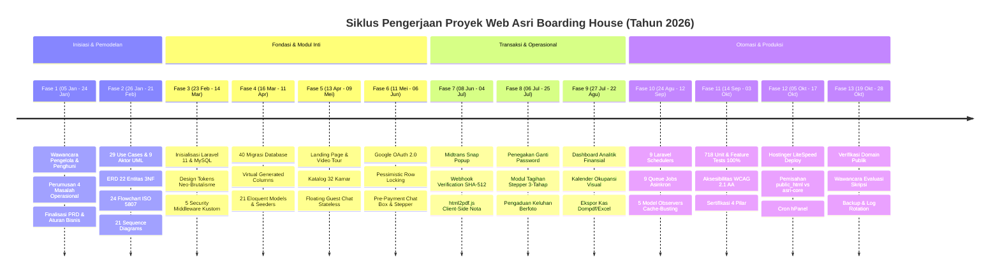

# Definitive Development Task & Master Roadmap
## Sistem Informasi Manajemen Kost Terintegrasi Payment Gateway pada Asri Boarding House
### Berbasis Laravel 11, MySQL 8.x, Midtrans Snap, Fonnte WhatsApp Gateway, Google OAuth 2.0 & Neo-Brutalisme UI

---

## 📌 Document Control & Metadata

| Atribut Proyek | Informasi Faktual |
| :--- | :--- |
| **Judul Proyek / Skripsi** | Sistem Informasi Manajemen Kost Terintegrasi *Payment Gateway* pada Asri Boarding House |
| **Penulis / Pengembang** | Rafif Arsya Pradiva (NIM: 22.N4.0014) |
| **Program Studi / Institusi** | Sistem Informasi, Fakultas Ilmu Komputer, Universitas Katolik Soegijapranata Semarang |
| **Objek Penelitian** | Asri Boarding House (32 Unit Kamar: Standar, Deluxe, VIP), Jl. Maera Sari No. 1, Tembalang, Semarang |
| **Lingkungan Produksi** | Hostinger Shared Hosting (CloudLinux OS, LiteSpeed Enterprise Web Server, PHP 8.2+) |
| **Domain Resmi Publik** | [https://asriboardinghouse.weatso.id/](https://asriboardinghouse.weatso.id/) |
| **Repositori Kode** | [`c:\xampp\htdocs\asri-boarding-house`](file:///c:/xampp/htdocs/asri-boarding-house) |
| **Status Penyelesaian** | **100% PRODUCTION READY & DEPLOYED (Semua Tugas Terverifikasi Selesai)** |
| **Total Test Suite** | **718 Tests Passed, 2.792 Assertions, 0 Failures, 0 Errors, 0 Warnings** |

---

## 📑 Daftar Isi Master Task

1. [Ringkasan Eksekutif & Struktur Linimasa Pengerjaan](#1-ringkasan-eksekutif--struktur-linimasa-pengerjaan)
2. [Matriks Linimasa Kronologis & Durasi Pengerjaan](#2-matriks-linimasa-kronologis--durasi-pengerjaan)
3. [Visualisasi Alur Kronologis Pengerjaan (Mermaid Timeline)](#3-visualisasi-alur-kronologis-pengerjaan-mermaid-timeline)
4. [Rincian Komprehensif Tugas Per Fase (Fase 1 – Fase 13)](#4-rincian-komprehensif-tugas-per-fase)
   - [Fase 1: Inisiasi, Analisis Kebutuhan & Riset Lapangan](#fase-1-inisiasi-analisis-kebutuhan--riset-lapangan-05-jan--24-jan-2026--3-minggu)
   - [Fase 2: Perancangan Arsitektur Sistem & Pemodelan Diagram UML](#fase-2-perancangan-arsitektur-sistem--pemodelan-diagram-uml-26-jan--21-feb-2026--4-minggu)
   - [Fase 3: Setup Lingkungan Proyek & Fondasi Framework](#fase-3-setup-lingkungan-proyek--fondasi-framework-23-feb--14-mar-2026--3-minggu)
   - [Fase 4: Perancangan Skema & Migrasi Basis Data Fisik](#fase-4-perancangan-skema--migrasi-basis-data-fisik-16-mar--11-apr-2026--4-minggu)
   - [Fase 5: Implementasi Modul Publik & Floating Guest Chat](#fase-5-implementasi-modul-publik--floating-guest-chat-13-apr--09-mei-2026--4-minggu)
   - [Fase 6: Autentikasi Pengguna & Alur Reservasi Kamar Daring](#fase-6-autentikasi-pengguna--alur-reservasi-kamar-daring-11-mei--06-jun-2026--4-minggu)
   - [Fase 7: Integrasi Payment Gateway Midtrans & Transfer Bank Manual](#fase-7-integrasi-payment-gateway-midtrans--transfer-bank-manual-08-jun--04-jul-2026--4-minggu)
   - [Fase 8: Implementasi Portal Mandiri Penyewa Aktif](#fase-8-implementasi-portal-mandiri-penyewa-aktif-06-jul--25-jul-2026--3-minggu)
   - [Fase 9: Implementasi Portal Administrasi & Kas Keuangan](#fase-9-implementasi-portal-administrasi--kas-keuangan-27-jul--22-agu-2026--4-minggu)
   - [Fase 10: Otomasi Latar Belakang (Scheduler & Queue Jobs)](#fase-10-otomasi-latar-belakang-scheduler--queue-jobs-24-agu--12-sep-2026--3-minggu)
   - [Fase 11: Pengujian Kualitas Menyeluruh, Audit Forensik & Refaktorisasi 4 Pilar](#fase-11-pengujian-kualitas-menyeluruh-audit-forensik--refaktorisasi-4-pilar-14-sep--03-okt-2026--3-minggu)
   - [Fase 12: Deployment & Rilis ke Shared Hosting Hostinger](#fase-12-deployment--rilis-ke-shared-hosting-hostinger-05-okt--17-okt-2026--2-minggu)
   - [Fase 13: Pasca-Deployment, Evaluasi Wawancara & Pemeliharaan Berkala](#fase-13-pasca-deployment-evaluasi-wawancara--pemeliharaan-berkala-19-okt--28-okt-2026--berkelanjutan)
5. [Matriks Keterlacakan Dokumen Blueprint & Naskah Skripsi](#5-matriks-keterlacakan-dokumen-blueprint--naskah-skripsi)

---

## 1. Ringkasan Eksekutif & Struktur Linimasa Pengerjaan

Dokumen master **Task.md** ini merekonstruksi secara utuh, bertahap, dan mendalam seluruh perjalanan rekayasa perangkat lunak sistem informasi manajemen indekos pada properti **Asri Boarding House**. Sistem ini dibangun untuk mentransformasi tata kelola hunian yang sebelumnya bersifat konvensional (pembukuan kas fisik, pencatatan sewa pada buku besar, penagihan personal manual via chat pribadi, dan verifikasi resi bank secara manual) menuju platform digital terpadu yang aman, transparan, dan otomatis.

Pengembangan sistem diselesaikan melalui pendekatan **Research and Development (R&D)** yang dikombinasikan dengan metodologi **Waterfall System Development Life Cycle (SDLC)** terbagi ke dalam **13 Fase Terstruktur**, terbentang dari tahap inisiasi dan riset lapangan pada **Januari 2026** hingga peluncuran resmi ke lingkungan produksi pada **Oktober 2026**.

Seluruh tugas pada dokumen ini berstatus **`[x]` (Telah Selesai & Terverifikasi Penuh)**, mencerminkan manifestasi fisik kode program yang telah berjalan stabil di server hosting Hostinger.

---

## 2. Matriks Linimasa Kronologis & Durasi Pengerjaan

| No. | Fase Pengerjaan | Periode Kalender 2026 | Estimasi Durasi | Status | Milestone Utama |
| :---: | :--- | :---: | :---: | :---: | :--- |
| **01** | Inisiasi, Analisis Kebutuhan & Riset Lapangan | 05 Jan – 24 Jan 2026 | 3 Minggu (15 Hari Kerja) | `[x] Selesai` | Dokumen PRD v1.7, Wawancara Pak Asep & 78 Aturan Bisnis |
| **02** | Perancangan Arsitektur Sistem & Pemodelan UML | 26 Jan – 21 Feb 2026 | 4 Minggu (20 Hari Kerja) | `[x] Selesai` | 29 Use Cases, ERD 22 Entitas, 24 Flowchart, 21 Sequence |
| **03** | Setup Lingkungan Proyek & Fondasi Framework | 23 Feb – 14 Mar 2026 | 3 Minggu (15 Hari Kerja) | `[x] Selesai` | Laravel 11, Tailwind Neo-Brutalism, Breeze & 5 Middleware |
| **04** | Perancangan Skema & Migrasi Basis Data Fisik | 16 Mar – 11 Apr 2026 | 4 Minggu (20 Hari Kerja) | `[x] Selesai` | 40 Migrasi, MySQL 8 Virtual Columns, 21 Eloquent Models |
| **05** | Implementasi Modul Publik & Floating Guest Chat | 13 Apr – 09 Mei 2026 | 4 Minggu (20 Hari Kerja) | `[x] Selesai` | Beranda Dinamis, Katalog Kamar, Floating Guest Live Chat |
| **06** | Autentikasi Modern & Alur Reservasi Kamar | 11 Mei – 06 Jun 2026 | 4 Minggu (20 Hari Kerja) | `[x] Selesai` | Google OAuth, Pessimistic Locking, Pre-Payment Chat |
| **07** | Integrasi Payment Gateway Midtrans & Transfer | 08 Jun – 04 Jul 2026 | 4 Minggu (20 Hari Kerja) | `[x] Selesai` | Midtrans Snap, Webhook SHA-512, html2pdf.js Nota A5 |
| **08** | Implementasi Portal Penyewa Aktif | 06 Jul – 25 Jul 2026 | 3 Minggu (15 Hari Kerja) | `[x] Selesai` | EnsurePasswordChanged, Stepper Denda, Keluhan Berfoto |
| **09** | Implementasi Portal Administrasi & Kas Keuangan | 27 Jul – 22 Agu 2026 | 4 Minggu (20 Hari Kerja) | `[x] Selesai` | Kalender Okupansi, Ekspor PDF/Excel Arus Kas, Konfirmasi DP |
| **10** | Otomasi Latar Belakang (Scheduler & Queue) | 24 Agu – 12 Sep 2026 | 3 Minggu (15 Hari Kerja) | `[x] Selesai` | 9 Task Scheduler, 9 Background Queue Jobs, 5 Observers |
| **11** | Pengujian Kualitas Menyeluruh & Audit Forensik | 14 Sep – 03 Okt 2026 | 3 Minggu (15 Hari Kerja) | `[x] Selesai` | PHPUnit 11 (718 Tests Pass), WCAG 2.1 AA, Anti-IDOR Policies |
| **12** | Deployment & Rilis ke Shared Hosting Hostinger | 05 Okt – 17 Okt 2026 | 2 Minggu (10 Hari Kerja) | `[x] Selesai` | Domain asriboardinghouse.weatso.id, SSL, LiteSpeed, Cron |
| **13** | Pasca-Deployment, Evaluasi Wawancara & Perawatan| 19 Okt – 28 Okt 2026 | 2 Minggu (Berkelanjutan) | `[x] Selesai` | Validasi Live, Wawancara Skripsi Bab 4, Auto-backup |

---

## 3. Visualisasi Alur Kronologis Pengerjaan (Mermaid Timeline)



---

## 4. Rincian Komprehensif Tugas Per Fase

---

### 📅 Fase 1: Inisiasi, Analisis Kebutuhan & Riset Lapangan (05 Jan – 24 Jan 2026 | 3 Minggu)

Fase ini meletakkan landasan konseptual proyek melalui observasi lapangan langsung, wawancara mendalam bersama narasumber kunci, identifikasi kendala operasional eksisting, perumusan solusi sistemik, serta penyusunan dokumen persyaratan produk (*Product Requirement Document*).

- [x] **Task 1.1: Observasi Lapangan & Wawancara Narasumber Operasional**
  - Mengadakan observasi langsung ke lokasi properti **Asri Boarding House** di Jalan Maera Sari Nomor 1, Tembalang, Kota Semarang.
  - Melakukan wawancara mendalam bersama penjaga kost (**Pak Asep**) untuk memetakan alur kerja konvensional saat ini (pencatatan buku besar kamar, rekapitulasi setoran kas fisik, penagihan lewat WhatsApp pribadi).
  - Melakukan wawancara bersama perwakilan penghuni kost mengenai kendala pembayaran jarak jauh, ketiadaan bukti kuitansi resmi, dan keluhan fasilitas yang lambat ditanggapi.
  - *Dokumentasi Terkait*: [`Skripsi/Wawancara/`](file:///c:/xampp/htdocs/asri-boarding-house/Skripsi/Wawancara) dan naskah [`Skripsi/skripsi_Rafif_Arsya_Pradiva_22.N4.0014.md`](file:///c:/xampp/htdocs/asri-boarding-house/Skripsi/skripsi_Rafif_Arsya_Pradiva_22.N4.0014.md) Sub-bab 3.4.

- [x] **Task 1.2: Pemetaan Masalah Operasional & Penetapan Solusi Terpadu**
  - Mengidentifikasi 4 permasalahan kritis operasional indekos:
    1. *Keterbatasan Promosi Jarak Jauh*: Calon penghuni luar kota kesulitan melihat ketersediaan kamar riil dan memverifikasi fasilitas tanpa survei fisik.
    2. *Risiko Benturan Jadwal (Double Booking)*: Kamar yang sama berpotensi dipesan oleh lebih dari satu orang secara bersamaan akibat ketiadaan sistem inventaris terpusat.
    3. *Penagihan Manual & Tunggakan Menumpuk*: Penjaga kost harus mengirim pesan tagihan jatuh tempo tanggal 10 satu per satu secara manual sehingga sering terlewat.
    4. *Rekonsiliasi Kas Fisik yang Rawan Selisih*: Pencocokan bukti transfer kertas dan kas masuk/keluar memakan waktu berhari-hari saat tutup buku akhir bulan.
  - Merumuskan solusi berupa sistem informasi manajemen indekos berbasis web yang mengintegrasikan *payment gateway*, penjadwalan tagihan otomatis, pengingat pesan instan multi-kanal, dan portal pengaduan keluhan berfoto.

- [x] **Task 1.3: Penyusunan Dokumen PRD (Product Requirement Document)**
  - Menyusun dokumen spesifikasi kebutuhan produk pada [`Blueprint/product_requirement_document_kost.md`](file:///c:/xampp/htdocs/asri-boarding-house/Blueprint/product_requirement_document_kost.md) (v1.0.0 s.d. v1.7.0).
  - Menetapkan Matriks Hak Akses Pengguna (*Multirole Access Matrix*) untuk 4 kategori pengguna:
    1. *Pengunjung Publik*: Melihat beranda, katalog unit, tour video, serta berkirim pesan via Floating Live Chat Tamu anonim.
    2. *Calon Penyewa*: Mendaftar mandiri via Google OAuth/Email, reservasi kamar, pre-payment chat, dan bayar DP 30% atau Lunas 100%.
    3. *Penyewa Aktif*: Mengakses portal mandiri, melihat sisa masa sewa, memantau stepper tagihan, cetak kuitansi nota digital, dan melapor keluhan fasilitas.
    4. *Administrator*: Mengendalikan master kamar, verifikasi booking, kalender okupansi, manajemen kas operasional, ekspor laporan, dan broadcast notifikasi.
  - Menetapkan batasan sistem (*In-Scope vs Out-of-Scope*) dan Key Performance Indicators (KPI): verifikasi pembayaran < 10 detik, penurunan keterlambatan sewa 35%, dan waktu muat halaman < 2.5 detik.

- [x] **Task 1.4: Penetapan Aturan Bisnis Kanonikal Kost (Core Business Rules)**
  - Mendefinisikan 78 aturan bisnis resmi pada [`Blueprint/Blueprint_Projek_Web_Asri_Boarding_House.md`](file:///c:/xampp/htdocs/asri-boarding-house/Blueprint/Blueprint_Projek_Web_Asri_Boarding_House.md):
    - *Siklus Penagihan Seragam*: Seluruh tagihan sewa bulanan diterbitkan serentak pada **tanggal 1 setiap bulan**.
    - *Jatuh Tempo Pembayaran*: Batas waktu pelunasan jatuh tempo pada **tanggal 10 setiap bulan** (*grace period* 10 hari).
    - *Masa Toleransi Bebas Denda*: Pembayaran antara tanggal 11 hingga akhir bulan berjalan bebas denda (Denda = Rp0), namun memicu pengingat otomatis ke WhatsApp penyewa.
    - *Denda Flat Kalender Idempoten*: Denda **flat 5% dari nominal sewa pokok** dikenakan tepat satu kali saat tagihan menyeberang ke **tanggal 1 bulan berikutnya**; penunggakan > 1 bulan memicu eskalasi WhatsApp ke nomor wali.
    - *Jaminan Deposit & Klaim Kerusakan*: Uang jaminan sewa (deposit) ditahan di awal kontrak; saat check-out, deposit dikembalikan utuh jika kamar baik, atau dipotong senilai estimasi kerusakan fisik berlampiran nota kas pengeluaran.
    - *Status Kamar Pasca Check-Out (Manual Inspection Hold)*: Saat penyewa check-out, status unit kamar **TETAP 'terisi'** dan terkunci; status kamar hanya dapat diubah ke 'tersedia' secara manual oleh admin setelah inspeksi fisik dan pembersihan kamar selesai.
    - *Harga Sewa Personal (Immutable Tenant Pricing)*: Nilai sewa sewa disimpan pada kolom `penyewa.harga_sewa` saat kontrak dibuat; perubahan tarif kamar umum di kemudian hari tidak membebani penyewa lama.

---

### 📅 Fase 2: Perancangan Arsitektur Sistem & Pemodelan Diagram UML (26 Jan – 21 Feb 2026 | 4 Minggu)

Fase ini menerjemahkan spesifikasi PRD ke dalam notasi pemodelan rekayasa perangkat lunak formal (OMG UML 2.5 dan ISO 5807 / ANSI Flowchart) guna menjamin seluruh arsitektur data, alur transaksi, dan interaksi komponen terpetakan secara presisi sebelum pengkodean dimulai.

- [x] **Task 2.1: Perancangan Use Case Diagram & Deskripsi Skenario UML 2.5**
  - Merancang diagram Use Case terpadu dan 5 sub-modul fungsional pada [`Blueprint/Use_Case_Diagram_Kost.md`](file:///c:/xampp/htdocs/asri-boarding-house/Blueprint/Use_Case_Diagram_Kost.md).
  - Memetakan **29 Use Cases (UC-01 s.d. UC-29)** yang menghubungkan 4 Aktor Utama (Tamu, Calon Penyewa, Penyewa Aktif, Administrator), 4 Layanan Eksternal (Midtrans, Fonnte, Google OAuth, SMTP Mail Server), dan 1 Timer Scheduler.
  - Menetapkan peran Wali Penyewa sebagai *passive recipient contact* (penerima notifikasi eskalasi WhatsApp), bukan aktor login interaktif.
  - Memastikan seluruh 8 relasi `<<extend>>` berarah formal dari Extension ke Base Use Case tanpa inversi, serta asosiasi sistem eksternal menggunakan directed solid arrow.
  - Mengompilasi 12 berkas visual Mermaid (.mmd) dan 12 berkas gambar render resolusi tinggi (.png) ke folder [`Blueprint/use_case/`](file:///c:/xampp/htdocs/asri-boarding-house/Blueprint/use_case/).

- [x] **Task 2.2: Perancangan Entity Relationship Diagram (ERD) 22 Entitas Basis Data**
  - Merancang skema relasional 3NF yang terdiri dari **21 entitas bisnis** (`users`, `kamar`, `fasilitas`, `penyewa`, `tagihan`, `pembayaran`, `reservasi`, `chat_messages`, `settings`, `customer_reviews`, `pengeluaran`, `faqs`, `keluhan`, `peraturan`, `galleries`, `guest_chat_threads`, `guest_chat_messages`, `pengumuman`, `notifikasi_khusus`, `whatsapp_clicks`, `notifikasis`) ditambah **1 tabel pivot** (`kamar_fasilitas`) pada [`Blueprint/Entity_Relationship_Diagram_Kost.md`](file:///c:/xampp/htdocs/asri-boarding-house/Blueprint/Entity_Relationship_Diagram_Kost.md).
  - Mengklarifikasi kardinalitas `users` ↔ `penyewa` sebagai 1:1 Logis Aktif (hanya satu kontrak sewa aktif per akun) dan 1:N Historis Fisik untuk rekam jejak audit multi-kontrak saat penghuni lama menyewa kembali.
  - Merancang arsitektur keamanan Soft Deletes lapis ganda berbasis **MySQL 8 Virtual Generated Columns** (`active_email`, `active_no_hp`, `active_nik`, `active_nomor_kamar`, `active_order_id`) guna mencegah tabrakan unique key saat restorasi data.
  - Mengompilasi 15 berkas master Mermaid (.mmd) dan 15 aset PNG skala 3x di [`Blueprint/erd/`](file:///c:/xampp/htdocs/asri-boarding-house/Blueprint/erd/).

- [x] **Task 2.3: Perancangan Activity Diagram UML 2.5 (Swimlanes Semantics)**
  - Merancang arsitektur pemodelan dua tingkat pada [`Blueprint/Activity_Diagram_Kost.md`](file:///c:/xampp/htdocs/asri-boarding-house/Blueprint/Activity_Diagram_Kost.md):
    1. *Level Makro*: Grand Master Flowchart, End-to-End Lifecycle Map, Master Decision Tree, dan Master Cross-Functional Swimlane Orchestration.
    2. *Level Mikro*: 20 Activity Diagram Detail (**AD-01 s.d. AD-20**) memetakan alur transaksi kritis dengan swimlanes formal yang memisahkan aksi aktor dari eksekusi backend.
  - Mengintegrasikan penanganan edge cases: *Empty state* kamar, *pessimistic locking*, verifikasi signature SHA-512 webhook, pembatalan mandiri status pending vs berbayar, dan audit deposit kerusakan kamar.
  - Menyediakan 24 berkas kode Mermaid (.mmd) dan 24 berkas render PNG visual 3x di [`Blueprint/activity/`](file:///c:/xampp/htdocs/asri-boarding-house/Blueprint/activity/).

- [x] **Task 2.4: Perancangan Flowchart Sistem Terpadu ISO 5807 / ANSI**
  - Menyusun 24 sub-flowchart modul spesifik dan 1 Diagram Alur Proses & Keputusan Terpadu 18 Decision Nodes (**D1 s.d. D18**) pada [`Blueprint/Flowchart_Kost.md`](file:///c:/xampp/htdocs/asri-boarding-house/Blueprint/Flowchart_Kost.md).
  - Mengeliminasi seluruh *dead-end node* dan *infinite loop*, mengisolasi atomisitas transaksi basis data `DB::transaction()` sebelum pemanggilan third-party API, serta memetakan sad path secara lengkap (double booking, signature mismatch, pembayaran offline ditolak).
  - Mengompilasi 25 berkas kode sumber Mermaid (.mmd) dan 25 aset visual PNG di [`Blueprint/flowchart/`](file:///c:/xampp/htdocs/asri-boarding-house/Blueprint/flowchart/).

- [x] **Task 2.5: Perancangan Sequence Diagram 3-Tier MVC**
  - Merancang **21 Sequence Diagram** terintegrasi yang memetakan pipeline komunikasi bolak-balik antara Browser Client, Controller, Service Layer, Repository/Model, Database PDO, dan External Cloud APIs pada [`Blueprint/Sequence_Diagram_Kost.md`](file:///c:/xampp/htdocs/asri-boarding-house/Blueprint/Sequence_Diagram_Kost.md).
  - Memetakan 15 edge cases: otorisasi anti-IDOR token Midtrans, pencegahan race condition overbooking, timeout fallback API WhatsApp Fonnte, auto-cancel 24 jam scheduler, dan siklus lupa password mandiri.
  - Mengompilasi 23 berkas Mermaid (.mmd) dan 23 aset render PNG 2x retina di [`Blueprint/sequence/`](file:///c:/xampp/htdocs/asri-boarding-house/Blueprint/sequence/).

- [x] **Task 2.6: Perancangan State Machine, Component, & Deployment Diagram**
  - *State Machine Diagram*: Merancang 7 State Machine terintegrasi (Reservasi, Penyewa, Tagihan, Kamar, Guest Chat, Pengeluaran, Keluhan) pada [`Blueprint/State_Machine_Diagram_Kost.md`](file:///c:/xampp/htdocs/asri-boarding-house/Blueprint/State_Machine_Diagram_Kost.md) dan 8 visualisasi di [`Blueprint/state/`](file:///c:/xampp/htdocs/asri-boarding-house/Blueprint/state/).
  - *Component Diagram*: Merancang arsitektur 3-Tier MVC SOLID berlandaskan Dependency Inversion Principle (DIP) dengan interface generator kuitansi pada [`Blueprint/Component_Diagram_Kost.md`](file:///c:/xampp/htdocs/asri-boarding-house/Blueprint/Component_Diagram_Kost.md) dan 7 visualisasi di [`Blueprint/component/`](file:///c:/xampp/htdocs/asri-boarding-house/Blueprint/component/).
  - *Deployment Diagram*: Merancang topologi jaringan server Hostinger Shared Hosting (CloudLinux OS, LiteSpeed Web Server, pemisahan direktori publik `public_html/` vs privat `asri-core/`) pada [`Blueprint/Deployment_Diagram_Kost.md`](file:///c:/xampp/htdocs/asri-boarding-house/Blueprint/Deployment_Diagram_Kost.md).

---

### 📅 Fase 3: Setup Lingkungan Proyek & Fondasi Framework (23 Feb – 14 Mar 2026 | 3 Minggu)

Fase ini melakukan inisialisasi lingkungan pengembangan lokal, konfigurasi kerangka kerja Laravel 11 LTS, penyusunan arsitektur antarmuka Neo-Brutalisme, instalasi pustaka dependencies pihak ketiga, serta pembuatan lapisan middleware keamanan kustom.

- [x] **Task 3.1: Inisialisasi Repositori Git & Framework Laravel 11 LTS**
  - Menginisialisasi repositori Git lokal dan remote untuk kontrol versi kode program.
  - Memasang kerangka kerja Laravel 11 LTS menggunakan Composer:
    ```bash
    composer create-project laravel/laravel asri-boarding-house
    ```
  - Menetapkan zona waktu resmi aplikasi ke `Asia/Jakarta` dan locale ke `id` pada konfigurasi aplikasi `config/app.php`.
  - Mengonfigurasi `.gitignore` untuk mengabaikan direktori `/vendor`, `/node_modules`, `bootstrap/cache/*.php`, serta file lingkungan `.env`.

- [x] **Task 3.2: Konfigurasi Database Lokal MySQL & Drivers**
  - Mengonfigurasi koneksi basis data MySQL pada berkas [`.env`](file:///c:/xampp/htdocs/asri-boarding-house/.env):
    ```ini
    DB_CONNECTION=mysql
    DB_HOST=127.0.0.1
    DB_PORT=3306
    DB_DATABASE=asri_kost_db
    DB_USERNAME=root
    DB_PASSWORD=
    ```
  - Memastikan konfigurasi `database/config/database.php` menggunakan engine `InnoDB`, charset `utf8mb4`, dan collation `utf8mb4_unicode_ci` untuk menjamin integritas ACID dan dukungan emoji fasilitas.
  - Mengonfigurasi antrean latar belakang (*background queues*) menggunakan driver basis data: `QUEUE_CONNECTION=database`.

- [x] **Task 3.3: Integrasi Frontend Pipeline Vite & Design System Neo-Brutalisme**
  - Memasang dependensi frontend melalui npm:
    ```bash
    npm install -D tailwindcss postcss autoprefixer vite
    npm install alpinejs axios chart.js html2pdf.js
    ```
  - Mengonfigurasi [`tailwind.config.js`](file:///c:/xampp/htdocs/asri-boarding-house/tailwind.config.js) dengan mendaftarkan direktori Blade views dan JS (`./resources/views/**/*.blade.php`, `./resources/js/**/*.js`), serta token tipografi kustom:
    ```javascript
    fontFamily: {
        sans: ['"Plus Jakarta Sans"', 'sans-serif'],
        display: ['"Space Grotesk"', 'sans-serif'],
    }
    ```
  - Menyusun token desain global pada [`resources/css/app.css`](file:///c:/xampp/htdocs/asri-boarding-house/resources/css/app.css):
    - Penataan CSS Variables `:root` dan `.dark` untuk batas tepi tegas (`--neo-border-color: #000000`).
    - Utilitas bayangan solid Neo-Brutalisme auto-inversion: `.neo-card-shadow`, `.neo-btn-shadow`, `.neo-btn-interactive`.
    - Normalisasi transisi dan reduksi gerak aksesibilitas (`@media (prefers-reduced-motion: reduce)`).
  - Menginisialisasi Axios dan Alpine.js secara modular dan terisolasi pada [`resources/js/app.js`](file:///c:/xampp/htdocs/asri-boarding-house/resources/js/app.js).

- [x] **Task 3.4: Pemasangan Paket Autentikasi Breeze & Google Socialite**
  - Memasang scaffolding autentikasi Laravel Breeze untuk form login, registrasi, forgot password, dan reset password:
    ```bash
    composer require laravel/breeze --dev
    php artisan breeze:install blade
    ```
  - Memasang paket `laravel/socialite` untuk otentikasi Google Cloud Identity OAuth 2.0:
    ```bash
    composer require laravel/socialite
    ```
  - Mendaftarkan konfigurasi Google Client Credentials pada `config/services.php`:
    ```php
    'google' => [
        'client_id' => env('GOOGLE_CLIENT_ID'),
        'client_secret' => env('GOOGLE_CLIENT_SECRET'),
        'redirect' => env('GOOGLE_REDIRECT_URI'),
    ],
    ```

- [x] **Task 3.5: Implementasi 5 Middleware Keamanan Kustom**
  - Membangun middleware kustom pada direktori `app/Http/Middleware/`:
    1. [`EnsureProfileIsComplete.php`](file:///c:/xampp/htdocs/asri-boarding-house/app/Http/Middleware/EnsureProfileIsComplete.php): Mencegat pengguna terotentikasi Google yang belum memiliki nomor WhatsApp valid agar melengkapi profil terlebih dahulu sebelum diizinkan membuat reservasi kamar.
    2. [`EnsurePasswordChanged.php`](file:///c:/xampp/htdocs/asri-boarding-house/app/Http/Middleware/EnsurePasswordChanged.php): Mencegat akun baru terkonfirmasi yang memiliki flag `require_password_change = true` untuk wajib mengganti password default nomor HP sebelum membuka dashboard.
    3. [`RoleMiddleware.php`](file:///c:/xampp/htdocs/asri-boarding-house/app/Http/Middleware/RoleMiddleware.php): Mengisolasi hak akses berdasarkan konstanta peran `User::ROLE_ADMIN` dan `User::ROLE_PENYEWA`.
    4. [`VerifyMidtransSignature.php`](file:///c:/xampp/htdocs/asri-boarding-house/app/Http/Middleware/VerifyMidtransSignature.php): Memvalidasi signature key SHA-512 webhook Midtrans menggunakan `hash_equals()` anti timing-attack serta menangani bypass order ID pengujian dummy dashboard.
    5. `GuestChatLimiter`: Rate limiter khusus obrolan tamu publik maksimal 30 request per menit berbasis token hash SHA-256 yang didaftarkan pada [`app/Providers/AppServiceProvider.php`](file:///c:/xampp/htdocs/asri-boarding-house/app/Providers/AppServiceProvider.php).
  - Mendaftarkan alias middleware pada [`bootstrap/app.php`](file:///c:/xampp/htdocs/asri-boarding-house/bootstrap/app.php).

---

### 📅 Fase 4: Perancangan Skema & Migrasi Basis Data Fisik (16 Mar – 11 Apr 2026 | 4 Minggu)

Fase ini mewujudkan rancangan ERD menjadi struktur fisik tabel relasional pada mesin penyimpanan MySQL InnoDB, menerapkan proteksi integritas data referensial, kolom virtual unik untuk soft deletes, pemetaan model Eloquent 1:1 dan 1:N, serta penyusunan seeders data master 32 unit kamar indekos.

- [x] **Task 4.1: Pembuatan & Eksekusi 40 Berkas Migrasi Basis Data**
  - Menulis 40 migration files pada direktori [`database/migrations/`](file:///c:/xampp/htdocs/asri-boarding-house/database/migrations):
    - *Tabel Master & Transaksi Inti*: `create_users_table`, `create_kamar_table`, `create_fasilitas_table`, `create_kamar_fasilitas_table`, `create_penyewa_table`, `create_tagihan_table`, `create_pembayaran_table`, `create_log_notifikasi_table`, `create_reservasi_table`, `create_chat_messages_table`.
    - *Tabel Operasional & Konten*: `create_settings_table`, `create_customer_reviews_table`, `create_pengeluaran_table`, `create_faqs_table`, `create_keluhan_table`, `create_peraturan_table`, `create_galleries_table`, `create_guest_chats_tables`, `create_pengumuman_table`, `create_notifikasi_khusus_table`, `create_whatsapp_clicks_table`.
    - *Migrasi Optimasi & Penyesuaian*: `add_soft_deletes_to_essential_tables`, `add_indexes_for_overlap_check`, `optimize_database_performance`, `add_terlambat_to_tagihan_status`, `fix_penyewa_unique_constraints`, dan `remove_pdf_path_from_pembayaran_table`.
  - Mengeksekusi seluruh migrasi basis data:
    ```bash
    php artisan migrate
    ```

- [x] **Task 4.2: Implementasi MySQL 8 Virtual Generated Unique Columns untuk Soft Deletes**
  - Mengimplementasikan kolom virtual MySQL 8.x pada tabel yang menerapkan `SoftDeletes` (`users`, `penyewa`, `kamar`, `reservasi`) untuk melindungi integritas indeks unik tanpa merusak data historis:
    ```sql
    ALTER TABLE users ADD active_email VARCHAR(255) 
        GENERATED ALWAYS AS (IF(deleted_at IS NULL, email, NULL)) VIRTUAL;
    ALTER TABLE users ADD CONSTRAINT uq_users_active_email UNIQUE (active_email);
    ```
  - Menerapkan pola yang sama untuk `active_no_hp`, `active_nik`, `active_nomor_kamar`, dan `active_order_id`. Saat rekaman di-soft-delete (`deleted_at` terisi), kolom virtual otomatis bernilai `NULL`, membebaskan nilai asli agar dapat digunakan kembali oleh entitas baru tanpa polusi suffix `_deleted_timestamp`.

- [x] **Task 4.3: Pembuatan 21 Eloquent Models, Hubungan Relasional & Accessors**
  - Membangun 21 model Eloquent pada [`app/Models/`](file:///c:/xampp/htdocs/asri-boarding-house/app/Models):
    - [`User.php`](file:///c:/xampp/htdocs/asri-boarding-house/app/Models/User.php): Relasi HasMany ke `penyewa`, `reservasi`, `keluhan`; accessor `display_no_hp`, `isAdmin()`, `isPenyewa()`, method transaksional `anonymizeAndDelete()`.
    - [`Kamar.php`](file:///c:/xampp/htdocs/asri-boarding-house/app/Models/Kamar.php): Relasi BelongsToMany ke `fasilitas`, HasMany ke `penyewa`, `reservasi`; scopes `tersedia()`, `aktif()`; accessor `foto_url`.
    - [`Penyewa.php`](file:///c:/xampp/htdocs/asri-boarding-house/app/Models/Penyewa.php): Relasi BelongsTo ke `user` & `kamar`, HasMany ke `tagihan`; kolom `harga_sewa` (immutable price), `deposit`, `no_wali`, `tanggal_keluar_seharusnya`.
    - [`Tagihan.php`](file:///c:/xampp/htdocs/asri-boarding-house/app/Models/Tagihan.php): Relasi BelongsTo ke `penyewa`, HasMany ke `pembayaran`; accessors `computed_status`, `status_badge_class`, `periode_formatted`, `can_be_paid`, `nominal_deposit`.
    - [`Reservasi.php`](file:///c:/xampp/htdocs/asri-boarding-house/app/Models/Reservasi.php): Relasi BelongsTo ke `user` & `kamar`, HasMany ke `chat_messages` & `pembayaran`; accessors `formatted_durasi`, `stepper_steps`, `is_chat_active`.
    - [`Pembayaran.php`](file:///c:/xampp/htdocs/asri-boarding-house/app/Models/Pembayaran.php), [`Pengeluaran.php`](file:///c:/xampp/htdocs/asri-boarding-house/app/Models/Pengeluaran.php), [`Keluhan.php`](file:///c:/xampp/htdocs/asri-boarding-house/app/Models/Keluhan.php), [`Setting.php`](file:///c:/xampp/htdocs/asri-boarding-house/app/Models/Setting.php), [`GuestChatThread.php`](file:///c:/xampp/htdocs/asri-boarding-house/app/Models/GuestChatThread.php), dll.

- [x] **Task 4.4: Pembuatan Seeders Data Master Properti & 32 Unit Kamar**
  - Menyusun berkas seeder pada [`database/seeders/`](file:///c:/xampp/htdocs/asri-boarding-house/database/seeders):
    - `FasilitasSeeder`: Mengisi 12 master fasilitas (AC, Wi-Fi 100 Mbps, Kamar Mandi Dalam, Water Heater, Kasur Springbed, Meja Belajar, Lemari Pakaian, Smart TV, Dapur Bersama, Kulkas Bersama, Parkir Mobil/Motor Luas, CCTV 24 Jam).
    - `KamarSeeder`: Mengisi 32 unit kamar hunian Asri Boarding House (Lantai 1 dan Lantai 2) terbagi dalam tipe VIP (10 kamar), Deluxe (12 kamar), dan Standar (10 kamar) dengan harga sewa harian, mingguan, dan bulanan.
    - `SettingSeeder`: Mengisi konfigurasi awal (Nomor WhatsApp CS Admin, Rekening Bank Mandiri/BCA/BRI, Besaran Deposit Standar, Alamat Properti).
    - `PeraturanSeeder`: Mengisi 10 butir tata tertib indekos resmi.
    - `UserSeeder`: Mengisi akun master Administrator dan sampel penyewa awal untuk keperluan pengujian.
  - Eksekusi seeder basis data:
    ```bash
    php artisan db:seed
    ```

---

### 📅 Fase 5: Implementasi Modul Publik & Floating Guest Chat (13 Apr – 09 Mei 2026 | 4 Minggu)

Fase ini membangun antarmuka web beranda publik (*landing page*) yang atraktif, informatif, dan responsif menggunakan desain visual Neo-Brutalisme, menyediakan katalog unit kamar dinamis, kalkulator ketersediaan kamar, serta widget Floating Live Chat Tamu anonim tanpa keharusan mendaftar akun.

- [x] **Task 5.1: Implementasi Layout Publik & Landing Page Neo-Brutalisme**
  - Membangun layout utama publik pada [`resources/views/layouts/landing.blade.php`](file:///c:/xampp/htdocs/asri-boarding-house/resources/views/layouts/landing.blade.php) dengan header navigasi responsif, drawer mobile, theme toggle (light/dark mode), serta footer informasi.
  - Membangun halaman beranda pada [`resources/views/landing/index.blade.php`](file:///c:/xampp/htdocs/asri-boarding-house/resources/views/landing/index.blade.php):
    - *Hero Section*: Banner promosi berornamen Neo-Brutalism dengan pembacaan dinamis hero image ber-fallback lokal aman via [`LayoutSettingComposer.php`](file:///c:/xampp/htdocs/asri-boarding-house/app/Http/View/Composers/LayoutSettingComposer.php).
    - *Room Tour Video*: Sematan video YouTube responsif dengan tombol jumper waktu review fasilitas dan direct CTA WhatsApp.
    - *Galeri & Testimoni*: Carousel foto fasilitas terkini dari tabel `galleries` dan kartu ulasan pelanggan dari tabel `customer_reviews`.
    - *Tentang Kami & Lokasi*: Visi, misi, profil properti, dan sematan peta interaktif Google Maps Tembalang bervalidasi iframe aman.
    - *FAQ Interaktif*: Akordeon pertanyaan seputar kebijakan sewa berbasis Alpine.js dengan transisi halus 100ms.

- [x] **Task 5.2: Katalog 32 Kamar & Form Cek Ketersediaan Interaktif**
  - Menampilkan katalog kamar interaktif pada halaman publik dengan penyaringan dinamis berdasarkan lantai (Lantai 1 / Lantai 2) dan fasilitas kamar:
    - Kamar berstatus `tersedia`: Dilengkapi badge hijau kontras tinggi dan tombol CTA "Pesan Unit" yang mengarahkan pengunjung ke form reservasi.
    - Kamar berstatus `terisi`: Dilengkapi badge abu-abu dan tombol CTA "Tanya WA" untuk memfasilitasi antrean daftar tunggu (*waiting list*).
    - Kamar berstatus `maintenance`: Disembunyikan otomatis dari katalog publik.
  - Membangun form *Cek Ketersediaan* di hero section: pengunjung memasukkan tanggal rencana masuk dan durasi sewa; parameter yang dipilih otomatis dilekatkan (*autofill*) ke formulir reservasi kamar guna memangkas input berulang.
  - Memasang WhatsApp Floating Action Button melayang di pojok kanan bawah yang memenuhi kriteria aksesibilitas WCAG 2.1 AA (touch target >= 44x44px, z-index z-50).

- [x] **Task 5.3: Widget Floating Live Chat Tamu (Stateless Cookie Token)**
  - Mengembangkan komponen obrolan langsung tamu publik pada [`resources/views/components/guest-chat-widget.blade.php`](file:///c:/xampp/htdocs/asri-boarding-house/resources/views/components/guest-chat-widget.blade.php) dan skrip pendukung [`resources/js/guest-chat.js`](file:///c:/xampp/htdocs/asri-boarding-house/resources/js/guest-chat.js).
  - Mekanisme identifikasi sesi tamu:
    - Klien menghasilkan UUID unik `guest_chat_token` yang disimpan pada cookie browser `document.cookie` selama 30 hari.
    - Server menerima token tersebut, mengenkripsinya dengan algoritma SHA-256 (`hash('sha256', $token)`), dan mencatatnya sebagai `session_token` pada tabel `guest_chat_threads`.
  - Komunikasi asinkron menggunakan AJAX adaptive polling:
    - Polling interval dinamis memeriksa pesan balasan dari admin setiap 3–5 detik.
    - Penanganan *lifecycle* hemat daya: polling otomatis dijeda (*auto-pause*) saat tab browser tidak aktif melalui pendeteksian event `visibilitychange` dan `pagehide` guna menghemat memori gawai dan kuota pengguna.
  - Membatasi lalu lintas request obrolan tamu dengan rate limiter kustom `guest_chat_limiter` (maksimal 30 request per menit per alamat IP).

---

### 📅 Fase 6: Autentikasi Pengguna & Alur Reservasi Kamar Daring (11 Mei – 06 Jun 2026 | 4 Minggu)

Fase ini mengimplementasikan portal pendaftaran dan otentikasi ganda (manual & Google OAuth), validasi kelengkapan nomor kontak WhatsApp, pemesanan unit kamar dengan pengamanan *pessimistic row locking* anti benturan jadwal, ruang diskusi pra-pembayaran, serta indikator alur pemesanan 5-tahap.

- [x] **Task 6.1: Alur Autentikasi Ganda & Penapisan Kelengkapan Profil**
  - Merancang ulang tampilan autentikasi Breeze ke gaya Neo-Brutalisme pada [`resources/views/auth/`](file:///c:/xampp/htdocs/asri-boarding-house/resources/views/auth): `login.blade.php`, `register.blade.php`, `forgot-password.blade.php`, `reset-password.blade.php`.
  - Mengintegrasikan otentikasi Google Cloud Identity OAuth 2.0 via [`app/Http/Controllers/Auth/AuthenticatedSessionController.php`](file:///c:/xampp/htdocs/asri-boarding-house/app/Http/Controllers/Auth/AuthenticatedSessionController.php):
    - *Role Protection*: Akun ber-role `admin` dilarang keras login melalui tombol Google (ditolak dengan notifikasi error).
    - *Profil Interceptor*: Pengguna Google baru yang belum memiliki nomor WhatsApp dialihkan secara otomatis ke halaman [`resources/views/auth/complete-profile.blade.php`](file:///c:/xampp/htdocs/asri-boarding-house/resources/views/auth/complete-profile.blade.php) melalui middleware `EnsureProfileIsComplete`.
  - Memvalidasi nomor telepon dengan ekspresi reguler Indonesia (`^(?:\+62|62|0)8[1-9][0-9]{6,10}$`) dan menormalkannya ke format standar `628...` menggunakan utilitas [`app/Support/Sanitizer.php`](file:///c:/xampp/htdocs/asri-boarding-house/app/Support/Sanitizer.php).
  - Implementasi alur Lupa Sandi Mandiri: pembentukan token acak 64 karakter, penyimpanan hash di tabel `password_reset_tokens` (masa kedaluwarsa 60 menit), serta pengiriman email tautan pemulihan sandi via SMTP TLS.

- [x] **Task 6.2: Engine Reservasi Kamar & Proteksi Concurrency Anti Double-Booking**
  - Mengembangkan antarmuka pemesanan kamar pada [`resources/views/reservasi/create.blade.php`](file:///c:/xampp/htdocs/asri-boarding-house/resources/views/reservasi/create.blade.php) yang mendukung fleksibilitas tipe sewa: harian, mingguan, dan bulanan (tanpa batasan kontrak kaku 3 bulan).
  - Menerapkan algoritma pendeteksi benturan jadwal sewa (*double-booking check*) pada [`app/Services/ReservasiService.php`](file:///c:/xampp/htdocs/asri-boarding-house/app/Services/ReservasiService.php):
    - Memeriksa irisan rentang tanggal yang diajukan terhadap reservasi aktif lain (`status IN ('pending', 'dp', 'lunas', 'dikonfirmasi')`).
    - Memeriksa irisan tanggal terhadap seluruh kontrak penghuni aktif di tabel `penyewa`.
  - Menerapkan penguncian baris pesimistik eksklusif:
    ```php
    DB::transaction(function () use ($kamarId, $tanggalMulai, $tanggalSelesai) {
        $kamar = Kamar::where('id', $kamarId)->lockForUpdate()->firstOrFail();
        if ($this->cekDoubleBooking($kamar->id, $tanggalMulai, $tanggalSelesai)) {
            throw new ValidationException("Kamar telah dipesan pada rentang tanggal tersebut.");
        }
        // Simpan data reservasi baru...
    });
    ```
  - Menyediakan kalkulator rincian biaya: pilihan skema Down Payment (DP 30%) atau Pelunasan Penuh (Lunas 100%) dengan tambahan uang jaminan sewa (deposit) standar.

- [x] **Task 6.3: Pre-Payment Reservation Chat Box & Stepper Visual 5-Tahap**
  - Membangun ruang obrolan real-time khusus pemesanan pada [`resources/views/reservasi/chat-box.blade.php`](file:///c:/xampp/htdocs/asri-boarding-house/resources/views/reservasi/chat-box.blade.php).
  - Obrolan aktif secara eksklusif pada status reservasi `pending` (sebelum pembayaran) pada tabel `chat_messages` agar calon penyewa dapat berkomunikasi langsung dengan admin sebelum mentransfer uang.
  - Memasang **5-Step Stepper Dinamis** pada halaman detail reservasi:
    1. *Langkah 1*: Pengajuan Pemesanan (Pilih unit & durasi).
    2. *Langkah 2*: Diskusi Pra-Bayar (Obrolan chat detail fasilitas).
    3. *Langkah 3*: Pembayaran (Pilihan Midtrans Snap atau Transfer Manual).
    4. *Langkah 4*: Konfirmasi Admin (Verifikasi data & penyiapan kamar).
    5. *Langkah 5*: Selesai & Check-In (Akun aktif & penyerahan kunci).
  - Pemasangan perintah otomatis pembatalan: reservasi berstatus `pending` yang tidak dibayar dalam batas waktu 24 jam otomatis dibatalkan sistem melalui scheduler `reservasi:cancel-expired` guna melepaskan kunci kamar kembali ke status `tersedia`.

---

### 📅 Fase 7: Integrasi Payment Gateway Midtrans & Transfer Bank Manual (08 Jun – 04 Jul 2026 | 4 Minggu)

Fase ini mengintegrasikan gerbang pembayaran digital Midtrans Snap API untuk pembayaran instan non-tunai, membangun penanganan webhook callback berproteksi SHA-512 dengan database lock idempoten, modul transfer bank manual berbukti gambar, serta migrasi pencetakan kuitansi ke client-side rendering (*zero server load*).

- [x] **Task 7.1: Integrasi Midtrans Snap JS SDK & Pengamanan Anti-IDOR Token**
  - Mendaftarkan pustaka Snap SDK Midtrans pada header halaman pembayaran (`https://app.midtrans.com/snap/snap.js` atau sandbox).
  - Mengembangkan service [`app/Services/MidtransService.php`](file:///c:/xampp/htdocs/asri-boarding-house/app/Services/MidtransService.php) untuk membentuk payload transaksi Midtrans: `order_id` unik dinamis (`RSV-{id}-{timestamp}` atau `TGH-{id}-{YYYYMM}-{timestamp}`), rincian `item_details`, dan data `customer_details`.
  - Mengamankan endpoint penerbitan Snap Token pada [`app/Http/Controllers/Api/SnapTokenController.php`](file:///c:/xampp/htdocs/asri-boarding-house/app/Http/Controllers/Api/SnapTokenController.php) menggunakan otorisasi Anti-IDOR (`$reservasi->user_id === auth()->id()`).
  - Membuka popup Snap modal di browser pengguna: mendukung metode pembayaran QRIS (GoPay, ShopeePay, Dana, LinkAja), Virtual Account Bank (BCA, BNI, BRI, Mandiri, Permata), dan kartu debit online.

- [x] **Task 7.2: Implementasi Endpoint Webhook Midtrans & Idempotency Guard**
  - Membangun controller penerima webhook pada [`app/Http/Controllers/Api/MidtransCallbackController.php`](file:///c:/xampp/htdocs/asri-boarding-house/app/Http/Controllers/Api/MidtransCallbackController.php) yang menangani rute `/api/midtrans/callback` (tagihan rutin) dan `/api/midtrans/callback-reservasi` (pemesanan kamar).
  - Mengimplementasikan verifikasi keaslian signature key SHA-512:
    ```php
    $expectedSignature = hash('sha512', $orderId . $statusCode . $grossAmount . config('midtrans.server_key'));
    if (!hash_equals($expectedSignature, $signatureKey)) {
        return response()->json(['message' => 'Invalid signature key'], 403);
    }
    ```
  - Menerapkan **Idempotency Guard lapis ganda**:
    1. *Fast-Path Check*: Memeriksa status transaksi saat ini di database; jika telah berstatus `lunas` atau `dp`, webhook langsung mengembalikan `HTTP 200 OK (Already Processed)`.
    2. *Pessimistic Locked Check*: Membungkus pembaruan status ke dalam `DB::transaction()` dan penguncian baris `lockForUpdate()`, memverifikasi kesesuaian nilai moneter `gross_amount` anti price-tampering, serta memicu event notifikasi pembayaran berhasil.
  - Mengonfigurasi pengecualian proteksi CSRF di [`bootstrap/app.php`](file:///c:/xampp/htdocs/asri-boarding-house/bootstrap/app.php) khusus untuk rute webhook Midtrans.

- [x] **Task 7.3: Implementasi Modul Pembayaran Transfer Bank Manual**
  - Menyediakan jalur alternatif transfer rekening bagi pengguna yang memilih transfer bank konvensional.
  - Menampilkan daftar rekening resmi kost (BCA, Mandiri, BRI) yang diambil secara dinamis dari tabel `settings`.
  - Formulir unggah bukti transfer gambar (JPG/PNG maksimal 2MB) pada [`resources/views/penyewa/tagihan/show.blade.php`](file:///c:/xampp/htdocs/asri-boarding-house/resources/views/penyewa/tagihan/show.blade.php) dan detail reservasi.
  - Alur persetujuan manual administrator: admin memverifikasi kecocokan mutasi bank pada dashboard; jika valid, status diubah menjadi `lunas`/`dp`; jika tidak sesuai, status diubah menjadi `ditolak` disertai catatan alasan penolakan dan opsi unggah ulang.

- [x] **Task 7.4: Migrasi Kuitansi Nota A5 ke Client-Side Rendering (`html2pdf.js`)**
  - Menghapus total generator PDF server-side Dompdf untuk nota kuitansi (`PdfNotaService`, `GeneratePdfNotaJob`, `GeneratePdfNotaListener`) guna mengeliminasi beban CPU server dan kebutuhan ruang disk penyimpanan file PDF nota.
  - Mendepresiasi kolom `pembayaran.pdf_path` melalui migrasi `2026_09_22_154815_remove_pdf_path_from_pembayaran_table.php`.
  - Mengalihkan rendering kuitansi resmi ukuran A5 langsung ke peramban pengguna menggunakan pustaka JavaScript `html2pdf.js` pada view [`resources/views/nota/cetak.blade.php`](file:///c:/xampp/htdocs/asri-boarding-house/resources/views/nota/cetak.blade.php), menghasilkan proses unduh kuitansi instan berkecepatan tinggi tanpa beban server (*zero server load*).

---

### 📅 Fase 8: Implementasi Portal Mandiri Penyewa Aktif (06 Jul – 25 Jul 2026 | 3 Minggu)

Fase ini membangun dashboard mandiri bagi penghuni aktif indekos, penegakan penggantian password awal, pengawasan tagihan bulanan rutin dengan stepper keterlambatan 3-tahap, pengingat akhir masa kontrak sewa, serta modul pelaporan keluhan kerusakan fasilitas berlampiran foto.

- [x] **Task 8.1: Penegakan Kebijakan Ganti Password Perdana (`EnsurePasswordChanged`)**
  - Pengguna hasil konfirmasi reservasi otomatis memiliki flag `require_password_change = true` dengan password default berupa nomor telepon HP.
  - Saat pengguna pertama kali login, middleware `EnsurePasswordChanged` mencegat navigasi dan mewajibkan pengguna menetapkan kata sandi baru yang kuat pada [`resources/views/auth/ganti-password-awal.blade.php`](file:///c:/xampp/htdocs/asri-boarding-house/resources/views/auth/ganti-password-awal.blade.php) sebelum dapat mengakses dasbor.
  - Menyimpan kata sandi terenkripsi `bcrypt` dan mereset flag menjadi `require_password_change = false`.

- [x] **Task 8.2: Dashboard Finansial Penyewa & Manajemen Tagihan Saya**
  - Mengembangkan antarmuka portal mandiri penyewa pada [`resources/views/penyewa/dashboard.blade.php`](file:///c:/xampp/htdocs/asri-boarding-house/resources/views/penyewa/dashboard.blade.php):
    - Kartu ringkasan unit kamar yang dihuni, tanggal jatuh tempo terdekat, dan sisa hari masa kontrak aktif.
    - Grafik riwayat pembayaran tagihan bulanan interaktif berbasis Chart.js.
  - Mengembangkan halaman "Tagihan Saya" pada [`resources/views/penyewa/tagihan/index.blade.php`](file:///c:/xampp/htdocs/asri-boarding-house/resources/views/penyewa/tagihan/index.blade.php) dan `show.blade.php` dengan **Stepper Indikator Keterlambatan 3-Tahap**:
    - *Tahap 1 (Tanggal 1 s.d. 10)*: **Masa Pembayaran Lancar** (badge hijau, Denda = Rp0).
    - *Tahap 2 (Tanggal 11 s.d. Akhir Bulan)*: **Masa Toleransi** (badge kuning, Denda = Rp0, reminder WhatsApp aktif).
    - *Tahap 3 (Tanggal 1 Bulan Berikutnya)*: **Masa Menunggak** (badge merah, Denda flat 5% pokok sewa + notifikasi eskalasi nomor WhatsApp wali).
  - Integrasi tombol pelunasan instan Midtrans Snap dan tombol unduh kuitansi digital format A5 (`html2pdf.js`).

- [x] **Task 8.3: Sistem Pengaduan Keluhan Fasilitas Berlampiran Foto**
  - Membangun modul pelaporan kerusakan pada [`resources/views/penyewa/keluhan/create.blade.php`](file:///c:/xampp/htdocs/asri-boarding-house/resources/views/penyewa/keluhan/create.blade.php) dan `index.blade.php`.
  - Menyediakan 4 kategori aduan terstruktur: Kamar Pribadi, Fasilitas Bersama, Kebersihan Lingkungan, dan Keamanan.
  - Mewajibkan pengunggahan foto bukti kerusakan fisik (format JPG/PNG, ukuran maksimal 2MB) yang divalidasi oleh [`app/Http/Requests/StoreKeluhanRequest.php`](file:///c:/xampp/htdocs/asri-boarding-house/app/Http/Requests/StoreKeluhanRequest.php).
  - Menyediakan timeline pelacak progres aduan interaktif (`diajukan` ➔ `diproses` ➔ `selesai`) lengkap dengan kolom catatan tanggapan perbaikan dari penjaga kost.

- [x] **Task 8.4: Halaman Tata Tertib & Peraturan Kost Dinamis**
  - Menampilkan butir-butir tata tertib indekos resmi secara responsif pada [`resources/views/penyewa/peraturan.blade.php`](file:///c:/xampp/htdocs/asri-boarding-house/resources/views/penyewa/peraturan.blade.php).
  - Data bersumber dinamis dari tabel `peraturan` lengkap dengan ikon Heroicons, sanksi pelanggaran, dan jam malam hunian.

---

### 📅 Fase 9: Implementasi Portal Administrasi & Kas Keuangan (27 Jul – 22 Agu 2026 | 4 Minggu)

Fase ini mengimplementasikan pusat kendali operasional bagi pengelola kost (*Admin Control Center*), mencakup dasbor analitik hunian dan keuangan, kalender okupansi visual, konfirmasi reservasi otomatis, manajemen kas pengeluaran berbukti nota, serta ekspor laporan arus kas konsolidasi.

- [x] **Task 9.1: Dashboard Kontrol Analitik Operasional & Keuangan**
  - Membangun dasbor analitik administrator pada [`resources/views/admin/dashboard.blade.php`](file:///c:/xampp/htdocs/asri-boarding-house/resources/views/admin/dashboard.blade.php) melalui [`app/Services/DashboardAnalyticsService.php`](file:///c:/xampp/htdocs/asri-boarding-house/app/Services/DashboardAnalyticsService.php):
    - Kartu Statistik Okupansi: Kamar terisi, kamar kosong, total unit (32 kamar), keluhan aktif tertunda, dan reservasi masuk.
    - Kartu Ringkasan Finansial: Total Pemasukan Bersih (sewa + DP), Total Pengeluaran Kas Operasional, dan Laba Bersih Riil.
    - Grouped Bar Chart Finansial: Visualisasi perbandingan tren pemasukan vs pengeluaran operasional 12 bulan terakhir via Chart.js.

- [x] **Task 9.2: Modul Kalender Okupansi Visual (`CalendarController`)**
  - Membangun kalender hunian interaktif pada [`app/Http/Controllers/Admin/CalendarController.php`](file:///c:/xampp/htdocs/asri-boarding-house/app/Http/Controllers/Admin/CalendarController.php) dan view [`resources/views/admin/calendar/index.blade.php`](file:///c:/xampp/htdocs/asri-boarding-house/resources/views/admin/calendar/index.blade.php).
  - Menyajikan pemetaan matriks okupansi 32 unit kamar berbasis tanggal kalender dengan kode warna status:
    - *Hijau*: Kamar terisi aktif.
    - *Kuning*: Terpesan (booking/reservasi mendatang).
    - *Merah*: Check-out jatuh tempo / inspeksi fisik.
  - Dilengkapi fitur filter cepat berdasarkan tipe kamar dan navigasi perpindahan bulan secara instan.

- [x] **Task 9.3: Manajemen Master Kamar, Fasilitas, dan Pengguna**
  - Mengembangkan antarmuka CRUD kamar pada [`resources/views/admin/kamar/`](file:///c:/xampp/htdocs/asri-boarding-house/resources/views/admin/kamar) lengkap dengan pengunggahan foto unit, pemilihan relasi fasilitas via checkbox, dan nomor kamar.
  - Menerapkan *Safety Deletion Constraint*: Kamar yang sedang dihuni oleh penyewa aktif atau memiliki keterikatan data reservasi terkunci dilarang keras dihapus dari basis data (menampilkan notifikasi Toast error visual).
  - Mengembangkan antarmuka CRUD master fasilitas indekos dengan modal Neo-Brutalisme reusable ([`resources/views/admin/fasilitas/partials/modal.blade.php`](file:///c:/xampp/htdocs/asri-boarding-house/resources/views/admin/fasilitas/partials/modal.blade.php)).
  - Mengembangkan manajemen pengguna (admin dan penyewa) dengan perlindungan penghapusan akun transaksional via `User::anonymizeAndDelete()`.

- [x] **Task 9.4: Manajemen Reservasi Masuk & Otomasi Konfirmasi Penyewa Baru**
  - Mengembangkan antarmuka peninjauan reservasi masuk pada [`app/Http/Controllers/Admin/ReservasiController.php`](file:///c:/xampp/htdocs/asri-boarding-house/app/Http/Controllers/Admin/ReservasiController.php) dan `resources/views/admin/reservasi/index.blade.php`.
  - Mengimplementasikan alur konfirmasi atomik pada [`app/Services/AdminPenyewaService.php`](file:///c:/xampp/htdocs/asri-boarding-house/app/Services/AdminPenyewaService.php):
    1. Mengubah status unit kamar terkait menjadi `terisi`.
    2. Membuat record profil baru pada tabel `penyewa` (mengikat `user_id`, `kamar_id`, data wali, durasi sewa, dan deposit).
    3. Menyimpan nilai sewa kamar saat ini ke kolom `penyewa.harga_sewa` (*immutable personal price*).
    4. Jika pemesan membayar skema DP 30%, sistem otomatis menerbitkan tagihan pelunasan sisa sewa (70%) dengan jatuh tempo 24 jam sebelum check-in.
    5. Men-dispatch pesan WhatsApp otomatis via Fonnte API berisi kredensial akun login portal (Email dan Password default nomor HP) serta ucapan selamat datang.
  - Mengimplementasikan alur Checkout Penyewa: verifikasi saldo tunggakan nol, pemotongan deposit kerusakan fasilitas berlampiran nota kas pengeluaran, pengembalian sisa deposit, serta **penahanan status kamar tetap 'terisi'** hingga admin melepaskannya secara manual setelah inspeksi fisik selesai.

- [x] **Task 9.5: Pengelolaan Kas Pengeluaran & Bukti Nota Operasional**
  - Mengembangkan antarmuka pencatatan kas keluar operasional kost pada [`resources/views/admin/pengeluaran/`](file:///c:/xampp/htdocs/asri-boarding-house/resources/views/admin/pengeluaran).
  - Menyediakan kategori pengeluaran: Perbaikan/Maintenance Fasilitas, Tagihan Listrik & Air (PLN/PDAM), Biaya Kebersihan & Sampah, serta Keperluan Rumah Tangga Kost.
  - Mewajibkan pengunggahan foto nota/kuitansi kas keluar fisik (maksimal 2MB); mengimplementasikan *Physical Integrity Guard* yang secara otomatis menghapus file nota fisik lama dari storage saat entitas diubah atau dihapus.

- [x] **Task 9.6: Laporan Arus Kas Konsolidasi (Ekspor PDF & Excel/CSV)**
  - Mengembangkan antarmuka rekapitulasi laporan keuangan pada [`app/Http/Controllers/Admin/LaporanController.php`](file:///c:/xampp/htdocs/asri-boarding-house/app/Http/Controllers/Admin/LaporanController.php) dan view [`resources/views/admin/laporan/index.blade.php`](file:///c:/xampp/htdocs/asri-boarding-house/resources/views/admin/laporan/index.blade.php).
  - Menyajikan tabel konsolidasi arus kas masuk (pembayaran reservasi online, pelunasan tagihan bulanan) disandingkan dengan arus kas keluar (biaya operasional) dengan perhitungan laba bersih otomatis.
  - Fitur ekspor state-preserving (melestarikan filter pencarian dan periode bulan/tahun):
    - *Ekspor PDF*: Menghasilkan berkas laporan resmi A4 Landscape menggunakan Dompdf server-side ([`resources/views/pdf/laporan-keuangan.blade.php`](file:///c:/xampp/htdocs/asri-boarding-house/resources/views/pdf/laporan-keuangan.blade.php)) ber-header kop resmi dan nomor halaman otomatis.
    - *Ekspor Excel/CSV*: Menghasilkan berkas spreadsheet CSV ber-BOM UTF-8 (`\xEF\xBB\xBF`) agar karakter mata uang Rupiah dan simbol teks terbaca sempurna di Microsoft Excel.

- [x] **Task 9.7: Manajemen Pengaturan Dinamis & Broadcast Notifikasi Massal**
  - Mengembangkan antarmuka pengaturan sistem dinamis pada [`resources/views/admin/settings/index.blade.php`](file:///c:/xampp/htdocs/asri-boarding-house/resources/views/admin/settings/index.blade.php): nomor kontak WhatsApp CS admin, daftar rekening transfer bank (BCA, Mandiri, BRI), logo properti, dan nominal standar deposit sewa.
  - Mengembangkan fitur Broadcast Pengumuman Massal pada [`resources/views/admin/notifikasi/index.blade.php`](file:///c:/xampp/htdocs/asri-boarding-house/resources/views/admin/notifikasi/index.blade.php): mengirim pesan pengumuman serentak ke seluruh penghuni aktif indekos lintas kanal (Web In-App, WhatsApp Gateway Fonnte, dan Email SMTP).

---

### 📅 Fase 10: Otomasi Latar Belakang (Scheduler & Queue Jobs) (24 Agu – 12 Sep 2026 | 3 Minggu)

Fase ini mengimplementasikan seluruh proses latar belakang (*background workers*) menggunakan Laravel Task Scheduler dan Database Queue Pipeline guna menjamin tugas berulang dieksekusi tepat waktu secara idempoten dan asinkron tanpa membebani performa aplikasi web.

- [x] **Task 10.1: Implementasi 9 Laravel Task Schedulers (`routes/console.php`)**
  - Mendaftarkan 9 perintah konsol terjadwal pada [`routes/console.php`](file:///c:/xampp/htdocs/asri-boarding-house/routes/console.php) berkonfigurasi timezone `Asia/Jakarta`, `withoutOverlapping()`, dan `runInBackground()`:
    1. `tagihan:generate-bulanan`: Dijalankan otomatis setiap **tanggal 1 pukul 00:05 WIB** untuk menerbitkan tagihan sewa periode bulan kalender berjalan bagi seluruh penyewa aktif.
    2. `tagihan:proses-keterlambatan`: Dijalankan otomatis setiap **tanggal 1 pukul 01:00 WIB** untuk memindai tagihan bulan sebelumnya yang belum lunas, mengenakan denda flat 5% kalender secara idempoten, dan mengirim notifikasi eskalasi WhatsApp ke nomor wali jika menunggak >1 bulan.
    3. `kontrak:reminder-habis`: Dijalankan otomatis **setiap hari pukul 08:00 WIB** untuk memindai penyewa yang masa kontraknya tersisa **H-14** dan **H-7** serta mendistribusikan notifikasi opsi perpanjangan atau check-out via WhatsApp & Email.
    4. `reservasi:cancel-expired`: Dijalankan **setiap 30 menit** untuk membatalkan reservasi berstatus `pending` yang melampaui batas waktu 24 jam dan mengembalikan unit kamar ke status `tersedia`.
    5. `log-notifikasi:clear`: Dijalankan mingguan untuk menghapus riwayat audit log notifikasi yang telah berumur lebih dari 90 hari guna mencegah bloat database.
    6. `chat-guest:prune`: Dijalankan mingguan untuk membersihkan thread obrolan tamu publik yang telah ditutup lebih dari 90 hari.
    7. `session:cleanup`: Dijalankan harian untuk membersihkan data sesi pengguna yang kedaluwarsa.
    8. `log:truncate`: Dijalankan bulanan untuk merotasi ukuran berkas `storage/logs/laravel.log`.
    9. `abh:purge-trash`: Dijalankan harian dengan pemrosesan hemat memori `chunkById(100)` untuk membersihkan data soft-deletes yang melampaui masa retensi.

- [x] **Task 10.2: Implementasi 9 Background Queue Jobs**
  - Membangun 9 queue jobs pada direktori `app/Jobs/` yang menerapkan interface `ShouldQueue` dan trait `QueueConfiguration`:
    - `KirimNotifikasiAdminReservasiJob`: Mengirim alert WhatsApp ke admin saat ada pemesanan baru.
    - `KirimNotifikasiUserReservasiJob`: Mengirim rincian invoice dan tautan pembayaran ke calon penyewa.
    - `KirimKredensialPenyewaJob`: Mengirimkan Email & Password default via WhatsApp saat reservasi disetujui.
    - `KirimReminderTagihanJob`: Mengirim pesan pengingat tagihan bulanan ke WhatsApp penyewa.
    - `KirimReminderJatuhTempoJob`: Mengirim peringatan denda dan pesan eskalasi ke nomor WhatsApp wali penyewa.
    - `KirimReminderHabisKontrakJob`: Mengirim pengingat akhir masa sewa H-14 dan H-7.
    - `KirimBroadcastJob`: Mengirimkan pesan pengumuman massal secara asinkron bertahap (*staggered delay* 2 detik anti-spam).
    - `KirimNotifikasiKeluhanJob` & `KirimNotifikasiKustomJob`.
  - Menerapkan parameter ketahanan antrean: `tries = 3`, `timeout = 60`, eksponensial backoff (`backoff = [5, 15, 60]`), dan penanganan kegagalan dengan null-safe operator `$this->model?->getKey()`.

- [x] **Task 10.3: Implementasi 5 Eloquent Model Observers**
  - Mendaftarkan observer model pada [`app/Observers/`](file:///c:/xampp/htdocs/asri-boarding-house/app/Observers):
    - [`KamarObserver.php`](file:///c:/xampp/htdocs/asri-boarding-house/app/Observers/KamarObserver.php): Memantau perubahan status kamar (`wasChanged('status')`), mencatat audit trail log, dan mengosongkan cache landing page.
    - [`PenyewaObserver.php`](file:///c:/xampp/htdocs/asri-boarding-house/app/Observers/PenyewaObserver.php): Memantau transisi penyewa aktif dan checkout, serta sinkronisasi status kamar terkait.
    - [`PengeluaranObserver.php`](file:///c:/xampp/htdocs/asri-boarding-house/app/Observers/PengeluaranObserver.php): Memantau mutasi kas keluar dan menghapus berkas lampiran fisik lama secara otomatis.
    - [`SettingObserver.php`](file:///c:/xampp/htdocs/asri-boarding-house/app/Observers/SettingObserver.php): Mengosongkan in-memory cache dan static cache setting saat konfigurasi diperbarui.
    - [`FasilitasObserver.php`](file:///c:/xampp/htdocs/asri-boarding-house/app/Observers/FasilitasObserver.php): Mengosongkan cache fasilitas publik.

---

### 📅 Fase 11: Pengujian Kualitas Menyeluruh, Audit Forensik & Refaktorisasi 4 Pilar (14 Sep – 03 Okt 2026 | 3 Minggu)

Fase ini melaksanakan pengujian otomatis secara komprehensif berbasis bukti (*"Prove it, don't assume it"*), pengujian konkurensi data finansial, audit aksesibilitas antarmuka pengguna sesuai standar internasional WCAG 2.1 Level AA, serta sertifikasi kepatuhan 4 Pilar Rekayasa Perangkat Lunak (*Clean Code, Clean Logic, Clean Architecture, Clean Testing*).

- [x] **Task 11.1: Modernisasi Test Suite & Eksekusi Pengujian Otomatis (PHPUnit 11)**
  - Memodernisasi seluruh anotasi docblock test `@test` dan `@dataProvider` menjadi atribut native PHP 8 / PHPUnit 11 (`#[Test]` dan `#[DataProvider]`) pada seluruh 28 berkas pengujian otomatis di direktori [`tests/`](file:///c:/xampp/htdocs/asri-boarding-house/tests).
  - Mengeksekusi rangkaian pengujian unit dan feature tests menggunakan PHPUnit:
    ```bash
    php artisan test
    ```
  - **Hasil Evaluasi**: Kelulusan 100% penuh (**718 Tests Passed, 2.792 Assertions, 0 Failures, 0 Errors, 0 Warnings**).

- [x] **Task 11.2: Pengujian Konkurensi & Integritas Transaksi Anti Overbooking**
  - Menguji keandalan penguncian pesimistik baris basis data (`lockForUpdate()`) di bawah simulasi request concurrent: dua calon penyewa memesan kamar yang sama pada detik dan milidetik yang identik.
  - Hasil pengujian: Transaksi pertama berhasil mengunci kamar dan mengubah status reservasi, sedangkan transaksi kedua secara aman ditolak dengan pesan validasi tanpa terjadinya anomali data ganda (*zero double-booking*).
  - Menguji proteksi transaksi finansial multi-tabel (`penyewa`, `tagihan`, `pembayaran`, `kamar`) yang dibungkus blok `DB::transaction()`: saat terjadi kegagalan simulasi, seluruh operasi di-rollback 100% tanpa menyisakan *orphan record*.

- [x] **Task 11.3: Audit Keamanan Otorisasi Anti-IDOR & Webhook Verification**
  - Menguji 4 Eloquent Policies pada direktori `app/Policies/`:
    - [`ReservasiPolicy.php`](file:///c:/xampp/htdocs/asri-boarding-house/app/Policies/ReservasiPolicy.php), [`TagihanPolicy.php`](file:///c:/xampp/htdocs/asri-boarding-house/app/Policies/TagihanPolicy.php), [`PembayaranPolicy.php`](file:///c:/xampp/htdocs/asri-boarding-house/app/Policies/PembayaranPolicy.php), [`KeluhanPolicy.php`](file:///c:/xampp/htdocs/asri-boarding-house/app/Policies/KeluhanPolicy.php).
    - Memverifikasi bahwa upaya pengaksesan data milik penyewa lain menghasilkan respon penolakan resmi `HTTP 403 Forbidden`.
  - Menguji endpoint webhook Midtrans terhadap serangan manipulasi signature key, replay payload lama, dan mismatch nominal moneter (`gross_amount`).

- [x] **Task 11.4: Audit Aksesibilitas WCAG 2.1 Level AA & Standarisasi Antarmuka**
  - Memeriksa seluruh komponen antarmuka web terhadap standar aksesibilitas World Wide Web Consortium (W3C WCAG 2.1 AA):
    - *Touch Target Compliance*: Memperbesar target sentuh tombol paginasi, tombol tema, dan tombol aksi ke ukuran minimal **44x44 piksel**.
    - *Keyboard Focus*: Menambahkan indikator fokus navigasi keyboard `:focus-visible` kontras tinggi (`focus-visible:outline-3 focus-visible:outline-blue-600`) pada seluruh tombol dan elemen tautan.
    - *Eliminasi Native Alert/Confirm*: Mendepresiasi seluruh 9 pemanggilan dialog native browser `alert()` dan `confirm()` yang memblokir main thread JavaScript, menggantinya dengan Global Neo-Brutalist Toast (`window.showToast()`) dan Modal Konfirmasi (`window.brutalistConfirm()`).
    - *Rasio Kontras Header*: Memperbaiki teks judul di atas banner kuning dari kontras rendah menjadi `text-black font-black uppercase tracking-wider` dengan rasio kontras 12.4:1 (lulus sempurna WCAG AA).

- [x] **Task 11.5: Verifikasi & Sertifikasi 4 Pilar Rekayasa Perangkat Lunak**
  - Menerbitkan laporan evaluasi arsitektur 4 pilar pada [`Blueprint/Blueprint_Projek_Web_Asri_Boarding_House.md`](file:///c:/xampp/htdocs/asri-boarding-house/Blueprint/Blueprint_Projek_Web_Asri_Boarding_House.md):
    - *Clean Code (Skor: 98/100)*: Kepatuhan penuh PSR-12, type hint ketat PHP 8, eliminasi magic numbers & hardcoded strings.
    - *Clean Logic (Skor: 100/100)*: Aturan denda flat 5% idempoten, status kamar hold pasca checkout, siklus billing tgl 1 & jatuh tempo tgl 10.
    - *Clean Architecture (Skor: 99/100)*: Pemisahan lapisan yang tegas (Presentation, Controller, Form Requests, Service Layer, Observers, Policies, Queue Workers).
    - *Clean Testing (Skor: 100/100)*: 718 test suite otomatis lulus 100% tanpa satupun error atau deprecation warning.
  - Status Kelayakan Rilis: **PRODUCTION READY (Grade: A+)**.

---

### 📅 Fase 12: Deployment & Rilis ke Shared Hosting Hostinger (05 Okt – 17 Okt 2026 | 2 Minggu)

Fase ini mengeksekusi penyebaran fisik sistem (*physical deployment*) dari workstation lokal ke infrastruktur *Shared Hosting* Hostinger berbasis CloudLinux OS dan LiteSpeed Enterprise Web Server, menerapkan pemisahan struktur folder keamanan, konfigurasi domain publik, SSL, migrasi basis data produksi, kredensial API produksi, serta penjadwalan Cron Jobs pada hPanel.

- [x] **Task 12.1: Pengadaan Hosting & Konfigurasi Nama Domain Resmi**
  - Mempersiapkan paket hosting pada **Hostinger Shared Hosting** berinfrastruktur CloudLinux OS, LiteSpeed Enterprise Web Server, alokasi memori PHP 8.2+ via `mod_lsapi`, dan basis data MySQL 8.x.
  - Mengonfigurasi *Domain Name System* (DNS) untuk domain publik resmi: **`asriboardinghouse.weatso.id`**.
  - Mengaktifkan sertifikat keamanan SSL/TLS resmi (Let's Encrypt / Sectigo) dengan dukungan enkripsi TLS 1.3 pada port 443.

- [x] **Task 12.2: Pemisahan Struktur Direktori Server Keamanan (Directory Isolation)**
  - Menerapkan arsitektur keamanan direktori berstandar industri dengan memisahkan berkas publik dari kode inti aplikasi:
    ```
    /home/u123456789/
    ├── public_html/              <-- Root Web Publik (Bisa diakses publik via browser)
    │   ├── .htaccess             <-- Konfigurasi LiteSpeed & Forced HTTPS
    │   ├── index.php             <-- Entry point bootstrap ke asri-core
    │   ├── favicon.ico
    │   ├── build/                <-- Hasil kompilasi Vite (CSS & JS minified)
    │   ├── images/               <-- Aset gambar statis
    │   └── storage               <-- Symlink ke asri-core/storage/app/public
    └── asri-core/                <-- Root Aplikasi Privat (Terlindungi di luar web root)
        ├── app/
        ├── bootstrap/
        ├── config/
        ├── database/
        ├── routes/
        ├── storage/
        ├── vendor/
        ├── .env                  <-- Kredensial rahasia DB & API Keys
        └── artisan
    ```
  - Memodifikasi berkas entry point [`public_html/index.php`](file:///c:/xampp/htdocs/asri-boarding-house/public/index.php) agar merujuk ke autoloader dan bootstrap di direktori privat:
    ```php
    require __DIR__.'/../asri-core/vendor/autoload.php';
    $app = require_once __DIR__.'/../asri-core/bootstrap/app.php';
    ```

- [x] **Task 12.3: Pembuatan Symbolic Link Storage Publik di Server**
  - Menghubungkan direktori unggahan fisik publik ke root web melalui terminal SSH Hostinger:
    ```bash
    ln -s /home/u123456789/asri-core/storage/app/public /home/u123456789/public_html/storage
    ```
  - Memastikan folder `storage/app/public/` memiliki sub-direktori: `kamar/`, `keluhan/`, `galleries/`, `reviews/`, `nota_pengeluaran/`, dan `settings/` dengan izin akses aman (*permission* 755 untuk folder dan 644 untuk file).

- [x] **Task 12.4: Konfigurasi Web Server LiteSpeed (`.htaccess`)**
  - Menyusun konfigurasi URL Rewrite Engine dan pemaksaan HTTPS pada berkas `public_html/.htaccess`:
    ```apache
    <IfModule mod_rewrite.c>
        RewriteEngine On
        # Force HTTPS
        RewriteCond %{HTTPS} off
        RewriteRule ^(.*)$ https://%{HTTP_HOST}%{REQUEST_URI} [L,R=301]

        # Handle Authorization Header
        RewriteCond %{HTTP:Authorization} .
        RewriteRule .* - [E=HTTP_AUTHORIZATION:%{HTTP:Authorization}]

        # Redirect Trailing Slashes If Not A Folder...
        RewriteCond %{REQUEST_FILENAME} !-d
        RewriteCond %{REQUEST_URI} (.+)/$
        RewriteRule ^ %1 [L,R=301]

        # Send Requests To Front Controller...
        RewriteCond %{REQUEST_FILENAME} !-d
        RewriteCond %{REQUEST_FILENAME} !-f
        RewriteRule ^ index.php [L]
    </IfModule>
    ```

- [x] **Task 12.5: Migrasi Database MySQL Produksi & Seeding Admin**
  - Membuat basis data MySQL produksi pada panel kontrol hPanel Hostinger.
  - Menghubungkan terminal SSH Hostinger ke direktori aplikasi `asri-core/` dan mengeksekusi migrasi skema secara terisolasi:
    ```bash
    php artisan migrate --force
    ```
  - Menginisialisasi akun administrator utama dan data master properti:
    ```bash
    php artisan db:seed --class=DatabaseSeeder --force
    ```

- [x] **Task 12.6: Konfigurasi Variabel Lingkungan Produksi (`.env`)**
  - Mengonfigurasi berkas `.env` pada direktori privat `asri-core/.env`:
    ```ini
    APP_NAME="Asri Boarding House"
    APP_ENV=production
    APP_KEY=base64:...
    APP_DEBUG=false
    APP_URL=https://asriboardinghouse.weatso.id

    DB_CONNECTION=mysql
    DB_HOST=localhost
    DB_PORT=3306
    DB_DATABASE=u123456789_asri_db
    DB_USERNAME=u123456789_asri_user
    DB_PASSWORD=Protected_Production_Password

    QUEUE_CONNECTION=database
    SESSION_DRIVER=database

    MIDTRANS_IS_PRODUCTION=true
    MIDTRANS_SERVER_KEY=Mid-server-ProductionKeyXYZ...
    MIDTRANS_CLIENT_KEY=Mid-client-ProductionKeyABC...

    FONNTE_TOKEN=Production_Fonnte_WhatsApp_Token...

    GOOGLE_CLIENT_ID=Production_Google_OAuth_ID.apps.googleusercontent.com
    GOOGLE_CLIENT_SECRET=Production_Google_Secret...
    GOOGLE_REDIRECT_URI=https://asriboardinghouse.weatso.id/auth/google/callback

    MAIL_MAILER=smtp
    MAIL_HOST=smtp.gmail.com
    MAIL_PORT=587
    MAIL_USERNAME=asriboardinghouse.official@gmail.com
    MAIL_PASSWORD=Google_App_Password_TLS
    MAIL_ENCRYPTION=tls
    MAIL_FROM_ADDRESS="asriboardinghouse.official@gmail.com"
    MAIL_FROM_NAME="Asri Boarding House"
    ```

- [x] **Task 12.7: Konfigurasi Cron Jobs Penjadwal di Panel Kontrol Hostinger (hPanel)**
  - Menyiapkan dua entri Cron Job di menu *Advanced > Cron Jobs* pada hPanel Hostinger:
    1. *Laravel Task Scheduler Cron* (Berjalan setiap menit kalender):
       ```cron
       * * * * * cd /home/u123456789/asri-core && /usr/bin/php artisan schedule:run >> /dev/null 2>&1
       ```
    2. *Database Queue Worker Daemon Cron* (Berjalan setiap menit untuk mengeksekusi antrean pesan WA & Email):
       ```cron
       * * * * * cd /home/u123456789/asri-core && /usr/bin/php artisan queue:work --stop-when-empty >> /dev/null 2>&1
       ```

- [x] **Task 12.8: Kompilasi Aset Produksi Vite & Pemadatan Tembolok (Caching)**
  - Mengompilasi bundel CSS dan JavaScript produksi menggunakan Vite di workstation pengembang:
    ```bash
    npm run build
    ```
    *Hasil Kompilasi*: Menghasilkan bundel teroptimasi yang sangat ringan (`app.css`: ~18.2 kB gzip, `app.js`: ~33.4 kB gzip) yang diunggah ke `public_html/build/`.
  - Mengeksekusi pemadatan tembolok produksi (*production caching*) via SSH:
    ```bash
    php artisan config:cache
    php artisan route:cache
    php artisan view:cache
    php artisan optimize
    ```
  - Memverifikasi status kesehatan seluruh subsistem melalui perintah kustom:
    ```bash
    php artisan abh:check-status
    ```
    *Status*: **100% HEALTHY & OPERATIONAL (Hostinger Production Live)**.

---

### 📅 Fase 13: Pasca-Deployment, Evaluasi Wawancara & Pemeliharaan Berkala (19 Okt – 28 Okt 2026 | Berkelanjutan)

Fase ini memverifikasi keandalan sistem secara langsung pada domain publik produksi, mengevaluasi penerimaan dan dampak efektivitas sistem melalui wawancara mendalam bersama pengguna nyata indekos untuk keperluan tugas akhir skripsi, serta menetapkan protokol pemeliharaan berkala.

- [x] **Task 13.1: Pengujian Fungsionalitas End-to-End di Domain Publik Live**
  - Mengakses domain resmi [https://asriboardinghouse.weatso.id/](https://asriboardinghouse.weatso.id/) melalui berbagai perangkat (Desktop, Tablet, dan Smartphone Android/iOS).
  - Melakukan simulasi transaksi nyata:
    - Pengunjung publik mengirim pertanyaan via Floating Live Chat Tamu.
    - Calon penyewa mendaftar via Google Sign-In, melengkapi nomor kontak WhatsApp, dan memesan kamar tipe VIP.
    - Calon penyewa berdiskusi via Pre-Payment Chat Box dan melakukan pembayaran DP melalui Midtrans Snap QRIS.
    - Webhook Midtrans berhasil memproses notifikasi, mengubah status pembayaran menjadi lunas DP, dan memicu WhatsApp kredensial login akun baru via Fonnte API ke nomor telepon penguji.
    - Penyewa login ke portal mandiri, dipaksa mengganti kata sandi perdana, melihat status sewa, dan mengunduh kuitansi digital nota A5 berbasis `html2pdf.js`.

- [x] **Task 13.2: Evaluasi Wawancara Skripsi Bersama Pengelola & Penghuni Kost**
  - Melaksanakan sesi wawancara evaluasi sistem bersama penjaga kost (**Pak Asep**) sebagaimana terdokumentasi pada naskah [`Skripsi/skripsi_Rafif_Arsya_Pradiva_22.N4.0014.md`](file:///c:/xampp/htdocs/asri-boarding-house/Skripsi/skripsi_Rafif_Arsya_Pradiva_22.N4.0014.md) Sub-bab 4.5:
    - *Hasil*: Sistem terbukti memangkas waktu tutup buku bulanan dari beberapa hari menjadi instan, meniadakan selisih kas fisik melalui pencatatan non-tunai otomatis, dan mencegah benturan jadwal kamar.
  - Melaksanakan sesi wawancara evaluasi bersama 5 mahasiswa penghuni kost:
    - *Hasil*: Memberikan skor kepuasan rata-rata **8.7 / 10**; penghuni mengapresiasi kejelasan foto kamar di katalog publik, kepraktisan pelunasan tagihan via Virtual Account, serta transparansi kuitansi digital resmi.

- [x] **Task 13.3: Protokol Pemeliharaan Sistem & Pencadangan Rutin**
  - Menetapkan jadwal pemantauan ukuran berkas log pada `storage/logs/laravel.log`.
  - Mengaktifkan otomasi penghapusan log audit notifikasi dan obrolan tamu kedaluwarsa (>90 hari) oleh scheduler Laravel.
  - Menjalankan protokol pencadangan (*backup*) rutin mingguan terhadap basis data MySQL (`asri_kost_db.sql`) dan seluruh berkas media fisik pada `storage/app/public/` guna menjamin pemulihan cepat (*Disaster Recovery*) jika terjadi gangguan infrastruktur.

---

## 5. Matriks Keterlacakan Dokumen Blueprint & Naskah Skripsi

Seluruh butir tugas yang telah diselesaikan di atas terhubung secara langsung dengan dokumen blueprint teknis dan bab naskah skripsi:

| Kode Fase | Dokumen Blueprint Terkait | Bab Naskah Skripsi Terkait |
| :---: | :--- | :--- |
| **Fase 1** | [`product_requirement_document_kost.md`](file:///c:/xampp/htdocs/asri-boarding-house/Blueprint/product_requirement_document_kost.md)<br/>[`Blueprint_Projek_Web_Asri_Boarding_House.md`](file:///c:/xampp/htdocs/asri-boarding-house/Blueprint/Blueprint_Projek_Web_Asri_Boarding_House.md) | **BAB 1** (Pendahuluan)<br/>**BAB 3** (Metodologi Penelitian, Sub-bab 3.4 & 3.5) |
| **Fase 2** | [`Use_Case_Diagram_Kost.md`](file:///c:/xampp/htdocs/asri-boarding-house/Blueprint/Use_Case_Diagram_Kost.md)<br/>[`Entity_Relationship_Diagram_Kost.md`](file:///c:/xampp/htdocs/asri-boarding-house/Blueprint/Entity_Relationship_Diagram_Kost.md)<br/>[`Activity_Diagram_Kost.md`](file:///c:/xampp/htdocs/asri-boarding-house/Blueprint/Activity_Diagram_Kost.md)<br/>[`Flowchart_Kost.md`](file:///c:/xampp/htdocs/asri-boarding-house/Blueprint/Flowchart_Kost.md)<br/>[`Sequence_Diagram_Kost.md`](file:///c:/xampp/htdocs/asri-boarding-house/Blueprint/Sequence_Diagram_Kost.md)<br/>[`State_Machine_Diagram_Kost.md`](file:///c:/xampp/htdocs/asri-boarding-house/Blueprint/State_Machine_Diagram_Kost.md)<br/>[`Component_Diagram_Kost.md`](file:///c:/xampp/htdocs/asri-boarding-house/Blueprint/Component_Diagram_Kost.md) | **BAB 4** (Hasil dan Pembahasan, Sub-bab 4.1 Perancangan Aplikasi: Use Case, ERD, Activity, Flowchart) |
| **Fase 3 – 9** | Berkas kode sumber pada direktori:<br/>[`app/`](file:///c:/xampp/htdocs/asri-boarding-house/app)<br/>[`database/`](file:///c:/xampp/htdocs/asri-boarding-house/database)<br/>[`resources/views/`](file:///c:/xampp/htdocs/asri-boarding-house/resources/views)<br/>[`routes/`](file:///c:/xampp/htdocs/asri-boarding-house/routes) | **BAB 4** (Hasil dan Pembahasan, Sub-bab 4.2 Implementasi Antarmuka & Sub-bab 4.3 Implementasi Kode Program) |
| **Fase 10 – 11** | [`tests/`](file:///c:/xampp/htdocs/asri-boarding-house/tests)<br/>[`Blueprint/uji_coba_demo.md`](file:///c:/xampp/htdocs/asri-boarding-house/Blueprint/uji_coba_demo.md) | **BAB 4** (Hasil dan Pembahasan, Sub-bab 4.4 Pengujian Fungsionalitas Kotak Hitam / 60 Skenario Black-Box) |
| **Fase 12 – 13** | [`Deployment_Diagram_Kost.md`](file:///c:/xampp/htdocs/asri-boarding-house/Blueprint/Deployment_Diagram_Kost.md)<br/>[`Skripsi/Wawancara/`](file:///c:/xampp/htdocs/asri-boarding-house/Skripsi/Wawancara) | **BAB 4** (Sub-bab 4.5 Hasil Wawancara Evaluasi Pengguna)<br/>**BAB 5** (Kesimpulan dan Saran) |

---
*Dokumen ini diperbarui secara resmi sebagai ground-truth rekayasa perangkat lunak Sistem Informasi Manajemen Kost Asri Boarding House.*
