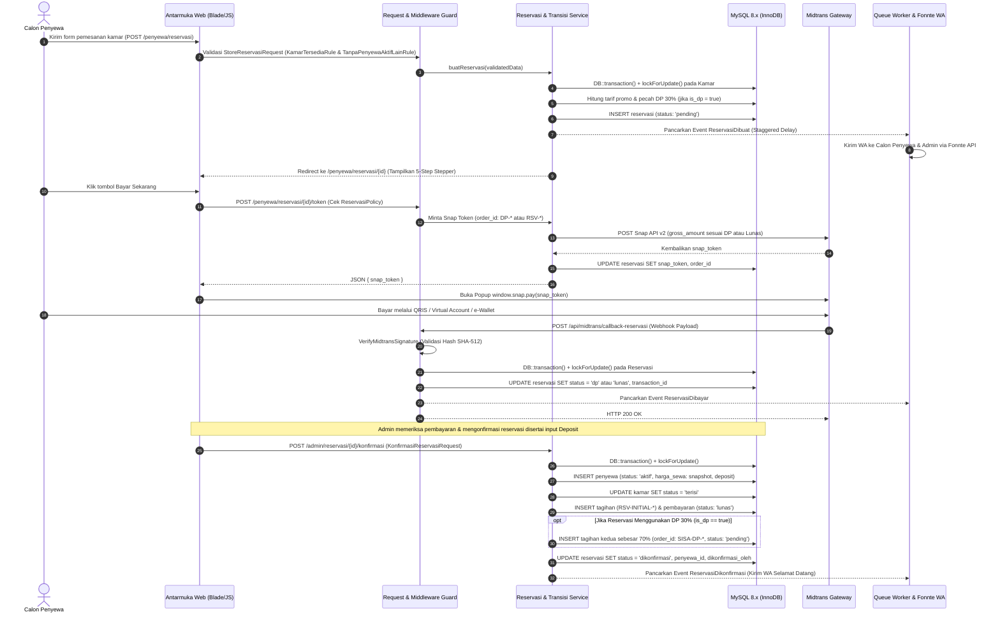
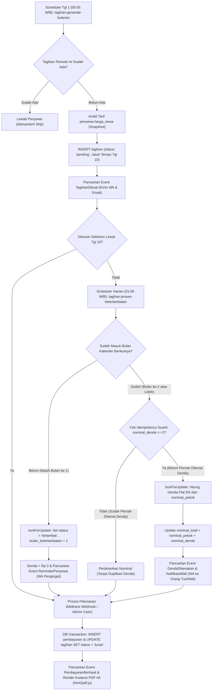
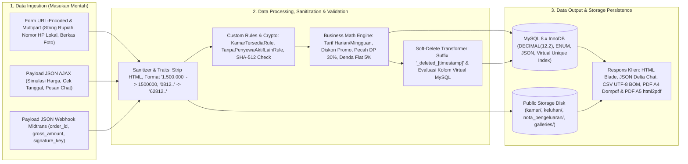
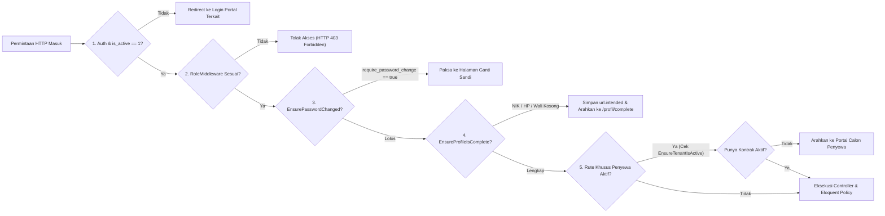

# Architecture & Functional Design (AFD): Sistem Informasi Manajemen Kost Terintegrasi Payment Gateway pada Asri Boarding House

## 1. Document Overview & Context

### 1.1. Identitas Dokumen
| Atribut Dokumen | Keterangan |
| :--- | :--- |
| **Judul Dokumen** | Architecture & Functional Design (AFD): Sistem Informasi Manajemen Kost Terintegrasi Payment Gateway pada Asri Boarding House |
| **Versi Dokumen** | Versi 1.0 (Selaras dengan Arsitektur Master v248.0) |
| **Status Dokumen** | Approved / Production Final |
| **Tanggal Efektif** | 4 November 2026 |
| **Penanggung Jawab** | Tim Pengembang Sistem Informasi Asri Boarding House |
| **Domain Produksi** | `https://asriboardinghouse.weatso.id/` |
| **Kapasitas Operasional** | 32 Unit Kamar Eksklusif (Tipe Standar, Deluxe, dan VIP) |

### 1.2. Tujuan Dokumen
Dokumen Architecture & Functional Design (AFD) ini berfungsi sebagai penghubung antara kebutuhan bisnis di ranah produk (PRD) dan rincian implementasi kode di ranah rekayasa perangkat lunak (TRD). Apabila PRD menitikberatkan pada fitur apa saja yang dibutuhkan oleh pengguna dan TRD menguraikan bagaimana struktur kode serta skema basis data ditulis, maka AFD menjelaskan bagaimana aliran data dan fungsi sistem bekerja secara utuh di balik layar. Penjelasan tersebut mencakup perjalanan sebuah transaksi sejak pengguna menekan tombol di antarmuka peramban, melewati gerbang validasi, diproses oleh mesin logika bisnis, berinteraksi dengan layanan pihak ketiga, hingga akhirnya tersimpan secara permanen di basis data dan sistem berkas.

Penyusunan dokumen ini bertujuan untuk memastikan seluruh pemangku kepentingan memiliki kesepahaman yang sama mengenai perilaku sistem dari ujung ke ujung (*end-to-end*). Melalui pemetaan fungsional ini, setiap aturan bisnis operasional Asri Boarding House, seperti perlindungan pemesanan ganda (*anti-double booking*), skema pembayaran uang muka (*Down Payment* 30%), pembekuan tarif sewa individu (*immutable rent snapshot*), perhitungan denda keterlambatan flat 5% yang bersifat *idempotent*, hingga audit pemotongan uang jaminan (*security deposit*) saat penghuni keluar (*check-out*), dapat ditelusuri secara transparan ke modul teknis yang menjalankannya.

### 1.3. Referensi dan Pemetaan Dokumen Terkait
Dokumen ini disusun berdampingan dan saling melengkapi dengan tiga dokumen utama proyek berikut:
1. **Product Requirements Document (PRD)**: [PRD-Asri-Boarding-House.md](file:///c:/xampp/htdocs/asri-boarding-house/Documentation/PRD-Asri-Boarding-House.md), yang memuat latar belakang bisnis, identifikasi 4 aktor utama dan 5 aktor sekunder, 10 aturan bisnis inti, serta daftar 25 *Use Case* fungsional.
2. **Technical Requirements Document (TRD)**: [TRD-Asri-Boarding-House.md](file:///c:/xampp/htdocs/asri-boarding-house/Documentation/TRD-Asri-Boarding-House.md), yang merinci spesifikasi teknis Laravel 12, definisi kolom pada 22 tabel bisnis MySQL 8.x, konfigurasi *Virtual Generated Columns*, daftar rute endpoint, serta prosedur pengujian dan *deployment*.
3. **Dokumen Cetak Biru Arsitektur**: [Blueprint_Projek_Web_Asri_Boarding_House.md](file:///c:/xampp/htdocs/asri-boarding-house/Blueprint/Blueprint_Projek_Web_Asri_Boarding_House.md), yang menjadi acuan histori evolusi fitur dan tata kelola antarmuka *Neo-Brutalism*.

#### Matriks Jembatan Fungsional (PRD ke AFD ke TRD)
| Domain Fungsi Bisnis (PRD) | Orkestrasi Alur & Transformasi Data (AFD) | Komponen Implementasi Teknis (TRD) |
| :--- | :--- | :--- |
| Eksplorasi katalog kamar, simulasi harga promo, dan konsultasi tamu anonim (`FR-PUB-01` s.d. `FR-PUB-05`). | Alur kalkulasi tarif proporsional (harian, mingguan, bulanan), potongan paket promo, serta pengelolaan sesi *Guest Live Chat* tanpa login. | `LandingController`, `GuestChatApiController`, `ReservasiService::hitungHargaSewa()`, tabel `kamar`, `settings`, `guest_chat_threads`, dan `whatsapp_clicks`. |
| Autentikasi tiga portal terisolasi, SSO Google, wajib ganti sandi awal, dan kelengkapan identitas (`FR-AUTH-01` s.d. `FR-AUTH-06`). | Penapisan sesi berlapis, penyimpanan URL tujuan awal (*intended URL*), sinkronisasi data NIK dan wali, serta anonimisasi hapus akun. | `PortalRedirectResolver`, `SocialiteController`, `EnsurePasswordChanged`, `EnsureProfileIsComplete`, `EnsureTenantIsActive`, dan `User::anonymizeAndDelete()`. |
| Pengajuan reservasi daring, ruang diskusi pra-bayar, pembayaran DP 30% atau lunas, dan konfirmasi admin (`FR-RES-01` s.d. `FR-RES-05`). | Pengecekan irisan tanggal sewa, penerbitan *Snap Token*, verifikasi tanda tangan webhook SHA-512, dan transisi atomik menjadi penyewa aktif. | `StoreReservasiRequest`, `KamarTersediaRule`, `TanpaPenyewaAktifLainRule`, `SnapTokenController`, `MidtransReservasiCallbackController`, dan `TransisiPenyewaService`. |
| Siklus tagihan bulanan seragam tanggal 1, evaluasi keterlambatan tanggal 10, denda flat 5%, dan cetak nota PDF A5 (`FR-TEN-01` s.d. `FR-TEN-03`). | Eksekusi jadwal otomatis bulanan dan harian, penjaga idempotensi denda pada bulan kedua, eskalasi pesan ke wali, dan perenderan kuitansi di peramban. | `BillingService`, `TagihanService`, `MidtransCallbackController`, `GenerateBulananTagihan`, `ProsesKeterlambatanTagihan`, dan pustaka klien `html2pdf.js`. |
| Pendaftaran penyewa *walk-in*, perpanjangan kontrak, inspeksi *check-out*, dan audit klaim deposit (`FR-ADM-05` & `FR-ADM-06`). | Pembekuan harga sewa ke profil penyewa, distribusi kredensial via WhatsApp, serta pembukuan otomatis potongan/pengembalian deposit ke tabel pengeluaran. | `Admin\PenyewaController`, `TransisiPenyewaService`, `KirimWelcomeMessageJob`, tabel `penyewa`, `kamar`, dan `pengeluaran`. |
| Pelaporan tiket keluhan fasilitas, rekapitulasi arus kas laba-rugi, kalender okupansi, dan pengiriman notifikasi (`FR-TEN-04`, `FR-ADM-01` s.d. `FR-ADM-10`). | Alur unggah bukti foto dengan pembersihan berkas gagal, agregasi metrik keuangan, ekspor PDF/CSV, serta antrean pesan berjeda (*staggered queue*). | `KeluhanController`, `LaporanController`, `AdminCalendarController`, `DompdfGenerator`, `FonnteService`, `NotifikasiService`, 11 *Events*, 12 *Listeners*, dan 8 *Queue Jobs*. |

---

## 2. Functional Architecture Overview (Gambaran Besar Sistem)

Secara fungsional, sistem informasi **Asri Boarding House** dibagi menjadi tujuh modul utama yang saling berkomunikasi melalui kontrak layanan (*Service Layer*) dan bus peristiwa (*Event Bus*). Setiap modul memiliki batas tanggung jawab yang tegas agar perubahan aturan bisnis pada satu area tidak merusak stabilitas modul lainnya.

### 2.1. Component Breakdown (Rincian Modul Fungsional)

#### 1. Public Discovery & Guest Interaction Module
Modul ini menangani seluruh interaksi pengunjung publik (Tamu) sebelum mereka memiliki akun atau masuk ke dalam sistem.
- **Katalog & Pemeriksaan Ketersediaan Unit**: Menyajikan daftar kamar beserta spesifikasi luas, lantai, fasilitas, dan status aktualnya. Modul ini memproses permintaan pengecekan ketersediaan kamar pada rentang tanggal tertentu melalui endpoint `/cek-ketersediaan`.
- **Simulasi Kalkulator Harga & Paket Promo**: Menerima parameter tipe sewa (`harian`, `mingguan`, `bulanan`) dan durasi dari antarmuka detail kamar, lalu menghitung tarif dasar, persentase diskon paket promo (Triwulan 5% atau Tahunan 8,33%), total harga bersih, serta rincian nominal uang muka 30%.
- **Guest Live Chat & Pelacakan Prospek**: Memungkinkan pengunjung anonim memulai percakapan langsung dengan admin hanya menggunakan nama dan nomor WhatsApp. Sistem menerbitkan `session_token` unik yang dipertahankan di peramban. Selain itu, setiap klik pada tombol konsultasi WhatsApp dicatat secara asinkron ke tabel `whatsapp_clicks` sebagai data analitik konversi.

#### 2. Identity, Multi-Portal Auth & Access Guard Module
Modul ini mengatur siklus autentikasi, kelengkapan identitas kependudukan, serta otorisasi akses di seluruh halaman aplikasi.
- **Pemisahan Pintu Masuk (Multi-Portal Isolation)**: Memisahkan jalur autentikasi menjadi tiga gerbang mandiri, yakni Portal Calon Penyewa (`/reservasi/login`), Portal Penyewa Aktif (`/penyewa/login`), dan Portal Administrator (`/admin/login`), ditambah integrasi masuk satu klik melalui Google OAuth 2.0.
- **Penapisan Bertahap (Sequential Access Guards)**: Setiap permintaan yang lolos autentikasi diperiksa secara berurutan oleh rantai middleware. Jika penanda `require_password_change` bernilai `true`, pengguna dipaksa mengganti kata sandi bawaan terlebih dahulu. Selanjutnya, jika data `nik` (16 digit), `no_hp`, `nama_wali`, atau `no_wali` belum lengkap, pengguna dialihkan ke halaman pelengkapan profil dengan tetap menyimpan alamat halaman yang ingin dituju (*intended URL*).
- **Penegakan Hak Akses Objek (Anti-IDOR)**: Mengawasi setiap akses ke detail reservasi, tagihan, nota pembayaran, dan tiket keluhan menggunakan kebijakan otorisasi (`ReservasiPolicy`, `TagihanPolicy`, `PembayaranPolicy`, dan `KeluhanPolicy`) agar seorang penghuni hanya dapat mengakses data miliknya sendiri.

#### 3. Reservation & Pre-Payment Negotiation Engine
Modul ini mengelola proses pemesanan kamar daring dari tahap pengajuan awal hingga siap dikonfirmasi oleh pengelola.
- **Validasi Anti-Bentrok & Pembatasan Kontrak Ganda**: Memverifikasi bahwa unit kamar berstatus `tersedia`, tidak memiliki irisan tanggal (`tanggal_mulai` hingga `tanggal_selesai`) dengan reservasi aktif lain pada kamar yang sama, serta memastikan akun pemesan tidak sedang terikat pada reservasi atau kontrak sewa aktif lainnya.
- **Ruang Diskusi Pra-Pembayaran**: Menyediakan kanal obrolan privat antara calon penyewa dan admin yang terikat langsung pada ID reservasi (`chat_messages`), dilengkapi penanda pesan terbaca (`is_read`) dan penarikan pesan delta.
- **Manajemen Masa Berlaku Reservasi**: Memantau usia reservasi berstatus `pending` dan membatalkannya secara otomatis apabila pembayaran belum diselesaikan setelah melewati batas waktu 24 jam.

#### 4. Transaction, Billing & Hybrid Payment Engine
Modul ini bertindak sebagai jantung finansial aplikasi yang memproses pembayaran daring maupun tunai, penerbitan tagihan rutin, serta perhitungan denda.
- **Orkestrasi Pembayaran Hibrida**: Pada jalur daring, modul ini berinteraksi dengan *Midtrans Snap API* untuk menerbitkan token pembayaran (`RSV-*` atau `DP-*` untuk reservasi, serta `INV-*` atau `SISA-DP-*` untuk tagihan) dan memproses webhook notifikasi pembayaran secara atomik. Pada jalur manual, modul ini menyediakan fitur verifikasi kasir tunai bagi admin yang langsung mencatat ID pengonfirmasi (`dikonfirmasi_oleh`).
- **Mesin Siklus Tagihan & Denda Flat Kalender**: Menerbitkan tagihan sewa bulanan secara serentak setiap tanggal 1 pukul 00:05 WIB dengan jatuh tempo tanggal 10. Mesin evaluasi harian memeriksa keterlambatan pembayaran: memberikan peringatan tanpa denda pada bulan pertama keterlambatan, lalu mengenakan denda flat 5% satu kali secara *idempotent* disertai eskalasi ke wali penyewa apabila tunggakan menyeberang ke bulan kalender berikutnya.
- **Pencetakan Kuitansi Resmi A5**: Menyediakan antarmuka nota pembayaran terverifikasi yang dapat diunduh langsung menjadi berkas PDF ukuran A5 di sisi klien.

#### 5. Tenant Lifecycle, Contract & Deposit Audit Module
Modul ini mengatur masa penghunian aktif sejak serah terima kunci kamar hingga penghuni menyelesaikan masa sewanya.
- **Aktivasi Kontrak & Pembekuan Tarif (*Immutable Rent Snapshot*)**: Mengonversi reservasi yang telah dibayar menjadi entitas `Penyewa` aktif atau mendaftarkan penyewa *walk-in* secara langsung. Tarif kamar saat kontrak dibuat disalin ke kolom `penyewa.harga_sewa` agar tagihan bulanan penghuni lama tidak ikut berubah ketika admin menaikkan harga katalog kamar di kemudian hari.
- **Perpanjangan Sewa & Pengingat Kontrak**: Memperbarui masa berlaku kontrak (`tanggal_keluar_seharusnya`) beserta penerbitan invoice perpanjangan (`EXT-*`), serta memindai kontrak yang akan habis pada H-14, H-7, H-3, dan H-0.
- **Inspeksi *Check-Out* & Audit Uang Jaminan (*Security Deposit*)**: Mengelola penghentian kontrak penyewa dengan memeriksa kondisi fisik kamar. Apabila terdapat kerusakan fasilitas, potongan biaya perbaikan secara otomatis dikurangkan dari saldo deposit dan dibukukan sebagai transaksi kas keluar pada tabel `pengeluaran` (kategori `maintenance`). Sisa deposit yang dikembalikan kepada penyewa juga otomatis dibukukan sebagai kas keluar (kategori `lainnya`), sementara status kamar dialihkan ke `maintenance` atau `tersedia` sesuai keputusan inspeksi admin.

#### 6. Property Operations, Executive Analytics & CMS Hub
Modul ini mendukung kegiatan operasional harian pengelola, pemeliharaan properti, pelaporan keuangan, dan pembaruan konten situs.
- **Manajemen Master Kamar, Fasilitas, & *Soft Deletes***: Mengelola 32 unit kamar dan fasilitasnya. Penghapusan data menerapkan *Soft Deletes* dengan pembubuhan akhiran `_deleted_[timestamp]` dan kolom virtual MySQL agar data historis terjaga tanpa menghalangi penggunaan ulang nomor kamar yang sama.
- **Penanganan Tiket Keluhan Penghuni**: Memproses laporan kerusakan fasilitas dari penyewa aktif beserta lampiran foto bukti melalui tahapan status `pending`, `diproses`, hingga `selesai`.
- **Kalender Okupansi Visual & Laporan Keuangan**: Menyusun jadwal masuk, masa tinggal, dan jadwal keluar seluruh kamar ke dalam matriks kalender 42 sel, serta mengagregasi pemasukan tagihan lunas dan pengeluaran operasional menjadi laporan laba-rugi yang dapat diekspor ke format PDF (via `DompdfGenerator`) maupun Excel/CSV.
- **Pengaturan Konten Dinamis (CMS)**: Mengelola parameter global situs, rekening bank pembayaran manual, skema diskon promo, FAQ, galeri, testimoni, dan peraturan kost melalui tabel `settings` yang didukung cache memori dan basis data.

#### 7. Notification Service, Event Bus & Storage Handler
Modul infrastruktur fungsional ini menangani komunikasi keluar dan penyimpanan berkas fisik di latar belakang.
- **Orkestrasi Notifikasi Berbasis Peristiwa (*Event-Driven Queue*)**: Menangkap 11 *Domain Events* bisnis melalui 12 *Listeners* dan mendorong 8 jenis *Queue Jobs* ke tabel `jobs` dengan penjedaan bertahap (*staggered delay*). Pekerja antrean merakit pesan menggunakan `NotificationTemplateBuilder` lalu mengirimkannya ke WhatsApp melalui `FonnteService` dan ke surel melalui `Symfony Mailer`.
- **Storage Handler & Pembersihan Berkas Gagal**: Mengelola penyimpanan berkas unggahan pada disk `storage/app/public` (meliputi folder `kamar/`, `keluhan/`, `nota_pengeluaran/`, `galleries/`, `reviews/`, dan `settings/`) yang dilengkapi mekanisme penghapusan berkas otomatis apabila transaksi basis data mengalami kegagalan (*rollback file cleanup*).

---

### 2.2. High-Level Context Diagram
Diagram konteks tingkat tinggi berikut menunjukkan bagaimana data mengalir dari para aktor dan pemicu eksternal, masuk ke dalam tujuh modul fungsional sistem, hingga disimpan ke lapisan persistensi atau diteruskan ke layanan pihak ketiga.

```mermaid
flowchart TB
    subgraph Actors ["Aktor Pengguna & Pemicu Waktu"]
        Guest["Tamu Publik (Guest)"]
        Prospective["Calon Penyewa"]
        ActiveTenant["Penyewa Aktif"]
        Admin["Administrator"]
        Cron["Laravel Task Scheduler (Cron 1 Menit)"]
    end

    subgraph FunctionalModules ["Blok Fungsional Sistem (Asri Boarding House)"]
        ModPublic["1. Public Discovery & Guest Interaction Module"]
        ModAuth["2. Identity, Multi-Portal Auth & Access Guard"]
        ModRes["3. Reservation & Pre-Payment Negotiation Engine"]
        ModPay["4. Transaction, Billing & Hybrid Payment Engine"]
        ModTenant["5. Tenant Lifecycle, Contract & Deposit Audit"]
        ModOps["6. Property Operations, Analytics & CMS Hub"]
        ModNotif["7. Notification Service, Event Bus & Storage Handler"]
    end

    subgraph Persistence ["Lapisan Penyimpanan Data & Berkas"]
        ClientStore[("Browser Storage (LocalStorage, SessionStorage, Cookie)")]
        Database[("MySQL 8.x Database (22 Tabel Bisnis + Antrean & Sesi)")]
        DiskStore[("Local Filesystem (storage/app/public)")]
    end

    subgraph ExternalSystems ["Layanan Eksternal Pihak Ketiga"]
        Midtrans["Midtrans Payment Gateway (Snap API & Webhook)"]
        Fonnte["Fonnte WhatsApp API Gateway"]
        GoogleSSO["Google Identity OAuth 2.0"]
        SMTP["SMTP Mail Server"]
    end

    Guest -->|Eksplorasi, Simulasi Harga, Guest Chat| ModPublic
    Prospective -->|Login/OAuth, Lengkapi Profil| ModAuth
    ActiveTenant -->|Login, Akses Dasbor| ModAuth
    Admin -->|Login Admin| ModAuth

    ModAuth <-->|Redirect & Verifikasi Token| GoogleSSO
    ModAuth -->|Simpan Sesi & Preferensi| ClientStore
    ModPublic -->|Token Guest Chat & Tema| ClientStore

    Prospective -->|Ajukan Reservasi & Chat Pra-Bayar| ModRes
    ModRes -->|Hitung Tarif & Cek Ketersediaan| ModPay
    Prospective -->|Bayar DP 30% / Lunas 100%| ModPay
    ActiveTenant -->|Bayar Tagihan Bulanan & Cetak Nota A5| ModPay
    ActiveTenant -->|Lapor Keluhan Fasilitas| ModOps

    Admin -->|Konfirmasi Reservasi, Walk-in, Check-Out Deposit| ModTenant
    Admin -->|Konfirmasi Cash, Pantau Tagihan| ModPay
    Admin -->|Kelola Kamar, Keluhan, Pengeluaran, Laporan, CMS| ModOps

    Cron -->|Trigger 9 Jadwal Otomatis| ModPay
    Cron -->|Trigger Reminder Kontrak & Pembersihan| ModTenant

    ModPay <-->|Request Snap Token & Cek Status| Midtrans
    Midtrans -->|Webhook Callback SHA-512| ModPay
    ModTenant -->|Terbitkan Tagihan Awal / Sisa DP / Pengeluaran Deposit| ModPay

    ModRes & ModPay & ModTenant & ModOps -->|Pancarkan Domain Events & Unggah Berkas| ModNotif
    ModNotif -->|Kirim Pesan WA Berjeda| Fonnte
    ModNotif -->|Kirim Email Transaksional| SMTP

    ModPublic & ModAuth & ModRes & ModPay & ModTenant & ModOps & ModNotif <-->|Transaksi ACID & Kueri Relasional| Database
    ModNotif & ModOps <-->|Simpan & Hapus Berkas Fisik| DiskStore
```



---

## 3. End-to-End Functional Flows (Alur Fungsional Menyeluruh)

Bagian ini menjabarkan secara rinci bagaimana sistem memproses empat skenario bisnis paling kritis di balik layar, mulai dari pengiriman data di antarmuka pengguna hingga pembaruan basis data dan pemicuan layanan eksternal.

### 3.1. Skenario 1: Alur Transaksi Reservasi Daring, Pembayaran Midtrans (DP 30% / Lunas), Webhook, hingga Konfirmasi Kontrak
Skenario ini menggambarkan siklus hidup pemesanan kamar secara daring oleh calon penyewa sampai resmi berstatus sebagai penghuni aktif.

#### Tahapan Pemrosesan Sistem:
1. **Pengiriman Payload Reservasi (*Client Request*)**:
   Calon penyewa yang telah melewati penapisan `EnsureProfileIsComplete` mengisi formulir pemesanan kamar pada halaman detail kamar dan mengirimkan permintaan `POST /penyewa/reservasi`. Payload berisi `kamar_id`, `tipe_sewa` (`harian`, `mingguan`, atau `bulanan`), `tanggal_mulai`, `durasi`, `metode_pembayaran` (`midtrans` atau `cash`), opsi pembayaran uang muka (`is_dp`), serta `catatan_user`.
2. **Sanitasi dan Validasi Aturan Bisnis (*Validation Layer*)**:
   Kelas `StoreReservasiRequest` membersihkan masukan teks, lalu menjalankan dua aturan validasi kustom:
   - `KamarTersediaRule`: Memeriksa bahwa baris pada tabel `kamar` berstatus `tersedia` dan melakukan kueri ke indeks komposit `idx_reservasi_overlap` untuk memastikan tidak ada reservasi aktif lain (`pending`, `dp`, `lunas`, `dikonfirmasi`) yang memiliki irisan tanggal antara `tanggal_mulai` dan `tanggal_selesai`.
   - `TanpaPenyewaAktifLainRule`: Memastikan `user_id` pemesan tidak sedang memiliki kontrak `penyewa` berstatus `aktif` ataupun pengajuan `reservasi` lain yang masih berjalan.
3. **Kalkulasi Harga, Pemecahan DP, dan Penyimpanan Awal (*Service & Persistence*)**:
   `ReservasiService::buatReservasi()` membuka blok `DB::transaction()` dan mengunci baris kamar menggunakan `lockForUpdate()`. Sistem menghitung `tanggal_selesai` serta `total_harga` (termasuk memotong diskon paket promo jika sewa bulanan memenuhi syarat 3 bulan atau 12 bulan). Apabila `is_dp` bernilai `true`, sistem menghitung `nominal_dp = round(total_harga * 0.30)` dan `nominal_sisa = total_harga - nominal_dp`. Data disimpan ke tabel `reservasi` dengan status `pending`.
4. **Pemicuan Notifikasi Pengajuan Awal (*Event Dispatch*)**:
   Begitu transaksi penyimpanan selesai, sistem memancarkan event `ReservasiDibuat`. Listener `HandleReservasiDibuat` mendorong `KirimNotifikasiUserReservasiJob` dan `KirimNotifikasiAdminReservasiJob` ke tabel `jobs` untuk mengirimkan rincian pemesanan ke WhatsApp calon penyewa dan admin melalui *Fonnte API*, sementara `NotifikasiKhususSubscriber` mencatat jejak audit ke tabel `notifikasi_khusus`.
5. **Penerbitan *Snap Token* dan Pembayaran Digital (*Payment Gateway Interaction*)**:
   Pada halaman detail reservasi (`/penyewa/reservasi/{reservasi}`), calon penyewa menekan tombol bayar yang memicu permintaan AJAX `POST /penyewa/reservasi/{reservasi}/token`. `SnapTokenController` memverifikasi kepemilikan melalui `ReservasiPolicy`, membentuk kode `order_id` unik (berawalan `DP-` jika membayar uang muka atau `RSV-` jika membayar lunas), lalu memanggil `MidtransService` untuk meminta `snap_token` ke server Midtrans. Token disimpan ke kolom `reservasi.snap_token` dan dikembalikan ke peramban untuk membuka jendela *Midtrans Snap*.
6. **Penerimaan Webhook dan Pembaruan Status Pembayaran (*Webhook Callback*)**:
   Setelah pengguna menyelesaikan pembayaran (misalnya melalui QRIS atau Virtual Account), server Midtrans mengirimkan paket HTTP `POST` ke `/api/midtrans/callback-reservasi`:
   - Middleware `VerifyMidtransSignature` menghitung hash SHA-512 dari gabungan `order_id + status_code + gross_amount + server_key` dan mencocokkannya dengan `signature_key` menggunakan `hash_equals()`. Jika tidak cocok, permintaan langsung ditolak (`HTTP 403`).
   - `MidtransReservasiCallbackController` membuka transaksi basis data dengan `lockForUpdate()` pada baris `reservasi` terkait.
   - Jika `transaction_status` bernilai `settlement` atau `capture`, status reservasi diperbarui menjadi `dp` (apabila `is_dp == true`) atau `lunas` (apabila bayar penuh 100%), disertai pencatatan `transaction_id`. Sistem memancarkan event `ReservasiDibayar` untuk memberi tahu admin dan calon penyewa bahwa pembayaran telah diterima.
7. **Verifikasi Admin dan Konversi Menjadi Penyewa Aktif (*Contract Activation*)**:
   Admin membuka halaman verifikasi reservasi di `/admin/reservasi/{reservasi}`, memeriksa kesesuaian data, memasukkan nilai uang jaminan (`deposit`), lalu mengirimkan formulir konfirmasi. `TransisiPenyewaService` menjalankan langkah atomik berikut di dalam satu transaksi basis data:
   - Membuat baris baru pada tabel `penyewa` dengan status `aktif`, menyalin tarif sewa ke `penyewa.harga_sewa` (*immutable rent snapshot*), serta menyalin data `nik`, `nama_wali`, dan `no_wali`.
   - Mengubah status pada tabel `kamar` menjadi `terisi`.
   - Mengubah status pada tabel `reservasi` menjadi `dikonfirmasi`, mengisi `penyewa_id`, `dikonfirmasi_oleh`, dan `tanggal_konfirmasi`.
   - Membuat baris `tagihan` awal (`order_id: RSV-INITIAL-*`) berstatus `lunas` beserta catatan pelunasannya di tabel `pembayaran`.
   - Apabila reservasi menggunakan skema DP (`is_dp == true`), sistem secara otomatis menerbitkan baris `tagihan` kedua berstatus `pending` sebesar 70% (`nominal_sisa`) dengan awalan `order_id: SISA-DP-*` agar penyewa dapat melunasi sisanya melalui portal penyewa aktif.
   - Memancarkan event `ReservasiDikonfirmasi` yang memicu pengiriman pesan selamat datang via WhatsApp dan membuka akses penuh ke Dasbor Penyewa Aktif.



---

### 3.2. Skenario 2: Alur Penagihan Bulanan Otomatis, Evaluasi Keterlambatan Bertingkat, Denda Flat 5% Idempotent, dan Pelunasan Hibrida
Skenario ini menjelaskan bagaimana mesin penagihan latar belakang mengelola piutang bulanan secara otomatis, menerapkan aturan denda satu kali tanpa risiko duplikasi, serta memproses pelunasannya.

#### Tahapan Pemrosesan Sistem:
1. **Penerbitan Tagihan Serentak Tanggal 1 (`tagihan:generate-bulanan`)**:
   Setiap tanggal 1 pukul `00:05` WIB, *Laravel Task Scheduler* memicu perintah `GenerateBulananTagihan` yang memanggil `BillingService::generateTagihanBulanan()`.
   - Sistem mengambil daftar seluruh entitas `penyewa` yang berstatus `aktif`.
   - Untuk setiap penyewa, sistem memeriksa apakah baris pada tabel `tagihan` untuk kombinasi `penyewa_id`, `periode_bulan` saat ini, dan `periode_tahun` saat ini sudah tersedia. Jika sudah ada, penyewa tersebut dilewati (*idempotent skip*).
   - Jika belum ada, sistem menentukan nilai pokok tagihan dari kolom `penyewa.harga_sewa` (atau menggunakan `kamar.harga_bulan` apabila `harga_sewa` kosong), menetapkan `tanggal_jatuh_tempo` pada tanggal 10 bulan berjalan, dan menyimpan baris baru ke tabel `tagihan` dengan status `pending` serta kode `order_id` berformat `INV-{YYYYMM}-{ID_PENYEWA}-{TIMESTAMP}`.
   - Sistem memancarkan event `TagihanDibuat` yang menjadwalkan `KirimNotifikasiTagihanJob` untuk mengirim rincian tagihan ke WhatsApp dan surel penyewa.
2. **Evaluasi Keterlambatan Harian & Penjaga Idempotensi Denda (`tagihan:proses-keterlambatan`)**:
   Setiap hari pukul `01:00` WIB, penjadwal menjalankan `BillingService::prosesKeterlambatan()` untuk memindai seluruh tagihan berstatus `pending` atau `terlambat` yang memiliki `tanggal_jatuh_tempo < today()`:
   - **Tahap 1: Keterlambatan Bulan Pertama (Lewat Tanggal 10 pada Bulan Tagihan Berjalan)**:
     Apabila tagihan masih berada di bulan dan tahun yang sama dengan periode terbitnya, sistem membuka transaksi basis data dengan `lockForUpdate()`, mengubah `status` menjadi `terlambat`, dan menetapkan `bulan_keterlambatan = 1` sementara `nominal_denda` tetap `0.00`. Sistem memancarkan event `ReminderPenyewa` (`KirimReminderJatuhTempoJob`) untuk mengirim pesan pengingat ramah ke WhatsApp penyewa.
   - **Tahap 2: Eskalasi Bulan Kedua (Memasuki Bulan Kalender Berikutnya)**:
     Apabila bulan kalender telah berganti (misalnya tagihan periode Oktober belum dibayar hingga memasuki tanggal 1 November atau setelahnya), sistem menaikkan `bulan_keterlambatan` menjadi `>= 2`. Di titik ini, sistem memeriksa **Idempotency Guard** (`nominal_denda == 0`):
     - Jika `nominal_denda` masih bernilai `0`, sistem menghitung denda flat sebesar **5% dari `nominal_pokok`** (`nominal_denda = 0.05 * nominal_pokok`), memperbarui `nominal_total = nominal_pokok + nominal_denda`, lalu menyimpan perubahan tersebut. Sistem kemudian memancarkan event `DendaDikenakan` (ke penyewa) dan `NotifikasiWali` (`KirimNotifikasiWaliJob`) yang mengirimkan surat pemberitahuan tunggakan resmi ke nomor WhatsApp orang tua/wali (`penyewa.no_wali`).
     - Jika pada hari-hari berikutnya penjadwal kembali memindai tagihan yang sama, kondisi `nominal_denda == 0` sudah tidak terpenuhi sehingga nominal denda tidak akan pernah ditambahkan dua kali.
3. **Pelunasan Tagihan melalui Dua Kanal (Hibrida)**:
   - **Jalur Daring (*Midtrans Snap*)**: Penyewa aktif menekan tombol bayar pada `/penyewa/tagihan`, meminta *Snap Token* melalui `POST /penyewa/pembayaran/{tagihan}/token` (dilindungi `TagihanPolicy` dan `EnsureTenantIsActive`), lalu menyelesaikan pembayaran. Saat webhook Midtrans masuk ke `/api/midtrans/callback` dan lolos verifikasi SHA-512, `MidtransCallbackController` mengunci baris `tagihan` dan `pembayaran`, mengubah status tagihan menjadi `lunas` beserta `metode_pembayaran = 'midtrans'`, menyimpan bukti kriptografi (`signature_key` dan `response_json`) di tabel `pembayaran`, lalu memancarkan event `PembayaranBerhasil`.
   - **Jalur Kasir Tunai / Transfer Manual (`konfirmasiCash`)**: Penyewa menyerahkan uang tunai atau mentransfer ke rekening bank kost yang tertera di halaman tagihan. Admin membuka `/admin/tagihan`, memverifikasi dana masuk, dan mengirim formulir `POST /admin/tagihan/{tagihan}/konfirmasi-cash`. `TagihanService` mengunci baris tagihan, membuat catatan di tabel `pembayaran` dengan kode transaksi `CASH-*` dan mencatat ID admin pada `dikonfirmasi_oleh`, mengubah status tagihan menjadi `lunas` (`metode_pembayaran = 'cash'`), lalu memancarkan event `PembayaranCashDikonfirmasi` dan `PembayaranBerhasil`.
4. **Distribusi Bukti Lunas dan Unduh Kuitansi PDF A5**:
   Event pelunasan memicu `KirimNotifikasiPembayaranJob` untuk mengirim ucapan terima kasih dan ringkasan pelunasan ke WhatsApp serta surel penyewa. Penyewa maupun admin selanjutnya dapat mengakses `/penyewa/nota/{pembayaran}/cetak` (dijaga oleh `PembayaranPolicy`), di mana peramban merender tata letak kuitansi A5 berstempel digital menjadi berkas PDF siap unduh menggunakan `html2pdf.js`.



---

### 3.3. Skenario 3: Alur Kontrak Penyewa Walk-in, Penanganan Keluhan, Check-Out, dan Audit Klaim Deposit
Skenario ini merangkum pemrosesan fungsional untuk pendaftaran penghuni langsung di lokasi kost (*offline*), pemeliharaan fasilitas selama masa huni, hingga penutupan kontrak dan pembukuan uang jaminan.

#### Tahapan Pemrosesan Sistem:
1. **Pendaftaran Penyewa *Walk-in* & Distribusi Akun Otomatis**:
   Saat calon penghuni datang langsung ke lokasi kost, admin mengisi formulir `/admin/penyewa/create` (`StorePenyewaRequest`). Di dalam `TransisiPenyewaService`, sistem membuka transaksi basis data:
   - Membuat akun baru di tabel `users` dengan alamat surel penyewa, menyetel kata sandi awal menggunakan nomor HP penyewa yang di-hash dengan Bcrypt, serta mengaktifkan penanda `require_password_change = true`.
   - Membuat baris kontrak di tabel `penyewa` berstatus `aktif`, membekukan tarif kamar ke `penyewa.harga_sewa`, menyimpan nominal `deposit`, dan menghitung `tanggal_keluar_seharusnya`.
   - Mengubah status kamar di tabel `kamar` menjadi `terisi` dan menerbitkan tagihan sewa awal.
   - Mendorong `KirimWelcomeMessageJob` ke antrean latar belakang untuk mengirimkan informasi nomor kamar beserta kredensial login (surel dan kata sandi awal) ke WhatsApp penyewa. Ketika penyewa login pertama kali, middleware `EnsurePasswordChanged` memaksanya mengganti kata sandi tersebut sebelum masuk ke dasbor.
2. **Alur Pelaporan dan Resolusi Tiket Keluhan Fasilitas**:
   - Penyewa aktif yang mendapati kerusakan fasilitas mengirim laporan melalui `POST /penyewa/keluhan` (`StoreKeluhanRequest`) disertai unggahan foto bukti maksimal 2MB.
   - `Penyewa\KeluhanController` menyimpan berkas foto ke `storage/app/public/keluhan/` dan membuat baris baru di tabel `keluhan` dengan status `pending`. Apabila penyimpanan ke basis data gagal, blok `catch` langsung menghapus berkas foto yang baru diunggah (*rollback file cleanup*).
   - Event `KeluhanDibuat` memicu pengiriman pesan peringatan WhatsApp ke admin.
   - Admin menindaklanjuti laporan melalui `/admin/keluhan/{keluhan}` dengan mengubah status menjadi `diproses` atau `selesai` disertai pengisian `tanggapan_admin`. Saat status berubah menjadi `selesai`, sistem mengisi kolom `tanggal_selesai` secara otomatis dan memancarkan event `KeluhanDitanggapi` untuk mengabarkan hasil perbaikan ke WhatsApp penyewa.
3. **Proses *Check-Out*, Inspeksi Kamar, dan Pembukuan Otomatis Klaim Deposit**:
   Ketika masa kontrak berakhir dan penghuni menyerahkan kunci kamar, admin membuka menu `/admin/penyewa/{penyewa}/checkout` dan mengirimkan hasil pemeriksaan fisik kamar:
   - `TransisiPenyewaService` memulai `DB::transaction()` dan mengunci baris `penyewa` serta `kamar`.
   - **Audit Kerusakan & Potongan Deposit**: Apabila admin menandai adanya kerusakan fasilitas dan memasukkan nominal `potongan_deposit` (beserta unggahan foto nota perbaikan ke `storage/app/public/nota_pengeluaran/`), sistem memvalidasi bahwa potongan tidak melebihi saldo `penyewa.deposit`. Nilai potongan tersebut langsung dicatat sebagai baris baru pada tabel `pengeluaran` dengan kategori `maintenance`.
   - **Pengembalian Sisa Deposit**: Sistem menghitung sisa uang jaminan (`sisa_deposit = deposit - potongan_deposit`). Apabila `sisa_deposit > 0`, sistem secara otomatis membuat baris baru pada tabel `pengeluaran` dengan kategori `lainnya` sebagai catatan kas keluar pengembalian deposit kepada penyewa, lalu mereset saldo deposit pada kontrak menjadi `0`.
   - **Penutupan Kontrak & Penahanan Status Kamar**: Status penyewa diubah menjadi `nonaktif` disertai pencatatan `tanggal_keluar` aktual. Status unit kamar pada tabel `kamar` tidak langsung dibuka secara sembarangan, melainkan diubah menjadi `maintenance` (jika perlu perbaikan lanjutan) atau `tersedia` sesuai pilihan inspeksi admin.

---

### 3.4. Skenario 4: Proses Penanganan Error, Gangguan Jaringan, dan Mekanisme Fallback
Sistem dirancang dengan mekanisme pertahanan berlapis (*defensive fallback*) agar gangguan jaringan sementara atau penghentian proses oleh pengguna tidak menyebabkan inkonsistensi data maupun kebocoran sumber daya.

#### 1. Keterlambatan atau Kegagalan Pengiriman Webhook Midtrans
- **Kondisi Masalah**: Pengguna telah menyelesaikan pembayaran di jendela *Midtrans Snap*, namun webhook dari server Midtrans ke endpoint `/api/midtrans/callback` atau `/api/midtrans/callback-reservasi` terlambat masuk akibat gangguan rute jaringan internet.
- **Perilaku Fungsional & Fallback**:
  - Sistem menyediakan mekanisme pemeriksaan status sinkron (*Synchronous API Fallback*) melalui metode `MidtransService::checkTransactionStatus($orderId)` yang melakukan panggilan HTTP `GET` langsung ke endpoint status Midtrans API v2 untuk menarik status transaksi terkini dan menyinkronkannya ke basis data.
  - Apabila pengguna menutup jendela *Snap* sebelum membayar lalu menekan tombol **Bayar Sekarang** kembali, `SnapTokenController` memeriksa apakah `snap_token` yang tersimpan pada baris reservasi masih valid. Jika masih berlaku, token lama digunakan kembali tanpa memanggil API eksternal berulang kali. Jika token sudah kedaluwarsa, sistem membuat `order_id` baru dengan *timestamp* segar dan meminta token baru.
  - Apabila webhook yang sama dikirimkan lebih dari satu kali oleh Midtrans (*duplicate webhook delivery*), pengecekan status di dalam blok `lockForUpdate()` memastikan reservasi atau tagihan yang sudah berstatus `lunas` tidak akan diproses ulang atau memicu pengiriman notifikasi ganda.

#### 2. Reservasi Menggantung Tanpa Penyelesaian Pembayaran (*Abandoned Reservation*)
- **Kondisi Masalah**: Calon penyewa mengajukan reservasi kamar daring (status `pending`), namun meninggalkan aplikasi dan tidak kunjung membayar hingga berhari-hari.
- **Perilaku Fungsional & Fallback**:
  - Setiap satu jam sekali, penjadwal latar belakang menjalankan perintah `reservasi:cancel-expired` (`CancelExpiredReservations`).
  - Perintah ini memindai seluruh baris pada tabel `reservasi` yang masih berstatus `pending` dan memiliki waktu pembuatan (`created_at`) lebih lama dari batas kedaluwarsa (`config('reservasi.expire_hours')`, yakni 24 jam).
  - Baris reservasi yang kedaluwarsa dikunci dengan `lockForUpdate()`, diubah statusnya menjadi `batal`, dan dicatat ke jejak audit `notifikasi_khusus`, sehingga unit kamar dan rentang tanggal tersebut kembali bebas untuk dipesan oleh calon penyewa lain.

#### 3. Kegagalan Pengiriman Pesan pada Gateway Eksternal (Fonnte WhatsApp / SMTP Down)
- **Kondisi Masalah**: Saat sistem memancarkan event bisnis (misalnya penerbitan tagihan bulanan atau konfirmasi reservasi), layanan *Fonnte API* mengalami *timeout* atau server SMTP gagal dihubungi.
- **Perilaku Fungsional & Fallback**:
  - Karena seluruh pengiriman pesan dijalankan secara asinkron di belakang layar melalui tabel `jobs`, kegagalan pada *Fonnte API* atau *SMTP* sama sekali tidak menggagalkan transaksi utama yang dilihat oleh pengguna di peramban.
  - Klien HTTP di dalam `FonnteService` menangkap eksepsi koneksi maupun respons non-200, lalu mengembalikan rincian pesan kesalahan kepada `NotifikasiService`.
  - Sistem tetap merekam upaya pengiriman tersebut ke tabel `log_notifikasi` dengan nilai `status = 'gagal'` dan menyimpan alasan teknis kegagalannya pada kolom `error_msg`.
  - Apabila sebuah *Queue Job* mengalami kegagalan fatal atau entitas datanya telah dihapus sebelum antrean sempat dieksekusi, metode `failed(\Throwable $exception)` pada seluruh kelas di `app/Jobs/` menggunakan pelindung *nullsafe operator* (`$this->model?->getKey()`) agar pekerja antrean (`queue:work`) tidak berhenti mendadak.
  - Administrator dapat membuka halaman `/admin/notifikasi`, memantau daftar pengiriman yang berstatus `gagal`, dan menekan tombol **Retry** untuk memicu pengiriman ulang pesan secara manual setelah jaringan normal kembali.

#### 4. Kegagalan Transaksi Basis Data Setelah Unggah Berkas Fisik
- **Kondisi Masalah**: Pengguna mengunggah foto bukti keluhan atau admin mengunggah foto kamar/nota pengeluaran. Berkas fisik berhasil ditulis ke folder `storage/app/public/`, namun sesaat kemudian operasi `INSERT` atau `UPDATE` ke tabel MySQL gagal akibat kendala basis data.
- **Perilaku Fungsional & Fallback**:
  - Seluruh *Controller* yang menangani unggahan berkas (`KeluhanController`, `KamarController`, `PengeluaranController`, `PenyewaController`) membungkus proses penyimpanan di dalam blok `try-catch`.
  - Ketika eksepsi basis data tertangkap dan transaksi SQL di-*rollback*, blok `catch` secara otomatis memanggil `Storage::disk('public')->delete($uploadedFilePath)` untuk menghapus berkas yang baru saja ditulis. Langkah ini memastikan disk server selalu bersih dari berkas yatim (*dangling files*).

#### 5. Kedaluwarsa Sesi Pengguna pada Ruang Obrolan dan Formulir (*Session Expiration*)
- **Kondisi Masalah**: Sesi autentikasi pengguna habis masa berlakunya (`SESSION_LIFETIME = 120` menit) ketika tab ruang obrolan reservasi masih terbuka atau saat pengguna hendak mengirim formulir.
- **Perilaku Fungsional & Fallback**:
  - Pada ruang obrolan reservasi (`reservasi/chat-box.blade.php`), ketika siklus *polling* AJAX menerima kode status `HTTP 401 Unauthorized`, skrip klien memeriksa `sessionStorage.getItem('chat_auth_reloaded')`. Jika belum bernilai `'true'`, skrip menyetel kunci tersebut menjadi `'true'` dan memuat ulang halaman tepat satu kali agar `PortalRedirectResolver` mengarahkan pengguna ke halaman login dengan rapi tanpa terjebak dalam pengulangan muat ulang tanpa henti (*infinite reload loop*).
  - Pada pengiriman formulir web, apabila token CSRF telah kedaluwarsa (`TokenMismatchException` / `HTTP 419`), penangkap eksepsi khusus di `bootstrap/app.php` mencegat halaman galat bawaan dan mengembalikan pengguna ke halaman formulir sebelumnya dengan mempertahankan masukan yang telah diketik (`withInput()`) disertai pesan peringatan berbahasa Indonesia.

---

## 4. Data Flow & Transformation (Alur & Transformasi Data)

Bab ini menjelaskan bagaimana data mentah yang masuk dari perangkat klien maupun sistem eksternal dibersihkan, divalidasi, dihitung ulang oleh aturan bisnis, hingga disimpan ke dalam struktur penyimpanan atau dikembalikan sebagai respons ke pengguna.



---

### 4.1. Data Ingestion (Format Data Mentah yang Masuk ke Sistem)
Sistem menerima masukan data mentah melalui tiga saluran utama dengan karakteristik format yang berbeda:

1. **Formulir Web Standar & Unggahan Multipart (`application/x-www-form-urlencoded` & `multipart/form-data`)**:
   - **Data Identitas & Kontrak**: Pengguna dan admin sering kali mengetikkan nomor telepon dalam beragam format lokal (seperti `0812-3456-7890`, `+62 812 3456 7890`, atau `81234567890`), NIK 16 digit, serta teks bebas pada kolom catatan dan deskripsi keluhan yang berpotensi mengandung spasi berlebih atau karakter HTML.
   - **Data Nominal Keuangan**: Pada formulir harga kamar, uang jaminan (*deposit*), potongan kerusakan *check-out*, dan pencatatan pengeluaran operasional, nilai uang dikirimkan dari antarmuka dalam format string berpemisah ribuan Indonesia (contoh: `"1.500.000"` atau `"Rp 750.000"`).
   - **Berkas Biner (*Binary Streams*)**: Unggahan foto kamar, bukti kerusakan fasilitas keluhan, struk pengeluaran, foto galeri, dan avatar ulasan masuk sebagai objek `UploadedFile` dengan batas ukuran maksimal `2048 KB` (`2 MB`).
2. **Permintaan Asinkron AJAX (`application/json`)**:
   - **Simulasi Harga & Cek Ketersediaan**: Mengirimkan objek JSON ringan yang berisi `kamar_id`, `tipe_sewa` (`harian`, `mingguan`, `bulanan`), `durasi` (angka bulat), serta `tanggal_mulai`.
   - **Pesan Obrolan (*Guest Chat* & *Reservation Chat*)**: Mengirimkan `session_token` (untuk tamu anonim) atau `reservasi_id` (untuk calon penyewa), teks `message`, serta parameter kueri `?after={last_message_id}` untuk menarik pesan baru secara bertahap.
3. **Paket Server-ke-Server Webhook Midtrans (`application/json`)**:
   - Server Midtrans mengirimkan objek JSON mentah yang memuat `transaction_id`, `order_id`, `transaction_status` (`capture`, `settlement`, `pending`, `deny`, `expire`, `cancel`), `status_code`, `gross_amount` (string desimal seperti `"1500000.00"`), `payment_type`, `va_numbers`, serta hash keamanan `signature_key`.

---

### 4.2. Data Processing, Sanitization, & Validation Rules (Transformasi & Aturan Bisnis)
Sebelum data menyentuh lapisan penyimpanan, sistem menerapkan serangkaian transformasi deterministik dan aturan validasi bisnis:

#### A. Sanitasi String, Normalisasi Nomor Telepon, dan Konversi Mata Uang
1. **Pembersihan Teks & Pelucutan Tag Berbahaya (`App\Support\Sanitizer` & `HasSanitizedInput`)**:
   Seluruh kelas *Form Request* memanggil metode sanitasi pada tahap `prepareForValidation()`. Spasi kosong di awal dan akhir teks dipangkas (`trim`), tag HTML atau skrip berbahaya dilucuti (`strip_tags`) untuk mencegah serangan *Cross-Site Scripting* (XSS), dan iframe Google Maps pada pengaturan situs diperiksa secara ketat oleh `ValidGoogleMapsEmbed` agar hanya menerima URL resmi `https://www.google.com/maps/embed...`.
2. **Konversi String Rupiah ke Angka Murni (`SanitizesCurrency`)**:
   Trait `SanitizesCurrency` mencegat kolom finansial (`harga_bulan`, `harga_sewa`, `deposit`, `potongan_deposit`, `nominal`) lalu menghapus seluruh karakter non-digit seperti `"Rp"`, spasi, dan titik pemisah ribuan. Sebagai contoh, masukan string `"1.750.000"` diubah menjadi nilai numerik `1750000` sehingga siap divalidasi sebagai angka dan disimpan ke kolom `DECIMAL(12,2)`.
3. **Normalisasi Nomor WhatsApp Standar Gateway (`628...`)**:
   Nomor telepon pengguna (`no_hp`) dan wali (`no_wali`) dibersihkan dari tanda hubung atau spasi, kemudian awalan `08...` atau `+628...` diubah secara konsisten menjadi format kode negara `628...`. Aturan validasi juga memastikan nomor WhatsApp wali tidak boleh sama dengan nomor WhatsApp pribadi penyewa (`different:no_hp`) agar eskalasi tunggakan benar-benar sampai ke pihak orang tua/wali.

#### B. Rumus Transformasi Matematika Bisnis
Seluruh perhitungan harga dan denda dilakukan di sisi server menggunakan fungsi pembulatan yang konsisten untuk menghindari selisih pecahan rupiah:

| Jenis Transformasi Bisnis | Rumus & Logika Kalkulasi Sistem | Kelas Pemroses |
| :--- | :--- | :--- |
| **Tarif Sewa Harian (1 s.d. 30 Hari)** | $\text{Tarif Harian} = \text{round}\left(\frac{\text{Harga Bulanan}}{30} \times 1,30,\ -3\right)$ dikalikan jumlah hari sewa (dibulatkan ke ribuan terdekat). | `ReservasiService` |
| **Tarif Sewa Mingguan (1 s.d. 8 Minggu)** | $\text{Tarif Mingguan} = \text{round}\left(\frac{\text{Harga Bulanan}}{4} \times 1,15,\ -3\right)$ dikalikan jumlah minggu sewa (dibulatkan ke ribuan terdekat). | `ReservasiService` |
| **Tarif Sewa Bulanan & Diskon Promo** | `Subtotal = harga_bulan * durasi`. Jika durasi cocok dengan paket promo aktif di tabel `settings` (Triwulan 3 bulan = diskon 5%; Tahunan 12 bulan = diskon 8,33%), maka $\text{Total Harga} = \text{Subtotal} - \text{round}(\text{Subtotal} \times \text{Persen Diskon})$. | `ReservasiService` |
| **Pemecahan Skema Uang Muka (DP 30%)** | Jika `is_dp == true`: `nominal_dp = round(total_harga * 0.30)` dan `nominal_sisa = total_harga - nominal_dp` (70% diterbitkan sebagai tagihan `SISA-DP-*` saat konfirmasi). | `ReservasiService` & `TransisiPenyewaService` |
| **Denda Keterlambatan Flat Kalender 5%** | Jika melewati tanggal 10 dan memasuki bulan kedua (`bulan_keterlambatan >= 2`) serta `nominal_denda == 0`: `nominal_denda = 0.05 * nominal_pokok` dan `nominal_total = nominal_pokok + nominal_denda`. | `BillingService` |
| **Audit Klaim Deposit Saat *Check-Out*** | `potongan_deposit <= deposit` (dicatat ke `pengeluaran` kategori `maintenance`). `sisa_deposit = deposit - potongan_deposit` (jika `> 0`, dicatat ke `pengeluaran` kategori `lainnya`). | `TransisiPenyewaService` |

#### C. Transformasi Kunci Unik pada *Soft Deletes* dan Kolom Virtual MySQL
Untuk menjaga keutuhan riwayat transaksi tanpa memblokir penggunaan ulang data unik, sistem melakukan transformasi khusus saat entitas `User`, `Kamar`, `Penyewa`, atau `Reservasi` dihapus sementara (*soft delete*) maupun dipulihkan (*restore*):
1. **Saat Dihapus Sementara (*Soft Delete*)**: Kolom `deleted_at` diisi dengan waktu saat ini, dan atribut unik (seperti `nomor_kamar`, `email`, `no_hp`, `nik`, atau `order_id`) dimodifikasi dengan menambahkan akhiran `_deleted_{timestamp}` (contoh: `"101"` menjadi `"101_deleted_1730723400"`). Pada tingkat mesin MySQL 8.x, kolom virtual `active_nomor_kamar`, `active_email`, `active_no_hp`, `active_nik`, dan `active_order_id` yang didefinisikan dengan rumus `IF(deleted_at IS NULL, nama_kolom, NULL)` secara otomatis berubah nilainya menjadi `NULL`. Karena indeks `UNIQUE` dipasang pada kolom virtual tersebut, nomor kamar `"101"` atau alamat surel yang sama dapat langsung dipakai kembali oleh baris aktif baru.
2. **Saat Dipulihkan (*Restore*)**: Ketika admin memulihkan data dari tempat sampah, sistem memotong kembali akhiran `_deleted_{timestamp}` ke nilai aslinya, memeriksa terlebih dahulu apakah nilai asli tersebut sedang dipakai oleh baris aktif lain (deteksi tabrakan kunci unik), lalu mengosongkan kolom `deleted_at`.
3. **Saat Penghapusan Akun Mandiri (`anonymizeAndDelete`)**: Apabila calon penyewa tanpa kontrak aktif menghapus akunnya sendiri, sistem mengganti nama menjadi `"Pengguna Terhapus"`, mengacak surel serta nomor telepon, mengosongkan NIK dan data wali, menghapus sesi aktifnya dari tabel `sessions`, lalu menandai `deleted_at`.

---

### 4.3. Data Output, Persistence, & Response Representation (Keluaran & Penyimpanan Data)
Setelah melewati proses validasi dan transformasi, data disimpan atau dikembalikan dalam lima bentuk representasi akhir:

1. **Persistensi Relasional MySQL 8.x (`InnoDB`)**:
   - Seluruh angka finansial disimpan secara presisi menggunakan tipe `DECIMAL(12,2)`.
   - Status siklus hidup entitas disimpan menggunakan tipe `ENUM` yang ketat (contoh: `reservasi.status` bernilai `'pending'`, `'dp'`, `'lunas'`, `'dikonfirmasi'`, atau `'batal'`).
   - Bukti mentah respons webhook Midtrans disimpan secara utuh ke kolom `pembayaran.response_json` bertipe `JSON`, sedangkan rincian perubahan model pada jejak audit disimpan ke `notifikasi_khusus.data_detail` bertipe `JSON`.
2. **Penyimpanan Berkas Fisik (`storage/app/public/`)**:
   Berkas gambar dan dokumen PDF yang lolos validasi MIME disimpan dengan nama berkas acak ber-hash unik ke dalam sub-direktori terpisah (`kamar/`, `keluhan/`, `nota_pengeluaran/`, `galleries/`, `reviews/`, `settings/`), sementara tabel basis data hanya menyimpan jalur relatifnya (contoh: `"keluhan/x8Jk92LmP.webp"`).
3. **Respons Antarmuka HTML Server-Side (`Laravel Blade`)**:
   Data model dirender ke dalam komponen Blade bergaya *Neo-Brutalism*, lengkap dengan pemformatan mata uang `Rp X.XXX.XXX`, lencana status berwarna kontekstual (`reservation-status-badge`), serta penyuntikan pengaturan global dari `LayoutSettingComposer`.
4. **Payload JSON Terstruktur untuk Komponen Interaktif**:
   - **Delta Chat Response**: Endpoint `/chat-box/{reservasi}/fetch` dan `/api/guest-chat/messages` mengembalikan array objek pesan yang sudah disanitasi beserta waktu relatif dan status `is_read`.
   - **Matriks Kalender 42 Sel**: Endpoint `/admin/kalender/events` mengubah baris kontrak `penyewa` dan `reservasi` menjadi daftar peristiwa harian berformat JSON yang dipetakan oleh `CalendarStyleHelper` ke dalam kisi kalender 6 minggu x 7 hari di Alpine.js.
5. **Dokumen Ekspor PDF dan Aliran Berkas CSV/Excel**:
   - **Laporan Server-Side PDF (A4/Landscape)**: Kelas `DompdfGenerator` (implementasi dari `PdfGeneratorInterface`) merender view laporan keuangan laba-rugi, daftar pengeluaran, dan daftar penyewa menjadi aliran biner `application/pdf` lengkap dengan penomoran halaman otomatis.
   - **Nota Pembayaran Client-Side PDF (A5)**: Halaman `/penyewa/nota/{pembayaran}/cetak` menyajikan tata letak kuitansi resmi berstempel yang langsung diubah menjadi berkas PDF di peramban pengguna oleh `html2pdf.js`.
   - **Ekspor CSV/Excel Berpenanda UTF-8 BOM**: Ekspor data penyewa, pengeluaran, dan laporan keuangan mengalirkan respons `text/csv` yang diawali karakter *Byte Order Mark* (`\xEF\xBB\xBF`) agar perangkat lunak Microsoft Excel langsung mengenali pengodean UTF-8 dan memisahkan kolom secara rapi.

---

## 5. Cross-Cutting Functional Concerns (Aspek Lintas Fungsi)

Aspek lintas fungsi mencakup mekanisme fungsional yang bekerja secara seragam di balik layar dan memengaruhi seluruh modul aplikasi.

### 5.1. Session, Multi-Portal Routing, & Client State Management

#### A. Pengenalan Sesi Lintas Halaman dan Isolasi Tiga Portal
Sistem menggunakan driver sesi berbasis basis data (`SESSION_DRIVER=database`) yang mengikat kuki terenkripsi `laravel_session` (`HttpOnly`, `SameSite=Lax`, masa aktif 120 menit) ke baris pada tabel `sessions`. Untuk menjaga ketertiban navigasi antar-aktor, pengenalan sesi dikombinasikan dengan pengarah rute cerdas `App\Services\Auth\PortalRedirectResolver`:
- Ketika pengguna yang belum terautentikasi mencoba mengakses URL terproteksi, sistem memeriksa segmen awal URL: akses ke `/admin/*` diarahkan ke `/admin/login`, akses ke `/penyewa/reservasi/*` diarahkan ke `/reservasi/login`, dan akses ke `/penyewa/*` lainnya diarahkan ke `/penyewa/login`.
- Ketika pengguna yang sudah login mengakses halaman tamu (seperti halaman login), `PortalRedirectResolver` memeriksa peran dan status kontraknya:
  1. Akun dengan `role === 'admin'` langsung diarahkan ke `/admin/dashboard`.
  2. Akun dengan `role === 'penyewa'` yang telah memiliki kontrak `penyewa` berstatus `aktif` diarahkan ke `/penyewa/dashboard`.
  3. Akun dengan `role === 'penyewa'` yang belum memiliki kontrak aktif (calon penyewa) diarahkan ke halaman pemesanan `/penyewa/reservasi/pemesanan`.

#### B. Rantai Penapisan Akses Bertahap (*Sequential Middleware Pipeline*)
Setiap permintaan HTTP menuju portal internal harus melewati urutan pemeriksaan status akun berikut sebelum mencapai *Controller*:



#### C. Pengelolaan State Sisi Klien & *Smart Adaptive Polling*
1. **Sinkronisasi Tema *Anti-Flicker* (`localStorage.theme`)**:
   Untuk menghindari kedipan layar putih saat pengguna menjelajahi aplikasi dalam mode gelap (*OLED Dark Mode* `#030712`), skrip sinkron di bagian `<head>` membaca kunci `theme` dari `localStorage` sebelum elemen visual dirender. Pembacaan dan penulisan ke penyimpanan peramban pada modul utama dibungkus oleh fungsi aman `getSafeStorage()` dan `setSafeStorage()` agar tidak menimbulkan galat JavaScript pada peramban yang memblokir penyimpanan lokal.
2. **Persistensi Ganda Token *Guest Live Chat***:
   Agar tamu publik yang belum memiliki akun tidak kehilangan jejak percakapannya ketika menutup atau memuat ulang tab peramban, `guest_chat_token` (64 karakter) disimpan secara bersamaan di `localStorage` dan di dalam kuki peramban (`guest_chat_token` dengan masa berlaku 30 hari yang dikecualikan dari enkripsi kuki Laravel).
3. **Mekanisme *Smart Adaptive Polling* Hemat Sumber Daya**:
   Pada widget *Guest Live Chat* maupun ruang obrolan reservasi, klien menarik pesan baru menggunakan parameter delta `?after={lastMessageId}`. Saat percakapan sedang aktif (ada pesan baru masuk), *polling* berjalan setiap **4 detik**. Apabila tidak ada pesan baru selama beberapa siklus berturut-turut, interval otomatis melambat secara bertahap hingga **12 detik**. Lebih jauh lagi, ketika pengguna berpindah tab (`document.visibilityState === 'hidden'` atau event `pagehide`), timer *polling* dihentikan sepenuhnya dan baru dinyalakan kembali saat pengguna membuka tab tersebut.

---

### 5.2. Event & Notification Handling (Orkestrasi Peristiwa & Penjadwalan)

#### A. Arsitektur Pengiriman Notifikasi Berbasis Antrean Berjeda (*Staggered Queue*)
Sistem memisahkan proses pengiriman notifikasi eksternal dari siklus transaksi utama melalui pola *Publish-Subscribe* yang bermuara ke tabel antrean `jobs`. Seluruh *Listener* yang menjadwalkan pekerjaan pengiriman pesan menggunakan trait `App\Support\StaggersJobs` untuk memberikan jeda tunda bertahap antar-pengiriman, sehingga server WhatsApp Fonnte maupun server SMTP tidak menolak permintaan akibat lonjakan trafik serentak (*rate limiting*).

| Domain Event (`app/Events/`) | Pemicu Fungsional | Listener Penangkap (`app/Listeners/`) | Queue Job & Kanal Tujuan (`app/Jobs/`) |
| :--- | :--- | :--- | :--- |
| `ReservasiDibuat` | Calon penyewa mengajukan reservasi kamar baru. | `HandleReservasiDibuat` | `KirimNotifikasiUserReservasiJob` (WA Calon Penyewa) & `KirimNotifikasiAdminReservasiJob` (WA Admin). |
| `ReservasiDibayar` | Webhook Midtrans mengonfirmasi pembayaran DP 30% atau Lunas 100%. | `HandleReservasiDibayar` | `KirimNotifikasiUserReservasiJob` & `KirimNotifikasiAdminReservasiJob` (WA pemberitahuan verifikasi). |
| `ReservasiDikonfirmasi` | Admin menyetujui reservasi menjadi kontrak penyewa aktif. | `HandleReservasiDikonfirmasi` & `ProsesTransisiPenyewa` | `KirimWelcomeMessageJob` (WA selamat datang & info kamar ke Penyewa Aktif). |
| `TagihanDibuat` | Penerbitan tagihan bulanan tanggal 1 atau tagihan kontrak baru. | `HandleTagihanDibuat` | `KirimNotifikasiTagihanJob` (WA & Email rincian invoice dan jatuh tempo tanggal 10). |
| `ReminderPenyewa` | Tagihan belum dibayar melewati tanggal 10 pada bulan berjalan (`bulan_keterlambatan = 1`). | `HandleReminderPenyewa` | `KirimReminderJatuhTempoJob` (WA pengingat ramah ke Penyewa tanpa denda). |
| `DendaDikenakan` | Tagihan menunggak hingga masuk bulan berikutnya (`bulan_keterlambatan >= 2`). | `HandleDendaDikenakan` | `KirimNotifikasiTagihanJob` (WA pemberitahuan pengenaan denda flat 5% ke Penyewa). |
| `NotifikasiWali` | Eskalasi tunggakan bulan kedua bersamaan dengan pengenaan denda 5%. | `HandleNotifikasiWali` | `KirimNotifikasiWaliJob` (WA pemberitahuan resmi ke nomor Orang Tua / Wali Penyewa). |
| `PembayaranBerhasil` | Pelunasan tagihan via webhook Midtrans atau konfirmasi kasir tunai. | Listener Pembayaran | `KirimNotifikasiPembayaranJob` (WA & Email bukti pelunasan tagihan). |
| `PembayaranCashDikonfirmasi` | Admin mengonfirmasi penerimaan uang tunai / transfer manual. | `KirimEmailPembayaranCashListener` | Pengiriman bukti konfirmasi pembayaran tunai via Email & WA. |
| `KeluhanDibuat` | Penyewa aktif mengirim laporan kerusakan fasilitas baru. | `KirimNotifikasiKeluhanDibuat` | Pengiriman peringatan tiket keluhan baru ke WhatsApp Admin. |
| `KeluhanDitanggapi` | Admin memperbarui status penanganan dan memberi tanggapan keluhan. | `KirimNotifikasiKeluhanDitanggapi` | Pengiriman kabar perkembangan atau penyelesaian perbaikan ke WhatsApp Penyewa. |

#### B. Otomasi Waktu Latar Belakang (*Scheduled Background Tasks*)
Selain pemicu berbasis interaksi pengguna, sistem mengandalkan 9 jadwal otomatis di [`routes/console.php`](file:///c:/xampp/htdocs/asri-boarding-house/routes/console.php) yang berjalan pada zona waktu `Asia/Jakarta` dengan pelindung `withoutOverlapping()`:
1. **Siklus Finansial**: `tagihan:generate-bulanan` (bulanan tiap tanggal 1 pukul `00:05`) dan `tagihan:proses-keterlambatan` (harian pukul `01:00`).
2. **Siklus Kontrak & Reservasi**: `kontrak:reminder-habis` (harian pukul `08:00` untuk pengingat kontrak H-14, H-7, H-3, dan H-0) serta `reservasi:cancel-expired` (setiap jam untuk membatalkan reservasi `pending` yang melewati 24 jam).
3. **Pemeliharaan Penyimpanan & Kebersihan Data**: `session:cleanup` (harian pukul `01:30`), `log-notifikasi:clear` (harian pukul `02:00` untuk menghapus log > 90 hari), `chat-guest:prune` (harian pukul `03:00` untuk membersihkan obrolan tamu yang sudah ditutup), `log:truncate` (mingguan untuk memangkas ukuran `laravel.log`), dan `abh:purge-trash` (bulanan untuk menghapus permanen data *soft-deleted* yang melewati masa retensi).

---

### 5.3. Logging, Auditing, & Security Traceability

Untuk menjamin transparansi operasional dan memudahkan penelusuran masalah (*debugging*) maupun pemeriksaan keamanan, sistem memisahkan pencatatan log ke dalam empat lapisan:

1. **Jejak Audit Aktivitas Bisnis (`notifikasi_khusus`)**:
   - **Pencatatan Peristiwa Domain**: Kelas `NotifikasiKhususSubscriber` mendengarkan seluruh 11 *Domain Events* dan secara otomatis menulis baris audit ke tabel `notifikasi_khusus` yang berisi `sumber`, `tipe_aktivitas`, `deskripsi`, `data_detail` (JSON), dan `user_id` pelaku.
   - **Pengawasan Perubahan Model (*Eloquent Observers*)**: Lima kelas *Observer* (`KamarObserver`, `PenyewaObserver`, `FasilitasObserver`, `PengeluaranObserver`, dan `SettingObserver`) memantau siklus penambahan, pembaruan, dan penghapusan data. Menggunakan metode `wasChanged()`, *Observer* hanya mencatat perubahan yang benar-benar terjadi (misalnya perubahan status kamar dari `terisi` ke `maintenance` atau perubahan nominal pengeluaran) sekaligus menyegarkan cache pengaturan/fasilitas secara otomatis. Seluruh rekaman ini dapat dipantau oleh pengelola melalui menu `/admin/notifikasi-khusus`.
2. **Log Pengiriman Komunikasi Eksternal (`log_notifikasi`)**:
   Setiap upaya pengiriman pesan melalui WhatsApp (`FonnteService`), surel (`Symfony Mailer`), maupun pengumuman sistem dicatat ke tabel `log_notifikasi` lengkap dengan referensi `penyewa_id`, `tagihan_id`, `channel`, nama `event`, isi `pesan`, status (`sukses` atau `gagal`), serta `error_msg`. Tabel ini menjadi dasar bagi fitur kirim ulang (*Retry*) pada panel admin.
3. **Log Analitik Konversi Prospek (`whatsapp_clicks`)**:
   Setiap kali pengunjung publik menekan tombol konsultasi WhatsApp pada halaman beranda, kartu kamar, atau detail kamar, sistem merekam sumber klik (`source`), `kamar_id`, alamat IP pengunjung, dan *user agent* ke tabel `whatsapp_clicks` untuk disajikan sebagai metrik konversi pada dasbor eksekutif admin.
4. **Log Teknis Aplikasi & Pemeriksaan Kesehatan (`laravel.log` & `abh:check-health`)**:
   Kesalahan tingkat sistem, kegagalan tanda tangan webhook Midtrans, dan eksepsi tak terduga dicatat ke berkas `storage/logs/laravel.log` tanpa pernah menampilkan jejak *stack trace* mentah ke layar pengguna produksi (`public/index.php`). Admin atau tim teknis juga dapat menjalankan perintah `php artisan abh:check-health` (`CheckSystemHealthCommand`) untuk memverifikasi konektivitas basis data, keterbacaan direktori penyimpanan, dan kelengkapan konfigurasi lingkungan.

---

## 6. Integration & External System Specifications

Aplikasi **Asri Boarding House** terhubung dengan empat layanan eksternal pihak ketiga. Bab ini menetapkan kontrak fungsional, mekanisme komunikasi, serta langkah penanganan apabila salah satu layanan eksternal tersebut mengalami gangguan (*graceful degradation*).

### 6.1. Daftar Integrasi Eksternal & Kontrak Fungsional

| No | Layanan Eksternal | Kelas Pengelola Internal | Fungsi Bisnis Utama | Arah & Pola Komunikasi |
| :-: | :--- | :--- | :--- | :--- |
| 1 | **Midtrans Payment Gateway** (*Snap API v2 & Webhook*) | `MidtransService`, `SnapTokenController`, `MidtransCallbackController`, `MidtransReservasiCallbackController`, `VerifyMidtransSignature` | Menerbitkan token pembayaran digital (QRIS, Virtual Account BCA/Mandiri/BNI/BRI/Permata, e-Wallet) untuk transaksi reservasi (`RSV-*` / `DP-*`) dan tagihan sewa (`INV-*` / `SISA-DP-*`), serta menerima konfirmasi lunas otomatis. | **Dua Arah**: (1) *Outbound REST POST* untuk meminta `snap_token` & *GET* untuk cek status transaksi; (2) *Inbound HTTP POST Webhook* dari server Midtrans ke `/api/midtrans/callback*`. |
| 2 | **Fonnte WhatsApp API Gateway** (`https://api.fonnte.com/send`) | `FonnteService`, `NotifikasiService`, `NotificationTemplateBuilder`, 8 *Queue Jobs* | Mengirimkan pesan WhatsApp transaksional secara otomatis kepada calon penyewa, penyewa aktif, orang tua/wali penyewa, dan administrator. | **Satu Arah (*Outbound Asynchronous*)**: Pekerja antrean (`queue:work`) mengirim permintaan *HTTP POST* berotorisasi token perangkat (*Authorization Header*). |
| 3 | **Google Identity Services** (*OAuth 2.0*) | `SocialiteController` (`laravel/socialite`), `initOAuthProtection()` | Memfasilitasi pendaftaran dan masuk akun satu klik (*Single Sign-On*) bagi calon penyewa maupun penyewa menggunakan akun Google mereka. | **Dua Arah (*Browser Redirect & Token Exchange*)**: Pengalihan ke `GET /auth/google` dan penerimaan kode otorisasi di `GET /auth/google/callback`. |
| 4 | **SMTP Mail Server** (*Google SMTP / Hostinger Mail*) | `Symfony Mailer`, `NotifikasiService`, `PenyewaPasswordResetController`, `AdminPasswordResetController` | Mengirimkan tautan pengaturan ulang kata sandi (*password reset*), surat tagihan bulanan, bukti pelunasan, dan pesan siaran pengelola. | **Satu Arah (*Outbound SMTP TLS*)**: Koneksi terenkripsi pada *Port 587* melalui antrean latar belakang maupun pengiriman langsung untuk pemulihan sandi. |

---

### 6.2. Mekanisme Interaksi, Keamanan, dan Penanganan Gangguan (*Graceful Degradation*)

```mermaid
flowchart TD
    subgraph App ["Sistem Internal Asri Boarding House"]
        TxEngine["Transaction & Billing Engine"]
        QueueEngine["Event Queue & Notification Worker"]
        AuthEngine["Authentication Engine"]
    end

    subgraph Gateways ["Layanan Eksternal Pihak Ketiga"]
        Midtrans["1. Midtrans Snap & Webhook API"]
        Fonnte["2. Fonnte WhatsApp API"]
        SMTP["3. SMTP Mail Server"]
        Google["4. Google OAuth 2.0"]
    end

    subgraph Fallbacks ["Mekanisme Graceful Degradation & Fallback"]
        FB_Midtrans["Fallback: Cek Status Sinkron API v2 / Alihkan ke Pembayaran Cash & Transfer Manual Rekening Dinamis"]
        FB_Fonnte["Fallback: Tangkap Timeout, Catat 'gagal' + error_msg di log_notifikasi, Sediakan Tombol Retry Admin"]
        FB_SMTP["Fallback: Isolasi di Queue Worker agar Transaksi Utama Tetap Sukses & Catat Status di log_notifikasi"]
        FB_Google["Fallback: Tangkap Eksepsi OAuth & Kembalikan ke Login Email/Password Standar dengan Pesan Ramah"]
    end

    TxEngine -->|Request Token / Terima Webhook| Midtrans
    Midtrans -. "Jika Down / Webhook Terlambat" .-> FB_Midtrans

    QueueEngine -->|HTTP POST Berjeda (Staggered)| Fonnte
    Fonnte -. "Jika Timeout / Device Disconnected" .-> FB_Fonnte

    QueueEngine -->|SMTP TLS Port 587| SMTP
    SMTP -. "Jika Koneksi SMTP Gagal" .-> FB_SMTP

    AuthEngine -->|OAuth 2.0 Redirect| Google
    Google -. "Jika Batal / Token Invalid" .-> FB_Google
```

#### 1. Spesifikasi Interaksi & Ketahanan Midtrans Payment Gateway
- **Mekanisme Interaksi**:
  - Saat meminta token pembayaran, `MidtransService` mengirimkan rincian transaksi (`order_id`, `gross_amount`), identitas pelanggan (`first_name`, `email`, `phone`), dan daftar item ke endpoint *Midtrans Snap API* menggunakan otorisasi *Basic Auth* (`base64(ServerKey + ":")`).
  - Saat pembayaran berhasil, server Midtrans mengirim webhook `POST` ke `/api/midtrans/callback` (untuk tagihan) atau `/api/midtrans/callback-reservasi` (untuk reservasi). Middleware `VerifyMidtransSignature` memverifikasi keaslian paket dengan membandingkan hash `SHA-512` secara waktu konstan (`hash_equals`).
- **Penanganan Saat Layanan Down (*Graceful Degradation*)**:
  - **Jika Webhook Terlambat Masuk**: Sistem dapat memanggil fungsi pengecekan status sinkron (`MidtransService::checkTransactionStatus`) langsung ke API Midtrans untuk menarik status terbaru (`settlement` atau `capture`) dan memperbarui status tagihan/reservasi tanpa harus menunggu webhook.
  - **Jika Server Midtrans Mengalami Gangguan Total**: Penangkapan eksepsi pada `SnapTokenController` mengembalikan pesan pemberitahuan yang jelas kepada pengguna. Pengguna maupun calon penyewa tetap dapat melanjutkan proses pemesanan atau pelunasan tagihan dengan memilih metode **Cash / Transfer Manual**, melihat nomor rekening bank kost yang ditampilkan secara dinamis dari pengaturan sistem, berkoordinasi melalui *Reservation Chat*, dan meminta verifikasi manual kepada admin melalui fitur **Konfirmasi Cash**.

#### 2. Spesifikasi Interaksi & Ketahanan Fonnte WhatsApp API
- **Mekanisme Interaksi**:
  - Pekerja antrean memanggil `FonnteService::sendMessage($targetPhone, $message)` yang melakukan permintaan `POST` ke `https://api.fonnte.com/send` dengan menyertakan header `Authorization: {FONNTE_TOKEN}`, nomor tujuan berformat `628...`, dan isi pesan teks yang dirakit oleh `NotificationTemplateBuilder`.
  - Seluruh pengiriman masal (seperti tagihan tanggal 1 untuk puluhan penyewa) diberi jeda waktu bertahap oleh trait `StaggersJobs` agar antrean pesan keluar mengalir secara teratur.
- **Penanganan Saat Layanan Down (*Graceful Degradation*)**:
  - Apabila server Fonnte sedang tidak dapat diakses, waktu tunggu habis (*connection timeout*), atau perangkat WhatsApp pengelola terputus, `FonnteService` menangkap kegagalan tersebut tanpa melempar kesalahan fatal ke antarmuka pengguna.
  - Status kegagalan beserta pesan galat dari API disimpan ke tabel `log_notifikasi` (`status = 'gagal'`, `channel = 'whatsapp'`).
  - Selama gangguan berlangsung, penyewa tetap dapat melihat seluruh rincian tagihan, pengumuman, dan status keluhan langsung di halaman `/penyewa/notifikasi` dan `/penyewa/tagihan` pada portal web. Begitu layanan Fonnte kembali normal, admin cukup menekan tombol **Retry** di halaman `/admin/notifikasi` untuk mengirim ulang pesan-pesan yang tertunda.

#### 3. Spesifikasi Interaksi & Ketahanan Google Identity OAuth 2.0
- **Mekanisme Interaksi**:
  - Di sisi peramban, fungsi `initOAuthProtection()` menonaktifkan tombol Google sesaat setelah diklik guna mencegah pengiriman permintaan ganda.
  - `SocialiteController` mengarahkan pengguna ke halaman persetujuan Google, menerima panggilan balik di `/auth/google/callback`, lalu mencocokkan alamat surel akun Google dengan tabel `users`. Jika surel belum terdaftar, sistem otomatis membuatkan akun baru dengan `role = 'penyewa'` dan menandai `email_verified_at = now()`, kemudian mengarahkannya ke halaman pelengkapan profil (`/profil/complete` melalui `EnsureProfileIsComplete`).
- **Penanganan Saat Layanan Down (*Graceful Degradation*)**:
  - Apabila pengguna membatalkan persetujuan di halaman Google, token negara (*state token*) tidak cocok, atau layanan Google OAuth gagal dihubungi, blok `try-catch` pada `SocialiteController` menangkap eksepsi tersebut, mencatatnya ke log sistem, dan mengembalikan pengguna ke halaman `/reservasi/login` disertai pesan pemberitahuan ramah. Pengguna tetap dapat mendaftar atau masuk menggunakan formulir surel dan kata sandi standar.

#### 4. Spesifikasi Interaksi & Ketahanan SMTP Mail Server
- **Mekanisme Interaksi**:
  - Pengiriman surel menggunakan komponen `Symfony Mailer` melalui protokol `SMTP` berenkripsi `TLS` (Port 587) dengan templat HTML responsif (`resources/views/layouts/email.blade.php`).
- **Penanganan Saat Layanan Down (*Graceful Degradation*)**:
  - Pengiriman surel pemberitahuan tagihan dan bukti pembayaran dijalankan di dalam *Queue Job* yang terpisah dari permintaan HTTP pengguna, serta dilengkapi pencatatan status di tabel `log_notifikasi`. Apabila server SMTP mengalami gangguan atau batas kuota pengiriman harian terlampaui, kegagalan dicatat pada `log_notifikasi.error_msg` dan dapat dikirim ulang melalui fitur **Retry**, sementara saluran pemberitahuan pendamping (WhatsApp dan kotak masuk notifikasi internal web) tetap menyampaikan informasi secara utuh kepada penyewa.
