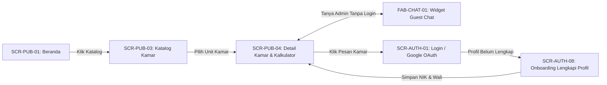
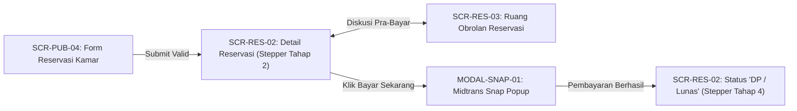

# App Flow Document (AFD): Sistem Informasi Manajemen Kost Terintegrasi Payment Gateway pada Asri Boarding House

## 1. Document Overview & Metadata

### 1.1. Identitas & Metadata Dokumen
| Atribut Dokumen | Keterangan |
| :--- | :--- |
| **Judul Dokumen & Versi** | App Flow Document (AFD) - Sistem Informasi Manajemen Kost Asri Boarding House v1.0 |
| **Status Dokumen** | Approved / Production Final |
| **Tanggal Efektif** | 4 November 2026 |
| **Penanggung Jawab** | Tim Pengembang Sistem Informasi Asri Boarding House |
| **Domain Produksi** | `https://asriboardinghouse.weatso.id/` |
| **Sistem Desain Visual** | Neo-Brutalism UI dengan Adaptabilitas *Light Mode* & *OLED Dark Mode* (`#030712`) |
| **Dokumen Referensi** | [PRD-Asri-Boarding-House.md](file:///c:/xampp/htdocs/asri-boarding-house/Documentation/PRD-Asri-Boarding-House.md) & [TRD-Asri-Boarding-House.md](file:///c:/xampp/htdocs/asri-boarding-house/Documentation/TRD-Asri-Boarding-House.md) |

### 1.2. Tujuan Dokumen
Dokumen **App Flow Document (AFD)** atau **UX Flow Document** ini disusun sebagai acuan tunggal bagi *UI/UX Designer*, *Frontend Developer*, dan *Quality Assurance (QA) Tester* dalam memahami struktur navigasi antar-layar (*screen transition*) di dalam aplikasi **Asri Boarding House**. Apabila dokumen PRD menitikberatkan pada spesifikasi kebutuhan fitur dan TRD merinci arsitektur kode di sisi server, maka AFD ini berfokus penuh pada pengalaman visual pengguna, tata letak komponen pada setiap halaman, interaksi langkah demi langkah, kondisi khusus tampilan (*loading*, *empty*, dan *error state*), hingga logika perpindahan dari satu layar ke layar lainnya.

### 1.3. Glosarium / Istilah Umum Elemen Antarmuka (UI Glossary)
Untuk menyeragamkan penyebutan komponen visual di seluruh bagian dokumen ini, tabel berikut mendefinisikan elemen antarmuka dan penanda interaksi yang digunakan pada aplikasi:

| Kode / Istilah UI | Lokasi Berkas Blade / JS | Penjelasan Visual & Perilaku Interaksi |
| :--- | :--- | :--- |
| **`MODAL-CONF-01`** (*Neo-Brutalist Confirmation Modal*) | `layouts/app.blade.php` (`window.brutalistConfirm`) | Kotak dialog konfirmasi kustom bergaya *Neo-Brutalism* dengan garis tepi tebal (`border-4`) dan bayangan kaku (`8px`). Menggantikan dialog `window.confirm()` bawaan peramban pada setiap aksi penting atau destruktif (seperti hapus data, batalkan reservasi, dan konfirmasi pembayaran). |
| **`MODAL-SNAP-01`** (*Midtrans Snap Popup*) | SDK Eksternal `snap.js` (`window.snap.pay`) | Jendela *overlay* pembayaran digital interaktif yang menampilkan pilihan QRIS, Virtual Account bank, dan dompet digital tanpa mengharuskan pengguna meninggalkan halaman aplikasi. |
| **`MODAL-FAC-01`** (*Facility Quick-Manage Modal*) | `admin/kamar/partials/facility-modal.blade.php` & `admin/fasilitas/partials/modal.blade.php` | Jendela modal di atas halaman form kamar atau master fasilitas yang memungkinkan admin menambah, mengubah, atau menghapus item fasilitas secara asinkron (AJAX) tanpa memuat ulang halaman. |
| **`TOAST-01`** (*Floating Brutalist Toast*) | `components/toast.blade.php` & `window.showToast()` | Kotak pemberitahuan melayang di sudut kanan atas layar (`top-5 right-5`) berwarna hijau zamrud untuk aksi berhasil (`✅ Sukses`) atau merah terang untuk kegagalan (`❌ Gagal`). Muncul dengan animasi geser turun dan menghilang otomatis setelah 4 hingga 4,5 detik. |
| **`FAB-WA-01`** (*Floating WhatsApp Button*) | `components/wa-float-button.blade.php` | Tombol aksi melayang di pojok kanan bawah halaman publik yang mencatat analitik klik ke server sebelum membuka ruang obrolan WhatsApp pengelola di tab baru. |
| **`FAB-CHAT-01`** (*Guest Live Chat Widget*) | `components/guest-chat-widget.blade.php` & `guest-chat.js` | Panel obrolan melayang di sudut kanan bawah halaman publik bagi pengunjung anonim untuk berkonsultasi langsung dengan admin tanpa harus login terlebih dahulu. |
| **5-Step Visual Stepper** | `reservasi/show.blade.php` | Indikator kemajuan horizontal 5 tahap pada halaman detail reservasi yang memandu calon penyewa mulai dari tahap Pengajuan, Diskusi/Pembayaran, Verifikasi Sistem, Konfirmasi Admin, hingga Aktivasi Penghuni. |
| **Shimmer Placeholder** | `layouts/landing.blade.php` (`removeShimmer()`) | Kerangka pemuat gambar beranimasi kilau (*shimmer*) yang menjaga dimensi kartu kamar dan galeri tetap stabil sebelum berkas foto selesai diunduh peramban. |
| **Rupiah Live Formatter** | `layouts/app.blade.php` (`.rupiah-input`) | Komponen input nominal uang yang secara otomatis menyisipkan titik pemisah ribuan (contoh: `1.500.000`) saat pengguna mengetik sekaligus menyinkronkan angka murninya ke input tersembunyi. |
| **Theme Switcher** | `navigation.blade.php`, `navigation-landing.blade.php`, `admin-topbar.blade.php` | Tombol pengalih instan antara tampilan *Light Mode* (latar putih/kuning cerah dengan garis tepi hitam) dan *OLED Dark Mode* (latar hitam pekat `#030712` dengan garis tepi putih kontras tinggi). |

---

## 2. High-Level Navigation Map (Sitemap)

Aplikasi **Asri Boarding House** membagi struktur navigasinya ke dalam empat zona utama berdasarkan peran dan status sesi pengguna: (1) **Zona Publik / Tamu**, (2) **Zona Autentikasi & Onboarding Akun**, (3) **Zona Portal Calon Penyewa & Penyewa Aktif**, serta (4) **Zona Portal Administrator**.

### 2.1. Diagram Visual Peta Navigasi Seluruh Sistem
Diagram di bawah ini memetakan hierarki perpindahan layar dari halaman utama (*Root* `/`) menuju seluruh layar di setiap portal.

```mermaid
flowchart TD
    subgraph PublicZone ["1. Zona Publik & Eksplorasi Tamu (Guest)"]
        PUB01["SCR-PUB-01: Beranda Utama (/)"]
        PUB02["SCR-PUB-02: Fasilitas Kost (/fasilitas)"]
        PUB03["SCR-PUB-03: Katalog Kamar (/kamar)"]
        PUB04["SCR-PUB-04: Detail Kamar & Kalkulator (/kamar/{kamar})"]
        PUB05["SCR-PUB-05: Cara Booking (/cara-booking)"]
        PUB06["SCR-PUB-06: Testimoni Penghuni (/testimoni)"]
        PUB07["SCR-PUB-07: Tentang Kami (/tentang-kami)"]
        PUB08["SCR-PUB-08: Tanya Jawab FAQ (/faq)"]
        PUB09["SCR-PUB-09: Galeri Properti (/galeri)"]
        FAB["FAB-CHAT-01: Widget Guest Chat & FAB-WA-01: Tombol WA"]
    end

    subgraph AuthZone ["2. Zona Autentikasi & Onboarding Profil"]
        AUTH01["SCR-AUTH-01: Login Calon Penyewa (/reservasi/login)"]
        AUTH02["SCR-AUTH-02: Registrasi Akun (/reservasi/register)"]
        AUTH03["SCR-AUTH-03: Login Penyewa Aktif (/penyewa/login)"]
        AUTH04["SCR-AUTH-04: Login Administrator (/admin/login)"]
        AUTH05["SCR-AUTH-05: Lupa Kata Sandi (/forgot-password & /admin/forgot-password)"]
        AUTH06["SCR-AUTH-06: Reset Kata Sandi (/reset-password/{token})"]
        AUTH07["SCR-AUTH-07: Wajib Ganti Sandi Awal (/admin/force-change-password)"]
        AUTH08["SCR-AUTH-08: Onboarding Lengkapi Profil (/profil/complete)"]
    end

    subgraph TenantZone ["3. Zona Portal Calon Penyewa & Penyewa Aktif"]
        RES01["SCR-RES-01: Daftar Pemesanan Reservasi (/penyewa/reservasi/pemesanan)"]
        RES02["SCR-RES-02: Detail Reservasi & 5-Step Stepper (/penyewa/reservasi/{id})"]
        RES03["SCR-RES-03: Ruang Obrolan Reservasi (/penyewa/reservasi/{id}/chat)"]
        RES04["SCR-RES-04: Riwayat Pembayaran Reservasi (/penyewa/reservasi/pembayaran)"]
        RES05["SCR-RES-05: Riwayat Obrolan Reservasi (/penyewa/reservasi/riwayat-chat)"]

        TEN01["SCR-TEN-01: Dasbor Penyewa Aktif (/penyewa/dashboard)"]
        TEN02["SCR-TEN-02: Daftar Tagihan Sewa (/penyewa/tagihan)"]
        TEN03["SCR-TEN-03: Detail & Bayar Tagihan (/penyewa/tagihan/{id})"]
        TEN04["SCR-TEN-04: Cetak Kuitansi PDF A5 (/penyewa/nota/{id}/cetak)"]
        TEN05["SCR-TEN-05: Daftar Keluhan Fasilitas (/penyewa/keluhan)"]
        TEN06["SCR-TEN-06: Form & Detail Keluhan (/penyewa/keluhan/create & /{id})"]
        TEN07["SCR-TEN-07: Peraturan & Kotak Notifikasi (/penyewa/peraturan & /notifikasi)"]
        TEN08["SCR-TEN-08: Pengaturan Profil & Akun (/profile)"]
    end

    subgraph AdminZone ["4. Zona Portal Administrator"]
        ADM01["SCR-ADM-01: Dasbor Analitik Eksekutif (/admin/dashboard)"]
        ADM02["SCR-ADM-02: Kalender Okupansi 42 Sel (/admin/kalender)"]
        ADM03["SCR-ADM-03: Manajemen Kamar & Form (/admin/kamar)"]
        ADM04["SCR-ADM-04: Master Fasilitas (/admin/fasilitas)"]
        ADM05["SCR-ADM-05: Manajemen Penyewa & Form Walk-in (/admin/penyewa)"]
        ADM06["SCR-ADM-06: Detail Kontrak & Perpanjang (/admin/penyewa/{id})"]
        ADM07["SCR-ADM-07: Form Check-Out & Klaim Deposit (/admin/penyewa/{id}/checkout)"]
        ADM08["SCR-ADM-08: Daftar & Verifikasi Reservasi (/admin/reservasi)"]
        ADM09["SCR-ADM-09: Manajemen Tagihan & Kasir Cash (/admin/tagihan)"]
        ADM10["SCR-ADM-10: Pembukuan Pengeluaran (/admin/pengeluaran)"]
        ADM11["SCR-ADM-11: Laporan Keuangan Laba-Rugi (/admin/laporan)"]
        ADM12["SCR-ADM-12: Tiket Keluhan Penghuni (/admin/keluhan)"]
        ADM13["SCR-ADM-13: Konsol Guest Live Chat (/admin/guest-chats)"]
        ADM14["SCR-ADM-14: Broadcast Notifikasi & Audit Log (/admin/notifikasi & /notifikasi-khusus)"]
        ADM15["SCR-ADM-15: Pengaturan CMS, FAQ, Galeri, Review, Peraturan (/admin/pengaturan-konten)"]
    end

    PUB01 --> PUB02 & PUB03 & PUB05 & PUB06 & PUB07 & PUB08 & PUB09 & FAB
    PUB03 --> PUB04
    PUB04 -->|Klik Pesan Kamar| AUTH01
    AUTH01 <--> AUTH02
    AUTH01 & AUTH03 & AUTH04 --> AUTH05 --> AUTH06
    AUTH01 & AUTH02 & AUTH03 & AUTH04 --> AUTH07 --> AUTH08

    AUTH08 -->|Role: Calon Penyewa| RES01
    RES01 --> RES02 & RES04 & RES05
    RES02 --> RES03
    RES02 -->|Setelah Dikonfirmasi Admin| TEN01

    AUTH08 -->|Role: Penyewa Aktif| TEN01
    TEN01 --> TEN02 & TEN05 & TEN07 & TEN08
    TEN02 --> TEN03 --> TEN04
    TEN05 --> TEN06

    AUTH08 -->|Role: Admin| ADM01
    ADM01 --> ADM02 & ADM03 & ADM04 & ADM05 & ADM08 & ADM09 & ADM10 & ADM11 & ADM12 & ADM13 & ADM14 & ADM15
    ADM05 --> ADM06 --> ADM07
```

---

### 2.2. Hierarki Struktur Halaman (Daftar Sitemap Berjenjang)
- **Root Publik (`/`)**
  - `SCR-PUB-01`: Beranda Utama (`/`)
  - `SCR-PUB-02`: Halaman Fasilitas (`/fasilitas`)
  - `SCR-PUB-03`: Katalog Daftar Kamar (`/kamar`)
    - `SCR-PUB-04`: Detail Kamar, Kalkulator Simulasi Harga, & Form Pengajuan Reservasi (`/kamar/{kamar}`)
  - `SCR-PUB-05`: Panduan Cara Booking (`/cara-booking`)
  - `SCR-PUB-06`: Halaman Testimoni Penghuni (`/testimoni`)
  - `SCR-PUB-07`: Halaman Tentang Kami & Peta Lokasi (`/tentang-kami`)
  - `SCR-PUB-08`: Halaman Tanya Jawab Interaktif (`/faq`)
  - `SCR-PUB-09`: Halaman Galeri Dokumentasi Kost (`/galeri`)
- **Gerbang Autentikasi & Onboarding (`/reservasi/*`, `/penyewa/*`, `/admin/*`, `/profil/*`)**
  - `SCR-AUTH-01`: Login Portal Reservasi Calon Penyewa (`/reservasi/login`)
  - `SCR-AUTH-02`: Registrasi Akun Calon Penyewa (`/reservasi/register`)
  - `SCR-AUTH-03`: Login Portal Penyewa Aktif (`/penyewa/login`)
  - `SCR-AUTH-04`: Login Portal Administrator (`/admin/login`)
  - `SCR-AUTH-05`: Form Permintaan Lupa Kata Sandi (`/forgot-password`, `/penyewa/forgot-password`, `/admin/forgot-password`)
  - `SCR-AUTH-06`: Form Atur Ulang Kata Sandi Baru (`/reset-password/{token}`, `/penyewa/reset-password/{token}`, `/admin/reset-password/{token}`)
  - `SCR-AUTH-07`: Layar Paksa Ganti Kata Sandi Bawaan (`/admin/force-change-password`)
  - `SCR-AUTH-08`: Layar Onboarding Kelengkapan Identitas Profil (`/profil/complete`)
- **Portal Calon Penyewa (`/penyewa/reservasi/*`)**
  - `SCR-RES-01`: Dasbor & Daftar Pemesanan Kamar (`/penyewa/reservasi/pemesanan` & `/penyewa/reservasi-dashboard`)
  - `SCR-RES-02`: Detail Reservasi, *5-Step Visual Stepper*, & Pembayaran (`/penyewa/reservasi/{reservasi}`)
  - `SCR-RES-03`: Ruang Obrolan Pra-Pembayaran Reservasi (`/penyewa/reservasi/{reservasi}/chat`)
  - `SCR-RES-04`: Riwayat Pembayaran Reservasi (`/penyewa/reservasi/pembayaran`)
  - `SCR-RES-05`: Riwayat Obrolan Reservasi (`/penyewa/reservasi/riwayat-chat`)
- **Portal Penyewa Aktif (`/penyewa/*`)**
  - `SCR-TEN-01`: Dasbor Utama Penyewa Aktif (`/penyewa/dashboard`)
  - `SCR-TEN-02`: Daftar Tagihan Sewa Bulanan & Sisa DP (`/penyewa/tagihan`)
  - `SCR-TEN-03`: Detail Tagihan & Instruksi Pembayaran (`/penyewa/tagihan/{tagihan}`)
  - `SCR-TEN-04`: Layar Pratinjau & Unduh Kuitansi Resmi PDF A5 (`/penyewa/nota/{pembayaran}/cetak`)
  - `SCR-TEN-05`: Daftar Tiket Keluhan Fasilitas (`/penyewa/keluhan`)
  - `SCR-TEN-06`: Form Buat Keluhan Baru & Detail Progres Keluhan (`/penyewa/keluhan/create` & `/penyewa/keluhan/{keluhan}`)
  - `SCR-TEN-07`: Halaman Tata Tertib Kost & Kotak Masuk Notifikasi (`/penyewa/peraturan` & `/penyewa/notifikasi`)
  - `SCR-TEN-08`: Pengaturan Profil, Ganti Kata Sandi, & Hapus Akun (`/profile` & `/penyewa/profile`)
- **Portal Administrator (`/admin/*`)**
  - `SCR-ADM-01`: Dasbor Analitik Eksekutif (`/admin/dashboard`)
  - `SCR-ADM-02`: Kalender Okupansi Visual 42 Sel (`/admin/kalender`)
  - `SCR-ADM-03`: Daftar, Tambah, Ubah, & Detail Master Kamar (`/admin/kamar`, `/create`, `/{kamar}/edit`, `/{kamar}`)
  - `SCR-ADM-04`: Manajemen Master Fasilitas (`/admin/fasilitas`)
  - `SCR-ADM-05`: Daftar Penyewa & Form Tambah Penyewa *Walk-in* (`/admin/penyewa` & `/admin/penyewa/create`)
  - `SCR-ADM-06`: Detail Kontrak Penyewa, Edit Data, & Perpanjangan Sewa (`/admin/penyewa/{penyewa}` & `/{penyewa}/edit`)
  - `SCR-ADM-07`: Formulir *Check-Out* Penghuni & Audit Klaim Deposit (`/admin/penyewa/{penyewa}/checkout`)
  - `SCR-ADM-08`: Daftar & Detail Verifikasi Reservasi Daring (`/admin/reservasi` & `/admin/reservasi/{reservasi}`)
  - `SCR-ADM-09`: Daftar, Detail Tagihan, & Konfirmasi Kasir Tunai (`/admin/tagihan` & `/admin/tagihan/{tagihan}`)
  - `SCR-ADM-10`: Daftar, Tambah, Ubah, & Detail Pengeluaran Operasional (`/admin/pengeluaran`)
  - `SCR-ADM-11`: Laporan Keuangan Arus Kas & Laba-Rugi (`/admin/laporan`)
  - `SCR-ADM-12`: Daftar & Detail Penanganan Tiket Keluhan (`/admin/keluhan` & `/admin/keluhan/{keluhan}`)
  - `SCR-ADM-13`: Konsol Balas *Guest Live Chat* (`/admin/guest-chats`)
  - `SCR-ADM-14`: Manajemen Broadcast Notifikasi, Retry Log, & Jejak Audit Sistem (`/admin/notifikasi` & `/admin/notifikasi-khusus`)
  - `SCR-ADM-15`: Pengaturan Konten Situs (CMS), Rekening, Promo, FAQ, Galeri, Testimoni, Peraturan, & Profil Admin (`/admin/pengaturan-konten`, `/admin/faq`, `/admin/gallery`, `/admin/reviews`, `/admin/peraturan`, `/admin/profil`)

---

## 3. Screen-by-Screen Flow & Wireframe References

Bagian ini membedah setiap layar di dalam aplikasi secara mendetail, mencakup susunan komponen visual, pemicu masuk, aksi navigasi pengguna, serta perilaku tampilan pada kondisi khusus.

---

### 3.1. Zona 1: Halaman Publik & Eksplorasi Tamu (`layouts/landing.blade.php`)

#### `SCR-PUB-01`: Beranda Utama (`/` -> `landing/index.blade.php`)
- **Deskripsi Visual**:
  - **Topbar Navigasi Publik (`navigation-landing.blade.php`)**: Logo merek dinamis di sisi kiri, tautan menu utama (Beranda, Fasilitas, Kamar, Cara Booking, Testimoni, Tentang Kami, FAQ, Galeri) di tengah, serta tombol pengalih tema (*Theme Switcher*) dan tombol masuk/dasbor di sisi kanan.
  - **Hero Section**: Judul promosi berhuruf *Space Grotesk* tebal, lencana lokasi Tembalang Semarang, tombol aksi utama `"Lihat Katalog Kamar"` dan `"Konsultasi via WhatsApp"`, serta bingkai foto utama kost bertepi tebal (`border-4`).
  - **Section Cuplikan Katalog, Fasilitas Unggulan, & Testimoni**: Barisan kartu kamar pilihan (`components/landing/kamar-card.blade.php`), kartu fasilitas berikon (`facility-card.blade.php`), kartu ulasan bintang penghuni (`review-card.blade.php`), serta akordeon FAQ ringkas (`faq-item.blade.php`).
  - **Widget Melayang Global**: Tombol WhatsApp (`FAB-WA-01`) dan tombol *Guest Live Chat* (`FAB-CHAT-01`) di sudut kanan bawah layar.
- **Trigger / Cara Masuk**: Pengguna membuka alamat domain utama `https://asriboardinghouse.weatso.id/` atau menekan logo merek dari halaman mana pun.
- **Interaksi & Alur Navigasi**:
  - *Jika pengguna klik tombol `"Lihat Katalog Kamar"`*: Pindah ke `SCR-PUB-03 (/kamar)`.
  - *Jika pengguna klik salah satu kartu kamar*: Pindah ke `SCR-PUB-04 (/kamar/{kamar})`.
  - *Jika pengguna klik tombol `"Masuk / Booking"` di bilah navigasi (kondisi belum login)*: Pindah ke `SCR-AUTH-01 (/reservasi/login)`.
  - *Jika pengguna klik tombol `"Dashboard"` di bilah navigasi (kondisi sudah login)*: Sistem mengarahkan ke `SCR-ADM-01`, `SCR-TEN-01`, atau `SCR-RES-01` sesuai peran akun.
  - *Jika pengguna klik `FAB-CHAT-01`*: Membuka jendela *overlay* *Guest Live Chat* di sudut kanan bawah tanpa berpindah halaman.
- **State Khusus**:
  - *Loading State*: Gambar hero dan foto kartu kamar menampilkan kerangka abu-abu berkilau (*Shimmer Placeholder*) yang memudar halus (`opacity-0` selama 300ms) begitu foto selesai dimuat.
  - *Empty State*: Apabila belum ada data kamar atau testimoni aktif, section terkait menampilkan kotak informasi bertuliskan data sedang diperbarui oleh pengelola.

---

#### `SCR-PUB-03`: Katalog Daftar Kamar (`/kamar` -> `landing/kamar-list.blade.php`)
- **Deskripsi Visual**:
  - **Header Halaman**: Banner kuning bergaya Neo-Brutalist dengan judul `"Katalog Kamar Eksklusif"` dan subjudul informasi total 32 unit kamar.
  - **Bilah Penyaring (Filter Bar)**: Pilihan filter tipe kamar (`Semua`, `Standar`, `Deluxe`, `VIP`) dan filter status ketersediaan (`Semua Status`, `Tersedia`, `Terisi`), dilengkapi formulir pengecekan ketersediaan tanggal sewa.
  - **Grid Kartu Kamar**: Susunan kartu 3 kolom di layar desktop (1 kolom di ponsel) yang memuat foto kamar, lencana tipe, lencana status (`Tersedia` berwarna hijau, `Terisi` berwarna merah, `Maintenance` berwarna kuning), luas ruangan (m²), posisi lantai, tarif bulanan, daftar ikon fasilitas, serta tombol `"Lihat Detail & Pesan"`.
  - **Paginasi Neo-Brutalist**: Deretan tombol halaman berkotak tegas di bagian bawah (`vendor/pagination/neo-brutalist.blade.php`).
- **Trigger / Cara Masuk**: Klik menu `"Kamar"` pada navigasi atas atau klik tombol `"Lihat Semua Kamar"` dari `SCR-PUB-01`.
- **Interaksi & Alur Navigasi**:
  - *Jika pengguna memilih filter Tipe atau Status Kamar*: Halaman memuat ulang daftar kamar yang sesuai dan mempertahankan parameter filter pada tombol paginasi.
  - *Jika pengguna mengisi rentang tanggal pada kotak Cek Ketersediaan lalu menekan `"Cek"`*: Sistem mengirim permintaan ke `/cek-ketersediaan` dan menyoroti unit kamar yang bebas bentrok tanggal.
  - *Jika pengguna klik tombol `"Lihat Detail & Pesan"` pada kartu kamar*: Pindah ke `SCR-PUB-04 (/kamar/{kamar})`.
- **State Khusus**:
  - *Empty State*: Jika kombinasi filter tidak menemukan kamar yang cocok, sistem menampilkan kotak ilustrasi kosong dengan tombol `"Reset Filter"` untuk mengembalikan seluruh daftar kamar.

---

#### `SCR-PUB-04`: Detail Kamar, Kalkulator Simulasi Harga, & Form Reservasi (`/kamar/{kamar}` -> `landing/show.blade.php`)
- **Deskripsi Visual**:
  - **Kolom Kiri (Informasi & Spesifikasi Unit)**: Bingkai foto besar kamar, lencana nomor kamar, lantai, luas m², tipe kamar, status ketersediaan, deskripsi lengkap ruangan, serta daftar fasilitas yang dimiliki unit tersebut.
  - **Kolom Kanan Atas (Kalkulator Simulasi Harga & Paket Promo)**: Pilihan dropdown Tipe Sewa (`Bulanan`, `Mingguan`, `Harian`), input Durasi, serta kartu pilihan Paket Promo aktif (Paket Fleksibel 1 Bulan diskon 0%, Paket Hemat Triwulan 3 Bulan diskon 5%, Paket Tahunan Super Promo 12 Bulan diskon 8,33%). Di bawahnya terdapat kotak rincian hasil hitung (Harga Satuan, Subtotal, Potongan Diskon Promo, Total Harga Akhir, serta estimasi DP 30% dan Sisa 70%).
  - **Kolom Kanan Bawah (Panel Aksi / Formulir Pengajuan Reservasi)**:
    - Bagi tamu belum login: Menampilkan tombol mencolok `"Login untuk Memesan Kamar Ini"` dan `"Konsultasi via WhatsApp"`.
    - Bagi calon penyewa yang sudah login & profil lengkap: Menampilkan formulir langsung berisi input Tanggal Mulai Masuk, Tipe Sewa, Durasi, Metode Pembayaran (`Midtrans Snap` atau `Cash / Transfer Manual`), pilihan skema bayar (`Bayar Lunas 100%` atau `Bayar DP 30%`), Catatan Tambahan, dan tombol `"Ajukan Reservasi Sekarang"`.
- **Trigger / Cara Masuk**: Klik kartu kamar dari `SCR-PUB-01` atau `SCR-PUB-03`, atau kembali otomatis setelah melengkapi profil dari `SCR-AUTH-08` (*intended URL*).
- **Interaksi & Alur Navigasi**:
  - *Jika pengguna mengubah Tipe Sewa, Durasi, atau klik salah satu kartu Paket Promo*: Klien mengirim permintaan AJAX `POST /kamar/{kamar}/hitung-harga` dan memperbarui angka Subtotal, Diskon, Total Harga, serta nominal DP 30% secara *real-time* tanpa memuat ulang halaman.
  - *Jika tamu (belum login) klik `"Login untuk Memesan Kamar Ini"`*: Pindah ke `SCR-AUTH-01 (/reservasi/login)`.
  - *Jika calon penyewa (sudah login) mengisi form reservasi dan klik `"Ajukan Reservasi Sekarang"`*:
    - *Jika validasi gagal (misal tanggal bentrok atau akun sudah punya reservasi aktif)*: Tetap di `SCR-PUB-04` dan tampilkan kotak peringatan kesalahan merah di atas formulir.
    - *Jika validasi lolos*: Simpan reservasi baru, tampilkan `TOAST-01` `"Reservasi berhasil diajukan"`, lalu pindah ke `SCR-RES-02 (/penyewa/reservasi/{reservasi})`.
- **State Khusus**:
  - *Unavailable / Locked State*: Apabila status kamar sedang `terisi` atau `maintenance`, tombol pengajuan reservasi dikunci (berwarna abu-abu nonaktif) disertai keterangan `"Kamar Tidak Tersedia Saat Ini"`, namun pengguna tetap dapat menggunakan tombol konsultasi WhatsApp untuk menanyakan jadwal kosong berikutnya.

---

#### `SCR-PUB-02`, `SCR-PUB-05` s.d. `SCR-PUB-09`: Halaman Informasi Publik Pendukung
| Kode Layar | Nama Layar & Rute | Deskripsi Visual & Komponen Utama | Interaksi & Navigasi Utama |
| :--- | :--- | :--- | :--- |
| **`SCR-PUB-02`** | Fasilitas Kost (`/fasilitas`) | Grid kartu seluruh fasilitas kamar dan fasilitas bersama lengkap dengan ikon vektor dan deskripsi fungsi. | Klik CTA bagian bawah -> Pindah ke `SCR-PUB-03 (/kamar)`. |
| **`SCR-PUB-05`** | Cara Booking (`/cara-booking`) | Infografis alur 5 langkah pemesanan kamar, penjelasan aturan DP 30%, dan metode pembayaran Midtrans/Tunai. | Klik tombol `"Mulai Cari Kamar"` -> Pindah ke `SCR-PUB-03 (/kamar)`. |
| **`SCR-PUB-06`** | Testimoni (`/testimoni`) | Grid kartu ulasan penghuni kost berisi foto avatar, nama, pekerjaan/kampus, peringkat bintang, dan kutipan ulasan. | Klik tombol `"Pesan Kamar Sekarang"` -> Pindah ke `SCR-PUB-03`. |
| **`SCR-PUB-07`** | Tentang Kami (`/tentang-kami`) | Profil sejarah Asri Boarding House, visi-misi, informasi kontak resmi, serta sematan peta interaktif Google Maps. | Klik tombol `"Hubungi Admin"` -> Memicu `FAB-WA-01` ke WhatsApp. |
| **`SCR-PUB-08`** | Tanya Jawab FAQ (`/faq`) | Daftar pertanyaan umum dalam komponen akordeon interaktif Alpine.js yang dapat dibuka-tutup per butir pertanyaan. | Klik baris pertanyaan -> Membuka panel jawaban secara halus di layar yang sama. |
| **`SCR-PUB-09`** | Galeri Properti (`/galeri`) | Kisi dokumentasi foto bangunan, area parkir, ruang bersama, dan interior kamar dengan pratinjau penuh. | Klik kartu foto -> Menampilkan keterangan judul dan deskripsi foto; mendukung paginasi. |

---

### 3.2. Zona 2: Portal Autentikasi & Onboarding Akun (`layouts/guest.blade.php`)

#### `SCR-AUTH-01`, `SCR-AUTH-03`, & `SCR-AUTH-04`: Tiga Layar Login Terisolasi
- **Rute & Berkas Blade**:
  - `SCR-AUTH-01`: Login Calon Penyewa (`/reservasi/login` -> `auth/reservasi-login.blade.php`)
  - `SCR-AUTH-03`: Login Penyewa Aktif (`/penyewa/login` -> `auth/penyewa-login.blade.php`)
  - `SCR-AUTH-04`: Login Administrator (`/admin/login` -> `auth/admin-login.blade.php`)
- **Deskripsi Visual**:
  - Kartu tengah berbingkai tebal (`border-4 border-black`) di atas latar belakang berpola geometris.
  - Lencana identitas portal di bagian atas kartu (membedakan dengan jelas apakah pengguna sedang berada di Portal Reservasi, Portal Penghuni Aktif, atau Portal Admin).
  - Input Email, input Kata Sandi dengan tombol mata pengintip sandi (`components/auth/password-input.blade.php`), kotak centang `"Ingat Saya"`, tautan `"Lupa Kata Sandi?"`, serta tombol submit utama.
  - Khusus pada `SCR-AUTH-01`: Dilengkapi tombol `"Masuk / Daftar dengan Google"` (`components/auth/google-button.blade.php`) dan tautan menuju halaman pendaftaran `SCR-AUTH-02`.
- **Trigger / Cara Masuk**: Klik tombol Login dari halaman publik, atau diarahkan otomatis oleh `PortalRedirectResolver` saat mengakses URL terproteksi tanpa sesi aktif.
- **Interaksi & Alur Navigasi**:
  - *Jika pengguna klik tombol `"Masuk dengan Google"` pada `SCR-AUTH-01`*: Tombol langsung dikunci (`disabled`) dengan teks `"Mengarahkan ke Google..."`, lalu beralih ke halaman persetujuan Google OAuth 2.0.
  - *Jika kredensial salah atau akun nonaktif*: Tetap di layar login dan tampilkan pesan kesalahan merah di bawah kolom input. Jika gagal lebih dari 5 kali dalam 1 menit (`throttle:5,1`), tampilkan peringatan batas percobaan.
  - *Jika kredensial benar*:
    - *Jika akun memiliki flag `require_password_change == true`*: Pindah paksa ke `SCR-AUTH-07`.
    - *Jika data NIK, No HP, atau Kontak Wali belum lengkap*: Pindah paksa ke `SCR-AUTH-08 (/profil/complete)`.
    - *Jika akun sudah lengkap*: Pindah ke `SCR-RES-01` (Calon Penyewa), `SCR-TEN-01` (Penyewa Aktif), atau `SCR-ADM-01` (Admin).
  - *Jika pengguna klik `"Lupa Kata Sandi?"`*: Pindah ke `SCR-AUTH-05`.

---

#### `SCR-AUTH-02`: Registrasi Akun Calon Penyewa (`/reservasi/register` -> `auth/reservasi-register.blade.php`)
- **Deskripsi Visual**: Formulir pendaftaran berisi input Nama Lengkap, Alamat Email, Nomor WhatsApp, Kata Sandi, Konfirmasi Kata Sandi, tombol `"Daftar Sekarang"`, tombol alternatif `"Daftar dengan Google"`, serta tautan kembali ke `SCR-AUTH-01`.
- **Trigger / Cara Masuk**: Klik tautan `"Belum punya akun? Daftar di sini"` pada `SCR-AUTH-01`.
- **Interaksi & Alur Navigasi**:
  - *Jika pengguna submit form dan email/nomor HP sudah terdaftar pada akun aktif*: Tampilkan pesan validasi di bawah kolom terkait.
  - *Jika pendaftaran berhasil*: Buat sesi login otomatis lalu arahkan pengguna ke `SCR-AUTH-08 (/profil/complete)` untuk melengkapi NIK 16 digit dan informasi orang tua/wali.

---

#### `SCR-AUTH-05` & `SCR-AUTH-06`: Lupa & Atur Ulang Kata Sandi
- **Rute & Berkas Blade**:
  - `SCR-AUTH-05`: `/forgot-password`, `/penyewa/forgot-password`, `/admin/forgot-password` (`auth/forgot-password.blade.php`, `auth/penyewa-forgot-password.blade.php`, `auth/admin-forgot-password.blade.php`).
  - `SCR-AUTH-06`: `/reset-password/{token}`, `/penyewa/reset-password/{token}`, `/admin/reset-password/{token}` (`auth/reset-password.blade.php`, dll.).
- **Deskripsi Visual & Interaksi**:
  - Pada `SCR-AUTH-05`, pengguna memasukkan alamat email terdaftar dan menekan `"Kirim Tautan Reset"`. Sistem menampilkan banner status hijau bahwa tautan telah dikirim ke email.
  - Saat pengguna membuka tautan dari email, pengguna masuk ke `SCR-AUTH-06`, mengisi Kata Sandi Baru dan Konfirmasi Kata Sandi, lalu menekan `"Simpan Kata Sandi"`. Setelah berhasil, pengguna diarahkan kembali ke layar login portal yang sesuai (`SCR-AUTH-01`, `SCR-AUTH-03`, atau `SCR-AUTH-04`) disertai notifikasi sukses.

---

#### `SCR-AUTH-07`: Wajib Ganti Kata Sandi Awal (`/admin/force-change-password` -> `auth/admin-force-change-password.blade.php`)
- **Deskripsi Visual**: Kartu peringatan kuning-hitam yang menjelaskan bahwa akun baru (seperti penyewa *walk-in* yang didaftarkan admin dengan kata sandi awal berupa nomor HP) wajib memperbarui kata sandinya demi keamanan. Berisi input Kata Sandi Baru (minimal 8 karakter kombinasi huruf dan angka) dan Konfirmasi Kata Sandi.
- **Trigger / Cara Masuk**: Pencegatan otomatis oleh middleware `EnsurePasswordChanged` sesaat setelah pengguna login. Selama berada di kondisi ini, seluruh menu navigasi lain dikunci.
- **Interaksi & Alur Navigasi**:
  - *Jika kata sandi baru masih sama dengan kata sandi lama atau kurang dari 8 karakter*: Tampilkan pesan error validasi.
  - *Jika valid*: Simpan kata sandi baru, ubah penanda `require_password_change` menjadi `false`, tampilkan `TOAST-01`, lalu lanjutkan ke `SCR-AUTH-08` (jika profil belum lengkap) atau langsung ke dasbor (`SCR-TEN-01` / `SCR-ADM-01`).

---

#### `SCR-AUTH-08`: Onboarding Kelengkapan Identitas Profil (`/profil/complete` -> `auth/complete-profile.blade.php`)
- **Deskripsi Visual**:
  - Banner instruksi onboarding yang menjelaskan bahwa data kependudukan dan kontak darurat wali wajib dilengkapi satu kali sebelum mengajukan sewa kamar.
  - Input Nomor WhatsApp Aktif (`no_hp`), Nomor Induk Kependudukan (`nik` tepat 16 digit angka), Nama Lengkap Orang Tua / Wali (`nama_wali`), dan Nomor WhatsApp Wali (`no_wali`), serta tombol `"Simpan & Lanjutkan"`.
- **Trigger / Cara Masuk**: Pencegatan otomatis oleh middleware `EnsureProfileIsComplete` ketika pengguna baru (terutama dari Google OAuth atau registrasi cepat) belum memiliki data NIK dan wali yang lengkap.
- **Interaksi & Alur Navigasi**:
  - *Jika NIK bukan 16 digit angka atau nomor WhatsApp wali sama dengan nomor pribadi penyewa*: Tampilkan pesan kesalahan di bawah kolom input.
  - *Jika valid dan disimpan*: Sistem mengarahkan pengguna kembali ke halaman tujuan awal yang sempat tertunda (*intended URL*, misalnya kembali ke halaman detail kamar `SCR-PUB-04` yang sedang ingin dipesan) atau menuju `SCR-RES-01`.

---

### 3.3. Zona 3: Portal Calon Penyewa & Penyewa Aktif (`layouts/app.blade.php` & `layouts/penyewa.blade.php`)

#### `SCR-RES-01`: Dasbor & Daftar Pemesanan Calon Penyewa (`/penyewa/reservasi/pemesanan` -> `reservasi/index.blade.php` & `penyewa/dashboard-pending.blade.php`)
- **Deskripsi Visual**:
  - **Sidebar & Topbar Portal Calon Penyewa**: Menampilkan menu khusus tahap pra-hunian, yaitu Daftar Pemesanan, Riwayat Pembayaran, Riwayat Chat, Peraturan Kost, dan Profil.
  - **Daftar Kartu Reservasi**: Menampilkan seluruh pengajuan reservasi kamar milik pengguna beserta foto unit, nomor kamar, tipe sewa, tanggal mulai dan selesai, total biaya, lencana status (`Pending`, `DP 30%`, `Lunas`, `Dikonfirmasi`, `Batal`), serta tombol aksi `"Lihat Detail / Bayar"` dan `"Buka Chat Admin"`.
- **Trigger / Cara Masuk**: Pengguna berstatus calon penyewa berhasil login atau menekan menu `"Pemesanan Saya"` di sidebar.
- **Interaksi & Alur Navigasi**:
  - *Jika pengguna belum memiliki pengajuan reservasi sama sekali*: Tampilkan *Empty State* dengan ilustrasi kamar dan tombol `"Cari Kamar Tersedia"` yang mengarahkan ke `SCR-PUB-03 (/kamar)`.
  - *Jika pengguna klik `"Lihat Detail / Bayar"`*: Pindah ke `SCR-RES-02 (/penyewa/reservasi/{reservasi})`.
  - *Jika pengguna klik `"Buka Chat Admin"`*: Pindah ke `SCR-RES-03 (/penyewa/reservasi/{reservasi}/chat)`.

---

#### `SCR-RES-02`: Detail Reservasi, *5-Step Visual Stepper*, & Pembayaran (`/penyewa/reservasi/{reservasi}` -> `reservasi/show.blade.php`)
- **Deskripsi Visual**:
  - **Komponen *5-Step Visual Stepper***: Baris indikator 5 tahap berangka tegas: (1) *Reservasi Diajukan*, (2) *Diskusi & Pembayaran*, (3) *Verifikasi Pembayaran*, (4) *Konfirmasi Admin*, dan (5) *Akses Penghuni Aktif*. Tahap yang sedang berlangsung diberi warna aksen kuning menyala dan ikon animasi aktif.
  - **Kartu Rincian Pemesanan & Tagihan Awal**: Menampilkan spesifikasi kamar, durasi sewa, total harga, skema pembayaran yang dipilih (Lunas 100% atau DP 30% beserta rincian nominal DP dan sisa 70%), serta batas waktu kedaluwarsa pembayaran (24 jam sejak dibuat).
  - **Panel Pembayaran & Aksi**:
    - Jika memilih jalur `Midtrans`: Menampilkan tombol utama `"Bayar Sekarang via Midtrans"`.
    - Jika memilih jalur `Cash`: Menampilkan kotak instruksi nomor rekening bank kost dinamis dan arahan untuk berkoordinasi melalui ruang obrolan.
    - Tombol sekunder `"Diskusi dengan Admin (Chat)"` dan tombol merah `"Batalkan Reservasi"` (hanya muncul selama status masih `pending`).
- **Trigger / Cara Masuk**: Diarahkan otomatis setelah mengirim form reservasi di `SCR-PUB-04` atau memilih salah satu item dari `SCR-RES-01`.
- **Interaksi & Alur Navigasi**:
  - *Jika pengguna klik `"Bayar Sekarang via Midtrans"`*:
    1. Tombol berubah menjadi status memuat (*loading spinner*) dan mengirim permintaan AJAX `POST /penyewa/reservasi/{reservasi}/token`.
    2. Begitu `snap_token` diterima, sistem membuka jendela **`MODAL-SNAP-01`** (*Midtrans Snap Popup*) di atas layar.
    3. *Jika pembayaran selesai (`onSuccess`)*: Jendela popup tertutup, halaman memuat ulang otomatis, lencana status berubah menjadi `DP` atau `Lunas`, dan *Stepper* maju ke tahap menunggu Konfirmasi Admin.
    4. *Jika pengguna menutup popup sebelum membayar (`onClose`)*: Menampilkan `TOAST-01` peringatan bahwa pembayaran belum diselesaikan dan tombol bayar aktif kembali.
  - *Jika pengguna klik `"Batalkan Reservasi"`*: Memunculkan **`MODAL-CONF-01`** (`"Apakah Anda yakin ingin membatalkan reservasi kamar ini?"`). Jika dikonfirmasi, status berubah menjadi `Batal` disertai `TOAST-01`.
  - *Jika pengguna klik `"Diskusi dengan Admin"`*: Pindah ke `SCR-RES-03`.

---

#### `SCR-RES-03`: Ruang Obrolan Pra-Pembayaran Reservasi (`/penyewa/reservasi/{reservasi}/chat` -> `penyewa/chat.blade.php` & `reservasi/chat-box.blade.php`)
- **Deskripsi Visual**:
  - Header informasi nomor kamar dan status reservasi beserta tombol kembali ke `SCR-RES-02`.
  - Area percakapan bergaya balon pesan (*chat bubbles*): pesan dari calon penyewa berada di sisi kanan (latar kuning tegas), sedangkan balasan admin berada di sisi kiri (latar putih/abu-abu gelap) lengkap dengan jam pengiriman dan tanda centang status baca (`is_read`).
  - Bilah input pesan di bagian bawah dengan kolom ketik teks dan tombol `"Kirim"`.
- **Trigger / Cara Masuk**: Klik tombol `"Diskusi dengan Admin"` dari `SCR-RES-02`, `SCR-RES-01`, atau daftar riwayat obrolan `SCR-RES-05`.
- **Interaksi & Alur Navigasi**:
  - *Jika pengguna mengetik pesan dan menekan Enter atau tombol `"Kirim"`*: Pesan dikirim secara asinkron (`POST /chat-box/{reservasi}/send`), kolom input dikosongkan, dan balon pesan langsung ditambahkan ke bagian bawah layar dengan gulir otomatis (*auto-scroll*).
  - *Penarikan Pesan Baru Otomatis*: Layar menjalankan *Smart Adaptive Polling* (`GET /chat-box/{reservasi}/fetch?after=last_id`) setiap 4 hingga 12 detik untuk menampilkan balasan admin secara langsung tanpa memuat ulang halaman.

---

#### `SCR-RES-04` & `SCR-RES-05`: Riwayat Pembayaran & Riwayat Obrolan Calon Penyewa
- **`SCR-RES-04` (`/penyewa/reservasi/pembayaran` -> `penyewa/riwayat-pembayaran.blade.php`)**: Menampilkan tabel dan kartu riwayat pembayaran reservasi awal (kode transaksi, nominal DP/lunas, metode pembayaran, waktu bayar, dan tautan kembali ke detail reservasi `SCR-RES-02`).
- **`SCR-RES-05` (`/penyewa/reservasi/riwayat-chat` -> `penyewa/riwayat-chat.blade.php`)**: Menampilkan daftar seluruh utas percakapan reservasi beserta cuplikan pesan terakhir dan lencana jumlah pesan belum dibaca. Klik pada salah satu baris langsung mengarahkan pengguna ke ruang obrolan `SCR-RES-03`.

---

#### `SCR-TEN-01`: Dasbor Utama Penyewa Aktif (`/penyewa/dashboard` -> `penyewa/dashboard.blade.php`)
- **Deskripsi Visual**:
  - **Banner Sapaan & Status Hunian**: Menampilkan nama penghuni, nomor kamar yang dihuni, tipe kamar, lantai, serta lencana status kontrak `AKTIF`.
  - **Kartu Metrik Kontrak Personal**: Menampilkan tarif sewa bulanan yang telah dibekukan (*Immutable Rent Snapshot*), nominal uang jaminan (*deposit*) yang tersimpan, tanggal masuk, tanggal berakhir kontrak, serta hitung mundur sisa hari masa sewa.
  - **Kartu Peringatan Tagihan Bulan Berjalan**: Jika terdapat tagihan berstatus `pending` atau `terlambat` (maupun tagihan pelunasan `SISA-DP-*`), sistem menampilkan kotak sorotan mencolok beserta tombol cepat `"Bayar Tagihan Sekarang"`.
  - **Papan Pengumuman Kost**: Menampilkan daftar pengumuman aktif dari pengelola.
- **Trigger / Cara Masuk**: Login melalui `SCR-AUTH-03` bagi pengguna yang sudah memiliki kontrak aktif (`EnsureTenantIsActive`), atau setelah reservasi daringnya dikonfirmasi oleh admin.
- **Interaksi & Alur Navigasi**:
  - *Jika pengguna klik `"Bayar Tagihan Sekarang"` atau menu `"Tagihan Sewa"`*: Pindah ke `SCR-TEN-02 (/penyewa/tagihan)`.
  - *Jika pengguna klik tombol `"Laporkan Keluhan Kamar"`*: Pindah ke `SCR-TEN-06 (/penyewa/keluhan/create)`.
  - *Jika pengguna klik pengumuman*: Membuka isi lengkap pengumuman atau pindah ke `SCR-TEN-07 (/penyewa/notifikasi)`.

---

#### `SCR-TEN-02` & `SCR-TEN-03`: Daftar & Detail Pembayaran Tagihan Sewa (`/penyewa/tagihan` & `/penyewa/tagihan/{tagihan}`)
- **Berkas Blade**: `penyewa/tagihan/index.blade.php` (`SCR-TEN-02`) dan `penyewa/tagihan/show.blade.php` (`SCR-TEN-03`).
- **Deskripsi Visual**:
  - Pada `SCR-TEN-02`: Daftar seluruh invoice sewa bulanan (`INV-*`), tagihan awal (`RSV-INITIAL-*`), maupun tagihan pelunasan sisa uang muka (`SISA-DP-*`). Setiap baris menampilkan periode bulan/tahun, tanggal jatuh tempo (tanggal 10), nominal pokok, nominal denda (jika ada), total tagihan, lencana status (`Pending`, `Terlambat`, `Lunas`), serta tombol `"Detail / Bayar"` atau `"Cetak Nota"`.
  - Pada `SCR-TEN-03`:
    - **Indikator 3 Tahap Eskalasi Keterlambatan**: Menjelaskan posisi tagihan saat ini, mulai dari Masa Normal (tanggal 1 s.d. 10), Masa Tenggang / Peringatan Bulan Pertama (`bulan_keterlambatan = 1`, denda Rp 0), hingga Tahap Denda Flat 5% & Pemberitahuan Wali (`bulan_keterlambatan >= 2`).
    - **Panel Pelunasan Hibrida**: Tombol `"Bayar Instan via Midtrans"` dan kotak informasi rekening bank kost untuk pembayaran manual/tunai.
- **Interaksi & Alur Navigasi**:
  - *Jika pengguna klik `"Detail / Bayar"` pada `SCR-TEN-02`*: Pindah ke `SCR-TEN-03`.
  - *Jika pengguna klik `"Bayar Instan via Midtrans"` pada `SCR-TEN-03`*: Meminta token pembayaran ke `/penyewa/pembayaran/{tagihan}/token` dan memunculkan **`MODAL-SNAP-01`**. Setelah lunas, halaman disegarkan dan menampilkan tombol `"Unduh / Cetak Kuitansi Resmi (A5)"`.
  - *Jika pengguna klik `"Cetak Nota"` pada tagihan yang sudah lunas*: Membuka `SCR-TEN-04 (/penyewa/nota/{pembayaran}/cetak)`.

---

#### `SCR-TEN-04`: Pratinjau & Unduh Kuitansi Resmi PDF A5 (`/penyewa/nota/{pembayaran}/cetak` -> `nota/cetak.blade.php`)
- **Deskripsi Visual**:
  - Bilah kendali di bagian atas layar berisi tombol `"Unduh PDF (A5)"`, tombol `"Cetak Printer"`, dan tombol `"Kembali"`.
  - Kanvas kuitansi berukuran kertas A5 lanskap bergaya resmi yang menampilkan kop Asri Boarding House, nomor referensi invoice (`order_id`), ID transaksi pembayaran, nama penyewa, nomor kamar, rincian nominal pokok dan denda, total pembayaran, tanggal lunas, metode pembayaran, serta stempel digital **`LUNAS / VERIFIED`**.
- **Trigger / Cara Masuk**: Klik tombol `"Cetak Nota"` dari `SCR-TEN-02`, `SCR-TEN-03`, atau dari halaman tagihan admin `SCR-ADM-09`.
- **Interaksi & Alur Navigasi**:
  - *Jika pengguna klik `"Unduh PDF (A5)"`*: Pustaka klien `html2pdf.js` mengubah elemen kanvas kuitansi menjadi berkas PDF bernama `Nota-Pembayaran-{order_id}.pdf` dan langsung mengunduhnya ke perangkat pengguna tanpa memuat ulang halaman.
  - *Jika pengguna klik `"Cetak Printer"`*: Memicu dialog cetak bawaan peramban (`window.print()`) dengan aturan CSS `@media print` yang menyembunyikan bilah tombol kendali.

---

#### `SCR-TEN-05` & `SCR-TEN-06`: Daftar, Form Buat, & Detail Tiket Keluhan Fasilitas (`/penyewa/keluhan/*`)
- **Berkas Blade**: `penyewa/keluhan/index.blade.php` (`SCR-TEN-05`), `penyewa/keluhan/create.blade.php`, dan `penyewa/keluhan/show.blade.php` (`SCR-TEN-06`).
- **Deskripsi Visual & Interaksi**:
  - Pada `SCR-TEN-05`: Menampilkan daftar laporan kerusakan fasilitas yang pernah diajukan penyewa beserta lencana kategori (`Kamar`, `Fasilitas Bersama`, `Kebersihan`, `Keamanan`, `Lainnya`), lencana status (`Pending`, `Diproses`, `Selesai`), dan tombol `"+ Buat Laporan Keluhan"`.
  - Klik `"+ Buat Laporan Keluhan"` mengarahkan ke form `SCR-TEN-06`: Pengguna mengisi Judul Keluhan, memilih Kategori, menuliskan Deskripsi Detail, dan mengunggah Foto Bukti Kerusakan (maksimal 2MB dengan pratinjau gambar langsung).
  - Saat disimpan, pengguna kembali ke `SCR-TEN-05` disertai `TOAST-01` `"Laporan keluhan berhasil dikirim"`.
  - Klik pada salah satu item keluhan membuka halaman detail `SCR-TEN-06` yang menampilkan foto bukti, linimasa status penanganan, serta kotak **Tanggapan Resmi Admin** apabila keluhan telah ditindaklanjuti.

---

#### `SCR-TEN-07` & `SCR-TEN-08`: Peraturan Kost, Kotak Notifikasi, & Pengaturan Profil
- **`SCR-TEN-07` (`/penyewa/peraturan` & `/penyewa/notifikasi`)**:
  - Layar Peraturan (`penyewa/peraturan.blade.php`) menampilkan daftar kartu tata tertib hunian kost berikon dan bernomor urut.
  - Layar Notifikasi (`penyewa/notifikasi/index.blade.php`) menampilkan kotak masuk pengumuman dari pengelola serta riwayat pemberitahuan tagihan dan pembayaran milik penyewa.
- **`SCR-TEN-08` (`/profile` -> `profile/edit.blade.php`)**:
  - Memuat tiga kartu formulir terpisah: (1) *Perbarui Informasi Profil & Kontak Wali* (`update-profile-information-form.blade.php`), (2) *Ubah Kata Sandi Akun* (`update-password-form.blade.php`), serta (3) *Zona Berbahaya: Hapus Akun Mandiri* (`delete-user-form.blade.php`).
  - *State Khusus Hapus Akun*: Apabila pengguna masih memiliki kontrak sewa aktif atau reservasi berjalan, tombol hapus akun ditolak oleh sistem dengan pesan peringatan bahwa akun yang sedang terikat kontrak aktif tidak dapat dihapus.

---

### 3.4. Zona 4: Portal Administrator (`layouts/app.blade.php` dengan `admin-sidebar.blade.php`)

#### `SCR-ADM-01`: Dasbor Analitik Eksekutif (`/admin/dashboard` -> `admin/dashboard.blade.php`)
- **Deskripsi Visual**:
  - **Sidebar Navigasi Admin (`admin-sidebar.blade.php`) & Topbar (`admin-topbar.blade.php`)**: Menyediakan navigasi terkelompok menuju seluruh modul operasional, tombol pengalih tema (*Theme Switcher*), indikator profil admin, dan tombol keluar. Pada layar ponsel, sidebar tersembunyi di balik tombol *hamburger* dengan penguncian gulir layar (`window.toggleScrollLock`).
  - **Baris Kartu KPI Utama**: Menampilkan tingkat keterisian kamar (*Occupancy Rate* %), jumlah kamar `Tersedia`, `Terisi`, dan `Maintenance`, total pemasukan lunas bulan berjalan, total pengeluaran, laba bersih, serta total piutang tagihan tertunggak.
  - **Grafik Tren Arus Kas 12 Bulan (`Chart.js`)**: Grafik batang/garis komparasi pemasukan sewa terhadap pengeluaran operasional selama satu tahun terakhir, dilengkapi metrik analitik konversi klik tombol WhatsApp (`whatsapp_clicks`).
  - **Panel Pintasan Operasional**: Tabel ringkas daftar tagihan yang mendekati atau melewati jatuh tempo, pengajuan reservasi baru berstatus `pending`/`dp`/`lunas`, serta tiket keluhan terbaru yang membutuhkan tindakan.
- **Trigger / Cara Masuk**: Login berhasil melalui `SCR-AUTH-04 (/admin/login)` atau klik menu `"Dashboard"` pada sidebar admin.
- **Interaksi & Alur Navigasi**:
  - *Jika admin klik kartu KPI Kamar*: Pindah ke `SCR-ADM-03 (/admin/kamar)`.
  - *Jika admin klik baris reservasi baru*: Pindah ke `SCR-ADM-08 (/admin/reservasi/{reservasi})`.
  - *Jika admin klik baris tagihan jatuh tempo*: Pindah ke `SCR-ADM-09 (/admin/tagihan/{tagihan})`.
  - *Jika admin klik baris keluhan terbaru*: Pindah ke `SCR-ADM-12 (/admin/keluhan/{keluhan})`.

---

#### `SCR-ADM-02`: Kalender Okupansi Visual 42 Sel (`/admin/kalender` -> `admin/calendar/index.blade.php`)
- **Deskripsi Visual**:
  - **Bilah Navigasi Bulan & Legenda Warna**: Tombol geser bulan (`< Bulan Sebelumnya`, `Hari Ini`, `Bulan Berikutnya >`), pemilih tahun/bulan, serta legenda warna status agenda (Jadwal Masuk *Check-In*, Masa Tinggal Aktif, Jadwal Keluar *Check-Out*, dan Reservasi Terjadwal).
  - **Matriks Kisi 42 Sel (6 Minggu x 7 Hari)**: Setiap sel tanggal menampilkan pita agenda kamar beserta nomor kamar dan nama penghuni.
- **Trigger / Cara Masuk**: Klik menu `"Kalender Okupansi"` pada sidebar admin.
- **Interaksi & Alur Navigasi**:
  - *Jika admin mengganti bulan atau tahun*: Komponen Alpine.js memanggil `GET /admin/kalender/events` untuk memuat dan menggambar ulang pita agenda pada 42 sel kalender tanpa memuat ulang halaman penuh.
  - *Jika admin klik salah satu pita agenda penghuni di dalam sel tanggal*: Menampilkan *popover* rincian kontrak (nomor kamar, nama penyewa, durasi, tanggal keluar) dengan tautan langsung menuju `SCR-ADM-06 (/admin/penyewa/{penyewa})`.

---

#### `SCR-ADM-03` & `SCR-ADM-04`: Manajemen Master Kamar & Fasilitas (`/admin/kamar/*` & `/admin/fasilitas`)
- **Berkas Blade**: `admin/kamar/index.blade.php`, `create.blade.php`, `edit.blade.php`, `show.blade.php` (`SCR-ADM-03`), serta `admin/fasilitas/index.blade.php` (`SCR-ADM-04`).
- **Deskripsi Visual**:
  - Pada daftar kamar `SCR-ADM-03`: Dilengkapi bilah pencarian nomor kamar, filter tipe (`Standar`, `Deluxe`, `VIP`), filter status (`Tersedia`, `Terisi`, `Maintenance`, `Terhapus / Trash`), tombol pengalih tampilan **Tabel vs Grid Kartu** (disimpan di `localStorage.kamar_view_mode`), serta tombol `"+ Tambah Kamar Baru"`.
  - Pada form Tambah/Edit Kamar: Input Nomor Kamar, Lantai, Tipe Kamar, Luas (`m²`), Harga Bulanan (menggunakan `.rupiah-input`), Status, Deskripsi, Unggah Foto Kamar, daftar kotak centang (*checkbox*) fasilitas kamar, serta tombol `"+ Kelola Master Fasilitas"` yang membuka **`MODAL-FAC-01`**.
- **Interaksi & Alur Navigasi**:
  - *Jika admin klik pengalih tampilan Tabel / Grid*: Tata letak daftar kamar langsung berubah secara instan dan preferensinya diingat oleh peramban.
  - *Jika admin mengubah dropdown Status Cepat pada baris kamar*: Mengirim `PATCH /admin/kamar/{kamar}/status` dan menampilkan `TOAST-01` `"Status kamar berhasil diperbarui"`.
  - *Jika admin klik tombol `"Kelola Master Fasilitas"` di dalam form kamar*: Membuka **`MODAL-FAC-01`** (`admin/kamar/partials/facility-modal.blade.php`). Admin dapat menambah atau menghapus master fasilitas via AJAX, dan daftar kotak centang fasilitas di form kamar langsung diperbarui (`GET /admin/fasilitas-list`) tanpa menghilangkan data kamar yang sedang diketik.
  - *Jika admin klik `"Hapus"` pada kamar*: Memunculkan **`MODAL-CONF-01`**. Jika dikonfirmasi, kamar dipindahkan ke tab *Trash* (*Soft Delete* dengan pembubuhan akhiran `_deleted_[timestamp]`). Pada tab *Trash*, admin dapat menekan tombol `"Pulihkan (Restore)"` untuk mengembalikan kamar ke daftar aktif.

---

#### `SCR-ADM-05`, `SCR-ADM-06`, & `SCR-ADM-07`: Siklus Kontrak Penyewa, Perpanjangan, & Audit *Check-Out* Deposit (`/admin/penyewa/*`)
- **Berkas Blade**: `admin/penyewa/index.blade.php` & `create.blade.php` (`SCR-ADM-05`), `show.blade.php` & `edit.blade.php` (`SCR-ADM-06`), serta `checkout.blade.php` (`SCR-ADM-07`).
- **Deskripsi Visual**:
  - **`SCR-ADM-05` (Daftar & Tambah Penyewa *Walk-in*)**: Tabel daftar seluruh penyewa aktif maupun nonaktif dengan filter status, pencarian nama/NIK/kamar, tombol `"Export PDF"`, tombol `"Export CSV"`, serta tombol `"+ Tambah Penyewa (Walk-in)"`. Formulir tambah penyewa memuat input identitas lengkap (Nama, Email, No HP WhatsApp, NIK 16 digit, Nama & No WA Wali) serta rincian kontrak (Pilih Kamar Tersedia, Tipe Sewa, Durasi, Tanggal Masuk, Tarif Sewa, dan Nominal Deposit dengan `.rupiah-input`).
  - **`SCR-ADM-06` (Detail Kontrak & Perpanjangan Sewa)**: Menampilkan profil penghuni, tarif sewa terbekukan (*Immutable Rent Snapshot*), saldo deposit aktif, daftar riwayat tagihan milik penyewa tersebut, formulir **Perpanjang Kontrak** (input tambahan durasi sewa), serta tombol `"Proses Check-Out"`.
  - **`SCR-ADM-07` (Formulir *Check-Out* & Klaim Deposit)**: Menampilkan ringkasan kontrak dan saldo uang jaminan (`deposit`) saat ini. Memuat pilihan radio Status Kamar Pasca-Keluar (`Maintenance / Inspeksi` atau `Langsung Tersedia`), pilihan ada tidaknya kerusakan fasilitas kamar, input Nominal Potongan Kerusakan (`.rupiah-input`), unggah Foto Bukti Nota Perbaikan, kalkulasi otomatis Sisa Deposit yang Dikembalikan ke Penyewa, serta tombol `"Konfirmasi Check-Out & Tutup Kontrak"`.
- **Interaksi & Alur Navigasi**:
  - *Saat admin menyimpan form penyewa baru di `SCR-ADM-05`*: Sistem membuat akun pengguna dan kontrak aktif, mengunci kamar menjadi `terisi`, mengirim kredensial login ke WhatsApp penyewa, menampilkan `TOAST-01`, lalu mengarahkan ke `SCR-ADM-06`.
  - *Saat admin mengirim form Perpanjang Kontrak di `SCR-ADM-06`*: Memunculkan **`MODAL-CONF-01`**. Setelah disetujui, tanggal keluar kontrak bergeser, tagihan perpanjangan diterbitkan, dan daftar tagihan di layar diperbarui.
  - *Saat admin mengisi Potongan Kerusakan di `SCR-ADM-07`*: Skrip layar langsung menghitung selisih `Sisa Deposit Kembali = Saldo Deposit - Potongan Kerusakan`. Saat tombol submit ditekan dan dikonfirmasi melalui **`MODAL-CONF-01`**, sistem mencatat potongan perbaikan dan pengembalian sisa deposit ke modul Pengeluaran (`SCR-ADM-10`), mengubah status penyewa menjadi `nonaktif`, lalu mengarahkan admin kembali ke `SCR-ADM-05` dengan `TOAST-01`.

---

#### `SCR-ADM-08`: Daftar & Verifikasi Reservasi Daring (`/admin/reservasi` & `/admin/reservasi/{reservasi}`)
- **Berkas Blade**: `admin/reservasi/index.blade.php` dan `admin/reservasi/show.blade.php`.
- **Deskripsi Visual**:
  - Pada halaman daftar: Tabel pengajuan reservasi daring dengan filter status (`Pending`, `DP 30%`, `Lunas`, `Dikonfirmasi`, `Batal`, `Terhapus`), menampilkan nama pemesan, nomor kamar, durasi, skema bayar, dan lencana status pembayaran.
  - Pada halaman detail verifikasi: Menampilkan kartu identitas calon penyewa (termasuk NIK 16 digit dan nomor WhatsApp wali), rincian harga reservasi, bukti status transaksi Midtrans (atau metode tunai), kotak obrolan langsung dengan calon penyewa (`reservasi/chat-box.blade.php`), input **Nominal Uang Jaminan (Deposit)**, tombol hijau `"Konfirmasi Reservasi & Aktifkan Penyewa"`, serta tombol merah `"Tolak / Batalkan Reservasi"`.
- **Interaksi & Alur Navigasi**:
  - *Jika admin mengisi nominal Deposit lalu menekan `"Konfirmasi Reservasi"`*: Memunculkan **`MODAL-CONF-01`**. Setelah dikonfirmasi:
    1. Sistem membuat kontrak penyewa aktif baru dan mengunci kamar menjadi `terisi`.
    2. Jika reservasi dibayar dengan skema DP 30%, sistem otomatis menerbitkan tagihan pelunasan 70% (`SISA-DP-*`).
    3. Menampilkan `TOAST-01` `"Reservasi berhasil dikonfirmasi menjadi penyewa aktif"` dan memperbarui tampilan halaman ke status `Dikonfirmasi` beserta tautan menuju profil penyewa `SCR-ADM-06`.

---

#### `SCR-ADM-09`: Manajemen Tagihan & Konfirmasi Kasir Tunai (`/admin/tagihan` & `/admin/tagihan/{tagihan}`)
- **Berkas Blade**: `admin/tagihan/index.blade.php` dan `admin/tagihan/show.blade.php`.
- **Deskripsi Visual**:
  - Tabel seluruh tagihan sewa dengan filter bulan, tahun, dan status (`Pending`, `Terlambat`, `Lunas`), dilengkapi ringkasan total tagihan lunas vs belum lunas pada periode terpilih.
  - Pada halaman detail `SCR-ADM-09`: Menampilkan rincian pokok tagihan, status bulan keterlambatan, nominal denda flat 5% (jika ada), riwayat percobaan pembayaran Midtrans, tombol `"Konfirmasi Pembayaran Tunai (Cash)"` (untuk tagihan yang belum lunas), serta tombol `"Cetak Kuitansi A5"` (untuk tagihan yang sudah lunas).
- **Interaksi & Alur Navigasi**:
  - *Jika admin klik `"Konfirmasi Pembayaran Tunai (Cash)"`*: Memunculkan **`MODAL-CONF-01`** (`"Konfirmasi bahwa uang tunai/transfer manual sebesar Rp ... telah diterima?"`). Jika disetujui, status tagihan berubah menjadi `Lunas`, nama admin dicatat sebagai pengonfirmasi, dan tombol `"Cetak Kuitansi A5"` langsung muncul untuk membuka `SCR-TEN-04`.

---

#### `SCR-ADM-10` & `SCR-ADM-11`: Pembukuan Pengeluaran & Laporan Keuangan Laba-Rugi (`/admin/pengeluaran/*` & `/admin/laporan`)
- **Berkas Blade**: `admin/pengeluaran/index.blade.php`, `create.blade.php`, `edit.blade.php`, `show.blade.php` (`SCR-ADM-10`), serta `admin/laporan/index.blade.php` (`SCR-ADM-11`).
- **Deskripsi Visual & Interaksi**:
  - **`SCR-ADM-10` (Pengeluaran Operasional)**: Menampilkan tabel kas keluar (termasuk biaya perbaikan dari potongan deposit dan pengembalian sisa deposit saat *check-out*), filter kategori (`Maintenance`, `Utilitas`, `Operasional`, `Lainnya`), filter rentang tanggal, tombol `"Export PDF"`, `"Export Excel/CSV"`, serta tombol `"+ Catat Pengeluaran"`. Form pengeluaran menggunakan `.rupiah-input` dan mendukung unggahan foto/PDF bukti nota belanja.
  - **`SCR-ADM-11` (Laporan Keuangan Laba-Rugi)**: Menyajikan filter periode bulan dan tahun, tiga kartu neraca utama (**Total Pemasukan Sewa Lunas**, **Total Pengeluaran Operasional**, dan **Laba / Rugi Bersih**), tabel rincian transaksi masuk dan keluar, serta tombol `"Unduh Laporan PDF (A4)"` dan `"Unduh Excel/CSV"` yang mempertahankan parameter filter aktif (*state-preserving export*).

---

#### `SCR-ADM-12`, `SCR-ADM-13`, `SCR-ADM-14`, & `SCR-ADM-15`: Keluhan, Guest Chat, Notifikasi/Audit, & CMS
| Kode Layar | Nama Layar & Rute | Deskripsi Visual & Komponen Utama | Interaksi & Transisi Layar |
| :--- | :--- | :--- | :--- |
| **`SCR-ADM-12`** | Penanganan Tiket Keluhan (`/admin/keluhan` & `/{keluhan}`) | Daftar tiket keluhan dengan filter kategori dan status. Halaman detail menampilkan foto bukti kerusakan dari penyewa, pemilih status (`Pending`, `Diproses`, `Selesai`), dan area teks `Tanggapan Admin`. | Pilih status baru & isi tanggapan -> Klik `"Simpan Pembaruan"` -> Tampilkan `TOAST-01` & kirim notifikasi WA otomatis ke penyewa. |
| **`SCR-ADM-13`** | Konsol *Guest Live Chat* (`/admin/guest-chats`) | Tata letak panel ganda (*split-pane*): kolom kiri berisi daftar utas tamu anonim beserta indikator pesan belum dibaca; kolom kanan menampilkan ruang percakapan aktif, tombol `"Tutup Sesi"`, dan `"Hapus"`. | Klik salah satu utas tamu di kiri -> Muat pesan via AJAX di kanan -> Ketik balasan & kirim tanpa memuat ulang halaman. |
| **`SCR-ADM-14`** | Broadcast Notifikasi & Audit Log (`/admin/notifikasi` & `/notifikasi-khusus`) | Form pengiriman pesan siaran (*broadcast* WA/Email/Pengumuman), tabel log pengiriman pesan (`log_notifikasi`) dengan tombol `"Retry"` pada baris berstatus `Gagal`, serta tabel jejak audit sistem (`notifikasi_khusus`). | Klik tombol `"Retry"` pada log gagal -> Kirim ulang pesan via gateway & perbarui lencana status menjadi `Sukses` disertai `TOAST-01`. |
| **`SCR-ADM-15`** | Pengaturan Konten Situs CMS (`/admin/pengaturan-konten`, `/faq`, `/gallery`, `/reviews`, `/peraturan`, `/profil`) | Form terpusat untuk mengubah nama kost, gambar hero, alamat, iframe Google Maps, nomor WA admin, daftar rekening bank manual, dan persentase diskon paket promo, ditambah halaman CRUD untuk FAQ, Galeri, Testimoni, dan Peraturan. | Simpan perubahan -> Cache pengaturan otomatis disegarkan di belakang layar -> Tampilkan `TOAST-01` & perbarui tampilan publik (`SCR-PUB-*`). |

---

## 4. Key User Journeys (Skenario Alur Utama)

Bagian ini menguraikan rangkaian perpindahan layar dari awal hingga akhir (*end-to-end user story*) untuk lima skenario penggunaan utama di dalam aplikasi.

---

### 4.1. Skenario 1: Alur Eksplorasi Tamu, Simulasi Harga Promo, Konsultasi Guest Chat, hingga Registrasi & Onboarding Profil
Skenario ini menggambarkan perjalanan seorang pengunjung baru sejak membuka situs web hingga siap memesan kamar.

1. Pengunjung membuka **Beranda Utama (`SCR-PUB-01`)** -> menekan tombol `"Lihat Katalog Kamar"`.
2. Sistem menampilkan **Katalog Kamar (`SCR-PUB-03`)**. Pengunjung memilih filter tipe `Deluxe` dan status `Tersedia` -> menekan tombol `"Lihat Detail & Pesan"` pada salah satu kartu kamar.
3. Sistem membuka **Detail Kamar & Kalkulator (`SCR-PUB-04`)**. Pengunjung memilih kartu **Paket Hemat Triwulan (3 Bulan, Diskon 5%)** pada kalkulator:
   - Klien memperbarui angka rincian Total Harga dan nominal opsi DP 30% secara langsung di layar.
4. Pengunjung ingin memastikan ketersediaan parkir mobil terlebih dahulu -> menekan tombol melayang **`FAB-CHAT-01` (*Guest Live Chat*)** di kanan bawah layar **Detail Kamar (`SCR-PUB-04`)**.
5. Pengunjung mengisi Nama, Nomor WhatsApp, dan pertanyaan -> menekan `"Mulai Chat"`. Admin membalas melalui **Konsol Guest Chat (`SCR-ADM-13`)** dan balasan muncul secara langsung di widget pengunjung.
6. Merasa cocok, pengunjung menutup widget chat lalu menekan tombol `"Login untuk Memesan Kamar Ini"` pada **Detail Kamar (`SCR-PUB-04`)**.
7. Sistem mengarahkan pengunjung ke **Login Calon Penyewa (`SCR-AUTH-01`)**. Pengunjung menekan tombol `"Masuk / Daftar dengan Google"` (atau mendaftar melalui **`SCR-AUTH-02`**).
8. Karena akun baru belum memiliki data NIK dan kontak wali, sistem mencegat navigasi dan menampilkan **Onboarding Lengkapi Profil (`SCR-AUTH-08`)**.
9. Pengguna mengisi NIK 16 digit, Nomor WhatsApp, Nama Wali, dan Nomor WhatsApp Wali -> menekan `"Simpan & Lanjutkan"`:
   - *Jika gagal validasi:* Pesan kesalahan muncul di bawah kolom input terkait dan pengguna tetap berada di **`SCR-AUTH-08`**.
   - *Jika sukses:* Sistem menampilkan **`TOAST-01`** `"Profil berhasil dilengkapi"` dan mengarahkan pengguna kembali ke halaman **Detail Kamar (`SCR-PUB-04`)** yang tadi dilihat (*intended URL*).

---

### 4.2. Skenario 2: Alur Pengajuan Reservasi Kamar, Diskusi Pra-Bayar, hingga Pembayaran Midtrans Snap (DP 30% / Lunas)
Skenario ini melanjutkan perjalanan calon penyewa yang sudah berada kembali di halaman detail kamar untuk mengajukan pemesanan dan membayar uang muka.

1. Pada **Detail Kamar (`SCR-PUB-04`)**, calon penyewa mengisi Tanggal Mulai Masuk, memilih durasi 3 bulan, memilih metode `Midtrans Snap`, mencentang opsi **`Bayar DP 30%`**, lalu menekan `"Ajukan Reservasi Sekarang"`.
2. Sistem memvalidasi ketersediaan tanggal kamar:
   - *Jika tanggal bentrok dengan reservasi lain:* Tetap di **`SCR-PUB-04`** dan tampilkan kotak peringatan merah di atas form.
   - *Jika tersedia:* Sistem menyimpan reservasi berstatus `Pending`, memunculkan **`TOAST-01`**, dan mengarahkan pengguna ke **Detail Reservasi & 5-Step Stepper (`SCR-RES-02`)** (posisi Stepper berada di Tahap 2: *Diskusi & Pembayaran*).
3. Calon penyewa ingin memberi tahu jam kedatangan -> menekan tombol `"Diskusi dengan Admin"` -> berpindah ke **Ruang Obrolan Reservasi (`SCR-RES-03`)** -> mengirim pesan singkat -> menekan tombol `"Kembali ke Detail Reservasi"` menuju **`SCR-RES-02`**.
4. Pada **`SCR-RES-02`**, calon penyewa menekan tombol `"Bayar Sekarang via Midtrans"`.
5. Sistem mengambil token pembayaran dan memunculkan jendela *overlay* **`MODAL-SNAP-01` (*Midtrans Snap Popup*)** di atas **`SCR-RES-02`**.
6. Calon penyewa memilih metode QRIS dan menyelesaikan pembayaran:
   - Jendela **`MODAL-SNAP-01`** menutup otomatis -> halaman **`SCR-RES-02`** memuat ulang -> lencana status berubah menjadi **`DP (30% Terbayar)`** -> indikator *5-Step Stepper* bergeser maju ke Tahap 4 (*Menunggu Konfirmasi Admin*).

---

### 4.3. Skenario 3: Alur Verifikasi Reservasi oleh Admin, Aktivasi Penghuni, Pelunasan Tagihan, & Unduh Kuitansi PDF A5
Skenario ini menjelaskan perpindahan layar sejak admin mengonfirmasi reservasi hingga penyewa aktif melunasi tagihan dan mengunduh kuitansi resminya.

1. Administrator berada di **Dasbor Eksekutif (`SCR-ADM-01`)** -> melihat pemberitahuan reservasi yang sudah dibayar -> menekan baris reservasi tersebut untuk masuk ke **Detail Verifikasi Reservasi (`SCR-ADM-08`)**.
2. Pada **`SCR-ADM-08`**, admin memeriksa NIK dan data wali calon penyewa, mengetikkan nominal uang jaminan pada kolom **Deposit** (misal `Rp 500.000` dengan pemformatan `.rupiah-input`), lalu menekan tombol `"Konfirmasi Reservasi & Aktifkan Penyewa"`.
3. Sistem memunculkan **`MODAL-CONF-01`** di atas layar -> Admin menekan `"Ya, Lanjutkan"`.
4. Sistem mengaktifkan kontrak penyewa, mengubah status kamar menjadi `Terisi`, menerbitkan invoice sisa pembayaran 70% (`SISA-DP-*`), menampilkan **`TOAST-01`**, dan memperbarui tampilan **`SCR-ADM-08`** menjadi `Dikonfirmasi`.
5. Di sisi penghuni, ketika pengguna membuka kembali aplikasinya atau menekan tombol masuk, sistem langsung mengarahkannya ke **Dasbor Penyewa Aktif (`SCR-TEN-01`)**.
6. Pada **`SCR-TEN-01`**, penyewa melihat kartu peringatan tagihan aktif (`SISA-DP-*` atau tagihan bulanan `INV-*`) -> menekan tombol `"Bayar Tagihan Sekarang"` -> berpindah ke **Daftar Tagihan (`SCR-TEN-02`)** -> menekan `"Detail / Bayar"` menuju **Detail Tagihan (`SCR-TEN-03`)**.
7. Penyewa melunasi tagihan melalui **`MODAL-SNAP-01`** (atau melalui pembayaran tunai yang dikonfirmasi admin di **`SCR-ADM-09`**).
8. Setelah berstatus `Lunas`, penyewa menekan tombol `"Cetak / Unduh Nota Resmi"` pada **`SCR-TEN-03`** -> berpindah ke layar **Pratinjau Kuitansi A5 (`SCR-TEN-04`)** -> menekan `"Unduh PDF (A5)"` untuk menyimpan berkas PDF kuitansi berstempel ke perangkatnya.

```mermaid
flowchart LR
    A1["SCR-ADM-01: Dasbor Admin"] --> A2["SCR-ADM-08: Verifikasi Reservasi"]
    A2 -->|Input Deposit & Klik Konfirmasi| MC["MODAL-CONF-01: Konfirmasi Admin"]
    MC -->|Disetujui| T1["SCR-TEN-01: Dasbor Penyewa Aktif"]
    T1 --> T2["SCR-TEN-02: Daftar Tagihan"]
    T2 --> T3["SCR-TEN-03: Detail & Bayar Tagihan"]
    T3 -->|Setelah Lunas| T4["SCR-TEN-04: Unduh Kuitansi PDF A5"]
```

---

### 4.4. Skenario 4: Alur Pelaporan Tiket Keluhan Fasilitas hingga Penyelesaian oleh Admin
1. Penyewa aktif berada di **Dasbor Penyewa Aktif (`SCR-TEN-01`)** -> memilih menu `"Keluhan Fasilitas"` menuju **Daftar Keluhan (`SCR-TEN-05`)** -> menekan tombol `"+ Buat Laporan Keluhan"`.
2. Sistem membuka **Form Buat Keluhan (`SCR-TEN-06`)**. Penyewa mengisi judul `"AC Kamar Kurang Dingin"`, memilih kategori `Kamar`, menulis deskripsi, mengunggah foto bukti, lalu menekan `"Kirim Laporan"`.
3. Sistem menyimpan tiket dengan status `Pending`, memunculkan **`TOAST-01`**, dan mengembalikan penyewa ke **Daftar Keluhan (`SCR-TEN-05`)**.
4. Admin membuka **Daftar Keluhan Admin (`SCR-ADM-12`)** -> menekan tiket baru tersebut untuk membuka detailnya -> mengubah status menjadi `Diproses` saat teknisi datang, lalu mengubahnya menjadi `Selesai` disertai pengisian catatan `"Freon AC telah ditambah dan filter dibersihkan"` -> menekan `"Simpan Pembaruan"`.
5. Sistem menampilkan **`TOAST-01`** di layar admin dan mengirim notifikasi WhatsApp ke penyewa. Saat penyewa membuka **Detail Keluhan (`SCR-TEN-06`)**, lencana status telah berubah hijau (`Selesai`) lengkap dengan catatan tanggapan admin dan waktu penyelesaian.

---

### 4.5. Skenario 5: Alur Pendaftaran Penyewa Walk-in, Wajib Ganti Sandi, hingga Check-Out & Audit Klaim Deposit
1. Calon penghuni datang langsung ke lokasi kost. Admin membuka **Daftar Penyewa (`SCR-ADM-05`)** -> menekan `"+ Tambah Penyewa (Walk-in)"`.
2. Admin mengisi biodata penyewa, memilih unit kamar, menentukan durasi sewa dan deposit, lalu menekan `"Simpan Penyewa"`. Sistem mengarahkan admin ke **Detail Kontrak Penyewa (`SCR-ADM-06`)** disertai **`TOAST-01`**, sementara penyewa menerima pesan WhatsApp berisi email dan kata sandi awal (nomor HP).
3. Saat penyewa login pertama kali di **Login Penyewa (`SCR-AUTH-03`)**, sistem langsung mengalihkannya ke layar **Wajib Ganti Kata Sandi Awal (`SCR-AUTH-07`)**. Setelah mengganti kata sandi, penyewa masuk ke **Dasbor Penyewa Aktif (`SCR-TEN-01`)**.
4. Ketika masa kontrak berakhir, admin membuka **Detail Kontrak Penyewa (`SCR-ADM-06`)** -> menekan tombol `"Proses Check-Out"` -> berpindah ke **Form Check-Out & Klaim Deposit (`SCR-ADM-07`)**.
5. Pada **`SCR-ADM-07`**, admin memilih status akhir kamar `Maintenance`, menandai adanya kerusakan lampu/kunci, mengisi nominal potongan perbaikan `Rp 150.000` dari total deposit `Rp 500.000`, mengunggah foto nota perbaikan, dan menekan `"Konfirmasi Check-Out"`.
6. Sistem memunculkan **`MODAL-CONF-01`** -> Admin menekan `"Ya, Lanjutkan"`.
7. Sistem menutup kontrak penyewa menjadi `Nonaktif`, mengubah status kamar menjadi `Maintenance`, membukukan potongan `Rp 150.000` dan pengembalian sisa deposit `Rp 350.000` secara otomatis ke **Pembukuan Pengeluaran (`SCR-ADM-10`)**, lalu mengarahkan admin kembali ke **Daftar Penyewa (`SCR-ADM-05`)** dengan **`TOAST-01`**.

---

## 5. Interaction Guidelines & Micro-Interactions

Untuk menghadirkan pengalaman pengguna yang tanggap, konsisten, dan memenuhi standar aksesibilitas **WCAG 2.1 Level AA**, seluruh layar di dalam aplikasi mematuhi aturan mikro-interaksi berikut:

### 5.1. Standar Transisi Layar, Efek Mekanis Tombol, & Penguncian Gulir (*Scroll Lock*)
1. **Efek Tekan Mekanis *Neo-Brutalism* (`neo-btn-interactive`)**:
   - Seluruh tombol aksi utama memiliki garis tepi tegas (`border-2` hingga `border-4`) dan bayangan kaku tanpa kabur (`box-shadow: 4px 4px 0px #000000` pada mode terang dan `#ffffff` pada mode gelap).
   - Saat kursor diarahkan ke tombol (*hover* pada perangkat berpenunjuk), tombol bergeser menekan bayangannya sejauh `translate(2px, 2px)` diikuti penyusutan bayangan menjadi `2px 2px 0px` dalam waktu `100ms` (`cubic-bezier(0.16, 1, 0.3, 1)`). Saat ditekan (*active*), tombol rata sepenuhnya dengan bayangan (`translate(0px, 0px)`), memberikan sensasi fisik layaknya menekan tombol mekanis.
2. **Transisi Kemunculan Modal & Panel Melayang**:
   - Jendela modal (`MODAL-CONF-01`, `MODAL-FAC-01`) dan panel *Guest Live Chat* (`FAB-CHAT-01`) muncul menggunakan kombinasi latar belakang redup (`bg-black/60 backdrop-blur-sm`) dengan transisi opasitas dan pergeseran vertikal selama `200ms` hingga `300ms`.
3. **Penguncian Gulir Latar Belakang Otomatis (`window.toggleScrollLock`)**:
   - Pada layar ponsel dan tablet (`lebar < 1024px`), setiap kali *sidebar* navigasi, jendela *Guest Live Chat*, atau modal konfirmasi dibuka, fungsi `window.toggleScrollLock()` menyematkan kelas `overflow-hidden` pada elemen `<body>` dalam jeda `50ms`. Hal ini mencegah halaman di belakang modal ikut tergulir secara tidak sengaja oleh sentuhan jari pengguna.

---

### 5.2. Aturan Umpan Balik Aksi (*Feedback Aksi: Toast & Custom Confirmation Modal*)
1. **Durasi dan Perilaku *Toast Notification* (`TOAST-01`)**:
   - Notifikasi *Toast* yang dipicu dari sesi server (`components/toast.blade.php`) muncul `50ms` setelah halaman selesai dimuat dengan animasi geser dari atas (`translate-y-[-20px]` ke `translate-y-0` selama `300ms`), bertahan selama **4,5 detik (`4500ms`)**, lalu memudar keluar secara otomatis dalam `200ms`.
   - Notifikasi *Toast* yang dipicu secara asinkron melalui JavaScript (`window.showToast(message, type)`) bertahan selama **4 detik (`4000ms`)** sebelum dihapus otomatis dari *DOM tree*. Pengguna juga dapat menutupnya lebih cepat menggunakan tombol silang (`✕`).
2. **Pencegahan Dialog Bawaan Peramban dengan `MODAL-CONF-01`**:
   - Aplikasi ini meniadakan penggunaan `window.confirm()` bawaan peramban agar tampilan visual tidak terputus.
   - Setiap elemen `<form>` yang memiliki atribut `data-confirm="Pesan konfirmasi..."` dicegat secara otomatis oleh *Form Submit Interceptor* di `layouts/app.blade.php`. Sistem menahan pengiriman formulir, menampilkan **`MODAL-CONF-01`** dengan judul, pesan, dan warna tombol yang sesuai (`bg-red-500` untuk aksi berbahaya atau `bg-yellow-400` untuk konfirmasi standar), serta hanya mengirimkan formulir apabila pengguna menekan tombol konfirmasi.

---

### 5.3. Validasi Input Real-Time, Pemformatan Otomatis, & Perilaku Asinkron
1. **Pemformatan Mata Uang Rupiah Langsung dengan Penjaga Kursor (`.rupiah-input`)**:
   - Saat pengguna mengetikkan angka pada kolom harga, deposit, atau pengeluaran, skrip pemformat langsung membersihkan karakter non-angka dan menambahkan titik pemisah ribuan setiap tiga digit secara *real-time*, sembari menyalin nilai angka murninya ke elemen `<input type="hidden">` pasangan (`data-target`).
   - Skrip menghitung selisih jumlah digit sebelum posisi kursor dan memulihkan posisi kursor (`setSelectionRange`) secara presisi, sehingga kursor tidak pernah melompat ke ujung kanan saat pengguna menyunting angka di tengah nominal.
2. **Pemuatan Gambar *Anti-Layout Shift* (*Shimmer Placeholder*)**:
   - Seluruh elemen gambar kamar dan galeri dibungkus bersama lapisan `.shimmer-placeholder`. Begitu peristiwa `onload` gambar terpicu, fungsi `removeShimmer(this)` menurunkan opasitas *shimmer* menjadi `0` dan menghapusnya dari DOM setelah `300ms`.
3. **Deteksi Tema *Anti-Flicker* (*Light Mode* & *OLED Dark Mode*)**:
   - Skrip di dalam tag `<head>` memeriksa `localStorage.theme` atau preferensi sistem operasi sebelum peramban menggambar elemen `<body>`. Ketika pengguna menekan tombol *Theme Switcher*, kelas `.dark` pada `<html>` langsung diperbarui tanpa memuat ulang halaman, mengubah latar menjadi hitam OLED (`#030712`) dan membalik seluruh garis tepi serta bayangan brutalist dari hitam (`#000000`) menjadi putih (`#ffffff`).
4. **Proteksi Klik Ganda Tombol OAuth (`initOAuthProtection`)**:
   - Saat tombol `"Masuk dengan Google"` ditekan, skrip langsung menyetel atribut `pointer-events: none` dan `opacity-60` agar pengguna yang menekan tombol dua kali secara cepat tidak memicu kesalahan *invalid state token* pada panggilan balik OAuth.
5. **Irama *Smart Adaptive Polling* pada Layar Obrolan**:
   - Ruang obrolan reservasi (`SCR-RES-03`) dan widget *Guest Live Chat* (`FAB-CHAT-01`) menarik pesan baru setiap **4 detik** ketika percakapan sedang berlangsung aktif, melambat secara bertahap hingga **12 detik** saat tidak ada pesan baru, dan berhenti sepenuhnya ketika tab peramban tidak terlihat di layar pengguna (`document.visibilityState === 'hidden'`).
