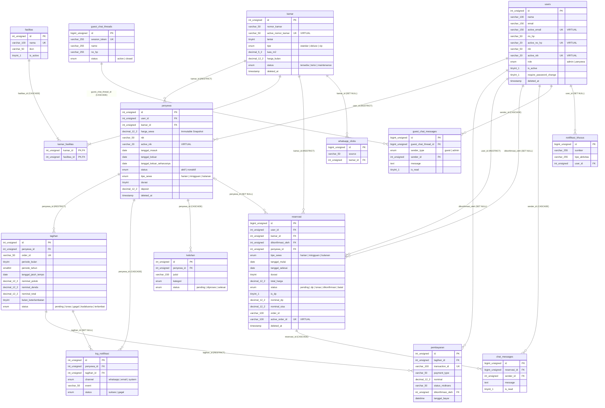
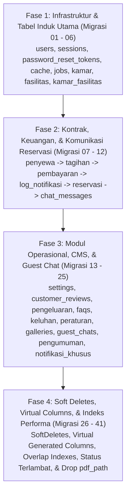

# Backend Schema Document (BSD): Sistem Informasi Manajemen Kost Terintegrasi Payment Gateway pada Asri Boarding House

## Informasi & Metadata Dokumen

| Atribut Dokumen | Keterangan |
| :--- | :--- |
| **Judul Dokumen** | Backend Schema Document (BSD): Sistem Informasi Manajemen Kost Terintegrasi Payment Gateway pada Asri Boarding House |
| **Versi Dokumen** | Versi 1.0 (Selaras dengan Arsitektur Master v248.0) |
| **Status Dokumen** | Approved / Production Final |
| **Tanggal Efektif** | 4 November 2026 |
| **Penanggung Jawab** | Tim Rekayasa Basis Data & Backend Asri Boarding House |
| **Lingkungan Produksi** | `https://asriboardinghouse.weatso.id/` |
| **Mesin Basis Data Utama** | MySQL 8.0+ (`InnoDB Storage Engine`, Karakter `utf8mb4`) |
| **Berkas Acuan Skema** | [`database/schema/mysql-schema.sql`](file:///c:/xampp/htdocs/asri-boarding-house/database/schema/mysql-schema.sql), `database/migrations/*` (41 Berkas), & `database/seeders/*` (9 Kelas Seeder) |
| **Dokumen Referensi Terkait** | [PRD-Asri-Boarding-House.md](file:///c:/xampp/htdocs/asri-boarding-house/Documentation/PRD-Asri-Boarding-House.md), [TRD-Asri-Boarding-House.md](file:///c:/xampp/htdocs/asri-boarding-house/Documentation/TRD-Asri-Boarding-House.md), [AFD-Asri-Boarding-House.md](file:///c:/xampp/htdocs/asri-boarding-house/Documentation/AFD-Asri-Boarding-House.md), & [DBD-Asri-Boarding-House.md](file:///c:/xampp/htdocs/asri-boarding-house/Documentation/DBD-Asri-Boarding-House.md) |

---

## 1. Document Overview & Architecture Context

### 1.1. Judul Dokumen, Versi, & Ruang Lingkup Skema
**Backend Schema Document (BSD): Sistem Informasi Manajemen Kost Terintegrasi Payment Gateway pada Asri Boarding House (Versi 1.0)** merupakan rujukan tunggal bagi pengembang untuk memahami struktur penyimpanan data, relasi antar-tabel, strategi indeksasi, aturan penghapusan sementara (*Soft Deletes*), urutan migrasi, hingga kontrak pertukaran data JSON pada sisi server.

Secara fungsional, skema basis data ini dirancang untuk menopang operasional harian properti kost berkapasitas 32 unit kamar eksklusif di kawasan Tembalang, Kota Semarang. Rancangan tabel di dalamnya mengawal siklus data dari hulu ke hilir: mulai dari penayangan katalog kamar publik, simulasi harga paket promo, pengajuan reservasi daring dengan opsi uang muka (*Down Payment* 30%) atau pelunasan langsung, penguncian tarif sewa personal (*Immutable Rent Snapshot*) saat kontrak aktif, penerbitan tagihan bulanan otomatis setiap tanggal 1, perhitungan denda keterlambatan flat 5% pada bulan kedua, pencatatan pembayaran via *Midtrans Snap* maupun kasir tunai, audit pemotongan uang jaminan (*deposit*) ketika penghuni keluar (*check-out*), hingga pengelolaan obrolan waktu nyata (*Guest Live Chat* dan *Reservation Chat*).

### 1.2. Tech Stack Backend & Infrastruktur Penyimpanan
Arsitektur server dibangun di atas fondasi monolitik modern yang mengutamakan konsistensi transaksi finansial dan kemudahan pemeliharaan jangka panjang tanpa ketergantungan pada layanan berbayar tambahan yang tidak perlu:

| Lapisan Infrastruktur | Teknologi & Versi | Peran dalam Arsitektur Skema & Backend |
| :--- | :--- | :--- |
| **Bahasa Pemrograman Server** | PHP `^8.2` | Menjalankan logika aplikasi dengan dukungan pengetikan ketat (*strict typing*), *nullsafe operator* (`?->`), dan *mod_lsapi* pada server produksi CloudLinux LiteSpeed Enterprise. |
| **Kerangka Kerja Utama** | Laravel Framework `^12.0` | Mengelola lapisan pemetaan objek relasional (*Eloquent ORM*), *Form Request Validation*, *Eloquent Policies* (Anti-IDOR), *Model Observers*, penjadwal tugas (*Task Scheduler*), serta pekerja antrean (*Queue Worker*). |
| **Mesin Basis Data Relasional** | MySQL `8.0+` (`InnoDB`) | Menyimpan **22 tabel bisnis** dan **8 tabel infrastruktur** dengan dukungan penuh transaksi ACID, penguncian baris (`SELECT ... FOR UPDATE`), validasi kolom JSON (`json_valid`), serta fitur *Virtual Generated Columns*. |
| **Manajemen Sesi, Cache, & Antrean** | MySQL Database Driver (`sessions`, `cache`, `jobs`) | Menggunakan tabel basis data relasional untuk menyimpan sesi login multi-portal, *caching* pengaturan aplikasi dan *Snap Token*, serta antrean pengiriman pesan asinkron tanpa memerlukan instalasi server Redis terpisah di lingkungan *shared/cloud hosting*. |
| **Penyimpanan Berkas Fisik** | Laravel Local Filesystem Disk (`storage/app/public`) | Menyimpan unggahan gambar terverifikasi yang dipetakan melalui *symbolic link* ke `public/storage`, terbagi atas direktori `kamar/`, `keluhan/`, `nota_pengeluaran/`, `galleries/`, `reviews/`, dan `settings/`. |
| **Integrasi Pihak Ketiga & Utilitas** | Midtrans API v2, Fonnte WA API, Google OAuth 2.0 (`laravel/socialite ^5.27`), & Dompdf `^3.1` | Menangani gerbang pembayaran digital berverifikasi tanda tangan SHA-512, pengiriman notifikasi WhatsApp otomatis berjeda (*staggered delay*), login satu klik dengan akun Google, serta pencetakan laporan PDF A4 di sisi server. |
| **Lingkungan Pengujian Otomatis** | PHPUnit `^11.5.50` + SQLite In-Memory (`:memory:`) | Menjalankan lebih dari 500 pengujian otomatis secara terisolasi di memori RAM tanpa menyentuh data produksi atau pengembangan lokal. |

### 1.3. Konvensi Penamaan (Naming Conventions)
Agar struktur basis data mudah dipahami baik oleh pengembang manusia maupun alat bantu otomasi kode, proyek ini menetapkan aturan penamaan standar sebagai berikut:

1. **Penamaan Tabel (*Table Naming Pattern*)**:
   - Seluruh nama tabel ditulis menggunakan huruf kecil dengan pemisah garis bawah (`snake_case`).
   - **Entitas Domain Bisnis Inti (Bahasa Indonesia Bentuk Tunggal)**: Tabel yang merepresentasikan konsep bisnis utama rumah kost menggunakan istilah Bahasa Indonesia bentuk tunggal agar selaras dengan kosakata domain skripsi dan administrasi properti, meliputi: `kamar`, `fasilitas`, `penyewa`, `reservasi`, `tagihan`, `pembayaran`, `keluhan`, `pengeluaran`, `pengumuman`, `peraturan`, `log_notifikasi`, dan `notifikasi_khusus`.
   - **Tabel Perantara / Pivot (`snake_case` Gabungan Induk)**: Tabel penghubung relasi *Many-to-Many* antara `kamar` dan `fasilitas` dinamai `kamar_fasilitas` (mengikuti urutan entitas utama dilanjutkan entitas atribut).
   - **Entitas Bawaan Kerangka Kerja, CMS Pendukung, & Analitik (Bahasa Inggris Bentuk Jamak)**: Tabel standar ekosistem Laravel dan modul pelengkap web menggunakan bentuk jamak berbahasa Inggris, meliputi: `users`, `settings`, `customer_reviews`, `faqs`, `galleries`, `chat_messages`, `guest_chat_threads`, `guest_chat_messages`, `whatsapp_clicks`, `sessions`, `password_reset_tokens`, `cache`, `cache_locks`, `jobs`, `job_batches`, `failed_jobs`, dan `migrations`.
   - Pada tingkat kode program, setiap model Eloquent di `app/Models/` yang menggunakan nama tabel tunggal mendefinisikan properti `protected $table = 'nama_tabel';` secara eksplisit.

2. **Penamaan Kolom (*Column Naming Pattern*)**:
   - Seluruh nama kolom menggunakan format `snake_case` (contoh: `nomor_kamar`, `harga_bulan`, `tanggal_jatuh_tempo`, `nominal_pokok`, `bulan_keterlambatan`).
   - **Kunci Utama (*Primary Key*)**: Menggunakan nama tunggal `id` bertipe `INT UNSIGNED` atau `BIGINT UNSIGNED` (`AUTO_INCREMENT`), kecuali pada tabel `settings` dan `cache` yang menggunakan `key` (`VARCHAR(255)`), tabel `sessions` dan `job_batches` yang menggunakan `id` (`VARCHAR(255)`), tabel `password_reset_tokens` yang menggunakan `email`, serta tabel pivot `kamar_fasilitas` yang menggunakan kunci komposit `(kamar_id, fasilitas_id)`.
   - **Penanda Boolean (*Boolean Flags*)**: Menggunakan awalan `is_` atau kata kerja deklaratif dengan tipe data `TINYINT(1)` (contoh: `is_active`, `is_read`, `is_dp`, `require_password_change`).
   - **Kolom Nominal Uang**: Selalu menggunakan tipe `DECIMAL(12,2)` (bukan `FLOAT` atau `DOUBLE`) untuk mencegah galat pembulatan titik mengambang pada perhitungan akuntansi Rupiah, dengan awalan `harga_`, `nominal_`, `total_`, atau `deposit`.
   - **Kolom Waktu (*Timestamps & Dates*)**: Kolom tanggal murni menggunakan awalan `tanggal_` dengan tipe `DATE` atau `DATETIME` (seperti `tanggal_masuk`, `tanggal_mulai`, `tanggal_bayar`), sedangkan jejak waktu siklus baris menggunakan standar Laravel `created_at`, `updated_at`, dan `deleted_at` (`TIMESTAMP NULL`).

3. **Penamaan Kunci Asing (*Foreign Key Conventions*)**:
   - Secara baku, kolom kunci asing ditulis dengan pola `{nama_tabel_tujuan}_id` (contoh: `user_id`, `kamar_id`, `penyewa_id`, `tagihan_id`, `reservasi_id`, `fasilitas_id`, `guest_chat_thread_id`).
   - Untuk relasi yang merujuk ke tabel `users` dengan peran spesifik (audit aktor atau pengirim pesan), nama kolom dibuat kontekstual sesuai perannya, yaitu `dikonfirmasi_oleh` (pada tabel `reservasi` dan `pembayaran`) serta `sender_id` (pada tabel `chat_messages` dan `guest_chat_messages`).
   - Nama *constraint* kunci asing di tingkat MySQL mengikuti pola `{tabel_anak}_{kolom_fk}_foreign` (contoh: `reservasi_kamar_id_foreign`).

4. **Penamaan Indeks & Kolom Virtual (*Index & Virtual Column Conventions*)**:
   - **Indeks Komposit & Performa**: Menggunakan awalan `idx_{nama_tabel}_{konteks_kolom}` (contoh: `idx_reservasi_overlap_check`, `idx_tagihan_cron_keterlambatan`) atau format bawaan Blueprint Laravel `{tabel}_{kolom}_index`.
   - **Indeks Unik (*Unique Constraints*)**: Menggunakan awalan `uq_{nama_tabel}_{kolom}` (contoh: `uq_users_active_email`, `uq_kamar_active_nomor`, `uq_periode`) atau `{tabel}_{kolom}_unique`.
   - **Kolom Virtual (*Virtual Generated Columns*)**: Menggunakan awalan `active_{nama_kolom_asli}` (contoh: `active_email`, `active_no_hp`, `active_nik`, `active_nomor_kamar`, `active_order_id`) yang bernilai sama dengan kolom asli ketika `deleted_at IS NULL` dan otomatis bernilai `NULL` ketika baris dihapus sementara.

---

## 2. Entity-Relationship Diagram (ERD) & Relasi Global

### 2.1. Visual ERD (Diagram Relasi Antar-Tabel Bisnis)
Skema basis data Asri Boarding House terdiri atas **30 tabel keseluruhan**, yang terbagi menjadi **22 tabel domain bisnis** (21 kelas Model Eloquent ditambah 1 tabel perantara `kamar_fasilitas`) dan **8 tabel infrastruktur kerangka kerja**. Diagram Mermaid di bawah ini menggambarkan struktur entitas bisnis utama beserta relasi kunci asing dan aturan integritas referensialnya (`RESTRICT`, `CASCADE`, atau `SET NULL`).



### 2.2. Ringkasan Hubungan (Cardinality)
Hubungan antar-entitas di dalam basis data dikelompokkan ke dalam empat pola kardinalitas sesuai aturan bisnis yang dikawal oleh lapisan *Model* dan *Service*:

#### A. Relasi One-to-Many (`1 : N`)
1. **Satu `users` memiliki banyak `reservasi` (`users.id -> reservasi.user_id`, `ON DELETE RESTRICT`)**:
   Seorang pengguna terdaftar dapat memiliki beberapa riwayat pengajuan reservasi dari waktu ke waktu (misalnya reservasi lama yang batal atau sudah selesai di masa lalu), meskipun aturan bisnis `TanpaPenyewaAktifLainRule` membatasi hanya satu reservasi/kontrak aktif dalam satu waktu.
2. **Satu `users` memiliki banyak `penyewa` (`users.id -> penyewa.user_id`, `ON DELETE RESTRICT`)**:
   Satu akun pengguna dapat tercatat pada lebih dari satu baris kontrak `penyewa` secara historis apabila penyewa tersebut pernah melakukan *check-out* lalu kembali menyewa kamar di periode berikutnya. Di tingkat Eloquent (`User::penyewa()`), relasi `hasOne` mengambil kontrak terbaru/aktif, sedangkan di tingkat skema basis data relasinya bersifat `1:N` untuk menjaga riwayat masa lalu.
3. **Satu `kamar` memiliki banyak `reservasi` (`kamar.id -> reservasi.kamar_id`, `ON DELETE RESTRICT`) dan banyak `penyewa` (`kamar.id -> penyewa.kamar_id`, `ON DELETE RESTRICT`)**:
   Satu unit kamar fisik dapat dipesan dan dihuni secara bergantian oleh banyak penyewa sepanjang umur operasional gedung kost, selama rentang tanggalnya tidak saling beririsan. Aturan `RESTRICT` mencegah unit kamar dihapus paksa jika masih terikat pada kontrak atau riwayat transaksi.
4. **Satu `penyewa` memiliki banyak `tagihan` (`penyewa.id -> tagihan.penyewa_id`, `ON DELETE RESTRICT`)**:
   Selama masa sewa berlangsung, satu kontrak penyewa menerbitkan banyak tagihan (tagihan kontrak awal `RSV-INITIAL-*`, tagihan pelunasan sisa DP 70% `SISA-DP-*`, tagihan perpanjangan `EXT-*`, maupun tagihan bulanan rutin `INV-*`). Aturan unik komposit `uq_periode (penyewa_id, periode_bulan, periode_tahun)` memastikan tidak ada tagihan ganda pada bulan dan tahun yang sama.
5. **Satu `tagihan` memiliki banyak `pembayaran` (`tagihan.id -> pembayaran.tagihan_id`, `ON DELETE RESTRICT`)**:
   Meskipun dalam kondisi normal satu tagihan dilunasi oleh satu transaksi pembayaran yang sukses (`Tagihan::pembayaran()` menggunakan `hasOne` untuk pembayaran aktif), secara struktural tabel `pembayaran` dapat menyimpan lebih dari satu catatan percobaan transaksi apabila percobaan sebelumnya berakhir kedaluwarsa atau gagal sebelum akhirnya lunas.
6. **Satu `penyewa` memiliki banyak `keluhan` (`penyewa.id -> keluhan.penyewa_id`, `ON DELETE CASCADE`)**:
   Penghuni aktif dapat mengirimkan banyak laporan kerusakan fasilitas kamar atau fasilitas bersama sepanjang masa tinggalnya.
7. **Satu `penyewa` dan satu `tagihan` memiliki banyak `log_notifikasi`**:
   Setiap pengiriman pengingat WhatsApp (H-3, H-0, keterlambatan bulan pertama, denda bulan kedua, eskalasi wali) maupun surel menghasilkan baris log baru yang terhubung ke `penyewa_id` (`ON DELETE CASCADE`) dan opsional ke `tagihan_id` (`ON DELETE SET NULL`).
8. **Satu `reservasi` memiliki banyak `chat_messages` (`reservasi.id -> chat_messages.reservasi_id`, `ON DELETE CASCADE`)**:
   Setiap lembar reservasi menyediakan satu ruang diskusi pra-bayar eksklusif yang menampung banyak pesan obrolan antara calon penyewa dan administrator.
9. **Satu `guest_chat_threads` memiliki banyak `guest_chat_messages` (`guest_chat_threads.id -> guest_chat_messages.guest_chat_thread_id`, `ON DELETE CASCADE`)**:
   Satu sesi obrolan pengunjung publik tanpa login menaungi seluruh pesan tanya-jawab di dalam utas tersebut. Ketika utas lama dibersihkan oleh perintah `chat-guest:prune`, seluruh pesan di dalamnya ikut terhapus secara otomatis.
10. **Relasi Aktor Audit & Analitik (`users` dan `kamar` ke Tabel Pendukung)**:
    - Satu `users` (Admin) dapat mengonfirmasi banyak `reservasi` (`dikonfirmasi_oleh`, `ON DELETE SET NULL`) dan banyak `pembayaran` (`dikonfirmasi_oleh`, `ON DELETE SET NULL`).
    - Satu `users` dapat mengirim banyak pesan di `chat_messages` dan `guest_chat_messages` (`sender_id`, `ON DELETE CASCADE`), serta memicu banyak catatan audit di `notifikasi_khusus` (`user_id`, `ON DELETE SET NULL`).
    - Satu `kamar` dapat memiliki banyak catatan metrik ketertarikan pengunjung di `whatsapp_clicks` (`kamar_id`, `ON DELETE SET NULL`).

#### B. Relasi One-to-One Transisional (`1 : 0..1`)
- **Transisi `reservasi` ke `penyewa` (`penyewa.id -> reservasi.penyewa_id`, `ON DELETE SET NULL`)**:
  Saat reservasi baru dibuat (`status = 'pending'`), kolom `penyewa_id` bernilai `NULL`. Begitu pembayaran terverifikasi dan admin menekan tombol konfirmasi (`TransisiPenyewaService::konfirmasiReservasi`), sistem mencetak satu baris kontrak baru di tabel `penyewa` lalu menautkan ID kontrak tersebut ke kolom `reservasi.penyewa_id`.

#### C. Relasi Many-to-Many (`M : N`)
- **Banyak `kamar` memiliki banyak `fasilitas` melalui tabel perantara `kamar_fasilitas`**:
  Satu unit kamar dapat dilengkapi berbagai fasilitas (seperti AC, Wi-Fi High Speed, Kamar Mandi Dalam, Meja Belajar), dan sebaliknya satu jenis fasilitas dimiliki oleh banyak unit kamar. Tabel `kamar_fasilitas` menggunakan kunci utama gabungan `(kamar_id, fasilitas_id)` dengan aturan `ON DELETE CASCADE` pada kedua sisinya.

#### D. Tabel Mandiri (*Standalone Business & Infrastructure Tables*)
- **Tabel Bisnis Mandiri (7 Tabel)**: Tidak memiliki kunci asing keluar maupun masuk karena berfungsi sebagai buku kas operasional dan penyimpan konten dinamis halaman publik/internal, meliputi: `pengeluaran` (pencatatan arus kas keluar & klaim deposit), `settings` (konfigurasi *key-value*), `customer_reviews` (testimoni penghuni), `faqs` (tanya-jawab), `peraturan` (tata tertib hunian), `galleries` (dokumentasi foto gedung), dan `pengumuman` (papan informasi penghuni).
- **Tabel Infrastruktur Laravel (8 Tabel)**: `sessions`, `password_reset_tokens`, `cache`, `cache_locks`, `jobs`, `job_batches`, `failed_jobs`, dan `migrations`.

---

## 3. Database Schema Definitions (Struktur Tabel / Koleksi)

Bagian ini menjabarkan spesifikasi fisik seluruh **30 tabel** pada basis data MySQL 8.x sesuai kondisi akhir setelah seluruh **41 berkas migrasi** dijalankan.

---

### Klaster 1: Identitas Pengguna & Master Katalog Kamar

#### 3.1. Tabel `users`
- **Model Eloquent**: [`App\Models\User`](file:///c:/xampp/htdocs/asri-boarding-house/app/Models/User.php)
- **Engine / Collation**: `InnoDB` / `utf8mb4_unicode_ci`
- **Deskripsi**: Menyimpan data akun pengguna untuk seluruh portal (Administrator, Calon Penyewa, dan Penyewa Aktif), mencakup kredensial autentikasi, identitas kependudukan (NIK), kontak darurat orang tua/wali, serta kolom virtual untuk pelepasan nilai unik saat akun dihapus sementara (*Soft Deletes*).

| Kolom | Tipe Data | Attributes (PK/FK/Null/Default) | Deskripsi / Catatan |
| :--- | :--- | :--- | :--- |
| `id` | `INT UNSIGNED` | `PK, AUTO_INCREMENT, NOT NULL` | ID unik pengguna. |
| `nama` | `VARCHAR(100)` | `NOT NULL` | Nama lengkap pengguna sesuai KTP. |
| `email` | `VARCHAR(150)` | `NOT NULL` | Alamat surat elektronik untuk login dan penerimaan notifikasi. |
| `active_email` | `VARCHAR(150)` | `VIRTUAL, UNIQUE (uq_users_active_email), NULLABLE` | Kolom virtual `GENERATED ALWAYS AS (CASE WHEN deleted_at IS NULL THEN email ELSE NULL END) VIRTUAL`. Menjaga keunikan email hanya pada pengguna aktif. |
| `password` | `VARCHAR(255)` | `NOT NULL` | Hash kata sandi menggunakan algoritma Bcrypt. |
| `no_hp` | `VARCHAR(50)` | `NULLABLE, Default NULL` | Nomor WhatsApp pengguna (dinormalisasi ke awalan `628...`). Diperlebar ke 50 karakter untuk menampung akhiran `_deleted_[timestamp]` saat *soft delete*. |
| `active_no_hp` | `VARCHAR(20)` | `VIRTUAL, UNIQUE (uq_users_active_no_hp), NULLABLE` | Kolom virtual `GENERATED ALWAYS AS (CASE WHEN deleted_at IS NULL THEN no_hp ELSE NULL END) VIRTUAL`. |
| `nik` | `VARCHAR(50)` | `NULLABLE, Default NULL` | Nomor Induk Kependudukan (16 digit angka saat aktif). |
| `active_nik` | `VARCHAR(20)` | `VIRTUAL, UNIQUE (uq_users_active_nik), NULLABLE` | Kolom virtual `GENERATED ALWAYS AS (CASE WHEN deleted_at IS NULL THEN nik ELSE NULL END) VIRTUAL`. |
| `nama_wali` | `VARCHAR(100)` | `NULLABLE, Default NULL` | Nama lengkap orang tua atau wali penanggung jawab penyewa. |
| `no_wali` | `VARCHAR(20)` | `NULLABLE, Default NULL` | Nomor WhatsApp darurat wali (divalidasi wajib berbeda dari `no_hp` penyewa). |
| `role` | `ENUM('admin','penyewa')` | `NOT NULL, Default 'penyewa', INDEX` | Hak akses pengguna (`admin` untuk pengelola, `penyewa` untuk calon penyewa maupun penyewa aktif). |
| `foto` | `VARCHAR(255)` | `NULLABLE, Default NULL` | Path berkas foto profil atau URL avatar dari login Google OAuth. |
| `is_active` | `TINYINT` | `NOT NULL, Default 1` | Status keaktifan akun (`1` = aktif, `0` = dinonaktifkan). |
| `require_password_change` | `TINYINT(1)` | `NOT NULL, Default 0` | Penanda paksa ganti kata sandi (`1` = wajib ganti password saat login pertama bagi penyewa yang didaftarkan manual oleh admin). |
| `created_at` | `TIMESTAMP` | `NULLABLE, Default NULL` | Waktu pembuatan akun. |
| `updated_at` | `TIMESTAMP` | `NULLABLE, Default NULL` | Waktu pembaruan data akun terakhir. |
| `deleted_at` | `TIMESTAMP` | `NULLABLE, Default NULL, INDEX` | Penanda waktu penghapusan sementara (*Soft Deletes*). |

---

#### 3.2. Tabel `kamar`
- **Model Eloquent**: [`App\Models\Kamar`](file:///c:/xampp/htdocs/asri-boarding-house/app/Models/Kamar.php)
- **Engine / Collation**: `InnoDB` / `utf8mb4_unicode_ci`
- **Deskripsi**: Menyimpan data master 32 unit kamar kost yang terbagi atas 2 lantai dan 3 kelas (`standar`, `deluxe`, `vip`), lengkap dengan tarif dasar bulanan, ukuran ruang, foto utama, serta status ketersediaan unit.

| Kolom | Tipe Data | Attributes (PK/FK/Null/Default) | Deskripsi / Catatan |
| :--- | :--- | :--- | :--- |
| `id` | `INT UNSIGNED` | `PK, AUTO_INCREMENT, NOT NULL` | ID unik unit kamar. |
| `nomor_kamar` | `VARCHAR(50)` | `NOT NULL` | Nomor identifikasi pintu kamar (contoh: `101` s.d. `116` di Lantai 1, `201` s.d. `216` di Lantai 2). |
| `active_nomor_kamar` | `VARCHAR(50)` | `VIRTUAL, UNIQUE (uq_kamar_active_nomor), NULLABLE` | Kolom virtual `GENERATED ALWAYS AS (CASE WHEN deleted_at IS NULL THEN nomor_kamar ELSE NULL END) VIRTUAL`. Memungkinkan nomor kamar digunakan ulang jika baris lama telah di-*soft-delete*. |
| `lantai` | `TINYINT` | `NOT NULL, Default 1, INDEX` | Lokasi lantai unit kamar (`1` atau `2`). |
| `tipe` | `ENUM('standar','deluxe','vip')` | `NOT NULL, Default 'standar', INDEX` | Kategori kelas kamar yang menentukan fasilitas dan tarif sewa. |
| `luas_m2` | `DECIMAL(5,2)` | `NOT NULL` | Luas kamar dalam satuan meter persegi (contoh: `12.00`, `18.00`, `24.00`). |
| `harga_bulan` | `DECIMAL(12,2)` | `NOT NULL` | Tarif sewa katalog per bulan dalam Rupiah (acuan dasar kalkulator harian, mingguan, dan promo). |
| `deskripsi` | `TEXT` | `NULLABLE` | Penjelasan spesifikasi dan keunggulan unit kamar. |
| `foto` | `VARCHAR(255)` | `NULLABLE, Default NULL` | Path berkas foto kamar pada `storage/app/public/kamar/`. |
| `status` | `ENUM('tersedia','terisi','maintenance')` | `NOT NULL, Default 'tersedia', INDEX` | Status operasional kamar saat ini. |
| `created_at` | `TIMESTAMP` | `NULLABLE, Default NULL` | Waktu data kamar dibuat. |
| `updated_at` | `TIMESTAMP` | `NULLABLE, Default NULL` | Waktu data kamar terakhir diperbarui. |
| `deleted_at` | `TIMESTAMP` | `NULLABLE, Default NULL, INDEX` | Penanda waktu *Soft Deletes*. |

---

#### 3.3. Tabel `fasilitas`
- **Model Eloquent**: [`App\Models\Fasilitas`](file:///c:/xampp/htdocs/asri-boarding-house/app/Models/Fasilitas.php)
- **Engine / Collation**: `InnoDB` / `utf8mb4_unicode_ci`
- **Deskripsi**: Menyimpan daftar master fasilitas kamar dan fasilitas gedung yang ditampilkan pada halaman publik maupun kartu spesifikasi kamar.

| Kolom | Tipe Data | Attributes (PK/FK/Null/Default) | Deskripsi / Catatan |
| :--- | :--- | :--- | :--- |
| `id` | `INT UNSIGNED` | `PK, AUTO_INCREMENT, NOT NULL` | ID unik fasilitas. |
| `nama` | `VARCHAR(100)` | `NOT NULL, UNIQUE (fasilitas_nama_unique)` | Nama fasilitas (contoh: `Air Conditioner (AC)`, `Wi-Fi High Speed`, `Free Listrik`). |
| `ikon` | `VARCHAR(50)` | `NULLABLE, Default NULL` | Pengenal ikon visual (contoh: `snowflake`, `wifi`, `bolt`, `bath`). |
| `deskripsi` | `TEXT` | `NULLABLE` | Keterangan singkat mengenai fasilitas terkait. |
| `is_active` | `TINYINT(1)` | `NOT NULL, Default 1, INDEX` | Status tampil di halaman publik (`1` = ditampilkan, `0` = disembunyikan). |
| `created_at` | `TIMESTAMP` | `NOT NULL, Default CURRENT_TIMESTAMP` | Waktu pembuatan data fasilitas. |
| `updated_at` | `TIMESTAMP` | `NULLABLE, Default NULL ON UPDATE CURRENT_TIMESTAMP` | Waktu pembaruan terakhir data fasilitas. |

---

#### 3.4. Tabel `kamar_fasilitas`
- **Model Eloquent**: Tabel Pivot (*BelongsToMany* antara `Kamar` dan `Fasilitas`)
- **Engine / Collation**: `InnoDB` / `utf8mb4_unicode_ci`
- **Deskripsi**: Tabel perantara yang memetakan fasilitas apa saja yang tersedia di dalam setiap unit kamar.

| Kolom | Tipe Data | Attributes (PK/FK/Null/Default) | Deskripsi / Catatan |
| :--- | :--- | :--- | :--- |
| `kamar_id` | `INT UNSIGNED` | `PK (Komposit), FK (kamar.id ON DELETE CASCADE), NOT NULL` | Referensi ke unit kamar. |
| `fasilitas_id` | `INT UNSIGNED` | `PK (Komposit), FK (fasilitas.id ON DELETE CASCADE), NOT NULL, INDEX` | Referensi ke item fasilitas yang dimiliki kamar tersebut. |

---

### Klaster 2: Transaksi Inti, Kontrak Hunian, & Keuangan

#### 3.5. Tabel `reservasi`
- **Model Eloquent**: [`App\Models\Reservasi`](file:///c:/xampp/htdocs/asri-boarding-house/app/Models/Reservasi.php)
- **Engine / Collation**: `InnoDB` / `utf8mb4_0900_ai_ci`
- **Deskripsi**: Menyimpan transaksi pemesanan kamar oleh calon penyewa sebelum dikonfirmasi menjadi penghuni aktif, termasuk perhitungan durasi, skema uang muka (DP 30%), token pembayaran Midtrans Snap, serta jejak persetujuan admin.

| Kolom | Tipe Data | Attributes (PK/FK/Null/Default) | Deskripsi / Catatan |
| :--- | :--- | :--- | :--- |
| `id` | `BIGINT UNSIGNED` | `PK, AUTO_INCREMENT, NOT NULL` | ID unik pengajuan reservasi. |
| `user_id` | `INT UNSIGNED` | `FK (users.id ON DELETE RESTRICT), NOT NULL, INDEX` | Pemohon reservasi (calon penyewa). |
| `kamar_id` | `INT UNSIGNED` | `FK (kamar.id ON DELETE RESTRICT), NOT NULL, INDEX` | Unit kamar yang dipesan. |
| `dikonfirmasi_oleh` | `INT UNSIGNED` | `FK (users.id ON DELETE SET NULL), NULLABLE, Default NULL` | ID akun administrator yang menyetujui reservasi. |
| `penyewa_id` | `INT UNSIGNED` | `FK (penyewa.id ON DELETE SET NULL), NULLABLE, Default NULL` | Tautan ke kontrak `penyewa` yang otomatis terbentuk saat reservasi berstatus `dikonfirmasi`. |
| `tipe_sewa` | `ENUM('harian','mingguan','bulanan')` | `NOT NULL, Default 'bulanan'` | Satuan periode sewa yang dipilih pemesan. |
| `tanggal_mulai` | `DATE` | `NOT NULL, INDEX` | Tanggal rencana masuk (*check-in*). |
| `tanggal_selesai` | `DATE` | `NOT NULL, INDEX` | Tanggal rencana selesai sewa (*check-out* seharusnya). |
| `durasi` | `TINYINT` | `NOT NULL, Default 1` | Jumlah durasi sesuai `tipe_sewa` (1-30 hari, 1-8 minggu, atau 1-12 bulan). |
| `total_harga` | `DECIMAL(12,2)` | `NOT NULL` | Total biaya sewa bersih setelah dikurangi diskon paket promo (jika memenuhi syarat). |
| `status` | `ENUM('pending','dp','lunas','dikonfirmasi','batal')` | `NOT NULL, Default 'pending', INDEX` | Status tahapan reservasi pada *5-Step Stepper*. |
| `metode_pembayaran` | `ENUM('midtrans','cash')` | `NULLABLE, Default NULL` | Metode pembayaran yang digunakan pemesan. |
| `is_dp` | `TINYINT(1)` | `NOT NULL, Default 0` | Penanda skema pembayaran (`1` = membayar DP 30% di awal, `0` = membayar lunas 100%). |
| `nominal_dp` | `DECIMAL(12,2)` | `NOT NULL, Default 0.00` | Nominal uang muka 30% (`round(total_harga * 0.30)`) jika `is_dp = 1`. |
| `nominal_sisa` | `DECIMAL(12,2)` | `NOT NULL, Default 0.00` | Sisa kewajiban 70% (`total_harga - nominal_dp`) yang akan ditagihkan sebagai invoice `SISA-DP-*`. |
| `snap_token` | `VARCHAR(255)` | `NULLABLE, Default NULL` | Token sesi pembayaran dari Midtrans Snap API. |
| `order_id` | `VARCHAR(100)` | `NULLABLE, Default NULL` | Kode referensi order Midtrans (`RSV-{id}-{timestamp}` atau `DP-{id}-{timestamp}`). |
| `active_order_id` | `VARCHAR(100)` | `VIRTUAL, UNIQUE (uq_reservasi_active_order_id), NULLABLE` | Kolom virtual `GENERATED ALWAYS AS (CASE WHEN deleted_at IS NULL THEN order_id ELSE NULL END) VIRTUAL`. |
| `transaction_id` | `VARCHAR(100)` | `NULLABLE, Default NULL` | ID transaksi dari webhook Midtrans setelah pembayaran diterima. |
| `catatan_user` | `TEXT` | `NULLABLE` | Catatan atau permintaan khusus dari calon penyewa saat memesan. |
| `catatan_admin` | `TEXT` | `NULLABLE` | Catatan verifikasi atau alasan penolakan/pembatalan dari admin. |
| `tanggal_konfirmasi` | `DATETIME` | `NULLABLE, Default NULL` | Waktu presisi ketika admin mengonfirmasi reservasi. |
| `created_at` | `TIMESTAMP` | `NULLABLE, Default NULL` | Waktu pengajuan reservasi dibuat (acuan batas kedaluwarsa 24 jam untuk status `pending`). |
| `updated_at` | `TIMESTAMP` | `NULLABLE, Default NULL` | Waktu pembaruan status reservasi terakhir. |
| `deleted_at` | `TIMESTAMP` | `NULLABLE, Default NULL, INDEX` | Penanda waktu *Soft Deletes*. |

---

#### 3.6. Tabel `penyewa`
- **Model Eloquent**: [`App\Models\Penyewa`](file:///c:/xampp/htdocs/asri-boarding-house/app/Models/Penyewa.php)
- **Engine / Collation**: `InnoDB` / `utf8mb4_0900_ai_ci`
- **Deskripsi**: Menyimpan kontrak penghunian kost baik yang masih aktif maupun yang telah berakhir (*nonaktif*). Tabel ini memegang peran vital dalam menjaga keadilan harga melalui kolom `harga_sewa` (*Immutable Rent Snapshot*) serta mengelola dana jaminan (*deposit*) penghuni.

| Kolom | Tipe Data | Attributes (PK/FK/Null/Default) | Deskripsi / Catatan |
| :--- | :--- | :--- | :--- |
| `id` | `INT UNSIGNED` | `PK, AUTO_INCREMENT, NOT NULL` | ID unik kontrak penyewa. |
| `user_id` | `INT UNSIGNED` | `FK (users.id ON DELETE RESTRICT), NOT NULL, INDEX` | Akun pengguna pemilik kontrak sewa. |
| `kamar_id` | `INT UNSIGNED` | `FK (kamar.id ON DELETE RESTRICT), NOT NULL, INDEX` | Unit kamar yang dihuni berdasarkan kontrak ini. |
| `harga_sewa` | `DECIMAL(12,2)` | `NULLABLE, Default NULL` | **Immutable Rent Snapshot**: Tarif sewa bulanan yang disepakati saat kontrak dibuat. Menjamin tagihan bulanan penyewa lama tidak ikut berubah ketika admin menaikkan `kamar.harga_bulan` di katalog publik. |
| `nik` | `VARCHAR(50)` | `NOT NULL, INDEX (penyewa_nik_index)` | Nomor Induk Kependudukan penyewa pada kontrak. Tidak dipasangi indeks `UNIQUE` agar pengguna yang sama dapat memiliki riwayat kontrak baru di masa depan setelah kontrak lama selesai. |
| `active_nik` | `VARCHAR(20)` | `VIRTUAL, NULLABLE` | Kolom virtual `GENERATED ALWAYS AS (CASE WHEN deleted_at IS NULL THEN nik ELSE NULL END) VIRTUAL`. |
| `tanggal_masuk` | `DATE` | `NOT NULL, INDEX` | Tanggal efektif penghuni mulai menempati kamar (*check-in*). |
| `tanggal_keluar` | `DATE` | `NULLABLE, Default NULL, INDEX` | Tanggal aktual penghuni melakukan *check-out* (bernilai `NULL` selama masih menghuni). |
| `tanggal_keluar_seharusnya` | `DATE` | `NULLABLE, Default NULL` | Tanggal jatuh tempo berakhirnya masa kontrak sewa (acuan pengiriman pengingat habis kontrak H-14, H-7, H-3, dan H-0). |
| `status` | `ENUM('aktif','nonaktif')` | `NOT NULL, Default 'aktif', INDEX` | Status keaktifan kontrak (`aktif` = sedang menghuni, `nonaktif` = sudah *check-out*). |
| `tanggal_billing` | `TINYINT` | `NOT NULL, Default 1` | Tanggal siklus penerbitan tagihan bulanan (diseragamkan setiap tanggal `1`). |
| `tipe_sewa` | `ENUM('harian','mingguan','bulanan')` | `NOT NULL, Default 'bulanan'` | Skema periode kontrak sewa. |
| `durasi` | `TINYINT` | `NOT NULL, Default 1` | Lama kontrak sewa sesuai satuan `tipe_sewa`. |
| `deposit` | `DECIMAL(12,2)` | `NOT NULL, Default 0.00` | Saldo uang jaminan fasilitas kamar yang disetorkan penyewa. |
| `no_wali` | `VARCHAR(20)` | `NOT NULL` | Nomor WhatsApp orang tua/wali untuk pengiriman notifikasi eskalasi tunggakan bulan kedua. |
| `nama_wali` | `VARCHAR(100)` | `NOT NULL` | Nama orang tua/wali penanggung jawab pada kontrak. |
| `catatan` | `TEXT` | `NULLABLE` | Catatan administratif kontrak atau berita acara klaim potongan deposit saat *check-out*. |
| `created_at` | `TIMESTAMP` | `NULLABLE, Default NULL` | Waktu pembuatan kontrak. |
| `updated_at` | `TIMESTAMP` | `NULLABLE, Default NULL` | Waktu pembaruan kontrak terakhir. |
| `deleted_at` | `TIMESTAMP` | `NULLABLE, Default NULL, INDEX` | Penanda waktu *Soft Deletes*. |

---

#### 3.7. Tabel `tagihan`
- **Model Eloquent**: [`App\Models\Tagihan`](file:///c:/xampp/htdocs/asri-boarding-house/app/Models/Tagihan.php)
- **Engine / Collation**: `InnoDB` / `utf8mb4_0900_ai_ci`
- **Deskripsi**: Menyimpan seluruh lembar tagihan (*invoice*) penghuni, baik tagihan sewa bulanan otomatis, tagihan kontrak awal, tagihan pelunasan sisa DP 70%, maupun tagihan perpanjangan kontrak, lengkap dengan kolom eskalasi keterlambatan dan denda 5%.

| Kolom | Tipe Data | Attributes (PK/FK/Null/Default) | Deskripsi / Catatan |
| :--- | :--- | :--- | :--- |
| `id` | `INT UNSIGNED` | `PK, AUTO_INCREMENT, NOT NULL` | ID unik lembar tagihan. |
| `penyewa_id` | `INT UNSIGNED` | `FK (penyewa.id ON DELETE RESTRICT), NOT NULL, INDEX` | Kontrak penyewa yang ditagih. |
| `order_id` | `VARCHAR(50)` | `NOT NULL, UNIQUE (tagihan_order_id_unique)` | Kode referensi unik tagihan (`INV-{YYYYMM}-{ID}-{TS}`, `RSV-INITIAL-*`, `SISA-DP-*`, atau `EXT-*`). |
| `periode_bulan` | `TINYINT` | `NOT NULL, UNIQUE Komposit (uq_periode)` | Angka bulan periode tagihan (`1` s.d. `12`). |
| `periode_tahun` | `SMALLINT` | `NOT NULL, UNIQUE Komposit (uq_periode)` | Angka tahun periode tagihan (contoh: `2026`). Dikombinasikan dengan `penyewa_id` dan `periode_bulan` pada indeks unik `uq_periode`. |
| `tanggal_tagihan` | `DATE` | `NOT NULL` | Tanggal diterbitkannya tagihan. |
| `tanggal_jatuh_tempo` | `DATE` | `NOT NULL, INDEX` | Batas akhir pembayaran tepat waktu (ditetapkan setiap tanggal 10 pada bulan tagihan). |
| `nominal_pokok` | `DECIMAL(12,2)` | `NOT NULL` | Nilai tagihan sewa dasar sebelum denda. |
| `nominal_denda` | `DECIMAL(12,2)` | `NOT NULL, Default 0.00` | Nilai denda keterlambatan flat 5% (`0.05 * nominal_pokok`). Sekaligus berfungsi sebagai *Idempotency Guard* (denda hanya dihitung jika `nominal_denda == 0` saat memasuki bulan kedua keterlambatan). |
| `nominal_total` | `DECIMAL(12,2)` | `NOT NULL` | Total tagihan yang wajib dibayar (`nominal_pokok + nominal_denda`). |
| `bulan_keterlambatan` | `TINYINT` | `NOT NULL, Default 0` | Indikator tingkat tunggakan (`0` = belum jatuh tempo/tepat waktu, `1` = lewat tanggal 10 di bulan pertama tanpa denda, `>= 2` = masuk bulan kedua, dikenakan denda 5% dan notifikasi wali). |
| `status` | `ENUM('pending','lunas','gagal','kadaluarsa','terlambat')` | `NOT NULL, Default 'pending', INDEX` | Status siklus hidup tagihan saat ini. |
| `metode_pembayaran` | `ENUM('midtrans','cash','')` | `NULLABLE, Default NULL` | Kanal pembayaran yang digunakan saat melunasi tagihan. |
| `keterangan` | `TEXT` | `NULLABLE` | Rincian deskripsi tagihan (misal: *"Tagihan Sewa Kamar 101 Periode November 2026"*). |
| `created_at` | `TIMESTAMP` | `NULLABLE, Default NULL` | Waktu tagihan diterbitkan. |
| `updated_at` | `TIMESTAMP` | `NULLABLE, Default NULL` | Waktu pembaruan status atau denda terakhir. |

---

#### 3.8. Tabel `pembayaran`
- **Model Eloquent**: [`App\Models\Pembayaran`](file:///c:/xampp/htdocs/asri-boarding-house/app/Models/Pembayaran.php)
- **Engine / Collation**: `InnoDB` / `utf8mb4_0900_ai_ci`
- **Deskripsi**: Menyimpan bukti transaksi pelunasan atas suatu tagihan, mencatat detail instrumen pembayaran Midtrans (QRIS, Virtual Account, e-Wallet), tanda tangan kriptografi SHA-512, salinan JSON mentah dari webhook, atau identitas admin yang menerima pembayaran kasir tunai. *(Catatan: Kolom `pdf_path` telah dihapus pada migrasi ke-41 karena pencetakan kuitansi A5 kini dirender secara langsung di sisi klien menggunakan `html2pdf.js`).*

| Kolom | Tipe Data | Attributes (PK/FK/Null/Default) | Deskripsi / Catatan |
| :--- | :--- | :--- | :--- |
| `id` | `INT UNSIGNED` | `PK, AUTO_INCREMENT, NOT NULL` | ID unik catatan pembayaran. |
| `tagihan_id` | `INT UNSIGNED` | `FK (tagihan.id ON DELETE RESTRICT), NOT NULL, INDEX` | Referensi ke lembar tagihan yang dibayar. |
| `transaction_id` | `VARCHAR(100)` | `NOT NULL, UNIQUE (pembayaran_transaction_id_unique)` | Nomor transaksi unik dari Midtrans atau kode kasir manual (`CASH-*`, `RSV-PAY-*`, `EXT-PAY-*`). |
| `payment_type` | `VARCHAR(50)` | `NULLABLE, Default NULL` | Jenis kanal pembayaran (`qris`, `bank_transfer`, `echannel`, `gopay`, `shopeepay`, `cash`). |
| `bank` | `VARCHAR(20)` | `NULLABLE, Default NULL` | Kode bank penerbit Virtual Account (seperti `bca`, `bni`, `bri`, `mandiri`, `permata`). |
| `va_number` | `VARCHAR(30)` | `NULLABLE, Default NULL` | Nomor Virtual Account yang digunakan saat transaksi. |
| `nominal` | `DECIMAL(12,2)` | `NOT NULL` | Jumlah nominal uang yang efektif dibayarkan. |
| `status_midtrans` | `VARCHAR(50)` | `NULLABLE, Default NULL, INDEX` | Status transaksi (`settlement`, `capture`, `pending`, `deny`, `expire`, `cancel`, atau `manual_cash`). |
| `dikonfirmasi_oleh` | `INT UNSIGNED` | `FK (users.id ON DELETE SET NULL), NULLABLE, Default NULL` | ID admin yang melakukan konfirmasi pembayaran tunai/manual (bernilai `NULL` jika otomatis via webhook Midtrans). |
| `signature_key` | `VARCHAR(255)` | `NULLABLE, Default NULL` | Hash SHA-512 dari paket notifikasi Midtrans sebagai bukti keaslian transaksi. |
| `response_json` | `LONGTEXT (JSON)` | `NULLABLE, CHECK (json_valid(response_json))` | Rekaman utuh *payload* JSON dari Midtrans untuk kebutuhan audit finansial. |
| `tanggal_bayar` | `DATETIME` | `NULLABLE, Default NULL, INDEX` | Waktu efektif dana pembayaran diterima/dikonfirmasi. |
| `created_at` | `TIMESTAMP` | `NULLABLE, Default NULL` | Waktu pencatatan baris pembayaran. |
| `updated_at` | `TIMESTAMP` | `NULLABLE, Default NULL` | Waktu pembaruan baris pembayaran terakhir. |

---

#### 3.9. Tabel `pengeluaran`
- **Model Eloquent**: [`App\Models\Pengeluaran`](file:///c:/xampp/htdocs/asri-boarding-house/app/Models/Pengeluaran.php)
- **Engine / Collation**: `InnoDB` / `utf8mb4_0900_ai_ci`
- **Deskripsi**: Mencatat seluruh pengeluaran kas operasional rumah kost (listrik, air, internet, kebersihan, perbaikan fasilitas), termasuk pencatatan otomatis biaya perbaikan dari potongan uang jaminan (*deposit*) serta pengembalian sisa deposit saat penghuni *check-out*.

| Kolom | Tipe Data | Attributes (PK/FK/Null/Default) | Deskripsi / Catatan |
| :--- | :--- | :--- | :--- |
| `id` | `INT UNSIGNED` | `PK, AUTO_INCREMENT, NOT NULL` | ID unik catatan pengeluaran. |
| `nama_pengeluaran` | `VARCHAR(150)` | `NOT NULL` | Judul atau item pengeluaran (contoh: *"Tagihan Wi-Fi Indihome Bulan November"*, *"Perbaikan Kamar 102 (Klaim Deposit)"*). |
| `kategori` | `ENUM('maintenance','utilitas','operasional','lainnya')` | `NOT NULL` | Kelompok pos pengeluaran untuk laporan laba-rugi. |
| `nominal` | `DECIMAL(12,2)` | `NOT NULL` | Nilai uang keluar dalam Rupiah. |
| `tanggal_pengeluaran` | `DATE` | `NOT NULL, INDEX (idx_pengeluaran_tanggal)` | Tanggal terjadinya transaksi pengeluaran (acuan filter bulanan laporan keuangan). |
| `bukti_nota` | `VARCHAR(255)` | `NULLABLE, Default NULL` | Path berkas foto struk/nota di `storage/app/public/nota_pengeluaran/`. |
| `keterangan` | `TEXT` | `NULLABLE` | Catatan detail pengeluaran atau rincian audit klaim deposit. |
| `created_at` | `TIMESTAMP` | `NULLABLE, Default NULL` | Waktu pencatatan data. |
| `updated_at` | `TIMESTAMP` | `NULLABLE, Default NULL` | Waktu pembaruan data terakhir. |

---

### Klaster 3: Komunikasi Waktu Nyata, Keluhan, Audit, & Analitik

#### 3.10. Tabel `chat_messages`
- **Model Eloquent**: [`App\Models\ChatMessage`](file:///c:/xampp/htdocs/asri-boarding-house/app/Models/ChatMessage.php)
- **Engine / Collation**: `InnoDB` / `utf8mb4_unicode_ci`
- **Deskripsi**: Menyimpan riwayat percakapan antara calon penyewa dan administrator di dalam ruang diskusi khusus pada setiap halaman detail reservasi.

| Kolom | Tipe Data | Attributes (PK/FK/Null/Default) | Deskripsi / Catatan |
| :--- | :--- | :--- | :--- |
| `id` | `BIGINT UNSIGNED` | `PK, AUTO_INCREMENT, NOT NULL` | ID unik pesan obrolan (digunakan sebagai penanda delta `?after=id` saat *polling*). |
| `reservasi_id` | `BIGINT UNSIGNED` | `FK (reservasi.id ON DELETE CASCADE), NOT NULL, INDEX` | Referensi ke lembar reservasi tempat diskusi berlangsung. |
| `sender_id` | `INT UNSIGNED` | `FK (users.id ON DELETE CASCADE), NOT NULL, INDEX` | ID pengguna pengirim pesan (baik calon penyewa maupun admin). |
| `message` | `TEXT` | `NOT NULL` | Isi pesan teks yang telah disanitasi dari tag HTML (`strip_tags`). |
| `is_read` | `TINYINT(1)` | `NOT NULL, Default 0, INDEX` | Status keterbacaan pesan oleh lawan bicara (`0` = belum dibaca, `1` = sudah dibaca). |
| `created_at` | `TIMESTAMP` | `NOT NULL, Default CURRENT_TIMESTAMP` | Waktu pengiriman pesan. |

---

#### 3.11. Tabel `guest_chat_threads`
- **Model Eloquent**: [`App\Models\GuestChatThread`](file:///c:/xampp/htdocs/asri-boarding-house/app/Models/GuestChatThread.php)
- **Engine / Collation**: `InnoDB` / `utf8mb4_unicode_ci`
- **Deskripsi**: Menyimpan kepala sesi (*thread header*) untuk fitur *Guest Live Chat* yang memungkinkan pengunjung publik berkonsultasi langsung dengan admin tanpa harus mendaftar akun terlebih dahulu.

| Kolom | Tipe Data | Attributes (PK/FK/Null/Default) | Deskripsi / Catatan |
| :--- | :--- | :--- | :--- |
| `id` | `BIGINT UNSIGNED` | `PK, AUTO_INCREMENT, NOT NULL` | ID unik utas percakapan tamu. |
| `session_token` | `VARCHAR(255)` | `NOT NULL, UNIQUE (guest_chat_threads_session_token_unique)` | Hash SHA-256 dari token UUID sesi tamu yang disimpan di *Cookie* (`httpOnly`) dan `localStorage` peramban. |
| `name` | `VARCHAR(255)` | `NOT NULL` | Nama pengunjung tamu yang diinput saat memulai obrolan. |
| `no_hp` | `VARCHAR(255)` | `NOT NULL` | Nomor WhatsApp pengunjung tamu untuk tindak lanjut apabila pengunjung meninggalkan situs. |
| `status` | `ENUM('active','closed')` | `NOT NULL, Default 'active'` | Status sesi obrolan (`active` = masih berlangsung, `closed` = telah diakhiri oleh admin). |
| `created_at` | `TIMESTAMP` | `NULLABLE, Default NULL` | Waktu sesi obrolan tamu dibuka. |
| `updated_at` | `TIMESTAMP` | `NULLABLE, Default NULL` | Waktu aktivitas terakhir pada utas obrolan (acuan pembersihan `chat-guest:prune`). |

---

#### 3.12. Tabel `guest_chat_messages`
- **Model Eloquent**: [`App\Models\GuestChatMessage`](file:///c:/xampp/htdocs/asri-boarding-house/app/Models/GuestChatMessage.php)
- **Engine / Collation**: `InnoDB` / `utf8mb4_unicode_ci`
- **Deskripsi**: Menyimpan butir-butir pesan percakapan di dalam setiap utas *Guest Live Chat*.

| Kolom | Tipe Data | Attributes (PK/FK/Null/Default) | Deskripsi / Catatan |
| :--- | :--- | :--- | :--- |
| `id` | `BIGINT UNSIGNED` | `PK, AUTO_INCREMENT, NOT NULL` | ID unik pesan obrolan tamu. |
| `guest_chat_thread_id` | `BIGINT UNSIGNED` | `FK (guest_chat_threads.id ON DELETE CASCADE), NOT NULL, INDEX` | Referensi ke utas percakapan tamu induk. |
| `sender_type` | `ENUM('guest','admin')` | `NOT NULL` | Penanda peran pengirim pesan (`guest` untuk pengunjung anonim, `admin` untuk pengelola kost). |
| `sender_id` | `INT UNSIGNED` | `FK (users.id ON DELETE CASCADE), NULLABLE, Default NULL, INDEX` | ID akun admin yang membalas pesan (bernilai `NULL` jika dikirim oleh `guest`). |
| `message` | `TEXT` | `NOT NULL` | Isi pesan teks percakapan. |
| `is_read` | `TINYINT(1)` | `NOT NULL, Default 0` | Penanda apakah pesan sudah dibaca oleh pihak penerima. |
| `created_at` | `TIMESTAMP` | `NULLABLE, Default NULL` | Waktu pesan dikirim. |
| `updated_at` | `TIMESTAMP` | `NULLABLE, Default NULL` | Waktu status pesan diperbarui. |

---

#### 3.13. Tabel `keluhan`
- **Model Eloquent**: [`App\Models\Keluhan`](file:///c:/xampp/htdocs/asri-boarding-house/app/Models/Keluhan.php)
- **Engine / Collation**: `InnoDB` / `utf8mb4_unicode_ci`
- **Deskripsi**: Menyimpan tiket pelaporan kendala atau kerusakan fasilitas yang diajukan oleh penyewa aktif beserta foto bukti dan tanggapan penyelesaian dari pengelola.

| Kolom | Tipe Data | Attributes (PK/FK/Null/Default) | Deskripsi / Catatan |
| :--- | :--- | :--- | :--- |
| `id` | `INT UNSIGNED` | `PK, AUTO_INCREMENT, NOT NULL` | ID unik tiket keluhan. |
| `penyewa_id` | `INT UNSIGNED` | `FK (penyewa.id ON DELETE CASCADE), NOT NULL, INDEX` | Kontrak penyewa yang melaporkan keluhan. |
| `judul` | `VARCHAR(150)` | `NOT NULL` | Ringkasan kendala (contoh: *"AC Kamar 102 Kurang Dingin"*). |
| `kategori` | `ENUM('kamar','fasilitas_bersama','kebersihan','keamanan','lainnya')` | `NOT NULL` | Klasifikasi area permasalahan. |
| `deskripsi` | `TEXT` | `NOT NULL` | Kronologi atau penjelasan rinci kerusakan. |
| `foto_bukti` | `VARCHAR(255)` | `NULLABLE, Default NULL` | Path berkas foto bukti kondisi kerusakan di `storage/app/public/keluhan/`. |
| `status` | `ENUM('pending','diproses','selesai')` | `NOT NULL, Default 'pending', INDEX` | Progres penanganan tiket keluhan. |
| `tanggapan_admin` | `TEXT` | `NULLABLE` | Balasan atau catatan tindakan teknisi dari administrator. |
| `tanggal_selesai` | `DATETIME` | `NULLABLE, Default NULL` | Waktu tiket keluhan dinyatakan selesai diperbaiki. |
| `created_at` | `TIMESTAMP` | `NULLABLE, Default NULL` | Waktu keluhan dilaporkan. |
| `updated_at` | `TIMESTAMP` | `NULLABLE, Default NULL` | Waktu pembaruan status keluhan terakhir. |

---

#### 3.14. Tabel `log_notifikasi`
- **Model Eloquent**: [`App\Models\LogNotifikasi`](file:///c:/xampp/htdocs/asri-boarding-house/app/Models/LogNotifikasi.php)
- **Engine / Collation**: `InnoDB` / `utf8mb4_unicode_ci`
- **Deskripsi**: Menyimpan catatan pengiriman pesan keluar melalui kanal WhatsApp (*Fonnte API*), surat elektronik (*SMTP*), maupun notifikasi sistem internal. Mendukung fitur kirim ulang (*retry*) dari dasbor admin apabila terjadi kegagalan jaringan.

| Kolom | Tipe Data | Attributes (PK/FK/Null/Default) | Deskripsi / Catatan |
| :--- | :--- | :--- | :--- |
| `id` | `INT UNSIGNED` | `PK, AUTO_INCREMENT, NOT NULL` | ID unik log pengiriman notifikasi. |
| `penyewa_id` | `INT UNSIGNED` | `FK (penyewa.id ON DELETE CASCADE ON UPDATE CASCADE), NOT NULL, INDEX` | Penyewa tujuan pengiriman pesan. |
| `tagihan_id` | `INT UNSIGNED` | `FK (tagihan.id ON DELETE SET NULL), NULLABLE, Default NULL, INDEX` | Tagihan terkait yang memicu pengiriman notifikasi (jika kontekstual terhadap tagihan). |
| `channel` | `ENUM('whatsapp','email','system')` | `NOT NULL` | Saluran komunikasi yang digunakan. |
| `event` | `VARCHAR(50)` | `NOT NULL` | Nama peristiwa pemicu (contoh: `tagihan_dibuat`, `reminder_h3`, `pembayaran_lunas`, `denda_dikenakan`, `notifikasi_wali`). |
| `status` | `ENUM('sukses','gagal')` | `NOT NULL` | Hasil akhir pengiriman pesan. |
| `pesan` | `TEXT` | `NULLABLE` | Salinan isi teks pesan yang dikirimkan kepada penerima. |
| `error_msg` | `TEXT` | `NULLABLE` | Pesan kesalahan HTTP/API jika pengiriman berstatus `gagal`. |
| `created_at` | `TIMESTAMP` | `NOT NULL, Default CURRENT_TIMESTAMP` | Waktu eksekusi pengiriman (dibersihkan otomatis setelah > 90 hari oleh `log-notifikasi:clear`). |

---

#### 3.15. Tabel `notifikasi_khusus`
- **Model Eloquent**: [`App\Models\NotifikasiKhusus`](file:///c:/xampp/htdocs/asri-boarding-house/app/Models/NotifikasiKhusus.php)
- **Engine / Collation**: `InnoDB` / `utf8mb4_unicode_ci`
- **Deskripsi**: Menyimpan jejak audit peristiwa sistem (*system audit trail*) yang direkam secara otomatis oleh `NotifikasiKhususSubscriber` dan 5 *Model Observers* setiap kali terjadi perubahan penting pada kamar, reservasi, kontrak penyewa, tagihan, atau pembayaran.

| Kolom | Tipe Data | Attributes (PK/FK/Null/Default) | Deskripsi / Catatan |
| :--- | :--- | :--- | :--- |
| `id` | `BIGINT UNSIGNED` | `PK, AUTO_INCREMENT, NOT NULL` | ID unik log audit aktivitas. |
| `sumber` | `VARCHAR(255)` | `NOT NULL, INDEX (notifikasi_khusus_sumber_index)` | Modul atau entitas asal peristiwa (contoh: `Reservasi`, `Tagihan`, `Pembayaran`, `Penyewa`, `Kamar`). |
| `tipe_aktivitas` | `VARCHAR(255)` | `NOT NULL, INDEX (notifikasi_khusus_tipe_aktivitas_index)` | Jenis aksi yang terjadi (contoh: `created`, `updated`, `deleted`, `status_changed`, `payment_confirmed`). |
| `deskripsi` | `TEXT` | `NOT NULL` | Narasi ringkas peristiwa untuk dibaca oleh administrator. |
| `data_detail` | `LONGTEXT (JSON)` | `NULLABLE, CHECK (json_valid(data_detail))` | Muatan JSON berisi perbandingan nilai atribut lama dan baru atau metadata transaksi. |
| `user_id` | `INT UNSIGNED` | `FK (users.id ON DELETE SET NULL), NULLABLE, Default NULL, INDEX` | Aktor pengguna yang memicu aktivitas tersebut (bernilai `NULL` jika dipicu oleh *Cron Scheduler* atau *Webhook*). |
| `created_at` | `TIMESTAMP` | `NULLABLE, Default NULL, INDEX` | Waktu terjadinya peristiwa. |
| `updated_at` | `TIMESTAMP` | `NULLABLE, Default NULL` | Waktu pembaruan baris log. |

---

#### 3.16. Tabel `whatsapp_clicks`
- **Model Eloquent**: [`App\Models\WhatsappClick`](file:///c:/xampp/htdocs/asri-boarding-house/app/Models/WhatsappClick.php)
- **Engine / Collation**: `InnoDB` / `utf8mb4_unicode_ci`
- **Deskripsi**: Mencatat analitik klik tombol konsultasi WhatsApp dari pengunjung halaman publik untuk mengukur tingkat ketertarikan calon penyewa terhadap kamar tertentu.

| Kolom | Tipe Data | Attributes (PK/FK/Null/Default) | Deskripsi / Catatan |
| :--- | :--- | :--- | :--- |
| `id` | `BIGINT UNSIGNED` | `PK, AUTO_INCREMENT, NOT NULL` | ID unik catatan klik analitik. |
| `source` | `VARCHAR(50)` | `NOT NULL` | Lokasi tombol yang diklik pengunjung (contoh: `floating_button`, `kamar_detail`, `contact_section`). |
| `kamar_id` | `INT UNSIGNED` | `FK (kamar.id ON DELETE SET NULL), NULLABLE, Default NULL, INDEX` | ID kamar yang sedang dilihat pengunjung saat menekan tombol WhatsApp (jika dari halaman detail kamar). |
| `ip_address` | `VARCHAR(45)` | `NULLABLE, Default NULL` | Alamat IP pengunjung (mendukung format IPv4 maupun IPv6). |
| `user_agent` | `TEXT` | `NULLABLE` | Informasi peramban dan perangkat pengunjung. |
| `created_at` | `TIMESTAMP` | `NULLABLE, Default NULL, INDEX (idx_whatsapp_clicks_created)` | Waktu terjadinya klik. |
| `updated_at` | `TIMESTAMP` | `NULLABLE, Default NULL` | Waktu pembaruan baris. |

---

### Klaster 4: Manajemen Konten Publik (CMS) & Konfigurasi Dinamis

#### 3.17. Tabel `settings`
- **Model Eloquent**: [`App\Models\Setting`](file:///c:/xampp/htdocs/asri-boarding-house/app/Models/Setting.php)
- **Engine / Collation**: `InnoDB` / `utf8mb4_unicode_ci`
- **Deskripsi**: Tabel penyimpanan berformat *Key-Value* untuk seluruh pengaturan dinamis situs, mencakup identitas merek, kontak pengelola, sematan peta Google Maps, nomor rekening bank manual, hingga parameter 3 paket promo diskon sewa.

| Kolom | Tipe Data | Attributes (PK/FK/Null/Default) | Deskripsi / Catatan |
| :--- | :--- | :--- | :--- |
| `key` | `VARCHAR(255)` | `PK, NOT NULL` | Kunci pengenal pengaturan unik (contoh: `logo_text`, `contact_whatsapp`, `bank_account_number`, `promo_pkg2_discount`). |
| `value` | `TEXT` | `NULLABLE` | Nilai konfigurasi yang terkait dengan kunci tersebut. |
| `created_at` | `TIMESTAMP` | `NULLABLE, Default NULL` | Waktu kunci konfigurasi pertama kali dibuat. |
| `updated_at` | `TIMESTAMP` | `NULLABLE, Default NULL` | Waktu nilai konfigurasi terakhir diubah oleh admin (memicu pembersihan cache melalui `SettingObserver`). |

---

#### 3.18. Tabel `customer_reviews`
- **Model Eloquent**: [`App\Models\CustomerReview`](file:///c:/xampp/htdocs/asri-boarding-house/app/Models/CustomerReview.php)
- **Engine / Collation**: `InnoDB` / `utf8mb4_unicode_ci`
- **Deskripsi**: Menyimpan daftar testimoni dan penilaian bintang dari penghuni maupun alumni penghuni kost yang ditayangkan di halaman publik.

| Kolom | Tipe Data | Attributes (PK/FK/Null/Default) | Deskripsi / Catatan |
| :--- | :--- | :--- | :--- |
| `id` | `BIGINT UNSIGNED` | `PK, AUTO_INCREMENT, NOT NULL` | ID unik ulasan pelanggan. |
| `nama` | `VARCHAR(100)` | `NOT NULL` | Nama pemberi ulasan. |
| `pekerjaan` | `VARCHAR(100)` | `NULLABLE, Default NULL` | Latar belakang atau profesi pemberi ulasan (contoh: *"Mahasiswa Teknik UNDIP"*, *"Karyawan Swasta"*). |
| `bintang` | `TINYINT UNSIGNED` | `NOT NULL, Default 5` | Skor kepuasan dalam skala `1` sampai `5`. |
| `ulasan` | `TEXT` | `NOT NULL` | Kutipan pengalaman tinggal di Asri Boarding House. |
| `foto` | `VARCHAR(255)` | `NULLABLE, Default NULL` | Path foto profil pemberi ulasan pada `storage/app/public/reviews/`. |
| `created_at` | `TIMESTAMP` | `NULLABLE, Default NULL` | Waktu pembuatan ulasan. |
| `updated_at` | `TIMESTAMP` | `NULLABLE, Default NULL` | Waktu pembaruan ulasan terakhir. |

---

#### 3.19. Tabel `faqs`
- **Model Eloquent**: [`App\Models\Faq`](file:///c:/xampp/htdocs/asri-boarding-house/app/Models/Faq.php)
- **Engine / Collation**: `InnoDB` / `utf8mb4_unicode_ci`
- **Deskripsi**: Menyimpan daftar pertanyaan yang sering diajukan (*Frequently Asked Questions*) beserta jawabannya untuk membantu calon penyewa memahami prosedur sewa dan fasilitas kost.

| Kolom | Tipe Data | Attributes (PK/FK/Null/Default) | Deskripsi / Catatan |
| :--- | :--- | :--- | :--- |
| `id` | `INT UNSIGNED` | `PK, AUTO_INCREMENT, NOT NULL` | ID unik item FAQ. |
| `pertanyaan` | `TEXT` | `NOT NULL` | Kalimat pertanyaan (telah diperbaiki penamaannya dari `pertanyaaan` melalui migrasi ke-38). |
| `jawaban` | `TEXT` | `NOT NULL` | Penjelasan jawaban yang tampil saat akordeon dibuka. |
| `urutan` | `TINYINT` | `NOT NULL, Default 0` | Nomor urut kemunculan dari atas ke bawah. |
| `is_active` | `TINYINT` | `NOT NULL, Default 1` | Status penayangan di halaman publik (`1` = aktif, `0` = nonaktif). |
| `created_at` | `TIMESTAMP` | `NULLABLE, Default NULL` | Waktu pembuatan item FAQ. |
| `updated_at` | `TIMESTAMP` | `NULLABLE, Default NULL` | Waktu pembaruan terakhir. |

---

#### 3.20. Tabel `peraturan`
- **Model Eloquent**: [`App\Models\Peraturan`](file:///c:/xampp/htdocs/asri-boarding-house/app/Models/Peraturan.php)
- **Engine / Collation**: `InnoDB` / `utf8mb4_unicode_ci`
- **Deskripsi**: Menyimpan butir-butir tata tertib dan aturan penghunian kost yang wajib dipatuhi oleh seluruh penyewa aktif.

| Kolom | Tipe Data | Attributes (PK/FK/Null/Default) | Deskripsi / Catatan |
| :--- | :--- | :--- | :--- |
| `id` | `INT UNSIGNED` | `PK, AUTO_INCREMENT, NOT NULL` | ID unik butir peraturan. |
| `judul` | `VARCHAR(100)` | `NOT NULL` | Judul singkat aturan (contoh: *"Jam Bertamu & Keamanan"*, *"Ketertiban Pembayaran"*). |
| `deskripsi` | `TEXT` | `NOT NULL` | Penjelasan lengkap mengenai aturan dan sanksi terkait. |
| `ikon` | `VARCHAR(50)` | `NOT NULL` | Nama ikon visual pendamping kartu peraturan. |
| `urutan` | `INT` | `NOT NULL, Default 0` | Nomor urut tampilan peraturan. |
| `created_at` | `TIMESTAMP` | `NULLABLE, Default NULL` | Waktu pembuatan peraturan. |
| `updated_at` | `TIMESTAMP` | `NULLABLE, Default NULL` | Waktu pembaruan peraturan terakhir. |

---

#### 3.21. Tabel `galleries`
- **Model Eloquent**: [`App\Models\Gallery`](file:///c:/xampp/htdocs/asri-boarding-house/app/Models/Gallery.php)
- **Engine / Collation**: `InnoDB` / `utf8mb4_unicode_ci`
- **Deskripsi**: Menyimpan koleksi foto dokumentasi lingkungan kost, area parkir, ruang bersama, dan sudut bangunan yang ditampilkan pada halaman Galeri publik.

| Kolom | Tipe Data | Attributes (PK/FK/Null/Default) | Deskripsi / Catatan |
| :--- | :--- | :--- | :--- |
| `id` | `BIGINT UNSIGNED` | `PK, AUTO_INCREMENT, NOT NULL` | ID unik item galeri. |
| `judul` | `VARCHAR(100)` | `NOT NULL` | Judul foto dokumentasi. |
| `deskripsi` | `TEXT` | `NULLABLE` | Keterangan singkat mengenai area pada foto. |
| `foto` | `VARCHAR(255)` | `NOT NULL` | Path berkas gambar pada `storage/app/public/galleries/`. |
| `urutan` | `INT` | `NOT NULL, Default 0` | Urutan posisi tampilan di dalam grid galeri. |
| `is_active` | `TINYINT(1)` | `NOT NULL, Default 1` | Status tampil di halaman publik (`1` = tampil, `0` = disembunyikan). |
| `created_at` | `TIMESTAMP` | `NULLABLE, Default NULL` | Waktu foto diunggah. |
| `updated_at` | `TIMESTAMP` | `NULLABLE, Default NULL` | Waktu pembaruan metadata foto terakhir. |

---

#### 3.22. Tabel `pengumuman`
- **Model Eloquent**: [`App\Models\Pengumuman`](file:///c:/xampp/htdocs/asri-boarding-house/app/Models/Pengumuman.php)
- **Engine / Collation**: `InnoDB` / `utf8mb4_unicode_ci`
- **Deskripsi**: Menyimpan pengumuman internal dari pengelola (seperti jadwal pemeliharaan Wi-Fi, pembersihan tandon air, atau himbauan keamanan) yang ditayangkan di dasbor portal penyewa aktif.

| Kolom | Tipe Data | Attributes (PK/FK/Null/Default) | Deskripsi / Catatan |
| :--- | :--- | :--- | :--- |
| `id` | `INT UNSIGNED` | `PK, AUTO_INCREMENT, NOT NULL` | ID unik pengumuman. |
| `judul` | `VARCHAR(150)` | `NOT NULL` | Tajuk utama pengumuman. |
| `isi` | `TEXT` | `NOT NULL` | Isi informasi lengkap yang disampaikan kepada penghuni. |
| `is_active` | `TINYINT(1)` | `NOT NULL, Default 1` | Status penayangan di dasbor penyewa (`1` = aktif ditayangkan, `0` = diarsipkan). |
| `created_at` | `TIMESTAMP` | `NULLABLE, Default NULL` | Waktu pengumuman diterbitkan. |
| `updated_at` | `TIMESTAMP` | `NULLABLE, Default NULL` | Waktu pembaruan pengumuman terakhir. |

---

### Klaster 5: Tabel Infrastruktur Kerangka Kerja Laravel (8 Tabel)

Delapan tabel berikut mendukung layanan sesi autentikasi, pengaturan ulang kata sandi, penyimpanan *cache* berbasis basis data, antrean pekerjaan latar belakang (*Database Queue*), serta pelacakan versi migrasi:

#### 3.23. Tabel `sessions`
- **Deskripsi**: Menyimpan sesi pengguna yang sedang masuk pada ketiga portal (`SESSION_DRIVER=database`), dibersihkan secara berkala setiap hari pukul `01:30` WIB melalui perintah `session:cleanup`.

| Kolom | Tipe Data | Attributes (PK/FK/Null/Default) | Deskripsi / Catatan |
| :--- | :--- | :--- | :--- |
| `id` | `VARCHAR(255)` | `PK, NOT NULL` | ID string sesi unik yang dienkripsi pada *cookie* peramban. |
| `user_id` | `INT UNSIGNED` | `NULLABLE, Default NULL, INDEX (sessions_user_id_index)` | ID pengguna pemilik sesi (bernilai `NULL` untuk pengunjung tamu). |
| `ip_address` | `VARCHAR(45)` | `NULLABLE, Default NULL` | Alamat IP klien. |
| `user_agent` | `TEXT` | `NULLABLE` | Identitas peramban klien. |
| `payload` | `MEDIUMTEXT` | `NOT NULL` | Data sesi ter-serialisasi (termasuk token CSRF dan URL `intended`). |
| `last_activity` | `INT` | `NOT NULL, INDEX (sessions_last_activity_index)` | *Unix timestamp* aktivitas permintaan HTTP terakhir. |

#### 3.24. Tabel `password_reset_tokens`
- **Deskripsi**: Menyimpan token sementara untuk proses pemulihan kata sandi pada portal calon penyewa, penyewa aktif, dan administrator.

| Kolom | Tipe Data | Attributes (PK/FK/Null/Default) | Deskripsi / Catatan |
| :--- | :--- | :--- | :--- |
| `email` | `VARCHAR(255)` | `PK, NOT NULL` | Alamat surel akun yang meminta pengaturan ulang kata sandi. |
| `token` | `VARCHAR(255)` | `NOT NULL` | Hash token keamanan pengaturan ulang kata sandi. |
| `created_at` | `TIMESTAMP` | `NULLABLE, Default NULL` | Waktu pembuatan token (untuk perhitungan masa kedaluwarsa). |

#### 3.25. Tabel `cache` & 3.26. Tabel `cache_locks`
- **Deskripsi**: Menyimpan objek *cache* aplikasi (`CACHE_STORE=database`) seperti konfigurasi global `settings`, *Snap Token* Midtrans berumur 24 jam, status penutupan *Guest Chat*, serta kunci atomik (*atomic lock*) `withoutOverlapping()` pada penjadwal Artisan.

| Nama Tabel | Kolom | Tipe Data | Attributes (PK/FK/Null/Default) | Deskripsi / Catatan |
| :--- | :--- | :--- | :--- | :--- |
| `cache` | `key` | `VARCHAR(255)` | `PK, NOT NULL` | Kunci pengenal *cache* (dengan awalan `CACHE_PREFIX`). |
| `cache` | `value` | `MEDIUMTEXT` | `NOT NULL` | Nilai data yang disimpan di dalam *cache*. |
| `cache` | `expiration` | `INT` | `NOT NULL, INDEX (cache_expiration_index)` | *Unix timestamp* batas waktu kedaluwarsa *cache*. |
| `cache_locks` | `key` | `VARCHAR(255)` | `PK, NOT NULL` | Kunci pengenal *atomic lock*. |
| `cache_locks` | `owner` | `VARCHAR(255)` | `NOT NULL` | Token pemilik proses yang sedang memegang kunci. |
| `cache_locks` | `expiration` | `INT` | `NOT NULL, INDEX (cache_locks_expiration_index)` | *Unix timestamp* pelepasan kunci otomatis jika proses terhenti. |

#### 3.27. Tabel `jobs`, 3.28. Tabel `job_batches`, & 3.29. Tabel `failed_jobs`
- **Deskripsi**: Mengelola antrean pekerjaan latar belakang (`QUEUE_CONNECTION=database`), khususnya pengiriman pesan WhatsApp via Fonnte dan email SMTP yang menggunakan penundaan bertahap (*staggered delay*).

| Nama Tabel | Kolom | Tipe Data | Attributes (PK/FK/Null/Default) | Deskripsi / Catatan |
| :--- | :--- | :--- | :--- | :--- |
| `jobs` | `id` | `BIGINT UNSIGNED` | `PK, AUTO_INCREMENT, NOT NULL` | ID unik antrean pekerjaan. |
| `jobs` | `queue` | `VARCHAR(255)` | `NOT NULL, INDEX (jobs_queue_index)` | Nama jalur antrean (default: `default`). |
| `jobs` | `payload` | `LONGTEXT` | `NOT NULL` | Objek kelas *Job* yang di-serialisasi. |
| `jobs` | `attempts` | `TINYINT UNSIGNED` | `NOT NULL` | Jumlah percobaan eksekusi yang telah dilakukan. |
| `jobs` | `reserved_at` | `INT UNSIGNED` | `NULLABLE, Default NULL` | Waktu *worker* mengunci pekerjaan untuk dieksekusi. |
| `jobs` | `available_at` | `INT UNSIGNED` | `NOT NULL` | *Unix timestamp* kapan pekerjaan mulai boleh dieksekusi (mendukung *delayed jobs*). |
| `jobs` | `created_at` | `INT UNSIGNED` | `NOT NULL` | *Unix timestamp* saat pekerjaan dimasukkan ke antrean. |
| `job_batches` | `id` | `VARCHAR(255)` | `PK, NOT NULL` | UUID kelompok pekerjaan (*batch*). |
| `job_batches` | `name`, `total_jobs`, `pending_jobs`, `failed_jobs`, `failed_job_ids`, `options`, `cancelled_at`, `created_at`, `finished_at` | `VARCHAR` / `INT` / `LONGTEXT` | `NOT NULL` / `NULLABLE` | Metadata pemantauan eksekusi sekumpulan pekerjaan secara paralel/bertahap. |
| `failed_jobs` | `id` | `BIGINT UNSIGNED` | `PK, AUTO_INCREMENT, NOT NULL` | ID unik pekerjaan yang gagal permanen. |
| `failed_jobs` | `uuid` | `VARCHAR(255)` | `NOT NULL, UNIQUE (failed_jobs_uuid_unique)` | Pengenal unik pekerjaan gagal. |
| `failed_jobs` | `connection`, `queue`, `payload`, `exception` | `TEXT` / `LONGTEXT` | `NOT NULL` | Detail koneksi, objek pekerjaan, serta jejak tumpukan kesalahan (*stack trace*). |
| `failed_jobs` | `failed_at` | `TIMESTAMP` | `NOT NULL, Default CURRENT_TIMESTAMP` | Waktu pekerjaan dinyatakan gagal. |

#### 3.30. Tabel `migrations`
- **Deskripsi**: Mencatat riwayat berkas migrasi skema yang telah dijalankan pada basis data agar perintah `php artisan migrate` bersifat idempoten.

| Kolom | Tipe Data | Attributes (PK/FK/Null/Default) | Deskripsi / Catatan |
| :--- | :--- | :--- | :--- |
| `id` | `INT UNSIGNED` | `PK, AUTO_INCREMENT, NOT NULL` | ID urut pencatatan migrasi. |
| `migration` | `VARCHAR(255)` | `NOT NULL` | Nama berkas migrasi tanpa ekstensi `.php`. |
| `batch` | `INT` | `NOT NULL` | Nomor kelompok (*batch*) eksekusi migrasi untuk keperluan *rollback*. |

---

## 4. Indexing & Performance Strategy

Seiring bertambahnya riwayat tagihan bulanan, log notifikasi, dan pesan obrolan dari waktu ke waktu, performa kueri dijaga agar tetap berada di bawah ambang respons `100ms` melalui penempatan indeks terarah, arsitektur penghapusan sementara berbasis kolom virtual, serta penguncian baris atomik.

### 4.1. Daftar Indeks Tunggal, Unik, & Komposit (Indexed Columns)
Tabel berikut merinci seluruh indeks tambahan (di luar *Primary Key*) yang dipasang pada skema MySQL beserta kueri bisnis yang dioptimalkan:

| Nama Tabel | Nama Indeks di MySQL | Kolom yang Diindeks | Jenis Indeks | Tujuan Optimasi Kueri Bisnis |
| :--- | :--- | :--- | :---: | :--- |
| `users` | `uq_users_active_email` | `(active_email)` | `UNIQUE` | Menjamin alamat surel unik untuk akun aktif dan mempercepat pencarian kredensial saat login. |
| `users` | `uq_users_active_no_hp` | `(active_no_hp)` | `UNIQUE` | Mencegah duplikasi nomor WhatsApp antar-pengguna aktif. |
| `users` | `uq_users_active_nik` | `(active_nik)` | `UNIQUE` | Menjamin satu NIK 16 digit hanya dimiliki oleh satu akun aktif. |
| `users` | `idx_users_role_deleted_at` | `(role, deleted_at)` | `COMPOSITE` | Mempercepat pemfilteran daftar penyewa vs administrator yang belum dihapus (`WHERE role = ? AND deleted_at IS NULL`). |
| `kamar` | `uq_kamar_active_nomor` | `(active_nomor_kamar)` | `UNIQUE` | Menjamin kode nomor kamar unik di antara kamar aktif. |
| `kamar` | `idx_kamar_status_deleted_at` | `(status, deleted_at)` | `COMPOSITE` | Mempercepat kueri katalog publik untuk menampilkan kamar berstatus `tersedia` dan metrik okupansi di dasbor admin. |
| `kamar` | `idx_kamar_tipe_deleted_at` | `(tipe, deleted_at)` | `COMPOSITE` | Mengoptimalkan filter katalog berdasarkan kelas kamar (`standar`, `deluxe`, `vip`). |
| `kamar` | `idx_kamar_lantai_deleted_at` | `(lantai, deleted_at)` | `COMPOSITE` | Mempercepat pengelompokan kamar per lantai di panel manajemen kamar. |
| `fasilitas` | `fasilitas_nama_unique` | `(nama)` | `UNIQUE` | Mencegah duplikasi nama fasilitas saat *seeding* maupun input admin. |
| `fasilitas` | `fasilitas_is_active_index` | `(is_active)` | `INDEX` | Mempercepat pemuatan daftar fasilitas aktif di beranda publik. |
| `reservasi` | `uq_reservasi_active_order_id` | `(active_order_id)` | `UNIQUE` | Menjamin keunikan kode transaksi Midtrans (`RSV-*` / `DP-*`) pada reservasi aktif. |
| `reservasi` | `idx_reservasi_overlap_check` | `(kamar_id, status, tanggal_mulai, tanggal_selesai)` | `COMPOSITE` | **Indeks Kritis Anti-Double Booking**: Mempercepat kueri `Reservasi::isKamarTerbooking()` dan `KamarTersediaRule` saat memeriksa irisan tanggal pemesanan pada unit kamar yang sama. |
| `reservasi` | `idx_reservasi_status_deleted_at` | `(status, deleted_at)` | `COMPOSITE` | Mempercepat pemfilteran tab status reservasi di panel admin dan pemindaian reservasi `pending` kedaluwarsa (> 24 jam). |
| `reservasi` | `idx_reservasi_user_deleted_at` | `(user_id, deleted_at)` | `COMPOSITE` | Mempercepat pemuatan riwayat reservasi milik pengguna yang sedang login. |
| `reservasi` | `idx_reservasi_kamar_deleted_at` | `(kamar_id, deleted_at)` | `COMPOSITE` | Mempercepat pengecekan riwayat pemesanan per kamar dan pemuatan data kalender okupansi. |
| `penyewa` | `idx_penyewa_overlap_check` | `(kamar_id, status, tanggal_masuk, tanggal_keluar)` | `COMPOSITE` | Mempercepat validasi ketersediaan kamar terhadap kontrak penghuni aktif dan visualisasi matriks kalender 42 sel. |
| `penyewa` | `idx_penyewa_status_deleted_at` | `(status, deleted_at)` | `COMPOSITE` | Mengoptimalkan kueri daftar penghuni aktif (`status = 'aktif'`) saat penerbitan tagihan tanggal 1 dan pengingat kontrak habis. |
| `penyewa` | `penyewa_user_id_index` | `(user_id)` | `INDEX` | Mempercepat pemeriksaan middleware `EnsureTenantIsActive` pada setiap permintaan portal penyewa. |
| `penyewa` | `penyewa_nik_index` | `(nik)` | `INDEX` | Mempercepat pencarian data penyewa berdasarkan NIK di tabel admin (tanpa mengunci pembuatan kontrak baru bagi alumni penghuni). |
| `tagihan` | `uq_periode` | `(penyewa_id, periode_bulan, periode_tahun)` | `UNIQUE COMPOSITE` | **Pelindung Idempotensi Tagihan**: Menjamin satu kontrak penyewa tidak akan pernah memiliki dua tagihan bulanan pada periode bulan dan tahun yang sama di tingkat mesin MySQL. |
| `tagihan` | `tagihan_order_id_unique` | `(order_id)` | `UNIQUE` | Mempercepat pencarian baris tagihan saat menerima paket *webhook* dari Midtrans (`WHERE order_id = ?`). |
| `tagihan` | `idx_tagihan_cron_keterlambatan` | `(status, tanggal_jatuh_tempo)` | `COMPOSITE` | Mengoptimalkan pekerjaan harian `tagihan:proses-keterlambatan` setiap pukul `01:00` WIB saat menyaring tagihan yang melewati tanggal 10. |
| `tagihan` | `tagihan_penyewa_id_status_index` | `(penyewa_id, status)` | `COMPOSITE` | Mempercepat tampilan daftar tagihan belum lunas di dasbor penyewa aktif. |
| `pembayaran` | `pembayaran_transaction_id_unique` | `(transaction_id)` | `UNIQUE` | Mencegah pencatatan pembayaran ganda untuk ID transaksi Midtrans yang sama. |
| `pembayaran` | `idx_pembayaran_tanggal_status` | `(status_midtrans, tanggal_bayar)` | `COMPOSITE` | Mengoptimalkan agregasi total pemasukan bulanan dan grafik arus kas 12 bulan pada laporan keuangan. |
| `pengeluaran` | `idx_pengeluaran_tanggal` | `(tanggal_pengeluaran)` | `INDEX` | Mempercepat filter rentang tanggal dan rekapitulasi pengeluaran bulanan/tahunan. |
| `keluhan` | `idx_keluhan_penyewa_status` | `(penyewa_id, status)` | `COMPOSITE` | Mempercepat pemuatan daftar keluhan penghuni dan penghitungan lencana keluhan `pending` di bilah navigasi admin. |
| `chat_messages` | `chat_messages_reservasi_id_id_index` | `(reservasi_id, id)` | `COMPOSITE` | **Indeks Polling Delta**: Memastikan kueri `WHERE reservasi_id = ? AND id > ? ORDER BY id ASC` mengambil pesan baru secara instan tanpa melakukan *filesort*. |
| `chat_messages` | `chat_messages_reservasi_read_status_index` | `(reservasi_id, is_read, sender_id)` | `COMPOSITE` | Mempercepat penghitungan pesan belum terbaca (*unread badge*) dan pembaruan massal `is_read = true`. |
| `guest_chat_threads` | `guest_chat_threads_session_token_unique` | `(session_token)` | `UNIQUE` | Mempercepat pencocokan hash SHA-256 token sesi pengunjung pada setiap siklus *polling*. |
| `guest_chat_messages` | `idx_guest_chat_messages_thread_id_id` | `(guest_chat_thread_id, id)` | `COMPOSITE` | Mengoptimalkan pengambilan pesan baru secara delta (`id > last_id`) pada widget *Guest Live Chat*. |
| `notifikasi_khusus` | `idx_notifikasi_khusus_user_created` | `(user_id, created_at)` | `COMPOSITE` | Mempercepat pengurutan kronologis jejak audit aktivitas pengguna. |
| `whatsapp_clicks` | `idx_whatsapp_clicks_created` | `(created_at)` | `INDEX` | Mempercepat agregasi statistik klik konsultasi WhatsApp harian/bulanan. |

---

### 4.2. Strategi Penghapusan Sementara (Soft Deletes) & Virtual Generated Columns

Dalam sistem manajemen properti yang melibatkan pencatatan uang, penghapusan baris secara fisik (*Hard Delete*) pada entitas utama sangat berisiko merusak keutuhan laporan laba-rugi historis dan memutus relasi kuitansi pembayaran lama. Sebaliknya, penggunaan *Soft Deletes* (`deleted_at`) standar sering menimbulkan masalah klasik di MySQL: **nilai unik seperti `email`, `no_hp`, `nik`, atau `nomor_kamar` pada baris yang sudah dihapus tetap terkunci oleh indeks `UNIQUE`**, sehingga pengguna atau kamar dengan identitas tersebut tidak dapat didaftarkan kembali.

Proyek Asri Boarding House menyelesaikan permasalahan tersebut melalui pendekatan berlapis:

```mermaid
flowchart LR
    subgraph ActiveRow ["1. Kondisi Baris Aktif (deleted_at IS NULL)"]
        A1["email: 'budi@mail.com'"]
        A2["active_email (VIRTUAL): 'budi@mail.com'"]
        A3["Constraint uq_users_active_email: AKTIF MENJAGA KEUNIKAN"]
        A1 --> A2 --> A3
    end

    subgraph SoftDeletedRow ["2. Saat Dihapus Sementara (deleted_atTerisi)"]
        B1["deleted_at: '2026-11-04 20:00:00'"]
        B2["active_email (VIRTUAL): NULL"]
        B3["Atribut asli dimutasi: 'budi@mail.com_deleted_1730725200'"]
        B4["Indeks UNIQUE mengizinkan banyak nilai NULL (Email bebas dipakai lagi)"]
        B1 --> B2 & B3 --> B4
    end

    ActiveRow -->|Admin / Sistem Menjalankan delete()| SoftDeletedRow
```

1. **Penerapan Terukur pada 4 Tabel Krusial (`users`, `kamar`, `penyewa`, `reservasi`)**:
   Keempat tabel ini menggunakan trait `Illuminate\Database\Eloquent\SoftDeletes` karena menjadi jangkar bagi tabel transaksi (`tagihan` dan `pembayaran`). Tabel anak seperti `chat_messages`, `guest_chat_messages`, atau `keluhan` tetap menggunakan penghapusan permanen berantai (`ON DELETE CASCADE`) ketika data induknya dibersihkan secara permanen agar ruang penyimpanan tidak dipenuhi data percakapan usang.
2. **Mekanisme *Virtual Generated Columns* di MySQL 8.x**:
   Pada tabel `users`, `kamar`, dan `reservasi`, skema mendefinisikan kolom virtual yang nilainya dihitung secara otomatis oleh mesin MySQL tanpa memakan ruang penyimpanan disk tambahan:
   ```sql
   `active_email` varchar(150) GENERATED ALWAYS AS (
       CASE WHEN (`deleted_at` IS NULL) THEN `email` ELSE NULL END
   ) VIRTUAL
   ```
   Indeks `UNIQUE` dipasang pada kolom `active_email`, `active_no_hp`, `active_nik`, `active_nomor_kamar`, dan `active_order_id`. Karena standar SQL menganggap setiap nilai `NULL` tidak sama dengan `NULL` lainnya di dalam indeks unik, baris yang telah memiliki nilai `deleted_at` otomatis menghasilkan `NULL` pada kolom virtualnya dan membebaskan nilai unik tersebut untuk dipakai oleh pendaftaran baru.
3. **Mutasi Akhiran `_deleted_[timestamp]` & Pemulihan Aman (*Collision-Safe Restore*)**:
   Sebagai pelindung ganda bagi lingkungan pengujian SQLite maupun kueri aplikasi, proses penghapusan sementara juga menambahkan akhiran `_deleted_{timestamp}` pada kolom unik dan memperlebar ukuran kolom `VARCHAR` terkait menjadi `50` atau `150` karakter (melalui migrasi `2026_07_12_170000_increase_unique_fields_length_for_soft_deletes.php`). Ketika admin menekan tombol **Restore** di panel manajemen, sistem terlebih dahulu memeriksa apakah nilai asli sudah digunakan oleh baris aktif lain sebelum memulihkan data dan melepaskan akhiran `_deleted_` tersebut.
4. **Pembersihan Sampah Terjadwal (`abh:purge-trash`)**:
   Untuk menjaga ukuran tabel tetap ramping, perintah terjadwal bulanan `php artisan abh:purge-trash` menghapus permanen (`forceDelete`) baris berstatus *soft-deleted* yang telah melewati masa retensi dan tidak lagi memiliki ketergantungan transaksi aktif.

---

### 4.3. Penguncian Baris (Pessimistic Locking) & Pencegahan Deadlock
Untuk mencegah kondisi balapan (*race condition*) ketika dua calon penyewa memesan kamar yang sama pada detik yang bersamaan atau ketika *webhook* Midtrans datang berbarengan dengan aksi manual admin:
- Seluruh transaksi finansial dan perubahan status kontrak dieksekusi di dalam blok `DB::transaction()` menggunakan penguncian baris `SELECT ... FOR UPDATE` (`lockForUpdate()`).
- **Urutan Penguncian Deterministik (*Lock Ordering*)**: Pada operasi yang melibatkan tabel `kamar` dan `reservasi` sekaligus (seperti pada `SnapTokenController@generateReservasi` dan `TransisiPenyewaService`), kode program selalu mengunci baris `Kamar` terlebih dahulu baru kemudian mengunci baris `Reservasi`. Konsistensi urutan kunci ini mencegah terjadinya *deadlock* melingkar di mesin InnoDB.

---

## 5. Data Seeding & Initial Migration Plan

### 5.1. Rencana Seeding Data Awal (`DatabaseSeeder`)
Saat aplikasi pertama kali diinstal atau ketika pengembang menjalankan perintah `composer run db:fresh-seed` (`php artisan migrate:fresh --seed`), kelas [`DatabaseSeeder`](file:///c:/xampp/htdocs/asri-boarding-house/database/seeders/DatabaseSeeder.php) mengeksekusi **9 kelas Seeder** secara berurutan. Seluruh *seeder* dirancang bersifat **idempoten** (menggunakan `updateOrInsert` atau `updateOrCreate` serta pencocokan nama dinamis tanpa bergantung pada angka *Auto Increment ID*):

| Urutan | Kelas Seeder | Tabel Sasaran | Rincian Data Awal (*Initial Data*) yang Disuntikkan |
| :-: | :--- | :--- | :--- |
| **1** | [`AdminUserSeeder`](file:///c:/xampp/htdocs/asri-boarding-house/database/seeders/AdminUserSeeder.php) | `users` | Membuat akun Administrator utama dengan nama **Admin Asep**, surel `asri-asep@gmail.com`, kata sandi terenkripsi Bcrypt (`asriasep48`), nomor HP `6281234567890`, `role = 'admin'`, `is_active = 1`, dan `require_password_change = false`. |
| **2** | [`UserPenyewaSeeder`](file:///c:/xampp/htdocs/asri-boarding-house/database/seeders/UserPenyewaSeeder.php) | `users` | Membuat akun pengguna dengan peran penyewa atas nama **Rafif Arsya Pradiva** (`rafif.arsya.pradiva@gmail.com`, kata sandi `rapipap27`, `no_hp = '628000000001'`, `role = 'penyewa'`) untuk keperluan pengujian alur portal reservasi dan tagihan. |
| **3** | [`SettingSeeder`](file:///c:/xampp/htdocs/asri-boarding-house/database/seeders/SettingSeeder.php) | `settings` | Menyuntikkan **29 pasangan kunci-nilai** konfigurasi awal: identitas kost (`Asri Boarding House`, ikon `🏡`), alamat resmi Tembalang Semarang, nomor WhatsApp `62895330031313`, iframe peta Google Maps resmi, rekening pembayaran manual (**Bank Mandiri 123-456-7890**), visi-misi kost, serta parameter 3 paket promo (Paket Fleksibel Bulanan diskon `0%`, **Paket Hemat Triwulan** 3 bulan diskon `5%`, dan **Paket Tahunan Super Promo** 12 bulan diskon `8.33%`). |
| **4** | [`FasilitasSeeder`](file:///c:/xampp/htdocs/asri-boarding-house/database/seeders/FasilitasSeeder.php) | `fasilitas` | Mengisi **8 fasilitas master**: `Air Conditioner (AC)`, `Wi-Fi High Speed`, `Free Listrik`, `Kamar Mandi Dalam`, `Kamar Mandi Luar (Bersama)`, `Lemari Pakaian`, `Meja Belajar`, dan `Kasur Springbed Queen` lengkap dengan kode ikon dan deskripsinya. |
| **5** | [`KamarSeeder`](file:///c:/xampp/htdocs/asri-boarding-house/database/seeders/KamarSeeder.php) | `kamar` & `kamar_fasilitas` | Membangun **32 unit kamar** berstatus `tersedia`:<br>- **Lantai 1 (16 Kamar: `101` s.d. `116`)**: 3 Kamar VIP (`101`-`103`, luas `24 m²`, Rp1.400.000/bulan), 1 Kamar Deluxe (`104`, luas `18 m²`, Rp950.000/bulan), dan 12 Kamar Standar (`105`-`116`, luas `12 m²`, Rp750.000/bulan).<br>- **Lantai 2 (16 Kamar: `201` s.d. `216`)**: 3 Kamar VIP (`201`-`203`, Rp1.400.000/bulan), 2 Kamar Deluxe (`204`-`205`, Rp950.000/bulan), dan 11 Kamar Standar (`206`-`216`, Rp750.000/bulan).<br>- Menghubungkan fasilitas tiap tipe kamar secara otomatis ke tabel pivot `kamar_fasilitas` menggunakan metode `$kamar->fasilitas()->sync()`. |
| **6** | [`CustomerReviewSeeder`](file:///c:/xampp/htdocs/asri-boarding-house/database/seeders/CustomerReviewSeeder.php) | `customer_reviews` | Mengisi ulasan awal penghuni kost (peringkat bintang 5) agar bagian testimoni halaman beranda tampil utuh sejak instalasi pertama. |
| **7** | [`FaqSeeder`](file:///c:/xampp/htdocs/asri-boarding-house/database/seeders/FaqSeeder.php) | `faqs` | Mengisi daftar pertanyaan umum seputar aturan pembayaran, fasilitas listrik/Wi-Fi gratis, prosedur uang muka DP 30%, dan ketentuan tamu. |
| **8** | [`PeraturanSeeder`](file:///c:/xampp/htdocs/asri-boarding-house/database/seeders/PeraturanSeeder.php) | `peraturan` | Mengisi butir-butir tata tertib kost untuk ditampilkan pada halaman Peraturan di portal penyewa aktif. |
| **9** | [`GallerySeeder`](file:///c:/xampp/htdocs/asri-boarding-house/database/seeders/GallerySeeder.php) | `galleries` | Mengisi katalog foto dokumentasi bangunan dan fasilitas bersama pada halaman Galeri publik. |

*(Catatan Tambahan: Tersedia juga kelas `AdminSeeder` dan `ReservasiSeeder` di direktori `database/seeders/` yang dapat dipanggil secara terpisah melalui `php artisan db:seed --class=ReservasiSeeder` apabila pengembang membutuhkan data simulasi reservasi tambahan).*

---

### 5.2. Urutan Migrasi Skema (41 Berkas Migrasi)
Urutan penamaan berkas di direktori `database/migrations/` telah disusun secara kronologis agar tabel induk (*parent tables*) selalu terbentuk lebih dulu sebelum tabel anak (*child tables*) yang memuat *Foreign Key Constraint*. Berikut adalah peta urutan eksekusi seluruh **41 berkas migrasi**:



| No | Nama Berkas Migrasi | Jenis Operasi | Ketergantungan FK & Perubahan Struktur yang Dijalankan |
| :-: | :--- | :---: | :--- |
| 1 | `0001_01_01_000000_create_users_table.php` | `CREATE` | Membuat tabel induk `users`, `password_reset_tokens`, dan `sessions`. |
| 2 | `0001_01_01_000001_create_cache_table.php` | `CREATE` | Membuat tabel infrastruktur `cache` dan `cache_locks`. |
| 3 | `0001_01_01_000002_create_jobs_table.php` | `CREATE` | Membuat tabel antrean `jobs`, `job_batches`, dan `failed_jobs`. |
| 4 | `2026_01_01_000001_create_kamar_table.php` | `CREATE` | Membuat tabel master `kamar`. |
| 5 | `2026_01_01_000002_create_fasilitas_table.php` | `CREATE` | Membuat tabel master `fasilitas`. |
| 6 | `2026_01_01_000003_create_kamar_fasilitas_table.php` | `CREATE` | Membuat tabel pivot `kamar_fasilitas` (bergantung pada `kamar` dan `fasilitas`). |
| 7 | `2026_01_01_000004_create_penyewa_table.php` | `CREATE` | Membuat tabel kontrak `penyewa` (bergantung pada `users` dan `kamar`). |
| 8 | `2026_01_01_000005_create_tagihan_table.php` | `CREATE` | Membuat tabel `tagihan` beserta constraint unik `uq_periode` (bergantung pada `penyewa`). |
| 9 | `2026_01_01_000006_create_pembayaran_table.php` | `CREATE` | Membuat tabel `pembayaran` (bergantung pada `tagihan` dan `users`). |
| 10 | `2026_01_01_000007_create_log_notifikasi_table.php` | `CREATE` | Membuat tabel `log_notifikasi` (bergantung pada `penyewa` dan `tagihan`). |
| 11 | `2026_01_01_000008_create_reservasi_table.php` | `CREATE` | Membuat tabel `reservasi` (bergantung pada `users`, `kamar`, dan `penyewa`). |
| 12 | `2026_01_01_000009_create_chat_messages_table.php` | `CREATE` | Membuat tabel `chat_messages` (bergantung pada `reservasi` dan `users`). |
| 13 | `2026_01_01_000010_add_fields_to_fasilitas_table.php` | `ALTER` | Menambahkan kolom `deskripsi`, `is_active`, dan `updated_at` pada tabel `fasilitas`. |
| 14 | `2026_06_04_081826_add_require_password_change_to_users_table.php` | `ALTER` | Menambahkan kolom `require_password_change` pada tabel `users`. |
| 15 | `2026_06_04_085600_create_settings_table.php` | `CREATE` | Membuat tabel konfigurasi `settings` (`key` sebagai PK). |
| 16 | `2026_06_04_091000_create_customer_reviews_table.php` | `CREATE` | Membuat tabel testimoni `customer_reviews`. |
| 17 | `2026_06_07_110145_create_pengeluaran_table.php` | `CREATE` | Membuat tabel buku kas keluar `pengeluaran`. |
| 18 | `2026_06_07_182742_create_faqs_table.php` | `CREATE` | Membuat tabel tanya-jawab `faqs`. |
| 19 | `2026_06_07_183800_create_keluhan_table.php` | `CREATE` | Membuat tabel tiket laporan kerusakan `keluhan` (bergantung pada `penyewa`). |
| 20 | `2026_06_09_000000_create_peraturan_table.php` | `CREATE` | Membuat tabel tata tertib `peraturan`. |
| 21 | `2026_06_09_064203_create_galleries_table.php` | `CREATE` | Membuat tabel dokumentasi foto `galleries`. |
| 22 | `2026_06_12_000000_create_guest_chats_tables.php` | `CREATE` | Membuat pasangan tabel `guest_chat_threads` dan `guest_chat_messages` (bergantung pada `users`). |
| 23 | `2026_06_12_054323_add_harga_sewa_to_penyewa_table.php` | `ALTER` | Menambahkan kolom `harga_sewa` (*Immutable Rent Snapshot*) pada tabel `penyewa`. |
| 24 | `2026_06_17_000000_create_pengumuman_table.php` | `CREATE` | Membuat tabel papan informasi internal `pengumuman`. |
| 25 | `2026_06_17_062439_create_notifikasi_khusus_table.php` | `CREATE` | Membuat tabel audit peristiwa sistem `notifikasi_khusus` (bergantung pada `users`). |
| 26 | `2026_06_21_074556_add_soft_deletes_to_essential_tables.php` | `ALTER` | Menambahkan kolom `deleted_at` beserta **Virtual Generated Columns** (`active_email`, `active_no_hp`, `active_nik`, `active_nomor_kamar`, `active_order_id`) pada tabel `users`, `kamar`, `penyewa`, dan `reservasi`. |
| 27 | `2026_06_21_150000_increase_nomor_kamar_length.php` | `ALTER` | Memperlebar panjang kolom `nomor_kamar` menjadi `VARCHAR(50)` untuk mendukung mutasi *soft delete*. |
| 28 | `2026_06_21_160000_add_indexes_to_chat_messages_and_tagihan_tables.php` | `ALTER` | Menambahkan indeks performa awal pada `chat_messages` dan `tagihan`. |
| 29 | `2026_06_23_100000_add_tanggal_keluar_seharusnya_to_penyewa_table.php` | `ALTER` | Menambahkan kolom `tanggal_keluar_seharusnya` pada tabel `penyewa` untuk pelacakan masa berakhir kontrak. |
| 30 | `2026_06_29_100000_optimize_chat_messages_indexes.php` | `ALTER` | Memasang indeks komposit delta `(reservasi_id, id)` dan `(reservasi_id, is_read, sender_id)` pada `chat_messages`. |
| 31 | `2026_06_29_101500_add_composite_indexes_for_soft_deletes_and_performance.php` | `ALTER` | Memasang indeks komposit `(status, deleted_at)`, `(role, deleted_at)`, `(tipe, deleted_at)`, dan `(lantai, deleted_at)` pada `users`, `kamar`, `penyewa`, serta `reservasi`. |
| 32 | `2026_07_11_100325_create_whatsapp_clicks_table.php` | `CREATE` | Membuat tabel analitik `whatsapp_clicks` (bergantung pada `kamar`). |
| 33 | `2026_07_11_103429_add_indexes_for_overlap_check.php` | `ALTER` | Memasang indeks komposit anti-bentrok tanggal `idx_reservasi_overlap_check` dan `idx_penyewa_overlap_check`. |
| 34 | `2026_07_11_134300_add_profile_fields_to_users_table.php` | `ALTER` | Menambahkan kolom kelengkapan profil (`nik`, `active_nik`, `nama_wali`, `no_wali`) langsung pada tabel `users` agar calon penyewa dapat melengkapi profil sebelum memesan kamar. |
| 35 | `2026_07_11_160000_optimize_database_performance.php` | `ALTER` | Menambahkan indeks performa pada `guest_chat_messages`, `log_notifikasi`, `notifikasi_khusus`, `pembayaran`, `pengeluaran`, dan `whatsapp_clicks`. |
| 36 | `2026_07_12_130000_add_composite_index_to_keluhan_table.php` | `ALTER` | Memasang indeks komposit `idx_keluhan_penyewa_status (penyewa_id, status)` pada tabel `keluhan`. |
| 37 | `2026_07_12_170000_increase_unique_fields_length_for_soft_deletes.php` | `ALTER` | Memperlebar kolom `email`, `no_hp`, dan `nik` pada `users` serta `nik` pada `penyewa` agar muat menampung akhiran `_deleted_[timestamp]`. |
| 38 | `2026_07_13_080000_rename_pertanyaaan_to_pertanyaan_in_faqs_table.php` | `ALTER` | Memperbaiki salah ketik nama kolom `pertanyaaan` menjadi `pertanyaan` pada tabel `faqs`. |
| 39 | `2026_07_20_102144_fix_penyewa_unique_constraints.php` | `ALTER` | Melepas indeks `UNIQUE` pada kolom `user_id` dan `nik` di tabel `penyewa` menjadi `INDEX` biasa agar alumni penyewa yang sudah *check-out* dapat membuat kontrak sewa baru di masa depan. |
| 40 | `2026_07_20_102435_add_terlambat_to_tagihan_status.php` | `ALTER` | Memperluas definisi `ENUM` kolom `status` pada tabel `tagihan` untuk menyertakan nilai `'terlambat'`. |
| 41 | `2026_09_22_154815_remove_pdf_path_from_pembayaran_table.php` | `ALTER` | Menghapus kolom `pdf_path` dari tabel `pembayaran` seiring migrasi pencetakan kuitansi A5 ke *client-side rendering* (`html2pdf.js`). |

---

## 6. Backend API Payload & Response Contracts

Walaupun mayoritas tampilan antarmuka menggunakan *Server-Side Rendering* berbasis Laravel Blade, aplikasi menyediakan **13 endpoint JSON internal dan eksternal** pada [`routes/api.php`](file:///c:/xampp/htdocs/asri-boarding-house/routes/api.php) serta [`routes/web.php`](file:///c:/xampp/htdocs/asri-boarding-house/routes/web.php) untuk menangani kalkulasi harga interaktif, pemeriksaan ketersediaan kamar, pembuatan token pembayaran Midtrans, penerimaan *webhook*, ruang obrolan waktu nyata, serta matriks kalender okupansi.

### 6.1. Katalog Endpoint JSON, AJAX, & Webhook

| No | Metode | URI Endpoint | Controller & Action | Middleware Proteksi | Fungsi Utama |
| :-: | :---: | :--- | :--- | :--- | :--- |
| 1 | `POST` | `/kamar/{kamar}/hitung-harga` | `Public\LandingController@hitungHarga` | `web` (CSRF) | Menghitung simulasi tarif harian/mingguan/bulanan, diskon promo, dan pecahan DP 30%. |
| 2 | `POST` | `/api/cek-ketersediaan` (dan `/cek-ketersediaan`) | `Public\LandingController@cekKetersediaan` | `api` / `web` | Memeriksa ketersediaan kamar pada rentang tanggal masuk dan durasi tertentu (`CekKetersediaanRequest`). |
| 3 | `POST` | `/analytics/track-whatsapp` | `Public\LandingController@trackWhatsappClick` | `web` (CSRF) | Mencatat analitik klik tombol konsultasi WhatsApp ke tabel `whatsapp_clicks`. |
| 4 | `POST` | `/api/guest-chat/start` | `Api\GuestChatApiController@startThread` | `throttle:5,1` | Membuka sesi *Guest Live Chat* baru, menyimpan hash SHA-256 token, dan memasang *cookie* `guest_chat_token`. |
| 5 | `GET` | `/api/guest-chat/messages` | `Api\GuestChatApiController@fetchMessages` | `throttle:guest_chat_limiter` | Mengambil daftar pesan utas tamu secara delta (`?after=id`) beserta status utas (`active` / `closed`). |
| 6 | `POST` | `/api/guest-chat/send` | `Api\GuestChatApiController@sendMessage` | `throttle:guest_chat_limiter` | Mengirim pesan baru dari pengunjung tamu ke dalam utas aktif. |
| 7 | `GET` | `/chat-box/{reservasi}/fetch` | `Api\ChatController@fetch` | `auth`, `throttle:120,1`, `ReservasiPolicy@chat` | Mengambil pesan ruang diskusi reservasi secara delta (`?after=id`) dengan optimasi *payload* kosong saat *polling*. |
| 8 | `POST` | `/chat-box/{reservasi}/send` | `Api\ChatController@send` | `auth`, `throttle:30,1`, `ReservasiPolicy@chat` | Mengirim pesan teks baru yang telah disanitasi pada ruang diskusi reservasi. |
| 9 | `POST` | `/penyewa/reservasi/{reservasi}/token` | `Api\SnapTokenController@generateReservasi` | `auth`, `role:penyewa`, `throttle:15,1`, `ReservasiPolicy@pay` | Meminta atau mengambil *cache* `snap_token` Midtrans untuk pembayaran reservasi (Lunas atau DP 30%). |
| 10 | `POST` | `/penyewa/pembayaran/{tagihan}/token` | `Api\SnapTokenController@generate` | `auth`, `ensure.tenant.active`, `throttle:15,1`, `TagihanPolicy@pay` | Meminta atau mengambil *cache* `snap_token` Midtrans untuk pelunasan tagihan sewa atau sisa DP. |
| 11 | `POST` | `/api/midtrans/callback` | `Api\MidtransCallbackController@handle` | `VerifyMidtransSignature` (Bebas CSRF) | Menerima *webhook* pembayaran tagihan (`INV-*`, `SISA-DP-*`, `EXT-*`) dari server Midtrans. |
| 12 | `POST` | `/api/midtrans/callback-reservasi` | `Api\MidtransReservasiCallbackController@handle` | `VerifyMidtransSignature` (Bebas CSRF) | Menerima *webhook* pembayaran reservasi (`RSV-*`, `DP-*`) dari server Midtrans. |
| 13 | `GET` | `/admin/kalender/events` | `Admin\AdminCalendarController@getEvents` | `auth`, `role:admin` | Mengambil daftar jadwal masuk, masa huni, dan jadwal keluar untuk matriks kalender okupansi admin. |

---

### 6.2. Standar Kontrak Payload & Respons JSON (Sukses & Gagal)

#### A. Kalkulator Simulasi Harga & Promo (`POST /kamar/{kamar}/hitung-harga`)
Digunakan oleh halaman detail kamar publik dan formulir pengajuan reservasi untuk menampilkan rincian harga secara transparan sebelum pengguna menekan tombol pesan.

```json
// 1. Request Payload
{
  "tipe_sewa": "bulanan",
  "durasi": 3
}

// 2. Success Response (HTTP 200 OK)
{
  "tipe_sewa": "bulanan",
  "durasi": 3,
  "harga_dasar": 1400000,
  "total_sebelum_diskon": 4200000,
  "diskon_persen": 5,
  "nominal_diskon": 210000,
  "total_harga": 3990000,
  "nominal_dp": 1197000,
  "nominal_sisa": 2793000,
  "label_promo": "Paket Hemat Triwulan (Diskon 5%)"
}
```

#### B. Pemeriksaan Ketersediaan Kamar (`POST /api/cek-ketersediaan`)
Memvalidasi apakah terdapat unit kamar yang bebas dari bentrok kontrak aktif maupun reservasi lain pada rentang tanggal yang diminta pengunjung.

```json
// 1. Request Payload
{
  "tanggal_mulai": "2026-11-10",
  "tipe_sewa": "bulanan",
  "durasi": 6,
  "tipe_kamar": "vip"
}

// 2. Success Response (HTTP 200 OK)
{
  "success": true,
  "message": "Tersedia 4 kamar untuk tanggal yang dipilih.",
  "tanggal_mulai": "2026-11-10",
  "tanggal_selesai": "2027-05-10",
  "jumlah_tersedia": 4,
  "kamar": [
    {
      "id": 1,
      "nomor_kamar": "101",
      "tipe": "vip",
      "lantai": 1,
      "harga_bulan": "1400000.00",
      "luas_m2": "24.00"
    }
  ]
}
```

#### C. Pembuatan Snap Token Midtrans (`POST /penyewa/pembayaran/{tagihan}/token` & `/penyewa/reservasi/{reservasi}/token`)
Mengambil token pembayaran dari layanan Midtrans Snap dengan mekanisme penguncian baris (`lockForUpdate()`) dan penyimpanan *cache* berumur 24 jam agar pencacah waktu kedaluwarsa Virtual Account/QRIS tidak terus ter-reset saat penyewa memuat ulang halaman.

```json
// 1. Success Response (HTTP 200 OK)
{
  "snap_token": "6f8a9b2c-4d5e-4f1a-8b2c-9d0e1f2a3b4c",
  "order_id": "INV-202611-0005-1730723400"
}

// 2. Error Response - Status Reservasi Tidak Valid atau Kamar Sudah Terisi (HTTP 400 / 502)
{
  "message": "Gagal menghubungi gateway pembayaran (Midtrans). Silakan coba lagi beberapa saat lagi."
}
```

#### D. Kontrak Webhook Pembayaran Midtrans (`POST /api/midtrans/callback` & `/api/midtrans/callback-reservasi`)
Dikirim secara langsung oleh server Midtrans dan divalidasi oleh middleware [`VerifyMidtransSignature`](file:///c:/xampp/htdocs/asri-boarding-house/app/Http/Middleware/VerifyMidtransSignature.php) menggunakan pencocokan waktu konstan `hash_equals` atas rumus `SHA512(order_id + status_code + gross_amount + server_key)`.

```json
// 1. Incoming Webhook Request Payload (Dari Server Midtrans)
{
  "transaction_time": "2026-11-04 20:15:00",
  "transaction_status": "settlement",
  "transaction_id": "9a8b7c6d-1234-5678-90ab-cdef12345678",
  "status_message": "midtrans payment notification",
  "status_code": "200",
  "signature_key": "e3b0c44298fc1c149afbf4c8996fb92427ae41e4649b934ca495991b7852b855...",
  "payment_type": "bank_transfer",
  "va_numbers": [
    {
      "bank": "bca",
      "va_number": "12345678901"
    }
  ],
  "order_id": "INV-202611-0005-1730723400",
  "gross_amount": "1400000.00",
  "fraud_status": "accept"
}

// 2. Success Webhook Response (HTTP 200 OK)
{
  "status": "success",
  "message": "Notifikasi pembayaran berhasil diproses."
}

// 3. Invalid Signature Response (HTTP 403 Forbidden)
{
  "message": "Invalid signature key."
}
```

#### E. Kontrak Guest Live Chat API (`/api/guest-chat/*`)
Mengelola sesi konsultasi pengunjung publik menggunakan token UUID yang di-hash dengan SHA-256 sebelum disimpan ke kolom `guest_chat_threads.session_token`.

```json
// 1. POST /api/guest-chat/start -> Success Response (HTTP 200 OK + Set-Cookie: guest_chat_token)
{
  "success": true,
  "token": "550e8400-e29b-41d4-a716-446655440000",
  "thread": {
    "id": 12,
    "name": "Andi Pratama",
    "no_hp": "081234567890",
    "status": "active",
    "created_at": "2026-11-04T13:20:00.000000Z"
  }
}

// 2. GET /api/guest-chat/messages?after=40 -> Success Response (HTTP 200 OK)
{
  "messages": [
    {
      "id": 41,
      "guest_chat_thread_id": 12,
      "sender_type": "admin",
      "sender_id": 1,
      "message": "Halo Kak Andi, untuk Kamar VIP 101 saat ini masih tersedia.",
      "is_read": 1,
      "created_at": "2026-11-04T13:21:10.000000Z",
      "sender": {
        "id": 1,
        "nama": "Admin Asep"
      }
    }
  ],
  "status": "active",
  "thread_name": "Andi Pratama"
}
```

#### F. Kontrak Reservation Chat Box API (`/chat-box/{reservasi}/*`)
Menggunakan optimasi hemat *bandwidth*: pada pemanggilan pertama (`after=0`) atau saat terdapat pesan baru, respons menyertakan `status` dan `is_closed`. Namun saat siklus *polling* tidak menemukan pesan baru dan obrolan masih aktif, server hanya mengembalikan `{"messages": []}` untuk memperkecil ukuran paket jaringan.

```json
// 1. GET /chat-box/15/fetch?after=0 -> Initial Load / Ada Pesan Baru (HTTP 200 OK)
{
  "messages": [
    {
      "id": 102,
      "message": "Selamat malam Admin, apakah saya boleh check-in pukul 16.00 WIB?",
      "created_at": "2026-11-04 20:10:05",
      "sender": "Rafif Arsya Pradiva",
      "is_admin": false
    }
  ],
  "status": "pending",
  "is_closed": false
}

// 2. GET /chat-box/15/fetch?after=102 -> Polling Delta Tanpa Pesan Baru (HTTP 200 OK)
{
  "messages": []
}

// 3. POST /chat-box/15/send -> Success Response (HTTP 200 OK)
{
  "success": true,
  "message": {
    "id": 103,
    "reservasi_id": 15,
    "sender_id": 2,
    "message": "Baik Kak, terima kasih informasinya.",
    "is_read": false,
    "created_at": "2026-11-04T13:25:00.000000Z"
  }
}
```

#### G. Standar Respons Kegagalan Validasi Laravel (`HTTP 422 Unprocessable Entity`)
Seluruh permintaan AJAX yang gagal melewati validasi `FormRequest` atau `$request->validate()` mengembalikan struktur JSON standar Laravel dalam bahasa Indonesia yang langsung ditampilkan di bawah kolom input terkait:

```json
// Error Response Validasi Form / API (HTTP 422 Unprocessable Entity)
{
  "message": "Format nomor WhatsApp tidak valid (gunakan format Indonesia seperti 0812xxx atau 62812xxx).",
  "errors": {
    "no_hp": [
      "Format nomor WhatsApp tidak valid (gunakan format Indonesia seperti 0812xxx atau 62812xxx)."
    ]
  }
}
```

---

### 6.3. Panduan Sinkronisasi & Pemanfaatan Backend Schema Document
Untuk menjaga kualitas rekayasa perangkat lunak secara berkelanjutan, dokumen skema ini digunakan dengan tiga prinsip kerja berikut:
1. **Sinkronisasi Lintas Dokumen (*Single Source of Truth*)**:
   - Setiap penambahan fitur pada [PRD-Asri-Boarding-House.md](file:///c:/xampp/htdocs/asri-boarding-house/Documentation/PRD-Asri-Boarding-House.md) atau perubahan alur cabang pada [AFD-Asri-Boarding-House.md](file:///c:/xampp/htdocs/asri-boarding-house/Documentation/AFD-Asri-Boarding-House.md) yang membutuhkan kolom baru wajib didaftarkan terlebih dahulu melalui berkas migrasi baru di `database/migrations/`, diperbarui pada bagian **Nomor 3 (Database Schema Definitions)** di dokumen ini, lalu disinkronkan dengan spesifikasi layanan di [TRD-Asri-Boarding-House.md](file:///c:/xampp/htdocs/asri-boarding-house/Documentation/TRD-Asri-Boarding-House.md).
2. **Akselerasi Pembuatan Migrasi & Pengujian Berbantuan AI (*AI-Assisted Coding*)**:
   - Saat mengembangkan modul baru atau menulis pengujian otomatis PHPUnit menggunakan asisten AI, pengembang cukup melampirkan bagian **Nomor 3 (Struktur Tabel)** dan **Nomor 4 (Strategi Indeks & Soft Deletes)** dari dokumen ini. Spesifikasi tipe data, *constraint* kunci asing, serta aturan kolom virtual yang telah tertulis rinci akan mencegah AI menghasilkan kueri yang melanggar aturan `ONLY_FULL_GROUP_BY` atau merusak mekanisme *Soft Deletes*.
3. **Prosedur Pembaruan Dump Skema (`mysql-schema.sql`)**:
   - Setelah menambahkan migrasi baru dan mengujinya melalui `composer run test`, jalankan perintah `php artisan schema:dump` pada lingkungan MySQL lokal agar berkas [`database/schema/mysql-schema.sql`](file:///c:/xampp/htdocs/asri-boarding-house/database/schema/mysql-schema.sql) selalu mencerminkan struktur DDL terbaru.
