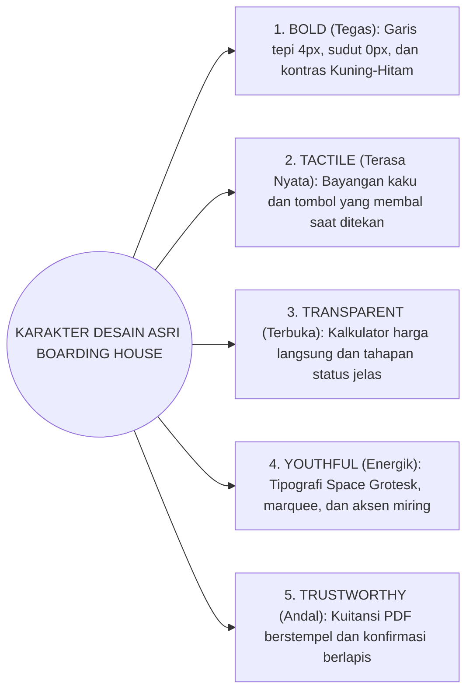

# Design Brief Document (DBD): Sistem Informasi Manajemen Kost Terintegrasi Payment Gateway pada Asri Boarding House

## Informasi & Metadata Dokumen

| Atribut Dokumen | Keterangan |
| :--- | :--- |
| **Judul Dokumen** | Design Brief Document (DBD): Sistem Informasi Manajemen Kost Terintegrasi Payment Gateway pada Asri Boarding House |
| **Versi Dokumen** | Versi 1.0 (Selaras dengan Arsitektur Master v248.0) |
| **Status Dokumen** | Approved / Production Final |
| **Tanggal Efektif** | 4 November 2026 |
| **Penanggung Jawab** | Tim Pengembang & Desainer Antarmuka Asri Boarding House |
| **Domain Produksi** | `https://asriboardinghouse.weatso.id/` |
| **Lokasi Properti** | Jl. Maera Sari No.1/no.12, Tembalang, Kec. Tembalang, Kota Semarang, Jawa Tengah 50275 |
| **Gaya Desain Utama** | *Neo-Brutalism UI* dengan Adaptabilitas *Light Mode* & *High-Contrast OLED Dark Mode* (`#030712`) |
| **Berkas Konfigurasi Acuan** | `tailwind.config.js`, `resources/css/app.css`, `resources/views/layouts/app.blade.php`, dan `resources/views/layouts/landing.blade.php` |
| **Dokumen Referensi Terkait** | [PRD-Asri-Boarding-House.md](file:///c:/xampp/htdocs/asri-boarding-house/Documentation/PRD-Asri-Boarding-House.md), [TRD-Asri-Boarding-House.md](file:///c:/xampp/htdocs/asri-boarding-house/Documentation/TRD-Asri-Boarding-House.md), & [AFD-Asri-Boarding-House.md](file:///c:/xampp/htdocs/asri-boarding-house/Documentation/AFD-Asri-Boarding-House.md) |

---

## 1. Project Overview & Context

### 1.1. Nama Proyek & Deskripsi Singkat
**Sistem Informasi Manajemen Kost Terintegrasi Asri Boarding House** adalah platform web yang menyatukan eksplorasi katalog 32 kamar eksklusif, pemesanan daring dengan skema uang muka (*Down Payment*) maupun bayar lunas, penagihan sewa bulanan otomatis melalui *Midtrans Snap*, hingga pengelolaan operasional properti dalam satu antarmuka berkarakter tegas.

Dari sudut pandang desain, aplikasi ini tidak sekadar menjadi papan pengumuman profil kost biasa. Antarmuka dirancang sebagai ruang kerja transaksi dua arah yang menjembatani kebutuhan calon penghuni dalam mencari tempat tinggal dengan kebutuhan pemilik properti dalam memantau arus kas, kontrak hunian, dan keluhan fasilitas secara akurat setiap hari.

### 1.2. Latar Belakang & Tujuan Desain
Banyak aplikasi manajemen properti atau situs pencarian kost tampil dengan gaya generik yang serba membulat, warna pastel pucat, dan batas antarelemen yang samar. Pada aplikasi yang sarat dengan transaksi uang seperti pembayaran DP 30%, pelunasan tagihan tanggal 1 hingga 10, perhitungan denda keterlambatan 5%, serta pemotongan uang jaminan (*deposit*) saat *check-out*, tampilan yang terlalu lembut justru berisiko menurunkan kewaspadaan pengguna saat membaca angka nominal atau status jatuh tempo.

Perancangan visual **Asri Boarding House** mengadopsi pendekatan **Neo-Brutalism UI** yang dipadukan dengan **OLED Dark Mode** untuk menjawab lima tujuan utama:
1. **Mempertegas Hierarki Informasi Finansial dan Status Kamar**: Garis tepi hitam tebal (`border-4`) dan kontras warna kuning menyala (`#FACC15`) memisahkan setiap kartu informasi secara tegas. Penghuni maupun admin dapat langsung membedakan mana tagihan yang masih menunggu pembayaran, mana yang sudah lunas, dan mana yang telah melewati batas tanggal 10 hanya dalam sekali pandang.
2. **Membangun Identitas Visual yang Segar bagi Generasi Muda**: Lokasi kost yang berada di kawasan pendidikan Tembalang, Kota Semarang, menjadikan mahasiswa dan pekerja muda sebagai pengguna terbesar. Gaya *Neo-Brutalism* yang berani, geometris, dan ditunjang animasi mikro interaktif memberikan kesan modern sekaligus membedakan Asri Boarding House dari kompetitor kost konvensional.
3. **Menjaga Kenyamanan Mata melalui *True OLED Dark Mode***: Penghuni sering memeriksa tagihan atau mengirim obrolan kepada admin pada malam hari melalui layar ponsel. Mode gelap aplikasi menggunakan latar hitam pekat (`#030712`) dengan garis tepi putih (`#FFFFFF`) yang menghemat konsumsi daya layar AMOLED sekaligus menjaga keterbacaan teks tetap tajam.
4. **Mencegah Kesalahan Klik pada Aksi Krusial**: Tombol aksi dirancang menyerupai tombol mekanis fisik yang memiliki bayangan kaku (*hard shadow*) dan bergerak turun saat ditekan. Setiap tindakan berisiko tinggi seperti pembatalan pesanan, penghapusan data kamar, atau konfirmasi pelunasan kasir selalu dilindungi oleh kotak dialog konfirmasi khusus (`MODAL-CONF-01`) yang kontras.
5. **Menjamin Kemudahan Akses Satu Tangan (*Thumb-Zone Ergonomics*)**: Lebih dari separuh pengunjung mengakses katalog kamar melalui peramban ponsel. Tata letak memprioritaskan kemudahan jangkauan ibu jari melalui bilah navigasi bawah (*Mobile Bottom Navigation Bar*) serta ukuran tombol yang memenuhi batas minimal sentuhan `44px`.

### 1.3. Target Audience (Persona Visual)
Arah estetika aplikasi disesuaikan untuk melayani tiga profil pengguna dengan kebiasaan visual yang berbeda:

| No | Persona Pengguna | Profil Demografis & Konteks Penggunaan | Kebutuhan Visual & Ekspektasi Antarmuka |
| :-: | :--- | :--- | :--- |
| 1 | **Mahasiswa & Perantau Muda** (*Calon Penyewa & Penyewa Aktif*) | Usia 18 sampai 24 tahun, mahasiswa perguruan tinggi di kawasan Tembalang (seperti UNDIP dan Polines). Mayoritas mengakses web dari *smartphone* saat mencari kamar, berdiskusi di ruang *chat*, atau membayar tagihan bulanan via QRIS. | Menyukai tampilan yang ekspresif, tidak membosankan, dan cepat dimengerti. Membutuhkan kalkulator simulasi harga yang transparan, indikator tahapan pemesanan (*5-Step Stepper*) yang jelas, serta tombol bayar yang langsung memunculkan *popup Midtrans* tanpa alur berbelit. |
| 2 | **Pekerja & Profesional Muda** (*Penyewa Eksklusif VIP/Deluxe*) | Usia 23 sampai 32 tahun, pekerja aktif yang membutuhkan hunian tenang dan tertib. Sering mengakses portal di sela jam kerja atau malam hari melalui ponsel maupun laptop. | Mengutamakan kejelasan informasi kontrak, kemudahan mengunduh kuitansi resmi berformat PDF A5 untuk keperluan administrasi, kemudahan melapor kerusakan fasilitas lewat unggahan foto, serta kenyamanan tampilan *Dark Mode* saat diakses malam hari. |
| 3 | **Pengelola & Administrator Kost** (*Owner / Admin Operasional*) | Usia 25 sampai 50 tahun, mengelola 32 kamar setiap hari melalui komputer meja (*desktop*) atau tablet. Bertugas memverifikasi reservasi, mencatat kas masuk/keluar, memantau kalender okupansi, dan membalas keluhan. | Membutuhkan tabel data dengan garis pembatas sel yang tegas, lencana status berwarna kontras tinggi, kalender visual 42 sel yang mudah dipindai, serta input nominal Rupiah yang otomatis memformat titik ribuan agar terhindar dari salah ketik angka. |

---

## 2. Brand Identity & Personality (Karakter Desain)

### 2.1. Brand Keywords (5 Kata Kunci Utama)
Seluruh keputusan desain mulai dari pemilihan huruf, ketebalan garis, hingga gerakan animasi berpusat pada lima kata kunci karakter merek berikut:



1. **Bold (Tegas & Berani)**: Tidak ada keraguan dalam penyajian elemen visual. Setiap wadah konten dibingkai garis hitam utuh tanpa sudut lengkung (`0px`), menciptakan batas wilayah yang tegas antara latar belakang, kartu kamar, dan tombol tindakan.
2. **Tactile (Terasa Fisik & Responsif)**: Elemen interaktif dirancang seolah memiliki ketebalan fisik di dunia nyata. Bayangan tajam tanpa efek kabur (*zero-blur hard shadow*) yang bergeser mengikuti posisi kursor atau tekanan jari memberikan umpan balik instan bahwa suatu tombol dapat diklik.
3. **Transparent (Jujur & Terbuka)**: Desain mendukung keterbukaan informasi harga dan aturan sewa. Pengunjung dapat langsung menghitung simulasi harga harian, mingguan, atau bulanan beserta potongan promo di halaman detail kamar tanpa ada biaya tersembunyi.
4. **Youthful (Segar & Energik)**: Penggunaan pita teks berjalan (*Brutalist Running Marquee*), judul kotak kuning yang dimiringkan satu derajat (`-rotate-1`), serta pemakaian ikon emoji terkurasi menghilangkan kesan kaku yang biasa ditemukan pada sistem informasi administrasi.
5. **Trustworthy (Andal & Terpercaya)**: Di balik tampilannya yang ekspresif, tata letak tetap menjaga kerapian struktur tabel akuntansi, ketertiban formulir pendaftaran NIK/wali, serta keabsahan kuitansi pembayaran digital berformat A5.

### 2.2. Tone of Voice & Strategi Mikro-Kopi
Gaya bahasa pada antarmuka (*UX Writing*) memadukan keramahan layanan perhotelan dengan ketegasan administrasi properti. Teks ditulis lugas, langsung pada inti pesan, dan bebas dari istilah teknis yang membingungkan penghuni.

| Konteks Kanal / Layar | Karakter Nada Bicara (*Tone*) | Aturan Penulisan & Contoh Implementasi Nyata pada Aplikasi |
| :--- | :--- | :--- |
| **Halaman Publik & Promosi** (`landing/*`) | Antusias, Mengundang, & Informatif | Menggunakan kalimat aktif yang menonjolkan kenyamanan dan kemudahan. Judul utama ditulis dalam huruf kapital penuh (*UPPERCASE*) untuk menarik perhatian. Contoh: *"CARI & PESAN KAMAR SEKARANG"*, *"Kenyamanan tinggal ekstra dengan fasilitas penunjang berstandar tinggi."* |
| **Peringatan Kontekstual & Banner Status** | Lugas, Membantu, & Mengarahkan | Memberi tahu kondisi akun saat ini beserta tautan solusi langsung. Contoh pada pita atas halaman publik: *"⚠️ Anda memiliki reservasi Kamar A-01 yang belum aktif (Status: PENDING). Klik di sini untuk melanjutkan pembayaran / melihat detail."* |
| **Kotak Konfirmasi & Validasi Form** (`MODAL-CONF-01`) | Jelas, Hati-hati, & Tanpa Intimidasi | Menjelaskan konsekuensi tindakan secara terang-terangan sebelum dieksekusi. Tombol konfirmasi menggunakan kata kerja spesifik seperti *"Ya, Lanjutkan"* atau *"Batalkan Reservasi"*, bukan sekadar *"OK"*. |
| **Notifikasi WhatsApp ke Penyewa** (via *Fonnte*) | Ramah, Sopan, & Terstruktur | Menyapa penyewa dengan nama lengkap, merinci nomor kamar dan nominal tagihan dengan format Rupiah, serta menyertakan pengingat batas jatuh tempo tanggal 10 secara santun. |
| **Eskalasi WhatsApp ke Wali Penyewa** (`bulan_keterlambatan >= 2`) | Formal, Hormat, & Objektif | Ketika tagihan menunggak hingga memasuki bulan kedua dan terkena denda flat 5%, gaya bahasa beralih menjadi surat pemberitahuan resmi yang sopan kepada orang tua/wali penghuni tanpa nada menyudutkan. |

---

## 3. Visual Style & Art Direction

### 3.1. Design Style: Neo-Brutalism UI & High-Contrast OLED Dark Mode
Aplikasi ini meninggalkan tren *Glassmorphism* (efek kaca buram) maupun *Soft Material Design* dan menetapkan **Neo-Brutalism UI** sebagai bahasa desain tunggal di seluruh modul (Publik, Calon Penyewa, Penyewa Aktif, dan Administrator).

Empat pilar utama yang membentuk estetika *Neo-Brutalism* pada Asri Boarding House meliputi:
1. **Geometri Sudut Tajam (`0px Border Radius`)**: Seluruh kartu, tombol, kotak input, lencana (*badge*), tabel, hingga jendela obrolan melayang menggunakan kelas `rounded-none`. Ketiadaan sudut membulat menciptakan kesan arsitektural yang kokoh dan rapi saat elemen disusun berdampingan di dalam *grid*.
2. **Garis Tepi Struktural Eksplisit (`2px` hingga `8px` Solid Borders)**: Alih-alih memisahkan komponen dengan ruang kosong semata atau bayangan halus, setiap komponen wajib memiliki garis pinggir padat berwarna hitam pekat (`#000000` pada *Light Mode*) atau putih bersih (`#FFFFFF` pada *Dark Mode*).
3. **Bayangan Kaku Tanpa Kabur (*Hard Offset Shadows*)**: Efek kedalaman tidak menggunakan *gaussian blur*, melainkan blok bayangan padat yang digeser secara diagonal ke kanan-bawah sebesar `1.5px`, `2px`, `3px`, `4px`, `6px`, atau `8px` sesuai hierarki komponen.
4. **Aksen Asimetris Terukur**: Pada bagian tajuk utama (*Hero Section*) dan kartu sorotan, elemen dekoratif diberi kemiringan terukur seperti `-rotate-1`, `rotate-3`, atau `rotate-12` untuk memecah kekakuan garis lurus tanpa mengganggu keterbacaan teks.

### 3.2. Referensi Visual, Moodboard & Koreografi Gerak (Motion Design)
Secara konseptual, arah artistik antarmuka ini menggabungkan ketegasan tata letak poster tipografi Swiss (*Swiss International Style*) dengan keberanian warna produk digital modern seperti *Gumroad* dan *Figma Config*, lalu diadaptasi ke dalam konteks aplikasi manajemen properti Indonesia.

Untuk memastikan tampilan yang tegas tersebut tetap terasa hidup dan luwes saat digunakan, aplikasi mengintegrasikan pustaka animasi **GSAP 3.12.5** dan **ScrollTrigger** pada halaman publik serta transisi CSS terpusat pada portal internal:
* **Tombol Magnetik (*Magnetic Cursor Pull*)**: Pada layar desktop (`>= 1024px`), tombol berkelas `.neo-btn-interactive` dan `.neo-btn-yellow-interactive` merespons pergerakan kursor di sekitarnya dengan bergeser halus mendekati arah kursor (`x * 0.3`, `y * 0.3`), lalu membal kembali secara elastis (`elastic.out(1.2, 0.4)`) saat kursor menjauh. Ketika tombol diklik (`mousedown`), posisi langsung dikunci ke titik tengah (`x: 0, y: 0`) agar target klik tidak pernah meleset.
* **Elevasi Kartu Elastis (*Elastic Card Hover*)**: Kartu galeri dan katalog kamar akan terangkat ke atas-kiri (`y: -6, x: -2`) disertai perbesaran bayangan menjadi `10px 10px 0px 0px #000000` dengan kurva `back.out(1.7)` saat disorot kursor.
* **Animasi Muncul Bertahap (*Staggered Scroll Reveal*)**: Elemen di dalam `.gsap-scroll-reveal-container` muncul secara berurutan ketika masuk ke area pandang layar. Pada desktop, kemunculan disertai rotasi tipis (`rotate: -2`) dan skala (`scale: 0.95`), sedangkan pada layar ponsel (`< 1024px`) animasi disederhanakan menjadi pergeseran vertikal murni (`y: 30`) demi menjaga kelancaran *frame rate* perangkat bergerak.
* **Pita Teks Berjalan (*Brutalist Running Marquee*)**: Di bawah bagian *Hero*, pita kuning `.brutalist-marquee-container` menggerakkan teks keunggulan kost secara terus-menerus selama `25 detik` per siklus (`marquee-scroll 25s linear infinite`).

### 3.3. Imagery, Iconography & Illustration Style
Penggunaan aset visual diatur agar selaras dengan bingkai *Neo-Brutalism*:
1. **Fotografi Properti & Kamar Asli**:
   - Foto bangunan dan interior kamar ditampilkan di dalam wadah berbingkai `border-4 border-black` dengan latar cadangan kuning (`bg-yellow-400`).
   - Pada latar belakang *Hero Section*, foto properti diberi efek `grayscale(40%)`, `opacity-15`, dan `mix-blend-multiply` sehingga menjadi tekstur arsitektural yang memperkaya latar putih tanpa menenggelamkan teks utama.
   - Setiap gambar kamar pada katalog dilengkapi kerangka pemuat berkilau (`.shimmer-placeholder`) yang otomatis memudar (`removeShimmer()`) begitu foto selesai diunduh, menjaga tata letak agar tidak melompat.
2. **Sistem Ikonografi Hibrida (Emoji Ekspresif + Ikon Vektor SVG)**:
   - **Emoji Fungsional Terkurasi**: Digunakan sebagai penanda kategori cepat pada tajuk, lencana tipe kamar, dan navigasi bawah ponsel untuk mempercepat pengenalan visual (contoh: `👑` untuk Kamar VIP, `✨` untuk Kamar Deluxe, `🏠` untuk Kamar Standar/Beranda, `🔍` untuk Pencarian, `⚡` untuk Aksen Kecepatan/Listrik, `⚠️` untuk Peringatan, `✅` untuk Sukses, dan `❌` untuk Gagal).
   - **Ikon Garis & Solid SVG (`20px` s.d. `24px`)**: Digunakan pada tombol tindakan struktural seperti logo WhatsApp resmi, tombol pengalih tema Terang/Gelap (ikon matahari dan bulan), tombol buka/tutup bilah sisi (*hamburger menu*), serta tombol aksi di dalam tabel admin.
3. **Grafis Dokumen Cetak (Kuitansi PDF A5)**:
   - Khusus pada tampilan cetak nota pembayaran (`/penyewa/nota/{pembayaran}/cetak`), gaya *Neo-Brutalism* dipadukan dengan tata letak kuitansi resmi berformat kertas A5 lanskap/potret yang dilengkapi tipografi monospasi pada nomor referensi, tabel rincian biaya berbingkai tegas, serta cap stempel vektor digital bertuliskan **LUNAS / ASRI BOARDING HOUSE**.

---

## 4. Color Palette (Palet Warna & Token Desain)

Sistem warna Asri Boarding House dirancang di atas dua kutub kontras ekstrem: **Kuning-Hitam di atas Putih** untuk tampilan *Light Mode*, dan **Kuning-Putih di atas Hitam OLED (`#030712`)** untuk tampilan *Dark Mode*.

### 4.1. Arsitektur Token Warna CSS (`resources/css/app.css`)
Untuk menjamin perubahan tema berlangsung instan tanpa perlu menulis ulang deklarasi bayangan di setiap komponen, warna garis tepi dan cincin fokus didefinisikan melalui variabel CSS pada `:root` dan otomatis dibalik pada kelas `.dark`:

```css
:root {
    --neo-border-color: #000000;       /* Hitam pekat untuk garis tepi & bayangan di Light Mode */
    --neo-focus-ring-color: #2563eb;   /* Blue-600 untuk indikator fokus keyboard */
}

.dark {
    --neo-border-color: #ffffff;       /* Putih murni untuk garis tepi & bayangan di Dark Mode */
    --neo-focus-ring-color: #60a5fa;   /* Blue-400 untuk indikator fokus keyboard di latar gelap */
}
```

### 4.2. Primary & Brand Accent Colors (Warna Identitas Utama)
Warna utama yang menjadi ciri khas langsung dari Asri Boarding House adalah **Brutalist Yellow** dan **Structural Black**.

| Nama Warna | Kelas Tailwind | Kode HEX |Nilai RGB | Peran & Penempatan pada Antarmuka |
| :--- | :--- | :---: | :---: | :--- |
| **Brutalist Yellow (Primary)** | `bg-yellow-400` / `text-yellow-400` | `#FACC15` | `rgb(250, 204, 21)` | Warna identitas utama: tombol aksi primer (`.admin-btn-primary`), latar tajuk halaman (*Brutalist Header*), pita *marquee*, sorotan judul *Hero*, dan bayangan kartu khusus (`.neo-card-shadow-yellow`). |
| **Brutalist Yellow Hover** | `bg-yellow-500` | `#EAB308` | `rgb(234, 179, 8)` | Warna kondisi *hover* pada tombol primer serta latar kepala tabel (`.admin-table-thead`) saat berada di *Dark Mode*. |
| **Table Header Yellow** | `bg-yellow-300` | `#FDE047` | `rgb(253, 224, 71)` | Warna latar kepala tabel data (`.admin-table-thead`) pada *Light Mode* agar teks kolom hitam terbaca jelas. |
| **Soft Yellow Tint** | `bg-yellow-50` | `#FEFCE8` | `rgb(254, 252, 232)` | Latar belakang kotak input saat sedang aktif diketik (`focus:bg-yellow-50`) dan efek sorot baris tabel (`hover:bg-yellow-50/30`). |
| **Structural Black** | `bg-black` / `border-black` | `#000000` | `rgb(0, 0, 0)` | Garis tepi utama seluruh komponen, warna bayangan kaku pada *Light Mode*, latar belakang *Footer* publik, serta lencana *tagline* utama. |

### 4.3. Secondary & Interactive Focus Colors (Warna Pendukung & Fokus)
Warna pendukung digunakan untuk mengarahkan fokus navigasi papan ketik dan membedakan elemen informasi non-peringatan.

| Nama Warna | Kelas Tailwind | Kode HEX | Peran & Penempatan pada Antarmuka |
| :--- | :--- | :---: | :--- |
| **Accessibility Focus Blue (Light)** | `blue-600` (`--neo-focus-ring-color`) | `#2563EB` | Cincin fokus luar (`outline: 2px/3px solid`) saat pengguna menavigasi tombol atau input menggunakan tombol `Tab` pada *Light Mode*. |
| **Accessibility Focus Blue (Dark)** | `blue-400` (`--neo-focus-ring-color`) | `#60A5FA` | Cincin fokus luar untuk navigasi papan ketik pada *OLED Dark Mode*. |
| **Cyber Cyan Accent** | `bg-cyan-400` | `#22D3EE` | Warna lencana informasi (`.admin-badge-info`), penanda status proses sekunder, dan sorotan metrik analitik. |

### 4.4. Neutral & Surface Colors (Perbandingan Light Mode vs OLED Dark Mode)
Aplikasi menerapkan pemetaan warna permukaan dan teks yang dioptimalkan secara khusus melalui aturan penguat kontras pada `layouts/app.blade.php` dan `layouts/landing.blade.php`:

| Elemen Permukaan / Teks | Spesifikasi Light Mode (HEX & Kelas) | Spesifikasi OLED Dark Mode (HEX & Kelas Override) | Penjelasan Fungsional |
| :--- | :--- | :--- | :--- |
| **Latar Belakang Utama (*Canvas*)** | `#FFFFFF` (`bg-white`) pada publik; `#F8FAFC` (`bg-slate-50`) pada portal | `#030712` (`dark:bg-slate-900` di-*override* ke **OLED Black**) | Memberikan kanvas bersih di siang hari dan mematikan piksel layar OLED sepenuhnya di malam hari. |
| **Latar Belakang Sekunder** | `#F1F5F9` (`bg-slate-100`) | `#0B0F19` (`.dark .bg-slate-50`) | Membedakan area pembungkus luar dengan wadah kartu utama. |
| **Permukaan Kartu & Modal (*Surface*)** | `#FFFFFF` (`bg-white`) | `#111827` (`.dark .bg-white` -> `gray-900`) & `#1E293B` (`dark:bg-slate-800`) | Wadah untuk `.admin-card`, kartu kamar, tabel, dan kotak dialog agar menonjol di atas kanvas `#030712`. |
| **Permukaan Input Form** | `#FFFFFF` (`bg-white`) | `#0F172A` (`dark:bg-slate-900`) | Latar kotak `.admin-input`, `.admin-textarea`, dan `.admin-select`. |
| **Teks Utama (*Primary Text*)** | `#000000` (`text-black`) & `#020617` (`text-slate-950`) | `#F9FAFB` (`#f9fafb` / `gray-50`) & `#F1F5F9` (`slate-100`) | Digunakan untuk judul, nominal harga, isi tabel, dan teks paragraf utama. |
| **Teks Sekunder (*Body / Subtitle*)** | `#334155` (`text-slate-700`) & `#475569` (`text-slate-600`) | `#E2E8F0` (`slate-200`) & `#CBD5E1` (`slate-300`) | Diperkuat otomatis pada *Dark Mode* agar rasio kontras tetap melampaui standar WCAG AA. |
| **Teks Panduan (*Placeholder / Muted*)** | `#94A3B8` (`placeholder-slate-400`) & `#64748B` (`text-slate-500`) | `#94A3B8` (`.dark .text-slate-500` -> `slate-400`) | Teks bayangan di dalam input sebelum diisi dan keterangan waktu tambahan. |
| **Garis Tepi & Bayangan Kaku** | `#000000` (Hitam Pekat) | `#FFFFFF` (Putih Murni) | Seluruh `.border-black`, `.neo-card-shadow`, dan `.neo-btn-shadow` otomatis berbalik menjadi putih pada *Dark Mode*. |

### 4.5. Semantic Status Colors (Warna Status Operasional)
Warna semantik memiliki arti khusus yang seragam di seluruh modul (status kamar, status reservasi, status tagihan, tiket keluhan, dan pemberitahuan *toast*):

| Kategori Semantik | Kelas Komponen / Tailwind | Kode HEX | Penggunaan Spesifik dalam Konteks Bisnis Kost |
| :--- | :--- | :---: | :--- |
| **Success (Berhasil / Aktif / Lunas)** | `.admin-btn-success` (`bg-emerald-500`), `.admin-badge-success` (`bg-emerald-400`) | `#10B981`, `#34D399` | Status kamar `tersedia`, status tagihan `lunas`, status reservasi `terkonfirmasi`, keluhan `selesai`, tombol konfirmasi bayar, dan notifikasi `TOAST-01` sukses. |
| **Warning (Peringatan / Menunggu / DP)** | `bg-amber-500`, `.admin-badge-warning` (`bg-amber-400`) | `#F59E0B`, `#FBBF24` | Status tagihan `belum_bayar` (sebelum tanggal 10), status reservasi `pending` atau `dp`, status kamar `maintenance`, serta keluhan yang sedang `diproses`. |
| **Danger (Bahaya / Tunggakan / Ditolak)** | `.admin-btn-danger` (`bg-red-500`), `.admin-badge-danger` (`bg-red-400`), Alert Box (`bg-red-100`) | `#EF4444`, `#F87171`, `#FEE2E2` | Status tagihan `terlambat` (lewat tanggal 10 atau terkena denda 5%), status kamar `terisi` (tidak bisa dipesan), reservasi `batal`, tombol hapus/tolak, dan `TOAST-01` gagal. |
| **Neutral (Arsip / Nonaktif)** | `.admin-badge-neutral` (`bg-slate-200` / `dark:bg-slate-700`) | `#E2E8F0`, `#334155` | Status kontrak penyewa yang sudah `nonaktif` (selesai *check-out*), sesi obrolan tamu yang telah ditutup, atau tombol batal sekunder. |

---

## 5. Typography (Tipografi & Skala Hierarki)

### 5.1. Pasangan Huruf Utama (*Font Pairing*)
Aplikasi memuat dua keluarga huruf dari *Google Fonts* yang didefinisikan di dalam `tailwind.config.js` dan dimuat secara *preload* pada bagian `<head>`:

1. **Heading Font (`font-heading`): `Space Grotesk`**
   - **Ketebalan yang Dimuat**: `500` (Medium), `750` (Bold-Extra), dan `800` (ExtraBold/Black).
   - **Karakter & Alasan Pemilihan**: Huruf *sans-serif* geometris dengan proporsi teknis yang khas. Sangat cocok dengan bingkai kotak *Neo-Brutalism*, memberikan wibawa visual ketika dicetak dalam huruf kapital penuh (`uppercase`) pada judul halaman dan nomor kamar.
   - **Cakupan Elemen**: Diterapkan secara global pada seluruh elemen tajuk `h1`, `h2`, `h3`, `h4`, `h5`, dan `h6`.
2. **Body & UI Font (`font-sans`): `Plus Jakarta Sans`**
   - **Ketebalan yang Dimuat**: `400` (Regular), `500` (Medium), `600` (SemiBold), `700` (Bold), dan `800` (ExtraBold).
   - **Karakter & Alasan Pemilihan**: Dirancang dengan bukaan huruf (*aperture*) yang lega dan tinggi huruf kecil (*x-height*) yang proporsional. Memastikan teks deskripsi fasilitas, isi pesan obrolan, label formulir, hingga deretan angka Rupiah di dalam tabel keuangan tetap nyaman dibaca pada ukuran kecil sekalipun.
   - **Cakupan Elemen**: Diterapkan secara bawaan pada `body`, paragraf, input form, tombol, lencana, dan tabel data.

### 5.2. Font Scale & Hierarchy (Skala & Hierarki Huruf)
Tabel berikut merinci standar ukuran, ketebalan, spasi antarhuruf (*letter-spacing*), dan kelas implementasi untuk setiap tingkatan teks:

| Tingkat Hierarki | Keluarga Huruf | Ukuran Layar Mobile (`< 640px`) | Ukuran Layar Desktop (`>= 640px`) | Ketebalan (*Weight*) | Atribut Spasi & Transformasi | Kelas Standar Tailwind / CSS |
| :--- | :--- | :---: | :---: | :---: | :--- | :--- |
| **Hero Display Title** | `Space Grotesk` | `36px` (`text-4xl`) | `60px` (`sm:text-6xl`) | `900` (`font-black`) | `uppercase`, `tracking-tighter`, `leading-none` | `text-4xl sm:text-6xl font-black uppercase tracking-tighter leading-none` |
| **Heading 1 (H1 - Judul Seksi Publik)** | `Space Grotesk` | `30px` (`text-3xl`) | `48px` (`sm:text-5xl`) | `900` (`font-black`) | `uppercase`, `tracking-tight` | `text-3xl sm:text-5xl font-black uppercase tracking-tight` |
| **Heading 2 (H2 - Judul Halaman Portal)** | `Space Grotesk` | `20px` (`text-xl`) | `24px` (`sm:text-2xl`) | `900` (`font-black`) | `uppercase`, `tracking-tight` | `text-xl sm:text-2xl font-black uppercase tracking-tight` |
| **Heading 3 (H3 - Judul Kartu / Modal)** | `Space Grotesk` | `18px` (`text-lg`) | `20px` (`text-xl`) | `800` (`font-extrabold`) | `uppercase`, `tracking-wide` | `text-lg sm:text-xl font-extrabold uppercase` |
| **Admin Section Title** | `Space Grotesk` / `Plus Jakarta Sans` | `14px` (`text-sm`) | `14px` (`text-sm`) | `900` (`font-black`) | `uppercase`, `tracking-wider`, garis bawah `2px` | `.admin-section-title` |
| **Body Text (Paragraf & Tabel)** | `Plus Jakarta Sans` | `14px` (`text-sm`) | `16px` (`sm:text-base`) | `500` (`font-medium`) s.d. `700` (`font-bold`) | `leading-relaxed` (`1.625`) | `text-sm sm:text-base font-bold leading-relaxed` |
| **Form Input Text** | `Plus Jakarta Sans` | `14px` (`text-sm`) | `14px` (`text-sm`) | `700` (`font-bold`) | Normal | `.admin-input` (`text-sm font-bold`) |
| **Form Label & Table Header** | `Plus Jakarta Sans` | `12px` (`text-xs`) | `12px` (`text-xs`) | `800` (`font-extrabold`) s.d. `900` (`font-black`) | `uppercase`, `tracking-wider` | `.admin-label` & `.admin-table-th` |
| **Badge / Caption / Subtitle** | `Plus Jakarta Sans` | `12px` (`text-xs`) | `12px` (`text-xs`) | `700` (`font-bold`) s.d. `900` (`font-black`) | Normal / `uppercase` | `.admin-badge` & `.admin-subtitle` |
| **Mobile Bottom Nav Label** | `Plus Jakarta Sans` | `9px` (`text-[9px]`) | *(Disembunyikan pada `lg:`)* | `900` (`font-black`) | `uppercase`, `tracking-wider` | `text-[9px] font-black uppercase tracking-wider` |

### 5.3. Aturan Penulisan Angka & Nominal Uang
Mengingat banyaknya informasi harga sewa, denda 5%, potongan deposit, dan laporan laba-rugi, penyajian angka mengikuti aturan khusus:
* Setiap nominal mata uang wajib diawali simbol `Rp` diikuti spasi atau langsung angka dengan pemisah ribuan berupa tanda titik (`.`), misalnya `Rp 1.500.000`.
* Angka total tagihan dan harga kamar pada kartu katalog dicetak dengan ketebalan `font-black` (`900`) atau `font-extrabold` (`800`) agar langsung tertangkap mata sebelum pengguna membaca teks penjelasan di sekitarnya.

---

## 6. UI Component Guidelines (Panduan Komponen Utama)

Seluruh komponen antarmuka dibangun secara modular di dalam `@layer components` pada `resources/css/app.css` serta komponen Blade di `resources/views/components/` agar seragam di seluruh halaman.

### 6.1. Skala Elevasi Bayangan Kaku (*Brutalist Shadow Tokens*)
Tingkat kepentingan suatu komponen ditunjukkan oleh seberapa jauh bayangan kakunya bergeser dari garis tepi:

| Nama Token CSS / Kelas Utilitas | Nilai `box-shadow` (Desktop) | Nilai `box-shadow` (Mobile `< 640px`) | Komponen Pengguna |
| :--- | :--- | :--- | :--- |
| `--neo-shadow-1` | `1px 1px 0px 0px var(--neo-border-color)` | `1px 1px 0px 0px` | `.admin-badge`, `.admin-checkbox`, dan input berstatus *disabled*. |
| `--neo-shadow-2` / `.neo-shadow-sm` | `2px 2px 0px 0px` s.d. `3px 3px 0px 0px` | `1.5px 1.5px 0px 0px` | `.admin-select-sm`, tombol saat sedang ditekan (*active state*), dan tombol *disabled*. |
| `--neo-shadow-3` | `3px 3px 0px 0px var(--neo-border-color)` | `3px 3px 0px 0px` | Kondisi normal pada `.admin-input`, `.admin-textarea`, dan `.admin-select`. |
| `--neo-shadow-4` / `.neo-btn-shadow` | `4px 4px 0px 0px var(--neo-border-color)` | `2px 2px 0px 0px` | Kondisi normal seluruh tombol utama (`.admin-btn-*`), `.admin-table-container`, dan input saat *focus*. |
| `--neo-shadow-6` / `.neo-card-shadow` | `6px 6px 0px 0px` (Portal) / `8px 8px 0px 0px` (Publik) | `4px 4px 0px 0px` | Wadah kartu utama (`.admin-card`) dan kondisi *hover* pada tombol portal admin. |
| `--neo-shadow-8` | `8px 8px 0px 0px var(--neo-border-color)` | `4px 4px 0px 0px` | Kondisi *hover* pada kartu interaktif (`.admin-card-hover:hover`) dan modal dialog utama. |

### 6.2. Buttons (Tombol Interaktif)
Tombol wajib memenuhi ukuran ramah sentuhan dengan tinggi minimal `44px` (`min-h-[44px]`), bantalan dalam `py-3 px-6`, garis tepi `border-4`, sudut `rounded-none`, teks kapital `text-xs uppercase tracking-wider`, dan jarak antar-ikon `gap-2`.

#### A. Varian Warna Tombol
1. **Primary Button (`.admin-btn-primary` / `.neo-btn-yellow-interactive`)**: Latar kuning `#FACC15` (`bg-yellow-400`), berubah ke `#EAB308` (`hover:bg-yellow-500`) saat disorot, teks hitam `font-black`. Digunakan untuk aksi utama pada layar (seperti *Simpan Data*, *Bayar Sekarang*, *Pesan Kamar*).
2. **Secondary Button (`.admin-btn-secondary`)**: Latar abu-abu terang `bg-slate-100` (atau `dark:bg-slate-700`), teks `text-slate-900` (`dark:text-slate-200`) `font-extrabold`. Digunakan untuk aksi pendukung seperti *Kembali*, *Filter*, atau *Batal*.
3. **Success Button (`.admin-btn-success`)**: Latar hijau zamrud `bg-emerald-500` (`hover:bg-emerald-600`), teks hitam `font-extrabold`. Digunakan khusus untuk aksi pengesahan positif seperti *Konfirmasi Reservasi*, *Verifikasi Lunas*, atau *Export Excel*.
4. **Danger Button (`.admin-btn-danger`)**: Latar merah terang `bg-red-500` (`hover:bg-red-600`), teks putih `font-extrabold`. Digunakan untuk aksi penghapusan, penolakan, atau pembatalan.

#### B. Siklus Kondisi Interaksi (*Button States*)
* **Normal State**: Posisi awal `transform: translate(0, 0)` dengan bayangan `--neo-shadow-4` (`4px`).
* **Hover State (Perangkat Penunjuk / Mouse)**:
  - Pada Portal Internal: Tombol terangkat ke kiri-atas (`transform: translate(-2px, -2px)`) dan bayangan membesar ke `--neo-shadow-6` (`6px`).
  - Pada Halaman Publik: Tombol menekan ke arah bayangan (`transform: translate(2px, 2px)`) dengan bayangan menyusut ke `2px`, dikombinasikan dengan efek tarikan magnetik GSAP pada layar desktop.
* **Active / Pressed State (Saat Diklik atau Disentuh)**: Tombol kembali ke titik dasar atau menekan penuh dengan bayangan menyusut ke `--neo-shadow-2` (`1px` s.d. `2px`), menciptakan sensasi tombol fisik yang tertekan.
* **Focus-Visible State (Navigasi Keyboard)**: Menampilkan cincin fokus biru kontras tinggi (`outline: 3px solid var(--neo-focus-ring-color)` dengan `outline-offset: 3px`).
* **Disabled State (`:disabled` atau `aria-disabled="true"`)**: Opasitas turun menjadi `50%` (`opacity-50`), kursor berubah menjadi tanda larangan (`cursor-not-allowed`), interaksi klik dimatikan (`pointer-events-none`), bayangan menyusut ke `--neo-shadow-2`, dan seluruh efek pergeseran `transform` dikunci mati.

### 6.3. Forms, Inputs & Live Formatters
Elemen formulir dirancang agar pengguna selalu mengetahui kotak mana yang sedang aktif diisi dan format data apa yang diharapkan:
* **Kotak Input Standar (`.admin-input`, `.admin-textarea`, `.admin-select`)**:
  - Menggunakan lebar penuh (`w-full`), sudut tajam (`rounded-none`), garis tepi `border-4`, bantalan `px-4 py-2.5`, teks `text-sm font-bold`, serta bayangan awal `--neo-shadow-3`.
  - **Saat Fokus (`:focus`)**: Bayangan menebal menjadi `--neo-shadow-4` disertai pergeseran halus `translate(-1px, -1px)`. Pada halaman publik, kotak pencarian juga memberikan sorotan cincin kuning (`focus:ring-4 focus:ring-yellow-400 focus:bg-yellow-50`).
  - **Saat Nonaktif (`:disabled`)**: Latar berubah menjadi abu-abu redup (`bg-slate-100 dark:bg-slate-800`), opasitas `60%`, dan bayangan menyusut ke `1px`.
* **Label Formulir (`.admin-label`)**: Dicetak di atas input dengan ukuran `text-xs font-extrabold uppercase tracking-wider`, jarak bawah `mb-1.5`, dan tidak dapat diblok secara tidak sengaja (`select-none`).
* **Pemformat Angka Rupiah Otomatis (`.rupiah-input`)**:
  - Setiap kotak input harga sewa, nominal DP, denda, atau pengeluaran menggunakan kelas `.rupiah-input` yang terhubung ke `<input type="hidden">` melalui atribut `data-target`.
  - Saat pengguna mengetik angka, skrip otomatis menyisipkan titik pemisah ribuan secara langsung di layar sambil menjaga posisi kursor tetap akurat, sementara nilai angka murni tanpa titik dikirimkan ke server.
* **Penanganan Pesan Error Validasi**:
  - Pesan kesalahan di bawah kolom input ditampilkan dengan teks merah tebal (`text-red-600 dark:text-red-400 text-xs font-bold mt-1`).
  - Untuk peringatan kesalahan tingkat formulir (seperti tanggal pencarian tidak valid), digunakan kotak peringatan berlatar merah muda `bg-red-100`, garis tepi `border-4 border-black`, bayangan `.neo-card-shadow`, dan ikon `⚠️`.

### 6.4. Cards, Containers & Data Tables
* **Kartu Konten (`.admin-card` & Kartu Katalog)**:
  - Menggunakan latar putih (`bg-white`) pada mode terang dan abu-abu gelap (`dark:bg-slate-800` / `#111827`) pada mode gelap, dibingkai `border-4`, bantalan dalam `p-6 md:p-8`, dan bayangan `.neo-card-shadow` (`6px` atau `8px`).
  - Varian `.neo-card-shadow-yellow` menggunakan bayangan kuning padat (`8px 8px 0px 0px #FACC15`) untuk menonjolkan panel penting seperti formulir *Cek Ketersediaan Kamar* di halaman beranda.
* **Tabel Data Brutalis (`.admin-table-container` & `.admin-table`)**:
  - Pembungkus tabel dilengkapi penggeser horizontal (`overflow-x-auto`), bingkai `border-4`, dan bayangan `--neo-shadow-4`.
  - Kepala tabel (`.admin-table-thead`) diberi warna latar kuning (`bg-yellow-300 dark:bg-yellow-500`) dengan teks hitam `text-xs font-black uppercase tracking-wider`.
  - Setiap kolom dan baris dipisahkan oleh garis tegas (`border-right-width: 2px` dan `border-top-width: 2px`), dengan efek sorot lembut (`hover:bg-yellow-50/30 dark:hover:bg-slate-700/40`) saat baris ditunjuk kursor.

### 6.5. Komponen Interaktif Khusus (Modals, Toasts, Widgets & Stepper)
1. **Modal Konfirmasi Brutalis (`MODAL-CONF-01` / `window.brutalistConfirm`)**: Menggantikan kotak dialog bawaan peramban. Tampil di tengah layar di atas lapisan penutup gelap, memiliki garis tepi `border-4`, bayangan `8px`, judul tegas, serta dua tombol berdampingan (*Batal* dan tombol konfirmasi berwarna merah/kuning sesuai tingkat bahaya aksi).
2. **Notifikasi Melayang (`TOAST-01` / `window.showToast`)**: Muncul di sudut kanan atas (`top-5 right-5 z-50`) dengan bingkai `border-4`, menampilkan status keberhasilan atau kegagalan aksi secara ringkas sebelum menutup otomatis setelah 4 detik.
3. **Indikator Kemajuan Reservasi (*5-Step Visual Stepper*)**: Menampilkan lima kotak tahapan berurutan pada halaman detail reservasi calon penyewa. Tahap yang sudah selesai diberi warna hijau zamrud, tahap yang sedang berlangsung diberi warna kuning menyala dengan animasi denyut halus, dan tahap berikutnya ditampilkan dalam warna netral.
4. **Widget Mengambang Publik (`FAB-WA-01` & `FAB-CHAT-01`)**: Tombol WhatsApp dan panel *Guest Live Chat* ditempatkan di sudut kanan bawah dengan bingkai `border-4 border-black` dan sudut `0px`. Pada layar ponsel, posisi vertikalnya otomatis dinaikkan (`bottom: 5rem` dan `bottom: 9.5rem`) agar tidak pernah menutupi bilah navigasi bawah.

---

## 7. Responsiveness & Accessibility (Aksesibilitas)

### 7.1. Breakpoints & Strategi Adaptasi Layar (*Mobile-First*)
Tata letak dirancang dengan pendekatan *Mobile-First* menggunakan tiga titik potong (*breakpoints*) utama yang mengatur kepadatan kolom sekaligus proporsi ketebalan elemen *Neo-Brutalism*:

| Kategori Perangkat | Rentang Lebar Layar | Awalan Tailwind | Aturan Tata Letak & Penyesuaian Geometri Visual |
| :--- | :---: | :---: | :--- |
| **Mobile (Ponsel Pintar)** | `< 640px` | *(Default)* | (1) Susunan kartu dan input formulir menjadi 1 kolom vertikal (`grid-cols-1`). (2) **Penyusutan Garis Tepi Otomatis**: Kelas `.border-4` otomatis diturunkan menjadi `2px` dan `.border-8` menjadi `4px` agar bingkai tebal tidak memakan ruang baca di layar sempit. (3) **Penyusutan Bayangan**: Bayangan tombol turun ke `2px` dan bayangan kartu turun ke `4px` untuk mencegah *horizontal overflow*. (4) Menampilkan **Mobile Bottom Navigation Bar** setinggi `64px` (`h-16`) berisi 5 pintasan utama (*Beranda, Fasilitas, Cari, Chat, Akun*). |
| **Small / Tablet (Layar Menengah)** | `640px` s.d. `1023px` | `sm:` & `md:` | (1) Katalog kamar dan kartu fasilitas beralih ke susunan 2 kolom (`sm:grid-cols-2`). (2) Ketebalan garis tepi kembali ke ukuran penuh (`4px` dan `8px`) serta bayangan kartu meningkat menjadi `6px` atau `8px`. (3) Bilah sisi (*sidebar*) portal admin/penyewa masih disembunyikan di balik menu geser (*off-canvas drawer*) yang dikendalikan oleh *Alpine.js* (`sidebarOpen`). |
| **Desktop (Layar Lebar)** | `>= 1024px` | `lg:` & `xl:` | (1) Bilah sisi navigasi portal dikunci tetap di sisi kiri selebar `256px` (`lg:pl-64`), sedangkan *Mobile Bottom Navigation Bar* disembunyikan (`lg:hidden`). (2) Tata letak halaman publik menggunakan *grid* 4 hingga 12 kolom (`lg:grid-cols-4`, `lg:grid-cols-12`) dengan lebar wadah maksimum `max-w-6xl` (`1152px`) atau `max-w-7xl` (`1280px`). (3) Mengaktifkan interaksi kursor magnetik GSAP dan menata ulang posisi tombol WA serta *Guest Chat* ke bagian bawah layar (`bottom: 1.5rem`). |

### 7.2. Standar Aksesibilitas & Kenyamanan Pengguna (WCAG 2.1 Level AA)
Meskipun mengusung gaya visual yang berani, antarmuka mematuhi kaidah aksesibilitas web agar tetap ramah bagi seluruh kalangan pengguna:
1. **Rasio Kontras Warna Tinggi**:
   - Pada *Light Mode*, perpaduan teks hitam `#000000` di atas latar putih `#FFFFFF` menghasilkan rasio kontras maksimal **21:1**, sedangkan teks hitam `#000000` di atas tombol kuning `#FACC15` menghasilkan rasio kontras **13,6:1** (jauh melampaui syarat minimal WCAG AAA sebesar 7:1).
   - Pada *OLED Dark Mode*, teks putih `#F9FAFB` di atas latar `#030712` menghasilkan rasio kontras **19,8:1**. Teks sekunder yang semula berwarna abu-abu gelap otomatis dinaikkan kecerahannya ke `#94A3B8`, `#CBD5E1`, dan `#E2E8F0` melalui aturan CSS khusus agar tidak pernah tampak pudar di layar gelap.
2. **Dukungan Navigasi Papan Ketik (*Keyboard Navigation*)**:
   - Seluruh elemen interaktif menggunakan pseudo-kelas `:focus-visible` untuk menampilkan cincin fokus biru (`#2563EB` pada mode terang dan `#60A5FA` pada mode gelap) selebar `2px` hingga `3px` dengan jarak renggang `outline-offset: 2px/3px`. Pengguna yang berpindah antarkolom menggunakan tombol `Tab` dapat melihat posisi fokus secara jelas.
3. **Penghormatan Preferensi Gerak (`prefers-reduced-motion`)**:
   - Di dalam `resources/css/app.css`, seluruh efek pergeseran posisi `transform: translate(...)` pada saat tombol atau kartu disorot maupun difokuskan dibungkus di dalam kueri `@media (prefers-reduced-motion: no-preference)`. Apabila pengguna mengaktifkan fitur pengurangan gerak pada sistem operasi perangkatnya, antarmuka otomatis menghentikan efek loncatan posisi tanpa mengurangi fungsi tombol.
4. **Pencegahan Kedipan Tema (*Anti-Flicker*) & Pergeseran Tata Letak (*Anti-CLS*)**:
   - Skrip pendek pendeteksi `localStorage.theme` dan `prefers-color-scheme` dijalankan langsung di dalam tag `<head>` sebelum halaman dirender, sehingga pengguna mode gelap tidak pernah mengalami kilatan layar putih saat berpindah halaman.
   - Elemen yang dianimasikan dengan GSAP diberi kelas `.gsap-reveal` (`opacity: 0; visibility: hidden`) di awal pemuatan untuk mencegah *Flash of Unstyled Content (FOUC)*.

---

## 8. Panduan Penggunaan Praktis & Referensi AI (Developer Hand-off)

Bagian ini disusun sebagai acuan cepat bagi pengembang maupun asisten AI ketika menambahkan halaman baru, membangun komponen tambahan, atau memelihara tampilan di dalam repositori **Asri Boarding House**.

### 8.1. Ringkasan Kelas Komponen Siap Pakai (`resources/css/app.css`)
Saat membuat halaman baru di portal penyewa maupun administrator, selalu utamakan penggunaan kelas komponen terpusat berikut daripada menulis ulang rangkaian kelas utilitas panjang:

```html
<!-- 1. Wadah Kartu Standar -->
<div class="admin-card admin-card-hover">
    <h2 class="admin-section-title">Informasi Kontrak Penyewa</h2>
    
    <!-- 2. Input Formulir dengan Label -->
    <div class="mb-4">
        <label for="harga_sewa_display" class="admin-label">Tarif Sewa Bulanan (Rp)</label>
        <input type="text" id="harga_sewa_display" data-target="harga_sewa" class="admin-input rupiah-input" placeholder="1.500.000">
        <input type="hidden" id="harga_sewa" name="harga_sewa">
        <span class="admin-subtitle">Tarif ini akan dibekukan selama masa kontrak berjalan.</span>
    </div>

    <!-- 3. Lencana Status (Badge) -->
    <div class="flex gap-2 mb-6">
        <span class="admin-badge admin-badge-success">LUNAS</span>
        <span class="admin-badge admin-badge-warning">MENUNGGU VERIFIKASI</span>
        <span class="admin-badge admin-badge-danger">TERLAMBAT (DENDA 5%)</span>
    </div>

    <!-- 4. Tombol Aksi -->
    <div class="flex flex-wrap gap-3">
        <button type="submit" class="admin-btn-primary">Simpan Perubahan</button>
        <button type="button" class="admin-btn-secondary">Batal</button>
    </div>
</div>
```

### 8.2. Templat Instruksi (*Prompting Guide*) untuk Kolaborasi dengan AI
Ketika menggunakan asisten AI untuk menghasilkan kode tampilan *Laravel Blade* atau komponen *Tailwind CSS* baru pada proyek ini, sertakan instruksi ringkas berikut agar kode yang dihasilkan langsung menyatu dengan sistem desain:

> **Contoh Prompt Standar Desain Asri Boarding House:**
> *"Buatkan komponen Blade untuk [nama fitur] mengikuti standar DBD Asri Boarding House: gunakan gaya Neo-Brutalism murni tanpa sudut lengkung (`rounded-none`), garis tepi tebal (`border-4 border-black dark:border-white`), dan bayangan kaku (`.neo-card-shadow` atau `.admin-card`). Gunakan font `Space Grotesk` (`uppercase font-black`) untuk judul dan `Plus Jakarta Sans` untuk teks isi. Gunakan warna aksen utama kuning (`bg-yellow-400 text-black`), pastikan seluruh tombol memiliki tinggi minimal `min-h-[44px]` (gunakan kelas `.admin-btn-primary`, `.admin-btn-secondary`, `.admin-btn-success`, atau `.admin-btn-danger`), serta dukung penuh tampilan OLED Dark Mode (`#030712`)."*

### 8.3. Daftar Periksa Kepatuhan Visual (*Design QA Checklist*)
Sebelum menyatakan sebuah halaman atau komponen baru selesai dikerjakan, pastikan enam poin pemeriksaan berikut telah terpenuhi:
- [ ] **Tidak Ada Sudut Membulat**: Pastikan tidak ada kelas `rounded`, `rounded-md`, `rounded-lg`, atau `rounded-full` yang terselip pada kartu, tombol, tabel, maupun kotak input.
- [ ] **Konsistensi Garis Tepi & Bayangan**: Setiap kartu dan tombol wajib memiliki garis tepi tegas dan bayangan kaku yang sesuai dengan tingkatannya.
- [ ] **Uji Keterbacaan OLED Dark Mode**: Aktifkan pengalih tema ke mode gelap dan pastikan tidak ada teks hitam yang tenggelam di atas latar `#030712` atau `#111827`, serta seluruh garis tepi berubah menjadi putih.
- [ ] **Kenyamanan Layar Ponsel (`< 640px`)**: Periksa tampilan pada lebar layar `375px` untuk memastikan tabel memiliki pembungkus `.admin-table-container` (tidak merusak lebar halaman) dan tombol tidak tertutup oleh *Mobile Bottom Navigation Bar*.
- [ ] **Format Angka & Mata Uang**: Pastikan seluruh input nominal uang menggunakan `.rupiah-input` dan setiap tampilan harga menggunakan format titik ribuan `Rp X.XXX.XXX`.
- [ ] **Perlindungan Aksi Destruktif**: Pastikan setiap tombol hapus, batalkan, atau konfirmasi kasir telah dihubungkan ke modal konfirmasi `window.brutalistConfirm` (`MODAL-CONF-01`), bukan `confirm()` bawaan peramban.
