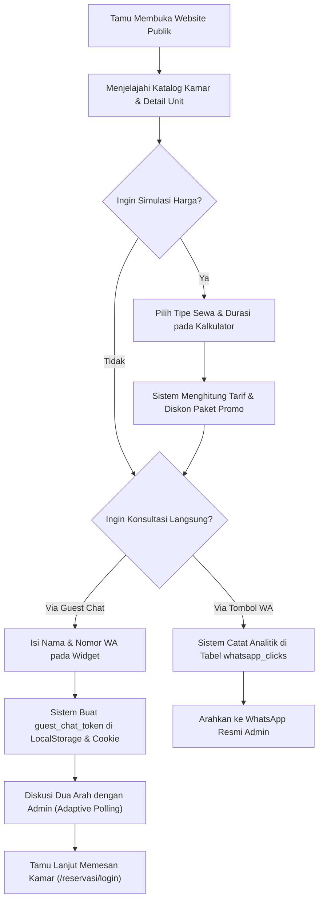
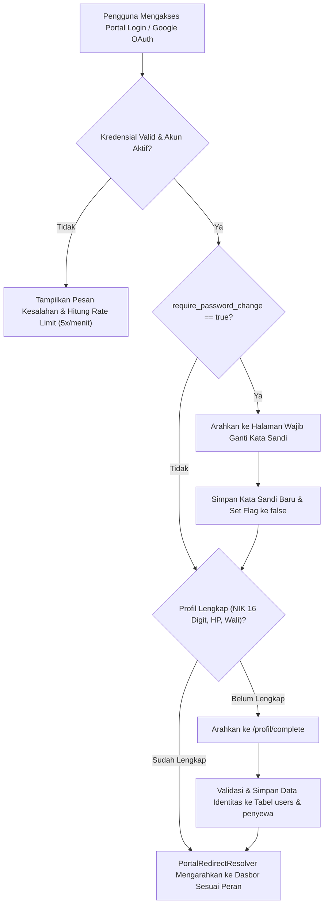
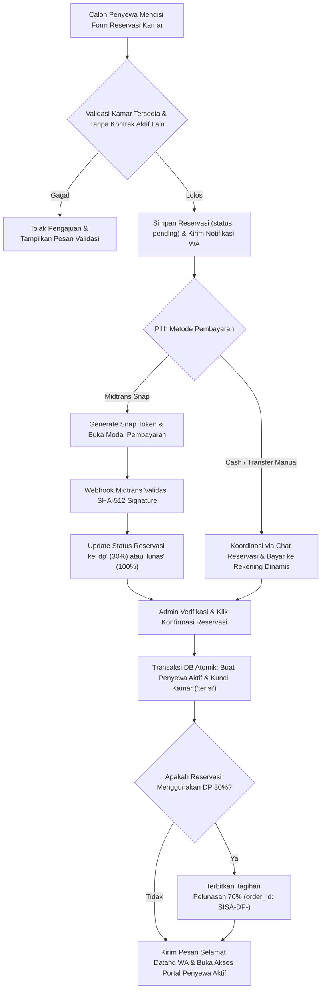
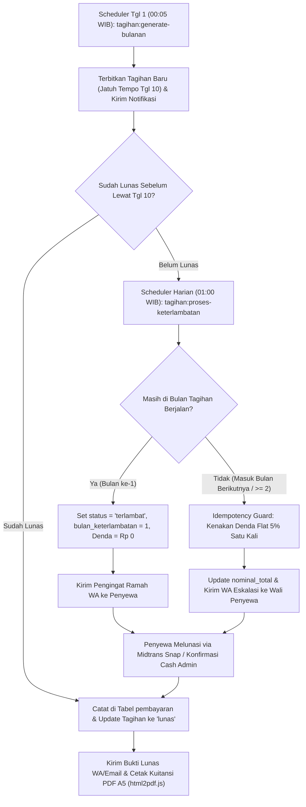
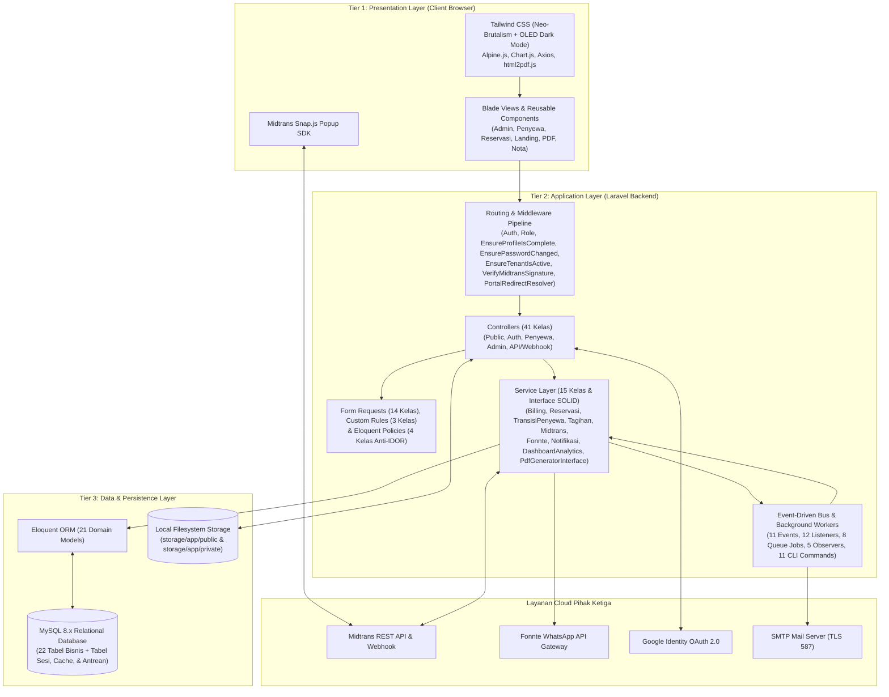
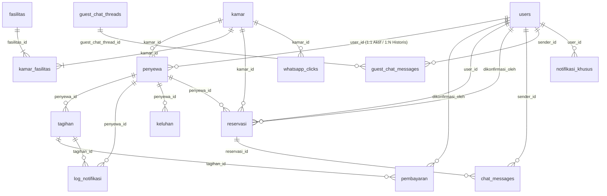

# Product Requirements Document (PRD): Sistem Informasi Manajemen Kost Terintegrasi Payment Gateway pada Asri Boarding House

**Informasi Dokumen**
- **Nama Produk**: Sistem Informasi Manajemen Kost Terintegrasi Asri Boarding House
- **Domain Produksi**: `https://asriboardinghouse.weatso.id/`
- **Lokasi Operasional**: Jl. Maera Sari No.1/no.12, Tembalang, Kec. Tembalang, Kota Semarang, Jawa Tengah 50275
- **Kapasitas Unit**: 32 Kamar Eksklusif (Tipe Standar, Deluxe, dan VIP)
- **Status Implementasi**: Produksi Final Terintegrasi Penuh

---

## 1. Overview

### 1.1. Latar Belakang dan Konteks Produk
Pengelolaan rumah kost berkapasitas puluhan kamar kerap menghadapi kendala serius apabila masih mengandalkan buku catatan fisik, lembar kerja manual, dan percakapan WhatsApp yang terpencar. Pengelola sering kesulitan memantau ketersediaan kamar secara akurat. Risiko pemesanan ganda (*double booking*) pun meningkat ketika calon penghuni dari jalur daring dan jalur kunjungan langsung (*walk-in*) memesan unit yang sama pada waktu berdekatan. Di sisi keuangan, penagihan sewa bulanan yang mengikuti tanggal masuk masing-masing penghuni membuat jadwal jatuh tempo menjadi tidak seragam, menyulitkan perhitungan denda keterlambatan, serta menghambat rekapitulasi arus kas operasional.

**Asri Boarding House** membangun sistem informasi manajemen kost berbasis web untuk menyatukan seluruh siklus hidup penghunian (*tenant lifecycle*) dalam satu platform terpusat. Aplikasi ini melayani empat kelompok pengguna utama sekaligus: pengunjung umum yang mencari kamar, calon penyewa yang sedang memproses pemesanan, penyewa aktif yang menghuni kamar, serta administrator pengelola properti. Seluruh transaksi reservasi, penagihan bulanan otomatis, pembayaran digital melalui *Midtrans Snap*, pencatatan pembayaran tunai, pengiriman pengingat WhatsApp melalui *Fonnte API*, pengajuan keluhan fasilitas, hingga pelaporan laba-rugi berjalan di atas aturan bisnis yang seragam dan terukur.

### 1.2. Tujuan Pengembangan Sistem
1. **Menyatukan Siklus Pemesanan dan Hunian**: Mengintegrasikan alur promosi katalog kamar, pengecekan ketersediaan unit secara langsung, pemesanan daring, diskusi pra-pembayaran, hingga aktivasi kontrak sewa tanpa perpindahan aplikasi manual.
2. **Menstandarkan Siklus Penagihan dan Denda**: Menyeragamkan penerbitan tagihan sewa bulanan pada tanggal 1 setiap bulan dengan batas jatuh tempo tanggal 10, dilengkapi mekanisme denda flat kalender 5% yang kebal terhadap duplikasi eksekusi (*idempotent*).
3. **Menyediakan Kanal Pembayaran Hibrida**: Memfasilitasi pelunasan tagihan maupun uang muka (*Down Payment*) secara instan melalui *Midtrans Snap* (QRIS, Virtual Account berbagai bank, dompet digital) sekaligus tetap mengakomodasi pembayaran tunai atau transfer manual yang diverifikasi oleh pengelola.
4. **Mengotomatiskan Pengingat dan Eskalasi Komunikasi**: Mengirimkan pemberitahuan tagihan, kuitansi pembayaran, pengingat kontrak habis, serta eskalasi keterlambatan pembayaran kepada penyewa maupun wali penyewa secara otomatis melalui WhatsApp dan surat elektronik (*email*).
5. **Mewujudkan Transparansi Keuangan dan Aset**: Mencatat seluruh pemasukan sewa, pemotongan uang jaminan (*deposit*) akibat kerusakan fasilitas, serta pengeluaran operasional harian ke dalam laporan arus kas yang dapat diekspor ke format PDF dan Excel/CSV.

### 1.3. Identifikasi Aktor dan Pengguna Sistem
Sistem membagi entitas yang berinteraksi ke dalam aktor utama (pengguna manusia) dan aktor sekunder (layanan eksternal serta mesin otomasi waktu).

#### A. Aktor Utama (*Primary Actors*)
| No | Aktor | Peran dalam Sistem | Cakupan Akses Utama |
| :-: | :--- | :--- | :--- |
| 1 | **Tamu (*Guest*)** | Pengunjung publik situs web yang belum memiliki atau belum masuk ke akun pengguna. | Menjelajahi beranda, katalog kamar, fasilitas, galeri, testimoni, FAQ, panduan pemesanan, menggunakan kalkulator simulasi harga, dan berkonsultasi melalui *Guest Live Chat* tanpa harus masuk akun. |
| 2 | **Calon Penyewa** | Pengguna terdaftar (`role: penyewa`) yang belum memiliki kontrak sewa berstatus aktif. | Masuk melalui kredensial manual atau Google OAuth 2.0, melengkapi identitas profil (NIK 16 digit & kontak wali), mengajukan reservasi kamar, berdiskusi di ruang obrolan reservasi, serta membayar DP 30% atau lunas 100%. |
| 3 | **Penyewa Aktif** | Penghuni kost yang reservasinya telah dikonfirmasi admin atau didaftarkan langsung ke dalam kontrak aktif (`penyewa.status = aktif`). | Mengakses dasbor penghuni, melihat rincian kontrak, melunasi tagihan bulanan maupun sisa DP, mengunduh kuitansi resmi PDF A5, melaporkan keluhan kerusakan fasilitas beserta foto bukti, membaca tata tertib, dan menerima pengumuman. |
| 4 | **Administrator** | Pemilik atau pengelola operasional Asri Boarding House (`role: admin`). | Mengelola data master kamar dan fasilitas, memverifikasi reservasi dan pembayaran tunai, mengelola kontrak penyewa (tambah, perpanjang, *check-out*, klaim deposit), memantau kalender okupansi visual, menanggapi keluhan dan obrolan tamu, mencatat pengeluaran, mengekspor laporan keuangan, serta mengatur konten dinamis situs. |

> **Peran Wali / Orang Tua Penyewa (Penerima Pasif)**:
> Wali penyewa tidak memiliki akun login ke dalam aplikasi web. Data nama dan nomor WhatsApp wali wajib dicatat saat pendaftaran profil untuk difungsikan sebagai penerima pesan eskalasi otomatis via WhatsApp apabila penyewa menunggak tagihan hingga memasuki bulan kedua.

#### B. Aktor Sekunder dan Otomasi (*Secondary & System Actors*)
| No | Entitas Eksternal / Sistem | Fungsi Integrasi | Protokol & Mekanisme Keamanan |
| :-: | :--- | :--- | :--- |
| 1 | **Midtrans Payment Gateway** | Memproses pembayaran nontunai untuk transaksi reservasi awal dan tagihan sewa bulanan. | *Midtrans Snap JS* pada sisi klien serta *Server-to-Server Webhook* dengan validasi kriptografi `signature_key` SHA-512. |
| 2 | **Fonnte WhatsApp Gateway** | Mengirimkan pesan WhatsApp transaksional, kredensial akun baru, pengingat jatuh tempo, dan pengumuman masal. | *HTTP POST REST API* (`https://api.fonnte.com/send`) menggunakan otorisasi *Bearer/Device Token* dan pencatatan status di tabel `log_notifikasi`. |
| 3 | **Google Identity Services** | Menyediakan layanan masuk dan daftar satu klik (*Single Sign-On*). | Protokol *OAuth 2.0* melalui pustaka *Laravel Socialite* dengan pengalihan balik ke `/auth/google/callback`. |
| 4 | **SMTP Mail Server** | Mengirimkan surel pengaturan ulang kata sandi, pemberitahuan tagihan bulanan, dan bukti pelunasan. | *Symfony Mailer* melalui protokol *SMTP TLS* (Port 587) dengan antrean latar belakang (*database queue*). |
| 5 | **Laravel Task Scheduler** | Mengeksekusi 9 pekerjaan terjadwal tanpa intervensi manusia. | *Cron daemon* server yang memicu `php artisan schedule:run` setiap menit pada zona waktu `Asia/Jakarta`. |

### 1.4. Aturan Bisnis Utama (*Core Business Rules*)
Seluruh logika kode program di dalam repositori mematuhi 10 kebijakan operasional berikut:
1. **Siklus Tagihan Seragam Tanggal 1**: Tagihan sewa rutin selalu diterbitkan serentak pada tanggal 1 setiap bulan pukul 00:05 WIB untuk seluruh penyewa aktif, terlepas dari tanggal awal penyewa mulai masuk.
2. **Masa Tenggang (*Grace Period*) 10 Hari**: Jatuh tempo pembayaran tagihan bulanan ditetapkan pada tanggal 10 setiap bulannya.
3. **Denda Flat Kalender 5% Berpelindung Idempotensi**:
   - Keterlambatan pada bulan berjalan (`bulan_keterlambatan = 1`, setelah lewat tanggal 10) tidak langsung dikenai denda uang, melainkan mengubah status tagihan menjadi `terlambat` dan memicu pengiriman pesan pengingat ramah kepada penyewa.
   - Apabila tagihan bulan sebelumnya masih belum lunas saat memasuki bulan kalender berikutnya (`bulan_keterlambatan >= 2`), sistem mengenakan denda flat sebesar **5% dari nominal pokok** tepat satu kali (`nominal_denda == 0` sebagai *idempotency guard*) dan mengirimkan pesan pemberitahuan resmi kepada wali penyewa.
4. **Fleksibilitas Durasi Sewa**: Sistem melayani tiga tipe durasi sewa baik untuk pemesanan daring maupun pendaftaran langsung: **Harian** (1 sampai 30 hari), **Mingguan** (1 sampai 8 minggu), dan **Bulanan** (1 sampai 12 bulan).
5. **Skema Pembayaran Uang Muka (*Down Payment* 30%)**: Calon penyewa dapat memilih membayar lunas 100% di muka atau membayar DP sebesar 30% dari total harga sewa. Jika menggunakan DP, sisa tagihan 70% otomatis diterbitkan sebagai tagihan pelunasan (`order_id` berawalan `SISA-DP-`) begitu admin mengonfirmasi reservasi.
6. **Pembekuan Tarif Sewa Individu (*Immutable Rent Snapshot*)**: Saat kontrak penyewa dibuat, harga kamar disalin ke kolom `penyewa.harga_sewa`. Perubahan tarif pada tabel master `kamar` di kemudian hari tidak akan mengubah nominal tagihan penyewa lama yang sedang berjalan, kecuali diubah secara khusus oleh admin pada profil penyewa terkait.
7. **Tata Kelola Uang Jaminan (*Security Deposit*)**: Setiap penyewa memiliki catatan deposit pada kontraknya. Saat proses keluar (*check-out*), apabila ditemukan kerusakan fasilitas kamar, admin dapat memotong deposit tersebut. Nilai potongan kerusakan maupun pengembalian sisa deposit secara otomatis dicatat sebagai transaksi kas keluar pada tabel `pengeluaran`.
8. **Penahanan Status Kamar Pasca *Check-Out* (*Manual Inspection Hold*)**: Ketika penyewa dinonaktifkan atau menyelesaikan kontrak, status kamar tidak langsung berubah menjadi `tersedia`. Kamar tetap dikunci atau dialihkan ke status `maintenance` oleh admin saat *check-out* agar tim operasional dapat memeriksa kondisi fisik kamar sebelum membukanya kembali untuk publik.
9. **Isolasi Portal dan Penapisan Bertahap**: Pengguna yang baru mendaftar melalui Google OAuth atau formulir singkat wajib melewati penapisan `EnsureProfileIsComplete` untuk melengkapi NIK 16 digit, nomor WhatsApp aktif, serta nama dan nomor wali sebelum diizinkan memesan kamar. Akun yang dibuatkan oleh admin secara manual wajib mengganti kata sandi bawaan melalui penapisan `EnsurePasswordChanged`.
10. **Pelepasan Kunci Unik pada *Soft Deletes***: Penghapusan data pada entitas krusial (`users`, `kamar`, `penyewa`, `reservasi`) menerapkan *Soft Deletes* yang didukung kolom virtual MySQL 8.x (`active_email`, `active_no_hp`, `active_nik`, `active_nomor_kamar`, `active_order_id`) serta pembubuhan akhiran `_deleted_[timestamp]` agar data historis tetap terjaga tanpa menghalangi pendaftaran ulang dengan nomor kamar, surel, atau NIK yang sama.

---

## 2. Requirements

### 2.1. Kebutuhan Fungsional (*Functional Requirements*)
Kebutuhan fungsional sistem dipetakan secara menyeluruh ke dalam 6 modul utama yang mencakup 25 *Use Case* terintegrasi.

#### A. Modul Publik dan Eksplorasi Tamu (*Public & Guest Module*)
- **FR-PUB-01 (Halaman Informasi Mandiri)**: Sistem menyediakan halaman publik terpisah yang meliputi Beranda (`/`), Fasilitas (`/fasilitas`), Katalog Kamar (`/kamar`), Detail Kamar (`/kamar/{kamar}`), Panduan Cara Booking (`/cara-booking`), Testimoni Penghuni (`/testimoni`), Tentang Kami (`/tentang-kami`), Tanya Jawab Interaktif (`/faq`), dan Galeri Properti (`/galeri`).
- **FR-PUB-02 (Pencarian, Penyaringan, dan Cek Ketersediaan Kamar - UC-10)**: Pengunjung dapat menyaring daftar kamar berdasarkan ketersediaan maupun tipe kamar (`standar`, `deluxe`, `vip`), serta memeriksa apakah suatu unit tersedia pada rentang tanggal dan tipe sewa tertentu melalui endpoint `/cek-ketersediaan`.
- **FR-PUB-03 (Kalkulator Simulasi Harga dan Paket Promo)**: Pada halaman detail kamar, pengunjung dapat menghitung estimasi biaya sewa secara langsung (`/kamar/{kamar}/hitung-harga`) berdasarkan tipe sewa (`harian`, `mingguan`, `bulanan`), durasi, serta potongan diskon dari paket promo aktif (Paket Fleksibel Bulanan 0%, Paket Hemat Triwulan 5%, dan Paket Tahunan Super Promo 8,33%).
- **FR-PUB-04 (*Guest Live Chat* Tanpa Login - UC-17)**: Pengunjung anonim dapat memulai sesi obrolan langsung dengan admin hanya dengan memasukkan nama dan nomor WhatsApp (`/api/guest-chat/start`). Sesi dipertahankan menggunakan token unik tanpa mewajibkan pembuatan akun.
- **FR-PUB-05 (Pelacakan Analitik Klik WhatsApp)**: Setiap klik pada tombol melayang atau tautan konsultasi WhatsApp dicatat secara asinkron ke endpoint `/analytics/track-whatsapp` beserta sumber halaman, ID kamar (jika ada), alamat IP, dan *user agent* peramban.

#### B. Modul Autentikasi dan Keamanan Akun (*Authentication & Account Security Module*)
- **FR-AUTH-01 (Login Multi-Portal Terisolasi - UC-22)**: Sistem memisahkan pintu masuk autentikasi menjadi tiga jalur: Portal Reservasi (`/reservasi/login`), Portal Penyewa Aktif (`/penyewa/login`), dan Portal Administrator (`/admin/login`), masing-masing dilindungi pembatasan percobaan masuk maksimal 5 kali per menit (`throttle:5,1`).
- **FR-AUTH-02 (Registrasi Mandiri & SSO Google OAuth 2.0 - UC-12 & UC-18)**: Calon penyewa dapat mendaftarkan akun baru menggunakan formulir surel dan kata sandi (`/reservasi/register`) atau masuk secara instan melalui akun Google (`/auth/google` dan `/auth/google/callback`).
- **FR-AUTH-03 (Pemulihan Kata Sandi Berbasis Peran - UC-24)**: Sistem menyediakan alur lupa dan atur ulang kata sandi terpisah untuk penyewa (`/forgot-password`, `/penyewa/forgot-password`) serta administrator (`/admin/forgot-password`) melalui pengiriman tautan bertanda tangan ke surel pengguna.
- **FR-AUTH-04 (Penapisan Kelengkapan Identitas Profil)**: Middleware `EnsureProfileIsComplete` mencegat pengguna yang belum memiliki data `no_hp`, `nik`, `nama_wali`, atau `no_wali` yang sah, lalu mengarahkannya ke halaman `/profil/complete` dengan tetap menyimpan URL tujuan awal (*intended URL*).
- **FR-AUTH-05 (Pemaksaan Ganti Kata Sandi Awal)**: Middleware `EnsurePasswordChanged` memaksa pengguna atau admin yang memiliki penanda `require_password_change = true` untuk memperbarui kata sandi bawaan (minimal 8 karakter kombinasi huruf dan angka, serta tidak boleh sama dengan kata sandi lama) sebelum dapat mengakses fitur lain.
- **FR-AUTH-06 (Sinkronisasi Profil dan Anonimisasi Hapus Akun)**: Pembaruan profil pada `/profile` secara otomatis menyinkronkan perubahan NIK dan kontak wali ke tabel `penyewa` di dalam satu transaksi basis data. Pengguna tanpa riwayat sewa atau reservasi aktif dapat menghapus akunnya secara mandiri melalui mekanisme `anonymizeAndDelete()`.

#### C. Modul Reservasi dan Calon Penyewa (*Reservation & Prospective Tenant Module*)
- **FR-RES-01 (Pengajuan Reservasi Kamar Daring - UC-01)**: Calon penyewa dapat mengajukan pemesanan kamar (`/penyewa/reservasi`) dengan memilih tipe sewa, tanggal mulai, durasi, catatan tambahan, metode pembayaran (`midtrans` atau `cash`), serta skema bayar (Lunas 100% atau DP 30%). Sistem memvalidasi ketersediaan kamar dan menolak pemesanan apabila pengguna sudah memiliki reservasi atau kontrak lain yang masih aktif.
- **FR-RES-02 (Panduan *5-Step Visual Stepper*)**: Halaman detail reservasi (`/penyewa/reservasi/{reservasi}`) menampilkan indikator kemajuan 5 langkah dinamis mulai dari pengajuan, diskusi/pembayaran, verifikasi pembayaran, konfirmasi admin, hingga akses penuh ke dasbor penyewa aktif.
- **FR-RES-03 (Ruang Obrolan Pra-Pembayaran - UC-03)**: Calon penyewa dan admin dapat bertukar pesan teks secara langsung pada konteks reservasi tertentu (`/chat-box/{reservasi}`) untuk mendiskusikan ketersediaan kamar, jadwal masuk, atau negosiasi sebelum pelunasan.
- **FR-RES-04 (Pembayaran Reservasi via Midtrans Snap - UC-02)**: Calon penyewa dapat menghasilkan *Snap Token* (`/penyewa/reservasi/{reservasi}/token`) untuk membuka jendela pembayaran *Midtrans Snap* dan melunasi tagihan reservasi atau DP secara instan.
- **FR-RES-05 (Manajemen Riwayat Mandiri & Pembatalan - UC-16)**: Portal calon penyewa memisahkan halaman Daftar Pemesanan (`/penyewa/reservasi/pemesanan`), Riwayat Pembayaran (`/penyewa/reservasi/pembayaran`), dan Riwayat Obrolan (`/penyewa/reservasi/riwayat-chat`), serta mengizinkan pembatalan reservasi yang masih berstatus `pending`.

#### D. Modul Portal Penyewa Aktif (*Active Tenant Portal Module*)
- **FR-TEN-01 (Dasbor Penyewa Aktif)**: Menampilkan ringkasan kamar yang dihuni, tarif sewa personal, sisa hari kontrak, status tagihan bulan berjalan, serta daftar pengumuman aktif dari pengelola (`/penyewa/dashboard`).
- **FR-TEN-02 (Pelunasan Tagihan Bulanan & Sisa DP - UC-04)**: Penyewa aktif dapat melihat daftar dan rincian seluruh tagihan (`/penyewa/tagihan`), memantau indikator tahapan keterlambatan (3 tahap), melakukan pembayaran daring via *Midtrans Snap* (`/penyewa/pembayaran/{tagihan}/token`), atau melihat instruksi nomor rekening bank dinamis untuk pembayaran manual.
- **FR-TEN-03 (Unduh dan Cetak Kuitansi PDF A5 - UC-25)**: Setiap transaksi pembayaran yang telah lunas menyediakan halaman cetak nota resmi (`/penyewa/nota/{pembayaran}/cetak`) berformat A5 lengkap dengan stempel digital yang dapat langsung diunduh menjadi berkas PDF melalui pustaka `html2pdf.js`.
- **FR-TEN-04 (Pelaporan Tiket Keluhan Fasilitas - UC-05)**: Penyewa aktif dapat mengirim laporan kerusakan fasilitas (`/penyewa/keluhan`) berdasarkan kategori (`kamar`, `fasilitas_bersama`, `kebersihan`, `keamanan`, `lainnya`) disertai unggahan foto bukti maksimal 2MB, serta memantau perkembangan penanganannya (`pending`, `diproses`, `selesai`).
- **FR-TEN-05 (Akses Peraturan & Kotak Masuk Notifikasi - UC-11 & UC-21)**: Penyewa dapat membaca daftar tata tertib kost (`/penyewa/peraturan`) dan memeriksa riwayat pengumuman serta pemberitahuan tagihan di halaman `/penyewa/notifikasi`.

#### E. Modul Portal Administrator (*Admin Management Hub Module*)
- **FR-ADM-01 (Dasbor Analitik Eksekutif)**: Menyajikan metrik tingkat keterisian kamar (*occupancy rate*), jumlah kamar tersedia/terisi/perbaikan, total pendapatan bersih bulan berjalan, total tunggakan, daftar tagihan jatuh tempo, keluhan terbaru, analitik klik WhatsApp, serta grafik arus kas 12 bulan terakhir (`/admin/dashboard`).
- **FR-ADM-02 (Kalender Okupansi Visual)**: Menyediakan tampilan matriks kalender 42 sel (`/admin/kalender` dan `/admin/kalender/events`) yang memetakan jadwal masuk (*check-in*), jadwal keluar (*check-out*), dan masa tinggal seluruh penghuni maupun reservasi aktif.
- **FR-ADM-03 (Manajemen Master Kamar & Fasilitas)**: Admin dapat menambah, mengubah, memperbarui status cepat (`tersedia`, `terisi`, `maintenance`), menghapus sementara (*soft delete*), dan memulihkan (*restore*) unit kamar (`/admin/kamar`) dengan pilihan tampilan tabel atau kartu (*grid*), serta mengelola master fasilitas (`/admin/fasilitas`) beserta relasi *many-to-many* ke tiap kamar.
- **FR-ADM-04 (Verifikasi & Konfirmasi Reservasi Online)**: Pada `/admin/reservasi`, admin dapat memverifikasi identitas calon penyewa, menetapkan nominal deposit, dan mengonfirmasi reservasi. Saat dikonfirmasi, sistem secara otomatis membuat entitas `Penyewa` aktif, mengubah status kamar menjadi `terisi`, mencatat transaksi awal, dan menerbitkan invoice sisa DP 70% apabila reservasi dibayar dengan skema DP. Admin juga dapat membatalkan reservasi atau menghapus permanen reservasi yang sudah berstatus `batal`.
- **FR-ADM-05 (Manajemen Penyewa *Offline/Walk-in* & Kontrak)**: Admin dapat mendaftarkan penyewa baru secara langsung (`/admin/penyewa/create`). Sistem otomatis membuatkan akun `User` dengan kata sandi awal berupa nomor HP, mengunci kamar, dan mengirimkan kredensial login ke WhatsApp penyewa via *Fonnte*. Admin juga dapat mengubah data penyewa, memperpanjang durasi kontrak (`/admin/penyewa/{penyewa}/perpanjang`), serta mengekspor daftar penyewa ke PDF dan CSV sesuai filter aktif.
- **FR-ADM-06 (Proses *Check-Out* & Audit Klaim Deposit)**: Melalui `/admin/penyewa/{penyewa}/checkout`, admin memproses penghentian sewa dengan memilih status akhir kamar (`tersedia` atau `maintenance`) dan memeriksa ada tidaknya kerusakan kamar. Jika terdapat kerusakan, nominal potongan otomatis mengurangi deposit dan tercatat sebagai pengeluaran kategori `maintenance`, sementara sisa deposit yang dikembalikan kepada penyewa dicatat sebagai pengeluaran kategori `lainnya`.
- **FR-ADM-07 (Manajemen Tagihan & Konfirmasi Kasir Tunai)**: Admin dapat memantau seluruh tagihan (`/admin/tagihan`), menyaring berdasarkan status/periode, mengonfirmasi pelunasan secara tunai atau transfer manual (`/admin/tagihan/{tagihan}/konfirmasi-cash`), serta mencetak nota pembayaran resmi.
- **FR-ADM-08 (Pembukuan Pengeluaran & Laporan Laba-Rugi)**: Admin dapat mengelola data pengeluaran operasional (`/admin/pengeluaran`) beserta lampiran foto nota, memantau neraca arus kas masuk dan keluar pada `/admin/laporan`, serta mengekspor laporan keuangan dan pengeluaran ke berkas PDF maupun Excel/CSV.
- **FR-ADM-09 (Penanganan Keluhan & Konsol *Guest Live Chat*)**: Admin dapat memperbarui status tiket keluhan dan memberikan tanggapan resmi (`/admin/keluhan`) yang langsung memicu notifikasi ke penyewa, serta membalas, menutup, atau menghapus sesi obrolan pengunjung publik pada `/admin/guest-chats`.
- **FR-ADM-10 (Manajemen Konten Dinamis CMS & Broadcast Notifikasi)**: Admin dapat mengelola pengaturan global situs, rekening bank, dan paket promo (`/admin/pengaturan-konten`), mengelola FAQ (`/admin/faq`), Galeri (`/admin/gallery`), Ulasan Pelanggan (`/admin/reviews`), dan Peraturan (`/admin/peraturan`), mengirimkan pesan siaran (*broadcast*) ke WhatsApp/Email/Pengumuman (`/admin/notifikasi`), mengirim ulang (*retry*) log notifikasi yang gagal, serta memantau jejak audit internal (`/admin/notifikasi-khusus`).

#### F. Modul Otomasi Latar Belakang (*Scheduled Background Tasks Module*)
Sistem menjalankan 9 perintah terjadwal otomatis yang didefinisikan pada `routes/console.php` ditambah perintah utilitas pemeliharaan:

| Kode | Perintah Artisan | Jadwal Eksekusi (WIB) | Fungsi Otomasi |
| :-: | :--- | :--- | :--- |
| **SCH-01** | `tagihan:generate-bulanan` | Tanggal 1 setiap bulan, `00:05` | Menerbitkan invoice tagihan bulanan baru untuk seluruh penyewa berstatus `aktif`. |
| **SCH-02** | `tagihan:proses-keterlambatan` | Harian, `01:00` | Mengevaluasi tagihan yang melewati tanggal 10, menetapkan status `terlambat`, memberikan denda flat 5% pada bulan kedua secara *idempotent*, dan mengirim notifikasi ke penyewa/wali. |
| **SCH-03** | `session:cleanup` | Harian, `01:30` | Menghapus baris sesi pengguna yang telah kedaluwarsa dari tabel `sessions`. |
| **SCH-04** | `log-notifikasi:clear` | Harian, `02:00` | Menghapus catatan di tabel `log_notifikasi` yang berumur lebih dari 90 hari. |
| **SCH-05** | `chat-guest:prune` | Harian, `03:00` | Membersihkan utas dan pesan *Guest Live Chat* yang telah ditutup dan melewati masa retensi. |
| **SCH-06** | `kontrak:reminder-habis` | Harian, `08:00` | Memindai kontrak penyewa yang akan berakhir pada H-14, H-7, H-3, dan H-0 untuk mengirimkan pengingat perpanjangan via WhatsApp. |
| **SCH-07** | `reservasi:cancel-expired` | Setiap jam (*Hourly*) | Membatalkan reservasi berstatus `pending` yang belum dibayar melewati batas waktu 24 jam (`config('reservasi.expire_hours')`). |
| **SCH-08** | `log:truncate` | Mingguan (*Weekly*) | Memangkas ukuran berkas `storage/logs/laravel.log` agar tidak memenuhi ruang penyimpanan server. |
| **SCH-09** | `abh:purge-trash` | Bulanan (*Monthly*) | Menghapus permanen (*force delete*) data *soft-deleted* yang telah melewati batas masa simpan. |

### 2.2. Kebutuhan Non-Fungsional (*Non-Functional Requirements*)
1. **Sistem Desain Neo-Brutalism dan Adaptabilitas Tema (UI/UX)**:
   - Seluruh komponen antarmuka menerapkan gaya visual *Neo-Brutalism* dengan garis tepi tegas (`border-2` hingga `border-4` berwarna hitam pada mode terang dan putih pada mode gelap), bayangan kaku presisi tanpa kabur (*hard offset shadow*), serta kombinasi tipografi *Space Grotesk* untuk judul dan *Plus Jakarta Sans* untuk teks isi.
   - Mendukung peralihan instan antara *Light Mode* dan *OLED Dark Mode* (`#030712`) dengan deteksi awal anti-kedip (*anti-flicker*) di elemen `<head>`.
   - Memenuhi standar aksesibilitas **WCAG 2.1 Level AA** dengan rasio kontras warna yang teruji, ukuran target sentuh (*touch target*) minimum `44px x 44px` pada tombol interaktif, dukungan atribut `WAI-ARIA` (`role="dialog"`, `aria-modal="true"`, `aria-live`), serta meniadakan dialog `window.confirm()` bawaan peramban demi menggunakan modal konfirmasi kustom bergaya Neo-Brutalist.
2. **Keamanan Aplikasi dan Integritas Transaksi (*Security*)**:
   - **Verifikasi Kriptografi Webhook**: Seluruh notifikasi masuk dari Midtrans wajib melewati middleware `VerifyMidtransSignature` yang membandingkan `signature_key` menggunakan algoritma `hash('sha512', order_id + status_code + gross_amount + server_key)`.
   - **Perlindungan Anti-IDOR**: Otorisasi akses objek data dikawal oleh 4 kebijakan Eloquent (*Policies*), yaitu `ReservasiPolicy`, `TagihanPolicy`, `PembayaranPolicy`, dan `KeluhanPolicy`, sehingga seorang penyewa tidak dapat melihat atau memanipulasi tagihan, nota, reservasi, maupun keluhan milik penyewa lain.
   - **Sanitasi Masukan Berlapis**: Seluruh masukan formulir dibersihkan melalui kelas `App\Support\Sanitizer`, trait `HasSanitizedInput`, dan trait `SanitizesCurrency` (membersihkan format titik/rupiah menjadi angka murni, menormalisasi nomor telepon ke awalan `628`, serta melucuti tag HTML berbahaya).
   - **Transaksi Atomik dan Penguncian Baris**: Operasi finansial dan perubahan status kritis (konfirmasi reservasi, pembuatan tagihan, webhook pembayaran, dan *check-out* penyewa) dibungkus dalam `DB::transaction()` menggunakan `lockForUpdate()` guna mencegah kondisi balapan (*race condition*).
3. **Kinerja dan Efisiensi Sumber Daya (*Performance*)**:
   - **Smart Adaptive Polling**: Ruang obrolan reservasi dan *Guest Chat* menarik pesan baru secara delta (`?after=lastMsgId`) dengan interval adaptif 4 hingga 12 detik yang otomatis melambat saat tidak ada pesan baru dan berhenti sementara ketika tab peramban disembunyikan (`document.visibilityState === 'hidden'` atau `pagehide`).
   - **In-Memory & Database Caching**: Pengaturan situs global (`Setting`) dimuat melalui `LayoutSettingComposer` menggunakan penyimpanan statis dalam memori dan cache basis data yang otomatis dihapus oleh `SettingObserver` maupun `FasilitasObserver` saat data diperbarui.

---

## 3. Core Features

### 3.1. Katalog Kamar Interaktif dan Kalkulator Harga Promo Dinamis
Halaman katalog dan detail kamar menyajikan informasi ketersediaan unit secara aktual beserta spesifikasi luas kamar ($m^2$), posisi lantai, daftar fasilitas berikon, dan galeri foto. Pengguna dapat mencoba simulasi biaya sewa sebelum mendaftar. Mesin kalkulasi pada `ReservasiService` menghitung tarif dasar secara proporsional: sewa bulanan menggunakan `harga_bulan`, sewa mingguan dihitung sebesar $\text{round}((\text{harga\_bulan} / 4) \times 1.15, -3)$ per minggu, dan sewa harian dihitung sebesar $\text{round}((\text{harga\_bulan} / 30) \times 1.3, -3)$ per hari. Apabila pengguna memilih durasi bulanan yang sesuai dengan paket promo aktif di tabel `settings` (misalnya 3 bulan dengan diskon 5% atau 12 bulan dengan diskon 8,33%), potongan harga langsung diterapkan secara otomatis.

### 3.2. Mesin Reservasi Daring dengan Proteksi *Anti-Double Booking* dan Opsi DP 30%
Saat calon penyewa mengajukan reservasi, sistem menjalankan validasi berlapis melalui `KamarTersediaRule` dan `TanpaPenyewaAktifLainRule`. Sistem menolak pemesanan apabila kamar sedang tidak berstatus `tersedia`, apabila terdapat irisan tanggal (*date overlap*) dengan reservasi aktif lain pada kamar tersebut, atau apabila akun pemesan masih tercatat memiliki kontrak aktif maupun reservasi yang sedang berjalan. Pemesan diberi keleluasaan memilih metode pelunasan penuh atau uang muka (*Down Payment*) sebesar 30%. Seluruh perjalanan reservasi dipandu oleh komponen visual *5-Step Stepper* yang menyesuaikan instruksi layar berdasarkan status reservasi (`pending`, `dp`, `lunas`, `dikonfirmasi`, `batal`).

### 3.3. Sistem Pembayaran Ganda (*Dual Payment Gateway*)
Platform menggabungkan kemudahan pembayaran daring otomatis dengan fleksibilitas pembayaran konvensional:
1. **Jalur Otomatis Midtrans Snap**: Menghasilkan token transaksi unik untuk tiap percobaan bayar (`RSV-` atau `DP-` untuk reservasi, serta `INV-` atau `SISA-DP-` untuk tagihan). Begitu pengguna menyelesaikan pembayaran via QRIS, Virtual Account (BCA, Mandiri, BNI, BRI, Permata), atau e-Wallet, webhook Midtrans memperbarui status secara instan. Sistem juga menyediakan mekanisme *Synchronous API Fallback* (`MidtransService::checkTransactionStatus`) untuk memeriksa status langsung ke server Midtrans apabila pengiriman webhook tertunda di jaringan lokal.
2. **Jalur Kasir Tunai / Transfer Manual**: Menampilkan informasi rekening bank kost yang dikelola secara dinamis melalui menu Pengaturan Konten. Setelah penyewa membayar dan berkoordinasi lewat ruang obrolan atau langsung di lokasi, admin memverifikasi pembayaran melalui fitur Konfirmasi Cash yang sekaligus mencatat identitas admin pengonfirmasi (`dikonfirmasi_oleh`).

### 3.4. Mesin Penagihan Bulanan Otomatis dan Denda Flat Kalender *Idempotent*
Melalui `BillingService`, pembuatan tagihan rutin berjalan tanpa campur tangan manual setiap tanggal 1 awal bulan. Sistem membaca tarif personal `penyewa.harga_sewa` (atau `kamar.harga_bulan` sebagai cadangan) dan menerbitkan invoice dengan jatuh tempo tanggal 10. Setiap hari pukul 01:00 WIB, perintah `tagihan:proses-keterlambatan` memeriksa seluruh tagihan yang belum lunas melewati tanggal jatuh tempo:
- Pada bulan pertama keterlambatan, sistem menaikkan nilai `bulan_keterlambatan` menjadi `1`, mengubah status tagihan menjadi `terlambat`, dan memicu `ReminderPenyewa` tanpa menambahkan denda.
- Ketika pergantian bulan tiba dan tagihan tersebut masih belum dilunasi (`bulan_keterlambatan >= 2`), sistem menghitung denda flat sebesar 5% dari `nominal_pokok` tepat satu kali, memperbarui `nominal_total`, serta memicu `DendaDikenakan` dan `NotifikasiWali` untuk menghubungi wali penyewa.

### 3.5. Kanal Komunikasi Langsung Dua Arah (*Guest Chat* & *Reservation Chat*)
Sistem memiliki dua ruang obrolan terpisah yang dirancang khusus sesuai fase pengguna:
1. **Guest Live Chat**: Widget mengambang di sudut halaman publik yang memungkinkan tamu bertanya langsung kepada admin tanpa login. Sesi percakapan diikat menggunakan `guest_chat_token` yang disimpan ganda di `localStorage` dan *cookie* peramban selama 30 hari.
2. **Reservation Pre-Payment Chat**: Ruang diskusi privat antara calon penyewa dan admin yang melekat pada setiap nomor reservasi (`chat_messages`). Obrolan ini memfasilitasi tanya-jawab kesepakatan kamar atau pengiriman informasi pembayaran sebelum reservasi dikonfirmasi.

### 3.6. Orkestrasi Notifikasi Multi-Kanal Berbasis Antrean (*Event-Driven Queue*)
Setiap peristiwa bisnis penting memancarkan *Domain Event* (seperti `ReservasiDibuat`, `ReservasiDibayar`, `ReservasiDikonfirmasi`, `TagihanDibuat`, `PembayaranBerhasil`, `PembayaranCashDikonfirmasi`, `DendaDikenakan`, `KeluhanDibuat`, dan `KeluhanDitanggapi`). Listener menangkap peristiwa tersebut dan mendorong pekerjaan ke antrean basis data (`jobs`) dengan penjedaan bertahap (*staggered delay* via trait `StaggersJobs`) untuk menghindari pemblokiran batas pengiriman (*rate limit*) API pihak ketiga. Pekerjaan antrean mengirimkan pesan WhatsApp yang telah diformat rapi oleh `NotificationTemplateBuilder` melalui `FonnteService`, mengirimkan surel melalui `Symfony Mailer`, serta mencatat keberhasilan atau kegagalannya di tabel `log_notifikasi` dan `notifikasi_khusus`.

### 3.7. Siklus Kontrak Penyewa, *Immutable Rent Snapshot*, dan Audit Deposit
Saat admin mengonfirmasi reservasi daring atau mendaftarkan penyewa *walk-in*, `TransisiPenyewaService` membekukan harga sewa kamar ke dalam profil penyewa (`harga_sewa`), menghitung `tanggal_keluar_seharusnya` berdasarkan tipe dan durasi sewa, serta mencatat uang jaminan (`deposit`). Ketika kontrak berakhir dan admin menjalankan proses *check-out*, sistem melakukan audit deposit secara transaksional: potongan biaya perbaikan kerusakan kamar langsung dibukukan sebagai pengeluaran kategori `maintenance`, sedangkan pengembalian sisa uang deposit kepada penyewa otomatis dibukukan sebagai pengeluaran kategori `lainnya`.

### 3.8. Portal Layanan Mandiri Penghuni (Tiket Keluhan & Kuitansi PDF A5)
Penyewa aktif memiliki kendali penuh atas administrasi huniannya. Apabila terjadi kendala fasilitas seperti AC kurang dingin atau kebocoran air, penyewa dapat membuat tiket keluhan disertai foto bukti. Setiap perubahan status penanganan oleh admin (`diproses` atau `selesai`) beserta tanggapannya langsung diteruskan ke WhatsApp penyewa. Selain itu, setiap bukti pembayaran yang sah dapat diunduh kapan saja dalam bentuk kuitansi resmi berformat PDF ukuran A5 (`nota-pembayaran` / `nota.cetak`) tanpa membebani CPU server karena proses perenderan PDF kuitansi dilakukan pada sisi klien menggunakan `html2pdf.js`.

### 3.9. Pusat Kendali Eksekutif (Kalender Okupansi Visual & Laporan Keuangan)
Panel administrator menyediakan visibilitas menyeluruh terhadap operasional kost. Fitur Kalender Okupansi memetakan jadwal masuk, masa tinggal, dan jadwal keluar seluruh kamar dalam matriks bulanan interaktif berbasis Alpine.js. Pada aspek finansial, modul Laporan mengonsolidasikan seluruh tagihan lunas (kas masuk) dan pengeluaran operasional (kas keluar) untuk menghitung laba bersih bulanan maupun tahunan, lengkap dengan dukungan ekspor dokumen ke PDF (menggunakan `DompdfGenerator` berorientasi A4/Landscape) serta CSV/Excel yang mempertahankan parameter penyaringan (*state-preserving export*).

### 3.10. Pengaturan Konten Dinamis (CMS) dan Tata Kelola *Soft Deletes*
Pengelola tidak perlu mengubah kode program untuk memperbarui informasi di halaman depan. Melalui menu Pengaturan Konten, admin dapat mengubah teks merek, gambar hero, alamat, koordinat sematan Google Maps (divalidasi oleh `ValidGoogleMapsEmbed`), nomor WhatsApp admin, nomor rekening bank, visi-misi, hingga skema diskon paket promo. Untuk menjaga integritas referensial basis data, penghapusan data kamar, penyewa, akun pengguna, dan reservasi menggunakan mekanisme *Soft Deletes* yang memodifikasi nilai unik dengan akhiran `_deleted_[timestamp]` serta menyediakan fitur pemulihan (*Restore*) dengan deteksi tabrakan kunci unik otomatis.

---

## 4. User Flow

Bagian ini menguraikan urutan interaksi antara pengguna, antarmuka aplikasi, logika backend, basis data, dan layanan eksternal pada 7 alur kerja utama sistem.

### 4.1. Alur Eksplorasi Publik, Simulasi Harga, dan *Guest Live Chat*
1. **Akses Halaman Publik**: Tamu membuka situs web Asri Boarding House dan menjelajahi katalog kamar (`/kamar`), fasilitas (`/fasilitas`), galeri (`/galeri`), maupun panduan pemesanan (`/cara-booking`).
2. **Simulasi Harga Sewa**: Tamu memilih salah satu unit kamar (`/kamar/{kamar}`), lalu memilih tipe sewa (`harian`, `mingguan`, atau `bulanan`) dan durasi pada kalkulator interaktif. Sistem menghitung harga dasar, menerapkan persentase diskon jika durasi cocok dengan paket promo aktif, dan menampilkan rincian total harga beserta nominal opsi DP 30%.
3. **Konsultasi via *Guest Live Chat***: Jika tamu ingin bertanya sebelum mendaftar, tamu menekan tombol obrolan di pojok bawah, mengisi nama serta nomor WhatsApp, dan mengirim pesan. Backend membuat utas di `guest_chat_threads`, mengembalikan `session_token` untuk disimpan di `localStorage` dan *cookie* peramban, lalu mengalirkan balasan admin melalui *Smart Adaptive Polling*.



### 4.2. Alur Autentikasi Multi-Portal, Google OAuth, dan Kelengkapan Profil
1. **Pemilihan Jalur Masuk**: Pengguna mengakses halaman login sesuai perannya (`/reservasi/login`, `/penyewa/login`, atau `/admin/login`) atau menekan tombol masuk dengan Google (`/auth/google`).
2. **Validasi Kredensial & Peran**: Backend memverifikasi kredensial atau token OAuth Google. Jika akun dinonaktifkan (`is_active = 0`), akses ditolak.
3. **Pemeriksaan Kata Sandi Wajib Ganti**: Middleware `EnsurePasswordChanged` memeriksa kolom `require_password_change`. Jika bernilai `true` (misalnya akun baru yang dibuatkan admin), pengguna diarahkan paksa ke halaman ganti kata sandi sebelum dapat melanjutkan.
4. **Pemeriksaan Kelengkapan Identitas**: Middleware `EnsureProfileIsComplete` memeriksa keberadaan `nik` (16 digit), `no_hp`, `nama_wali`, dan `no_wali`. Jika belum lengkap (umumnya pada pengguna baru Google OAuth), sistem mengalihkan pengguna ke `/profil/complete`. Setelah disimpan, pengguna dikembalikan secara mulus ke halaman pemesanan kamar yang dituju sebelumnya (*intended URL*).



### 4.3. Alur Reservasi Kamar Online, Pembayaran, dan Konfirmasi Admin
1. **Pengajuan Formulir Reservasi**: Calon penyewa memilih kamar yang berstatus `tersedia`, menentukan tipe sewa (`harian`, `mingguan`, `bulanan`), tanggal mulai, durasi, metode pembayaran (`midtrans` atau `cash`), serta memilih apakah ingin membayar Lunas 100% atau DP 30%.
2. **Pencatatan Reservasi & Notifikasi Awal**: Sistem menyimpan data ke tabel `reservasi` dengan status `pending` dan memicu event `ReservasiDibuat` untuk mengirimkan notifikasi WhatsApp kepada calon penyewa serta admin.
3. **Diskusi Pra-Bayar & Pelunasan**:
   - Calon penyewa dapat mengirim pesan kepada admin melalui kotak obrolan di halaman detail reservasi.
   - Jika memilih jalur *Midtrans Snap*, calon penyewa menekan tombol bayar, menyelesaikan transaksi di jendela *Snap*, dan webhook Midtrans (`MidtransReservasiCallbackController`) memvalidasi `signature_key` SHA-512 lalu mengubah status reservasi menjadi `lunas` (jika bayar 100%) atau `dp` (jika bayar DP 30%).
4. **Verifikasi & Konfirmasi oleh Admin**: Admin membuka `/admin/reservasi/{reservasi}`, memeriksa data identitas dan pembayaran, mengisi nominal deposit (jika ada), lalu menekan tombol Konfirmasi.
5. **Transisi Otomatis Menjadi Penyewa Aktif**: `TransisiPenyewaService` secara atomik membuat profil `Penyewa` baru berstatus `aktif`, menyalin tarif sewa ke `penyewa.harga_sewa`, mengubah status `Kamar` menjadi `terisi`, mengubah status `Reservasi` menjadi `dikonfirmasi`, membuat catatan `Tagihan` dan `Pembayaran` awal, serta menerbitkan tagihan kedua berstatus `pending` (`SISA-DP-`) apabila penyewa baru membayar DP 30%.



### 4.4. Alur Pendaftaran Penyewa *Offline / Walk-in*
1. **Input Data oleh Admin**: Calon penghuni datang langsung ke lokasi kost atau memesan lewat WhatsApp pribadi pengelola. Admin membuka menu Tambah Penyewa (`/admin/penyewa/create`) dan mengisi nama, surel, nomor HP WhatsApp, NIK 16 digit, nama wali, nomor HP wali, kamar yang dipilih, tipe sewa, durasi, tanggal masuk, serta nominal deposit.
2. **Pembuatan Akun & Kontrak Otomatis**: Sistem membuatkan akun `User` baru dengan kata sandi bawaan berupa nomor HP penyewa dan menandai `require_password_change = true`. Pada transaksi yang sama, sistem membuat profil `Penyewa` berstatus `aktif`, membekukan `harga_sewa`, mengubah status kamar menjadi `terisi`, serta menerbitkan tagihan sewa awal.
3. **Distribusi Kredensial via WhatsApp**: Sistem mendorong `KirimWelcomeMessageJob` ke antrean untuk mengirimkan rincian kamar beserta surel dan kata sandi awal ke nomor WhatsApp penyewa melalui *Fonnte API*. Saat penyewa masuk untuk pertama kali, sistem memaksanya mengganti kata sandi bawaan tersebut.

### 4.5. Alur Siklus Tagihan Bulanan, Eskalasi Denda, Pelunasan, dan Kuitansi PDF
1. **Penerbitan Tagihan Otomatis**: Setiap tanggal 1 pukul 00:05 WIB, `tagihan:generate-bulanan` menerbitkan tagihan baru berstatus `pending` dengan jatuh tempo tanggal 10 untuk seluruh penyewa aktif, lalu mengirimkan pemberitahuan WhatsApp dan surel (`TagihanDibuat`).
2. **Evaluasi Keterlambatan & Denda Flat 5%**: Setiap hari pukul 01:00 WIB, `tagihan:proses-keterlambatan` memeriksa tagihan yang belum lunas melewati tanggal 10:
   - Bulan berjalan (`bulan_keterlambatan = 1`): Status berubah menjadi `terlambat`, sistem mengirim pengingat ramah kepada penyewa tanpa denda.
   - Bulan berikutnya (`bulan_keterlambatan >= 2`): Sistem menambahkan denda flat 5% dari `nominal_pokok` tepat satu kali (`nominal_denda`), memperbarui `nominal_total`, dan mengirim pesan WhatsApp eskalasi kepada wali penyewa.
3. **Pelunasan Hibrida & Cetak Nota**: Penyewa melunasi tagihan melalui *Midtrans Snap* (`MidtransCallbackController`) atau membayar tunai/transfer yang dikonfirmasi admin (`konfirmasiCash`). Setelah status tagihan menjadi `lunas`, penyewa maupun admin dapat membuka halaman cetak kuitansi resmi dan mengunduhnya sebagai berkas PDF A5.



### 4.6. Alur Pengajuan dan Penanganan Tiket Keluhan Fasilitas
1. **Pelaporan Keluhan**: Penyewa aktif membuka `/penyewa/keluhan/create`, mengisi judul keluhan, memilih kategori (`kamar`, `fasilitas_bersama`, `kebersihan`, `keamanan`, `lainnya`), menuliskan deskripsi detail, dan mengunggah foto bukti kerusakan.
2. **Pemberitahuan ke Admin**: Sistem menyimpan data ke tabel `keluhan` dengan status `pending` dan memancarkan event `KeluhanDibuat` untuk mengirim peringatan WhatsApp kepada admin.
3. **Tindak Lanjut & Resolusi**: Admin memeriksa laporan di `/admin/keluhan/{keluhan}`, mengubah status menjadi `diproses` saat teknisi bekerja, lalu mengubahnya menjadi `selesai` disertai catatan `tanggapan_admin`. Sistem otomatis mencatat `tanggal_selesai` dan mengirimkan kabar penyelesaian ke WhatsApp penyewa (`KeluhanDitanggapi`).

### 4.7. Alur Perpanjangan Kontrak, *Check-Out*, dan Audit Deposit
1. **Pengingat Kontrak Habis & Perpanjangan**: Setiap hari pukul 08:00 WIB, `kontrak:reminder-habis` mengirim pengingat WhatsApp kepada penyewa yang masa kontraknya tersisa 14 hari, 7 hari, 3 hari, atau 0 hari. Jika penyewa sepakat memperpanjang, admin menjalankan fitur Perpanjang Kontrak (`/admin/penyewa/{penyewa}/perpanjang`) yang otomatis menggeser `tanggal_keluar_seharusnya` dan menerbitkan tagihan periode perpanjangan.
2. **Proses *Check-Out* & Inspeksi Fisik**: Jika penyewa mengakhiri masa sewa, admin membuka formulir `/admin/penyewa/{penyewa}/checkout`, memilih status kamar pasca-keluar (`maintenance` atau `tersedia`), dan menentukan apakah terdapat kerusakan fasilitas.
3. **Pemotongan Deposit & Pembukuan Kas Keluar**:
   - Apabila terdapat kerusakan, admin mengisi nominal potongan dan mengunggah foto nota perbaikan. Sistem memotong nilai deposit penyewa dan membukukan biaya perbaikan tersebut ke tabel `pengeluaran` (kategori `maintenance`).
   - Apabila masih terdapat sisa deposit, sistem membukukan nilai pengembalian deposit tersebut ke tabel `pengeluaran` (kategori `lainnya`), mengubah status penyewa menjadi `nonaktif`, dan memperbarui status kamar sesuai hasil inspeksi.

---

## 5. Architecture

### 5.1. Pola Arsitektur Sistem (*3-Tier MVC + Service Layer + Event-Driven Queue*)
Aplikasi **Asri Boarding House** dibangun di atas pola arsitektur berlapis (*3-Tier Architecture*) yang memisahkan tanggung jawab presentasi antarmuka, pemrosesan logika bisnis, dan penyimpanan data persisten. Untuk menghindari penumpukan logika di dalam Controller (*Fat Controller*), logika bisnis dikapsulasi ke dalam **Service Layer**, **Form Requests**, **Eloquent Policies**, **Model Observers**, serta **Event-Driven Asynchronous Queue**.



### 5.2. Rincian Komponen per Lapisan Arsitektur

#### A. Tier 1: Presentation Layer (*Antarmuka dan Logika Sisi Klien*)
1. **Struktur Layout & Blade Views (`resources/views/`)**:
   - **Layouts**: `app.blade.php` (portal internal dengan modal konfirmasi kustom Neo-Brutalist), `landing.blade.php` (halaman publik dengan *shimmer loader* anti-CLS), `guest.blade.php` (halaman autentikasi), `penyewa.blade.php`, `navigation.blade.php`, `navigation-landing.blade.php`, `admin-sidebar.blade.php`, `admin-topbar.blade.php`, `email.blade.php`, serta `pdf/layouts/master.blade.php` (master layout cetakan laporan PDF dilengkapi penghitung halaman otomatis).
   - **Komponen Blade Modular (`resources/views/components/`)**: Mencakup komponen halaman publik (`landing/kamar-card`, `landing/facility-card`, `landing/review-card`, `landing/faq-item`, `landing/cta-whatsapp`), komponen autentikasi (`auth/password-input`, `auth/google-button`), serta komponen global (`guest-chat-widget`, `wa-float-button`, `toast`, `flash-message`, `reservation-status-badge`, dan paginasi kustom `vendor/pagination/neo-brutalist.blade.php`).
   - **View Composer Terpusat**: `App\Http\View\Composers\LayoutSettingComposer` menyuntikkan konfigurasi dinamis dari tabel `settings` ke seluruh tampilan layout menggunakan penyimpanan dalam memori (`$cachedSettings`) agar terhindar dari kueri berulang.
2. **Modul JavaScript dan Pustaka Klien (`resources/js/`)**:
   - `app.js` & `bootstrap.js`: Mengelola inisialisasi terbungkus `configureAxios()`, `initializeApp()`, komponen Alpine.js `themeToggle`, utilitas `getSafeStorage()` / `setSafeStorage()`, serta proteksi klik ganda pada tautan Google OAuth (`initOAuthProtection()`).
   - `components/guest-chat.js`: Mengendalikan antarmuka *Guest Live Chat* secara terisolasi (IIFE), sanitasi teks anti-XSS, dan mekanisme *Smart Adaptive Polling*.
   - `html2pdf.js` & `Chart.js`: Digunakan masing-masing pada halaman cetak kuitansi A5 (`nota/cetak.blade.php`) dan visualisasi analitik keuangan pada dasbor admin.

#### B. Tier 2: Application Layer (*Backend Laravel, Keamanan, dan Logika Bisnis*)
1. **Pipeline Middleware & Pengarah Portal (`app/Http/Middleware/` & `bootstrap/app.php`)**:
   - `RoleMiddleware` (`role:admin` / `role:penyewa`): Menegakkan otorisasi akses berbasis peran pengguna.
   - `EnsureProfileIsComplete` (`ensure.profile.complete`): Memastikan kelengkapan NIK, nomor HP, dan data wali sebelum pengguna mengakses fitur transaksi.
   - `EnsurePasswordChanged` (`ensure.password.changed`): Memaksa pengguna mengganti kata sandi bawaan pada kunjungan pertama.
   - `EnsureTenantIsActive` (`ensure.tenant.active`): Membatasi akses dasbor dan menu tagihan khusus bagi penyewa yang memiliki kontrak berstatus `aktif`.
   - `VerifyMidtransSignature`: Memvalidasi keaslian tanda tangan SHA-512 pada endpoint webhook `/api/midtrans/callback` dan `/api/midtrans/callback-reservasi`.
   - `PortalRedirectResolver`: Mengarahkan tamu yang belum login maupun pengguna yang sudah terautentikasi ke portal login atau dasbor yang tepat berdasarkan awalan URL dan peran akunnya.
2. **Lapisan Controller (`app/Http/Controllers/` - 41 Kelas)**:
   - **Public (1 Kelas)**: `LandingController` (menangani 9 halaman publik, simulasi harga, cek ketersediaan, dan pelacakan klik WhatsApp).
   - **Authentication & Profile (15 Kelas)**: `ReservasiAuthController`, `PenyewaLoginController`, `AdminLoginController`, `SocialiteController`, `PenyewaPasswordResetController`, `AdminPasswordResetController`, `PasswordController`, `ConfirmablePasswordController`, `EmailVerificationPromptController`, `VerifyEmailController`, `EmailVerificationNotificationController`, `ProfileCompletionController`, `ProfileController`, `DashboardRedirectController`, dan `Controller`.
   - **Portal Penyewa (5 Kelas)**: `Penyewa\DashboardController`, `Penyewa\ReservasiController`, `Penyewa\TagihanController`, `Penyewa\KeluhanController`, dan `Penyewa\NotifikasiController`.
   - **Portal Admin (19 Kelas)**: `Admin\DashboardController`, `Admin\AdminCalendarController`, `Admin\KamarController`, `Admin\FasilitasController`, `Admin\PenyewaController`, `Admin\ReservasiController`, `Admin\TagihanController`, `Admin\PengeluaranController`, `Admin\LaporanController`, `Admin\KeluhanController`, `Admin\GuestChatController`, `Admin\NotifikasiController`, `Admin\NotifikasiKhususController`, `Admin\SettingController`, `Admin\FaqController`, `Admin\GalleryController`, `Admin\CustomerReviewController`, `Admin\PeraturanController`, dan `Admin\ProfileController`.
   - **API & Webhook (5 Kelas)**: `Api\SnapTokenController`, `Api\MidtransCallbackController`, `Api\MidtransReservasiCallbackController`, `Api\ChatController`, dan `Api\GuestChatApiController`.
3. **Form Requests (14 Kelas), Custom Rules (3 Kelas), & Policies (4 Kelas)**:
   - **Form Requests**: `LoginRequest`, `ProfileCompletionRequest`, `ProfileUpdateRequest`, `CekKetersediaanRequest`, `StoreReservasiRequest`, `StoreKamarRequest`, `UpdateKamarRequest`, `StorePenyewaRequest`, `UpdatePenyewaRequest`, `KonfirmasiCashRequest`, `Admin\KonfirmasiReservasiRequest`, `Admin\StorePengeluaranRequest`, `Admin\UpdatePengeluaranRequest`, dan `Penyewa\StoreKeluhanRequest` (dilengkapi trait `HasSanitizedInput` dan `SanitizesCurrency`).
   - **Custom Validation Rules**: `KamarTersediaRule` (mencegah bentrok tanggal sewa), `TanpaPenyewaAktifLainRule` (mencegah satu akun memiliki lebih dari satu kontrak aktif), dan `ValidGoogleMapsEmbed` (memvalidasi keamanan iframe Google Maps).
   - **Eloquent Policies**: `ReservasiPolicy`, `TagihanPolicy`, `PembayaranPolicy`, dan `KeluhanPolicy`.
4. **Lapisan Service (`app/Services/` - 15 Kelas & Kontrak Interface)**:
   - `BillingService`: Menangani penerbitan tagihan bulanan otomatis dan algoritma evaluasi denda keterlambatan flat 5% berpelindung idempotensi.
   - `TagihanService`: Mengelola kueri penyaringan tagihan dan proses konfirmasi pembayaran tunai oleh admin.
   - `ReservasiService`: Menangani perhitungan harga dinamis, diskon paket promo, pembuatan reservasi, dan pembatalan reservasi.
   - `TransisiPenyewaService`: Mengelola konversi reservasi menjadi penyewa aktif, pembuatan penyewa *offline*, perpanjangan kontrak, dan audit deposit saat *check-out*.
   - `AdminPenyewaService`: Menangani penyaringan daftar penyewa serta penyiapan data ekspor PDF dan CSV.
   - `MidtransService`: Menangani pembuatan *Snap Token*, komunikasi API Midtrans, dan verifikasi status transaksi.
   - `FonnteService`: Klien HTTP untuk mengirim pesan WhatsApp melalui gateway Fonnte beserta penanganan *timeout* dan pencatatan log.
   - `NotifikasiService` & `Notifications\NotificationTemplateBuilder`: Mengorkestrasi pengiriman notifikasi lintas kanal (WhatsApp, Email, Sistem) dan merakit templat pesan dinamis.
   - `DashboardAnalyticsService`: Mengagregasi statistik kamar, pendapatan, piutang, dan tren arus kas 12 bulan untuk dasbor admin.
   - `PdfGeneratorInterface` & `DompdfGenerator`: Abstraksi *Dependency Inversion Principle* (DIP) untuk merender dokumen laporan keuangan, pengeluaran, dan daftar penyewa ke format PDF.
   - `PenyewaAuthService`, `AuthRedirectService`, `Auth\PortalRedirectResolver`, `CalendarStyleHelper`, dan `SanitizerService`: Layanan pendukung autentikasi, pengalihan rute, pewarnaan agenda kalender, dan normalisasi data.
5. **Event-Driven Bus, Listeners, Observers, dan Queue Jobs**:
   - **11 Domain Events (`app/Events/`)**: `ReservasiDibuat`, `ReservasiDibayar`, `ReservasiDikonfirmasi`, `TagihanDibuat`, `PembayaranBerhasil`, `PembayaranCashDikonfirmasi`, `ReminderPenyewa`, `DendaDikenakan`, `NotifikasiWali`, `KeluhanDibuat`, dan `KeluhanDitanggapi`.
   - **12 Listeners & Subscribers (`app/Listeners/`)**: `HandleReservasiDibuat`, `HandleReservasiDibayar`, `HandleReservasiDikonfirmasi`, `HandleTagihanDibuat`, `ProsesTransisiPenyewa`, `KirimEmailPembayaranCashListener`, `HandleReminderPenyewa`, `HandleDendaDikenakan`, `HandleNotifikasiWali`, `KirimNotifikasiKeluhanDibuat`, `KirimNotifikasiKeluhanDitanggapi`, serta `NotifikasiKhususSubscriber` (mencatat seluruh jejak audit peristiwa ke tabel `notifikasi_khusus`).
   - **8 Queue Jobs (`app/Jobs/`)**: `KirimNotifikasiUserReservasiJob`, `KirimNotifikasiAdminReservasiJob`, `KirimWelcomeMessageJob`, `KirimNotifikasiTagihanJob`, `KirimNotifikasiPembayaranJob`, `KirimReminderJatuhTempoJob`, `KirimNotifikasiWaliJob`, dan `KirimNotifikasiKustomJob` (seluruhnya menggunakan trait `QueueConfiguration` dengan perlindungan *nullsafe operator* `?->getKey()` pada metode `failed()`).
   - **5 Eloquent Observers (`app/Observers/`)**: `KamarObserver`, `PenyewaObserver`, `FasilitasObserver`, `PengeluaranObserver`, dan `SettingObserver` (mengawasi perubahan status menggunakan `wasChanged()`, mencatat audit otomatis, dan menyegarkan cache).
   - **11 Console Commands (`app/Console/Commands/`)**: `GenerateBulananTagihan`, `ProsesKeterlambatanTagihan`, `ProsesKeterlambatanCommand`, `ReminderHabisKontrakCommand`, `CancelExpiredReservations`, `ClearOldNotificationLogs`, `PruneClosedGuestChats`, `DatabaseSessionCleanup`, `TruncateLogFile`, `AbhPurgeTrash`, dan `CheckSystemHealthCommand`.

### 5.3. Arsitektur Penyebaran Produksi (*Production Deployment Architecture*)
Pada lingkungan produksi (`https://asriboardinghouse.weatso.id/`), aplikasi dijalankan di atas infrastruktur **CloudLinux OS dengan LiteSpeed Enterprise Web Server** (Hostinger). Demi alasan keamanan, berkas kode inti Laravel dipisahkan dari direktori web publik:
- **Direktori Inti Terproteksi (`asri-core/`)**: Menyimpan seluruh direktori `app/`, `bootstrap/`, `config/`, `database/`, `resources/`, `routes/`, `storage/`, `vendor/`, dan berkas rahasia `.env` di luar jangkauan akses HTTP langsung.
- **Direktori Web Publik (`public_html/`)**: Hanya memuat berkas `index.php` (yang telah dilengkapi pemeriksaan defensif `file_exists` dan penangkap eksepsi global agar tidak membocorkan jejak *stack trace* mentah), `.htaccess`, hasil kompilasi aset statis `build/`, `images/`, serta jembatan tautan simbolik (*symlink*) `public_html/storage` yang mengarah ke `asri-core/storage/app/public`.
- **Orkestrasi Pekerja Latar Belakang**: *Cron job* server memicu `php artisan schedule:run` setiap menit dan menjalankan pekerja antrean `php artisan queue:work --stop-when-empty` untuk memproses pengiriman WhatsApp dan surel secara asinkron.

---

## 6. Local Storage Schema

Untuk memberikan dokumentasi teknis yang utuh tanpa celah interpretasi, bab ini merinci ketiganya sekaligus: (1) **Skema Penyimpanan Lokal Peramban (*Browser LocalStorage, SessionStorage, & Client Cookies*)**, (2) **Skema Penyimpanan Berkas Lokal Server (*Local Filesystem Disks*)**, serta (3) **Skema Basis Data Relasional Lokal (*MySQL 8.x Database Schema*)**.

### 6.1. Skema Penyimpanan Lokal Peramban (*Browser Web Storage & Cookies*)
Aplikasi memanfaatkan `window.localStorage`, `window.sessionStorage`, dan `document.cookie` di sisi klien untuk menyimpan preferensi tampilan, mempertahankan sesi konsultasi tamu anonim, serta mencegah pengulangan muat ulang halaman saat sesi berakhir. Akses ke `localStorage` pada modul utama dibungkus oleh fungsi `getSafeStorage(key, defaultValue)` dan `setSafeStorage(key, value)` di [`resources/js/app.js`](file:///c:/xampp/htdocs/asri-boarding-house/resources/js/app.js) agar aplikasi tidak mengalami kegagalan fatal apabila peramban pengguna memblokir penyimpanan lokal (seperti pada mode penyamaran ketat).

#### A. Tabel Spesifikasi Kunci `localStorage` dan `sessionStorage`
| Nama Kunci (*Key*) | Jenis Penyimpanan | Tipe & Nilai yang Diizinkan | Nilai Bawaan (*Default*) | Lokasi Berkas Pengelola | Fungsi & Siklus Hidup Data |
| :--- | :---: | :--- | :---: | :--- | :--- |
| `theme` | `localStorage` | `String`: `'light'` \| `'dark'` | Mengikuti `prefers-color-scheme` sistem operasi | `resources/js/app.js`, `layouts/app.blade.php`, `layouts/guest.blade.php`, `layouts/landing.blade.php` | Menyimpan preferensi tema visual pengguna (*Light Mode* atau *OLED Dark Mode*). Dibaca secara sinkron di tag `<head>` untuk mencegah kedipan layar (*anti-flicker*) dan diperbarui saat pengguna menekan tombol pengalih tema. Bersifat persisten lintas sesi. |
| `guest_chat_token` | `localStorage` | `String`: Token heksadesimal / UUID 64 karakter | `null` | `resources/js/components/guest-chat.js` | Menyimpan token identitas sesi percakapan tamu anonim yang berelasi langsung dengan kolom `guest_chat_threads.session_token`. Dibuat saat tamu memulai obrolan baru (`/api/guest-chat/start`) dan dihapus otomatis (`removeItem`) apabila server mengembalikan status `HTTP 404` atau saat tidak ada sesi valid. |
| `kamar_view_mode` | `localStorage` | `String`: `'table'` \| `'grid'` | `'table'` | `resources/views/admin/kamar/index.blade.php` | Menyimpan preferensi tata letak daftar kamar pada panel Administrator (tampilan tabel baris atau tampilan kartu *grid*). Dipulihkan otomatis saat peristiwa `DOMContentLoaded`. |
| `chat_auth_reloaded` | `sessionStorage` | `String`: `'true'` | `null` | `resources/views/reservasi/chat-box.blade.php` | Penanda sementara (*one-time reload guard*) pada ruang obrolan reservasi. Saat *polling* pesan menerima respons `HTTP 401` (sesi login kedaluwarsa), halaman dimuat ulang satu kali dan kunci ini diset ke `'true'` agar tidak terjebak dalam *infinite reload loop*. Kunci dihapus (`removeItem`) begitu respons kembali normal (`HTTP 200`). |

#### B. Tabel Spesifikasi *Client-Side & Session Cookies*
| Nama Cookie | Masa Berlaku (*TTL*) | Atribut Keamanan | Pengelola | Fungsi Teknis |
| :--- | :---: | :--- | :--- | :--- |
| `guest_chat_token` | 30 Hari (`2.592.000` detik) | `path=/; SameSite=Lax` (Dikecualikan dari enkripsi cookie Laravel di `bootstrap/app.php`) | `guest-chat.js` & `GuestChatApiController` | Cadangan sinkronisasi dari `localStorage.guest_chat_token`. Memungkinkan pembacaan token baik oleh JavaScript di peramban maupun oleh endpoint API backend jika diperlukan. |
| `laravel_session` | `120` menit (konfigurasi `SESSION_LIFETIME`) | `HttpOnly; SameSite=Lax; Encrypted` | Laravel Session Middleware | Menyimpan ID sesi pengguna terautentikasi yang dipetakan ke tabel `sessions` di basis data MySQL. |
| `XSRF-TOKEN` | `120` menit | `SameSite=Lax; Encrypted` | Laravel CSRF Protection & Axios | Dibaca secara otomatis oleh klien HTTP Axios untuk dikirimkan kembali sebagai header `X-XSRF-TOKEN` pada setiap permintaan mutasi data. |

#### C. Representasi Struktur Logis Penyimpanan Klien
```json
{
  "localStorage": {
    "theme": "dark",
    "guest_chat_token": "a8f5f167f44f4964e6c998dee827110c...",
    "kamar_view_mode": "grid"
  },
  "sessionStorage": {
    "chat_auth_reloaded": "true"
  },
  "cookies": {
    "guest_chat_token": "a8f5f167f44f4964e6c998dee827110c...",
    "laravel_session": "eyJpdiI6Ik...",
    "XSRF-TOKEN": "eyJpdiI6Im..."
  }
}
```

---

### 6.2. Skema Penyimpanan Berkas Lokal Server (*Local Filesystem Storage Schema*)
Konfigurasi penyimpanan berkas fisik pada [`config/filesystems.php`](file:///c:/xampp/htdocs/asri-boarding-house/config/filesystems.php) menggunakan driver `local` yang terbagi menjadi dua disk utama:
1. **Disk `local` (`storage/app/private`)**: Digunakan untuk berkas internal non-publik yang tidak boleh diakses langsung melalui URL peramban.
2. **Disk `public` (`storage/app/public`)**: Dipetakan melalui tautan simbolik (`php artisan storage:link`) ke `public/storage` sehingga dapat diakses melalui URL `${APP_URL}/storage/{folder}/{nama_berkas}`.

#### Tabel Pemetaan Direktori Penyimpanan Fisik (`storage/app/public/`)
| Direktori Tujuan | Entitas & Kolom Terkait | Kelas Pengelola (*Controller*) | Batas Format & Ukuran | Kebijakan Siklus Hidup Berkas |
| :--- | :--- | :--- | :--- | :--- |
| `kamar/` | `kamar.foto` | `Admin\KamarController` | `jpg, jpeg, png, webp` (Maks. 2MB) | Berkas lama dihapus otomatis via `Storage::disk('public')->delete()` saat foto kamar diganti atau unit kamar dihapus. |
| `keluhan/` | `keluhan.foto_bukti` | `Penyewa\KeluhanController` | `jpg, jpeg, png, webp` (Maks. 2MB) | Dilengkapi *rollback file cleanup*: apabila penyimpanan baris ke tabel `keluhan` gagal di tengah transaksi, berkas foto yang telanjur terunggah langsung dihapus agar tidak menjadi berkas yatim (*dangling file*). |
| `nota_pengeluaran/` | `pengeluaran.bukti_nota` | `Admin\PengeluaranController` & `Admin\PenyewaController` | `jpg, jpeg, png, webp, pdf` (Maks. 2MB) | Menyimpan struk belanja operasional kost maupun bukti nota perbaikan kerusakan kamar saat pemotongan deposit *check-out*. Berkas lama dihapus saat bukti diperbarui atau data pengeluaran dihapus. |
| `galleries/` | `galleries.foto` | `Admin\GalleryController` | `jpg, jpeg, png, webp` (Maks. 2MB) atau URL eksternal | Mendukung penyimpanan hibrida (unggah berkas lokal atau tautan URL eksternal). Jika beralih dari berkas lokal ke URL eksternal atau sebaliknya, berkas lokal lama dihapus secara otomatis. |
| `reviews/` | `customer_reviews.foto` | `Admin\CustomerReviewController` | `jpg, jpeg, png, webp` (Maks. 2MB) | Menyimpan foto avatar pemberi testimoni. Berkas lama dihapus otomatis saat foto diperbarui atau ulasan dihapus. |
| `settings/` | `settings.value` (`key = 'hero_image'`) | `Admin\SettingController` | `jpg, jpeg, png, webp` (Maks. 2MB) | Menyimpan gambar latar utama (*hero image*) halaman beranda. Mengganti gambar baru akan menghapus berkas lama selama bukan merupakan URL bawaan. |

---

### 6.3. Skema Basis Data Relasional Lokal (*MySQL 8.x Relational Database Schema*)
Basis data sistem menggunakan mesin penyimpanan **MySQL 8.x InnoDB** (`utf8mb4_unicode_ci`) yang terdiri atas **22 tabel bisnis** (21 model Eloquent + 1 tabel pivot `kamar_fasilitas`) serta **7 tabel infrastruktur framework Laravel**.

#### A. Diagram Relasi Entitas (*Entity Relationship Diagram*)


#### B. Spesifikasi Rinci 22 Tabel Bisnis Utama

1. **Tabel `users` (Model: `App\Models\User`)**
   - **Fungsi**: Menyimpan akun autentikasi untuk administrator, calon penyewa, dan penyewa aktif.
   - **Kolom**:
     - `id`: `BIGINT UNSIGNED AUTO_INCREMENT PRIMARY KEY`
     - `nama`: `VARCHAR(100) NOT NULL`
     - `email`: `VARCHAR(150) NOT NULL`
     - `active_email`: `VARCHAR(150) GENERATED ALWAYS AS (IF(deleted_at IS NULL, email, NULL)) VIRTUAL UNIQUE`
     - `email_verified_at`: `TIMESTAMP NULL`
     - `password`: `VARCHAR(255) NOT NULL`
     - `no_hp`: `VARCHAR(50) NULL`
     - `active_no_hp`: `VARCHAR(20) GENERATED ALWAYS AS (IF(deleted_at IS NULL, no_hp, NULL)) VIRTUAL UNIQUE`
     - `nik`: `VARCHAR(50) NULL`
     - `active_nik`: `VARCHAR(20) GENERATED ALWAYS AS (IF(deleted_at IS NULL, nik, NULL)) VIRTUAL UNIQUE`
     - `nama_wali`: `VARCHAR(100) NULL`
     - `no_wali`: `VARCHAR(20) NULL`
     - `role`: `ENUM('admin', 'penyewa') DEFAULT 'penyewa'`
     - `foto`: `VARCHAR(255) NULL`
     - `is_active`: `TINYINT(1) DEFAULT 1`
     - `require_password_change`: `BOOLEAN DEFAULT FALSE`
     - `remember_token`: `VARCHAR(100) NULL`
     - `deleted_at`: `TIMESTAMP NULL INDEX` (*Soft Deletes*)
     - `created_at`, `updated_at`: `TIMESTAMP NULL`

2. **Tabel `kamar` (Model: `App\Models\Kamar`)**
   - **Fungsi**: Menyimpan master unit kamar kost beserta harga, tipe, dimensi, dan status ketersediaannya.
   - **Kolom**:
     - `id`: `BIGINT UNSIGNED AUTO_INCREMENT PRIMARY KEY`
     - `nomor_kamar`: `VARCHAR(50) NOT NULL`
     - `active_nomor_kamar`: `VARCHAR(50) GENERATED ALWAYS AS (IF(deleted_at IS NULL, nomor_kamar, NULL)) VIRTUAL UNIQUE`
     - `lantai`: `TINYINT DEFAULT 1`
     - `tipe`: `ENUM('standar', 'deluxe', 'vip') DEFAULT 'standar'`
     - `luas_m2`: `DECIMAL(5,2) NOT NULL`
     - `harga_bulan`: `DECIMAL(12,2) NOT NULL`
     - `deskripsi`: `TEXT NULL`
     - `foto`: `VARCHAR(255) NULL`
     - `status`: `ENUM('tersedia', 'terisi', 'maintenance') DEFAULT 'tersedia'`
     - `deleted_at`: `TIMESTAMP NULL INDEX` (*Soft Deletes*)
     - `created_at`, `updated_at`: `TIMESTAMP NULL`
   - **Indeks Komposit**: `idx_kamar_status_deleted (status, deleted_at)`, `idx_kamar_tipe_status (tipe, status)`.

3. **Tabel `fasilitas` (Model: `App\Models\Fasilitas`)**
   - **Fungsi**: Menyimpan master fasilitas kamar dan properti kost.
   - **Kolom**: `id` (`PK`), `nama` (`VARCHAR(100) UNIQUE`), `ikon` (`VARCHAR(50) NULL`), `deskripsi` (`TEXT NULL`), `is_active` (`BOOLEAN DEFAULT TRUE`), `created_at`, `updated_at`.

4. **Tabel `kamar_fasilitas` (Tabel Pivot N:M)**
   - **Fungsi**: Menghubungkan relasi *many-to-many* antara tabel `kamar` dan `fasilitas`.
   - **Kolom**: `kamar_id` (`FK -> kamar.id ON DELETE CASCADE`), `fasilitas_id` (`FK -> fasilitas.id ON DELETE CASCADE`), dengan *Composite Primary Key* `(kamar_id, fasilitas_id)`.

5. **Tabel `penyewa` (Model: `App\Models\Penyewa`)**
   - **Fungsi**: Menyimpan kontrak sewa penghuni, tarif sewa personal (*immutable snapshot*), deposit, dan kontak wali.
   - **Kolom**:
     - `id`: `BIGINT UNSIGNED AUTO_INCREMENT PRIMARY KEY`
     - `user_id`: `BIGINT UNSIGNED NOT NULL` (`FK -> users.id ON DELETE RESTRICT`)
     - `kamar_id`: `BIGINT UNSIGNED NOT NULL` (`FK -> kamar.id ON DELETE RESTRICT`)
     - `harga_sewa`: `DECIMAL(12,2) NULL`
     - `nik`: `VARCHAR(50) NOT NULL`
     - `tanggal_masuk`: `DATE NOT NULL`
     - `tanggal_keluar`: `DATE NULL`
     - `tanggal_keluar_seharusnya`: `DATE NULL`
     - `status`: `ENUM('aktif', 'nonaktif') DEFAULT 'aktif'`
     - `tanggal_billing`: `TINYINT DEFAULT 1`
     - `tipe_sewa`: `ENUM('harian', 'mingguan', 'bulanan') DEFAULT 'bulanan'`
     - `durasi`: `TINYINT DEFAULT 1`
     - `deposit`: `DECIMAL(12,2) DEFAULT 0.00`
     - `no_wali`: `VARCHAR(20) NOT NULL`
     - `nama_wali`: `VARCHAR(100) NOT NULL`
     - `catatan`: `TEXT NULL`
     - `deleted_at`: `TIMESTAMP NULL INDEX` (*Soft Deletes*)
     - `created_at`, `updated_at`: `TIMESTAMP NULL`
   - **Indeks Komposit**: `idx_penyewa_status_deleted (status, deleted_at)`, `idx_penyewa_user_status (user_id, status)`.

6. **Tabel `tagihan` (Model: `App\Models\Tagihan`)**
   - **Fungsi**: Menyimpan seluruh invoice sewa bulanan, tagihan awal, maupun tagihan pelunasan sisa DP beserta eskalasi denda.
   - **Kolom**:
     - `id`: `BIGINT UNSIGNED AUTO_INCREMENT PRIMARY KEY`
     - `penyewa_id`: `BIGINT UNSIGNED NOT NULL` (`FK -> penyewa.id ON DELETE RESTRICT`)
     - `order_id`: `VARCHAR(50) UNIQUE NOT NULL`
     - `periode_bulan`: `TINYINT NOT NULL`
     - `periode_tahun`: `SMALLINT NOT NULL`
     - `tanggal_tagihan`: `DATE NOT NULL`
     - `tanggal_jatuh_tempo`: `DATE NOT NULL`
     - `nominal_pokok`: `DECIMAL(12,2) NOT NULL`
     - `nominal_denda`: `DECIMAL(12,2) DEFAULT 0.00`
     - `nominal_total`: `DECIMAL(12,2) NOT NULL`
     - `bulan_keterlambatan`: `TINYINT DEFAULT 0`
     - `status`: `ENUM('pending', 'lunas', 'gagal', 'kadaluarsa', 'terlambat') DEFAULT 'pending'`
     - `metode_pembayaran`: `ENUM('midtrans', 'cash') NULL`
     - `keterangan`: `TEXT NULL`
     - `created_at`, `updated_at`: `TIMESTAMP NULL`
   - **Indeks Komposit**: `idx_tagihan_status_jatuh_tempo (status, tanggal_jatuh_tempo)`, `idx_tagihan_periode_status (periode_tahun, periode_bulan, status)`.

7. **Tabel `pembayaran` (Model: `App\Models\Pembayaran`)**
   - **Fungsi**: Mencatat riwayat pelunasan tagihan baik melalui webhook Midtrans maupun konfirmasi tunai admin.
   - **Kolom**: `id` (`PK`), `tagihan_id` (`FK -> tagihan.id ON DELETE RESTRICT`), `transaction_id` (`VARCHAR(100) UNIQUE`), `payment_type` (`VARCHAR(50) NULL`), `bank` (`VARCHAR(20) NULL`), `va_number` (`VARCHAR(30) NULL`), `nominal` (`DECIMAL(12,2)`), `status_midtrans` (`VARCHAR(50) NULL`), `dikonfirmasi_oleh` (`FK -> users.id ON DELETE SET NULL`), `signature_key` (`VARCHAR(255) NULL`), `response_json` (`JSON NULL`), `tanggal_bayar` (`DATETIME NULL`), `created_at`, `updated_at`.

8. **Tabel `reservasi` (Model: `App\Models\Reservasi`)**
   - **Fungsi**: Menyimpan transaksi pemesanan kamar daring sebelum dan sesudah dikonversi menjadi kontrak penyewa aktif.
   - **Kolom**:
     - `id`: `BIGINT UNSIGNED AUTO_INCREMENT PRIMARY KEY`
     - `user_id`: `BIGINT UNSIGNED NOT NULL` (`FK -> users.id ON DELETE RESTRICT`)
     - `kamar_id`: `BIGINT UNSIGNED NOT NULL` (`FK -> kamar.id ON DELETE RESTRICT`)
     - `dikonfirmasi_oleh`: `BIGINT UNSIGNED NULL` (`FK -> users.id ON DELETE SET NULL`)
     - `penyewa_id`: `BIGINT UNSIGNED NULL` (`FK -> penyewa.id ON DELETE SET NULL`)
     - `tipe_sewa`: `ENUM('harian', 'mingguan', 'bulanan') DEFAULT 'bulanan'`
     - `tanggal_mulai`: `DATE NOT NULL`
     - `tanggal_selesai`: `DATE NOT NULL`
     - `durasi`: `TINYINT DEFAULT 1`
     - `total_harga`: `DECIMAL(12,2) NOT NULL`
     - `status`: `ENUM('pending', 'dp', 'lunas', 'dikonfirmasi', 'batal') DEFAULT 'pending'`
     - `metode_pembayaran`: `ENUM('midtrans', 'cash') NULL`
     - `is_dp`: `BOOLEAN DEFAULT FALSE`
     - `nominal_dp`: `DECIMAL(12,2) DEFAULT 0.00`
     - `nominal_sisa`: `DECIMAL(12,2) DEFAULT 0.00`
     - `snap_token`: `VARCHAR(255) NULL`
     - `order_id`: `VARCHAR(100) NULL`
     - `active_order_id`: `VARCHAR(100) GENERATED ALWAYS AS (IF(deleted_at IS NULL, order_id, NULL)) VIRTUAL UNIQUE`
     - `transaction_id`: `VARCHAR(100) NULL`
     - `catatan_user`, `catatan_admin`: `TEXT NULL`
     - `tanggal_konfirmasi`: `DATETIME NULL`
     - `deleted_at`: `TIMESTAMP NULL INDEX` (*Soft Deletes*)
     - `created_at`, `updated_at`: `TIMESTAMP NULL`
   - **Indeks Komposit**: `idx_reservasi_overlap (kamar_id, status, tanggal_mulai, tanggal_selesai)`, `idx_reservasi_status_deleted (status, deleted_at)`.

9. **Tabel `chat_messages` (Model: `App\Models\ChatMessage`)**
   - **Fungsi**: Menyimpan pesan diskusi pra-pembayaran antara calon penyewa dan admin pada suatu reservasi.
   - **Kolom**: `id` (`PK`), `reservasi_id` (`FK -> reservasi.id ON DELETE CASCADE`), `sender_id` (`FK -> users.id ON DELETE CASCADE`), `message` (`TEXT NOT NULL`), `is_read` (`BOOLEAN DEFAULT FALSE`), `created_at` (`TIMESTAMP`).
   - **Indeks Komposit**: `idx_chat_reservasi_id_id (reservasi_id, id)`, `idx_chat_unread (reservasi_id, sender_id, is_read)`.

10. **Tabel `guest_chat_threads` (Model: `App\Models\GuestChatThread`)**
    - **Fungsi**: Menyimpan kepala sesi percakapan langsung pengunjung anonim (*Guest Live Chat*).
    - **Kolom**: `id` (`PK`), `session_token` (`VARCHAR(255) UNIQUE INDEX`), `name` (`VARCHAR(255)`), `no_hp` (`VARCHAR(255)`), `status` (`ENUM('active', 'closed') DEFAULT 'active'`), `created_at`, `updated_at`.

11. **Tabel `guest_chat_messages` (Model: `App\Models\GuestChatMessage`)**
    - **Fungsi**: Menyimpan butir pesan dalam utas *Guest Live Chat*.
    - **Kolom**: `id` (`PK`), `guest_chat_thread_id` (`FK -> guest_chat_threads.id ON DELETE CASCADE`), `sender_type` (`ENUM('guest', 'admin')`), `sender_id` (`FK -> users.id ON DELETE CASCADE NULL`), `message` (`TEXT NOT NULL`), `is_read` (`BOOLEAN DEFAULT FALSE`), `created_at`, `updated_at`.

12. **Tabel `keluhan` (Model: `App\Models\Keluhan`)**
    - **Fungsi**: Menyimpan tiket pengaduan kerusakan fasilitas dari penyewa aktif beserta tanggapan penyelesaian admin.
    - **Kolom**: `id` (`PK`), `penyewa_id` (`FK -> penyewa.id ON DELETE CASCADE`), `judul` (`VARCHAR(150)`), `kategori` (`ENUM('kamar', 'fasilitas_bersama', 'kebersihan', 'keamanan', 'lainnya')`), `deskripsi` (`TEXT`), `foto_bukti` (`VARCHAR(255) NULL`), `status` (`ENUM('pending', 'diproses', 'selesai') DEFAULT 'pending'`), `tanggapan_admin` (`TEXT NULL`), `tanggal_selesai` (`DATETIME NULL`), `created_at`, `updated_at`.

13. **Tabel `pengeluaran` (Model: `App\Models\Pengeluaran`)**
    - **Fungsi**: Mencatat arus kas keluar operasional kost (pemeliharaan, listrik/air/internet, operasional, pengembalian deposit).
    - **Kolom**: `id` (`PK`), `nama_pengeluaran` (`VARCHAR(150)`), `kategori` (`ENUM('maintenance', 'utilitas', 'operasional', 'lainnya')`), `nominal` (`DECIMAL(12,2)`), `tanggal_pengeluaran` (`DATE INDEX`), `bukti_nota` (`VARCHAR(255) NULL`), `keterangan` (`TEXT NULL`), `created_at`, `updated_at`.

14. **Tabel `log_notifikasi` (Model: `App\Models\LogNotifikasi`)**
    - **Fungsi**: Mencatat riwayat pengiriman pesan keluar ke WhatsApp, surel, maupun sistem beserta pesan kesalahannya untuk fitur *retry*.
    - **Kolom**: `id` (`PK`), `penyewa_id` (`FK -> penyewa.id ON DELETE CASCADE`), `tagihan_id` (`FK -> tagihan.id ON DELETE SET NULL NULL`), `channel` (`ENUM('whatsapp', 'email', 'system')`), `event` (`VARCHAR(50)`), `status` (`ENUM('sukses', 'gagal')`), `pesan` (`TEXT NULL`), `error_msg` (`TEXT NULL`), `created_at`.

15. **Tabel `notifikasi_khusus` (Model: `App\Models\NotifikasiKhusus`)**
    - **Fungsi**: Menyimpan jejak audit aktivitas sistem (*system activity audit trail*) yang dipantau oleh admin.
    - **Kolom**: `id` (`PK`), `sumber` (`VARCHAR(255) INDEX`), `tipe_aktivitas` (`VARCHAR(255) INDEX`), `deskripsi` (`TEXT`), `data_detail` (`JSON NULL`), `user_id` (`FK -> users.id ON DELETE SET NULL NULL`), `created_at`, `updated_at`.

16. **Tabel `settings` (Model: `App\Models\Setting`)**
    - **Fungsi**: Penyimpanan pasangan kunci-nilai (*key-value store*) untuk konfigurasi dinamis situs web, rekening bank, kontak admin, dan paket promo.
    - **Kolom**: `key` (`VARCHAR(255) PRIMARY KEY`), `value` (`TEXT NULL`), `created_at`, `updated_at`.

17. **Tabel `customer_reviews` (Model: `App\Models\CustomerReview`)**
    - **Fungsi**: Menyimpan testimoni dan peringkat bintang dari penghuni kost.
    - **Kolom**: `id` (`PK`), `nama` (`VARCHAR(100)`), `pekerjaan` (`VARCHAR(100) NULL`), `bintang` (`TINYINT UNSIGNED DEFAULT 5`), `ulasan` (`TEXT`), `foto` (`VARCHAR(255) NULL`), `created_at`, `updated_at`.

18. **Tabel `faqs` (Model: `App\Models\Faq`)**
    - **Fungsi**: Menyimpan daftar pertanyaan dan jawaban yang sering diajukan pengunjung.
    - **Kolom**: `id` (`PK`), `pertanyaan` (`TEXT`), `jawaban` (`TEXT`), `urutan` (`TINYINT DEFAULT 0`), `is_active` (`TINYINT(1) DEFAULT 1`), `created_at`, `updated_at`.

19. **Tabel `peraturan` (Model: `App\Models\Peraturan`)**
    - **Fungsi**: Menyimpan butir tata tertib hunian kost yang ditampilkan pada portal penyewa.
    - **Kolom**: `id` (`PK`), `judul` (`VARCHAR(100)`), `deskripsi` (`TEXT`), `ikon` (`VARCHAR(50)`), `urutan` (`INT DEFAULT 0`), `created_at`, `updated_at`.

20. **Tabel `galleries` (Model: `App\Models\Gallery`)**
    - **Fungsi**: Menyimpan koleksi dokumentasi foto bangunan dan fasilitas kost.
    - **Kolom**: `id` (`PK`), `judul` (`VARCHAR(100)`), `deskripsi` (`TEXT NULL`), `foto` (`VARCHAR(255)`), `urutan` (`INT DEFAULT 0`), `is_active` (`BOOLEAN DEFAULT TRUE`), `created_at`, `updated_at`.

21. **Tabel `pengumuman` (Model: `App\Models\Pengumuman`)**
    - **Fungsi**: Menyimpan pengumuman siaran dari pengelola yang ditayangkan di dasbor dan menu notifikasi penyewa.
    - **Kolom**: `id` (`PK`), `judul` (`VARCHAR(150)`), `isi` (`TEXT`), `is_active` (`BOOLEAN DEFAULT TRUE`), `created_at`, `updated_at`.

22. **Tabel `whatsapp_clicks` (Model: `App\Models\WhatsappClick`)**
    - **Fungsi**: Mencatat analitik konversi klik tombol konsultasi WhatsApp dari pengunjung publik.
    - **Kolom**: `id` (`PK`), `source` (`VARCHAR(50)`), `kamar_id` (`FK -> kamar.id ON DELETE SET NULL NULL`), `ip_address` (`VARCHAR(45) NULL`), `user_agent` (`TEXT NULL`), `created_at` (`INDEX`), `updated_at`.

#### C. Tabel Infrastruktur Framework Laravel
Selain 22 tabel bisnis di atas, migrasi basis data mencakup 7 tabel pendukung operasional framework:
- `sessions`: Menyimpan sesi aktif pengguna (`id`, `user_id`, `ip_address`, `user_agent`, `payload`, `last_activity`).
- `password_reset_tokens`: Menyimpan token pemulihan kata sandi (`email`, `token`, `created_at`).
- `cache` & `cache_locks`: Menyimpan cache aplikasi dan kunci konkurensi atomik (`key`, `value`, `expiration`).
- `jobs`, `job_batches`, & `failed_jobs`: Menyimpan antrean tugas latar belakang untuk pengiriman WhatsApp dan surel serta catatan kegagalan eksekusinya.

---

## 7. Tech Stack

Tabel berikut merangkum seluruh tumpukan teknologi, versi pustaka (*packages*), kakas kompilasi, perangkat pengujian, serta layanan cloud eksternal yang digunakan dalam pengembangan dan operasional **Asri Boarding House**.

### 7.1. Bahasa Pemrograman, Framework Inti, dan Basis Data
| Kategori | Teknologi / Paket | Versi Spesifik | Peran dalam Sistem |
| :--- | :--- | :---: | :--- |
| **Bahasa Backend** | PHP | `^8.2` | Bahasa pemrograman sisi server dengan dukungan *strict types*, *nullsafe operator*, dan karakteristik OOP modern. |
| **Framework Backend** | Laravel Framework (`laravel/framework`) | `^12.0` | Kerangka kerja utama aplikasi yang menangani perutean, ORM Eloquent, antrean (*queue*), penjadwalan (*scheduler*), dan keamanan. |
| **Mesin Basis Data** | MySQL Server (InnoDB Engine) | `8.x` | Penyimpanan data relasional transaksional dengan dukungan *Virtual Generated Columns* dan indeks komposit. |
| **Otentikasi SSO** | Laravel Socialite (`laravel/socialite`) | `^5.27` | Integrasi autentikasi pihak ketiga menggunakan protokol Google OAuth 2.0. |
| **Generator PDF Server** | Dompdf (`dompdf/dompdf`) | `^3.1` | Merender laporan keuangan laba-rugi, laporan pengeluaran, dan rekapitulasi penyewa ke berkas PDF di sisi server. |
| **REPL Interaktif** | Laravel Tinker (`laravel/tinker`) | `^2.10.1` | Konsol interaktif untuk inspeksi model dan pemeliharaan data. |

### 7.2. Teknologi Frontend, Antarmuka, dan Build Tooling
| Kategori | Teknologi / Paket | Versi Spesifik | Peran dalam Sistem |
| :--- | :--- | :---: | :--- |
| **Templating Engine** | Laravel Blade | Bawaan Laravel | Merender antarmuka HTML dinamis dengan sistem pewarisan layout dan komponen modular. |
| **Framework CSS** | Tailwind CSS (`tailwindcss` & `@tailwindcss/vite`) | `^3.1.0` / `^4.0.0` | Menyusun tata letak bergaya *Neo-Brutalism*, token variabel CSS kustom, serta dukungan penuh *OLED Dark Mode*. |
| **Plugin Formulir CSS** | `@tailwindcss/forms` | `^0.5.2` | Menormalisasi tampilan dasar elemen input, kotak centang, dan pilihan dropdown. |
| **Reaktivitas UI** | Alpine.js (`alpinejs`) | `^3.4.2` | Mengelola interaktivitas ringan di sisi klien (modal, tab, akordeon FAQ, kalender matriks, dan pengalih tema). |
| **Klien HTTP Asinkron** | Axios (`axios`) & Fetch API | `^1.11.0` | Menangani permintaan AJAX, kalkulasi harga dinamis, dan *Smart Adaptive Polling* pada ruang obrolan. |
| **Generator PDF Klien** | `html2pdf.js` | `0.10.1` (CDN/Client) | Mengonversi halaman nota pembayaran berformat A5 menjadi berkas PDF langsung di peramban pengguna tanpa membebani server. |
| **Visualisasi Grafik** | `Chart.js` | `4.x` (Client) | Menampilkan grafik tren pemasukan dan pengeluaran bulanan pada dasbor eksekutif admin. |
| **Tipografi Web** | Google Fonts (*Space Grotesk* & *Plus Jakarta Sans*) | Webfont | *Space Grotesk* untuk ketegasan judul bergaya brutalist dan *Plus Jakarta Sans* untuk keterbacaan teks isi. |
| **Bundler Aset** | Vite (`vite` & `laravel-vite-plugin`) | `^7.0.7` / `^2.0.0` | Mengompilasi, meminifikasi, dan memberi penanda versi (*cache busting*) pada berkas CSS dan JavaScript. |
| **Pemroses CSS** | PostCSS & Autoprefixer | `^8.4.31` / `^10.4.2` | Memproses direktif CSS dan menambahkan awalan vendor peramban secara otomatis. |
| **Runner Proses Ganda** | Concurrently (`concurrently`) | `^9.0.1` | Menjalankan HTTP server, *queue listener*, dan *Vite dev server* secara bersamaan melalui perintah `composer run dev`. |
| **Kompilator Diagram** | Mermaid CLI (`@mermaid-js/mermaid-cli`) | `^11.15.0` | Merender berkas diagram arsitektur dan alur sistem (`.mmd`) menjadi aset visual resolusi tinggi. |

### 7.3. Perangkat Pengujian Kualitas (*Quality Assurance*) dan Infrastruktur
| Kategori | Teknologi / Layanan | Versi / Spesifikasi | Peran dalam Sistem |
| :--- | :--- | :---: | :--- |
| **Framework Pengujian** | PHPUnit (`phpunit/phpunit`) & Mockery | `^11.5.50` / `^1.6` | Menjalankan ratusan pengujian unit dan fitur otomatis untuk memvalidasi alur bisnis, webhook, serta keamanan otorisasi. |
| **Standar Gaya Kode** | Laravel Pint (`laravel/pint`) | `^1.24` | Menjaga kerapian dan keseragaman standar penulisan kode PHP (PSR-12). |
| **Pemantau Log Langsung** | Laravel Pail (`laravel/pail`) | `^1.2.2` | Memantau aliran catatan log aplikasi secara langsung melalui terminal pengembangan. |
| **Payment Gateway** | Midtrans Snap API & Webhook Notification | REST API v2 | Memproses pembayaran QRIS, Virtual Account, dan e-Wallet beserta pemberitahuan status transaksi otomatis. |
| **WhatsApp Gateway** | Fonnte WhatsApp API | REST API | Mengirimkan pesan WhatsApp otomatis untuk tagihan, pengingat kontrak, kredensial akun, dan eskalasi wali. |
| **Layanan Surel** | SMTP Mail Server (Google SMTP / Hostinger Mail) | TLS Port 587 | Mengirimkan surel pengaturan ulang kata sandi, pemberitahuan invoice, dan pesan siaran pengelola. |
| **Server Produksi** | CloudLinux LVE & LiteSpeed Enterprise Web Server | PHP 8.2+ (`mod_lsapi`) | Menjalankan aplikasi di domain produksi `https://asriboardinghouse.weatso.id/` dengan enkripsi HTTPS TLS 1.3. |
