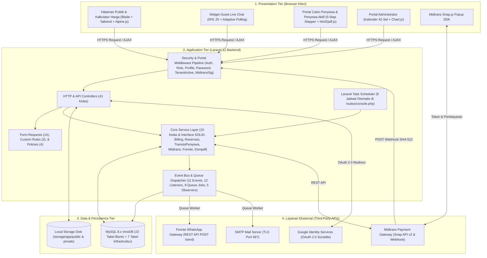
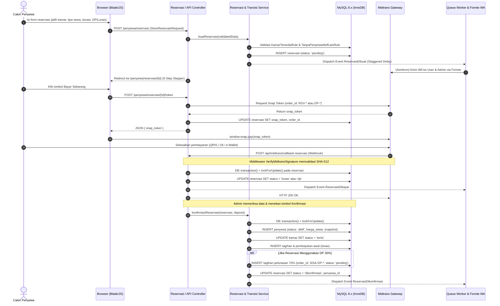
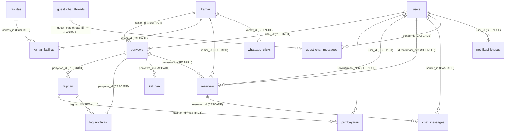

# Technical Requirements Document (TRD): Sistem Informasi Manajemen Kost Terintegrasi Payment Gateway pada Asri Boarding House

## 1. Document Metadata & Overview

### 1.1. Identitas Dokumen
| Atribut Dokumen | Keterangan |
| :--- | :--- |
| **Judul Dokumen** | Technical Requirements Document (TRD): Sistem Informasi Manajemen Kost Terintegrasi Payment Gateway pada Asri Boarding House |
| **Versi Dokumen** | Versi 1.0 (Selaras dengan Arsitektur Master v248.0) |
| **Status Dokumen** | Approved / Production Final |
| **Tanggal Efektif** | 4 November 2026 |
| **Penanggung Jawab (Author / Tech Lead)** | Tim Pengembang Sistem Informasi Asri Boarding House |
| **Lingkungan Produksi** | `https://asriboardinghouse.weatso.id/` |
| **Lokasi Repositori Lokal** | `c:\xampp\htdocs\asri-boarding-house` |
| **Dokumen Referensi Utama** | [PRD-Asri-Boarding-House.md](file:///c:/xampp/htdocs/asri-boarding-house/Documentation/PRD-Asri-Boarding-House.md) & [Blueprint_Projek_Web_Asri_Boarding_House.md](file:///c:/xampp/htdocs/asri-boarding-house/Blueprint/Blueprint_Projek_Web_Asri_Boarding_House.md) |

### 1.2. Riwayat Perubahan Dokumen (*Revision History*)
| Versi | Tanggal | Penulis | Deskripsi Perubahan Teknis |
| :---: | :---: | :--- | :--- |
| `0.1` | 19 September 2026 | Tim Pengembang | Perancangan awal skema basis data MySQL 8.x, struktur monolitik MVC Laravel, serta integrasi dasar Midtrans Snap dan Fonnte WhatsApp API. |
| `0.5` | 15 Oktober 2026 | Tim Pengembang | Pemisahan logika bisnis ke *Service Layer*, penambahan sistem obrolan dua arah (*Guest Live Chat* dan *Reservation Chat*), serta penerapan *Soft Deletes* berbasis kolom virtual. |
| `0.9` | 28 Oktober 2026 | Tim Pengembang | Standarisasi antarmuka *Neo-Brutalism* dengan *OLED Dark Mode*, penyempurnaan idempotensi denda flat kalender 5%, audit uang jaminan (*deposit*), serta optimasi *Smart Adaptive Polling*. |
| `1.0` | 4 November 2026 | Tim Pengembang | Finalisasi spesifikasi teknis produksi, cakupan lebih dari 500 pengujian otomatis PHPUnit, dan penyelarasan penuh dengan dokumen PRD. |

### 1.3. Tujuan dan Ruang Lingkup Teknis
Dokumen ini menerjemahkan kebutuhan produk pada [PRD-Asri-Boarding-House.md](file:///c:/xampp/htdocs/asri-boarding-house/Documentation/PRD-Asri-Boarding-House.md) menjadi rancangan rekayasa perangkat lunak yang siap dieksekusi maupun dipelihara oleh tim teknis. Fokus utama TRD ini adalah menjabarkan bagaimana sistem menangani siklus hidup penghunian kost berkapasitas 32 kamar secara akurat di tingkat kode program, skema basis data, antrean pekerjaan latar belakang, hingga komunikasi antar-layanan.

Secara teknis, arsitektur yang dirancang menyelesaikan lima tantangan rekayasa utama:
1. **Pencegahan Kondisi Balapan (*Race Condition*) pada Reservasi**: Memastikan dua calon penyewa tidak dapat memesan unit kamar yang sama pada rentang tanggal yang beririsan melalui kombinasi aturan validasi kustom dan penguncian baris basis data (`SELECT ... FOR UPDATE`).
2. **Idempotensi Mesin Penagihan dan Denda**: Menjamin proses otomatis penerbitan tagihan bulanan setiap tanggal 1 serta perhitungan denda keterlambatan flat 5% pada bulan kedua tidak pernah menggandakan nominal tagihan meskipun penjadwal (*scheduler*) dijalankan berulang kali.
3. **Keandalan Transaksi Pembayaran Hibrida**: Menyatukan alur pembayaran daring otomatis (*Midtrans Snap* dengan verifikasi tanda tangan SHA-512 dan *fallback* pengecekan API sinkron) dengan alur verifikasi kasir tunai atau transfer manual oleh administrator.
4. **Pengiriman Notifikasi Asinkron Tahan Gangguan**: Memisahkan proses pengiriman pesan WhatsApp (*Fonnte API*) dan surat elektronik (*SMTP*) dari siklus permintaan HTTP utama menggunakan antrean basis data (*database queue*) berjeda bertahap (*staggered delay*).
5. **Kepatuhan Integritas Data Historis**: Menerapkan penghapusan sementara (*Soft Deletes*) yang dikombinasikan dengan kolom virtual MySQL (*Virtual Generated Columns*) agar riwayat transaksi lama tetap utuh tanpa memblokir penggunaan ulang alamat surel, NIK, atau nomor kamar yang sama di masa mendatang.

---

## 2. System Architecture & High-Level Design

### 2.1. Pola Arsitektur Sistem (*3-Tier Layered MVC + Service & Event-Driven Architecture*)
Aplikasi ini menerapkan pola arsitektur tiga lapis (*3-Tier Architecture*) di atas kerangka kerja Laravel 12. Untuk menjaga agar kelas *Controller* tetap ramping dan mudah diuji, pemrosesan aturan bisnis yang kompleks ditarik keluar menuju **Service Layer**, **Form Request Validators**, **Eloquent Policies**, **Model Observers**, serta **Event-Driven Queue Workers**.

1. **Presentation Tier (Sisi Klien / Peramban)**:
   Bertanggung jawab merender antarmuka pengguna berbasis **Laravel Blade** yang diperkaya dengan **Tailwind CSS** (gaya visual *Neo-Brutalism* dan *OLED Dark Mode*) serta **Alpine.js** untuk reaktivitas komponen lokal. Komunikasi data asinkron untuk kalkulator harga, obrolan langsung, dan pembuatan token bayar dilakukan melalui **Axios** dan **Fetch API**, sedangkan pencetakan kuitansi A5 ditangani langsung di peramban menggunakan **html2pdf.js**.
2. **Application Tier (Sisi Server / Backend Laravel)**:
   Menerima permintaan HTTP melalui lapisan **Middleware Pipeline**, memvalidasi masukan dan hak akses menggunakan **Form Requests** serta **Policies**, lalu mendelegasikan eksekusi bisnis ke **Service Layer**. Setelah transaksi basis data utama selesai, *Service* memancarkan **Domain Events** yang ditangkap oleh **Listeners** untuk dijadwalkan ke dalam antrean latar belakang (**Queue Jobs**).
3. **Data & Persistence Tier (Penyimpanan Data & Berkas)**:
   Mengandalkan mesin penyimpanan **MySQL 8.x InnoDB** untuk data relasional, sesi aktif, cache aplikasi, dan tabel antrean pekerjaan. Berkas unggahan pengguna seperti foto kamar, bukti kerusakan keluhan, serta nota pengeluaran disimpan pada sistem berkas lokal (**Local Filesystem Disk** `storage/app/public`).

### 2.2. High-Level Architecture Diagram

#### A. Diagram Topologi Komponen End-to-End
Diagram berikut menggambarkan hubungan antar-komponen mulai dari perangkat pengguna hingga layanan pihak ketiga.



#### B. Sequence Diagram Alur Transaksi Inti (Reservasi, Webhook Pembayaran, & Konfirmasi)
Diagram urutan di bawah ini memperlihatkan interaksi teknis lintas komponen saat calon penyewa memesan kamar, membayar via Midtrans, hingga dikonfirmasi menjadi penyewa aktif oleh admin.



### 2.3. Deployment & Hosting Setup
Sistem dirancang agar dapat berjalan secara identik di lingkungan pengembangan lokal maupun di server produksi berbasis Linux.

#### A. Lingkungan Pengembangan Lokal (*Local Development Setup*)
- **Runtime & Server**: XAMPP pada Windows 10/11 dengan PHP 8.2+, MySQL 8.x, dan Apache/PHP Built-in Server.
- **Orkestrasi Proses Serentak**: Pengembang cukup menjalankan satu perintah `composer run dev` yang memanfaatkan paket `concurrently` untuk menyalakan tiga layanan sekaligus:
  1. `php artisan serve` (Server HTTP lokal pada `http://127.0.0.1:8000`).
  2. `php artisan queue:listen --tries=1 --timeout=0` (Pekerja antrean latar belakang untuk memproses pengiriman WhatsApp dan surel).
  3. `npm run dev` (Server Vite untuk *Hot Module Replacement* aset Tailwind CSS dan JavaScript).

#### B. Arsitektur Server Produksi (*Production Hosting Setup*)
Di lingkungan produksi (`https://asriboardinghouse.weatso.id/`), aplikasi di-deploy pada infrastruktur **CloudLinux OS (LVE)** dengan **LiteSpeed Enterprise Web Server** dan modul `mod_lsapi` PHP 8.2+. Untuk mencegah akses publik terhadap berkas konfigurasi sensitif, struktur direktori dipisahkan menjadi dua bagian:

```text
/home/uXXXXXXX/
├── asri-core/                      <-- Direktori Inti Laravel (Di luar jangkauan HTTP publik)
│   ├── app/
│   ├── bootstrap/
│   ├── config/
│   ├── database/
│   ├── resources/
│   ├── routes/
│   ├── storage/
│   │   ├── app/public/             <-- Penyimpanan berkas fisik (kamar, keluhan, nota, galeri)
│   │   └── logs/laravel.log
│   ├── vendor/
│   ├── .env                        <-- Berkas kredensial produksi (chmod 600)
│   └── artisan
│
└── domains/asriboardinghouse.weatso.id/
    └── public_html/                <-- Document Root Web Server (Diakses publik via HTTPS)
        ├── index.php               <-- Entrypoint dengan pemeriksaan defensif file_exists & try-catch
        ├── .htaccess               <-- Aturan rewrite LiteSpeed/Apache & header keamanan
        ├── build/                  <-- Aset terkompilasi Vite (manifest.json, CSS, JS ter-minifikasi)
        ├── images/                 <-- Aset gambar statis
        └── storage -> ../../../asri-core/storage/app/public  (Symbolic Link)
```

- **Penjadwal & Antrean Produksi**: *Cron daemon* pada panel server mengeksekusi perintah `php /home/uXXXXXXX/asri-core/artisan schedule:run >> /dev/null 2>&1` setiap menit untuk menjalankan 9 tugas terjadwal serta memproses antrean pekerjaan di tabel `jobs`.

---

## 3. Tech Stack & Dependencies

### 3.1. Core Tech Stack
Pemilihan teknologi inti memprioritaskan stabilitas transaksi finansial, kecepatan pengembangan, kemudahan pemeliharaan kode oleh tim kecil atau pengembang tunggal, serta efisiensi pemakaian sumber daya server.

| Lapisan | Teknologi | Versi | Alasan Teknis Pemilihan |
| :--- | :--- | :---: | :--- |
| **Bahasa Server** | PHP | `^8.2` | Mendukung pengetikan ketat (*strict types*), *readonly properties*, *enum* bawaan, dan *nullsafe operator* (`?->`) yang mencegah kesalahan referensi kosong pada antrean pekerjaan. |
| **Framework Backend** | Laravel Framework | `^12.0` | Menyediakan ekosistem utuh mulai dari Eloquent ORM, sistem antrean basis data, penjadwal tugas (*Task Scheduler*), *Form Request Validation*, hingga perlindungan keamanan bawaan. |
| **Templating UI** | Laravel Blade | Bawaan Laravel 12 | Merender HTML langsung dari server (*Server-Side Rendering*) dengan waktu muat halaman pertama (*First Contentful Paint*) yang cepat dan ramah mesin pencari (SEO) untuk halaman katalog publik. |
| **Styling & Desain** | Tailwind CSS & `@tailwindcss/vite` | `^3.1.0` / `^4.0.0` | Memudahkan implementasi sistem desain *Neo-Brutalism* menggunakan variabel CSS kustom (`--nb-border`, `--nb-shadow`), mendukung *OLED Dark Mode* (`#030712`), serta menghasilkan berkas CSS produksi berukuran sangat kecil. |
| **Interaktivitas Klien** | Alpine.js | `^3.4.2` | Memberikan reaktivitas deklaratif langsung pada atribut HTML untuk modal konfirmasi, akordeon FAQ, tab, pengalih tema, dan matriks kalender 42 sel tanpa beban *bundle* besar seperti SPA framework penuh. |
| **Asset Bundler** | Vite & `laravel-vite-plugin` | `^7.0.7` / `^2.0.0` | Mengompilasi dan meminifikasi berkas CSS/JS dengan sangat cepat serta menyematkan *hash* versi otomatis untuk mencegah masalah *cache* peramban. |

### 3.2. Database & Storage
Sistem menggabungkan tiga jenis penyimpanan sesuai sifat dan masa hidup datanya:

1. **Basis Data Relasional (`MySQL 8.x InnoDB`)**:
   Dipilih karena mendukung transaksi ACID penuh, penguncian baris tingkat lanjut (`FOR UPDATE`), indeks komposit untuk pencarian cepat, serta fitur *Virtual Generated Columns* yang krusial untuk menangani pelepasan *unique constraint* pada baris berstatus *soft-deleted*.
2. **Penyimpanan Sisi Klien (`Browser LocalStorage, SessionStorage, & Cookies`)**:
   Digunakan secara terukur untuk menyimpan state non-sensitif di peramban pengguna:
   - `localStorage.theme`: Menyimpan pilihan tema (`light` atau `dark`) dan dibaca di bagian `<head>` sebelum halaman dirender guna mencegah kedipan warna (*anti-flicker*).
   - `localStorage.guest_chat_token` & Cookie `guest_chat_token` (TTL 30 hari): Menyimpan token sesi 64 karakter bagi pengunjung anonim agar riwayat *Guest Live Chat* tidak hilang saat halaman dimuat ulang.
   - `localStorage.kamar_view_mode`: Mengingat pilihan tampilan daftar kamar (`table` atau `grid`) di panel admin.
   - `sessionStorage.chat_auth_reloaded`: Penjaga satu kali muat ulang (*one-time reload guard*) saat sesi obrolan menerima status `HTTP 401`.
3. **Penyimpanan Berkas Fisik (`Local Filesystem Disk`)**:
   Menggunakan disk `public` (`storage/app/public`) yang dihubungkan ke `public/storage`. Berkas dikelompokkan secara rapi ke dalam enam folder: `kamar/`, `keluhan/`, `nota_pengeluaran/`, `galleries/`, `reviews/`, dan `settings/`.

### 3.3. Third-Party Libraries & External APIs
| Nama Paket / Layanan | Versi / Jenis | Fungsi dalam Sistem & Alasan Pemilihan |
| :--- | :---: | :--- |
| **Midtrans Snap & Core API** | REST API v2 + `snap.js` | Memproses pembayaran QRIS, Virtual Account (BCA, Mandiri, BNI, BRI, Permata), dan dompet digital. Dipilih karena menyediakan antarmuka *popup* siap pakai tanpa mengharuskan pengguna berpindah situs, serta mendukung *webhook notification* berkeamanan SHA-512. |
| **Fonnte WhatsApp API** | REST API (`api.fonnte.com`) | Mengirimkan pesan WhatsApp otomatis untuk pengingat tagihan, bukti lunas, kredensial akun penyewa baru, dan eskalasi wali. Dipilih karena kemudahan integrasi berbasis HTTP POST dengan token perangkat dan tarif operasional yang ekonomis untuk skala rumah kost. |
| **Laravel Socialite** | `^5.27` | Menangani alur autentikasi OAuth 2.0 dengan Google Identity Services sehingga calon penyewa dapat masuk atau mendaftar hanya dengan satu klik. |
| **Dompdf** (`dompdf/dompdf`) | `^3.1` | Merender laporan keuangan laba-rugi, daftar pengeluaran, dan rekapitulasi penyewa menjadi dokumen PDF berformat A4/Landscape di sisi server melalui abstraksi `PdfGeneratorInterface`. |
| **html2pdf.js** | `0.10.1` (Client) | Mengonversi tampilan kuitansi pembayaran resmi ukuran A5 menjadi berkas PDF langsung di peramban pengguna. Pendekatan ini dipilih agar proses unduh nota oleh puluhan penyewa secara bersamaan tidak membebani CPU dan memori server. |
| **Chart.js** | `4.x` (Client) | Memvisualisasikan tren pemasukan sewa terhadap pengeluaran operasional selama 12 bulan terakhir di dasbor eksekutif admin. |
| **Axios** | `^1.11.0` | Klien HTTP di sisi peramban yang secara otomatis menyertakan header `X-XSRF-TOKEN` dari cookie Laravel untuk permintaan AJAX. |
| **PHPUnit & Mockery** | `^11.5.50` / `^1.6` | Kerangka pengujian otomatis untuk memverifikasi logika *Service*, validasi *Form Request*, keamanan *Policy*, hingga simulasi *webhook* Midtrans dan pengiriman WhatsApp. |

---

## 4. Database Schema & Data Models

### 4.1. Entity-Relationship Diagram (ERD)
Skema basis data terdiri atas **22 tabel bisnis** (21 model Eloquent ditambah 1 tabel pivot `kamar_fasilitas`) dan **7 tabel infrastruktur Laravel**. Diagram berikut memperlihatkan relasi kunci asing (*foreign key*) antar-entitas bisnis utama.



### 4.2. Table Definitions (Spesifikasi Rinci Tabel Bisnis)

#### 1. Tabel `users` (Model: `App\Models\User`)
Menyimpan kredensial masuk, identitas kependudukan, kontak darurat wali, dan peran akses untuk seluruh pengguna terdaftar.
| Nama Kolom | Tipe Data | Atribut & Constraints | Keterangan Teknis |
| :--- | :--- | :--- | :--- |
| `id` | `BIGINT UNSIGNED` | `PK, AUTO_INCREMENT` | Kunci utama pengguna. |
| `nama` | `VARCHAR(100)` | `NOT NULL` | Nama lengkap pengguna sesuai identitas resmi. |
| `email` | `VARCHAR(150)` | `NOT NULL` | Alamat surel untuk login dan penerima notifikasi. |
| `active_email` | `VARCHAR(150)` | `VIRTUAL, UNIQUE` | `GENERATED ALWAYS AS (IF(deleted_at IS NULL, email, NULL))` untuk menjaga keunikan hanya pada akun aktif. |
| `email_verified_at` | `TIMESTAMP` | `NULL` | Waktu verifikasi surel (otomatis terisi saat login via Google OAuth). |
| `password` | `VARCHAR(255)` | `NOT NULL` | Hash kata sandi menggunakan algoritma Bcrypt. |
| `no_hp` | `VARCHAR(50)` | `NULL` | Nomor WhatsApp pengguna (dinormalisasi ke awalan `628`). |
| `active_no_hp` | `VARCHAR(20)` | `VIRTUAL, UNIQUE` | `GENERATED ALWAYS AS (IF(deleted_at IS NULL, no_hp, NULL))`. |
| `nik` | `VARCHAR(50)` | `NULL` | Nomor Induk Kependudukan 16 digit angka. |
| `active_nik` | `VARCHAR(20)` | `VIRTUAL, UNIQUE` | `GENERATED ALWAYS AS (IF(deleted_at IS NULL, nik, NULL))`. |
| `nama_wali` | `VARCHAR(100)` | `NULL` | Nama orang tua atau wali darurat penyewa. |
| `no_wali` | `VARCHAR(20)` | `NULL` | Nomor WhatsApp wali (tidak boleh sama dengan `no_hp` penyewa). |
| `role` | `ENUM('admin','penyewa')` | `DEFAULT 'penyewa'` | Penentu hak akses portal (`User::ROLE_ADMIN` / `User::ROLE_PENYEWA`). |
| `foto` | `VARCHAR(255)` | `NULL` | Path foto profil atau URL avatar Google. |
| `is_active` | `TINYINT(1)` | `DEFAULT 1` | Status keaktifan akun (`1` = aktif, `0` = ditangguhkan). |
| `require_password_change` | `BOOLEAN` | `DEFAULT FALSE` | Jika `true`, memaksa pengguna mengganti kata sandi saat login berikutnya. |
| `remember_token` | `VARCHAR(100)` | `NULL` | Token sesi pengingat login. |
| `deleted_at` | `TIMESTAMP` | `NULL, INDEX` | Penanda waktu penghapusan sementara (*Soft Deletes*). |
| `created_at`, `updated_at` | `TIMESTAMP` | `NULL` | Waktu pembuatan dan pembaruan baris. |

#### 2. Tabel `kamar` (Model: `App\Models\Kamar`)
Menyimpan data master 32 unit kamar kost beserta harga bulanan dan status okupansinya.
| Nama Kolom | Tipe Data | Atribut & Constraints | Keterangan Teknis |
| :--- | :--- | :--- | :--- |
| `id` | `BIGINT UNSIGNED` | `PK, AUTO_INCREMENT` | Kunci utama unit kamar. |
| `nomor_kamar` | `VARCHAR(50)` | `NOT NULL` | Kode nomor kamar (contoh: `101`, `205`, `VIP-01`). |
| `active_nomor_kamar` | `VARCHAR(50)` | `VIRTUAL, UNIQUE` | `GENERATED ALWAYS AS (IF(deleted_at IS NULL, nomor_kamar, NULL))`. |
| `lantai` | `TINYINT` | `DEFAULT 1` | Posisi lantai kamar di gedung kost. |
| `tipe` | `ENUM('standar','deluxe','vip')` | `DEFAULT 'standar'` | Klasifikasi kelas kamar. |
| `luas_m2` | `DECIMAL(5,2)` | `NOT NULL` | Luas ruangan dalam satuan meter persegi. |
| `harga_bulan` | `DECIMAL(12,2)` | `NOT NULL` | Tarif sewa dasar bulanan pada katalog publik. |
| `deskripsi` | `TEXT` | `NULL` | Penjelasan spesifikasi kamar. |
| `foto` | `VARCHAR(255)` | `NULL` | Path berkas foto kamar di `storage/app/public/kamar/`. |
| `status` | `ENUM('tersedia','terisi','maintenance')` | `DEFAULT 'tersedia'` | Status ketersediaan unit saat ini. |
| `deleted_at` | `TIMESTAMP` | `NULL, INDEX` | Penanda *Soft Deletes*. |
| `created_at`, `updated_at` | `TIMESTAMP` | `NULL` | Waktu pembuatan dan pembaruan baris. |
- **Indeks Komposit**: `idx_kamar_status_deleted (status, deleted_at)` dan `idx_kamar_tipe_status (tipe, status)`.

#### 3. Tabel `fasilitas` & `kamar_fasilitas` (Model: `App\Models\Fasilitas`)
- **Tabel `fasilitas`**: `id` (`PK`), `nama` (`VARCHAR(100) UNIQUE`), `ikon` (`VARCHAR(50) NULL`), `deskripsi` (`TEXT NULL`), `is_active` (`BOOLEAN DEFAULT TRUE`), `created_at`, `updated_at`.
- **Tabel Pivot `kamar_fasilitas`**: `kamar_id` (`FK -> kamar.id ON DELETE CASCADE`), `fasilitas_id` (`FK -> fasilitas.id ON DELETE CASCADE`), dengan kunci utama gabungan `(kamar_id, fasilitas_id)`.

#### 4. Tabel `penyewa` (Model: `App\Models\Penyewa`)
Menyimpan kontrak penghunian aktif maupun historis, termasuk salinan harga sewa personal yang kebal terhadap perubahan harga katalog kamar.
| Nama Kolom | Tipe Data | Atribut & Constraints | Keterangan Teknis |
| :--- | :--- | :--- | :--- |
| `id` | `BIGINT UNSIGNED` | `PK, AUTO_INCREMENT` | Kunci utama kontrak penyewa. |
| `user_id` | `BIGINT UNSIGNED` | `FK -> users.id (RESTRICT)` | Referensi ke akun pengguna. |
| `kamar_id` | `BIGINT UNSIGNED` | `FK -> kamar.id (RESTRICT)` | Referensi ke unit kamar yang dihuni. |
| `harga_sewa` | `DECIMAL(12,2)` | `NULL` | *Immutable Rent Snapshot* (tarif sewa individu yang disepakati saat kontrak dibuat). |
| `nik` | `VARCHAR(50)` | `NOT NULL` | Salinan NIK penyewa pada kontrak. |
| `tanggal_masuk` | `DATE` | `NOT NULL` | Tanggal efektif mulai menghuni kamar. |
| `tanggal_keluar` | `DATE` | `NULL` | Tanggal aktual penyewa melakukan *check-out*. |
| `tanggal_keluar_seharusnya` | `DATE` | `NULL` | Tanggal berakhirnya masa kontrak berdasarkan tipe dan durasi sewa. |
| `status` | `ENUM('aktif','nonaktif')` | `DEFAULT 'aktif'` | Status keaktifan kontrak sewa. |
| `tanggal_billing` | `TINYINT` | `DEFAULT 1` | Tanggal penerbitan tagihan bulanan (diseragamkan tanggal 1). |
| `tipe_sewa` | `ENUM('harian','mingguan','bulanan')` | `DEFAULT 'bulanan'` | Skema periode sewa penghuni. |
| `durasi` | `TINYINT` | `DEFAULT 1` | Lama sewa sesuai satuan `tipe_sewa`. |
| `deposit` | `DECIMAL(12,2)` | `DEFAULT 0.00` | Saldo uang jaminan keamanan fasilitas kamar. |
| `nama_wali` | `VARCHAR(100)` | `NOT NULL` | Nama wali untuk eskalasi tunggakan bulan kedua. |
| `no_wali` | `VARCHAR(20)` | `NOT NULL` | Nomor WhatsApp wali penyewa. |
| `catatan` | `TEXT` | `NULL` | Catatan administratif kontrak atau riwayat klaim deposit. |
| `deleted_at` | `TIMESTAMP` | `NULL, INDEX` | Penanda *Soft Deletes*. |
| `created_at`, `updated_at` | `TIMESTAMP` | `NULL` | Waktu pembuatan dan pembaruan baris. |
- **Indeks Komposit**: `idx_penyewa_status_deleted (status, deleted_at)` dan `idx_penyewa_user_status (user_id, status)`.

#### 5. Tabel `reservasi` (Model: `App\Models\Reservasi`)
Menyimpan pengajuan pemesanan kamar daring beserta status pembayaran uang muka (DP 30%) atau pelunasan penuh.
| Nama Kolom | Tipe Data | Atribut & Constraints | Keterangan Teknis |
| :--- | :--- | :--- | :--- |
| `id` | `BIGINT UNSIGNED` | `PK, AUTO_INCREMENT` | Kunci utama reservasi. |
| `user_id` | `BIGINT UNSIGNED` | `FK -> users.id (RESTRICT)` | Akun calon penyewa yang mengajukan reservasi. |
| `kamar_id` | `BIGINT UNSIGNED` | `FK -> kamar.id (RESTRICT)` | Kamar yang dipesan. |
| `dikonfirmasi_oleh` | `BIGINT UNSIGNED` | `FK -> users.id (SET NULL), NULL` | ID admin yang memverifikasi dan mengonfirmasi reservasi. |
| `penyewa_id` | `BIGINT UNSIGNED` | `FK -> penyewa.id (SET NULL), NULL` | Referensi ke baris `penyewa` yang terbentuk setelah reservasi dikonfirmasi. |
| `tipe_sewa` | `ENUM('harian','mingguan','bulanan')` | `DEFAULT 'bulanan'` | Pilihan skema sewa. |
| `tanggal_mulai` | `DATE` | `NOT NULL` | Rencana tanggal masuk (*check-in*). |
| `tanggal_selesai` | `DATE` | `NOT NULL` | Rencana tanggal berakhir sewa. |
| `durasi` | `TINYINT` | `DEFAULT 1` | Durasi sewa (1-30 hari, 1-8 minggu, atau 1-12 bulan). |
| `total_harga` | `DECIMAL(12,2)` | `NOT NULL` | Total biaya sewa setelah dikurangi diskon paket promo (jika ada). |
| `status` | `ENUM('pending','dp','lunas','dikonfirmasi','batal')` | `DEFAULT 'pending'` | Siklus status reservasi. |
| `metode_pembayaran` | `ENUM('midtrans','cash')` | `NULL` | Jalur pembayaran yang dipilih calon penyewa. |
| `is_dp` | `BOOLEAN` | `DEFAULT FALSE` | Bernilai `true` jika pemesan memilih opsi DP 30%. |
| `nominal_dp` | `DECIMAL(12,2)` | `DEFAULT 0.00` | Nominal uang muka 30% yang wajib dibayar di awal. |
| `nominal_sisa` | `DECIMAL(12,2)` | `DEFAULT 0.00` | Sisa tagihan 70% yang akan diterbitkan sebagai invoice `SISA-DP-`. |
| `snap_token` | `VARCHAR(255)` | `NULL` | Token pembayaran Midtrans Snap aktif. |
| `order_id` | `VARCHAR(100)` | `NULL` | Kode transaksi Midtrans (`RSV-*` atau `DP-*`). |
| `active_order_id` | `VARCHAR(100)` | `VIRTUAL, UNIQUE` | `GENERATED ALWAYS AS (IF(deleted_at IS NULL, order_id, NULL))`. |
| `transaction_id` | `VARCHAR(100)` | `NULL` | ID transaksi dari Midtrans saat pembayaran berhasil. |
| `catatan_user`, `catatan_admin` | `TEXT` | `NULL` | Catatan permintaan pemesan dan catatan verifikasi admin. |
| `tanggal_konfirmasi` | `DATETIME` | `NULL` | Waktu reservasi disetujui oleh admin. |
| `deleted_at` | `TIMESTAMP` | `NULL, INDEX` | Penanda *Soft Deletes*. |
| `created_at`, `updated_at` | `TIMESTAMP` | `NULL` | Waktu pembuatan dan pembaruan baris. |
- **Indeks Komposit**: `idx_reservasi_overlap (kamar_id, status, tanggal_mulai, tanggal_selesai)` untuk mempercepat pengecekan bentrok tanggal sewa, serta `idx_reservasi_status_deleted (status, deleted_at)`.

#### 6. Tabel `tagihan` (Model: `App\Models\Tagihan`)
Menyimpan seluruh tagihan sewa bulanan, tagihan kontrak awal, maupun tagihan sisa DP beserta perhitungan denda keterlambatannya.
| Nama Kolom | Tipe Data | Atribut & Constraints | Keterangan Teknis |
| :--- | :--- | :--- | :--- |
| `id` | `BIGINT UNSIGNED` | `PK, AUTO_INCREMENT` | Kunci utama tagihan. |
| `penyewa_id` | `BIGINT UNSIGNED` | `FK -> penyewa.id (RESTRICT)` | Kontrak penyewa pemilik tagihan. |
| `order_id` | `VARCHAR(50)` | `UNIQUE, NOT NULL` | Nomor referensi invoice unik (`INV-*`, `RSV-INITIAL-*`, `SISA-DP-*`, `EXT-*`). |
| `periode_bulan` | `TINYINT` | `NOT NULL` | Bulan tagihan (`1` sampai `12`). |
| `periode_tahun` | `SMALLINT` | `NOT NULL` | Tahun tagihan (contoh: `2026`). |
| `tanggal_tagihan` | `DATE` | `NOT NULL` | Tanggal diterbitkannya tagihan. |
| `tanggal_jatuh_tempo` | `DATE` | `NOT NULL` | Batas akhir pembayaran tanpa keterlambatan (tanggal 10 setiap bulan). |
| `nominal_pokok` | `DECIMAL(12,2)` | `NOT NULL` | Nilai pokok tagihan sewa sebelum denda. |
| `nominal_denda` | `DECIMAL(12,2)` | `DEFAULT 0.00` | Nilai denda keterlambatan (5% dari `nominal_pokok` saat `bulan_keterlambatan >= 2`). |
| `nominal_total` | `DECIMAL(12,2)` | `NOT NULL` | Hasil penjumlahan `nominal_pokok + nominal_denda`. |
| `bulan_keterlambatan` | `TINYINT` | `DEFAULT 0` | Tingkat eskalasi tunggakan (`0` = normal, `1` = bulan pertama, `>= 2` = kena denda & lapor wali). |
| `status` | `ENUM('pending','lunas','gagal','kadaluarsa','terlambat')` | `DEFAULT 'pending'` | Status siklus hidup tagihan. |
| `metode_pembayaran` | `ENUM('midtrans','cash')` | `NULL` | Kanal pelunasan tagihan. |
| `keterangan` | `TEXT` | `NULL` | Deskripsi rincian tagihan. |
| `created_at`, `updated_at` | `TIMESTAMP` | `NULL` | Waktu pembuatan dan pembaruan baris. |
- **Indeks Komposit**: `idx_tagihan_status_jatuh_tempo (status, tanggal_jatuh_tempo)` dan `idx_tagihan_periode_status (periode_tahun, periode_bulan, status)`.

#### 7. Tabel `pembayaran` (Model: `App\Models\Pembayaran`)
Mencatat bukti pelunasan setiap tagihan beserta jejak kriptografi Midtrans atau identitas admin yang mengonfirmasi pembayaran tunai.
| Nama Kolom | Tipe Data | Atribut & Constraints | Keterangan Teknis |
| :--- | :--- | :--- | :--- |
| `id` | `BIGINT UNSIGNED` | `PK, AUTO_INCREMENT` | Kunci utama transaksi pembayaran. |
| `tagihan_id` | `BIGINT UNSIGNED` | `FK -> tagihan.id (RESTRICT)` | Referensi tagihan yang dilunasi. |
| `transaction_id` | `VARCHAR(100)` | `UNIQUE, NOT NULL` | ID transaksi unik dari Midtrans atau kode kasir (`CASH-*`). |
| `payment_type` | `VARCHAR(50)` | `NULL` | Jenis instrumen bayar (`bank_transfer`, `qris`, `gopay`, `cash`, dll.). |
| `bank` | `VARCHAR(20)` | `NULL` | Nama bank penerbit Virtual Account (jika via transfer VA). |
| `va_number` | `VARCHAR(30)` | `NULL` | Nomor Virtual Account pembayaran. |
| `nominal` | `DECIMAL(12,2)` | `NOT NULL` | Jumlah uang yang dibayarkan. |
| `status_midtrans` | `VARCHAR(50)` | `NULL` | Status asli dari respons Midtrans (`settlement`, `capture`, `pending`, `manual_cash`). |
| `dikonfirmasi_oleh` | `BIGINT UNSIGNED` | `FK -> users.id (SET NULL), NULL` | ID admin yang mengonfirmasi pembayaran tunai/manual. |
| `signature_key` | `VARCHAR(255)` | `NULL` | Hash SHA-512 dari webhook Midtrans untuk keperluan audit keamanan. |
| `response_json` | `JSON` | `NULL` | Salinan mentah (*raw payload*) respons JSON dari webhook Midtrans. |
| `tanggal_bayar` | `DATETIME` | `NULL` | Waktu efektif pembayaran dinyatakan lunas. |
| `created_at`, `updated_at` | `TIMESTAMP` | `NULL` | Waktu pembuatan dan pembaruan baris. |

#### 8. Ringkasan 14 Tabel Bisnis Pendukung Lainnya
| No | Nama Tabel & Model | Kolom Utama & Constraints | Fungsi Teknis |
| :-: | :--- | :--- | :--- |
| 9 | `chat_messages` (`ChatMessage`) | `id` (`PK`), `reservasi_id` (`FK CASCADE`), `sender_id` (`FK CASCADE`), `message` (`TEXT`), `is_read` (`BOOL`), `created_at`. Indeks: `(reservasi_id, id)`, `(reservasi_id, sender_id, is_read)`. | Menyimpan pesan diskusi pra-bayar antara calon penyewa dan admin pada tiap reservasi. |
| 10 | `guest_chat_threads` (`GuestChatThread`) | `id` (`PK`), `session_token` (`VARCHAR(255) UNIQUE INDEX`), `name`, `no_hp`, `status` (`ENUM('active','closed')`), `created_at`, `updated_at`. | Menyimpan kepala sesi obrolan langsung pengunjung publik tanpa login. |
| 11 | `guest_chat_messages` (`GuestChatMessage`) | `id` (`PK`), `guest_chat_thread_id` (`FK CASCADE`), `sender_type` (`ENUM('guest','admin')`), `sender_id` (`FK NULL`), `message` (`TEXT`), `is_read` (`BOOL`), `timestamps`. | Menyimpan isi percakapan dalam utas *Guest Live Chat*. |
| 12 | `keluhan` (`Keluhan`) | `id` (`PK`), `penyewa_id` (`FK CASCADE`), `judul` (`VARCHAR(150)`), `kategori` (`ENUM('kamar','fasilitas_bersama','kebersihan','keamanan','lainnya')`), `deskripsi` (`TEXT`), `foto_bukti` (`NULL`), `status` (`ENUM('pending','diproses','selesai')`), `tanggapan_admin`, `tanggal_selesai`, `timestamps`. | Menyimpan tiket laporan kerusakan fasilitas dari penyewa aktif beserta progres penanganannya. |
| 13 | `pengeluaran` (`Pengeluaran`) | `id` (`PK`), `nama_pengeluaran` (`VARCHAR(150)`), `kategori` (`ENUM('maintenance','utilitas','operasional','lainnya')`), `nominal` (`DECIMAL(12,2)`), `tanggal_pengeluaran` (`DATE INDEX`), `bukti_nota` (`NULL`), `keterangan`, `timestamps`. | Mencatat arus kas keluar operasional kost, biaya perbaikan potongan deposit, dan pengembalian sisa deposit. |
| 14 | `log_notifikasi` (`LogNotifikasi`) | `id` (`PK`), `penyewa_id` (`FK CASCADE`), `tagihan_id` (`FK SET NULL`), `channel` (`ENUM('whatsapp','email','system')`), `event` (`VARCHAR(50)`), `status` (`ENUM('sukses','gagal')`), `pesan`, `error_msg`, `created_at`. | Mencatat status keberhasilan pengiriman pesan keluar dan menyediakan data untuk fitur kirim ulang (*retry*). |
| 15 | `notifikasi_khusus` (`NotifikasiKhusus`) | `id` (`PK`), `sumber` (`INDEX`), `tipe_aktivitas` (`INDEX`), `deskripsi` (`TEXT`), `data_detail` (`JSON NULL`), `user_id` (`FK SET NULL`), `timestamps`. | Menyimpan jejak audit peristiwa sistem (*audit trail*) yang ditangkap oleh `NotifikasiKhususSubscriber` dan *Model Observers*. |
| 16 | `settings` (`Setting`) | `key` (`VARCHAR(255) PK`), `value` (`TEXT NULL`), `timestamps`. | Penyimpanan kunci-nilai (*key-value*) untuk pengaturan dinamis situs, nomor rekening bank, koordinat peta, dan skema diskon paket promo. |
| 17 | `customer_reviews` (`CustomerReview`) | `id` (`PK`), `nama` (`VARCHAR(100)`), `pekerjaan` (`NULL`), `bintang` (`TINYINT DEFAULT 5`), `ulasan` (`TEXT`), `foto` (`NULL`), `timestamps`. | Menyimpan ulasan dan peringkat kepuasan penghuni kost untuk ditampilkan di halaman publik. |
| 18 | `faqs` (`Faq`) | `id` (`PK`), `pertanyaan` (`TEXT`), `jawaban` (`TEXT`), `urutan` (`TINYINT`), `is_active` (`TINYINT(1)`), `timestamps`. | Menyimpan daftar tanya-jawab interaktif yang dikelola dari CMS admin. |
| 19 | `peraturan` (`Peraturan`) | `id` (`PK`), `judul` (`VARCHAR(100)`), `deskripsi` (`TEXT`), `ikon` (`VARCHAR(50)`), `urutan` (`INT`), `timestamps`. | Menyimpan butir tata tertib kost untuk portal penyewa aktif. |
| 20 | `galleries` (`Gallery`) | `id` (`PK`), `judul` (`VARCHAR(100)`), `deskripsi` (`NULL`), `foto` (`VARCHAR(255)`), `urutan` (`INT`), `is_active` (`BOOL`), `timestamps`. | Menyimpan koleksi foto dokumentasi bangunan dan fasilitas kost. |
| 21 | `pengumuman` (`Pengumuman`) | `id` (`PK`), `judul` (`VARCHAR(150)`), `isi` (`TEXT`), `is_active` (`BOOL`), `timestamps`. | Menyimpan pengumuman internal dari pengelola yang ditayangkan di dasbor penyewa. |
| 22 | `whatsapp_clicks` (`WhatsappClick`) | `id` (`PK`), `source` (`VARCHAR(50)`), `kamar_id` (`FK SET NULL`), `ip_address` (`VARCHAR(45)`), `user_agent` (`TEXT`), `created_at` (`INDEX`), `updated_at`. | Mencatat metrik klik tombol konsultasi WhatsApp dari pengunjung publik. |

### 4.3. Data Migration & Seeding Plan

#### A. Strategi Migrasi Skema & Kolom Virtual (*Virtual Generated Columns*)
Seluruh perubahan struktur tabel dikelola secara berurutan melalui **56 berkas migrasi** di direktori `database/migrations/`. Salah satu rancangan teknis paling penting terdapat pada migrasi peningkatan integritas *Soft Deletes* (`2026_09_25_000001_enhance_soft_deletes_and_unique_constraints.php`):
- Pada basis data standar, indeks `UNIQUE` biasa pada kolom `email` atau `nomor_kamar` akan menolak pendaftaran pengguna baru atau pembuatan kamar baru apabila terdapat baris lama berstatus *soft-deleted* (`deleted_at IS NOT NULL`) yang memiliki nilai serupa.
- Untuk mengatasinya di MySQL 8.x, migrasi membuat kolom virtual `GENERATED ALWAYS AS (IF(deleted_at IS NULL, nama_kolom, NULL)) VIRTUAL` dan memasang indeks `UNIQUE` pada kolom virtual tersebut. Karena MySQL mengizinkan banyak nilai `NULL` di dalam indeks unik, baris yang telah dihapus sementara tidak lagi mengunci nilai unik bagi data baru.
- Selain itu, saat metode hapus sementara dijalankan, logika aplikasi membubuhkan akhiran `_deleted_[timestamp]` pada atribut unik (seperti `nomor_kamar`, `email`, `nik`) dan melepaskan akhiran tersebut secara otomatis disertai deteksi tabrakan ketika admin menjalankan fitur **Restore**.

#### B. Rencana Seeding Data Awal (`DatabaseSeeder`)
Eksekusi perintah `php artisan migrate:fresh --seed` (atau `composer run db:fresh-seed`) menjalankan kelas [`DatabaseSeeder`](file:///c:/xampp/htdocs/asri-boarding-house/database/seeders/DatabaseSeeder.php) secara deterministik sesuai urutan ketergantungan kunci asing:
1. `AdminUserSeeder`: Membuat akun administrator utama (`admin@asriboardinghouse.com`).
2. `UserPenyewaSeeder`: Membuat akun penyewa demonstrasi (`penyewa@asriboardinghouse.com`) lengkap dengan identitas profil dan kontak wali.
3. `SettingSeeder`: Mengisi konfigurasi awal situs web, nomor WhatsApp pengelola, detail rekening bank pembayaran manual, serta parameter diskon paket promo (Triwulan 5% dan Tahunan 8,33%).
4. `FasilitasSeeder`: Mengisi daftar master fasilitas kamar dan fasilitas bersama beserta kelas ikonnya.
5. `KamarSeeder`: Membangun data unit kamar untuk tipe Standar, Deluxe, dan VIP sekaligus menghubungkan relasi *many-to-many* ke tabel `kamar_fasilitas`.
6. `CustomerReviewSeeder`, `FaqSeeder`, `PeraturanSeeder`, & `GallerySeeder`: Mengisi konten awal halaman depan dan tata tertib hunian agar sistem siap diuji secara menyeluruh sejak instalasi pertama.


---

## 5. Backend / Core Logic & API Specification

### 5.1. API Endpoints & Routing Structure
Perutean aplikasi dibagi secara tegas ke dalam dua berkas utama, yaitu [`routes/web.php`](file:///c:/xampp/htdocs/asri-boarding-house/routes/web.php) (untuk halaman berbasis sesi web dan endpoint AJAX internal yang dilindungi token CSRF) serta [`routes/api.php`](file:///c:/xampp/htdocs/asri-boarding-house/routes/api.php) (untuk webhook server-ke-server dan API publik tanpa sesi login).

#### A. Spesifikasi Endpoint JSON, AJAX, dan Webhook (`api.php` & `web.php`)
| Metode | URI Endpoint | Controller & Method | Middleware Proteksi | Fungsi & Parameter Utama |
| :---: | :--- | :--- | :--- | :--- |
| `POST` | `/kamar/{kamar}/hitung-harga` | `LandingController@hitungHarga` | `web` (CSRF) | Menghitung simulasi tarif sewa dan potongan promo. Body: `tipe_sewa`, `durasi`. |
| `POST` | `/cek-ketersediaan` | `LandingController@cekKetersediaan` | `web` / `api` | Memvalidasi ketersediaan unit kamar pada rentang tanggal tertentu (`CekKetersediaanRequest`). |
| `POST` | `/analytics/track-whatsapp` | `LandingController@trackWhatsappClick` | `web` (CSRF) | Mencatat klik tombol konsultasi WhatsApp (`source`, `kamar_id`). |
| `POST` | `/api/guest-chat/start` | `GuestChatApiController@startThread` | `throttle:5,1` | Membuka sesi *Guest Live Chat* baru (`name`, `no_hp`, `message`) dan mengembalikan `session_token`. |
| `GET` | `/api/guest-chat/messages` | `GuestChatApiController@fetchMessages` | `throttle:guest_chat_limiter` | Mengambil pesan baru pada utas tamu (`?token=...&after=last_id`). |
| `POST` | `/api/guest-chat/send` | `GuestChatApiController@sendMessage` | `throttle:guest_chat_limiter` | Mengirim pesan baru dari pengunjung tamu menggunakan `session_token`. |
| `GET` | `/chat-box/{reservasi}/fetch` | `Api\ChatController@fetch` | `auth`, `throttle:120,1` | Mengambil pesan obrolan reservasi secara delta (`?after=last_id`) beserta penanda `is_read`. |
| `POST` | `/chat-box/{reservasi}/send` | `Api\ChatController@send` | `auth`, `throttle:30,1` | Mengirim pesan teks baru pada ruang diskusi reservasi (`ReservasiPolicy`). |
| `POST` | `/penyewa/reservasi/{reservasi}/token` | `Api\SnapTokenController@generateReservasi` | `auth`, `role:penyewa`, `throttle:15,1` | Meminta *Snap Token* Midtrans untuk pembayaran reservasi (Lunas 100% atau DP 30%). |
| `POST` | `/penyewa/pembayaran/{tagihan}/token` | `Api\SnapTokenController@generate` | `auth`, `ensure.tenant.active`, `throttle:15,1` | Meminta *Snap Token* Midtrans untuk pelunasan tagihan bulanan atau sisa DP. |
| `POST` | `/api/midtrans/callback` | `Api\MidtransCallbackController@handle` | `VerifyMidtransSignature` (Bebas CSRF) | Menerima webhook status pembayaran tagihan (`INV-*` / `SISA-DP-*`) dari server Midtrans. |
| `POST` | `/api/midtrans/callback-reservasi` | `Api\MidtransReservasiCallbackController@handle` | `VerifyMidtransSignature` (Bebas CSRF) | Menerima webhook status pembayaran reservasi (`RSV-*` / `DP-*`) dari server Midtrans. |
| `GET` | `/admin/kalender/events` | `AdminCalendarController@getEvents` | `auth`, `role:admin` | Mengembalikan struktur JSON jadwal masuk, masa tinggal, dan jadwal keluar kamar untuk matriks kalender. |

#### B. Contoh Struktur Payload Request & Response JSON

1. **Kalkulator Simulasi Harga (`POST /kamar/{kamar}/hitung-harga`)**
   - **Request Payload**:
     ```json
     {
       "tipe_sewa": "bulanan",
       "durasi": 3
     }
     ```
   - **Response Payload (`HTTP 200 OK`)**:
     ```json
     {
       "harga_satuan": 1500000,
       "subtotal": 4500000,
       "diskon_persen": 5,
       "potongan_diskon": 225000,
       "total_harga": 4275000,
       "nominal_dp": 1282500,
       "nominal_sisa": 2992500,
       "nama_paket": "Paket Hemat Triwulan"
     }
     ```

2. **Webhook Notifikasi Pembayaran Midtrans (`POST /api/midtrans/callback`)**
   - **Request Payload (Dikirim oleh Midtrans Server)**:
     ```json
     {
       "transaction_time": "2026-11-04 19:30:12",
       "transaction_status": "settlement",
       "transaction_id": "9a8b7c6d-1234-5678-90ab-cdef12345678",
       "status_message": "midtrans payment notification",
       "status_code": "200",
       "signature_key": "f4c89a1b2e3d4c5f6a7b8c9d0e1f2a3b4c5d6e7f8a9b0c1d2e3f4a5b6c7d8e9f...",
       "payment_type": "qris",
       "order_id": "INV-202611-0012-1730723400",
       "gross_amount": "1500000.00",
       "fraud_status": "accept"
     }
     ```
   - **Response Payload (`HTTP 200 OK`)**:
     ```json
     {
       "status": "success",
       "message": "Notifikasi pembayaran berhasil diproses."
     }
     ```

#### C. Struktur Kelompok Rute Web (`routes/web.php`)
- **Kelompok Publik (`LandingController`)**: `/`, `/fasilitas`, `/kamar`, `/kamar/{kamar}`, `/cara-booking`, `/testimoni`, `/tentang-kami`, `/faq`, dan `/galeri`.
- **Kelompok Autentikasi Multi-Portal (`middleware: guest`)**:
  - Portal Calon Penyewa: `/reservasi/login`, `/reservasi/register`, `/auth/google`, `/auth/google/callback`, `/forgot-password`, `/reset-password/{token}`.
  - Portal Penyewa Aktif: `/penyewa/login`, `/penyewa/forgot-password`, `/penyewa/reset-password/{token}`.
  - Portal Administrator: `/admin/login`, `/admin/forgot-password`, `/admin/reset-password/{token}`.
- **Kelompok Portal Penyewa (`/penyewa/*`)**: Dilindungi oleh `['auth', 'role:penyewa', 'ensure.profile.complete', 'ensure.password.changed']`. Sub-grup khusus penyewa aktif (`/penyewa/dashboard`, `/penyewa/tagihan`, `/penyewa/nota/{pembayaran}/cetak`) dilapisi tambahan middleware `ensure.tenant.active`.
- **Kelompok Portal Administrator (`/admin/*`)**: Dilindungi oleh `['auth', 'role:admin', 'ensure.profile.complete', 'ensure.password.changed']`, mencakup 19 *Controller* untuk manajemen kamar, fasilitas, reservasi, penyewa, *check-out* deposit, tagihan, pengeluaran, laporan keuangan, keluhan, *guest chat*, pengaturan CMS, serta log notifikasi.

---

### 5.2. Business Logic & Services
Untuk menjaga keterbacaan dan kemudahan pengujian unit, seluruh perhitungan finansial dan perubahan status lintas-tabel dipusatkan di dalam direktori `app/Services/`.

#### A. Kalkulasi Tarif Proporsional, Diskon Promo, & DP 30% (`ReservasiService`)
Kelas [`ReservasiService`](file:///c:/xampp/htdocs/asri-boarding-house/app/Services/ReservasiService.php) menghitung biaya sewa berdasarkan tarif bulanan kamar (`$kamar->harga_bulan`) dengan pembulatan ke ribuan terdekat:
1. **Tarif Harian (1 s.d. 30 Hari)**:
   $$\text{Harga per Hari} = \text{round}\left(\frac{\text{Harga Bulanan}}{30} \times 1,30,\ -3\right)$$
2. **Tarif Mingguan (1 s.d. 8 Minggu)**:
   $$\text{Harga per Minggu} = \text{round}\left(\frac{\text{Harga Bulanan}}{4} \times 1,15,\ -3\right)$$
3. **Tarif Bulanan (1 s.d. 12 Bulan) & Paket Promo Dinamis**:
   Menggunakan `harga_bulan` dikalikan durasi bulan. Jika durasi sewa cocok dengan konfigurasi promo aktif di tabel `settings` (contoh: 3 bulan mendapat diskon 5%, 12 bulan mendapat diskon 8,33%), sistem memotong subtotal secara otomatis.
4. **Pemecahan Uang Muka (*Down Payment* 30%)**:
   Apabila calon penyewa memilih skema DP (`is_dp = true`), sistem menetapkan `nominal_dp = round(total_harga * 0.30)` dan `nominal_sisa = total_harga - nominal_dp`.

#### B. Mesin Penagihan Bulanan & Denda Flat Kalender 5% (`BillingService`)
Kelas [`BillingService`](file:///c:/xampp/htdocs/asri-boarding-house/app/Services/BillingService.php) mengatur siklus piutang sewa bulanan dengan prinsip idempotensi ketat:
1. **Penerbitan Tagihan Seragam Tanggal 1 (`generateTagihanBulanan`)**:
   Dijalankan setiap tanggal 1 pukul `00:05` WIB. Metode ini mengambil seluruh penyewa berstatus `aktif`, memeriksa apakah tagihan untuk kombinasi `(penyewa_id, periode_bulan, periode_tahun)` sudah ada, lalu membuat tagihan baru menggunakan tarif personal `$penyewa->harga_sewa ?? $penyewa->kamar->harga_bulan` dengan batas jatuh tempo tanggal 10 bulan berjalan.
2. **Evaluasi Keterlambatan & Idempotency Guard (`prosesKeterlambatan`)**:
   Dijalankan setiap hari pukul `01:00` WIB untuk memeriksa tagihan berstatus `pending` atau `terlambat` yang telah melewati tanggal 10:
   - **Keterlambatan Bulan Pertama (`bulan_keterlambatan == 1`)**: Tagihan yang masih berada pada bulan dan tahun terbitnya diubah statusnya menjadi `terlambat` dengan `nominal_denda = 0`. Sistem memancarkan event `ReminderPenyewa` untuk mengirim pengingat ke penyewa.
   - **Eskalasi Bulan Kedua (`bulan_keterlambatan >= 2`)**: Saat kalender berganti ke bulan berikutnya dan tagihan tersebut belum dilunasi, sistem memeriksa penjaga idempotensi (`nominal_denda == 0`). Denda flat sebesar **5% dari `nominal_pokok`** hanya dihitung dan ditambahkan ke `nominal_total` tepat satu kali, lalu sistem memancarkan event `DendaDikenakan` (ke penyewa) dan `NotifikasiWali` (ke orang tua/wali penyewa).

#### C. Transisi Penyewa Aktif, *Immutable Snapshot*, & Audit Deposit (`TransisiPenyewaService`)
Kelas [`TransisiPenyewaService`](file:///c:/xampp/htdocs/asri-boarding-house/app/Services/TransisiPenyewaService.php) membungkus seluruh mutasi kontrak di dalam `DB::transaction()` dengan `lockForUpdate()`:
1. **Konfirmasi Reservasi Menjadi Penyewa Aktif**:
   Saat admin menyetujui reservasi yang telah berstatus `lunas` atau `dp`, layanan ini menyalin tarif sewa kamar ke kolom `penyewa.harga_sewa` (*Immutable Rent Snapshot*), mengubah status kamar menjadi `terisi`, membuat catatan tagihan dan pembayaran awal yang lunas, serta menerbitkan tagihan kedua berawalan `SISA-DP-` sebesar 70% apabila reservasi menggunakan skema uang muka.
2. **Audit Klaim Deposit Saat *Check-Out***:
   Ketika penyewa mengakhiri masa sewa, admin menentukan status akhir kamar (`maintenance` atau `tersedia`) dan menginput nilai potongan kerusakan fasilitas (jika ada):
   - Apabila terdapat potongan kerusakan (`potongan_deposit > 0`), sistem mencatat transaksi kas keluar baru pada tabel `pengeluaran` dengan kategori `maintenance` beserta lampiran foto nota perbaikan.
   - Apabila masih terdapat sisa uang jaminan (`sisa_deposit = deposit - potongan_deposit > 0`), sistem secara otomatis mencatat pengembalian dana tersebut pada tabel `pengeluaran` dengan kategori `lainnya`, kemudian mengubah status penyewa menjadi `nonaktif`.

#### D. Orkestrasi Event-Driven Queue & Jadwal Otomatis (`routes/console.php`)
- **Pencegahan *Rate Limit* Pihak Ketiga (`StaggersJobs`)**: Seluruh *Event Listener* yang mendorong pekerjaan pengiriman pesan ke antrean basis data menggunakan trait `App\Support\StaggersJobs`. Trait ini memberi jeda waktu bertahap (misalnya kelipatan beberapa detik antar-job) agar pengiriman pesan masal ke API Fonnte maupun server SMTP tidak ditolak akibat lonjakan permintaan serentak.
- **Sembilan Pekerjaan Terjadwal (`routes/console.php`)**: Seluruh perintah dijalankan pada zona waktu `Asia/Jakarta` menggunakan pelindung `withoutOverlapping()` dan `runInBackground()`:
  1. `tagihan:generate-bulanan` (Bulanan setiap tanggal 1 pukul `00:05`).
  2. `tagihan:proses-keterlambatan` (Harian pukul `01:00`).
  3. `session:cleanup` (Harian pukul `01:30`).
  4. `log-notifikasi:clear` (Harian pukul `02:00`, menghapus log > 90 hari).
  5. `chat-guest:prune` (Harian pukul `03:00`, membersihkan utas obrolan tamu yang sudah ditutup).
  6. `kontrak:reminder-habis` (Harian pukul `08:00`, mengirim pengingat H-14, H-7, H-3, dan H-0).
  7. `reservasi:cancel-expired` (Setiap jam, membatalkan reservasi `pending` yang melewati 24 jam).
  8. `log:truncate` (Mingguan, memangkas ukuran `storage/logs/laravel.log`).
  9. `abh:purge-trash` (Bulanan, menghapus permanen data *soft-deleted* yang melewati masa retensi).

---

### 5.3. State Management & Client Flow
Meskipun aplikasi menggunakan arsitektur *Server-Side Rendering* berbasis Blade, beberapa modul membutuhkan pengelolaan state sisi klien yang responsif dan hemat sumber daya:

1. **Inisialisasi Modular & Penyimpanan Aman (`resources/js/app.js`)**:
   Seluruh kode inisialisasi Axios dan Alpine.js dibungkus di dalam fungsi `configureAxios()` dan `initializeApp()` agar bebas dari efek samping global saat diuji. Pembacaan dan penulisan ke `window.localStorage` selalu melewati fungsi pembungkus `getSafeStorage(key, fallback)` dan `setSafeStorage(key, value)` yang dilengkapi blok `try-catch` guna mencegah kegagalan skrip pada peramban dengan mode privasi ketat.
2. **Manajemen Tema *Anti-Flicker* (*Light Mode* & *OLED Dark Mode*)**:
   Skrip deteksi tema diletakkan secara sinkron di dalam elemen `<head>` pada seluruh berkas layout utama (`app.blade.php`, `landing.blade.php`, `guest.blade.php`). Sebelum peramban menggambar elemen body, skrip memeriksa nilai `localStorage.getItem('theme')` dan langsung menyematkan kelas `dark` pada elemen `<html>`, sehingga perpindahan halaman tidak pernah menimbulkan kilatan warna putih pada mode gelap.
3. **Algoritma *Smart Adaptive Polling* pada Ruang Obrolan**:
   Baik widget *Guest Live Chat* (`resources/js/components/guest-chat.js`) maupun ruang obrolan reservasi (`reservasi/chat-box.blade.php`) menarik pesan baru menggunakan parameter penanda ID terakhir (`?after=lastMessageId`) agar server hanya mengirimkan selisih pesan baru:
   - Ketika terdapat pesan baru dalam percakapan aktif, interval *polling* berjalan cepat setiap **4 detik**.
   - Ketika tidak ada pesan baru selama beberapa siklus berturut-turut, interval otomatis melambat secara bertahap hingga **12 detik** (*adaptive backoff*).
   - Ketika pengguna berpindah tab atau meminimalkan jendela peramban (`document.visibilityState === 'hidden'` atau event `pagehide`), siklus *polling* dihentikan sementara dan langsung dilanjutkan kembali saat tab kembali aktif.

---

## 6. Security, Authentication, & Authorization

### 6.1. Authentication Method (Isolasi Multi-Portal & SSO)
Sistem menerapkan pemisahan jalur autentikasi agar pengalaman masuk antara calon penyewa, penyewa aktif, dan pengelola tidak saling tumpang tindih:
- **Tiga Pintu Login Terisolasi**:
  1. `/reservasi/login` (`ReservasiAuthController`): Dikhususkan bagi calon penyewa yang ingin memesan kamar atau memantau status reservasinya.
  2. `/penyewa/login` (`PenyewaLoginController`): Dikhususkan bagi penghuni kost yang telah memiliki kontrak sewa aktif.
  3. `/admin/login` (`AdminLoginController`): Pintu masuk khusus pengelola dengan verifikasi peran `User::ROLE_ADMIN`.
- **Pembatasan Laju Percobaan (*Rate Limiting*)**: Seluruh rute `POST` login dan registrasi dilindungi middleware `throttle:5,1` (maksimal 5 percobaan per menit per alamat IP) guna menahan serangan tebak kata sandi (*brute-force*).
- **Google OAuth 2.0 (`SocialiteController`)**: Mengizinkan calon penyewa masuk menggunakan akun Google. Di sisi klien, fungsi `initOAuthProtection()` pada `app.js` menonaktifkan tombol setelah klik pertama agar tidak terjadi pengiriman kode otorisasi ganda ke endpoint `/auth/google/callback`.
- **Pengarah Rute Cerdas (`PortalRedirectResolver`)**: Didaftarkan pada [`bootstrap/app.php`](file:///c:/xampp/htdocs/asri-boarding-house/bootstrap/app.php) melalui `redirectGuestsTo` dan `redirectUsersTo`. Kelas ini memeriksa awalan URL permintaan (`/admin/*`, `/penyewa/*`, atau `/reservasi/*`) sehingga pengguna yang belum login diarahkan ke halaman login portal yang relevan, bukan ke satu halaman login generik.

### 6.2. Authorization & Access Control (RBAC & Anti-IDOR)
Otorisasi ditegakkan secara berlapis mulai dari tingkat grup rute hingga tingkat baris objek basis data:

1. **Middleware Berbasis Peran & Status Akun**:
   - `RoleMiddleware` (`role:admin` / `role:penyewa`): Memastikan penyewa tidak dapat mengakses rute `/admin/*` dan sebaliknya (mengembalikan `HTTP 403 Forbidden`).
   - `EnsurePasswordChanged` (`ensure.password.changed`): Mencegat pengguna yang memiliki penanda `require_password_change == true` (seperti penyewa *walk-in* yang baru didaftarkan admin dengan kata sandi awal nomor HP) dan memaksanya memperbarui kata sandi terlebih dahulu.
   - `EnsureProfileIsComplete` (`ensure.profile.complete`): Memastikan kolom `nik` (16 digit), `no_hp`, `nama_wali`, dan `no_wali` telah terisi lengkap sebelum pengguna dapat mengajukan reservasi. URL tujuan awal disimpan di sesi (`url.intended`) agar pengguna otomatis kembali ke halaman kamar yang sedang dipilih setelah melengkapi profil.
   - `EnsureTenantIsActive` (`ensure.tenant.active`): Memastikan hanya penyewa yang memiliki baris `penyewa` berstatus `aktif` yang boleh membuka dasbor penghuni dan halaman tagihan bulanan.
2. **Perlindungan Anti-IDOR (*Insecure Direct Object Reference*) via Eloquent Policies**:
   Untuk mencegah penyewa A mengakses atau memanipulasi data milik penyewa B dengan cara mengganti parameter ID pada URL, sistem mengimplementasikan 4 kelas *Policy* di `app/Policies/`:
   - `ReservasiPolicy`: Memverifikasi `$reservasi->user_id === $user->id` (atau `$user->isAdmin()`) pada halaman detail reservasi, pembatalan, permintaan *Snap Token*, dan ruang obrolan.
   - `TagihanPolicy`: Memverifikasi kepemilikan tagihan melalui relasi `$tagihan->penyewa->user_id === $user->id`.
   - `PembayaranPolicy`: Memastikan hanya pemilik tagihan terkait atau admin yang dapat membuka dan mengunduh kuitansi PDF A5 (`/nota/{pembayaran}/cetak`).
   - `KeluhanPolicy`: Memastikan tiket keluhan fasilitas hanya dapat dilihat oleh penyewa pembuat laporan atau administrator.

### 6.3. Data Sanitization & Security Measures
1. **Verifikasi Kriptografi Webhook Midtrans (`VerifyMidtransSignature`)**:
   Endpoint `/api/midtrans/callback` dan `/api/midtrans/callback-reservasi` dikecualikan dari pemeriksaan token CSRF karena diakses langsung oleh server Midtrans. Sebagai gantinya, middleware [`VerifyMidtransSignature`](file:///c:/xampp/htdocs/asri-boarding-house/app/Http/Middleware/VerifyMidtransSignature.php) memvalidasi keaslian setiap paket (`order_id`, `status_code`, `gross_amount`, dan `server_key`) menggunakan rumus resmi SHA-512:
   $$\text{Expected Signature} = \text{SHA512}(\text{OrderID} \mathbin{\Vert} \text{StatusCode} \mathbin{\Vert} \text{GrossAmount} \mathbin{\Vert} \text{ServerKey})$$
   Permintaan dengan tanda tangan yang tidak cocok langsung ditolak menggunakan perbandingan aman waktu konstan (`hash_equals`) dan menghasilkan respons `HTTP 403`.
2. **Sanitasi Input Berlapis (`Sanitizer`, `HasSanitizedInput`, & `SanitizesCurrency`)**:
   - Seluruh kelas *Form Request* membersihkan spasi berlebih dan melucuti tag HTML berbahaya sebelum aturan validasi dijalankan.
   - Trait `SanitizesCurrency` otomatis mengubah input nominal uang berformat titik/rupiah (seperti `"1.500.000"`) menjadi angka murni (`1500000`) pada formulir kamar, penyewa, pengeluaran, dan deposit.
   - Nomor telepon secara konsisten dinormalisasi dari awalan `08...` atau `+628...` menjadi format standar `628...` agar kompatibel dengan gateway WhatsApp Fonnte.
3. **Aturan Validasi Bisnis Kustom (`app/Rules/`)**:
   - `KamarTersediaRule`: Memeriksa status kamar dan memastikan tidak ada irisan tanggal (`tanggal_mulai` s.d. `tanggal_selesai`) dengan reservasi aktif lain di kamar yang sama.
   - `TanpaPenyewaAktifLainRule`: Mencegah satu akun pengguna mengajukan pemesanan baru jika masih memiliki kontrak aktif atau reservasi yang belum selesai.
   - `ValidGoogleMapsEmbed`: Memastikan kode sematan peta yang dimasukkan admin pada menu pengaturan hanya berasal dari domain resmi Google Maps (`https://www.google.com/maps/embed...`) guna menangkal serangan *Stored XSS* melalui injeksi tag `<script>` atau `<iframe>` berbahaya.
4. **Penguncian Baris Basis Data (*Pessimistic Locking*)**:
   Seluruh operasi yang mengubah status pembayaran, mengonfirmasi reservasi, membatalkan reservasi kedaluwarsa, maupun memproses *check-out* penyewa selalu dijalankan di dalam blok `DB::transaction()` disertai `lockForUpdate()` pada baris model terkait untuk menutup celah kondisi balapan (*race condition*).

---

## 7. Non-Functional Technical Requirements

### 7.1. Performance & Scalability
1. **Optimasi Kueri dan Indeks Komposit MySQL**:
   Tabel-tabel dengan frekuensi baca tinggi telah dipasangi indeks komposit terarah, meliputi `idx_reservasi_overlap` pada tabel `reservasi` untuk pengecekan bentrok tanggal, `idx_tagihan_status_jatuh_tempo` pada tabel `tagihan` untuk pemindaian denda harian, serta `idx_chat_reservasi_id_id` pada tabel `chat_messages` untuk pengambilan pesan obrolan secara delta (`WHERE reservasi_id = ? AND id > ?`). Selain itu, pemuatan relasi di seluruh *Controller* menerapkan *eager loading* (`with(['kamar', 'user', 'pembayaran'])`) guna mencegah masalah kueri berulang (*N+1 query problem*).
2. **Penyimpanan Cache Pengaturan Global (`LayoutSettingComposer` & Observers)**:
   Karena data pengaturan situs (nama kost, nomor WhatsApp, alamat, sosial media) dibutuhkan pada setiap pemuatan halaman, kelas `LayoutSettingComposer` menyimpan hasil pembacaan tabel `settings` di dalam properti statis memori selama siklus permintaan berlangsung serta di dalam cache aplikasi. Saat admin mengubah pengaturan atau daftar fasilitas, `SettingObserver` dan `FasilitasObserver` secara otomatis menghapus cache terkait sehingga perubahan langsung terlihat tanpa membebani basis data.
3. **Pelepasan Beban Render Kuitansi ke Sisi Klien**:
   Pembuatan kuitansi pembayaran ukuran A5 dilakukan di peramban menggunakan pustaka `html2pdf.js`, sementara `DompdfGenerator` di sisi server difokuskan hanya untuk ekspor laporan rekapitulasi administratif oleh pengelola. Pembagian beban ini menjaga penggunaan RAM server tetap rendah saat tanggal jatuh tempo pembayaran tiba.

### 7.2. Error Handling & Logging
1. **Penanganan Eksepsi Global Tanpa Kebocoran Path (`public/index.php` & `bootstrap/app.php`)**:
   - Berkas titik masuk `public/index.php` dilengkapi pemeriksaan `file_exists()` sebelum memuat `vendor/autoload.php` dan `bootstrap/app.php`, serta dibungkus blok `try-catch (\Throwable $e)` yang mencatat rincian kesalahan ke log server namun hanya menampilkan pesan kesalahan ramah pengguna di layar produksi.
   - Pada `bootstrap/app.php`, eksepsi kedaluwarsa token keamanan (`HTTP 419 Page Expired`) ditangkap secara khusus untuk mengembalikan pengguna ke halaman sebelumnya beserta input yang telah diketik dan pesan peringatan yang jelas dalam bahasa Indonesia.
2. **Pembersihan Berkas Yatim Saat Transaksi Gagal (*Rollback File Cleanup*)**:
   Pada saat penyewa mengunggah foto bukti keluhan atau admin mengunggah foto kamar/nota pengeluaran, berkas disimpan terlebih dahulu ke disk `public`. Apabila penyimpanan data ke tabel MySQL gagal dan memicu *rollback*, blok `catch` secara otomatis memanggil `Storage::disk('public')->delete($path)` agar tidak meninggalkan berkas sampah di ruang penyimpanan server.
3. **Pencatatan Log Notifikasi, Fitur *Retry*, dan Audit Internal**:
   - Setiap pengiriman pesan WhatsApp dan surel dicatat ke tabel `log_notifikasi` dengan status `sukses` atau `gagal` beserta pesan kesalahannya (`error_msg`). Jika pengiriman gagal akibat gangguan jaringan sementara pada gateway pihak ketiga, admin dapat menekan tombol **Retry** di halaman `/admin/notifikasi` untuk mengirim ulang pesan tersebut.
   - Setiap metode `failed(\Throwable $exception)` pada kelas *Queue Job* di `app/Jobs/` menggunakan *nullsafe operator* (`$this->model?->getKey()`) agar kegagalan antrean akibat data yang telah dihapus tidak memicu kesalahan fatal baru di dalam pekerja antrean.
   - Seluruh aktivitas krusial (perubahan status kamar, pembuatan penyewa, konfirmasi pembayaran, pengenaan denda) direkam secara otomatis oleh `NotifikasiKhususSubscriber` dan 5 *Eloquent Observers* ke tabel `notifikasi_khusus` sebagai jejak audit internal.

### 7.3. Backup & Recovery Strategy
1. **Perlindungan Penghapusan Data Berlapis (*Soft Deletes* & *Trash Purge*)**:
   Data pada tabel `users`, `kamar`, `penyewa`, dan `reservasi` tidak langsung hilang saat dihapus oleh admin, melainkan ditandai pada kolom `deleted_at`. Admin dapat memulihkan data tersebut kapan saja melalui tombol **Restore** di panel manajemen sebelum pembersihan bulanan (`abh:purge-trash`) menghapus permanen data yang telah melewati masa simpan.
2. **Ekspor Data Mandiri (*State-Preserving Export*)**:
   Pengelola dapat mencadangkan dan mengunduh data operasional secara langsung dari antarmuka aplikasi dalam bentuk berkas **CSV/Excel** (dilengkapi penanda *UTF-8 BOM* agar terbaca rapi di Microsoft Excel) maupun **PDF**, meliputi Daftar Penyewa (`/admin/penyewa/export-csv`), Laporan Pengeluaran (`/admin/pengeluaran/export-excel`), dan Laporan Arus Kas Laba-Rugi (`/admin/laporan/export-excel`).
3. **Pencadangan Basis Data Relasional**:
   Skema penuh dan data basis data dapat dicadangkan secara berkala menggunakan utilitas `mysqldump` pada server produksi maupun berkas cadangan SQL (`asri_kost_db.sql`) sebelum melakukan pembaruan versi aplikasi.

---

## 8. Testing & Deployment Plan

### 8.1. Testing Strategy
Kualitas kode dan kebenaran aturan bisnis dijaga melalui rangkaian pengujian otomatis berbasis **PHPUnit 11.5** yang dikonfigurasi pada berkas [`phpunit.xml`](file:///c:/xampp/htdocs/asri-boarding-house/phpunit.xml).

#### A. Arsitektur Lingkungan Pengujian Otomatis (`phpunit.xml`)
Pengujian berjalan secara terisolasi dan cepat menggunakan basis data **SQLite In-Memory** (`DB_CONNECTION=sqlite`, `DB_DATABASE=:memory:`), driver cache dan sesi berbasis `array`, serta antrean `sync` dan mailer `array` agar eksekusi pengujian tidak pernah mengubah data MySQL lokal maupun mengirim pesan WhatsApp/surel sungguhan ke pelanggan.

#### B. Cakupan Tiga Lapisan Pengujian (`tests/`)
Repositori ini memiliki lebih dari **500 pengujian otomatis** yang terbagi ke dalam tiga direktori:
1. **Unit Tests (`tests/Unit/`)**:
   Menguji komponen terisolasi seperti rumus kalkulasi harga dan diskon promo pada `ReservasiService`, perhitungan denda flat 5% berpelindung idempotensi pada `BillingService`, sanitasi nominal mata uang (`SanitizesCurrency`), normalisasi nomor telepon (`Sanitizer`), aturan validasi kustom (`KamarTersediaRule`, `ValidGoogleMapsEmbed`), pembungkus aman `public/index.php`, serta transaksi anonimisasi hapus akun (`User@anonymizeAndDelete`).
2. **Feature Tests (`tests/Feature/`)**:
   Menguji alur HTTP *end-to-end* dari *Controller* hingga basis data, mencakup:
   - Isolasi login tiga portal dan pengalihan `PortalRedirectResolver`.
   - Siklus penuh reservasi daring, pembuatan *Snap Token*, simulasi webhook Midtrans dengan tanda tangan SHA-512 valid maupun palsu, serta konfirmasi admin menjadi penyewa aktif (`AdminReservasiWorkflowTest`).
   - Proses *check-out* penyewa, pemotongan deposit akibat kerusakan kamar, dan pencatatan otomatis ke tabel `pengeluaran`.
   - Pengujian keamanan otorisasi Anti-IDOR pada `ReservasiPolicy`, `TagihanPolicy`, `PembayaranPolicy`, dan `KeluhanPolicy`.
   - Eksekusi seluruh 9 perintah terjadwal Artisan (`tagihan:generate-bulanan`, `tagihan:proses-keterlambatan`, `reservasi:cancel-expired`, `kontrak:reminder-habis`, dll.).
3. **Browser & UX Compliance Tests (`tests/Browser/`)**:
   Memverifikasi kepatuhan standar aksesibilitas **WCAG 2.1 Level AA**, ukuran target sentuh minimum `44px`, ketiadaan dialog bawaan `window.confirm()`, kompatibilitas kelas *OLED Dark Mode* Neo-Brutalist, serta perilaku tombol melayang WhatsApp dan widget *Guest Live Chat*.

#### C. Perintah Eksekusi Pengujian
```powershell
# Menjalankan seluruh rangkaian pengujian otomatis (Unit, Feature, & Browser)
composer run test

# Atau menjalankan pengujian spesifik menggunakan Artisan test runner
php artisan test --filter=AdminReservasiWorkflowTest
```

---

### 8.2. CI/CD & Release Pipeline

#### A. Prosedur Penyiapan Lingkungan Lokal Baru (*Onboarding Pipeline*)
Pengembang baru dapat menyiapkan seluruh lingkungan aplikasi dari awal hanya dengan menjalankan skrip komposit yang telah didefinisikan pada [`composer.json`](file:///c:/xampp/htdocs/asri-boarding-house/composer.json):

```powershell
# 1. Instal dependensi PHP & JS, salin .env, buat APP_KEY, jalankan migrasi, dan build aset Vite
composer run setup

# 2. Isi data awal (Admin, Penyewa Demo, Kamar, Fasilitas, Pengaturan, FAQ, Galeri)
composer run db:seed

# 3. Buat symbolic link untuk akses berkas publik
php artisan storage:link

# 4. Jalankan server HTTP, queue worker, dan Vite HMR secara bersamaan
composer run dev
```

#### B. Urutan Langkah Deployment ke Server Produksi (*Production Release Pipeline*)
Setiap kali merilis pembaruan fitur atau perbaikan bug ke server produksi (`https://asriboardinghouse.weatso.id/`), urutan langkah standar yang dijalankan melalui terminal SSH pada direktori `/home/uXXXXXXX/asri-core/` adalah sebagai berikut:

```bash
# 1. Aktifkan mode pemeliharaan sementara agar tidak ada transaksi masuk saat pembaruan
php artisan down --refresh=15

# 2. Tarik perubahan kode terbaru dari repositori Git cabang utama
git pull origin main

# 3. Pasang paket dependensi PHP produksi dengan optimasi autoloader
composer install --no-dev --optimize-autoloader --no-interaction

# 4. Jalankan migrasi skema basis data terbaru secara aman
php artisan migrate --force

# 5. Kompilasi dan minifikasi aset frontend (Tailwind CSS & JavaScript)
npm ci
npm run build

# 6. Salin hasil build aset statis ke direktori web publik (jika menggunakan struktur terpisah)
cp -r public/build/* ../domains/asriboardinghouse.weatso.id/public_html/build/

# 7. Bersihkan dan bangun ulang cache konfigurasi, rute, event, serta tampilan Blade
php artisan optimize:clear
php artisan optimize

# 8. Muat ulang pekerja antrean agar membaca kode terbaru di memori
php artisan queue:restart

# 9. Jalankan pemeriksaan kesehatan sistem internal dan buka kembali akses aplikasi
php artisan abh:check-health
php artisan up
```

#### C. Daftar Periksa Pasca-Rilis (*Post-Deployment Verification Checklist*)
1. Memastikan endpoint pemeriksaan kesehatan `/up` dan perintah `php artisan abh:check-health` mengembalikan status normal.
2. Memeriksa halaman beranda, katalog kamar, dan peralihan *Light/OLED Dark Mode* memuat seluruh aset CSS/JS tanpa galat `404` pada konsol peramban.
3. Menguji pembuatan *Snap Token* Midtrans pada lingkungan produksi dan memastikan URL webhook `/api/midtrans/callback` serta `/api/midtrans/callback-reservasi` merespons status `HTTP 200`.
4. Memastikan *cron daemon* server mengeksekusi `php artisan schedule:run` secara teratur dan log pengiriman pesan di `/admin/notifikasi` tercatat dengan status `sukses`.
