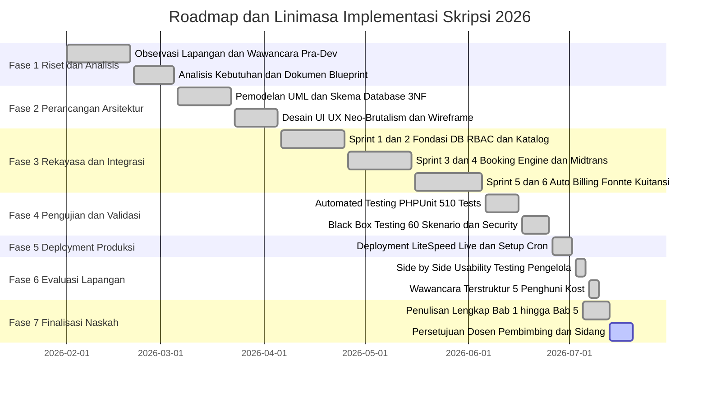

# OUTLINE DAN PLAN IMPLEMENTASI TUGAS AKHIR / SKRIPSI

**Judul Dokumen:** Outline dan Rencana Implementasi Sistem Informasi Manajemen Kost Terintegrasi *Payment Gateway* pada Asri Boarding House  
**Naskah Acuan:** `Skripsi_Rafif_Arsya_Pradiva_22.N4.0014.md`  
**Penyusun:** Rafif Arsya Pradiva (NIM: 22.N4.0014)  
**Program Studi:** Sistem Informasi, Fakultas Ilmu Komputer  
**Institusi:** Universitas Katolik Soegijapranata Semarang  
**Tahun Akademik:** 2026  

---

## BAGIAN 1: IDENTITAS DAN METADATA TUGAS AKHIR

| Atribut Dokumen | Rincian Keterangan |
| :--- | :--- |
| **Judul Lengkap** | **Sistem Informasi Manajemen Kost Terintegrasi *Payment Gateway* pada Asri Boarding House** |
| **Nama Mahasiswa** | Rafif Arsya Pradiva |
| **Nomor Induk Mahasiswa** | 22.N4.0014 |
| **Program Studi / Fakultas** | Sistem Informasi / Fakultas Ilmu Komputer |
| **Perguruan Tinggi** | Universitas Katolik Soegijapranata Semarang |
| **Dosen Pembimbing 1** | Ir. Andre Kurniawan Pamudji, S.Kom., M.Ling. (NPP: 058.1.1994.161) |
| **Dosen Pembimbing 2** | Erdhi Widyarto Nugroho, S.T., M.T. |
| **Objek Penelitian** | **Asri Boarding House** (Jl. Maera Sari No. 1 / No. 12, Tembalang, Kota Semarang 50275) |
| **Kapasitas Properti** | 32 Unit Kamar (6 Unit VIP @ Rp1.400.000; 3 Unit Deluxe @ Rp950.000; 23 Unit Standar @ Rp750.000) |
| **Potensi Omzet Bruto** | Rp28.500.000 per bulan pada kondisi keterisian penuh (*full occupancy*) |
| **Informan Kunci Pengelola** | Bapak Asep (Usia 48 tahun, Pengelola Operasional Senior, Pengalaman Konvensional ±20 tahun) |
| **Informan Penghuni Kost** | 5 (Lima) Mahasiswa Penghuni Aktif: Arjun (P1), Farrel (P2), Iman (P3), Ammar (P4), dan Sindhu (P5) |
| **Tumpukan Teknologi (Tech Stack)** | PHP 8.2, Laravel 11 (MVC + *Service Layer*), MySQL 8.x InnoDB (3NF), TailwindCSS Neo-Brutalism |
| **Layanan & API Pihak Ketiga** | Midtrans Snap API v2 (BCA VA), Fonnte WhatsApp Gateway API, Hostinger SMTP Mailer, `html2pdf.js` |
| **Lingkungan Produksi Live** | Peladen Web LiteSpeed cPanel Hostinger (`https://asriboardinghouse.weatso.id/`) |
| **Capaian Pengujian Teknis** | 60 Skenario *Black Box* (100% Lulus), 510 Pengujian Otomatis PHPUnit (2.211 *Assertions*, 0 *Error*) |
| **Tingkat Kepuasan Pengguna** | Skor Pengelola: **9,5 / 10**; Rata-Rata Skor 5 Penghuni Kost: **8,00 / 10** |

---

## BAGIAN 2: OUTLINE KOMPREHENSIF NASKAH SKRIPSI

Outline di bawah ini memetakan struktur hierarki lengkap naskah Skripsi/Tugas Akhir dari halaman awal hingga lampiran, disertai intisari bahasan akademik dan teknis pada setiap bab dan subbab:

```
HALAMAN AWAL
├── Halaman Judul Luar & Dalam
├── Halaman Pernyataan Orisinalitas
├── Halaman Pernyataan Bebas Plagiasi
├── Halaman Pengesahan (Dosen Pembimbing 1, Pembimbing 2, Ka. Progdi)
├── Kata Pengantar & Ucapan Terima Kasih
├── Halaman Pernyataan Persetujuan Publikasi Karya Ilmiah untuk Kepentingan Akademis
├── Abstrak (Bahasa Indonesia)
├── Abstract (Bahasa Inggris)
├── Daftar Isi
├── Daftar Tabel (14 Tabel Utama)
├── Daftar Gambar (22 Gambar Utama & Diagram Alur)
└── Daftar Lampiran (6 Lampiran Dokumen & Pengujian)

BAB 1: PENDAHULUAN
├── 1.1 Latar Belakang
│   ├── Dinamika pertumbuhan kawasan kampus Tembalang & tingginya kebutuhan hunian sewa mahasiswa perantau.
│   ├── Profil Asri Boarding House: 32 kamar, 3 tipe (VIP, Deluxe, Standar), omzet bruto Rp28.500.000/bulan.
│   ├── Uraian Naratif Tiga Masalah Faktual Operasional: administrasi penagihan & pengawasan tunggakan, dokumentasi pembayaran & rekapitulasi kas nota fisik 3-5 hari, serta risiko double booking & keterbatasan calon penyewa luar daerah.
│   ├── Sintesis Naratif Tinjauan Penelitian Terdahulu: Cornellya & Afriyadi [1], Nizar [2], Jannah dkk. [3], Malaikosa & Mokola [4], dan Purnia dkk. [5].
│   ├── Identifikasi Gap Penelitian: Ketiadaan integrasi payment gateway otomatis, auto-billing engine, denda berjenjang, dan eskalasi wali.
│   ├── Landasan SIM dan Integrasi Payment Gateway: Peranan SIM [6] serta otomatisasi transaksi via payment gateway [7]-[10].
│   └── Solusi yang Diajukan: SIM Kost Terpadu Laravel 11, Midtrans Snap BCA VA, Fonnte WA, Cron Job terprogram, dan evaluasi empiris pengelola serta 5 penghuni.
├── 1.2 Rumusan Masalah
│   ├── RM 1: Perancangan, pembangunan, dan integrasi sistem (reservasi daring, pembayaran digital, penagihan otomatis, notifikasi WhatsApp).
│   ├── RM 2: Solusi sistem terhadap permasalahan operasional (penagihan sewa, rekapitulasi kas, double-booking).
│   └── RM 3: Hasil evaluasi penerimaan pengguna (pengelola dan penghuni kost) setelah sistem diterapkan live.
├── 1.3 Tujuan Penelitian
│   ├── TP 1: Merancang, membangun, dan mengintegrasikan sistem informasi manajemen kost terpadu dengan empat fitur kunci.
│   ├── TP 2: Menganalisis efektivitas sistem dalam menyelesaikan permasalahan penagihan sewa, rekapitulasi kas, dan double-booking.
│   └── TP 3: Mendeskripsikan dan menganalisis hasil evaluasi penerimaan pengguna (pengelola dan penghuni kost) pasca-penerapan live.
└── 1.4 Batasan Masalah
    ├── Objek: Asri Boarding House Tembalang (32 kamar).
    ├── Bentuk: Web-responsive application (desktop dan mobile).
    ├── Fitur: Kamar, katalog Neo-Brutalism, reservasi daring, BCA VA Midtrans, auto-billing tgl 1, denda flat 5%, notifikasi Fonnte/SMTP, aduan berfoto, arus kas & ekspor laporan.
    ├── Teknologi: Laravel 11, PHP 8.2, MySQL 8.x InnoDB, Midtrans API, Fonnte WhatsApp API.
    └── Pengujian & Evaluasi: Black box 60 butir, PHPUnit, serta wawancara pengelola & 5 penghuni aktif.

BAB 2: TINJAUAN PUSTAKA
├── 2.1 Sistem Informasi dan Sistem Informasi Manajemen (SIM sebagai single source of truth operasional).
├── 2.2 Sistem Berbasis Web dan E-Commerce Model B2C (Model mandiri direct-to-consumer tanpa komisi pihak ketiga).
├── 2.3 RDBMS dan Normalisasi 3NF (MySQL 8.0 InnoDB, pemenuhan ACID, eliminasi anomali insersi/update/hapus).
├── 2.4 Arsitektur 3-Tier dan MVC pada Laravel 11 (Presentation, Logic, Data Tier; Service Layer decoupling; Observer pattern).
├── 2.5 API Eksternal: Midtrans dan Fonnte (REST API, Snap token, callback webhook signature SHA-512 anti-spoofing, WhatsApp Gateway).
├── 2.6 Penjadwalan Tugas, Mesin Penagihan Otomatis, dan Cron Job (Linux crontab, Laravel task scheduler, indeks unik gabungan).
├── 2.7 Teori Interaktivitas UI/UX: Neo-Brutalism dan WCAG 2.1 (Space Grotesk, 4px border, tactile feedback, target sentuh 44-56px, OLED dark mode).
├── 2.8 Keamanan Web dan Integritas Data (CSRF token, ORM parameter binding anti-SQLi, XSS filtering Blade, RBAC 3 portal, anti brute force).
├── 2.9 Concurrency Control dan Mekanisme Penguncian Basis Data (Komparasi Optimistic vs Pessimistic Locking; `lockForUpdate()`).
└── 2.10 Pengujian Perangkat Lunak dan Metode Black Box Testing (Equivalence partitioning & boundary value analysis).

BAB 3: METODOLOGI PENELITIAN
├── 3.1 Jenis Penelitian (Research and Development / R&D dengan Software Engineering).
├── 3.2 Teknik Pengumpulan Data (Triangulasi 4 Metode):
│   ├── 1. Observasi Lapangan: Pengamatan langsung 32 kamar, alur walk-in, pembukuan kas fisik meja pengelola.
│   ├── 2. Wawancara Pengelola Kost: Bapak Asep (48 tahun) pra-pengembangan dan evaluasi tatap muka pasca-implementasi.
│   ├── 3. Wawancara Lima Penghuni Kost: Arjun (P1), Farrel (P2), Iman (P3), Ammar (P4), dan Sindhu (P5).
│   └── 4. Studi Dokumentasi: Buku kas manual, arsip nota kuitansi rangkap dua, blueprint teknis, dan log pengujian.
├── 3.3 Metode Pengembangan Sistem (Waterfall SDLC):
│   ├── Fase 1: Analisis Kebutuhan (Requirements Analysis).
│   ├── Fase 2: Perancangan Sistem (System Design).
│   ├── Fase 3: Implementasi Program (Implementation/Coding).
│   ├── Fase 4: Pengujian Sistem (System Testing).
│   └── Fase 5: Penerapan & Evaluasi Pengguna (Deployment & Evaluation).
└── 3.4 Kerangka Pemikiran
    ├── Alur integratif: Input Masalah ➔ Pengumpulan Data ➔ Proses Waterfall ➔ Output Live ➔ Pengujian & Wawancara ➔ Dampak Operasional.
    └── Diagram alur Mermaid kerangka pemikiran.

BAB 4: HASIL DAN PEMBAHASAN
├── 4.1 Perancangan Sistem
│   ├── 4.1.1 Use Case Diagram (Aktor Calon Penyewa, Penyewa Aktif, Administrator).
│   ├── 4.1.2 Activity Diagram (Alur Reservasi Online, Penagihan & Denda Kalender, Penanganan Keluhan Fasilitas).
│   ├── 4.1.3 Flowchart Diagram (Logika Transaksi Midtrans Webhook, Evaluasi Cron Billing, Concurrency Lock).
│   ├── 4.1.4 Sequence Diagram (Interaksi Antar-Objek saat Reservasi, Pembayaran BCA VA, dan Penerbitan Tagihan).
│   ├── 4.1.5 Entity Relationship Diagram (ERD 22 Tabel Ternormalisasi 3NF).
│   └── 4.1.6 Skenario Diagram Alur Sistem (Tabel 4.1 Matriks Pemetaan Status Transaksional: pending, paid, expired, cancelled, refund).
├── 4.2 Tampilan Antarmuka Sistem
│   ├── 4.2.1 Antarmuka Calon Penyewa (Katalog Neo-Brutalism, Estimasi Biaya, Stepper 5 Tahap Reservasi, Guest Chat).
│   ├── 4.2.2 Antarmuka Penyewa Aktif (Dasbor Kontrak, Portal Tagihan & Pembayaran BCA VA, Kuitansi A5 Instan, Form Keluhan).
│   └── 4.2.3 Antarmuka Administrator (Dasbor OLED Dark Mode Keuangan, Monitoring 32 Kamar, Input Walk-In, Ekspor Laporan).
├── 4.3 Implementasi Sistem
│   ├── 4.3.1 Lingkungan Implementasi (Hardware & Software Environment).
│   ├── 4.3.2 Perancangan Arsitektur Aplikasi (Pemisahan Controller, Service Layer, Repository, dan Observers).
│   ├── 4.3.3 Implementasi Basis Data (Tabel 4.2 Struktur 22 Tabel & Implementasi Virtual Generated Columns).
│   ├── 4.3.4 Implementasi Autentikasi dan Hak Akses (RBAC Middleware & Interceptor Google OAuth UserObserver).
│   ├── 4.3.5 Implementasi Fitur Calon Penyewa (BookingService dengan Pessimistic Row Locking anti-double booking).
│   ├── 4.3.6 Implementasi Fitur Penyewa Aktif (PaymentReceiptPdfService dengan rendering html2pdf.js peramban).
│   ├── 4.3.7 Implementasi Fitur Administrator (CheckoutService dengan mekanisme karantina kamar merah pasca-checkout).
│   ├── 4.3.8 Implementasi Integrasi Payment Gateway Midtrans (Validasi SHA-512 & Idempotency Guard).
│   ├── 4.3.9 Implementasi Notifikasi Surel SMTP (Mail Notification).
│   └── 4.3.10 Implementasi Notifikasi WhatsApp Fonnte (FonnteNotificationService & tabel log_notifikasi).
├── 4.4 Hasil Deployment
│   ├── 4.4.1 Konfigurasi Peladen Web LiteSpeed & Header Keamanan HTTP (.htaccess).
│   ├── 4.4.2 Konfigurasi Penjadwal Tugas Peladen (Cron Job schedule:run per menit).
│   └── 4.4.3 Konfigurasi Variabel Lingkungan Produksi & Optimasi Kinerja Peladen (config, route, view cache).
├── 4.5 Hasil Pengujian Sistem
│   ├── 4.5.1 Hasil Black Box Testing (Tabel 4.3 Matriks 60 Skenario Uji pada 7 Modul, Kelulusan 100%).
│   ├── 4.5.2 Hasil Pengujian Hak Akses (Tabel 4.4 Pengujian Isolasi RBAC 3 Portal Bebas IDOR).
│   ├── 4.5.3 Hasil Pengujian Transaksi Midtrans Sandbox BCA VA (Tabel 4.5 Simulasi Siklus Transaksi).
│   └── 4.5.4 Hasil Pengujian Parameter Keamanan & Live (Tabel 4.6 Enkripsi TLS 1.3 Grade A & Pengujian PHPUnit 510 Tests).
├── 4.6 Hasil Wawancara dengan Penjaga Kost
│   ├── Profil Informan (Bapak Asep, 48 tahun, pengalaman ±20 tahun).
│   ├── Prosedur Side-by-Side Usability Testing (Berkas rekaman audio `REKAMAN_UX_ADMIN_KOST_2026.m4a` 23m 14s).
│   ├── Tabel 4.7 Transkrip 10 Butir Pertanyaan & Respon Pengelola.
│   └── Analisis Capaian: Skor Kepuasan 9,5/10, Pemangkasan Pembukuan dari 3-5 Hari Jadi Instan, Zero Cash Variance.
├── 4.7 Hasil Wawancara dengan Lima Orang Penghuni Kost
│   ├── Tabel 4.8 Profil & Konteks Hunian 5 Responden.
│   ├── 4.7.1 Transkrip Responden 1: Arjun (Mahasiswa UNNES - Penghuni Kost, Pengujian via Laptop & Android, Skor 8,5/10).
│   ├── 4.7.2 Transkrip Responden 2: Farrel (Mahasiswa USM - Penghuni Kost, Pengujian via Smartphone Android, Mahasiswa Rantau Luar Kota, Skor 7,0/10).
│   ├── 4.7.3 Transkrip Responden 3: Iman (Mahasiswa UDINUS - Penghuni Kost, Pengujian via Laptop, Evaluasi Rekam Jejak Transaksi Digital, Skor 9,0/10).
│   ├── 4.7.4 Transkrip Responden 4: Ammar (Mahasiswa PKN STAN - Penghuni Kost, Pengujian via Smartphone iOS, Aksesibilitas Jarak Jauh, Skor 7,5/10).
│   ├── 4.7.5 Transkrip Responden 5: Sindhu (Mahasiswa UI - Penghuni Kost, Pengujian via Smartphone Android, Adaptasi Pengguna Baru, Skor 8,0/10).
│   ├── 4.7.6 Tabel 4.14 Matriks Komparasi Evaluasi Respon dan Temuan Kunci Kelima Penghuni Kost.
│   └── 4.7.7 Analisis Kualitatif: 4 Tema (Akseptabilitas Tinggi 8,00/10, Value Proposition, Kendala Empiris, Saran).
└── 4.8 Pembahasan
    ├── 1. Harmonisasi Perancangan, Implementasi, dan Pengujian Fungsionalitas Sistem (Menjawab Rumusan Masalah 1).
    ├── 2. Efektivitas Sistem sebagai Solusi Permasalahan Operasional Kos (Menjawab Rumusan Masalah 2).
    ├── 3. Sintesis Hasil Evaluasi Penerimaan Pengguna Lapangan (Menjawab Rumusan Masalah 3).
    └── 4. Diferensiasi Verifikasi Teknis (Kebenaran Fungsional) vs Evaluasi Penerimaan Pengguna (Adopsi Humanis).

BAB 5: KESIMPULAN DAN SARAN
├── 5.1 Kesimpulan
│   ├── Kesimpulan 1 (Rancang Bangun & Verifikasi): Sistem terpadu Laravel 11 & MySQL 8.x ternormalisasi 3NF, integrasi Midtrans Snap & Fonnte WA, 100% lulus 60 skenario black box dan 510 uji otomatis PHPUnit (Menjawab RM 1).
│   ├── Kesimpulan 2 (Solusi Masalah Operasional): Otomasi auto-billing tgl 1 & denda kalender 5%, penjaminan zero cash variance & ekspor pembukuan instan, serta eliminasi zero double-booking via defense-in-depth (Menjawab RM 2).
│   └── Kesimpulan 3 (Evaluasi Pengguna Lapangan): Keberhasilan penerapan live; evaluasi pengelola skor 9,5/10; evaluasi 5 mahasiswa penghuni kost rata-rata skor 8,00/10 (Menjawab RM 3).
└── 5.2 Saran
    ├── 1. Perluasan Kanal Pembayaran Non-Tunai Berbasis QRIS dan E-Wallet.
    ├── 2. Penyempurnaan Penjadwalan Pengingat Berjenjang (H-2, Hari-H) dan Label Visual "Masa Toleransi".
    ├── 3. Penyediaan Panduan Interaktif Onboarding Digital bagi Penyewa Pendaftaran Langsung (Walk-in).
    ├── 4. Otomatisasi Notifikasi WhatsApp Pra-Terminasi Kontrak Sewa (H-30) untuk Penghuni Semesteran/Tahunan.
    └── 5. Optimasi Kinerja Skalabilitas dan Caching Peladen Tingkat Lanjut (Redis) pada Beban Puncak Tanggal 1.

BAGIAN AKHIR
├── DAFTAR PUSTAKA (20 Referensi Ilmiah Standar IEEE / Akademik Terindeks)
└── LAMPIRAN
    ├── Lampiran 1: Pedoman dan Panduan Wawancara Operasional Pengelola Kost (Informed Consent Bapak Asep).
    ├── Lampiran 2: Transkrip Lengkap dan Kuesioner Wawancara Lima Responden Penghuni Kost.
    ├── Lampiran 3: Matriks Rinci 60 Butir Pengujian Fungsionalitas Kotak Hitam (Black Box Testing).
    ├── Lampiran 4: Log Eksekusi Rangkaian Pengujian Otomatis Laravel PHPUnit (510 Passed, 2.211 Assertions).
    ├── Lampiran 5: Kode Sumber Skrip Kritis Otomasi Sistem (BillingService, LatePenalties, MidtransCallbackController).
    └── Lampiran 6: Dokumentasi Riset Lapangan dan Surat Keterangan Selesai Penelitian Asri Boarding House.
```

---

## BAGIAN 3: PLAN IMPLEMENTASI SISTEM DAN PENULISAN SKRIPSI

Rencana implementasi dirancang mengadopsi model *Waterfall System Development Life Cycle* (SDLC) yang dipadukan dengan siklus tahapan akademik tugas akhir. Rencana ini terbagi ke dalam 7 (tujuh) fase utama, mencakup *Work Breakdown Structure* (WBS), alokasi waktu, deliverable, serta pengujian kualitas.



---

### 3.1 Work Breakdown Structure (WBS) Rinci per Fase

#### FASE 1: STUDI PENDAHULUAN, PENGUMPULAN DATA, DAN ANALISIS KEBUTUHAN (Pekan 1 – 5)
* **Aktivitas 1.1**: Observasi lapangan langsung di Asri Boarding House Tembalang.
  * Memetakan struktur fisik 32 unit kamar, denah 2 lantai, pembagian 3 tipe kamar (VIP, Deluxe, Standar).
  * Mengamati rutinitas penagihan sewa, pengeluaran token listrik/air, dan tata cara verifikasi bukti transfer.
* **Aktivitas 1.2**: Wawancara mendalam pra-pengembangan dengan pengelola senior (Bapak Asep, 48 tahun).
  * Menggali aturan bisnis: siklus penagihan tanggal 1, jatuh tempo tanggal 10, denda flat 5% saat menyeberang bulan, dan prosedur pendaftaran tamu langsung (*walk-in*).
* **Aktivitas 1.3**: Studi dokumentasi arsip kos konvensional.
  * Mengaudit lembaran buku besar, buku kas harian, nota kuitansi rangkap dua (*carbon copy*), dan buku pengeluaran kasbon perbaikan sarana.
* **Aktivitas 1.4**: Penyusunan dokumen Spesifikasi Kebutuhan Perangkat Lunak (*Software Requirements Specification* / SRS).
  * Mengunci kebutuhan fungsional (FR-01 s.d. FR-10) dan kebutuhan non-fungsional (NFR-01 s.d. NFR-06).
  * **Luaran Fase 1**: Dokumen Catatan Observasi Lapangan, Transkrip Wawancara Kebutuhan, dan Berkas *Blueprint* Spesifikasi Sistem.

---

#### FASE 2: PERANCANGAN SISTEM, ARSITEKTUR, DAN DESAIN ANTARMUKA (Pekan 6 – 10)
* **Aktivitas 2.1**: Pemodelan Arsitektur Berorientasi Objek dengan *Unified Modeling Language* (UML).
  * Menyusun *Use Case Diagram* untuk 3 aktor (Calon Penyewa, Penghuni Aktif, Administrator).
  * Merancang *Activity Diagram* untuk 3 proses bisnis kritis (Reservasi Kamar, Penagihan & Denda, Pelaporan Aduan).
  * Menyusun *Flowchart Diagram* logika transaksi Midtrans Webhook dan *Auto-Billing Scheduler*.
  * Merancang *Sequence Diagram* untuk interaksi transaksional klien-peladen-basis data-API eksternal.
* **Aktivitas 2.2**: Perancangan Skema Basis Data Relasional Normalisasi 3NF.
  * Merancang struktur 22 tabel data relasional, batasan *foreign key*, aturan integritas *cascade/restrict*.
  * Mengintegrasikan teknik *Virtual Generated Columns* (`active_email`, `active_no_hp`, `active_nik`, `active_nomor_kamar`, `active_order_id`) guna mencegah benturan indeks unik pada baris *soft deletes*.
* **Aktivitas 2.3**: Desain Antarmuka Pengguna Berbasis Bahasa Desain Neo-Brutalism.
  * Menerapkan tipografi *Space Grotesk*, bingkai hitam tebal 4px, bayangan tegas (*hard box-shadow*), dan palet warna kontras tinggi.
  * Menyelaraskan aksesibilitas dengan standar WCAG 2.1 (target sentuh tombol melayang CTA minimal 56px).
  * Merancang tema khusus *OLED Black Dark Mode* (#000000) untuk panel administrator guna ergonomi mata pengguna paruh baya.
  * **Luaran Fase 2**: Cetak Biru UML Diagram, Skema ERD 22 Tabel, Kamus Data Relasional, dan Wireframe UI/UX Lengkap.

---

#### FASE 3: IMPLEMENTASI REKAYASA PERANGKAT LUNAK (SPRINT CODING) (Pekan 11 – 18)
Implementasi kode program dieksekusi secara modular menggunakan pola arsitektur *3-Tier MVC* yang diperkuat *Service Layer Decoupling* pada framework Laravel 11 (PHP 8.2):

* **Sprint 1 (Fondasi Sistem, Basis Data, dan Autentikasi RBAC)**:
  * Inisialisasi proyek Laravel 11, konfigurasi berkas `.env`, koneksi MySQL 8.x InnoDB.
  * Eksekusi *Database Migrations* & *Seeders* untuk 22 tabel basis data ternormalisasi 3NF.
  * Implementasi *Role-Based Access Control* (RBAC) dengan 3 *guard* portal terpisah: Administrator (`/admin`), Penyewa Aktif (`/penyewa`), dan Calon Penyewa (`/reservasi`).
  * Integrasi Google OAuth 2.0 via Laravel Socialite disertai *interceptor* pemaksa kelengkapan profil nomor telepon/WhatsApp (`UserObserver`).
* **Sprint 2 (Modul Katalog Publik, Kalkulator Sewa, dan Guest Chat)**:
  * Pengembangan antarmuka katalog 32 unit kamar publik Neo-Brutalism dengan lencana status dinamis (*Tersedia, Terisi, Karantina*).
  * Implementasi kalkulator estimasi sewa dengan diskon sewa tahunan otomatis.
  * Implementasi fitur konsultasi awal (*pre-payment guest inquiry*) berbasis *AJAX polling* dengan persistensi token sesi SHA-256.
  * Penyematan tombol aksi melayang (*floating CTA*) WhatsApp berstandar WCAG 2.1 (56px).
* **Sprint 3 (Mesin Reservasi Mandiri dan Algoritma Anti-Double Booking)**:
  * Pengembangan formulir reservasi mandiri 5 tahap terpandu (*5-step stepper*).
  * Validasi kependudukan NIK 16 digit dan nomor kontak orang tua/wali mahasiswa.
  * Implementasi *Pessimistic Row Locking* pada `BookingService` (`lockForUpdate()`) di dalam blok `DB::transaction()` untuk mengunci baris kamar dan mencegah kondisi balapan (*race condition*) reservasi serentak.
  * Logika opsi pembayaran fleksibel: Pelunasan 100% vs Uang Muka (DP 30%) dengan penerbitan otomatis tagihan sisa 70%.
* **Sprint 4 (Integrasi Payment Gateway Midtrans Snap API & Kuitansi A5)**:
  * Integrasi pustaka Midtrans Snap PHP SDK untuk saluran Bank BCA Virtual Account.
  * Implementasi `MidtransCallbackController` untuk menangani *asynchronous HTTP POST callback webhook*.
  * Verifikasi tanda tangan digital kriptografi SHA-512 menggunakan fungsi anti-*timing attack* `hash_equals()`.
  * Penerapan proteksi idempotensi transaksi (*Fast-exit Idempotency Guard*) guna mencegah pencatatan saldo kas ganda.
  * Modul kompilasi kuitansi digital instan format A5 di sisi peramban klien menggunakan pustaka JavaScript `html2pdf.js` (*zero server storage overhead*).
* **Sprint 5 (Mesin Penagihan Otomatis, Denda Kalender, dan Gateway WhatsApp Fonnte)**:
  * Pengembangan `BillingService`: otomatisasi pembuatan tagihan bulanan massal setiap tanggal 1 pukul 00:05 WIB dengan jatuh tempo tanggal 10.
  * Proteksi integritas basis data via indeks unik komposit `(penyewa_id, periode_bulan, periode_tahun)`.
  * Pengembangan `ApplyLatePenalties`: aturan toleransi bebas denda (Denda = Rp0) selama bulan kalender berjalan, dan penegakan denda flat 5% idempoten saat menyeberang ke bulan baru.
  * Integrasi REST API Gateway Fonnte WhatsApp untuk distribusi otomatis nota tagihan, kuitansi lunas, dan eskalasi penunggakan berjenjang ke kontak orang tua/wali.
  * Perekaman jejak audit transmisi pesan pada tabel `log_notifikasi`.
* **Sprint 6 (Dasbor Keuangan Administrator, Karantina Kamar, dan Ekspor Laporan)**:
  * Pengembangan panel dasbor keuangan bertema *OLED Black Dark Mode*.
  * Modul pendaftaran calon penghuni datang langsung (*walk-in*) dalam satu transaksi atomik terpadu.
  * Tombol aksi satu sentuhan "Konfirmasi Tunai" untuk pembayaran fisik di kantor pengelola.
  * Pengembangan `CheckoutService`: kebijakan karantina status kamar tetap merah (*occupied*) pasca-checkout hingga verifikasi kebersihan fisik selesai dikonfirmasi pengelola.
  * Modul ekspor laporan laba-rugi operasional ke format dokumen PDF (Dompdf) dan Excel/CSV dengan enkripsi karakter BOM UTF-8.
  * **Luaran Fase 3**: Kode Sumber Aplikasi Terintegrasi Penuh (Repositori Git dengan 7 Modul Fungsional Selesai).

---

#### FASE 4: PENGUJIAN SISTEM DAN PENJAMINAN MUTU (QUALITY ASSURANCE) (Pekan 19 – 21)
* **Aktivitas 4.1**: Pengujian Otomatis Tingkat Kerangka Kerja (PHPUnit Automated Testing).
  * Menulis dan mengeksekusi rangkaian pengujian unit (*Unit Tests*) dan fitur (*Feature Tests*).
  * Validasi ketepatan kalkulasi denda, keandalan penguncian baris pesimistik, verifikasi webhook SHA-512, dan isolasi kebijakan otorisasi RBAC.
  * **Target Capaian**: 510 pengujian passed, 2.211 *assertions*, 0 *failure*, 0 *error*.
* **Aktivitas 4.2**: Pengujian Fungsionalitas Kotak Hitam (*Black Box Testing*).
  * Mengeksekusi 60 skenario uji terstruktur pada 7 domain modul (`MOD-01` s.d. `MOD-07`).
  * Menguji kondisi batas (*boundary value*), form validasi, alur kegagalan pembayaran, dan *fast-exit idempotency*.
  * **Target Capaian**: 100% Skenario Valid dan Lulus (Tabel 4.3).
* **Aktivitas 4.3**: Pengujian Keamanan Akses dan Simulasi Transaksi Perbankan.
  * Pengujian isolasi RBAC terhadap serangan manipulasi URL (*Insecure Direct Object References* / IDOR).
  * Simulasi transaksi daring pada Midtrans Sandbox Virtual Account BCA Simulator.
  * Verifikasi sertifikat enkripsi SSL TLS 1.3 Grade A pada peladen produksi.
  * **Luaran Fase 4**: Matriks Rinci 60 Butir Black Box Testing, Berkas Log PHPUnit, dan Laporan Uji Keamanan.

---

#### FASE 5: PENERAPAN PADA PELADEN PRODUKSI (LIVE DEPLOYMENT) (Pekan 22)
* **Aktivitas 5.1**: Konfigurasi Lingkungan Peladen LiteSpeed cPanel Hostinger.
  * Migrasi basis data MySQL produksi, setup domain publik `https://asriboardinghouse.weatso.id/`.
  * Konfigurasi berkas proteksi `.htaccess` (HTTPS redirection, MIME sniffing protection, XSS protection, clickjacking protection).
* **Aktivitas 5.2**: Konfigurasi Penjadwalan Tugas Peladen (*Crontab Scheduler*).
  * Mengaktifkan cron job Linux: `* * * * * cd /home/uXXXX/public_html && php artisan schedule:run >> /dev/null 2>&1`.
* **Aktivitas 5.3**: Optimasi Performa Peladen Produksi.
  * Mengeksekusi perintah optimasi cache: `php artisan config:cache`, `route:cache`, `view:cache`, `event:cache`.
  * Pengaturan penyimpanan berkas statis publik via *symlink* `storage:link`.
  * **Luaran Fase 5**: Sistem Informasi Manajemen Kost Berjalan Aktif 24/7 di Lingkungan Produksi Live.

---

#### FASE 6: EVALUASI OPERASIONAL LAPANGAN DAN WAWANCARA PENGGUNA (Pekan 23 – 24)
* **Aktivitas 6.1**: *Side-by-Side Usability Testing* bersama Pengelola Senior (Bapak Asep, 48 tahun).
  * Pengujian tatap muka langsung di kantor kos menggunakan satu layar laptop sistem live.
  * Pengelola menguji mandiri: input walk-in, konfirmasi tunai, ekspor laporan laba-rugi PDF/Excel, navigasi *OLED Dark Mode*.
  * Perekaman audio digital sesi wawancara (`REKAMAN_UX_ADMIN_KOST_2026.m4a`, durasi 23m 14s).
  * Tabulasi 10 butir pertanyaan dan jawaban pengelola (Tabel 4.7) dengan capaian skor kepuasan 9,5 / 10.
* **Aktivitas 6.2**: Wawancara Evaluasi Pasca-Implementasi bersama Lima Penghuni Kost Aktif.
  * Melakukan wawancara semiterstruktur di area bersama (*communal space*) kos.
  * Melibatkan 5 responden mahasiswa penghuni kost (*surrogate users*) dengan beragam latar belakang perangkat dan pengalaman: P1 (Arjun - Mahasiswa UNNES - Penghuni Kost, Laptop & Android), P2 (Farrel - Mahasiswa USM - Penghuni Kost, Android & Luar Kota), P3 (Iman - Mahasiswa UDINUS - Penghuni Kost, Laptop & Jejak Audit Digital), P4 (Ammar - Mahasiswa PKN STAN - Penghuni Kost, iOS Safari & Luar Kota), P5 (Sindhu - Mahasiswa UI - Penghuni Kost, Android & Onboarding Baru).
  * Tabulasi transkrip individu (Tabel 4.9 s.d. Tabel 4.13), matriks komparasi (Tabel 4.14), dan sintesis 4 tema kualitatif.
  * **Luaran Fase 6**: Berkas Audio Rekaman Wawancara, Lembar Transkrip Lengkap, dan Matriks Analisis Kepuasan Pengguna.

---

#### FASE 7: PENYUSUNAN LAPORAN TUGAS AKHIR DAN FINALISASI AKADEMIK (Pekan 23 – 25)
* **Aktivitas 7.1**: Penulisan komprehensif naskah Skripsi Bab 1 sampai Bab 5 secara terpadu.
* **Aktivitas 7.2**: Penyusunan 6 dokumen lampiran (Pedoman wawancara, transkrip 5 penghuni, matriks black box 60 butir, log PHPUnit, kode sumber otomasi kritis, surat izin riset).
* **Aktivitas 7.3**: Pembahasan bimbingan berkala bersama Dosen Pembimbing 1 dan Dosen Pembimbing 2.
* **Aktivitas 7.4**: Finalisasi naskah akhir, lembar pengesahan, dan pengunggahan naskah ke repositori akademik universitas.
* **Aktivitas 7.5**: Persiapan presentasi sidang pendadaran tugas akhir.
  * **Luaran Fase 7**: Naskah Lengkap Skripsi (Format Markdown & PDF Resmi) dan Slide Presentasi Ujian Sidang.

---

### 3.2 Matriks Keterlacakan (Traceability Matrix): Masalah - Fitur - Teknis - Pengujian - Pembahasan

Matriks berikut menjamin konsistensi ilmiah antara permasalahan lapangan, tujuan penelitian, komponen rekayasa sistem, metode verifikasi, hingga bab pembahasannya:

| No | Permasalahan Lapangan | Solusi Rekayasa Fitur | Komponen Teknis & Arsitektur | Butir Pengujian | Evaluasi Pengguna | Bab Pembahasan |
| :-: | :--- | :--- | :--- | :--- | :--- | :--- |
| **1** | Penagihan bulanan manual via WhatsApp pribadi menyita waktu dan rawan terlewat. | Mesin Penagihan Otomatis (*Auto-Billing Engine*) terbit serentak tanggal 1 pukul 00:05 WIB. | `BillingService.php`, Cron Job Linux `schedule:run`, Indeks Unik Komposit Basis Data. | Skenario `MOD-05` (8 Butir Uji), PHPUnit `BillingServiceTest`. | Iman (P3, Skor 9/10), Pengelola (Bapak Asep, Skor 9,5/10). | Subbab 4.3.9, 4.5.1, 4.6, 4.8.1. |
| **2** | Belum ada mekanisme pendisiplinan dan eskalasi penunggakan ke kontak wali mahasiswa. | Kebijakan toleransi bebas denda (Denda Rp0) di bulan berjalan; Denda flat 5% idempoten saat ganti bulan; Notifikasi otomatis ke kontak wali. | `ApplyLatePenalties.php`, `FonnteNotificationService.php`, REST API Gateway Fonnte WA. | Skenario `MOD-05` & `MOD-06` (14 Butir Uji), PHPUnit Late Penalty. | Ammar (P4, Skor 7,5/10), Pengelola (Bapak Asep, Skor 9,5/10). | Subbab 4.3.10, 4.5.1, 4.7.4, 4.8.1. |
| **3** | Rekapitulasi kas berbasis nota kertas menyita 3-5 hari kerja & rawan selisih kas. | Dasbor Keuangan Terpusat (*Single Source of Truth*), rekap laba-rugi otomatis, dan ekspor instan PDF/Excel. | Panel Admin *OLED Dark Mode*, Dompdf Service, BOM UTF-8 Excel Exporter, MySQL InnoDB. | Skenario `MOD-07` (10 Butir Uji), Validasi Ekspor Laporan. | Pengelola (Bapak Asep: "Dari 3-4 hari kalkulator menjadi seketika, selisih kas Rp0"). | Subbab 4.3.7, 4.5.1, 4.6, 4.8.2. |
| **4** | Pembayaran sewa tunai/transfer manual rawan nota hilang dan verifikasi mutasi lambat. | Pembayaran Digital Non-Tunai BCA Virtual Account via Midtrans Snap dengan verifikasi otomatis instan. | Midtrans Snap PHP SDK, `MidtransCallbackController`, SHA-512 Signature, Idempotency Guard. | Skenario `MOD-04` (9 Butir Uji), Midtrans Sandbox BCA VA Simulator. | Seluruh Responden (P1-P5: Verifikasi < 1 mnt tanpa kirim bukti resi manual). | Subbab 4.3.8, 4.5.3, 4.7, 4.8.1. |
| **5** | Kuitansi kertas hilang menimbulkan perdebatan pembayaran terdahulu. | Modul kuitansi digital instan format A5 di peramban dan riwayat pembayaran digital transparan. | Pustaka JavaScript `html2pdf.js` (*zero server overhead*), Portal Mandiri `/penyewa/tagihan`. | Skenario `MOD-04`, Pengujian Cetak Kuitansi A5 Peramban Klien. | Arjun (P1), Iman (P3: "Disimpan di GDrive buat arsip pribadi"). | Subbab 4.3.6, 4.5.1, 4.7, 4.8.2. |
| **6** | Risiko pemesanan ganda (*double-booking*) akibat survei fisik & cek manual. | Pertahanan ganda: *Pessimistic Row Locking* transaksi database & karantina kamar pasca-checkout. | `lockForUpdate()` MySQL InnoDB pada `BookingService.php`, `CheckoutService.php`. | Skenario `MOD-03` (10 Butir Uji), PHPUnit Concurrency Simulation. | Farrel (P2), Sindhu (P5). | Subbab 4.3.5, 4.3.7, 4.5.1, 4.8.3. |
| **7** | Calon penyewa luar kota sulit melihat informasi kamar dan survei fisik. | Katalog publik interaktif berdesain Neo-Brutalism dengan kalkulator sewa & formulir mandiri 5 tahap. | Blade Templating, TailwindCSS, Desain Neo-Brutalism, Standar WCAG 2.1. | Skenario `MOD-02` & `MOD-03` (18 Butir Uji Fungsional). | Arjun (P1), Farrel (P2). | Subbab 4.2.1, 4.5.1, 4.7.1, 4.8.2. |

---

### 3.3 Manajemen Risiko dan Rencana Mitigasi Teknis

Dalam eksekusi rekayasa sistem transaksi finansial dan penagihan terjadwal, telah dirumuskan langkah antisipasi dan mitigasi kegagalan teknis:

| No | Risiko Potensial | Tingkat Risiko | Dampak Operasional | Strategi Mitigasi Teruji dalam Sistem |
| :-: | :--- | :---: | :--- | :--- |
| **1** | **Kondisi Balapan (*Race Condition*) Reservasi Serentak** | **Tinggi** | Terjadinya pemesanan ganda (*double-booking*) pada unit kamar yang sama oleh dua calon penyewa. | Penerapan mekanisme penguncian pesimistik (`lockForUpdate()`) di dalam blok `DB::transaction()` pada `BookingService`. Transaksi kedua otomatis ditolak sistem dengan notifikasi validasi. |
| **2** | **Pemalsuan Webhook Midtrans (*Callback Spoofing*)** | **Tinggi** | Pengubahan status pembayaran menjadi lunas secara ilegal tanpa adanya penyetoran uang kas. | Validasi tanda tangan digital SHA-512 (`order_id + status_code + gross_amount + ServerKey`) menggunakan fungsi kebal serangan *timing attack* `hash_equals()`. Akses tanpa tanda tangan valid langsung ditolak dengan kode respon HTTP 403. |
| **3** | **Webhook Replay Attack / Callback Berulang** | **Sedang** | Pencatatan saldo kas bertambah ganda atau pembaruan status transaksi berulang. | Penerapan *Fast-exit Idempotency Guard*: sistem memeriksa apakah status pembayaran pada database sudah bernilai `lunas`. Jika sudah, eksekusi pembaruan basis data langsung dihentikan (*noop*). |
| **4** | **Duplikasi Pembuatan Tagihan Bulanan oleh Cron Job** | **Sedang** | Terbitnya invoice sewa lebih dari satu lembar untuk penghuni yang sama pada bulan kalender yang sama. | Penegakan indeks unik komposit (*composite unique constraint*) pada skema basis data: `UNIQUE(penyewa_id, periode_bulan, periode_tahun)` dan penggunaan metode `firstOrCreate()` pada Eloquent. |
| **5** | **Kelebihan Beban Peladen (*Server Overhead*) Pembuatan PDF Kuitansi** | **Sedang** | Peladen web mengalami *memory exhaustion* (HTTP 500) saat banyak penyewa mengunduh kuitansi bersamaan. | Mengalihkan proses kompilasi kuitansi digital format A5 ke sisi peramban klien (*client-side rendering*) menggunakan pustaka JavaScript `html2pdf.js`, sehingga beban komputasi peladen bernilai nol (*zero server load*). |
| **6** | **Kegagalan Titik Akhir API WhatsApp Fonnte** | **Rendah** | Pesan pengingat atau kuitansi tidak sampai ke ponsel pengguna saat kuota gateway habis. | Sistem mencatat status pengiriman ke tabel `log_notifikasi`, mengisolasi proses pengiriman agar tidak membatalkan transaksi basis data utama, serta menyediakan notifikasi cadangan via surel SMTP. |
| **7** | **Penerobosan Hak Akses Silang Pengguna (*IDOR Vulnerability*)** | **Tinggi** | Penyewa dapat melihat rincian tagihan atau kuitansi milik penyewa kamar lain dengan memanipulasi parameter URL. | Penerapan otorisasi ketat pada lapisan pengendali (*Controller Authorization Gate*): sistem selalu mencocokkan `penyewa_id` pada tagihan dengan identitas pengguna yang sedang terautentikasi (`Auth::id()`). Pelanggaran akses memicu respon HTTP 403 Forbidden. |
| **8** | **Pelepasan Kamar Prematur Pasca-Checkout** | **Sedang** | Kamar yang baru ditinggalkan penghuni lama langsung terpesan publik padahal fisik kamar masih kotor/rusak. | Kebijakan *Operational Inspection Hold* pada `CheckoutService`: status kamar pasca-checkout tetap terkunci merah (*occupied*) hingga administrator selesai menginspeksi fisik dan melepas status kamar secara manual. |

---

### 3.4 Standar Kualitas dan Kriteria Kesiapan (Definition of Done)

Sebelum naskah Skripsi dan perangkat lunak diajukan ke sidang pendadaran tugas akhir, seluruh kriteria kesiapan kualitas (*Quality Gates*) berikut telah terpenuhi secara mutlak:

1. **Integritas Fungsional (100% Black Box Pass)**:
   Seluruh 60 skenario uji fungsionalitas kotak hitam pada 7 kluster modul telah dieksekusi pada lingkungan peladen produksi live dengan hasil 100% valid dan lulus tanpa ada cacat (*zero defects*).
2. **Kekebalan Otomasi Kode (PHPUnit 100% Success)**:
   Rangkaian pengujian unit dan fitur internal Laravel PHPUnit menghasilkan 510 tes lulus (2.211 *assertions*) dengan durasi eksekusi < 20 detik dan penggunaan memori < 45 MB tanpa satupun galat atau kegagalan.
3. **Integritas Basis Data Ternormalisasi 3NF**:
   Skema basis data 22 tabel terbebas dari anomali data, memiliki relasi kunci asing yang konsisten, serta mengamankan keunikan baris *soft deletes* menggunakan *Virtual Generated Columns*.
4. **Keamanan Transaksi Finansial**:
   Verifikasi transaksi Midtrans Snap BCA VA terlindungi tanda tangan kriptografi SHA-512, bebas manipulasi callback (*zero spoofing*), dan terlindungi proteksi idempotensi.
5. **Kesiapan Lingkungan Produksi (Live Readiness)**:
   Sistem aktif berjalan pada peladen produksi Hostinger LiteSpeed (`https://asriboardinghouse.weatso.id/`) dengan enkripsi HTTPS SSL TLS 1.3 Grade A, header keamanan HTTP lengkap, dan penjadwal cron job berjalan otomatis setiap menit.
6. **Validasi Pengguna Empiris Terbukti Tinggi**:
   Telah dilaksanakan pengujian tatap muka (*side-by-side usability testing*) bersama pengelola operasional senior dengan skor kepuasan operasional **9,5 / 10** serta wawancara terstruktur bersama lima penghuni kost aktif dengan rata-rata skor kepuasan **8,00 / 10**.
7. **Kelengkapan Dokumen Akademik**:
   Naskah lengkap Skripsi Bab 1 sampai Bab 5 telah disusun selaras dengan pedoman akademik universitas, dilengkapi 6 berkas lampiran resmi (pedoman wawancara, transkrip wawancara, matriks uji black box, log eksekusi PHPUnit, kode sumber otomasi, dan surat keterangan riset).

---

## KESIMPULAN RINGKAS

Dokumen outline dan rencana implementasi ini menyajikan sintesis komprehensif dari artefak naskah Skripsi `Skripsi_Rafif_Arsya_Pradiva_22.N4.0014.md`. Dokumen ini menjadi pedoman operasional dan akademik yang menjamin bahwa seluruh tahapan rekayasa perangkat lunak, integrasi gerbang pembayaran, penjadwalan otomasi penagihan, pengujian teknis berlapis, serta pengujian penerimaan pengguna di Asri Boarding House Tembalang terdokumentasi secara tertib, akuntabel, dan memenuhi standar keunggulan ilmiah program sarjana Sistem Informasi.
