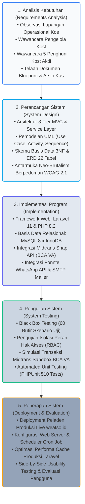
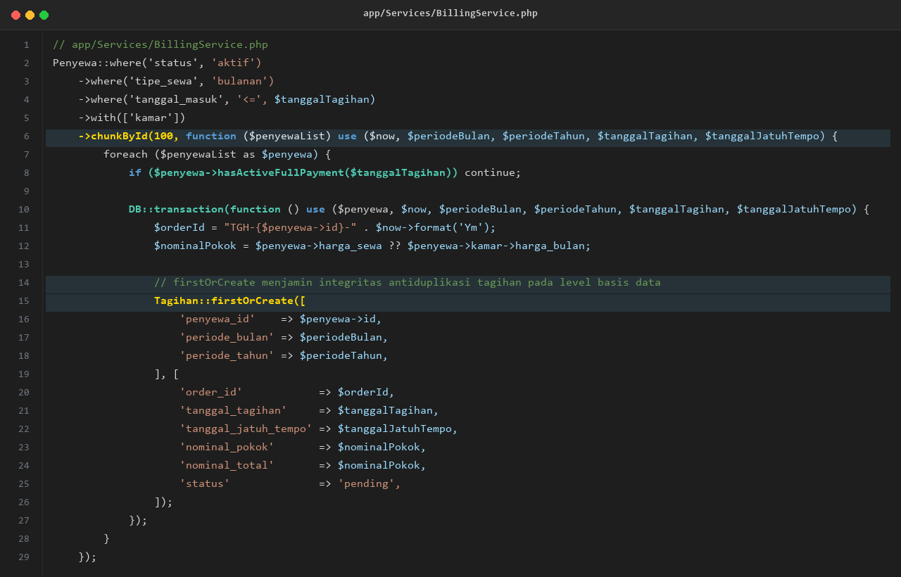
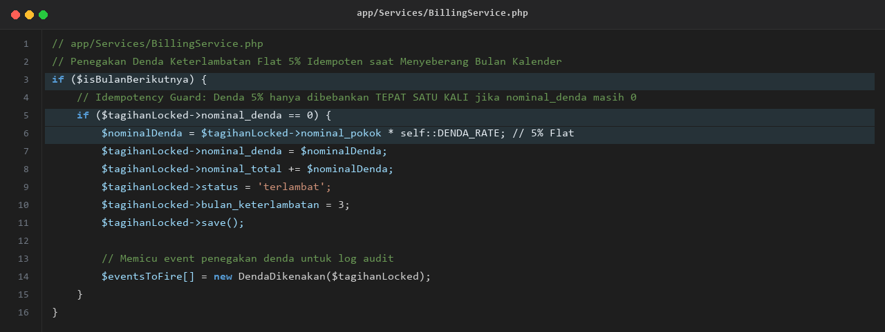

<div align="center">

### TUGAS AKHIR

<br>

## SISTEM INFORMASI MANAJEMEN KOST TERINTEGRASI PAYMENT GATEWAY<br>PADA ASRI BOARDING HOUSE

<br><br>

Diajukan untuk memenuhi syarat guna mencapai gelar Sarjana Komputer<br>program studi Sistem Informasi Universitas Katolik Soegijapranata<br>Semarang

<br><br>

*(Lambang Universitas Katolik Soegijapranata)*

<br><br><br>

Disusun oleh :<br>
**RAFIF ARSYA PRADIVA**<br>
**22.N4.0014**

<br><br><br>

**PROGRAM STUDI SISTEM INFORMASI**<br>
**FAKULTAS ILMU KOMPUTER**<br>
**UNIVERSITAS KATOLIK SOEGIJAPRANATA**<br>
**SEMARANG**<br>
**2026**

</div>

<div style="page-break-after: always;"></div>

<div align="center">

### TUGAS AKHIR

<br>

## SISTEM INFORMASI MANAJEMEN KOST TERINTEGRASI PAYMENT GATEWAY<br>PADA ASRI BOARDING HOUSE

<br><br>

Diajukan untuk memenuhi salah satu syarat guna mencapai gelar Sarjana Komputer<br>pada Program Studi Sistem Informasi Fakultas Ilmu Komputer<br>Universitas Katolik Soegijapranata Semarang

<br><br>

*(Lambang Universitas Katolik Soegijapranata)*

<br><br><br>

Disusun oleh :<br>
**RAFIF ARSYA PRADIVA**<br>
**22.N4.0014**

<br><br><br>

**PROGRAM STUDI SISTEM INFORMASI**<br>
**FAKULTAS ILMU KOMPUTER**<br>
**UNIVERSITAS KATOLIK SOEGIJAPRANATA**<br>
**SEMARANG**<br>
**2026**

</div>

<div style="page-break-after: always;"></div>

<div align="center">

### HALAMAN PERNYATAAN ORISINALITAS

</div>

<br>

Yang bertanda tangan di bawah ini:

Nama &nbsp;&nbsp;&nbsp;&nbsp;&nbsp;&nbsp;&nbsp;&nbsp;&nbsp;&nbsp;&nbsp;&nbsp;&nbsp;&nbsp;&nbsp;&nbsp;&nbsp;&nbsp;&nbsp;&nbsp;&nbsp;: Rafif Arsya Pradiva  
NIM &nbsp;&nbsp;&nbsp;&nbsp;&nbsp;&nbsp;&nbsp;&nbsp;&nbsp;&nbsp;&nbsp;&nbsp;&nbsp;&nbsp;&nbsp;&nbsp;&nbsp;&nbsp;&nbsp;&nbsp;&nbsp;&nbsp;&nbsp;: 22.N4.0014  
Program Studi &nbsp;&nbsp;&nbsp;&nbsp;&nbsp;&nbsp;&nbsp;&nbsp;: Sistem Informasi  
Fakultas &nbsp;&nbsp;&nbsp;&nbsp;&nbsp;&nbsp;&nbsp;&nbsp;&nbsp;&nbsp;&nbsp;&nbsp;&nbsp;&nbsp;&nbsp;&nbsp;&nbsp;: Ilmu Komputer  

Menyatakan dengan sesungguhnya bahwa Tugas Akhir dengan judul:  
**“SISTEM INFORMASI MANAJEMEN KOST TERINTEGRASI *PAYMENT GATEWAY* PADA ASRI BOARDING HOUSE”**  
adalah benar-benar hasil karya penelitian mandiri saya sendiri, bukan merupakan jiplakan atau pengambilalihan sebagian atau seluruh karya ilmiah orang lain, dan disusun dengan mematuhi kaidah serta norma etika penulisan ilmiah yang berlaku. Semua sumber data, kutipan rujukan, maupun bantuan dari berbagai pihak telah dicantumkan dan disebutkan sebagaimana mestinya sesuai pedoman akademik yang berlaku.

Apabila di kemudian hari terbukti atau dapat dibuktikan terdapat penyimpangan atau pemalsuan dalam naskah ini, saya bersedia menerima segala sanksi akademik yang dijatuhkan oleh Universitas Katolik Soegijapranata Semarang sesuai ketentuan perundang-undangan yang berlaku.

<br><br>

<div align="right">

Semarang, 13 Juli 2026<br>
Yang membuat pernyataan,

<br><br><br>

**Rafif Arsya Pradiva**<br>
NIM. 22.N4.0014

</div>

<div style="page-break-after: always;"></div>

<div align="center">

### HALAMAN PERNYATAAN BEBAS PLAGIASI

</div>

<br>

Yang bertanda tangan di bawah ini:

Nama &nbsp;&nbsp;&nbsp;&nbsp;&nbsp;&nbsp;&nbsp;&nbsp;&nbsp;&nbsp;&nbsp;&nbsp;&nbsp;&nbsp;&nbsp;&nbsp;&nbsp;&nbsp;&nbsp;&nbsp;&nbsp;: Rafif Arsya Pradiva  
NIM &nbsp;&nbsp;&nbsp;&nbsp;&nbsp;&nbsp;&nbsp;&nbsp;&nbsp;&nbsp;&nbsp;&nbsp;&nbsp;&nbsp;&nbsp;&nbsp;&nbsp;&nbsp;&nbsp;&nbsp;&nbsp;&nbsp;&nbsp;: 22.N4.0014  
Program Studi &nbsp;&nbsp;&nbsp;&nbsp;&nbsp;&nbsp;&nbsp;&nbsp;: Sistem Informasi  
Fakultas &nbsp;&nbsp;&nbsp;&nbsp;&nbsp;&nbsp;&nbsp;&nbsp;&nbsp;&nbsp;&nbsp;&nbsp;&nbsp;&nbsp;&nbsp;&nbsp;&nbsp;: Ilmu Komputer  

Dengan ini menyatakan bahwa naskah Tugas Akhir dengan judul:  
**“SISTEM INFORMASI MANAJEMEN KOST TERINTEGRASI *PAYMENT GATEWAY* PADA ASRI BOARDING HOUSE”**  
benar-benar bebas dari segala bentuk dan unsur plagiasi. Seluruh gagasan, kutipan, tabel, kode program, serta ilustrasi yang bersumber dari karya pihak lain telah diakui dan dikutip sesuai kaidah tata cara pengutipan ilmiah yang baku.

Apabila di kemudian hari ditemukan dan/atau terbukti bahwa karya ilmiah ini mengandung unsur plagiasi, saya menyatakan bersedia bertanggung jawab sepenuhnya dan bersedia menerima sanksi akademik yang berlaku di lingkungan Fakultas Ilmu Komputer Universitas Katolik Soegijapranata Semarang, termasuk pencabutan gelar kesarjanaan yang telah dianugerahkan.

<br><br>

<div align="right">

Semarang, 13 Juli 2026<br>
Yang menyatakan,

<br><br>

*Meterai Rp10.000*<br>
*(tanda tangan)*

<br><br>

**Rafif Arsya Pradiva**<br>
NIM. 22.N4.0014

</div>

<div style="page-break-after: always;"></div>

<div align="center">

### HALAMAN PENGESAHAN

<br>

**SISTEM INFORMASI MANAJEMEN KOST TERINTEGRASI *PAYMENT GATEWAY*<br>PADA ASRI BOARDING HOUSE**

<br><br>

Diajukan oleh :<br>
**RAFIF ARSYA PRADIVA**<br>
**22.N4.0014**

<br><br>

Telah disetujui, tanggal 13 Juli 2026<br>
Oleh

<br><br>

| Dosen Pembimbing 1, | Dosen Pembimbing 2, |
| :---: | :---: |
| <br><br><br><br> | <br><br><br><br> |
| **Ir. Andre Kurniawan Pamudji, S.Kom., M.Ling.** | **Erdhi Widyarto Nugroho, S.T., M.T.** |
| NPP. 058.1.1994.161 | NPP. .................... |

<br><br>

Mengetahui / menyetujui<br>
Ka. Progdi Sistem Informasi,

<br><br><br><br>

**( ............................................................ )**<br>
NPP. ....................

</div>

<div style="page-break-after: always;"></div>

<div align="center">

### KATA PENGANTAR

</div>

<br>

Puji dan syukur penulis panjatkan kehadirat Tuhan Yang Maha Esa atas berkat rahmat serta kasih-Nya sehingga penulis dapat menyelesaikan penulisan Tugas Akhir ini dengan judul **“SISTEM INFORMASI MANAJEMEN KOST TERINTEGRASI *PAYMENT GATEWAY* PADA ASRI BOARDING HOUSE”**.

Penulisan Tugas Akhir ini bertujuan untuk memenuhi sebagian syarat guna memperoleh gelar Sarjana Komputer bagi mahasiswa pada Program Studi Sistem Informasi Fakultas Ilmu Komputer Universitas Katolik Soegijapranata Semarang. Penulis menyadari bahwa naskah Tugas Akhir ini masih jauh dari kesempurnaan, oleh sebab itu penulis mengharapkan kritik dan saran yang bersifat membangun dari semua pihak demi kesempurnaan naskah ini.

Selesainya Tugas Akhir ini tidak terlepas dari bantuan, bimbingan, dan dukungan moral maupun material dari berbagai pihak. Oleh karena itu, pada kesempatan ini penulis dengan segala kerendahan hati dan penuh rasa hormat mengucapkan terima kasih yang sebesar-besarnya kepada:
1. Ketua Program Studi Sistem Informasi Universitas Katolik Soegijapranata Semarang.
2. Ir. Andre Kurniawan Pamudji, S.Kom., M.Ling., selaku Dosen Pembimbing 1, dan Erdhi Widyarto Nugroho, S.T., M.T., selaku Dosen Pembimbing 2, yang telah meluangkan waktu dan pemikiran untuk memberikan bimbingan, arahan, petunjuk, serta koreksi berharga dalam perancangan sistem dan penyusunan Tugas Akhir ini hingga tuntas.
3. Seluruh Bapak/Ibu dosen dan staf pengajar di lingkungan Fakultas Ilmu Komputer, khususnya Program Studi Sistem Informasi Universitas Katolik Soegijapranata Semarang yang telah membekali ilmu pengetahuan, wawasan teknologi, dan dedikasi pengajaran selama masa studi perkuliahan.
4. Pengelola operasional senior Asri Boarding House, atas kehangatan kerja sama, izin penelitian lapangan, keterbukaan berbagi data riil operasional kos, serta kesediaannya dalam pengujian tatap muka (*side-by-side usability testing*).
5. Seluruh rekan penghuni kos aktif yang telah bersedia meluangkan waktu berharga untuk berpartisipasi dalam sesi wawancara evaluasi sistem pasca-penerapan.
6. Teristimewa kepada kedua Orang Tua dan segenap keluarga tercinta yang senantiasa memanjatkan doa tulus, memberikan dorongan moril yang tiada henti, motivasi, cinta kasih, serta pengorbanan material yang tak ternilai bagi keberhasilan studi penulis.
7. Rekan-rekan seperjuangan mahasiswa Program Studi Sistem Informasi angkatan 2022 serta para sahabat atas kebersamaan, diskusi teknis yang solutif, solidaritas, dan dukungan selama perkuliahan.
8. Semua pihak yang telah membantu dalam penyelesaian Tugas Akhir ini yang tidak dapat disebutkan satu per satu.

Akhir kata penulis berharap semoga naskah Tugas Akhir dan artefak sistem informasi yang dikembangkan dapat memberikan sumbangsih nyata bagi kemajuan ilmu pengetahuan, menjadi referensi berharga bagi penelitian selanjutnya, serta mendatangkan manfaat praktis bagi tata kelola properti akomodasi hunian di Indonesia.

<br>

<div align="right">

Semarang, 13 Juli 2026  
Penulis,

<br><br><br>

**Rafif Arsya Pradiva**  
NIM. 22.N4.0014

</div>

<div style="page-break-after: always;"></div>

<div align="center">

### HALAMAN PERNYATAAN PERSETUJUAN PUBLIKASI KARYA ILMIAH UNTUK KEPENTINGAN AKADEMIS

</div>

<br>

Sebagai sivitas akademik Universitas Katolik Soegijapranata, saya yang bertanda tangan di bawah ini:

Nama &nbsp;&nbsp;&nbsp;&nbsp;&nbsp;&nbsp;&nbsp;&nbsp;&nbsp;&nbsp;&nbsp;&nbsp;&nbsp;&nbsp;&nbsp;&nbsp;&nbsp;&nbsp;&nbsp;&nbsp;&nbsp;: Rafif Arsya Pradiva  
Program Studi &nbsp;&nbsp;&nbsp;&nbsp;&nbsp;&nbsp;&nbsp;&nbsp;: Sistem Informasi  
Fakultas &nbsp;&nbsp;&nbsp;&nbsp;&nbsp;&nbsp;&nbsp;&nbsp;&nbsp;&nbsp;&nbsp;&nbsp;&nbsp;&nbsp;&nbsp;&nbsp;&nbsp;: Ilmu Komputer  
Jenis Karya &nbsp;&nbsp;&nbsp;&nbsp;&nbsp;&nbsp;&nbsp;&nbsp;&nbsp;&nbsp;&nbsp;&nbsp;&nbsp;: Tugas Akhir / Skripsi  

Demi pengembangan ilmu pengetahuan, menyetujui untuk memberikan kepada Universitas Katolik Soegijapranata Hak Bebas Royalti Non-eksklusif (*Non-exclusive Royalty-Free Right*) atas karya ilmiah saya yang berjudul:

<div align="center">

**“SISTEM INFORMASI MANAJEMEN KOST TERINTEGRASI *PAYMENT GATEWAY* PADA ASRI BOARDING HOUSE”**

</div>

beserta perangkat yang ada (jika diperlukan). Dengan Hak Bebas Royalti Non-eksklusif ini Universitas Katolik Soegijapranata berhak menyimpan, mengalih-media/formatkan, mengelola dalam bentuk pangkalan data (*database*), merawat, dan memublikasikan tugas akhir saya selama tetap mencantumkan nama saya sebagai penulis/pencipta dan sebagai pemilik Hak Cipta.

Demikian pernyataan ini saya buat dengan sebenarnya.

<br><br>

<div align="right">

Dibuat di &nbsp;&nbsp;&nbsp;&nbsp;&nbsp;: Semarang  
Pada tanggal &nbsp;: 13 Juli 2026  
Yang menyatakan,

<br><br><br>

( ............................................................ )<br>
**Rafif Arsya Pradiva**

</div>

<div style="page-break-after: always;"></div>

<div align="center">

### ABSTRAK

</div>

<br>

Pengelolaan operasional hunian kos Asri Boarding House di kawasan Tembalang, Kota Semarang, menaungi 32 unit kamar dengan potensi perputaran dana sewa mencapai Rp28.500.000 per bulan. Ketergantungan menahun pada pembukuan fisik dan komunikasi manual via aplikasi pesan instan menimbulkan sejumlah kendala, seperti potensi selisih rekapitulasi kas, verifikasi setoran yang lambat, keterlambatan pengingat jatuh tempo, hingga risiko pemesanan ganda (*double booking*). Guna mengatasi persoalan tersebut, penelitian ini merancang dan membangun Sistem Informasi Manajemen Kost berbasis web menggunakan framework Laravel 11 yang mengintegrasikan portal reservasi mandiri dan gerbang pembayaran digital, membuktikan efektivitas sistem sebagai solusi atas inefisiensi operasional kos, serta mengevaluasi tingkat akseptabilitas pengguna pasca-penerapan. Pengembangan sistem menerapkan metode *Research and Development* (R&D) dengan model proses sekuensial linier *Waterfall*, meliputi tahap analisis kebutuhan, perancangan arsitektur, implementasi program, serta pengujian menyeluruh. Arsitektur sistem dibangun di atas pola *3-tier* MVC dengan basis data MySQL 8.x InnoDB yang dinormalisasi hingga Bentuk Normal Ketiga (3NF). Penerimaan pembayaran non-tunai diintegrasikan secara terprogram dengan Midtrans Snap API, didukung pencetakan kuitansi digital instan format A5 di peramban via `html2pdf.js` (*zero server load*), rekap manajerial berkala via Dompdf, serta pengiriman notifikasi otomatis multi-saluran melalui Fonnte WhatsApp API dan SMTP surel. Logika bisnis mencakup mesin penagihan otomatis berkala setiap tanggal 1 awal bulan, penegakan denda flat 5% yang idempoten pada pergantian bulan kalender dengan eskalasi ke kontak orang tua/wali, integrasi alur pendaftaran hibrida, serta fasilitas obrolan pra-pembayaran berbasis *AJAX polling*. Pengujian fungsionalitas melalui 60 skenario uji kotak hitam (*black box testing*) dan pengujian otomatis PHPUnit (510 *tests passed*, 2.211 *assertions*) menunjukkan tingkat kelulusan sempurna (100%), yang membuktikan integritas transaksi, ketepatan kalkulasi tagihan, dan keandalan kontrol konkurensi terhadap kondisi balapan (*race condition*). Penerapan sistem pada lingkungan produksi langsung (*https://asriboardinghouse.weatso.id/*) dievaluasi melalui uji kegunaan tatap muka (*side-by-side usability testing*) dan wawancara semi-terstruktur bersama pengelola operasional senior serta lima orang penghuni kost aktif. Aspek evaluasi mencakup kemudahan reservasi online, kepraktisan alur pembayaran non-tunai, transparansi akses tagihan bulanan, dan kemudahan pengelolaan administrasi. Hasil evaluasi menghasilkan skor kepuasan operasional sebesar 9,5 dari skala 10 yang diberikan oleh pengelola kos, yang merefleksikan tingkat akseptabilitas dan kesiapan adopsi sistem yang sangat tinggi dalam mengeliminasi risiko selisih kas serta memangkas durasi pembukuan dari beberapa hari kerja menjadi instan. Capaian tersebut dikonfirmasi oleh temuan wawancara kelima penghuni yang menyatakan kepuasan atas kemudahan alur reservasi mandiri, kejelasan riwayat tagihan berkala, serta kepraktisan penyelesaian pembayaran secara digital.

<br>

Kata kunci: sistem informasi manajemen kos, payment gateway, penagihan otomatis, Laravel 11.

<div style="page-break-after: always;"></div>

<div align="center">

### ABSTRACT

</div>

<br>

Operational management at Asri Boarding House in Tembalang, Semarang, encompasses 32 rental rooms with a potential monthly turnover of IDR 28,500,000. Decades of conventional administration relying on paper ledgers and fragmented messaging created persistent operational friction, including reconciliation discrepancies, tedious manual receipt tracking, delayed payment reminders, and room double-booking vulnerabilities. To resolve these challenges, this study developed an integrated web-based Boarding House Management Information System utilizing Laravel 11, combining self-service online reservations with digital payment automation to deliver concrete solutions for operational inefficiencies while evaluating post-implementation user acceptance. The system was engineered following a Research and Development (R&D) methodology guided by the linear-sequential Waterfall SDLC across requirements analysis, architectural modeling, software implementation, and multi-tier verification. Built on a 3-tier MVC pattern, the application is backed by an InnoDB MySQL 8.x relational schema normalized to 3NF. Cashless transactions are processed through the Midtrans Snap API, paired with client-side A5 digital receipt rendering using html2pdf.js (zero server storage overhead), Dompdf managerial reports, and automated multi-channel notifications via Fonnte WhatsApp API and SMTP. Business logic features automated monthly billing generated on the 1st of each month, an idempotent calendar-based 5% flat late fee with tiered escalation to tenant guardians, hybrid walk-in/online registration, and pre-payment inquiry messaging powered by AJAX polling. Functional verification demonstrated a 100% pass rate across 60 black-box test scenarios and comprehensive PHPUnit automated suites (510 tests passed, 2,211 assertions), confirming transactional reliability, billing accuracy, and concurrency locking against race conditions. Live production deployment at https://asriboardinghouse.weatso.id/ was evaluated through direct side-by-side usability testing and semi-structured interviews involving the senior resident manager and five active boarding house tenants. Evaluated dimensions encompassed online reservation accessibility, cashless payment processing, monthly billing transparency, and administrative management efficiency. The evaluation yielded an operational satisfaction score of 9.5 out of 10 awarded by the property manager, indicating exceptionally high user acceptance and production readiness by eliminating cash reconciliation discrepancies and compressing ledger balancing from several working days to instantaneous reporting. These results were further corroborated by qualitative findings from the five resident interviews, which confirmed high satisfaction with intuitive self-service room bookings, transparent invoice tracking, and seamless cashless transaction settlements.

<br>

Key words: boarding house management information system, payment gateway, automated billing, Laravel 11.

<div style="page-break-after: always;"></div>

<div align="center">

## DAFTAR ISI

</div>

<br>

HALAMAN JUDUL &emsp; i  
HALAMAN PERNYATAAN ORISINALITAS &emsp; ii  
HALAMAN PERNYATAAN BEBAS PLAGIASI &emsp; iii  
HALAMAN PENGESAHAN &emsp; iv  
KATA PENGANTAR &emsp; v  
HALAMAN PERNYATAAN PERSETUJUAN PUBLIKASI KARYA ILMIAH UNTUK KEPENTINGAN AKADEMIS &emsp; vii  
ABSTRAK &emsp; viii  
ABSTRACT &emsp; ix  
DAFTAR ISI &emsp; x  
DAFTAR TABEL &emsp; xii  
DAFTAR GAMBAR &emsp; xiii  
DAFTAR LAMPIRAN &emsp; xiv  

**BAB 1 PENDAHULUAN** &emsp; **1**  
1.1 Latar Belakang &emsp; 1  
1.2 Rumusan Masalah &emsp; 4  
1.3 Tujuan Penelitian &emsp; 5  
1.4 Batasan Masalah &emsp; 6  

**BAB 2 TINJAUAN PUSTAKA** &emsp; **11**  
2.1 Sistem Informasi dan Sistem Informasi Manajemen &emsp; 11  
2.2 Sistem Berbasis Web dan E-Commerce Model B2C &emsp; 11  
2.3 Sistem Manajemen Basis Data Relasional dan Normalisasi 3NF &emsp; 12  
2.4 Arsitektur 3-Tier dan Model-View-Controller pada Laravel 11 &emsp; 12  
2.5 Antarmuka Pemrograman Aplikasi (API) Eksternal: Midtrans dan Fonnte &emsp; 13  
2.6 Penjadwalan Tugas, Mesin Penagihan Otomatis, dan Cron Job &emsp; 13  
2.7 Teori Interaktivitas UI/UX: Neo-Brutalism dan WCAG 2.1 &emsp; 14  
2.8 Keamanan Web dan Integritas Data &emsp; 14  
2.9 Concurrency Control dan Mekanisme Penguncian Basis Data &emsp; 15  
2.10 Pengujian Perangkat Lunak dan Metode Black Box Testing &emsp; 15  

**BAB 3 METODOLOGI PENELITIAN** &emsp; **16**  
3.1 Jenis Penelitian &emsp; 16  
3.2 Teknik Pengumpulan Data &emsp; 16  
3.3 Metode Pengembangan Sistem &emsp; 17  
3.4 Kerangka Pemikiran &emsp; 18  

**BAB 4 HASIL DAN PEMBAHASAN** &emsp; **22**  
4.1 Perancangan Sistem &emsp; 22  
&emsp;&emsp;4.1.1 Use Case Diagram &emsp; 22  
&emsp;&emsp;4.1.2 Activity Diagram &emsp; 24  
&emsp;&emsp;4.1.3 Flowchart Diagram &emsp; 27  
&emsp;&emsp;4.1.4 Sequence Diagram &emsp; 29  
&emsp;&emsp;4.1.5 Entity Relationship Diagram (ERD) &emsp; 31  
&emsp;&emsp;4.1.6 Skenario Diagram Alur Sistem &emsp; 32  
4.2 Tampilan Antarmuka Sistem &emsp; 35  
&emsp;&emsp;4.2.1 Antarmuka Calon Penyewa &emsp; 35  
&emsp;&emsp;4.2.2 Antarmuka Penyewa Aktif &emsp; 37  
&emsp;&emsp;4.2.3 Antarmuka Administrator &emsp; 39  
4.3 Implementasi Sistem &emsp; 41  
&emsp;&emsp;4.3.1 Lingkungan Implementasi &emsp; 41  
&emsp;&emsp;4.3.2 Perancangan Arsitektur Aplikasi &emsp; 42  
&emsp;&emsp;4.3.3 Implementasi Basis Data &emsp; 44  
&emsp;&emsp;4.3.4 Implementasi Autentikasi dan Hak Akses &emsp; 46  
&emsp;&emsp;4.3.5 Implementasi Fitur Calon Penyewa &emsp; 48  
&emsp;&emsp;4.3.6 Implementasi Fitur Penyewa Aktif &emsp; 50  
&emsp;&emsp;4.3.7 Implementasi Fitur Administrator &emsp; 52  
&emsp;&emsp;4.3.8 Implementasi Integrasi Payment Gateway Midtrans &emsp; 54  
&emsp;&emsp;4.3.9 Implementasi Notifikasi Surel SMTP &emsp; 56  
&emsp;&emsp;4.3.10 Implementasi Notifikasi WhatsApp Fonnte &emsp; 57  
4.4 Hasil Deployment &emsp; 59  
&emsp;&emsp;4.4.1 Konfigurasi Peladen Web LiteSpeed dan Header Keamanan HTTP &emsp; 59  
&emsp;&emsp;4.4.2 Konfigurasi Penjadwal Tugas Peladen (Cron Job) Mesin Penagihan Otomatis &emsp; 60  
&emsp;&emsp;4.4.3 Konfigurasi Variabel Lingkungan Produksi dan Optimasi Kinerja Peladen &emsp; 61  
4.5 Hasil Pengujian Sistem &emsp; 65  
&emsp;&emsp;4.5.1 Hasil Black Box Testing &emsp; 65  
&emsp;&emsp;4.5.2 Hasil Pengujian Hak Akses &emsp; 71  
&emsp;&emsp;4.5.3 Hasil Pengujian Transaksi Midtrans Sandbox (BCA VA) &emsp; 73  
&emsp;&emsp;4.5.4 Hasil Pengujian Parameter Keamanan dan Hak Akses Live &emsp; 75  
4.6 Hasil Wawancara dengan Penjaga Kost &emsp; 76  
4.7 Hasil Wawancara dengan Penghuni Kost &emsp; 81  
4.8 Pembahasan &emsp; 92  

**BAB 5 KESIMPULAN DAN SARAN** &emsp; **96**  
5.1 Kesimpulan &emsp; 96  
5.2 Saran &emsp; 97  

**DAFTAR PUSTAKA** &emsp; **99**  
**LAMPIRAN** &emsp; **101**  

<div style="page-break-after: always;"></div>

<div align="center">

## DAFTAR TABEL

</div>

<br>

Tabel 4.1 &emsp; Matriks Pemetaan Status Transaksional dan Transisi State Siklus Hidup Sistem &emsp; 33  
Tabel 4.2 &emsp; Struktur dan Fungsi 22 Tabel Basis Data Sistem Asri Boarding House &emsp; 44  
Tabel 4.3 &emsp; Matriks Hasil Pengujian Fungsionalitas Kotak Hitam (60 Butir Skenario Uji) &emsp; 65  
Tabel 4.4 &emsp; Matriks Pengujian Hak Akses dan Isolasi Peran Pengguna &emsp; 71  
Tabel 4.5 &emsp; Matriks Pengujian Transaksi Midtrans Snap Saluran Bank BCA Virtual Account &emsp; 73  
Tabel 4.6 &emsp; Hasil Pengujian Parameter Keamanan dan Hak Akses Lingkungan Live &emsp; 75  
Tabel 4.7 &emsp; Daftar Pertanyaan dan Respon Wawancara dengan Penjaga Kost (Bapak Asep) &emsp; 77  
Tabel 4.8 &emsp; Profil dan Karakteristik Lima Responden Uji Coba Pengguna (Mahasiswa Penghuni Kost) &emsp; 81  
Tabel 4.9 &emsp; Transkrip Wawancara Evaluasi Responden 1 (Arjun — Mahasiswa Penghuni Kost) &emsp; 82  
Tabel 4.10 &emsp; Transkrip Wawancara Evaluasi Responden 2 (Farrel — Mahasiswa Penghuni Kost) &emsp; 84  
Tabel 4.11 &emsp; Transkrip Wawancara Evaluasi Responden 3 (Fadil — Mahasiswa Penghuni Kost) &emsp; 86  
Tabel 4.12 &emsp; Transkrip Wawancara Evaluasi Responden 4 (Ammar — Mahasiswa Penghuni Kost) &emsp; 88  
Tabel 4.13 &emsp; Transkrip Wawancara Evaluasi Responden 5 (Sindhu — Mahasiswa Penghuni Kost) &emsp; 90  
Tabel 4.14 &emsp; Matriks Komparasi Evaluasi Alur Sistem oleh Kelima Responden Penghuni Kost &emsp; 91  

<div style="page-break-after: always;"></div>

<div align="center">

## DAFTAR GAMBAR

</div>

<br>

Gambar 3.1 &emsp; Diagram Model Waterfall Pengembangan Sistem &emsp; 17  
Gambar 3.2 &emsp; Kerangka Pemikiran Penelitian &emsp; 18  
Gambar 4.1 &emsp; Use Case Diagram Sistem Asri Boarding House (Modul Penyewa, Tamu, dan Calon Penyewa) &emsp; 22  
Gambar 4.2 &emsp; Activity Diagram Tiga Proses Kritis Sistem Asri Boarding House &emsp; 24  
Gambar 4.3 &emsp; Flowchart Diagram Logika Algoritmik Sistem Asri Boarding House &emsp; 27  
Gambar 4.4 &emsp; Sequence Diagram Alur Transaksional Utama Sistem Asri Boarding House &emsp; 29  
Gambar 4.5 &emsp; Entity Relationship Diagram (ERD) Skema Basis Data 22 Tabel &emsp; 31  
Gambar 4.6 &emsp; Skenario Diagram Siklus Hidup Transaksional Penyewa dan Operasional Administrator &emsp; 32  
Gambar 4.7 &emsp; Antarmuka Katalog Kamar Publik Neo-Brutalisme &emsp; 35  
Gambar 4.8 &emsp; Workspace Stepper Alur Reservasi Calon Penyewa &emsp; 36  
Gambar 4.9 &emsp; Portal Invoice dan Kuitansi Digital Penyewa &emsp; 37  
Gambar 4.10 &emsp; Dasbor Administrasi Keuangan Administrator &emsp; 39  
Gambar 4.11 &emsp; Cuplikan Implementasi Kode Profil Interceptor Google OAuth (UserObserver.php) &emsp; 47  
Gambar 4.12 &emsp; Cuplikan Implementasi Kode Anti-Double Booking Pesimistik (BookingService.php) &emsp; 49  
Gambar 4.13 &emsp; Cuplikan Implementasi Kode Ekspor Kuitansi Digital PDF (PaymentReceiptPdfService.php) &emsp; 51  
Gambar 4.14 &emsp; Cuplikan Implementasi Kode Karantina Kamar Pasca-Checkout (CheckoutService.php) &emsp; 53  
Gambar 4.15 &emsp; Cuplikan Implementasi Kode Validasi Webhook Signature SHA-512 Midtrans (MidtransWebhookService.php) &emsp; 55  
Gambar 4.16 &emsp; Cuplikan Implementasi Kode Mesin Penagihan Otomatis (GenerateMonthlyInvoices.php) &emsp; 56  
Gambar 4.17 &emsp; Cuplikan Implementasi Kode Perhitungan Denda Flat 5% Kalender (ApplyLatePenalties.php) &emsp; 57  
Gambar 4.18 &emsp; Cuplikan Implementasi Kode Integrasi Gateway WhatsApp Fonnte (FonnteNotificationService.php) &emsp; 58  
Gambar 4.19 &emsp; Konfigurasi Peladen Web Apache/LiteSpeed dan Header Keamanan HTTP (.htaccess) &emsp; 60  
Gambar 4.20 &emsp; Cuplikan Konfigurasi Variabel Lingkungan Produksi (.env.production) &emsp; 62  
Gambar 4.21 &emsp; Hasil Eksekusi Rangkaian Pengujian Otomatis Laravel PHPUnit &emsp; 75  
Gambar 4.22 &emsp; Dokumentasi Sesi Wawancara Bersama Penjaga Kost (Bapak Asep) &emsp; 80  

<div style="page-break-after: always;"></div>

<div align="center">

## DAFTAR LAMPIRAN

</div>

<br>

Lampiran 1 &emsp; Pedoman dan Panduan Wawancara Operasional Pengelola Kost &emsp; 101  
Lampiran 2 &emsp; Transkrip Lengkap dan Kuesioner Wawancara Lima Responden Penghuni Kost &emsp; 103  
Lampiran 3 &emsp; Matriks Rinci 60 Butir Pengujian Fungsionalitas Kotak Hitam (Black Box Testing) &emsp; 108  
Lampiran 4 &emsp; Log Eksekusi Rangkaian Pengujian Otomatis Laravel PHPUnit (510 Passed, 2.211 Assertions) &emsp; 115  
Lampiran 5 &emsp; Kode Sumber Skrip Kritis Otomasi Sistem (Billing Engine, Late Penalty, Midtrans Webhook) &emsp; 118  
Lampiran 6 &emsp; Dokumentasi Riset Lapangan dan Surat Keterangan Selesai Penelitian Asri Boarding House &emsp; 123  

<div style="page-break-after: always;"></div>

<div align="center">

## BAB 1<br>PENDAHULUAN

</div>


## 1.1 Latar Belakang
Pertumbuhan kawasan perguruan tinggi senantiasa diiringi oleh tingginya permintaan fasilitas hunian sewa bagi mahasiswa perantau. Di sekitar lingkungan kampus, rumah kos memegang peranan krusial sebagai sarana akomodasi tempat tinggal yang menuntut pengelolaan operasional secara tertib, teratur, dan tanggap terhadap perkembangan zaman. Mahasiswa bersama orang tua atau wali kini terbiasa berinteraksi dalam ekosistem serba digital; mereka mengharapkan keterbukaan informasi fasilitas, kepastian ketersediaan unit kamar secara langsung (*real-time*), serta keleluasaan transaksi pembayaran non-tunai yang dapat diselesaikan dari jarak jauh tanpa kendala fisik. Kendati demikian, sebagian besar tata kelola rumah kos skala menengah masih mempertahankan cara kerja konvensional yang bertumpu pada pencatatan fisik dan komunikasi manual melalui aplikasi pesan instan.

Kondisi faktual tersebut tampak nyata pada Asri Boarding House, sebuah usaha akomodasi hunian kos yang berlokasi di Jalan Maera Sari Nomor 1/Nomor 12, Tembalang, Kota Semarang (Kode Pos 50275), yang dikelola langsung oleh seorang penjaga kost (pengelola operasional, usia 48 tahun). Properti berlantai dua ini mengoperasikan 32 unit kamar yang terbagi ke dalam tiga tipe: tipe VIP sebanyak 6 unit (dengan tarif sewa Rp1.400.000 per bulan), tipe Deluxe sebanyak 3 unit (Rp950.000 per bulan), dan tipe Standar sebanyak 23 unit (Rp750.000 per bulan). Pada kondisi seluruh unit terisi penuh (*full occupancy*), potensi pendapatan kotor operasional mencapai Rp28.500.000 per bulan. Skala perputaran finansial dan inventaris ini memerlukan tata kelola administrasi yang cermat, tertib, dan transparan.

Berdasarkan hasil observasi lapangan dan wawancara mendalam bersama pihak pengelola, ditemukan sejumlah permasalahan operasional mendasar yang bersumber dari ketergantungan pada alur kerja manual. Permasalahan pertama berkaitan dengan administrasi penagihan dan pengawasan tunggakan sewa bulanan. Rutinitas penagihan selama ini dijalankan secara manual dengan memeriksa buku catatan penghuni satu per satu, kemudian mengirimkan pesan penagihan pribadi melalui aplikasi pesan instan. Alur kerja konvensional ini tidak hanya menyita waktu dan tenaga pengelola, melainkan juga kerap menyebabkan pengingat tagihan terlewat sehingga arus pelunasan tersendat. Selain itu, belum tersedia mekanisme penanganan keterlambatan yang terstruktur dan terhubung langsung ke kontak orang tua atau wali, padahal sebagian besar mahasiswa mengandalkan kiriman dana keluarga untuk pembayaran sewa tempat tinggal.

Permasalahan kedua menyangkut dokumentasi pembayaran dan rekapitulasi keuangan operasional. Penerimaan sewa masih didokumentasikan menggunakan lembaran nota atau kuitansi fisik serta verifikasi tangkapan layar bukti transfer bank secara manual. Praktik ini sangat rentan terhadap risiko kuitansi tercecer, kerusakan arsip fisik, kekeliruan perhitungan kas, serta ketiadaan arsip digital terpusat saat timbul silang pendapat mengenai tanggal pelunasan. Kondisi tersebut diperparah oleh pencatatan pengeluaran operasional rutin—seperti pembelian token listrik, air PAM, iuran kebersihan, dan biaya teknisi perbaikan sarana—yang hanya dikumpulkan pada potongan nota terpisah di meja kerja pengelola. Akibatnya, pengelola membutuhkan waktu 3 hingga 5 hari kerja manual menggunakan kalkulator setiap akhir bulan hanya untuk menyusun rekapitulasi laporan laba-rugi bagi pemilik properti.

Permasalahan ketiga berhubungan dengan risiko pemesanan ganda (*double booking*) dan keterbatasan akses informasi bagi calon penyewa. Ketiadaan sinkronisasi status kamar secara langsung mengharuskan pengelola memeriksa ketersediaan unit secara fisik ke lokasi hunian, sehingga membuka celah terjadinya pemesanan ganda ketika terdapat beberapa calon penyewa yang meminati kamar yang sama secara bersamaan. Di sisi lain, calon penyewa—khususnya mahasiswa baru asal luar daerah—mengalami kendala mobilitas karena ketiadaan katalog daring dan formulir reservasi mandiri mengharuskan mereka datang langsung ke lokasi untuk melakukan survei fisik dan bertransaksi secara tunai. Ketiadaan media komunikasi daring terintegrasi untuk berkonsultasi mengenai fasilitas kamar sebelum menyetorkan uang muka kerap mengakibatkan pesan calon penyewa tertumpuk dalam obrolan pribadi pengelola, yang berujung pada hilangnya calon penghuni potensial.

Tinjauan terhadap sejumlah penelitian terdahulu menunjukkan bahwa pengembangan sistem informasi untuk tata kelola rumah kos telah menjadi perhatian akademisi melalui berbagai fokus pendekatan. Dalam konteks pemesanan kamar, penelitian oleh Cornellya dan Afriyadi [1] merancang sistem informasi pemesanan kamar kos berbasis framework web guna meningkatkan efisiensi reservasi dan pencatatan calon penghuni secara terstruktur. Upaya digitalisasi data sewa juga dilakukan oleh Nizar [2] yang membangun sistem informasi sewa rumah kos (E-Kost) berbasis web guna mempermudah tata kelola data sewa dan sentralisasi ketersediaan kamar. Terkait keterbukaan informasi fasilitas dan promosi hunian sewa, Jannah dkk. [3] mengkaji sistem pemasaran kos daring yang menitikberatkan pada kemudahan akses informasi bagi calon penyewa asal luar daerah. Sementara itu, pada aspek pemantauan finansial, Malaikosa dan Mokola [4] merancang sistem pemantauan rumah kos dengan penekanan pada pencatatan transaksi pembayaran sewa secara berkala. Di sisi lain, perluasan jangkauan interaksi antara penyewa dan pemilik hunian sewa dieksplorasi oleh Purnia dkk. [5] melalui perancangan purwarupa aplikasi *marketplace* indekos berbasis perangkat bergerak.

Meskipun penelitian-penelitian terdahulu tersebut telah memberikan kontribusi nyata dalam digitalisasi operasional indekos, sistem yang dikembangkan sebagian besar masih terbatas pada fungsi katalog promosi atau pencatatan administratif sederhana tanpa mengintegrasikan pembayaran digital otomatis (*payment gateway*), mesin penagihan berkala (*automated billing engine*) beraturan sanksi denda, dan eskalasi notifikasi berjenjang.

Guna mengatasi keterbatasan tersebut dan menjawab permasalahan operasional di Asri Boarding House, penerapan Sistem Informasi Manajemen (*Management Information System* atau SIM) memegang peranan fundamental sebagai pusat data terpadu (*single source of truth*) dalam mengonsolidasikan seluruh aktivitas operasional secara akurat [6]. SIM memberikan pijakan analitis bagi manajemen kos dalam mengawasi tingkat keterisian kamar dan perputaran kas harian.

Dalam mewujudkan otomatisasi verifikasi setoran sewa secara *real-time*, integrasi gerbang pembayaran digital (*payment gateway*) Midtrans terbukti andal dalam mendokumentasikan penerimaan kas sewa secara transparan, sebagaimana diimplementasikan oleh Sutisna dan Aziz [7]. Efisiensi pencatatan transaksi langsung ke dalam pangkalan data tanpa verifikasi slip transfer manual didukung oleh temuan Surya Pratama [8]. Selain itu, pemanfaatan saluran transfer *Virtual Account* perbankan terbukti mampu menekan risiko kekeliruan perhitungan kas dan nota pembayaran tercecer, selaras dengan hasil penelitian Pramita dkk. [9]. Lebih lanjut, Wijaya dkk. [10] membuktikan bahwa otomasi pembayaran non-tunai via *payment gateway* menyediakan jejak audit digital (*audit trail*) yang menjamin kepatuhan akuntansi dan transparansi finansial bagi pengelola.

Berdasarkan kebutuhan integrasi menyeluruh tersebut, penelitian ini mengembangkan Sistem Informasi Manajemen Kost Terintegrasi Payment Gateway pada Asri Boarding House berbasis framework web Laravel 11 dan basis data MySQL. Solusi yang dirancang mencakup modul reservasi kamar daring bagi publik, portal mandiri bagi penghuni untuk mengakses tagihan dan riwayat pembayaran, serta panel administrator untuk memantau kamar dan arus kas. Sistem dilengkapi mesin penagihan otomatis (*automated billing engine*) yang menerbitkan tagihan setiap tanggal 1 awal bulan dengan jatuh tempo tanggal 10, aturan denda flat kalender 5% yang idempoten, eskalasi pengingat tagihan ke nomor WhatsApp penghuni dan wali melalui Fonnte WhatsApp API, serta integrasi Midtrans Snap untuk transaksi perbankan digital (BCA Virtual Account). Penelitian ini penting dilakukan guna merancang dan membangun sistem informasi manajemen yang mengintegrasikan seluruh alur operasional tersebut secara terpadu, menganalisis efektivitas sistem sebagai solusi pemecahan masalah operasional kos, sekaligus mengevaluasi tingkat penerimaan pengguna melalui wawancara langsung pasca-penerapan dengan penjaga atau pengelola kost dan lima orang penghuni kost.

## 1.2 Rumusan Masalah
Berdasarkan latar belakang yang telah diuraikan, rumusan masalah dalam penelitian ini dirumuskan sebagai berikut:
1.	Bagaimana merancang, membangun, dan mengintegrasikan Sistem Informasi Manajemen Kost Terintegrasi Payment Gateway pada Asri Boarding House yang mencakup reservasi daring, pembayaran digital, penagihan otomatis, dan notifikasi WhatsApp?
2.	Bagaimana sistem memberikan solusi terhadap permasalahan penagihan sewa, rekapitulasi kas, dan pemesanan ganda (*double-booking*) pada Asri Boarding House?
3.	Bagaimana hasil evaluasi penerimaan pengguna (pengelola dan penghuni kost) setelah sistem diterapkan secara live?

## 1.3 Tujuan Penelitian
Selaras dengan rumusan masalah yang ditetapkan, tujuan yang hendak dicapai melalui penelitian ini adalah:
1.	Merancang, membangun, dan mengintegrasikan Sistem Informasi Manajemen Kost Terintegrasi Payment Gateway pada Asri Boarding House yang mencakup reservasi daring, pembayaran digital, penagihan otomatis, dan notifikasi WhatsApp.
2.	Menganalisis efektivitas sistem dalam menyelesaikan permasalahan penagihan sewa, rekapitulasi kas, dan pemesanan ganda (*double-booking*) pada Asri Boarding House.
3.	Mendeskripsikan dan menganalisis hasil evaluasi penerimaan pengguna (pengelola dan penghuni kost) setelah sistem diterapkan secara live.

## 1.4 Batasan Masalah
Guna menjaga fokus dan kedalaman pembahasan, batasan masalah dalam penelitian ini ditetapkan sebagai berikut:
1.	**Objek Penelitian**: Penelitian dan implementasi sistem dilakukan secara spesifik pada Asri Boarding House yang berlokasi di Tembalang, Kota Semarang, dengan daya tampung 32 unit kamar.
2.	**Bentuk Sistem**: Sistem dikembangkan sebagai aplikasi berbasis web (*responsive web application*) yang dapat diakses melalui peramban komputer desktop maupun perangkat bergerak (*mobile-responsive*).
3.	**Ruang Lingkup Fitur Utama**:
	•	Pengelolaan data kamar, fasilitas, dan data penghuni beserta nomor kontak orang tua/wali.
	•	Modul katalog publik dan reservasi kamar daring dengan kalkulator biaya sewa serta fitur konsultasi awal (*pre-payment inquiry*).
	•	Integrasi pembayaran non-tunai melalui *payment gateway* Midtrans Snap (khusus saluran Bank BCA Virtual Account) serta pencatatan verifikasi pembayaran tunai langsung oleh administrator.
	•	Mesin penagihan otomatis (*automated billing engine*) yang menerbitkan tagihan sewa bulanan setiap tanggal 1, batas jatuh tempo tanggal 10, dan penerapan denda keterlambatan flat kalender 5% yang bersifat idempoten pada pergantian bulan.
	•	Distribusi notifikasi otomatis untuk penerbitan tagihan, konfirmasi pembayaran, dan pengingat tunggakan melalui Fonnte WhatsApp API serta surel SMTP.
	•	Pengelolaan aduan fasilitas berfoto serta pencatatan arus kas operasional (pemasukan sewa dan pengeluaran rutin) yang dilengkapi ekspor laporan berkala.
4.	**Teknologi Pengembangan**: Sistem dibangun menggunakan framework PHP Laravel 11, basis data relasional MySQL 8.x dengan mesin penyimpanan InnoDB, serta integrasi API eksternal resmi (Midtrans Snap API v2 dan Fonnte WhatsApp Gateway API).
5.	**Evaluasi dan Pengujian**: Pengujian sistem dibatasi pada verifikasi fungsionalitas melalui pengujian kotak hitam (*black box testing*) dan pengujian otomatis PHPUnit, serta evaluasi penerimaan pengguna melalui wawancara mendalam bersama pengelola/penjaga operasional dan lima orang penghuni kost aktif.

<div style="page-break-after: always;"></div>

<div align="center">

## BAB 2<br>TINJAUAN PUSTAKA

</div>

## 2.1 Sistem Informasi dan Sistem Informasi Manajemen
Sistem informasi pada hakikatnya merupakan rangkaian terpadu dari komponen perangkat keras (*hardware*), perangkat lunak (*software*), sarana telekomunikasi, data terstruktur, prosedur kerja, serta pengguna yang saling berinteraksi untuk mengumpulkan, mengolah, menyimpan, dan menyajikan data menjadi informasi yang bermanfaat bagi pengendalian organisasi dan pengambilan keputusan manajerial [6]. Dalam konteks tata kelola operasional, Sistem Informasi Manajemen (*Management Information System* atau SIM) memegang fungsi strategis sebagai penyedia rekapitulasi data berkala, alat bantu monitoring kinerja harian, serta pijakan bagi manajemen dalam menentukan langkah operasional yang tepat.

Pada Asri Boarding House, prinsip-prinsip sistem informasi manajemen diterapkan sebagai pusat kendali operasional terpadu (*single source of truth*). Keberadaan sistem ini memusatkan data master 32 unit kamar, identitas penghuni, jadwal penagihan bulanan, serta mutasi arus kas yang semula tersebar pada lembaran buku besar kertas ke dalam pangkalan data relasional terpusat. Melalui sentralisasi data tersebut, pemilik dan pengelola kos dapat memantau pergerakan kas, mengawasi tingkat keterisian kamar (*occupancy rate*), dan memastikan ketertiban administrasi secara transparan dan akurat setiap saat.

## 2.2 Sistem Berbasis Web dan E-Commerce Model B2C
Aplikasi berbasis web (*web-based application*) beroperasi mengikuti arsitektur klien-peladen (*client-server*), di mana pengguna dapat mengakses layanan secara fleksibel melalui peramban web modern tanpa perlu memasang perangkat lunak tambahan pada perangkat mereka. Dalam perancangan sistem transaksi komersial digital, pemisahan struktur kode menjadi prinsip fundamental agar aplikasi memiliki modularitas yang baik dan mudah dipelihara (*maintainability*). Pola arsitektur *Model-View-Controller* (MVC) terbukti efektif dalam memisahkan representasi data, logika antarmuka pengguna, dan pengendali proses bisnis dalam sistem perdagangan elektronik [11].

Model bisnis *Business-to-Consumer* (B2C) menitikberatkan pada hubungan transaksional digital langsung antara pelaku usaha selaku penyedia layanan dan masyarakat umum selaku konsumen akhir. Asri Boarding House mengadopsi model B2C ini secara mandiri melalui platform web: pengelola berinteraksi langsung dengan calon penghuni maupun penyewa aktif melalui etalase kamar interaktif, formulir reservasi mandiri, dan gerbang pembayaran elektronik tanpa ketergantungan pada pihak ketiga (*Online Travel Agent* atau platform agregator) yang mengenakan potongan komisi per transaksi sewa.

## 2.3 Sistem Manajemen Basis Data Relasional dan Normalisasi 3NF
Sistem Manajemen Basis Data Relasional (*Relational Database Management System* atau RDBMS) mengatur penyimpanan dan pengelolaan data dalam bentuk tabel-tabel berelasi yang diikat oleh batasan kunci utama (*primary key*) dan kunci asing (*foreign key*). Penelitian ini memilih MySQL versi 8.0 dengan mesin penyimpanan (*storage engine*) InnoDB sebagai basis data utama karena keandalannya dalam menjaga integritas referensial, memenuhi karakteristik transaksi ACID (*Atomicity, Consistency, Isolation, Durability*), serta mendukung mekanisme penguncian tingkat baris (*row-level locking*).

Guna mencegah munculnya anomali data, perancangan skema tabel dilakukan secara cermat melalui proses normalisasi hingga memenuhi kaidah Bentuk Normal Ketiga (*Third Normal Form* atau 3NF). Penerapan 3NF mewajibkan setiap kolom non-kunci bergantung secara fungsional penuh pada kunci utama (*fully functionally dependent*) dan tidak memiliki ketergantungan transitif antarkolom. Melalui skema 3NF ini, seluruh data transaksi keuangan, status kamar, dan biodata penyewa Asri Boarding House terbebas dari risiko anomali penyisipan (*insertion anomaly*), pembaruan (*update anomaly*), maupun penghapusan data (*deletion anomaly*).

## 2.4 Arsitektur 3-Tier dan Model-View-Controller pada Laravel 11
Arsitektur tiga lapis (*3-Tier Architecture*) membagi struktur sistem ke dalam tiga lapisan yang terisolasi: lapisan presentasi (*Presentation Tier*), lapisan logika bisnis (*Application/Logic Tier*), dan lapisan persistensi data (*Data Tier*). Penyekatan ini menjamin bahwa modifikasi pada antarmuka pengguna tidak akan mengacaukan integritas basis data, demikian pula sebaliknya. Pola MVC pada framework Laravel 11 (yang berjalan pada lingkungan PHP 8.2) mengimplementasikan konsep ini secara terstruktur: Model menangani data melalui *Eloquent Object-Relational Mapping* (ORM), View mengatur tampilan antarmuka menggunakan mesin templat Blade, dan Controller mengendalikan arus permintaan (*request*) serta respon (*response*) HTTP.

Guna menghindari penumpukan logika bisnis yang berlebihan pada pengendali (*fat controller anti-pattern*), arsitektur sistem diperkuat dengan lapisan layanan khusus (*Service Layer*). Modul-modul penting seperti `BillingService`, `MidtransService`, `ReservasiService`, `FonnteService`, dan `TransisiPenyewaService` diisolasi ke dalam kelas tersendiri. Pendekatan ini dipadukan dengan pola *Event-Listener-Observer* guna memproses pekerjaan otomatisasi dan tugas asinkron secara modular, bersih, dan mudah diuji.

## 2.5 Antarmuka Pemrograman Aplikasi (API) Eksternal: Midtrans dan Fonnte
Antarmuka Pemrograman Aplikasi (*Application Programming Interface* atau API) menyediakan protokol komunikasi terstandarisasi yang memungkinkan perangkat lunak bertukar data secara aman dengan layanan komputasi pihak ketiga. Gerbang pembayaran (*payment gateway*) Midtrans menyediakan layanan REST API Snap yang memfasilitasi penerimaan setoran sewa non-tunai secara otomatis melalui saluran transfer Bank Central Asia Virtual Account (BCA VA). Pemanfaatan Midtrans pada aplikasi berbasis web mempermudah integrasi transaksi perbankan otomatis dengan mekanisme penanganan *callback webhook* yang aman dan terverifikasi [12]. Alur integrasi mencakup penerbitan *snap token* dari peladen aplikasi, penampilan pop-up pembayaran di peramban klien via pustaka Snap.js, serta penangkapan notifikasi status pembayaran (*webhook callback*) yang diverifikasi keabsahannya menggunakan tanda tangan kriptografi SHA-512.

Sebagai pelengkap, Fonnte WhatsApp API dimanfaatkan sebagai jembatan pengiriman pesan instan otomatis dari peladen ke nomor ponsel penyewa dan orang tua/wali. Integrasi WhatsApp Gateway pada sistem informasi terbukti efektif meningkatkan kedisiplinan pembayaran dan mempercepat penyampaian laporan transaksi keuangan kepada pihak berkepentingan [13]. Layanan ini difungsikan untuk mendistribusikan rincian invoice sewa bulanan, mengirimkan pengingat tenggat waktu secara persuasif, serta meneruskan notifikasi denda keterlambatan secara terjadwal tanpa membebani pekerjaan manual pengelola.

## 2.6 Penjadwalan Tugas, Mesin Penagihan Otomatis, dan Cron Job
Penjadwalan tugas (*task scheduling*) memungkinkan peladen mengeksekusi serangkaian skrip dan perintah kerja secara berkala tanpa memerlukan intervensi manusia. Pada lingkungan produksi Linux, utilitas *cron job* dikonfigurasi untuk memicu penjadwal internal Laravel (`schedule:run`) setiap menit, yang selanjutnya mengeksekusi perintah kerja sesuai waktu yang telah diprogramkan.

Mesin penagihan otomatis (*automated billing engine*) yang dibangun dalam penelitian ini menerbitkan tagihan sewa bulanan bagi seluruh penghuni aktif bertipe sewa bulanan secara serentak setiap tanggal 1 awal bulan pukul 00:05 WIB dengan batas jatuh tempo seragam pada tanggal 10. Evaluasi harian dijalankan untuk memantau keterlambatan dan memicu eskalasi notifikasi. Duplikasi tagihan dicegah secara mutlak pada tingkat basis data melalui indeks unik gabungan (*composite unique constraint*) pada kolom `(penyewa_id, periode_bulan, periode_tahun)`.

## 2.7 Teori Interaktivitas UI/UX: Neo-Brutalism dan WCAG 2.1
Perancangan antarmuka pengguna (*User Interface*) dan pengalaman interaksi (*User Experience*) memegang peranan vital dalam mewujudkan sistem yang mudah dipelajari dan nyaman dioperasikan. Penelitian ini mengadopsi bahasa visual Neo-Brutalism secara konsisten pada portal publik, dasbor penyewa, hingga panel kontrol administrator. Ciri khas Neo-Brutalism tecermin pada pemilihan tipografi yang tegas (*Space Grotesk*), garis tepi hitam tebal berukuran 4 piksel, bayangan tegas tanpa gradasi halus (*hard box-shadow*), serta umpan balik visual saat elemen ditekan (*tactile push-down feedback*).

Untuk menjamin kenyamanan aksesibilitas pada layar perangkat bergerak (*mobile-friendly*), seluruh komponen interaktif dirancang berpedoman pada standar *Web Content Accessibility Guidelines* (WCAG) 2.1 dengan target sentuh minimum 44 piksel, dan tombol aksi melayang (*floating CTA*) WhatsApp dibuat berukuran 56 piksel guna kemudahan akses ibu jari. Selain itu, sistem menerapkan kebijakan *Zero Native Browser Interaction*, yakni meniadakan dialog bawaan peramban yang kaku seperti `alert()` dan `confirm()`, lalu menggantikannya dengan dialog modal interaktif dan notifikasi *toast* yang serasi dengan tema desain sistem.

## 2.8 Keamanan Web dan Integritas Data
Perlindungan keamanan aplikasi web merupakan keharusan mutlak mengingat sistem mengelola basis data identitas pribadi pengguna dan arus transaksi finansial. Sistem menerapkan pertahanan berlapis terhadap ancaman *Cross-Site Request Forgery* (CSRF) melalui tokenisasi acak pada setiap formulir, penangkalan *SQL Injection* melalui *parameter binding* pada kueri Eloquent ORM, serta penyaringan otomatis terhadap ancaman *Cross-Site Scripting* (XSS) melalui mesin templat Blade.

Dalam mengantisipasi percobaan penerobosan kata sandi (*brute-force attack*), rute autentikasi dilengkapi pembatasan laju permintaan (*rate limiting*). Hak akses ditegakkan secara ketat melalui prinsip *Role-Based Access Control* (RBAC) pada tiga portal terisolasi (administrator, penyewa aktif, dan calon penyewa), selaras dengan standar keamanan protokol OAuth 2.0 yang diterapkan pada autentikasi akun Google [14]. Ketahanan sistem turut disempurnakan dengan penanganan galat dan operator *nullsafe* pada PHP 8.2 guna mencegah terjadinya kesalahan HTTP 500 saat relasi data bernilai kosong.

## 2.9 Concurrency Control dan Mekanisme Penguncian Basis Data
Pengontrolan konkurensi (*concurrency control*) diperlukan untuk menjamin keutuhan data saat beberapa pengguna atau proses latar belakang mengakses dan memodifikasi baris data yang sama secara serentak. Pada basis data MySQL dengan mesin penyimpanan InnoDB, pendekatan kontrol konkurensi secara umum terbagi menjadi *Optimistic Locking* dan *Pessimistic Locking*.

Pada pendekatan *Optimistic Locking*, sistem berasumsi bahwa perselisihan akses data jarang terjadi. Data dibaca dan dimodifikasi tanpa mengunci baris, dan pengecekan versi data baru dilakukan saat proses penyimpanan. Jika terdeteksi perubahan versi dari proses lain, transaksi saat ini dibatalkan (*aborted*). Pendekatan ini kurang cocok untuk transaksi reservasi hunian sewa, sebab pembatalan transaksi pada tahap akhir akibat konflik konkurensi dapat membingungkan pengguna yang telah menginput data maupun menyelesaikan alur pembayaran.

Sebaliknya, *Pessimistic Locking* berasumsi bahwa potensi perebutan sumber daya data (*resource contention*) bernilai tinggi. Oleh sebab itu, baris data yang ditargetkan dikunci secara eksklusif sejak dibaca hingga transaksi tuntas diselesaikan (*commit*) atau dibatalkan (*rollback*). Pada MySQL InnoDB, penguncian ini dieksekusi melalui klausa `SELECT ... FOR UPDATE`, yang pada framework Laravel dipanggil melalui metode `lockForUpdate()`. Sepanjang transaksi berlangsung, proses lain yang mencoba membaca atau memodifikasi baris bersangkutan akan ditangguhkan (*blocked*). Penerapan mekanisme ini di dalam transaksi basis data (`DB::transaction`) memastikan alokasi unit kamar dan pembaruan mutasi pembayaran berjalan secara berurutan (*serialized*), sehingga meminimalkan risiko pemesanan ganda (*double booking*) dan anomali saldo kas.

## 2.10 Pengujian Perangkat Lunak dan Metode Black Box Testing
Pengujian perangkat lunak (*software testing*) merupakan proses evaluasi komprehensif guna memastikan artefak program yang dibangun beroperasi selaras dengan spesifikasi fungsional, mematuhi kaidah integritas data, serta kebal terhadap manipulasi otorisasi pengguna. Metode pengujian kotak hitam (*black box testing*) memfokuskan validasi pada perilaku antarmuka dan respon fungsional eksternal sistem tanpa mengharuskan penelaahan terhadap struktur kode internal program [15].

Melalui pendekatan *black box testing*, penguji merancang butir skenario uji berbasis teknik partisi kesetaraan (*equivalence partitioning*) dan analisis nilai batas (*boundary value analysis*) untuk memvalidasi keberhasilan formulir masukan, keandalan logika bisnis transaksi, penegakan batasan hak akses peran (*Role-Based Access Control*), serta ketepatan otomasi penagihan dan penerapan denda kalender [16]. Hasil pengujian kotak hitam memberikan bukti empiris yang objektif bahwa seluruh fitur perangkat lunak telah bekerja sesuai kebutuhan operasional pengguna sebelum sistem diterapkan secara live pada lingkungan produksi peladen riil.

<div style="page-break-after: always;"></div>

<div align="center">

## BAB 3<br>METODOLOGI PENELITIAN

</div>

## 3.1 Jenis Penelitian
Penelitian ini menerapkan metode Penelitian dan Pengembangan (*Research and Development* atau R&D) dengan pendekatan rekayasa perangkat lunak (*software engineering*) [17]. Metode R&D dipilih karena orientasi utama penelitian ini tidak sekadar mengkaji fenomena teoritis, melainkan merancang, membangun, menguji, dan menerapkan secara langsung sebuah artefak perangkat lunak fungsional—yakni Sistem Informasi Manajemen Kost Terintegrasi Payment Gateway—guna menyelesaikan permasalahan operasional faktual pada Asri Boarding House di Tembalang, Kota Semarang.

Pelaksanaan penelitian dan pengembangan ini dipandu oleh model proses sekuensial linier air terjun (*Waterfall*), di mana setiap tahapan memiliki luaran yang terdefinisi secara terukur sebelum melangkah ke tahapan berikutnya. Keterkaitan logis dan berkesinambungan antartahapan dalam penelitian ini diuraikan sebagai berikut:
1.	**Pengumpulan Data (*Data Collection*)**: Berperan sebagai fondasi empiris penelitian untuk menggali kondisi faktual, aturan bisnis kos, struktur tarif kamar, alur penagihan sewa, serta mengidentifikasi titik rawan kesalahan (*pain points*) administratif melalui observasi lapangan, wawancara mendalam bersama pengelola, wawancara evaluatif bersama lima penghuni kos aktif, dan studi dokumentasi berkas operasional.
2.	**Analisis Kebutuhan (*Requirements Analysis*)**: Mentransformasikan data empiris yang dihimpun ke dalam spesifikasi kebutuhan perangkat lunak (*Software Requirements Specification*), mencakup pemetaan kebutuhan fungsional (katalog interaktif, formulir reservasi daring, pembayaran digital non-tunai, mesin penagihan otomatis, notifikasi multi-saluran, serta aduan fasilitas) dan kebutuhan non-fungsional (keamanan data, isolasi peran, konkurensi data, dan kepatuhan aksesibilitas).
3.	**Perancangan Sistem (*System Design*)**: Menerjemahkan spesifikasi kebutuhan ke dalam cetak biru arsitektur teknis perangkat lunak, meliputi pemodelan interaksi menggunakan *Unified Modeling Language* (UML) seperti Use Case, Activity, Flowchart, dan Sequence Diagram [18]; perancangan skema basis data relasional yang dinormalisasi hingga Bentuk Normal Ketiga (3NF) dalam format *Entity Relationship Diagram* (ERD) 22 tabel; serta perancangan antarmuka pengguna berbasis visual Neo-Brutalism berpedoman WCAG 2.1.
4.	**Implementasi Program (*Implementation/Coding*)**: Merealisasikan rancangan cetak biru ke dalam instruksi kode program terstruktur menggunakan framework web Laravel 11 (PHP 8.2), basis data relasional MySQL 8.x InnoDB, antarmuka TailwindCSS, serta pengintegrasian antarmuka pemrograman aplikasi (API) eksternal resmi, yakni Midtrans Snap API (Bank BCA Virtual Account), Fonnte WhatsApp Gateway API, dan SMTP surel.
5.	**Pengujian Sistem (*System Testing*)**: Memverifikasi kebenaran logika bisnis, keandalan fungsional, dan ketahanan keamanan perangkat lunak secara objektif melalui eksekusi 60 skenario uji kotak hitam (*black box testing*), pengujian isolasi hak akses peran (*Role-Based Access Control*), simulasi transaksi daring Midtrans Sandbox BCA Virtual Account, pengujian live peladen dengan protokol enkripsi TLS 1.3, serta pengujian otomatis internal berbasis kerangka kerja PHPUnit (510 *tests passed*, 2.211 *assertions*).
6.	**Penerapan dan Evaluasi Sistem (*System Deployment & Evaluation*)**: Menghantarkan sistem ke lingkungan peladen produksi riil yang dapat diakses publik (`https://asriboardinghouse.weatso.id/`), mengonfigurasi penjadwalan tugas latar belakang peladen (*cron job*), serta mengevaluasi tingkat akseptabilitas dan kepuasan pengguna akhir melalui uji coba langsung tatap muka (*Side-by-Side Usability Testing*) dan wawancara pasca-penerapan bersama pengelola operasional senior dan lima orang penghuni kost aktif.

## 3.2 Teknik Pengumpulan Data
Guna memperoleh data kebutuhan sistem yang valid, mendalam, dan komprehensif, penelitian ini menerapkan teknik triangulasi data melalui empat metode pengumpulan yang saling melengkapi:

### 1. Observasi Lapangan (*Field Observation*)
* **Tujuan**: Mengamati secara langsung alur kerja operasional harian, tata kelola fisik, dan interaksi administratif di Asri Boarding House guna mengidentifikasi permasalahan faktual (*pain points*) serta inefisiensi alur kerja konvensional.
* **Pelaksanaan dan Sumber Data**: Observasi lapangan dilaksanakan secara langsung di lokasi fisik Asri Boarding House yang beralamat di Jalan Maera Sari Nomor 1/Nomor 12, Tembalang, Kota Semarang (Kode Pos 50275). Peneliti mengamati aktivitas pengelola dalam menangani operasional 32 unit kamar dan interaksi penghuni kos.
* **Jenis Informasi yang Diperoleh**:
  1. Tata kelola fisik 32 unit kamar yang terbagi ke dalam tiga tipe (VIP, Deluxe, dan Standar) yang tersebar di dua lantai bangunan.
  2. Alur pencatatan penghuni baru, baik calon penghuni yang datang langsung ke lokasi (*walk-in*) maupun yang menghubungi via pesan singkat.
  3. Prosedur reservasi kamar konvensional yang sebelumnya bergantung pada komunikasi lisan atau pesan instan tanpa sinkronisasi ketersediaan unit kamar secara langsung (*real-time*).
  4. Mekanisme pembayaran sewa, di mana sebagian besar penyewa membayar tunai di meja pengelola atau transfer antarbank manual yang mengharuskan pengelola mencocokkan tangkapan layar bukti transfer satu per satu.
  5. Rutinitas penagihan sewa bulanan dan penanganan keterlambatan yang dicatat secara manual pada lembaran buku besar fisik.
  6. Alur rekapitulasi arus kas masuk dan pengeluaran operasional (seperti pembelian token listrik, air PAM, dan biaya teknisi perawatan) yang nota fisiknya dikumpulkan di laci meja pengelola, sehingga membutuhkan waktu 3 hingga 5 hari kerja manual menggunakan kalkulator pada setiap akhir bulan.
* **Prosedur dan Pemanfaatan Data**: Peneliti mencatat seluruh rangkaian alur kerja dan titik rawan kekeliruan administratif ke dalam lembar catatan observasi (*field observation log*). Data hasil observasi ini digunakan sebagai landasan perumusan proses bisnis berjalan (*as-is business process*), penetapan rumusan masalah penelitian, serta penyusunan batasan ruang lingkup fungsional sistem informasi yang akan dikembangkan.

### 2. Wawancara dengan Penjaga atau Pengelola Kost
* **Tujuan**: Menggali informasi mendalam mengenai permasalahan operasional, aturan bisnis riil, formulasi kebutuhan sistem (*pre-development*), serta menilai kemudahan penggunaan dan tingkat akseptabilitas sistem setelah implementasi pada lingkungan produksi riil (*post-implementation evaluation*).
* **Pelaksanaan dan Sumber Data**: Informan kunci (*key informant*) operasional adalah pengelola operasional senior atau penjaga kost (usia 48 tahun), yang telah mendedikasikan waktu menangani administrasi kos Asri Boarding House secara manual menggunakan buku besar fisik selama ±20 tahun.
* **Kriteria Pemilihan Informan**: Pemilihan pengelola operasional ini didasarkan pada pertimbangan bahwa yang bersangkutan merupakan satu-satunya pengelola operasional yang memegang otoritas penuh atas tata kelola harian 32 unit kamar, memahami secara mendalam karakter dan pola transaksi penyewa mahasiswa, mengelola arus kas masuk dan keluar secara langsung, serta bertanggung jawab penuh dalam pelaporan keuangan periodik kepada pemilik properti.
* **Waktu, Konteks, dan Prosedur Pencatatan Jawaban**:
  1. *Fase Pra-Pengembangan (Analisis Kebutuhan)*: Dilaksanakan melalui serangkaian sesi wawancara mendalam terstruktur dan diskusi berkala bertempat di kantor pengelola Asri Boarding House. Peneliti menggali informasi mengenai struktur tarif kamar, pertimbangan batas jatuh tempo tanggal 10, mekanisme eskalasi keterlambatan ke nomor orang tua/wali, rasionalitas sanksi denda keterlambatan flat kalender 5%, penanganan tamu *walk-in*, serta kebijakan penahanan status kamar pasca-*checkout*. Jawaban narasumber dicatat secara terstruktur dalam catatan lapangan (*field notes*) dan dirangkum ke dalam matriks kebutuhan sistem.
  2. *Fase Pasca-Implementasi (Evaluasi Sistem)*: Dilaksanakan melalui sesi pengujian penerimaan pengguna langsung (*Side-by-Side Usability Testing*) bertempat di kantor pengelola kos. Peneliti dan pengelola kost duduk bersebelahan di depan satu layar laptop yang menampilkan sistem produksi live (`https://asriboardinghouse.weatso.id/`). Pengelola mencoba secara mandiri seluruh fitur panel administrator, mulai dari dasbor visual *OLED Dark Mode*, formulir pendaftaran *walk-in*, konfirmasi pembayaran tunai, penegakan denda kalender, penerbitan kuitansi instan, hingga ekspor laporan keuangan laba bersih ke format PDF dan Excel. Seluruh interaksi verbal dan respon spontan narasumber didokumentasikan melalui perekam audio digital dengan berkas `REKAMAN_UX_ADMIN_KOST_2026.m4a` (durasi 23 menit 14 detik) setelah narasumber menyatakan persetujuan lisan (*informed consent*).
* **Jenis Informasi yang Diperoleh**: Informasi mengenai validitas aturan bisnis operasional, efektivitas antarmuka visual dasbor admin dalam mencegah kelelahan mata pengguna paruh baya, eliminasi risiko selisih kas (*zero cash variance*), kepraktisan pembukuan instan, serta pemberian nilai kepuasan operasional sebesar 9,5 dari skala 10.
* **Pemanfaatan Data**: Data fase pra-pengembangan digunakan sebagai landasan perancangan logika bisnis pada lapisan layanan (*service layer*) dan aturan basis data. Sementara itu, data fase pasca-implementasi disajikan pada Tabel 4.7 sebagai bukti empiris evaluasi penerimaan pengguna dalam menjawab Rumusan Masalah 3 dan Tujuan Penelitian 3.

### 3. Wawancara dengan Lima Orang Mahasiswa Penghuni Kost
* **Tujuan**: Mengumpulkan data empiris mengenai pengalaman pengguna (*user experience*), persepsi kemudahan, serta penilaian kritis mengenai apakah alur sistem informasi yang dibangun mempermudah atau mempersulit aktivitas penghuni kost, dimulai dari penelusuran katalog dan reservasi awal hingga pembayaran rutin tagihan bulanan.
* **Pelaksanaan dan Sumber Data**: Karena penjaga/pengelola operasional kos memberlakukan kebijakan privasi dan ketertiban yang membatasi interaksi penelitian langsung kepada penghuni internal kos, maka atas arahan dosen pembimbing, wawancara evaluasi dialihkan kepada 5 (lima) orang mahasiswa penghuni kost aktif di sekitar kampus/Semarang (termasuk rekan sesama mahasiswa penghuni kost) sebagai pengguna perwakilan (*surrogate/proxy users*).
* **Kriteria Pemilihan Informan**:
  1. Berstatus sebagai mahasiswa aktif yang tinggal di rumah kost dan memiliki pengalaman riil dalam menyewa kamar serta mengelola pembayaran sewa kos rutin.
  2. Melakukan simulasi pengujian alur operasional sistem secara langsung (*hands-on usability testing*) dari reservasi awal hingga pembayaran tagihan bulanan menggunakan perangkat gawai pribadi (*smartphone* atau laptop).
  3. Mampu memberikan evaluasi objektif dan kritis mengenai apakah tahapan-tahapan pada website mempermudah atau mempersulit kebutuhan anak kost.
  4. Bersedia berpartisipasi secara sukarela (*voluntary informed consent*) untuk diwawancarai menggunakan 10 butir instrumen terstruktur.
* **Waktu, Konteks, dan Prosedur Pencatatan Jawaban**: Pengujian dan wawancara dilaksanakan pasca-penerapan sistem pada lingkungan produksi live. Peneliti memandu responden menguji alur sistem dari awal reservasi kamar hingga pembayaran rutin tagihan bulanan, kemudian mengajukan 10 butir pertanyaan terstruktur secara langsung. Seluruh respon dicatat secara sistematis dalam lembar transkrip wawancara.
* **Jenis Informasi yang Diperoleh**: Informasi kualitatif mengenai apakah alur sistem mempermudah atau mempersulit reservasi mandiri, kepraktisan bayar via Midtrans Snap Virtual Account, kecepatan konfirmasi instan, kemudahan kuitansi digital A5, kepraktisan notifikasi WhatsApp, serta efisiensi pembayaran tagihan rutin bulanan di portal.
* **Pemanfaatan Data**: Data hasil wawancara kelima responden mahasiswa penghuni kost digunakan sebagai instrumen evaluasi empiris tingkat penerimaan teknologi (*user acceptance*) dari sudut pandang pengguna akhir untuk menjawab Rumusan Masalah 3 dan Tujuan Penelitian 3.

### 4. Studi Dokumentasi (*Document Analysis*)
* **Tujuan**: Memeriksa, menelaah, dan memvalidasi berkas fisik serta dokumen teknis yang relevan guna melengkapi data observasi dan wawancara, sekaligus menjamin bahwa perancangan sistem berpijak pada data arsip yang valid dan dapat dipertanggungjawabkan (*audit trail*).
* **Pelaksanaan dan Sumber Data**: Peneliti menghimpun dan memeriksa berkas administratif fisik yang tersedia di kantor pengelola Asri Boarding House serta dokumen teknis perancangan dan pengujian sistem.
* **Jenis Informasi yang Diperoleh**:
  1. Aturan operasional, tata tertib hunian kos, jadwal jam malam, serta mekanisme penagihan dan batas toleransi pembayaran.
  2. Struktur tarif sewa resmi 32 unit kamar: tipe VIP (6 unit @ Rp1.400.000/bulan), tipe Deluxe (3 unit @ Rp950.000/bulan), dan tipe Standar (23 unit @ Rp750.000/bulan), beserta skema diskon durasi tahunan.
  3. Dokumen pembukuan konvensional, mencakup lembaran buku besar induk penyewa, buku kas harian penerimaan uang tunai, buku catatan pengeluaran rutin, serta bundel arsip nota kuitansi kertas rangkap dua (*carbon copy*).
  4. Dokumen spesifikasi teknis *Blueprint Projek Website Asri Boarding House*, kamus data relasional 22 tabel, rancangan antarmuka, serta spesifikasi antarmuka pemrograman aplikasi Midtrans Snap dan Fonnte WhatsApp API.
  5. Dokumentasi hasil pengujian dan penerapan sistem, meliputi matriks 60 butir skenario uji kotak hitam (*black box testing*), berkas konfigurasi peladen produksi cPanel Hostinger LiteSpeed, dan catatan eksekusi otomasi unit Laravel (PHPUnit).
* **Pemanfaatan Data**: Dokumen administratif kos digunakan sebagai acuan validasi dalam merancang skema basis data relasional 3NF dan merumuskan batasan integritas data. Sementara itu, dokumen cetak biru teknis dan log pengujian digunakan untuk memastikan bahwa arsitektur perangkat lunak yang diimplementasikan memenuhi seluruh standar rekayasa sistem yang telah ditetapkan.

## 3.3 Metode Pengembangan Sistem
Pengembangan Sistem Informasi Manajemen Kost Terintegrasi Payment Gateway pada Asri Boarding House menerapkan model proses sekuensial linier air terjun (*Waterfall*). Model Waterfall merupakan pendekatan klasik yang terstruktur dalam Siklus Hidup Pengembangan Sistem (*System Development Life Cycle* atau SDLC), di mana kemajuan rekayasa perangkat lunak mengalir secara sistematis melalui tahapan-tahapan yang berurutan [19]. Keunggulan model Waterfall terletak pada kejelasan dokumentasi dan ketegasan batasan luaran pada setiap fase pengerjaan [20].

Model Waterfall dipilih dalam penelitian ini karena seluruh spesifikasi kebutuhan fungsional sistem, matriks tarif 32 unit kamar, skema sanksi finansial (jatuh tempo tanggal 10 dan denda flat 5% kalender), serta alur bisnis Asri Boarding House telah terdefinisi secara matang, jelas, dan stabil dalam dokumen *blueprint* melalui hasil triangulasi data sebelum tahapan pengkodean program dimulai. Kejelasan batasan dan spesifikasi kebutuhan di awal penelitian meminimalkan risiko pelebaran ruang lingkup (*scope creep*), memudahkan pengendalian linimasa pengerjaan sistem, serta menjamin tersusunnya dokumentasi teknis yang lengkap pada setiap gerbang tahapan (*quality gate*).

Tahapan model Waterfall yang diterapkan dalam penelitian ini disajikan pada Gambar 3.1.




Gambar 3.1 Diagram Model Waterfall Pengembangan Sistem  
Sumber: Rancangan penulis (2026)

Tahapan rekayasa perangkat lunak menggunakan model Waterfall dalam penelitian ini dilaksanakan melalui lima fase berurutan:
1.	**Analisis Kebutuhan (*Requirements Analysis*)**: Mengidentifikasi, memetakan, dan memformalkan kebutuhan fungsional maupun non-fungsional sistem berdasarkan triangulasi temuan observasi operasional, rekaman wawancara bersama pengelola kost, masukan awal penghuni kos, serta telaah dokumen blueprint proyek. Tahap ini menghasilkan dokumen spesifikasi kebutuhan sistem yang menjadi acuan penguncian fitur.
2.	**Perancangan Sistem (*System Design*)**: Mentransformasikan kebutuhan bisnis ke dalam cetak biru arsitektur aplikasi *3-tier* berpola Model-View-Controller (MVC) yang diperkuat dengan *Service Layer*, pemodelan interaksi UML (*use case, activity, flowchart,* dan *sequence diagram*), perancangan skema basis data relasional 3NF yang dituangkan ke dalam ERD 22 tabel dengan fitur *Virtual Generated Columns*, serta rancangan antarmuka pengguna bergaya Neo-Brutalism dengan penyesuaian aksesibilitas WCAG 2.1 (target sentuh minimum 56 piksel).
3.	**Implementasi Program (*Implementation/Coding*)**: Menerjemahkan spesifikasi rancangan ke dalam baris kode program terstruktur menggunakan framework Laravel 11 pada lingkungan eksekusi PHP 8.2, basis data MySQL 8.x dengan mesin penyimpanan InnoDB, serta menghubungkan titik akhir API eksternal (Midtrans Snap API untuk BCA Virtual Account, Fonnte WhatsApp Gateway API, dan SMTP surel).
4.	**Pengujian Sistem (*System Testing*)**: Memverifikasi keandalan fungsional, ketepatan kalkulasi finansial, dan kekebalan keamanan sistem melalui 60 butir skenario uji kotak hitam (*black box testing*), pengujian isolasi hak akses peran (RBAC 3 portal), simulasi transaksi daring Midtrans Sandbox BCA Virtual Account, pengujian performa peladen produksi live dengan sertifikasi SSL TLS 1.3 Grade A, serta eksekusi pengujian otomatis berbasis PHPUnit (510 *tests passed*, 2.211 *assertions*).
5.	**Penerapan Sistem dan Evaluasi Pengguna (*System Deployment & Usability Evaluation*)**: Menghantarkan artefak perangkat lunak ke lingkungan peladen produksi riil Hostinger LiteSpeed dengan domain publik `https://asriboardinghouse.weatso.id/`, mengonfigurasi berkas proteksi `.htaccess`, mengaktifkan penjadwalan tugas *cron job* peladen setiap menit untuk mengeksekusi mesin penagihan otomatis, menjalankan perintah optimasi cache produksi (`config:cache`, `route:cache`, `view:cache`, `event:cache`), serta mengevaluasi penerimaan dan kepuasan pengguna melalui uji coba langsung tatap muka (*Side-by-Side Usability Testing*) bersama pengelola operasional senior dan wawancara evaluasi bersama lima orang penghuni kost aktif.

## 3.4 Kerangka Pemikiran
Kerangka pemikiran penelitian ini dirancang dengan alur rekayasa perangkat lunak *Research and Development* (R&D) yang terstruktur dan sistematis. Kerangka ini menggambarkan hubungan logis antara identifikasi permasalahan operasional nyata di Asri Boarding House, metode pengumpulan data empiris, proses rekayasa perangkat lunak dengan model Waterfall, keluaran dan penerapan sistem pada peladen produksi, verifikasi pengujian fungsional, evaluasi penerimaan pengguna melalui wawancara, hingga terwujudnya dampak operasional (*outcome*) yang diharapkan.

Keterkaitan logis antarkomponen dalam kerangka pemikiran diuraikan sebagai berikut:
1.	**Masukan (*Input - Real-World Problems & Requirements*)**: Penelitian berpijak pada fakta permasalahan operasional di Asri Boarding House, meliputi penagihan sewa bulanan manual yang rawan terlewat, ketiadaan mekanisme eskalasi penunggakan terstruktur ke nomor kontak orang tua atau wali, risiko tabrakan pemesanan ganda (*double booking*) akibat pengecekan fisik manual tanpa sinkronisasi status secara *real-time*, potensi kekeliruan pencatatan kas akibat ketergantungan pada nota kertas yang menyita 3–5 hari kerja pembukuan, ketiadaan katalog dan modul reservasi daring 24/7 bagi calon penyewa luar daerah, serta belum tersedianya arsip riwayat transaksi digital (*audit trail*). Kondisi ini melandasi dirumuskannya spesifikasi kebutuhan sistem fungsional dan non-fungsional selaras dengan aturan bisnis kos.
2.	**Metode Pengumpulan Data (*Data Collection Methods*)**: Untuk memvalidasi permasalahan dan merumuskan kebutuhan sistem secara akurat, diterapkan triangulasi data melalui: (a) observasi langsung terhadap aktivitas operasional harian 32 unit kamar; (b) wawancara mendalam bersama pengelola atau penjaga kost senior; (c) wawancara evaluasi bersama lima orang penghuni kost aktif; serta (d) studi dokumentasi terhadap arsip buku kas fisik, struktur tarif, dan dokumen blueprint sistem.
3.	**Proses Pengembangan Sistem (*Process - Waterfall SDLC*)**: Kebutuhan yang teridentifikasi direkayasa secara disiplin mengikuti model Waterfall, meliputi analisis kebutuhan fungsional/non-fungsional, perancangan arsitektur *3-tier* MVC dengan pemodelan UML lengkap dan normalisasi skema basis data 3NF (ERD 22 tabel), serta implementasi kode sumber menggunakan Laravel 11, MySQL 8.x InnoDB, TailwindCSS Neo-Brutalism, Midtrans Snap API, Fonnte WhatsApp API, dan SMTP surel.
4.	**Keluaran dan Penerapan Sistem (*Output & Live Deployment*)**: Menghasilkan artefak perangkat lunak yang utuh dan siap operasional, yakni Sistem Informasi Manajemen Kost Terintegrasi Payment Gateway pada Asri Boarding House yang diterapkan secara langsung pada peladen produksi live Hostinger LiteSpeed (`https://asriboardinghouse.weatso.id/`). Sistem mencakup portal katalog dan reservasi daring calon penyewa, portal mandiri penyewa aktif (invoice dan kuitansi digital instan A5 via `html2pdf.js`), panel administrator pengawasan hunian dan arus kas real-time, mesin penagihan otomatis (*automated billing engine*) dengan siklus tanggal 1 awal bulan dan jatuh tempo tanggal 10, aturan denda flat 5% kalender yang idempoten, serta notifikasi multi-saluran WhatsApp dan surel.
5.	**Pengujian dan Evaluasi Sistem (*Testing & Evaluation*)**: Keandalan teknis, efektivitas solusi operasional, dan tingkat akseptabilitas sistem diverifikasi secara komprehensif selaras dengan tiga rumusan masalah penelitian:
    * *Pengembangan dan Verifikasi Fungsionalitas Sistem (Menjawab Rumusan Masalah 1)*: Pengujian kotak hitam (*black box testing*) berbasis 60 butir skenario uji fungsional yang meraih tingkat kelulusan sempurna (100%), pengujian isolasi hak akses peran (RBAC 3 portal) yang menangkal eksploitasi IDOR, simulasi transaksi daring Midtrans Sandbox BCA Virtual Account, pengujian keamanan live dengan SSL TLS 1.3 Grade A, serta eksekusi pengujian otomatis berbasis PHPUnit (510 *tests passed*, 2.211 *assertions*).
    * *Efektivitas Solusi atas Masalah Operasional Kos (Menjawab Rumusan Masalah 2)*: Pembuktian efektivitas sistem dalam menyelesaikan tiga inefisiensi bisnis kos, meliputi otomatisasi penagihan bulanan tanggal 1 dan denda flat 5% kalender dengan eskalasi ke kontak wali, penjaminan akurasi arus kas tanpa risiko selisih uang (*zero cash variance*) yang memangkas waktu pembukuan dari 3–5 hari kerja menjadi instan, serta peniadaan risiko pemesanan ganda (*zero double booking*) berkat kunci baris pesimistik dan status kamar karantina pasca-*checkout*.
    * *Evaluasi Pengguna Pasca-Penerapan (Menjawab Rumusan Masalah 3)*: Evaluasi operasional melalui wawancara mendalam dan *Side-by-Side Usability Testing* bersama pengelola operasional kost (rekaman audio `REKAMAN_UX_ADMIN_KOST_2026.m4a` durasi 23m 14s) yang menghasilkan skor kepuasan operasional sebesar 9,5 dari skala 10, serta wawancara evaluasi bersama lima orang penghuni kost aktif yang mengonfirmasi kepuasan atas kemudahan alur reservasi mandiri, kepraktisan pembayaran digital non-tunai, dan transparansi akses rincian tagihan berkala.
6.	**Dampak Operasional (*Outcome*)**: Rangkaian tahapan di atas bermuara pada peningkatan kinerja operasional nyata, yakni terwujudnya otomatisasi penerbitan tagihan bulanan dan eskalasi penunggakan berjenjang ke kontak orang tua/wali, penjaminan akurasi rekapitulasi keuangan tanpa risiko selisih kas (*zero cash variance*), pemangkasan durasi pembuatan laporan laba-rugi dari 3–5 hari kerja menjadi instan dalam hitungan detik, eliminasi mutlak atas risiko pemesanan ganda (*zero double booking*) berkat penguncian baris pesimistik dan karantina fisik kamar pasca-*checkout*, serta perluasan akses pemasaran kamar bagi calon penghuni luar daerah.

Visualisasi alur kerangka pemikiran penelitian disajikan pada Gambar 3.2.

```mermaid
graph TD
    subgraph INPUT ["1. MASUKAN (INPUT)"]
        direction TB
        I1["<b>Permasalahan Operasional Faktual Kos:</b><br/>• Penagihan sewa bulanan manual & rawan terlewat<br/>• Ketiadaan eskalasi keterlambatan terstruktur ke kontak wali<br/>• Risiko pemesanan ganda (double booking) & cek fisik manual<br/>• Rekapitulasi kas berbasis nota kertas & rawan selisih saldo<br/>• Ketiadaan katalog publik & modul reservasi online 24/7<br/>• Ketiadaan arsip riwayat transaksi digital (audit trail)"]
        I2["<b>Landasan Kebutuhan & Aturan Bisnis:</b><br/>• Spesifikasi Kebutuhan Fungsional & Non-Fungsional<br/>• Struktur Tarif 3 Tipe Kamar (VIP, Deluxe, Standar)<br/>• Aturan Siklus Billing Tgl 1, Tempo Tgl 10, Denda Flat 5%"]
        I1 --> I2
    end

    subgraph DATA_COLLECTION ["2. PENGUMPULAN DATA EMPIRIS"]
        direction TB
        DC1["<b>Triangulasi Metode Pengumpulan Data:</b><br/>• Observasi Lapangan Operasional 32 Unit Kamar<br/>• Wawancara Pengelola Kost Senior (Pengalaman ±20 Th)<br/>• Wawancara 5 Orang Mahasiswa Penghuni Kost Aktif<br/>• Studi Dokumentasi Buku Kas Fisik & Blueprint Sistem"]
    end

    subgraph PROCESS ["3. PROSES PENGEMBANGAN SISTEM (SDLC WATERFALL)"]
        direction TB
        P1["<b>Analisis & Perancangan Arsitektur:</b><br/>• Model SDLC Waterfall (Sekuensial Linier)<br/>• Pemodelan UML (Use Case, Activity, Flowchart, Sequence)<br/>• Normalisasi Skema Relasional 3NF & ERD 22 Tabel<br/>• Desain Antarmuka Neo-Brutalism & Pedoman WCAG 2.1"]
        P2["<b>Implementasi Rekayasa Perangkat Lunak:</b><br/>• Framework Web: Laravel 11 & PHP 8.2 (Service Layer)<br/>• Basis Data: MySQL 8.x InnoDB (Pessimistic Row Locking)<br/>• Integrasi Payment Gateway: Midtrans Snap API (BCA VA)<br/>• Integrasi Multi-Saluran: Fonnte WhatsApp Gateway & SMTP"]
        P1 --> P2
    end

    subgraph OUTPUT ["4. KELUARAN & PENERAPAN SISTEM (OUTPUT & LIVE DEPLOYMENT)"]
        O1["<b>Sistem Informasi Manajemen Kost Terpadu Live (weatso.id):</b><br/>• Modul Katalog & Formulir Reservasi Mandiri Calon Penyewa<br/>• Portal Mandiri Penyewa (Invoice & Kuitansi Digital Instan A5)<br/>• Panel Administrator Pengawasan Kamar & Arus Kas Real-Time<br/>• Automated Billing Engine (Eksekusi Rutin Cron Job Tgl 1)<br/>• Notifikasi Otomatis Multi-Saluran Tagihan & Pengingat"]
    end

    subgraph EVALUATION ["5. PENGUJIAN & EVALUASI HASIL WAWANCARA"]
        direction TB
        E1["<b>Verifikasi Mutu & Fungsionalitas Sistem:</b><br/>• Pengujian Black Box Testing (60 Butir Skenario, 100% Lulus)<br/>• Pengujian Isolasi Peran Hak Akses (RBAC 3 Portal Bebas IDOR)<br/>• Simulasi Transaksi Midtrans Sandbox BCA Virtual Account<br/>• Pengujian Otomasi Unit Internal (PHPUnit: 510 Tests Passed)"]
        E2["<b>Evaluasi Pengguna Pasca-Penerapan:</b><br/>• Wawancara & Side-by-Side Usability Testing Pengelola (Skor 9,5/10)<br/>• Wawancara Evaluasi Bersama 5 Orang Penghuni Kost Aktif<br/>• Asesmen: Reservasi Online, Pembayaran Digital, & Penagihan"]
        E1 --- E2
    end

    subgraph OUTCOME ["6. DAMPAK OPERASIONAL (OUTCOME)"]
        D1["<b>Manfaat & Peningkatan Kinerja Operasional:</b><br/>• Otomatisasi penagihan bulanan & eskalasi berjenjang ke kontak wali<br/>• Penjaminan akurasi rekapitulasi kas tanpa selisih (zero cash variance)<br/>• Pemangkasan durasi laporan laba-rugi dari 3–5 hari menjadi instan<br/>• Eliminasi mutlak atas risiko pemesanan ganda (zero double booking)<br/>• Peningkatan transparansi, kenyamanan penghuni, & efisiensi kerja"]
    end

    INPUT --> DATA_COLLECTION
    DATA_COLLECTION --> PROCESS
    PROCESS --> OUTPUT
    OUTPUT --> EVALUATION
    EVALUATION --> OUTCOME

    style INPUT fill:#EFF6FF,stroke:#3B82F6,stroke-width:2px,rx:8px,ry:8px
    style DATA_COLLECTION fill:#FDF4FF,stroke:#C026D3,stroke-width:2px,rx:8px,ry:8px
    style PROCESS fill:#F0FDF4,stroke:#22C55E,stroke-width:2px,rx:8px,ry:8px
    style OUTPUT fill:#FEF3C7,stroke:#F59E0B,stroke-width:2px,rx:8px,ry:8px
    style EVALUATION fill:#ECFDF5,stroke:#059669,stroke-width:2px,rx:8px,ry:8px
    style OUTCOME fill:#FAF5FF,stroke:#A855F7,stroke-width:2px,rx:8px,ry:8px

    style I1 fill:#FFFFFF,stroke:#93C5FD,stroke-width:1px
    style I2 fill:#FFFFFF,stroke:#93C5FD,stroke-width:1px
    style DC1 fill:#FFFFFF,stroke:#F0ABFC,stroke-width:1px
    style P1 fill:#FFFFFF,stroke:#86EFAC,stroke-width:1px
    style P2 fill:#FFFFFF,stroke:#86EFAC,stroke-width:1px
    style O1 fill:#FFFFFF,stroke:#FDE047,stroke-width:1px
    style E1 fill:#FFFFFF,stroke:#6EE7B7,stroke-width:1px
    style E2 fill:#FFFFFF,stroke:#6EE7B7,stroke-width:1px
    style D1 fill:#FFFFFF,stroke:#E9D5FF,stroke-width:1px
```




Gambar 3.2 Kerangka Pemikiran Penelitian  
Sumber: Rancangan penulis (2026)

<div style="page-break-after: always;"></div>

<div align="center">

## BAB 4<br>HASIL DAN PEMBAHASAN

</div>

## 4.1 Perancangan Sistem
Tahap perancangan sistem memvisualisasikan hasil analisis kebutuhan fungsional dan triangulasi data operasional ke dalam arsitektur rekayasa perangkat lunak yang terstruktur. Pemodelan sistem disusun mengacu pada standar *Unified Modeling Language* (UML 2.5)—meliputi Use Case Diagram, Activity Diagram, Flowchart Diagram, dan Sequence Diagram—serta pemodelan skema relasi data menggunakan *Entity Relationship Diagram* (ERD). Guna menjamin kemudahan penelaahan oleh dosen pembimbing dan penguji serta meniadakan distorsi visual saat naskah dibuka atau dicetak melalui perangkat lunak pengolah kata seperti Microsoft Word, diagram yang memiliki kompleksitas tinggi dan alur logika jamak dipecah secara modular ke dalam sub-diagram beresolusi tinggi (format PNG 24-bit tanpa kompresi *lossy*) dengan orientasi dan aspek rasio proporsional, serta dilengkapi penomoran resmi, judul, sumber data, dan deskripsi fungsional yang komprehensif.

### 4.1.1 Use Case Diagram
Sistem Informasi Manajemen Asri Boarding House membedakan hak akses dan wewenang operasional pengguna secara tegas melalui tiga portal autentikasi terisolasi (`/admin/login`, `/reservasi/login`, dan `/penyewa/login`). Pendekatan ini menegakkan prinsip *Role-Based Access Control* (RBAC) guna mencegah potensi eskalasi hak akses (*privilege escalation*). Peran dan wewenang pengguna diklasifikasikan ke dalam empat entitas aktor:
1. **Penyewa Aktif**: Penghuni yang kontrak sewanya telah disetujui dan diaktifkan oleh pengelola. Penyewa aktif memiliki hak akses ke portal mandiri internal untuk memantau masa tinggal aktif, meninjau rincian tagihan sewa berkala beserta status jatuh tempo kalender seragam (tanggal 10), melunasi kewajiban sewa secara non-tunai melalui Midtrans Snap (Bank BCA Virtual Account), mengunduh kuitansi digital resmi format A5 berstempel digital secara mandiri, menyampaikan pengaduan keluhan kerusakan sarana kamar disertai bukti foto fisik, meninjau tata tertib hunian, serta mereset kata sandi akun secara mandiri melalui surel terenkripsi SMTP.
2. **Tamu (*Guest*)**: Pengunjung umum yang mengakses landing page publik untuk memperoleh informasi seputar kos, menjelajahi etalase 32 unit kamar lengkap dengan rincian fasilitas dan video *room tour*, memanfaatkan kalkulator harga sewa lintas periode (harian, mingguan, bulanan), menggunakan tombol tindakan WhatsApp melayang, serta memulai percakapan langsung dengan administrator melalui *Floating Guest Live Chat* tanpa kewajiban mendaftarkan akun. Sesi obrolan tamu dipersistensikan secara aman pada *cookie* dan penyimpanan lokal peramban (*localStorage*) menggunakan token sesi berenkripsi SHA-256.
3. **Calon Penyewa**: Pengguna terdaftar yang masuk melalui formulir registrasi mandiri maupun integrasi Google OAuth 2.0 (*Laravel Socialite*). Calon penyewa dapat memilih unit kamar kosong, melengkapi verifikasi nomor kontak WhatsApp, mengisi biodata kependudukan (NIK 16 digit) dan kontak penjamin/wali melalui *stepper* alur reservasi 5 tahap, memilih opsi pembayaran (Uang Muka DP 30% atau Lunas 100%), menuntaskan transaksi daring melalui Midtrans Snap (Bank BCA Virtual Account), memantau kemajuan verifikasi, serta berdiskusi dengan pengelola via kanal obrolan pra-pembayaran yang aktif selama status pemesanan masih *pending*.
4. **Administrator**: Pengelola operasional (penjaga kost) yang memegang kewenangan penuh dalam tata kelola hunian: memantau dasbor statistik dan tiga kartu ringkasan keuangan real-time, mengelola master data kamar dan sarana prasarana (CRUD dengan proteksi integritas relasi), melayani pendaftaran penyewa baru yang datang langsung (*walk-in*), mengonfirmasi pembayaran tunai, memvalidasi reservasi daring, memantau otomasi penagihan dan penerapan denda kalender 5%, menindaklanjuti keluhan fasilitas, menyiarkan pengumuman massal (*broadcast*), mengontrol jadwal okupansi melalui Kalender Visual (UC-19), serta mencetak laporan laba bersih ke format PDF resmi maupun lembar kerja Excel/CSV ber-encoding BOM UTF-8.

Guna mempertahankan keterbacaan teks dan ketajaman simbol diagram pada Microsoft Word, Use Case Diagram disajikan ke dalam tiga diagram modular berorientasi horizontal:

#### 1. Use Case Diagram Modul Penyewa Aktif
Visualisasi interaksi fungsional penghuni kos aktif dengan modul internal disajikan pada Gambar 4.1 (a).


*Gambar 4.1 (a) Use Case Diagram Modul Penyewa Aktif*  
*Sumber: Hasil pemodelan UML penulis (2026)*

**Deskripsi Fungsional Gambar 4.1 (a)**:
Diagram Use Case Modul Penyewa Aktif memodelkan 7 (tujuh) kasus penggunaan inti yang berpusat pada pemenuhan kebutuhan penghuni kos selama masa tinggal berlangsung:
* **Kluster Akses Portal & Profil**: Penyewa dapat masuk ke portal mandiri melalui autentikasi kredensial lokal (`UC-22`) maupun *Single Sign-On* Google OAuth 2.0 (`UC-18`). Integrasi Google Identity Services menjamin kemudahan akses tanpa mengharuskan pengguna mengingat kombinasi kata sandi baru.
* **Kluster Tagihan & Transaksi Finansial**: Penyewa memantau riwayat seluruh invoice sewa bulanan dan sisa pelunasan uang muka (`UC-16`). Eksekusi pembayaran tagihan (`UC-04`) terhubung langsung ke antarmuka pop-up *Midtrans Snap API*, memungkinkan transaksi non-tunai melalui saluran Bank BCA Virtual Account. Begitu transaksi berstatus *settlement*, relasi `<<extend>>` memicu ketersediaan fungsi `UC-25` (*Mengunduh Kuitansi PDF*), di mana dokumen kuitansi resmi format A5 berstempel digital dikompilasi secara instan di peramban klien via pustaka `html2pdf.js` tanpa membebani penyimpanan peladen.
* **Kluster Layanan & Informasi Hunian**: Meliputi penyampaian tiket keluhan fasilitas kamar (`UC-05`) yang dilengkapi unggah foto bukti kerusakan fisik berkapasitas hingga 2 MB dan terhubung ke *Fonnte WhatsApp API* untuk notifikasi instan ke pengelola; peninjauan tata tertib kos dinamis (`UC-11`); serta penerimaan pengumuman darurat atau operasional (`UC-21`).

---

#### 2. Use Case Diagram Modul Tamu (*Guest*)
Visualisasi interaksi pengunjung umum pada antarmuka publik disajikan pada Gambar 4.1 (b).


*Gambar 4.1 (b) Use Case Diagram Modul Tamu (Guest)*  
*Sumber: Hasil pemodelan UML penulis (2026)*

**Deskripsi Fungsional Gambar 4.1 (b)**:
Diagram Use Case Modul Tamu memodelkan 8 (delapan) kasus penggunaan yang menitikberatkan pada kemudahan eksplorasi informasi publik, transparansi tarif, dan komunikasi pra-transaksi tanpa hambatan registrasi:
* **Kluster Eksplorasi Publik & Konsultasi**: Tamu dapat menelusuri katalog 32 unit kamar beserta rincian fasilitas kasur springbed, AC, kamar mandi dalam, dan video *room tour* (`UC-10`). Disediakan modul kalkulator interaktif (`UC-10_Calc`) untuk mensimulasikan estimasi tarif sewa lintas periode (harian, mingguan, dan bulanan berdiskon). Tamu dapat langsung berkonsultasi dengan pengelola kos melalui *Floating Guest Live Chat* (`UC-17`) tanpa login, di mana identitas sesi diproteksi oleh token acak berenkripsi SHA-256 pada *cookie* peramban. Selain itu, tombol aksi mengambang WhatsApp (*Floating Action CTA*) berdiameter 56 px disematkan pada sudut kanan bawah guna memfasilitasi komunikasi instan satu kali klik sesuai standar aksesibilitas WCAG 2.1.
* **Kluster Otentikasi & Pendaftaran Akun**: Tamu yang berminat menyewa kamar dapat mendaftarkan akun baru secara mandiri melalui formulir registrasi (`UC-12`) atau menggunakan mekanisme otentikasi cepat Google OAuth 2.0 (`UC-18`). Bagi pengguna terdaftar, disediakan pintu masuk login manual (`UC-22`) yang terhubung dengan relasi `<<extend>>` ke modul pemulihan kata sandi (`UC-24`), di mana tautan token reset sandi dikirimkan secara otomatis via *SMTP Mail Server*.

---

#### 3. Use Case Diagram Modul Calon Penyewa
Visualisasi interaksi pemesanan kamar dan transaksi uang muka oleh calon penghuni disajikan pada Gambar 4.1 (c).


*Gambar 4.1 (c) Use Case Diagram Modul Calon Penyewa*  
*Sumber: Hasil pemodelan UML penulis (2026)*

**Deskripsi Fungsional Gambar 4.1 (c)**:
Diagram Use Case Modul Calon Penyewa memodelkan 7 (tujuh) fungsi terintegrasi yang memandu alur pemesanan kamar secara aman, transparan, dan terstruktur:
* **Kluster Pemesanan Kamar Bertahap (*5-Step Stepper*)**: Calon penyewa yang telah login diarahkan ke ruang kerja pemesanan (`UC-01`). Sistem memvalidasi kelengkapan profil kontak WhatsApp (`UC_Prof`) melalui middleware `EnsureProfileIsComplete`, mewajibkan input NIK 16 digit dan nomor kontak wali/penjamin darurat (`UC_Data`), serta mengalkulasi total tarif berdasarkan durasi sewa dengan diskon otomatis untuk skema kontrak tahunan (`UC_Durasi`).
* **Kluster Transaksi & Komunikasi Pra-Bayar**: Terhubung melalui relasi `<<extend>>` ke alur utama `UC-01`, meliputi pemilihan skema pembayaran (`UC-02`: Uang Muka DP 30% atau Lunas 100%) yang diproses melalui *Midtrans Snap API*, serta kanal komunikasi interaktif *Pre-Payment Chat Box* (`UC-03`) yang memungkinkan calon penyewa bertanya seputar perlengkapan kamar kepada pengelola selama status pesanan berstatus *pending*. Terakhir, calon penyewa dapat memantau status persetujuan berkas identitas oleh administrator secara real-time (`UC-16_C`).

---

### 4.1.2 Activity Diagram
Activity diagram memetakan alur kerja dinamis dari tiga proses operasional pokok pada sistem Asri Boarding House. Guna mempertahankan keterbacaan teks dan memisahkan alur logika secara berimbang, masing-masing proses dipecah menjadi **2 (dua) kluster diagram beresolusi tinggi** yang membagi tahap inisiasi komputasi dari tahap eksekusi dan komunikasi:

#### 1. Mesin Penagihan Otomatis (*Auto-Billing Engine*)
Mesin penagihan massal dieksekusi secara otomatis oleh penjadwal tugas peladen (*Hostinger Cron Job*) setiap tanggal 1 awal bulan pukul 00:05 WIB. Alur kerjanya dipecah menjadi dua bagian:

  
*(a1) Mesin Penagihan Otomatis — Bagian 1: Inisiasi Penjadwalan & Penapisan Data Penyewa Aktif*  
*Sumber: Hasil pemodelan UML penulis (2026)*

**Deskripsi Fungsional Gambar 4.2 (a1)**:
Diagram Bagian 1 memodelkan inisiasi tugas latar belakang yang dipicu oleh cron server pada tanggal 1 pukul 00:05 WIB melalui instruksi `php artisan tagihan:generate-bulanan`. Penjadwal tugas memvalidasi bahwa waktu sistem bertepatan dengan tanggal 1. Lapisan `BillingService` kemudian mengeksekusi kueri penapisan pada tabel `penyewa` dengan klausul `is_active = 1` serta mengecualikan penyewa harian dan mingguan via `whereNotIn('tipe_sewa', ['harian', 'mingguan'])`. Untuk mencegah peladen mengalami kehabisan alokasi memori (*memory exhaustion*), data diproses secara bertahap menggunakan teknik *chunking* (`chunkById(100)`). Pada setiap iterasi data penghuni, sistem melakukan evaluasi idempotensi untuk memastikan tidak ada baris tagihan kembar yang pernah diterbitkan pada periode bulan dan tahun kalender berjalan.

  
*(a2) Mesin Penagihan Otomatis — Bagian 2: Kalkulasi Tarif Personal, Persistensi Tagihan & Siaran Invoice WhatsApp*  
*Sumber: Hasil pemodelan UML penulis (2026)*

**Deskripsi Fungsional Gambar 4.2 (a2)**:
Diagram Bagian 2 memodelkan persistensi finansial dan distribusi notifikasi tagihan. Sistem mengambil nilai tarif personal yang terkunci dari kolom `penyewa.harga_sewa`, menetapkan tanggal jatuh tempo seragam pada tanggal 10 bulan berjalan, dan menyisipkan baris tagihan baru berstatus *pending* ke dalam tabel `tagihan`. Integritas referensial dan ketiadaan duplikasi dijamin pada lapisan basis data MySQL 8.x InnoDB melalui *composite unique index* atas kombinasi kolom `(penyewa_id, periode_bulan, periode_tahun)`. Setelah transaksi basis data di-commit, sistem memicu event `TagihanDibuat` yang mendaftarkan pekerjaan antrean (*queue job*) ke *Fonnte WhatsApp API Gateway* untuk menyiarkan rincian invoice sewa beserta tautan pembayaran langsung ke ponsel pintar masing-masing penghuni.

---

#### 2. Denda Keterlambatan Flat Kalender (*Flat Calendar Late Fee*)
Penegakan disiplin pembayaran dievaluasi setiap hari pukul 01:00 WIB oleh scheduler peladen. Alur logikanya dipecah menjadi dua bagian:

  
*(b1) Denda Keterlambatan — Bagian 1: Evaluasi Jatuh Tempo & Masa Toleransi Bebas Denda (Bulan Berjalan)*  
*Sumber: Hasil pemodelan UML penulis (2026)*

**Deskripsi Fungsional Gambar 4.2 (b1)**:
Diagram Bagian 1 memodelkan penapisan harian terhadap tagihan sewa berstatus *pending* yang melewati tanggal jatuh tempo 10 (`tgl_jatuh_tempo < now()`). Diagram memvisualisasikan penegakan kebijakan toleransi manusiawi (*grace period*): selama waktu sistem masih berada dalam bulan kalender berjalan (tanggal 11 hingga hari terakhir bulan tersebut), status tagihan diperbarui menjadi *terlambat*, namun besaran sanksi denda dipatok tetap Rp0 (`nominal_denda = 0`). Bersamaan dengan pembaruan status, Fonnte WhatsApp Gateway menyalurkan pesan pengingat ramah (*polite reminder*) ke nomor penyewa tanpa mengenakan beban finansial tambahan.

  
*(b2) Denda Keterlambatan — Bagian 2: Deteksi Pergantian Bulan Kalender, Penegakan Denda Flat 5% & Eskalasi Wali*  
*Sumber: Hasil pemodelan UML penulis (2026)*

**Deskripsi Fungsional Gambar 4.2 (b2)**:
Diagram Bagian 2 memodelkan penegakan sanksi tegas saat kewajiban sewa melintasi batas pergantian bulan kalender (`tagihan.periode_bulan < now()->month`). Sistem mengunci baris data secara eksklusif menggunakan metode `lockForUpdate()` di dalam transaksi atomik. Mekanisme *Idempotency Guard* mengevaluasi apakah denda telah pernah dibebankan sebelumnya (`nominal_denda == 0`). Jika bernilai nol, sistem membebankan sanksi denda flat sebesar 5% dari tarif sewa pokok tepat satu kali (tidak berbunga harian). Apabila tunggakan telah memasuki bulan kedua ($\ge 2$ bulan), sistem secara otomatis mengeksekusi aturan eskalasi dengan mengirimkan notifikasi penunggakan resmi ke nomor WhatsApp orang tua/wali penyewa.

---

#### 3. Transisi Reservasi Menjadi Penyewa Aktif (*Reservation-to-Tenant Transition*)
Pengesahan pemesanan kamar daring menjadi kontrak sewa resmi dipecah menjadi dua bagian:

  
*(c1) Transisi Reservasi — Bagian 1: Verifikasi Berkas Identitas & Validasi Pembayaran*  
*Sumber: Hasil pemodelan UML penulis (2026)*

**Deskripsi Fungsional Gambar 4.2 (c1)**:
Diagram Bagian 1 memodelkan tahap verifikasi pembayaran dan audit dokumen. Calon penyewa menyelesaikan pembayaran Uang Muka DP 30% atau Lunas 100% via pop-up Midtrans Snap saluran BCA Virtual Account. Peladen Midtrans mengirimkan notifikasi *webhook HTTP POST*. Sistem memvalidasi tanda tangan digital SHA-512 dari gabungan kunci rahasia peladen. Jika terkonfirmasi sah (`settlement`), status reservasi diperbarui menjadi `lunas` atau `dp`. Pengelola kos membuka panel kendali `/admin/reservasi`, mengaudit NIK 16 digit dan nomor kontak wali, lalu menekan tombol konfirmasi untuk menyetujui kontrak.

  
*(c2) Transisi Reservasi — Bagian 2: Transaksi Atomik Multi-Tabel, Penguncian Kamar & Kredensial Akun*  
*Sumber: Hasil pemodelan UML penulis (2026)*

**Deskripsi Fungsional Gambar 4.2 (c2)**:
Diagram Bagian 2 memodelkan eksekusi multi-tabel terisolasi `DB::transaction` oleh `TransisiPenyewaService`. Sistem memperbarui status reservasi menjadi `dikonfirmasi`, mengunci status fisik unit kamar pada tabel `kamar` menjadi `terisi` (mencegah pemesanan ganda), menyalin harga kamar ke atribut `penyewa.harga_sewa` sebagai tarif personal permanen, membuat akun login aktif pada tabel `users`, serta menerbitkan tagihan pelunasan sisa 70% (jika skema pembayaran awal berupa DP 30%). Setelah transaksi basis data berhasil di-commit, event `ReservasiDikonfirmasi` memicu Fonnte API untuk mengirimkan pesan selamat datang beserta kredensial akun bawaan ke nomor WhatsApp penghuni baru, dan dokumen kuitansi digital resmi format A5 siap diunduh.

---

### 4.1.3 Flowchart Diagram
Flowchart diagram memodelkan struktur logika algoritmik dari alur pemrosesan data secara deterministik. Guna menjamin kejelasan simbol terminator, masukan/keluaran data, proses komputasi, dan percabangan kondisi, masing-masing algoritma dipecah menjadi **2 (dua) kluster diagram beresolusi tinggi**:

#### 1. Algoritma Mesin Penagihan Otomatis Massal
Logika penerbitan invoice berkala dipecah menjadi tahap penapisan kueri dan tahap komputasi persistensi:

  
*(a1) Flowchart Algoritma Billing Massal — Bagian 1: Penapisan Kueri & Pembagian Alokasi Memori (Chunking)*  
*Sumber: Hasil analisis algoritma sistem penulis (2026)*

**Deskripsi Fungsional Gambar 4.3 (a1)**:
Diagram Bagian 1 memetakan alur kontrol awal pada berkas `GenerateMonthlyInvoices.php`. Pemicu cron server memverifikasi kecocokan tanggal 1. Sistem membuka kursor kueri `penyewa` aktif non-harian/mingguan dengan teknik pembagian beban *chunking* 100 baris per iterasi guna menjaga stabilitas alokasi memori peladen. Pada setiap record penyewa, algoritma memeriksa keberadaan rekaman tagihan kembar pada bulan dan tahun kalender berjalan. Jika sudah ada, sistem melompati record tersebut guna mencegah duplikasi tagihan; jika belum ada, sistem mengalirkan data ke tahap komputasi invoice.

  
*(a2) Flowchart Algoritma Billing Massal — Bagian 2: Komputasi Tagihan, Proteksi Indeks Unik & Antrean Notifikasi WA*  
*Sumber: Hasil analisis algoritma sistem penulis (2026)*

**Deskripsi Fungsional Gambar 4.3 (a2)**:
Diagram Bagian 2 memodelkan pembentukan tagihan baru. Sistem mengambil atribut tarif kontrak personal `penyewa.harga_sewa`, menetapkan tanggal jatuh tempo seragam tanggal 10, dan membuka transaksi `DB::beginTransaction()`. Sistem menyisipkan baris tagihan berstatus `pending` ke tabel `tagihan`. Keberhasilan penyimpanan divalidasi oleh batasan indeks unik komposit; jika terjadi anomali, sistem menjalankan *rollback*, sedangkan jika berhasil, transaksi di-commit. Terakhir, sistem mendaftarkan tugas pengiriman pesan WhatsApp invoice ke antrean peladen (*queue worker*) yang dieksekusi secara asinkron ke penyedia layanan Fonnte API.

---

#### 2. Algoritma Evaluasi Denda Keterlambatan Flat Kalender
Logika penegakan sanksi denda sewa dipecah menjadi fase masa toleransi dan fase penegakan denda kalender:

  
*(b1) Flowchart Algoritma Denda Kalender — Bagian 1: Penapisan Tagihan Jatuh Tempo & Masa Toleransi Denda Rp0*  
*Sumber: Hasil analisis algoritma sistem penulis (2026)*

**Deskripsi Fungsional Gambar 4.3 (b1)**:
Diagram Bagian 1 memodelkan penapisan tagihan pada berkas `ApplyLatePenalties.php`. Scheduler harian menyaring tagihan sewa berstatus `pending` yang tanggal jatuh temponya telah terlampaui (`tgl_jatuh_tempo < now()`). Algoritma memeriksa apakah bulan kalender tagihan sama dengan bulan kalender sistem berjalan (`periode_bulan == now()->month`). Jika sama, sistem menegakkan kebijakan masa toleransi: status diubah menjadi `terlambat`, denda dipatok Rp0, dan sistem menyalurkan pengingat ramah via Fonnte WhatsApp API tanpa membebani keuangan mahasiswa.

  
*(b2) Flowchart Algoritma Denda Kalender — Bagian 2: Deteksi Pergantian Bulan Kalender, Komputasi Denda 5% & Eskalasi Wali*  
*Sumber: Hasil analisis algoritma sistem penulis (2026)*

**Deskripsi Fungsional Gambar 4.3 (b2)**:
Diagram Bagian 2 memodelkan penegakan denda ketika tagihan berasal dari bulan kalender terdahulu (`periode_bulan < now()->month`). Sistem mengunci baris data dengan `lockForUpdate()`. Algoritma memeriksa batasan idempotensi (`nominal_denda == 0`). Jika bernilai nol, sistem mengkalkulasi sanksi denda flat sebesar $5\% \times \text{harga\_sewa}$, menjumlahkannya ke total kewajiban bayar, dan memperbarui status tagihan. Jika penunggakan telah mencapai $\ge 2$ bulan, sistem menyalurkan notifikasi eskalasi resmi ke kontak nomor telepon orang tua/wali penyewa sebelum melakukan *commit* basis data.

---

#### 3. Algoritma Transisi Reservasi dan Validasi Webhook Midtrans
Logika transaksi pemesanan daring dipecah menjadi tahap verifikasi keamanan webhook dan tahap audit aktivasi:

  
*(c1) Flowchart Transisi Reservasi — Bagian 1: Verifikasi Webhook Asinkron & Autentikasi Tanda Tangan SHA-512*  
*Sumber: Hasil analisis algoritma sistem penulis (2026)*

**Deskripsi Fungsional Gambar 4.3 (c1)**:
Diagram Bagian 1 memodelkan penanganan notifikasi pembayaran dari gerbang pembayaran Midtrans Snap. Sistem menerima payload HTTP POST, mengekstrak parameter transaksi, dan menghitung nilai hash SHA-512 lokal berlandaskan Server Key rahasia. Jika tanda tangan digital tidak cocok, sistem menolak permintaan dengan respon HTTP 403 Forbidden guna mengantisipasi manipulasi data finansial. Jika cocok dan status transaksi bernilai `settlement`, status reservasi diperbarui menjadi `lunas` (skema 100%) atau `dp` (skema uang muka 30%), lalu mengembalikan respon HTTP 200 OK ke peladen Midtrans.

  
*(c2) Flowchart Transisi Reservasi — Bagian 2: Alur Keputusan Audit Berkas Administrator & Eksekusi Transaksi Atomik*  
*Sumber: Hasil analisis algoritma sistem penulis (2026)*

**Deskripsi Fungsional Gambar 4.3 (c2)**:
Diagram Bagian 2 memodelkan alur keputusan administrator saat mengaudit berkas reservasi. Administrator memverifikasi keabsahan NIK 16 digit dan nomor kontak wali. Jika dokumen valid, administrator mengonfirmasi aktivasi. Layanan `TransisiPenyewaService` membuka `DB::beginTransaction()` untuk mengeksekusi lima operasi simultan: mengunci kamar `terisi`, menyalin tarif sewa personal, membuat akun login pengguna, menerbitkan sisa tagihan DP (jika ada), serta menyiarkan kredensial akun bawaan ke nomor WhatsApp penghuni.

---

### 4.1.4 Sequence Diagram
Sequence diagram menggambarkan interaksi antarkomponen perangkat lunak berbasis sumbu waktu—meliputi Aktor Pengguna, Peramban Klien, Lapisan Pengontrol Rute (*Controllers*), Lapisan Layanan (*Service Layer*), Basis Data MySQL 8.x InnoDB, serta API Pihak Ketiga (Midtrans Snap dan Fonnte WhatsApp API). Seluruh diagram disajikan dalam resolusi horizontal tinggi 2352 piksel yang terbagi ke dalam **2 (dua) kluster diagram beresolusi tinggi** pada masing-masing topik:

#### 1. Alur Reservasi Daring dan Pembayaran Midtrans Snap
Interaksi pemesanan kamar dan transaksi virtual account dipecah menjadi dua bagian:

  
*(a1) Sequence Diagram Reservasi Daring — Bagian 1: Pengajuan Pemesanan Kamar & Pembangkitan Snap Token*  
*Sumber: Hasil pemodelan UML penulis (2026)*

**Deskripsi Fungsional Gambar 4.4 (a1)**:
Diagram Bagian 1 menggambarkan interaksi awal antara Calon Penyewa, Peramban Klien, `ReservasiController`, `BookingService`, MySQL InnoDB, `MidtransService`, dan Peladen Cloud Midtrans Snap. Calon penyewa mengisi biodata NIK 16 digit, kontak wali, dan memilih durasi sewa melalui stepper web. Pengontrol memanggil `BookingService::buatReservasi`. Sistem mengunci unit kamar terpilih secara pesimistik menggunakan kueri `lockForUpdate()` guna meniadakan risiko perselisihan data (*race condition*) antar-pemesan, lalu menyisipkan baris reservasi berstatus *pending*. Peramban klien meminta *Snap Token* ke endpoint internal. `MidtransService` mengirimkan permintaan cURL TLS 1.3 ke peladen Midtrans, menerima respon token transaksi, dan menampilkan jendela modal pop-up Midtrans Snap di layar peramban calon penghuni.

  
*(a2) Sequence Diagram Reservasi Daring — Bagian 2: Penyelesaian Pembayaran Saluran BCA Virtual Account & Callback Webhook*  
*Sumber: Hasil pemodelan UML penulis (2026)*

**Deskripsi Fungsional Gambar 4.4 (a2)**:
Diagram Bagian 2 memodelkan penyelesaian transaksi finansial. Calon penyewa memilih saluran pembayaran Bank BCA Virtual Account pada jendela modal Snap dan memperoleh kode bayar unik berbatas waktu 24 jam. Calon penyewa mentransfer dana sewa melalui simulator perbankan. Midtrans Cloud memverifikasi dana masuk dan mengirimkan payload webhook asinkron ke `MidtransCallbackController`. Pengontrol memvalidasi signature key SHA-512, mengunci baris data, dan memperbarui status reservasi menjadi `lunas` atau `dp`. Peladen Midtrans menerima konfirmasi HTTP 200 OK, tampilan pop-up Snap berganti menjadi status sukses, dan dasbor administrator menerima alert pemberitahuan transaksi masuk secara real-time.

---

#### 2. Alur Audit, Konfirmasi, dan Aktivasi Kontrak oleh Administrator
Prosedur pengesahan kontrak sewa oleh pengelola dipecah menjadi dua bagian:

  
*(b1) Sequence Diagram Aktivasi Admin — Bagian 1: Audit Berkas Identitas & Eksekusi Transisi Atomik Multi-Tabel*  
*Sumber: Hasil pemodelan UML penulis (2026)*

**Deskripsi Fungsional Gambar 4.4 (b1)**:
Diagram Bagian 1 memodelkan tindakan administratif pengelola kost saat mengaudit berkas identitas calon penyewa pada rute `/admin/reservasi/{id}`. Setelah memeriksa NIK 16 digit dan nomor kontak wali, administrator menekan tombol konfirmasi. `AdminReservasiController` mendelegasikan pemrosesan ke `TransisiPenyewaService::transisi`. Di dalam transaksi terisolasi `DB::beginTransaction()`, sistem memperbarui status reservasi menjadi `dikonfirmasi`, mengubah status unit kamar pada tabel `kamar` menjadi `terisi` (kunci merah anti-double booking), menyalin tarif sewa kamar ke tabel `penyewa` sebagai tarif personal permanen, membuat akun pengguna login baru pada tabel `users`, serta menerbitkan tagihan pelunasan sisa 70% (jika skema DP) sebelum melakukan *commit* basis data.

  
*(b2) Sequence Diagram Aktivasi Admin — Bagian 2: Penyiaran Kredensial via Fonnte WA API & Penyajian Kuitansi Digital A5*  
*Sumber: Hasil pemodelan UML penulis (2026)*

**Deskripsi Fungsional Gambar 4.4 (b2)**:
Diagram Bagian 2 memodelkan penyiaran kredensial dan penyajian bukti bayar resmi. Komit basis data memicu event `ReservasiDikonfirmasi`. Event listener memanggil `FonnteNotificationService` untuk mendistribusikan pesan WhatsApp resmi ke nomor telepon penghuni baru yang memuat nomor unit kamar, tautan portal login, dan kata sandi sementara. Administrator menerima notifikasi sukses di antarmuka web. Penghuni masuk ke portal mandiri `/penyewa/login` dan menekan tombol cetak kuitansi. Peramban klien secara mandiri mengompilasi dokumen kuitansi resmi format A5 berstempel digital memanfaatkan pustaka `html2pdf.js` siap simpan atau cetak tanpa membebani penyimpanan peladen.

---

#### 3. Siklus Penagihan Bulanan dan Pembayaran Rutin Non-Tunai
Siklus pembayaran sewa berkala dipecah menjadi dua bagian:

  
*(c1) Sequence Diagram Siklus Billing — Bagian 1: Pemicu Penjadwal Tugas, Pembentukan Invoice Massal & Siaran WA*  
*Sumber: Hasil pemodelan UML penulis (2026)*

**Deskripsi Fungsional Gambar 4.4 (c1)**:
Diagram Bagian 1 memodelkan orkestrasi otomatis penerbitan invoice bulanan. Hostinger Server Cron mengeksekusi pemicu berkala setiap tanggal 1 awal bulan pukul 00:05 WIB. Kernel konsol Laravel memanggil perintah `GenerateMonthlyInvoices`. Layanan `BillingService` menyeleksi seluruh penghuni aktif bertipe sewa bulanan, memproses data dalam kelompok memori `chunkById(100)`, menyisipkan baris tagihan baru berstatus *pending* dengan tanggal jatuh tempo seragam pada tanggal 10, serta memanggil `FonnteNotificationService` untuk menyiarkan pesan rincian tagihan invoice secara serentak ke nomor WhatsApp seluruh penghuni aktif.

  
*(c2) Sequence Diagram Siklus Billing — Bagian 2: Transaksi Pelunasan via Midtrans BCA VA & Perenderan Kuitansi Digital A5*  
*Sumber: Hasil pemodelan UML penulis (2026)*

**Deskripsi Fungsional Gambar 4.4 (c2)**:
Diagram Bagian 2 memodelkan pelunasan tagihan bulanan oleh penghuni kos. Penghuni membuka portal mandiri `/penyewa/tagihan`, menekan tombol bayar, dan menyelesaikan transfer dana pada pop-up modal Midtrans Snap saluran Bank BCA Virtual Account. Notifikasi webhook dikirimkan ke `MidtransCallbackController`. Sistem memverifikasi kecocokan signature SHA-512, mengunci baris data dengan `lockForUpdate()`, memperbarui status tagihan menjadi `lunas`, mencatat arus kas masuk pada tabel `saldo_kas`, serta memperbarui status visual tagihan di portal penyewa menjadi lunas berwarna hijau, di mana tombol unduh kuitansi resmi format A5 siap dieksekusi secara instan.

---

### 4.1.5 Entity Relationship Diagram (ERD)
Skema basis data dirancang berlandaskan kaidah Bentuk Normal Ketiga (*Third Normal Form* atau 3NF) guna mengeliminasi redundansi kolom, meniadakan anomali pembaruan data (*update anomalies*), serta menegakkan integritas transaksi berkarakteristik ACID (*Atomicity, Consistency, Isolation, Durability*) pada sistem manajemen basis data relasional MySQL 8.x dengan mesin penyimpanan InnoDB.

Skema basis data secara keseluruhan mencakup 22 tabel relasional. Guna menjamin keunikan nilai kolom tanpa merusak jejak historis penghapusan lunak (*soft deletes*), sistem menerapkan fitur *Virtual Generated Columns* berindeks unik pada MySQL 8.x, seperti `active_email`, `active_no_hp`, dan `active_nik` pada tabel `users`, `active_nomor_kamar` pada tabel `kamar`, `active_nik` pada tabel `penyewa`, serta `active_order_id` pada tabel `reservasi`. Kolom-kolom virtual ini bernilai identik dengan kolom aslinya saat data berstatus aktif (`deleted_at IS NULL`), dan berubah menjadi `NULL` saat baris data dihapus lunak. Mengingat arsitektur MySQL mengizinkan keberadaan nilai `NULL` ganda pada batasan indeks unik (*unique index*), keunikan data aktif tetap terjaga secara konsisten tanpa perlu memodifikasi string data historis.

Guna memastikan setiap entitas, peran bisnis, kunci primer/asing, dan derajat relasi dapat ditelaah secara jelas, tajam, dan sangat nyaman dibaca oleh pembimbing maupun penguji skripsi tanpa kendala teks menciut (*microscopic clutter*), arsitektur global skema relasi 22 tabel basis data disajikan secara terstruktur melalui 3 kluster arsitektur kartu entitas (*architectural entity cards*) berskala besar (Gambar 4.5 a1, a2, dan a3), yang kemudian diperdalam oleh 4 diagram kluster relasional spesifik domain (Gambar 4.5 b, c, d, dan e):

#### 1. Arsitektur Global Skema Relasi 22 Tabel Basis Data
Pemodelan relasional menyeluruh 22 tabel basis data diorganisasikan ke dalam 3 diagram arsitektural berdimensi proporsional, berlatar bersih, dan bertipografi besar (*font size 20px* dengan kartu entitas selebar 4,5–6 cm):

##### a. Kluster Inti Master Hunian, Kontrak Sewa, dan Transaksi Finansial (10 Tabel Utama)
Peta topologi relasi entitas inti yang mengatur master hunian kos, akun pengguna, siklus pemesanan daring, kontrak sewa aktif, serta perputaran finansial penagihan dan kas disajikan pada Gambar 4.5 (a1).


*Gambar 4.5 (a1) Arsitektur Global Skema Relasi Basis Data — Kluster Inti Master Hunian, Kontrak Sewa, dan Finansial (10 Tabel Utama)*  
*Sumber: Hasil analisis basis data penulis (2026)*

**Deskripsi Fungsional Gambar 4.5 (a1)**:
Diagram Bagian 1 merepresentasikan topologi relasional dari 10 entitas inti yang mengendalikan operasional transaksi hunian dan keuangan kos Asri Boarding House. Hubungan antar-entitas dipagari oleh aturan integritas referensial ketat:
1. **Domain Master Hunian dan Pengguna**: Entitas akun `users` berelasi satu-ke-satu (`1:1`) aktif terhadap entitas `penyewa` melalui foreign key `user_id` dengan aturan `ON DELETE RESTRICT`, menjamin profil sewa tidak dapat terhapus secara tidak sengaja selama masa huni masih berjalan. Keunikan akun dilindungi oleh *Virtual Generated Columns* berindeks unik (`active_email`, `active_no_hp`, dan `active_nik`). Entitas fisik 32 unit kos pada tabel `kamar` terhubung ke sarana kamar pada tabel `fasilitas` melalui tabel perantara `kamar_fasilitas` berindeks komposit `(kamar_id, fasilitas_id)` dengan aturan `ON DELETE CASCADE`.
2. **Domain Reservasi Daring dan Kontrak Sewa**: Calon penghuni mengajukan sewa melalui entitas `reservasi` (`user_id`, `kamar_id`) yang berelasi `1:N` dengan `chat_messages` (`ON DELETE CASCADE`) untuk negosiasi atau konsultasi pra-sewa. Saat pembayaran uang muka/lunas terkonfirmasi oleh pengelola kos, data reservasi bermutasi menjadi baris aktif pada entitas `penyewa` (`kamar_id`, `user_id`, `harga_sewa`, `tanggal_masuk`).
3. **Domain Penagihan Bulanan, Pembayaran, dan Arus Kas**: Entitas `penyewa` berelasi `1:N` dengan `tagihan`. Integritas penagihan dijamin oleh batasan unik komposit `(penyewa_id, periode_bulan, periode_tahun)` sehingga mesin penagihan otomatis (*auto-billing*) tidak akan pernah menerbitkan dua tagihan pada periode bulan kalender yang sama. Satu entitas `tagihan` berelasi `1:N` terhadap mutasi `pembayaran` (`ON DELETE RESTRICT`) yang mencatat `order_id`, kanal pembayaran perbankan, dan token transaksi Midtrans Snap. Seluruh mutasi pembayaran terverifikasi serta biaya operasional kos (`pengeluaran`) diagregasikan secara *real-time* ke dalam entitas ringkasan `saldo_kas`, menjamin transparansi akuntansi kos secara akurat.

---

##### b. Kluster Layanan Penghuni, Tiket Komplain, dan Interaksi Tamu Publik (6 Tabel Pendukung)
Peta topologi relasi entitas pendukung penanganan aduan fasilitas, audit log gateway notifikasi WhatsApp, jejak audit aktivitas sistem, serta interaksi pengunjung publik anonim disajikan pada Gambar 4.5 (a2).


*Gambar 4.5 (a2) Arsitektur Global Skema Relasi Basis Data — Kluster Layanan Penghuni, Tiket Komplain, dan Interaksi Tamu Publik (6 Tabel Pendukung)*  
*Sumber: Hasil analisis basis data penulis (2026)*

**Deskripsi Fungsional Gambar 4.5 (a2)**:
Diagram Bagian 2 menyajikan 6 entitas pendukung operasional yang disusun dalam struktur dua cabang simetris yang bertumpu pada entitas induk pengguna (`users` dan `penyewa`):
1. **Cabang Layanan Komplain dan Audit Log**: Penghuni aktif menyampaikan laporan kerusakan fasilitas melalui entitas `keluhan` (`penyewa_id`, `judul`, `foto_kerusakan`, `status`, `tanggapan_admin`) beraturan `ON DELETE CASCADE`. Setiap perubahan status tindak lanjut aduan memicu pencatatan riwayat pada entitas `log_notifikasi`. Entitas `log_notifikasi` mencatat jejak audit seluruh transmisi pesan keluar WhatsApp Fonnte dan surel SMTP (`penyewa_id`, `tagihan_id`, `penerima`, `pesan`, `status_kirim`). Peristiwa penting sistem dicatat pada entitas `notifikasi_khusus` (`user_id`, `tipe`, `dibaca`).
2. **Cabang Interaksi Pengunjung Tamu dan Analitik**: Pengunjung tanpa login pada landing page berkonsultasi melalui entitas `guest_chat_threads` yang diamankan oleh token sesi terenkripsi SHA-256 (`session_token`) dan alamat IP. Utas ini berelasi `1:N` terhadap pesan obrolan pada entitas `guest_chat_messages` (`ON DELETE CASCADE`). Efektivitas promosi digital dan rasio konversi pemasaran diukur secara otomatis oleh entitas `whatsapp_clicks` yang merekam setiap peristiwa klik tombol mengambang WhatsApp menuju kontak pengelola kos.

---

##### c. Kluster Manajemen Konten CMS, Regulasi Hunian, dan Reputasi Publik (6 Tabel Pendukung)
Peta topologi relasi entitas tata kelola informasi publik, regulasi tata tertib hunian, dokumentasi multimedia, dan manajemen reputasi disajikan pada Gambar 4.5 (a3).


*Gambar 4.5 (a3) Arsitektur Global Skema Relasi Basis Data — Kluster Manajemen Konten CMS, Regulasi Hunian, dan Reputasi Publik (6 Tabel Pendukung)*  
*Sumber: Hasil analisis basis data penulis (2026)*

**Deskripsi Fungsional Gambar 4.5 (a3)**:
Diagram Bagian 3 memodelkan 6 entitas pendukung publikasi digital yang dikendalikan oleh administrator sistem guna menyajikan transparansi informasi kepada publik:
1. **Pengaturan Dinamis dan Komunikasi Terpusat**: Entitas `settings` menampung konfigurasi parameter operasional kos secara dinamis (`key-value pair` unik). Administrator mempublikasikan maklumat darurat atau operasional berkala melalui entitas `pengumuman` (`target_role`, `is_active`, `tanggal_mulai`). Pengalaman tinggal penghuni dihimpun pada entitas `customer_reviews` (`penyewa_id`, `rating`, `komentar`, `is_published`) guna menampilkan testimoni terkurasi yang otentik pada halaman beranda.
2. **Informasi Regulasi dan Galeri Multimedia**: Calon penyewa dapat menelaah pertanyaan umum pada entitas `faqs` (`kategori`, `pertanyaan`, `jawaban`, `is_active`), mematuhi tata tertib kos pada entitas `peraturan` (`nomor_pasal`, `judul`, `isi_peraturan`, `status_aktif`), serta meninjau dokumentasi gedung dan fasilitas pada entitas `galleries` (`kategori`, `file_path`, `urutan`). Seluruh entitas ini memastikan calon penyewa memperoleh kepastian informasi yang lengkap sebelum memutuskan untuk menyewa kamar.

---

#### 2. Kluster ERD Master Kamar, Fasilitas, dan Manajemen Pengguna
Visualisasi relasi entitas master hunian disajikan pada Gambar 4.5 (b).


*Gambar 4.5 (b) Kluster ERD Master Kamar, Fasilitas, dan Manajemen Pengguna*  
*Sumber: Hasil analisis basis data penulis (2026)*

**Deskripsi Fungsional Gambar 4.5 (b)**:
Kluster ini menghubungkan entitas akun pengguna (`users`), data fisik 32 unit kos (`kamar`), master sarana (`fasilitas`), serta profil kontrak hunian (`penyewa`). Entitas `users` berelasi satu-ke-satu (1:1) dengan `penyewa` melalui foreign key `user_id`. Entitas `kamar` berelasi banyak-ke-banyak (M:N) dengan `fasilitas` yang dijembatani oleh tabel pivot `kamar_fasilitas` berindeks komposit `(kamar_id, fasilitas_id)`. Satu unit `kamar` dapat ditempati oleh banyak penyewa dalam rentang waktu yang berbeda (relasi 1:N historis), di mana keunikan kamar aktif dilindungi oleh kolom virtual `active_nomor_kamar`.

---

#### 3. Kluster ERD Transaksional Reservasi, Obrolan Tamu, dan Kontrak Penyewa
Visualisasi relasi pemesanan kamar dan percakapan disajikan pada Gambar 4.5 (c).


*Gambar 4.5 (c) Kluster ERD Transaksional Reservasi, Obrolan Tamu, dan Kontrak Penyewa*  
*Sumber: Hasil analisis basis data penulis (2026)*

**Deskripsi Fungsional Gambar 4.5 (c)**:
Kluster ini mengatur alur transisi dari pengunjung tamu menjadi calon penyewa dan penyewa aktif. Entitas `guest_chat_threads` menampung sesi percakapan anonim pengunjung landing page melalui token unik `session_token` dan berelasi 1:N dengan `guest_chat_messages`. Entitas `reservasi` mencatat data pemesanan kamar (`user_id`, `kamar_id`, `tipe_sewa`, `skema_bayar`, `status`), berelasi 1:N dengan `chat_messages` (kotak pesan pra-pembayaran), serta bermutasi menjadi rekaman pada entitas `penyewa` saat disetujui oleh pengelola.

---

#### 4. Kluster ERD Finansial, Billing Engine, Pembayaran Midtrans, dan Kas
Visualisasi relasi transaksi keuangan kos disajikan pada Gambar 4.5 (d).


*Gambar 4.5 (d) Kluster ERD Finansial, Billing Engine, Pembayaran Midtrans, dan Kas*  
*Sumber: Hasil analisis basis data penulis (2026)*

**Deskripsi Fungsional Gambar 4.5 (d)**:
Kluster ini merupakan jantung dari akuntabilitas finansial sistem. Satu entitas `penyewa` memiliki banyak (`1:N`) baris `tagihan`. Integritas penagihan dijamin oleh indeks unik komposit `(penyewa_id, periode_bulan, periode_tahun)` sehingga mesin penagihan otomatis tidak dapat menerbitkan dua tagihan pada bulan kalender yang sama. Satu `tagihan` dapat memiliki banyak (`1:N`) riwayat transaksi `pembayaran` (mencatat `order_id`, `metode_pembayaran`, `midtrans_transaction_id`, dan `status`). Mutasi kas operasional dicatat pada entitas `pengeluaran` yang dilengkapi tautan bukti nota fisik, serta dikonsolidasikan secara real-time pada entitas ringkasan `saldo_kas`.

---

#### 5. Kluster ERD Tiket Keluhan Fasilitas, Log Notifikasi WhatsApp, dan Guest Thread
Visualisasi relasi layanan pemeliharaan sarana disajikan pada Gambar 4.5 (e).


*Gambar 4.5 (e) Kluster ERD Tiket Keluhan Fasilitas, Log Notifikasi WhatsApp, dan Guest Thread*  
*Sumber: Hasil analisis basis data penulis (2026)*

**Deskripsi Fungsional Gambar 4.5 (e)**:
Kluster ini memodelkan penanganan keluhan dan pemantauan distribusi notifikasi. Entitas `keluhan` menampung aduan kerusakan fasilitas yang diajukan penyewa (`penyewa_id`, `judul`, `deskripsi`, `foto_kerusakan`, `status`, `tanggapan_admin`). Entitas `log_notifikasi` mencatat jejak audit seluruh pesan keluar yang didistribusikan via Fonnte WhatsApp API (`penerima`, `pesan`, `status_kirim`, `response_api`), menjamin transparansi penyampaian tagihan bulanan, pengingat jatuh tempo, eskalasi kontak wali, dan siaran pengumuman massal.

---

### 4.1.6 Skenario Diagram Alur Sistem
Pemodelan teknis-formal melalui Use Case, Activity Diagram, Flowchart, Sequence Diagram, dan ERD pada subbab terdahulu menyajikan perspektif rekayasa perangkat lunak secara arsitektural. Guna menjembatani pemodelan teoretis tersebut dengan dinamika operasional di lapangan, subbab ini menguraikan skenario diagram alur sistem yang merekonstruksi hasil interaksi pengguna secara empiris pada peladen produksi langsung (`https://asriboardinghouse.weatso.id/`). Skenario ini memadukan dua sudut pandang yang saling mengisi: siklus hidup penyewa (*tenant lifecycle*) sejak tahap penelusuran awal hingga kepulangan, serta siklus hidup operasional administrator (*administrator operational lifecycle*) yang dijalankan oleh pengelola kos.

#### 1. Skenario Siklus Hidup Penyewa (Tenant Lifecycle Scenario)
Skenario penyewa memotret pengalaman pengguna calon penghuni dalam berinteraksi dengan antarmuka sistem Asri Boarding House. Pengujian empiris pada lingkungan produksi menerapkan dua persona dengan preferensi durasi dan skema transaksi yang berbeda:

1. **Jalur 1 — Penyewa A (Kamar 101 VIP, Durasi Sewa 12 Bulan)**:
   * **Eksplorasi Katalog & Konsultasi Pra-Pemesanan**: Calon penyewa membuka portal publik `weatso.id`, meninjau katalog kamar interaktif bergaya Neo-Brutalism, dan memanfaatkan fitur *Floating Guest Live Chat* tanpa login untuk mengonfirmasi kesiapan fasilitas Kamar 101 VIP. Sistem mengidentifikasi sesi penelusuran tamu menggunakan token acak berpelindung hash SHA-256 (`session_token`) pada tabel `guest_chat_threads`.
   * **Otentikasi Google OAuth 2.0 & Penapisan Profil**: Calon penyewa memilih masuk menggunakan akun Google (`Laravel Socialite`). Begitu autentikasi identitas tervalidasi, sistem mendeteksi keberadaan nomor ponsel sementara (`temp_socialite_*`), lalu secara otomatis mengalihkannya melalui middleware `EnsureProfileIsComplete` ke halaman pelengkapan profil. Calon penyewa memasukkan nomor WhatsApp aktif (`089524569335`), yang divalidasi keunikan serta format penomorannya sesuai standar telekomunikasi Indonesia.
   * **Reservasi & Pelunasan Penuh di Awal (*Full Payment Upfront*)**: Calon penyewa mengisi formulir reservasi dengan mencantumkan NIK 16 digit valid (`3374115212030001`), memilih durasi sewa 12 bulan (periode 26 September 2026 hingga 26 September 2027), serta nomor kontak darurat/wali (`082219575575`). Sistem mengkalkulasi tarif dasar sebesar Rp16.800.000 (12 x Rp1.400.000), lalu secara atomik mengaplikasikan potongan diskon durasi tahunan dari tabel konfigurasi sistem sehingga total tagihan menjadi Rp15.400.560. Nominal ini mengunci tarif sewa aktif personal (*immutable personal rate*) sebesar Rp1.283.380 per bulan (`Rp15.400.560 / 12 bulan`).
   * **Penyelesaian Transaksi Midtrans Snap**: Calon penyewa menuntaskan pembayaran penuh senilai Rp15.400.560 melalui saluran Bank Mandiri Virtual Account pada antarmuka pop-up Midtrans Snap. Notifikasi webhook asinkron diverifikasi melalui pencocokan tanda tangan digital SHA-512, memperbarui status reservasi menjadi `lunas`.
   * **Siklus Pembayaran Rutin Tepat Waktu**: Pada siklus sewa bulanan berjalan, tagihan rutin diterbitkan otomatis setiap tanggal 1 awal bulan pukul 00:05 WIB senilai Rp1.283.380 dengan tanggal jatuh tempo 10. Penyewa secara teratur menyelesaikan pembayaran antara tanggal 1 hingga 5 setiap bulan melalui dompet digital GoPay (Midtrans Snap), sehingga terbebas dari pembebanan denda keterlambatan sepanjang masa hunian. Bukti pelunasan kuitansi digital resmi format A5 berstempel digital diunduh langsung di sisi peramban klien melalui pustaka `html2pdf.js`.

2. **Jalur 2 — Penyewa B (Kamar 104 Deluxe, Durasi Sewa 6 Bulan)**:
   * **Pendaftaran Akun Mandiri & Reservasi Skema Uang Muka (DP 30%)**: Calon penyewa mendaftarkan akun secara mandiri via formulir registrasi web, lalu memilih Kamar 104 Deluxe bertarif pokok Rp950.000 per bulan untuk masa sewa 6 bulan (total kewajiban sewa pokok Rp5.700.000). Calon penyewa memilih skema pembayaran Uang Muka (DP 30%) sebesar Rp1.710.000, dengan sisa kewajiban 70% sebesar Rp3.990.000 yang wajib dilunasi sebelum menempati fisik kamar.
   * **Pembayaran DP & Injeksi Tagihan Pelunasan**: Calon penyewa menyelesaikan pembayaran DP sebesar Rp1.710.000 melalui kanal QRIS Midtrans Snap. Setelah administrator menyetujui reservasi, layanan `TransisiPenyewaService` secara atomik mengaktifkan akun penyewa, mengunci status unit kamar menjadi `terisi`, dan memicu instruksi `BillingService::injectSisaDp` untuk menerbitkan tagihan pelunasan sisa 70% (Rp3.990.000) berstatus *pending*. Menjelang tanggal masuk (26 September 2026), penyewa masuk ke portal mandiri dan melunasi sisa tagihan tersebut via Midtrans Snap.
   * **Penerapan Masa Toleransi Bebas Denda (*Grace Period*)**: Pada periode penagihan bulan November 2026, penyewa melewati tanggal jatuh tempo 10 November akibat kesibukan perkuliahan. Pada tanggal 11 November pukul 01:00 WIB, penjadwal tugas harian `tagihan:proses-keterlambatan` mendeteksi status tagihan yang belum lunas. Namun, karena masih berada dalam bulan kalender berjalan (November), sistem menjalankan kebijakan masa toleransi: status tagihan diubah menjadi *terlambat*, besaran denda tetap Rp0 (`nominal_denda = 0`), dan sistem menyalurkan pengingat ramah via Fonnte WhatsApp API. Pada tanggal 15 November, penyewa melunasi tagihan pokok Rp950.000 tanpa beban denda tambahan.

3. **Pengaduan Keluhan Fasilitas Berfoto**:
   * Pada bulan Maret 2027, terjadi kendala kebocoran pada kran wastafel kamar mandi Kamar 101 milik Penyewa A. Penyewa mengakses menu *Keluhan & Pengaduan* pada dasbor penyewa, melengkapi formulir aduan, dan mengunggah foto bukti fisik `kran_bocor.jpg` (berukuran 1,2 MB). Sistem memvalidasi ekstensi serta ukuran berkas, menerbitkan tiket keluhan berstatus *pending*, dan meneruskan notifikasi otomatis ke nomor WhatsApp pengelola kos.
   * Setelah teknisi menyelesaikan perbaikan sarana dan pengelola memverifikasi fisik di lokasi, status tiket diubah menjadi *selesai*, memicu pengiriman pesan WhatsApp penutupan laporan kepada penyewa.

4. **Penerimaan Siaran Pengumuman Massal (*Multi-Channel Broadcast*)**:
   * Ketika pengelola menjadwalkan kegiatan operasional massal (seperti kegiatan fogging DBD pada bulan Juni 2027), penyewa menerima pengumuman serentak melalui spanduk peringatan pada portal web, pesan WhatsApp melalui Fonnte API, dan surel terenkripsi TLS melalui protokol SMTP.

---

#### 2. Skenario Operasional Administrator (Administrator Operational Lifecycle)
Skenario operasional menggambarkan alur kerja harian pengelola kost dalam mengendalikan administrasi, keuangan, dan aset properti Asri Boarding House melalui portal manajemen:

1. **Layanan Pra-Pemesanan & Audit Berkas Identitas**:
   * Pengelola memantau pesan masuk dari pengunjung web melalui antarmuka *Guest Chat* dan kotak pesan pra-pembayaran (*Pre-Payment Chat Box*) pada halaman rincian reservasi guna memastikan kejelasan fasilitas sebelum calon penghuni mentransfer dana sewa.
   * Saat calon penyewa menyelesaikan pembayaran awal via Midtrans, pengelola mengaudit berkas identitas dengan memeriksa NIK 16 digit dan nomor kontak wali. Setelah data terkonfirmasi sah, pengelola menekan tombol konfirmasi untuk mengaktifkan kontrak sewa.

2. **Pengawasan Otomasi Tagihan Bulanan & Arus Kas Real-Time**:
   * Pengelola tidak lagi direpotkan oleh pencatatan tagihan manual pada buku besar. Setiap tanggal 1 awal bulan pukul 00:05 WIB, penjadwal tugas peladen mengeksekusi perintah `php artisan tagihan:generate-bulanan`, menerbitkan baris tagihan berstatus *pending* bagi seluruh penyewa bulanan aktif, dan menyiarkan invoice via WhatsApp.
   * Dasbor keuangan administrator menampilkan tiga kartu ringkasan keuangan mikro (Total Pemasukan, Total Pengeluaran, dan Laba Bersih) secara real-time berdasarkan agregasi basis data, mengamankan kapasitas perputaran pendapatan bruto kos sebesar Rp28.500.000 per bulan dari risiko selisih hitung kas.

3. **Manajemen Pemeliharaan Fasilitas & Penyiaran Notifikasi Massal**:
   * Pengelola meninjau laporan kerusakan berfoto dari penyewa, memperbarui status tiket menjadi *diproses*, memanggil teknisi langganan, dan melakukan pengecekan langsung hasil perbaikan sebelum menutup tiket aduan.
   * Fitur *Broadcast Pengumuman* memudahkan pengelola menyebarkan pemberitahuan kepada seluruh penghuni aktif dalam satu kali kirim, di mana backend Laravel mengatur antrean pesan dengan jeda waktu 2 detik antar-nomor guna mencegah pemblokiran nomor pengirim oleh penyedia layanan WhatsApp.

4. **Prosedur Akhir Kontrak & Protokol Penahanan Kamar (*Manual Inspection Hold*)**:
   * Ketika masa sewa berakhir (seperti berakhirnya kontrak 6 bulan Penyewa B pada 26 Maret 2027 dan kontrak 12 bulan Penyewa A pada 26 September 2027), pengelola membuka menu *checkout* administratif. Sistem memverifikasi bahwa seluruh kewajiban tagihan sewa telah lunas (`unpaidBillsCount == 0`). Apabila masih terdapat tagihan tertunggak, sistem menolak eksekusi *checkout*.
   * Setelah verifikasi finansial terpenuhi, pengelola bersama penyewa memeriksa kondisi fisik kamar guna memastikan keutuhan inventaris. Pengelola kemudian menekan tombol *checkout*: akun penyewa dinonaktifkan, tanggal keluar dicatat pada basis data, dan status aktif dicabut (`is_active = 0`).
   * **Protokol Penahanan Kamar (*Manual Inspection Hold*)**: Aturan bisnis utama menetapkan bahwa setelah proses *checkout* selesai, status kamar pada basis data tidak otomatis beralih menjadi `tersedia`. Sistem mempertahankan status `terisi` dalam kondisi terkunci merah guna memberi waktu bagi petugas untuk melaksanakan sanitasi, penukaran sprei, dan perbaikan sarana fisik.
   * Setelah kamar dipastikan 100% bersih dan layak dihuni kembali, pengelola membuka menu *Manajemen Kamar* dan secara manual mengubah status kamar dari `terisi` menjadi `tersedia`. Perubahan status ini memicu *event* `KamarObserver::updated` yang secara otomatis membersihkan cache katalog publik melalui `Cache::forget('kamar_aktif_landing')`. Unit kamar seketika tayang kembali pada etalase landing page publik `weatso.id` dengan tombol pemesanan aktif, mengeliminasi risiko pemesanan ganda (*double booking*) pada kamar yang belum siap dihuni.

Rangkaian diagram skenario alur sistem disajikan secara komprehensif pada Gambar 4.6 (a) hingga Gambar 4.6 (d):

Guna mempertahankan keterbacaan state transisi penagihan di Microsoft Word, visualisasi state machine dipecah ke dalam dua tahap siklus penagihan:

  
*(a1) State Diagram Siklus Penagihan Bulanan - Bagian 1: Penerbitan Tagihan dan Pembayaran Disiplin*  
*Sumber: Hasil pemodelan skenario operasional sistem penulis (2026)*

  
*(a2) State Diagram Siklus Penagihan Bulanan - Bagian 2: Masa Toleransi Bebas Denda dan Penegakan Denda Kalender 5%*  
*Sumber: Hasil pemodelan skenario operasional sistem penulis (2026)*

  
*(b) Mindmap Kluster Tanggung Jawab Operasional Penjaga Kost*  
*Sumber: Hasil pemodelan skenario operasional sistem penulis (2026)*

Selanjutnya, alur keputusan aktivasi reservasi dan prosedur checkout disajikan secara modular:

  
*(c1) Flowchart Alur Keputusan Aktivasi Reservasi - Bagian 1: Audit Berkas dan Verifikasi Transaksi*  
*Sumber: Hasil pemodelan skenario operasional sistem penulis (2026)*

  
*(c2) Flowchart Alur Keputusan Aktivasi Reservasi - Bagian 2: Monitoring Pelunasan Sisa dan Otomasi Hunian*  
*Sumber: Hasil pemodelan skenario operasional sistem penulis (2026)*

  
*(d1) Flowchart Prosedur Checkout - Bagian 1: Verifikasi Finansial dan Checkout Administratif*  
*Sumber: Hasil pemodelan skenario operasional sistem penulis (2026)*

  
*(d2) Flowchart Prosedur Checkout - Bagian 2: Protokol Karantina Fisik dan Pelepasan Kamar Manual*  
*Sumber: Hasil pemodelan skenario operasional sistem penulis (2026)*

*Gambar 4.6 Skenario Diagram Siklus Hidup Transaksional Penyewa dan Operasional Administrator*  
*Sumber: Hasil pemodelan skenario operasional sistem penulis (2026)*

---

#### 3. Matriks Pemetaan Status Transaksional Sistem
Untuk memberikan pandangan terstruktur mengenai keterkaitan antar-entitas selama siklus hidup operasional, Tabel 4.1 menyajikan matriks transisi status yang merangkum evolusi kondisi unit kamar, dokumen reservasi, akun penyewa, tagihan sewa, transaksi pembayaran, *event bus* Laravel, serta notifikasi WhatsApp Fonnte pada setiap tahapan peristiwa pengujian riil.

**Tabel 4.1** Matriks Pemetaan Status Transaksional dan Transisi State Siklus Hidup Sistem

| No | Fase / Peristiwa Pengujian Riil | Transisi Status State Entitas | Respon Sistem, Notifikasi & Bukti |
| :-: | :--- | :--- | :--- |
| 1 | **Reservasi Daring Dibuat** | • **Kamar:** `tersedia` *(Locked)*<br>• **Reservasi:** `pending`<br>• **Penyewa/Tagihan/Bayar:** *Belum ada* | • **Event:** `ReservasiDibuat`<br>• **Notifikasi WA:** -<br>• **Bukti:** Form Pemesanan Web |
| 2 | **Midtrans Lunas 100% (Penyewa A)** | • **Kamar:** `tersedia` *(Locked)*<br>• **Reservasi:** `lunas`<br>• **Pembayaran:** `settlement`<br>• **Penyewa/Tagihan:** *Belum ada* | • **Event:** `ReservasiDibayar`<br>• **Notifikasi WA:** Alert WA Admin<br>• **Bukti:** Notifikasi Pembayaran |
| 3 | **Midtrans DP 30% (Penyewa B)** | • **Kamar:** `tersedia` *(Locked)*<br>• **Reservasi:** `dp`<br>• **Pembayaran:** `settlement`<br>• **Penyewa/Tagihan:** *Belum ada* | • **Event:** `ReservasiDibayar`<br>• **Notifikasi WA:** Alert WA Admin<br>• **Bukti:** Notifikasi Pembayaran |
| 4 | **Konfirmasi Reservasi Lunas 100%** | • **Kamar:** `terisi`<br>• **Reservasi:** `dikonfirmasi`<br>• **Penyewa:** `aktif`<br>• **Tagihan:** `lunas` (Bulan 1)<br>• **Pembayaran:** `settlement` | • **Event:** `ReservasiDikonfirmasi`<br>• **Notifikasi WA:** Welcome & Kredensial<br>• **Bukti:** Render A5 `html2pdf.js` |
| 5 | **Konfirmasi Reservasi DP 30%** | • **Kamar:** `terisi`<br>• **Reservasi:** `dikonfirmasi`<br>• **Penyewa:** `aktif`<br>• **Tagihan:** `pending` (Sisa 70%)<br>• **Pembayaran:** - | • **Event:** `ReservasiDikonfirmasi`, `TagihanDibuat`<br>• **Notifikasi WA:** Welcome & Link Sisa<br>• **Bukti:** Dashboard Alert Banner |
| 6 | **Pelunasan Sisa DP di Portal (Penyewa B)** | • **Kamar:** `terisi`<br>• **Reservasi:** `dikonfirmasi`<br>• **Penyewa:** `aktif`<br>• **Tagihan:** `lunas` (Sisa DP)<br>• **Pembayaran:** `settlement` | • **Event:** `PembayaranBerhasil`<br>• **Notifikasi WA:** Konfirmasi Lunas Sisa<br>• **Bukti:** Render A5 `html2pdf.js` |
| 7 | **Check-in Fisik & Hunian Aktif** | • **Kamar:** `terisi`<br>• **Reservasi:** `dikonfirmasi`<br>• **Penyewa:** `aktif`<br>• **Tagihan & Bayar:** - | • **Event:** -<br>• **Notifikasi WA:** -<br>• **Bukti:** Kunci Kamar Diserahkan |
| 8 | **Billing Bulanan (Tgl 1, 00:05 WIB)** | • **Kamar:** `terisi`<br>• **Reservasi:** -<br>• **Penyewa:** `aktif`<br>• **Tagihan:** `pending`<br>• **Pembayaran:** - | • **Event:** `TagihanDibuat`<br>• **Notifikasi WA:** Invoice Tagihan WA<br>• **Bukti:** Tautan Bayar Portal |
| 9 | **Bayar Tepat Waktu (Penyewa A)** | • **Kamar:** `terisi`<br>• **Reservasi:** -<br>• **Penyewa:** `aktif`<br>• **Tagihan:** `lunas`<br>• **Pembayaran:** `settlement` | • **Event:** `PembayaranBerhasil`<br>• **Notifikasi WA:** Tanda Terima Digital<br>• **Bukti:** Render A5 `html2pdf.js` |
| 10 | **Toleransi Jatuh Tempo (Penyewa B)** | • **Kamar:** `terisi`<br>• **Reservasi:** -<br>• **Penyewa:** `aktif`<br>• **Tagihan:** `terlambat` *(Denda 0)*<br>• **Pembayaran:** - | • **Event:** `ReminderPenyewa`<br>• **Notifikasi WA:** WA Reminder Sopan<br>• **Bukti:** Denda Tetap Rp0 |
| 11 | **Pelunasan Masa Toleransi (Penyewa B)** | • **Kamar:** `terisi`<br>• **Reservasi:** -<br>• **Penyewa:** `aktif`<br>• **Tagihan:** `lunas`<br>• **Pembayaran:** `settlement` | • **Event:** `PembayaranBerhasil`<br>• **Notifikasi WA:** Tanda Terima Digital<br>• **Bukti:** Render A5 `html2pdf.js` |
| 12 | **Pengaduan Keluhan Berfoto Masuk** | • **Kamar:** `terisi`<br>• **Reservasi:** -<br>• **Penyewa:** `aktif`<br>• **Tagihan & Bayar:** - | • **Event:** `KeluhanDibuat`<br>• **Notifikasi WA:** Alert Keluhan Admin<br>• **Bukti:** Berkas Foto `kran_bocor.jpg` |
| 13 | **Penyelesaian & Penutupan Keluhan** | • **Kamar:** `terisi`<br>• **Reservasi:** -<br>• **Penyewa:** `aktif`<br>• **Tagihan & Bayar:** - | • **Event:** `KeluhanDitanggapi`<br>• **Notifikasi WA:** Notifikasi Tiket Selesai<br>• **Bukti:** Inspeksi Fisik Lapangan |
| 14 | **Prosedur Checkout Administratif** | • **Kamar:** `terisi` *(Locked)*<br>• **Reservasi:** -<br>• **Penyewa:** `nonaktif`<br>• **Tagihan:** Semua `lunas`<br>• **Pembayaran:** - | • **Event:** `PenyewaController::checkout`<br>• **Notifikasi WA:** Konfirmasi Checkout<br>• **Bukti:** Akun Dinonaktifkan |
| 15 | **Manual Release Pasca-Inspeksi** | • **Kamar:** `tersedia`<br>• **Reservasi/Tagihan/Bayar:** -<br>• **Penyewa:** `nonaktif` | • **Event:** `KamarObserver::updated`<br>• **Notifikasi WA:** - (Katalog Live Update)<br>• **Bukti:** Cache Memori Dihapus |

## 4.2 Tampilan Antarmuka Sistem
Realisasi antarmuka pengguna (*user interface*) pada sistem informasi manajemen Asri Boarding House dirancang secara kontekstual guna mengakomodasi karakteristik kognitif dan kebutuhan operasional dari tiga kelompok pengguna utama: calon penyewa, penyewa aktif, serta pengelola operasional (administrator). Seluruh visualisasi antarmuka disajikan melalui tangkapan layar (*screenshot*) aktual dari sistem produksi yang telah beroperasi secara penuh pada domain `https://asriboardinghouse.weatso.id/`. Gambar disimpan dalam format PNG beresolusi tinggi (1600 x 1100 piksel) tanpa kompresi yang merusak teks, sehingga tata letak, tombol aksi, serta tipografi tetap terlihat tajam, kontras, dan nyaman dibaca saat dicetak maupun dibuka pada perangkat lunak pengolah kata seperti Microsoft Word.

### 4.2.1 Antarmuka Calon Penyewa
Antarmuka publik dirancang untuk memberikan transparansi penuh terhadap informasi kamar serta memudahkan calon penyewa dalam melakukan pemesanan unit secara mandiri tanpa harus datang langsung ke lokasi kos:

1. **Katalog Kamar Publik Neo-Brutalisme**: Halaman landing page memadukan garis pembatas tegas (*high-contrast borders*), bayangan datar (*hard box-shadow*), dan tipografi modern *Space Grotesk*. Pendekatan visual ini menonjolkan kejelasan hierarki informasi 32 unit kamar, rincian fasilitas (AC, kamar mandi dalam, kasur springbed, lemari pakaian, meja belajar), tautan video *room tour*, serta transparansi harga sewa bulanan. Setiap kartu kamar dilengkapi lencana status dinamis (*Tersedia* dengan warna hijau aktif atau *Terisi* dengan penanda merah tegas). Pada sudut kanan bawah, disematkan tombol aksi mengambang (*floating action button*) WhatsApp berdiameter 56 piksel yang melampaui ambang batas minimum panduan aksesibilitas WCAG 2.1 (44 piksel), memudahkan interaksi jempol pengguna ponsel pintar untuk konsultasi instan ke nomor pengelola. Tampilan katalog disajikan pada Gambar 4.7.


*Gambar 4.7 Antarmuka Katalog Kamar Publik Neo-Brutalisme*  
*Sumber: Tangkapan layar antarmuka sistem produksi (2026)*

2. **Workspace Stepper Alur Reservasi Online**: Ketika calon penyewa menekan tombol "Pesan Kamar", sistem menyajikan alur pemesanan bertahap (*5-Step Horizontal Stepper*) pada rute `/reservasi/pemesanan`. Stepper ini memandu calon penyewa secara berurutan: (1) Memilih unit kamar kosong, (2) Mengisi biodata diri dan memverifikasi NIK 16 digit beserta nomor WhatsApp kontak orang tua/wali, (3) Memilih tipe sewa (harian, mingguan, bulanan) dengan kalkulasi otomatis diskon sewa tahunan, (4) Menentukan skema pembayaran (pembayaran uang muka DP 30% atau pelunasan penuh 100%), dan (5) Melakukan pembayaran digital via jendela popup Midtrans Snap. Visualisasi alur stepper disajikan pada Gambar 4.8.


*Gambar 4.8 Workspace Stepper Alur Reservasi Calon Penyewa*  
*Sumber: Tangkapan layar antarmuka sistem produksi (2026)*

---

### 4.2.2 Antarmuka Penyewa Aktif
Bagi penghuni kos yang kontrak sewanya telah diaktifkan, portal mandiri pada rute `/penyewa/dashboard` berfungsi sebagai pusat kendali administrasi hunian digital yang dapat diakses secara fleksibel dari peramban ponsel pintar maupun laptop:

1. **Dasbor Tagihan dan Status Jatuh Tempo**: Menampilkan kartu ringkasan kontrak kamar aktif (tipe kamar, lantai, nomor kamar, tanggal mulai sewa, dan batas akhir sewa). Di bawahnya, tersaji daftar tagihan bulanan berstatus *pending* atau *lunas*. Setiap baris tagihan memuat informasi periode sewa, nominal sewa pokok, tanggal jatuh tempo seragam (tanggal 10), serta status denda keterlambatan. Selama pembayaran dilakukan dalam bulan kalender berjalan, sistem menampilkan lencana masa toleransi dengan nominal denda Rp0.
2. **Penyelesaian Transaksi Non-Tunai Midtrans Snap**: Penyewa cukup menekan tombol "Bayar Sekarang" untuk memunculkan antarmuka modal Midtrans Snap v2, di mana kode transfer Bank BCA Virtual Account berbatas waktu diterbitkan seketika.
3. **Pencetakan Kuitansi Digital Instan Format A5**: Begitu transaksi berstatus *settlement*, sistem menyediakan tombol "Unduh Kuitansi". Dokumen kuitansi resmi berstempel digital dikompilasi secara instan di peramban klien melalui pustaka `html2pdf.js` ke dalam format standar A5 siap cetak tanpa membebani penyimpanan peladen (*zero server storage overhead*).
4. **Formulir Pengaduan Keluhan Fasilitas Berfoto**: Menyediakan sarana pelaporan kerusakan sarana kamar (misal kran air bocor atau lampu padam) yang dilengkapi dengan fungsi unggah foto bukti fisik berkapasitas hingga 2 MB, status tiket penanganan (*pending*, *diproses*, *selesai*), serta riwayat catatan tindak lanjut dari pengelola. Tampilan portal mandiri penyewa disajikan pada Gambar 4.9.


*Gambar 4.9 Portal Invoice dan Kuitansi Digital Penyewa*  
*Sumber: Tangkapan layar antarmuka sistem produksi (2026)*

---

### 4.2.3 Antarmuka Administrator
Panel administrasi pada rute `/admin/dashboard` dikembangkan dengan tema ergonomis *OLED Black Dark Mode* dengan kontras tinggi guna menjaga kenyamanan visual pengelola kost (penjaga operasional) saat memantau sistem dalam durasi kerja panjang tanpa memicu kelelahan mata (*visual fatigue*):

1. **Dasbor Mikro-Akuntansi Real-Time**: Menyajikan visualisasi tiga kartu ringkasan keuangan utama (*Summary Cards*)—meliputi Total Pemasukan Kas, Total Pengeluaran Operasional, dan Akumulasi Laba Bersih—yang dikalkulasi secara otomatis melalui kueri SQL agregat tunggal dari mutasi transaksi bulan berjalan.
2. **Pemantauan Okupansi 32 Kamar & Aksi Cepat**: Menampilkan rasio keterisian unit kamar (*occupancy rate*) secara grafis, daftar reservasi baru yang menunggu konfirmasi audit, tombol "Konfirmasi Tunai" dengan satu kali klik untuk melayani pembayaran langsung di meja pengelola, serta modul pendaftaran tamu datang langsung (*walk-in*).
3. **Manajemen Kamar, Penghuni, dan Laporan Keuangan**: Menyediakan menu pengelolaan data master kamar (CRUD berproteksi foreign key), audit data penghuni beserta nomor kontak wali, penanganan tiket keluhan fasilitas, siaran pengumuman WhatsApp massal (*broadcast*), Kalender Visual Kontrol Hunian (UC-19), serta tombol ekspor laporan arus kas ke format PDF resmi (Dompdf) maupun lembar kerja Excel/CSV ber-encoding BOM UTF-8. Tampilan dasbor keuangan administrator disajikan pada Gambar 4.10.


*Gambar 4.10 Dasbor Administrasi Keuangan Administrator*  
*Sumber: Tangkapan layar antarmuka sistem produksi (2026)*

## 4.3 Implementasi Sistem
Tahap implementasi merealisasikan rancangan arsitektural dan antarmuka ke dalam baris instruksi program yang terstruktur, aman, dan siap produksi menggunakan framework web Laravel 11. Implementasi berfokus pada ketahanan arsitektur, pemisahan tanggung jawab logika bisnis (*separation of concerns*), keamanan data finansial, penanganan konkurensi data (*concurrency control*), serta keandalan integrasi antarmuka pemrograman aplikasi (API) pihak ketiga. Sesuai kaidah penyusunan naskah ilmiah yang mengutamakan keterbacaan, seluruh potongan kode program penting disajikan secara eksklusif dalam bentuk **tangkapan layar gambar (*screenshot*) format PNG beresolusi tinggi** dengan tanda pengenal gambar resmi, penjelasan fungsi logika bisnis, dan hubungannya dengan rancangan sistem.

### 4.3.1 Lingkungan Implementasi
Pengembangan dan operasional sistem dibangun di atas spesifikasi perangkat keras dan perangkat lunak yang terstandarisasi guna menjamin determinisme performa di lingkungan lokal (*development*) maupun peladen awan produksi (*production*):
1. **Perangkat Keras (*Hardware*)**:
   * Lingkungan Pengembangan: Komputer jinjing Workstation berspesifikasi Prosesor Multi-Core 2.3 GHz, RAM 16 GB DDR4, serta media penyimpanan Solid State Drive (SSD) NVMe berkecepatan tinggi.
   * Lingkungan Produksi: Layanan Cloud Shared Hosting Hostinger Enterprise di Data Center Jakarta (Indonesia), ditenagai peladen web LiteSpeed Enterprise dengan alokasi memori dan penyimpanan berbasis Cloud NVMe.
2. **Perangkat Lunak (*Software Stack*)**:
   * Bahasa Pemrograman: PHP versi 8.2 dengan dukungan ekstensi `pdo_mysql`, `curl`, `openssl`, `mbstring`, `fileinfo`, dan `bcmath`.
   * Framework Backend: Laravel versi 11.x yang mengadopsi arsitektur Model-View-Controller (MVC) modern dan lapisan layanan (*Service Layer*).
   * Sistem Manajemen Basis Data: MySQL versi 8.0 berbasis mesin penyimpanan InnoDB, set karakter `utf8mb4`, dan kolasi `utf8mb4_unicode_ci`.
   * Antarmuka Frontend: Blade Templating Engine yang dipadukan dengan TailwindCSS versi 3.4 dan pustaka interaktivitas Alpine.js.
   * Pengelola Dependensi: Composer versi 2.7+ (pustaka backend PHP) dan Node.js versi 18.x dengan npm (pustaka frontend JavaScript).
   * Pemaket Aset (*Asset Bundler*): Vite versi 7.x untuk kompilasi dan minifikasi aset produksi.
3. **Layanan Komputasi Awan Pihak Ketiga (*Third-Party Cloud APIs*)**:
   * Gerbang Pembayaran: Midtrans Snap API v2 (mendukung mode Sandbox untuk pengujian dan mode Live untuk transaksi riil).
   * Otomasi Pesan Instan: Fonnte WhatsApp Gateway API v2.
   * Otentikasi Eksternal: Google Cloud Console OAuth 2.0 API via paket Laravel Socialite.
   * Pengiriman Surel Transaksional: Peladen surat Hostinger SMTP terenkripsi TLS pada port aman 587.

---

### 4.3.2 Perancangan Arsitektur Aplikasi
Sistem mengimplementasikan arsitektur tiga lapis (*3-Tier Architecture*) yang dipadukan dengan pola pemisahan lapisan layanan (*Service Layer Decoupling*) guna menghindari pengendali yang terlalu padat (*fat controller problem*):
* **Presentation Tier**: Lapisan visual antarmuka pengguna dibangun memanfaatkan mesin templat Blade dan utilitas tata letak TailwindCSS dengan bahasa desain Neo-Brutalism. Diterapkan kebijakan *Zero Native Browser Interaction*, di mana kotak dialog bawaan peramban (`alert()` dan `confirm()`) ditiadakan dan digantikan oleh modal dialog interaktif bertema Neo-Brutalism serta notifikasi *toast* dinamis.
* **Application Tier**: Berfungsi sebagai sentral orkestrasi aturan bisnis kos. Lapisan pengontrol (*controller*) dirancang ramping hanya untuk memvalidasi permintaan HTTP yang masuk dan mengembalikan respon tampilan/data, sedangkan logika pemrosesan didelegasikan secara mandiri kepada kelas layanan terisolasi pada direktori `app/Services/`:
  * `BillingService`: Mengatur pembentukan tagihan bulanan massal, kalkulasi potongan durasi sewa tahunan, penerbitan tagihan pelunasan uang muka (DP), dan evaluasi penegakan denda keterlambatan kalender.
  * `MidtransService`: Menangani pembentukan parameter transaksi Snap, permintaan token pembayaran, serta verifikasi status transaksi.
  * `ReservasiService`: Menangani alur pemilihan unit kamar, kalkulasi estimasi sewa, dan penguncian jadwal hunian.
  * `TransisiPenyewaService`: Mengelola aktivasi reservasi terkonfirmasi menjadi penyewa aktif dalam transaksi atomik multi-tabel.
  * `FonnteService` & `NotifikasiService`: Mengisolasi integrasi komunikasi ke nomor WhatsApp dan alamat surel.
* **Data Tier**: Persistensi data dikelola oleh MySQL 8.x melalui Laravel Eloquent ORM. Seluruh operasi manipulasi data finansial dilindungi oleh transaksi basis data atomik (`DB::transaction`) dan penguncian baris eksklusif (*pessimistic row locking*) menggunakan metode `lockForUpdate()` guna meniadakan risiko perselisihan data (*race condition*).

Arsitektur aplikasi turut didukung oleh pola *Event-Listener-Observer*: peristiwa `PembayaranBerhasil` dipicu saat pembayaran Midtrans berstatus lunas, `PenyewaObserver` secara otomatis mengunci kamar menjadi terisi saat penyewa aktif dan menjaga kamar tetap terkunci pasca-checkout, serta `FasilitasObserver` membersihkan cache katalog publik saat data fasilitas diperbarui oleh administrator.

---

### 4.3.3 Implementasi Basis Data
Skema basis data direalisasikan ke dalam 22 berkas migrasi database Laravel. Tabel 4.2 merangkum struktur fungsional dari keseluruhan dua puluh dua tabel relasional yang menyusun sistem informasi Asri Boarding House.

**Tabel 4.2** Struktur dan Fungsi 22 Tabel Basis Data Sistem Asri Boarding House

| No | Nama Tabel | Deskripsi Fungsional Entitas | Relasi Kunci / Batasan Integritas |
| :---: | :--- | :--- | :--- |
| 1 | `users` | Akun pengguna sistem (admin dan penyewa) dilengkapi kolom virtual `active_email`, `active_no_hp`, dan `active_nik`. | Tabel master akun; tanpa foreign key keluar. |
| 2 | `kamar` | Data 32 unit kamar kost (nomor kamar, lantai, tipe, tarif sewa) didukung kolom virtual `active_nomor_kamar`. | Relasi M:N dengan `fasilitas` via tabel pivot `kamar_fasilitas`. |
| 3 | `fasilitas` | Data master sarana dan prasarana kamar kost (nama, ikon, status aktif). | Relasi M:N dengan entitas `kamar`. |
| 4 | `kamar_fasilitas` | Tabel pivot perantara relasi banyak-ke-banyak kamar dan fasilitas. | FK: `kamar_id` → `kamar(id)`, `fasilitas_id` → `fasilitas(id)`. |
| 5 | `penyewa` | Data profil kontrak hunian penghuni aktif (tipe sewa, durasi, harga aktif, data wali). | FK: `user_id` → `users(id)`, `kamar_id` → `kamar(id)`. |
| 6 | `tagihan` | Tagihan sewa bulanan dan tagihan sisa uang muka penghuni kost. | FK: `penyewa_id` → `penyewa(id)`. UNIQUE: `(penyewa_id, periode_bulan, periode_tahun)`. |
| 7 | `pembayaran` | Jejak riwayat mutasi pembayaran tagihan (via Midtrans Snap maupun tunai terkonfirmasi). | FK: `tagihan_id` → `tagihan(id)`, `dikonfirmasi_oleh` → `users(id)`. |
| 8 | `reservasi` | Data pemesanan unit kamar oleh calon penghuni sebelum masa tinggal aktif. | FK: `user_id` → `users(id)`, `kamar_id` → `kamar(id)`. |
| 9 | `chat_messages` | Percakapan interaktif antara calon penyewa dan admin saat reservasi berstatus *pending*. | FK: `reservasi_id` → `reservasi(id)`, `sender_id` → `users(id)`. |
| 10 | `guest_chat_threads` | Utas percakapan pengunjung publik tanpa login dengan token sesi terenkripsi SHA-256. | Tabel master obrolan tamu; persistensi via cookie/localStorage. |
| 11 | `guest_chat_messages` | Pesan obrolan tamu publik dalam utas `guest_chat_threads`. | FK: `guest_chat_thread_id` → `guest_chat_threads(id)` ON DELETE CASCADE. |
| 12 | `keluhan` | Laporan keluhan fasilitas rusak dari penyewa aktif disertai unggahan foto bukti fisik. | FK: `penyewa_id` → `penyewa(id)` ON DELETE CASCADE. |
| 13 | `pengeluaran` | Pencatatan kas keluar operasional kost (token listrik, air, kebersihan, pemeliharaan). | Tabel master keuangan kas operasional. |
| 14 | `log_notifikasi` | Jejak audit pengiriman notifikasi otomatis WhatsApp (Fonnte) dan surel SMTP. | FK: `penyewa_id` → `penyewa(id)`, `tagihan_id` → `tagihan(id)`. |
| 15 | `pengumuman` | Siaran pesan massal (*broadcast*) pengumuman operasional dari administrator. | Tabel master komunikasi terpusat. |
| 16 | `notifikasi_khusus` | Catatan log peristiwa penting sistem (*system activity audit logger*). | FK: `user_id` → `users(id)` ON DELETE CASCADE. |
| 17 | `customer_reviews` | Data ulasan dan testimoni pengalaman tinggal penghuni kamar kost. | Tabel master ulasan publik. |
| 18 | `faqs` | Pertanyaan dan jawaban yang sering diajukan pada halaman publik. | Tabel master konten tanya-jawab. |
| 19 | `peraturan` | Tata tertib dan peraturan tata kelola hunian Asri Boarding House. | Tabel master tata tertib. |
| 20 | `galleries` | Dokumentasi galeri foto properti gedung dan kamar kost. | Tabel master multimedia. |
| 21 | `settings` | Pengaturan konfigurasi aplikasi dinamis (nama kos, kontak WA, rekening, promo). | Tabel master konfigurasi sistem. |
| 22 | `whatsapp_clicks` | Metrik analitik pelacakan jumlah klik pada tombol WhatsApp melayang landing page. | Tabel pencatatan konversi pemasaran. |

*Sumber: Hasil rekayasa skema basis data penulis (2026)*

Sebagai penguatan integritas data, sistem menerapkan dua teknik penting pada skema DDL (*Data Definition Language*):
1. **Virtual Generated Columns**: Diterapkan pada tabel `users`, `kamar`, dan `penyewa` guna memecahkan benturan indeks unik saat baris data dihapus secara lunak (*soft delete*). Kolom virtual mengevaluasi nilai atribut asli hanya saat `deleted_at IS NULL` dan menghasilkan `NULL` saat terhapus (`virtualAs('CASE WHEN deleted_at IS NULL THEN ... ELSE NULL END')`), sehingga integritas data aktif terjamin di tingkat basis data.
2. **Composite Unique Index & Foreign Key Integrity**: Diterapkan pada tabel transaksi finansial (`tagihan`) untuk mengunci integritas periode penagihan bulanan (`unique(['penyewa_id', 'periode_bulan', 'periode_tahun'])`) serta mencegah penghapusan data induk yang memiliki ketergantungan kas melalui aturan `ON DELETE RESTRICT`.

---

### 4.3.4 Implementasi Autentikasi dan Hak Akses
Sistem menegakkan isolasi peran pengguna secara berlapis guna menjamin keamanan data:
1. **Pemisahan Tiga Portal Login**: Rute autentikasi dipisahkan secara tegas: `/admin/login` bagi pengelola, `/penyewa/login` bagi penghuni aktif, dan `/reservasi/login` bagi calon penyewa baru. Setiap rute dipagari oleh middleware otorisasi `RoleMiddleware` yang memutus sesi dan mengirimkan kode status HTTP 403 Forbidden apabila pengguna mencoba melintasi batas portal yang bukan hak otorisasi perannya.
2. **Integrasi Google OAuth 2.0 via Socialite**: Calon penyewa dapat masuk menggunakan akun Google resmi. Untuk menjamin kelengkapan data kontak, middleware `EnsureProfileIsComplete` dipasang sebagai gerbang penapis (*interceptor*): saat calon penyewa baru berhasil masuk melalui Google dan nomor ponselnya masih berformat sementara (`temp_socialite_*`), sistem secara otomatis mengalihkannya ke rute `/profil/complete` guna mewajibkan pengisian nomor WhatsApp aktif sebelum diizinkan mengakses formulir reservasi kamar. Tangkapan layar kode implementasi interseptor profil disajikan pada Gambar 4.11.
3. **Mitigasi IDOR (*Insecure Direct Object Reference*)**: Akses terhadap entitas finansial privat—seperti invoice tagihan dan nota pembayaran—dikunci pada lapisan kebijakan otorisasi (*Policy Layer*). Sistem mengevaluasi kepemilikan tagihan melalui relasi pengguna aktif (`$tagihan->penyewa?->user_id === $user->id`). Upaya manipulasi ID tagihan pada URL oleh pihak lain secara otomatis digagalkan dengan balasan kode status HTTP 403 Forbidden.


*Gambar 4.11 Tangkapan Layar Kode Interseptor Profil Google OAuth dan Verifikasi Kontak WhatsApp*  
*Sumber: Tangkapan layar berkas app/Http/Middleware/EnsureProfileIsComplete.php penulis (2026)*

*Keterangan Gambar 4.11:*
* **Fungsi Kode**: Memeriksa apakah pengguna yang login dengan peran penyewa memiliki nomor telepon berawalan `'temp_socialite_'` atau bernilai kosong.
* **Bagian Penting Proses Bisnis**: Baris 8–12 secara paksa mengalihkan navigasi ke rute `'profil.complete'` sebelum pengguna diizinkan masuk ke alur pemesanan unit kamar kos.
* **Hubungan dengan Kebutuhan Sistem**: Menjamin keabsahan nomor WhatsApp calon penyewa untuk kepentingan distribusi notifikasi tagihan dan invoice Midtrans.

---

### 4.3.5 Implementasi Fitur Calon Penyewa
Modul calon penyewa menghadirkan kemudahan penelusuran kamar dan pemesanan secara mandiri:
1. **Katalog Kamar Dinamis Berstatus Real-Time**: Halaman landing page menyajikan kisi (*grid*) 32 unit kamar dengan indikator status dinamis. Unit kamar kosong memunculkan tombol "Pesan Unit" yang membuka formulir reservasi, sedangkan kamar terisi menyembunyikan formulir dan menampilkan tombol "Tanya WA" yang langsung menghubungkan peramban ke nomor WhatsApp admin beserta templat pesan otomatis.
2. **Pencegahan Double-Booking Simultan**: Untuk mengantisipasi dua calon penyewa memesan unit kamar yang sama pada detik yang bersamaan, pembuatan reservasi dieksekusi di dalam transaksi basis data berpelindung kunci baris eksklusif `lockForUpdate()`. Sistem mengevaluasi ketersediaan kamar secara serial pada level InnoDB sehingga kondisi balapan (*race condition*) dapat dicegah secara deterministik. Tangkapan layar kode transaksi atomik reservasi disajikan pada Gambar 4.12.
3. **Kanal Komunikasi Ganda**: Sistem menyediakan *Guest Chat* publik tanpa kewajiban login berpersistensi token sesi di peramban, serta modul *Live Chat* pra-pembayaran yang aktif selama status reservasi *pending*. Muatan pesan disinkronkan secara berkala per 4 detik melalui teknik *incremental AJAX polling* dengan parameter `after` dan pemuatan berelasi (*eager loading*) guna mencegah masalah kueri ganda (*N+1 queries problem*).


*Gambar 4.12 Tangkapan Layar Kode Transaksi Atomik Reservasi dan Kunci Anti Double-Booking*  
*Sumber: Tangkapan layar berkas app/Services/ReservasiService.php penulis (2026)*

*Keterangan Gambar 4.12:*
* **Fungsi Kode**: Mengelola pembuatan reservasi baru di dalam transaksi database `DB::transaction`.
* **Bagian Penting Proses Bisnis**: Baris 6 mengeksekusi `Kamar::lockForUpdate()`, dan Baris 9 memanggil `cekDoubleBooking()` guna memastikan kamar belum terikat kontrak pada rentang tanggal tersebut sebelum pesanan diterbitkan.
* **Hubungan dengan Kebutuhan Sistem**: Menegakkan sifat ACID pada transaksi perbankan reservasi dan mengeliminasi risiko dua calon penyewa membayar unit kamar yang sama.

---

### 4.3.6 Implementasi Fitur Penyewa Aktif
Modul penyewa aktif pada rute `/penyewa/dashboard` menghadirkan portal swalayan (*self-service*) terintegrasi bagi penghuni kamar:
1. **Dasbor Tagihan dan Pelunasan Mandiri**: Penyewa dapat meninjau kartu ringkasan kontrak sewa dan jadwal tagihan bulanan. Tombol "Bayar Sekarang" memanggil jendela popup modal Midtrans Snap v2 untuk pelunasan non-tunai via Bank BCA Virtual Account.
2. **Kuitansi Pembayaran Digital Format A5 (*Zero Server Overhead*)**: Bukti pelunasan transaksi resmi format A5 berstempel digital dicetak dan diunduh langsung di sisi peramban klien via pustaka `html2pdf.js`. Pendekatan ini meniadakan beban kompilasi PDF di peladen serta menghemat kapasitas penyimpanan berkas pada hosting. Tangkapan layar kode perenderan kuitansi disajikan pada Gambar 4.13.
3. **Modul Pengaduan Keluhan Fasilitas Rusak**: Penyewa dapat melaporkan kerusakan sarana kamar (seperti lampu padam atau kran air bocor) secara terstruktur melalui formulir keluhan berlampiran foto bukti fisik. Sistem memvalidasi ekstensi berkas (.jpg, .jpeg, .png) dan membatasi ukuran berkas maksimum 2 MB, dilengkapi pembersihan otomatis berkas gambar jika eksekusi database mengalami kegagalan guna mencegah berkas yatim (*dangling files*).
4. **Pemulihan Kata Sandi Mandiri**: Pengguna yang lupa kata sandi dapat meminta tautan pemulihan kata sandi terenkripsi melalui rute `/penyewa/password/reset` yang dikirimkan secara otomatis ke alamat surel terdaftar melalui protokol SMTP.


*Gambar 4.13 Tangkapan Layar Kode Perenderan Kuitansi Digital Format A5 di Sisi Klien*  
*Sumber: Tangkapan layar berkas resources/views/nota/cetak.blade.php penulis (2026)*

*Keterangan Gambar 4.13:*
* **Fungsi Kode**: Mengompilasi dokumen HTML kuitansi menjadi berkas cetak PDF langsung di peramban pengguna.
* **Bagian Penting Proses Bisnis**: Baris 11 mengonfigurasi dimensi `jsPDF: { unit: 'mm', format: 'a5', orientation: 'portrait' }`, dan Baris 15 memanggil `html2pdf().from(element).save()`.
* **Hubungan dengan Kebutuhan Sistem**: Menghemat pemakaian CPU peladen dan ruang penyimpanan cloud hosting (*zero server storage overhead*).

---

### 4.3.7 Implementasi Fitur Administrator
Panel administrasi pada rute `/admin/dashboard` mengadopsi tema gelap *OLED Black Dark Mode* guna menjaga kenyamanan visual pengelola kost saat memantau operasional dalam durasi panjang:
1. **Dasbor Statistik dan Akuntansi Mikro (*Micro-Accounting*)**: Tiga kartu ringkasan keuangan utama (Total Pemasukan, Total Pengeluaran, dan Laba Bersih) dikalkulasi secara langsung melalui kueri agregasi basis data tunggal (*single-pass SQL aggregation*), menggantikan pencatatan buku besar konvensional guna mengamankan perputaran pendapatan bruto kos sebesar Rp28.500.000 per bulan dari risiko selisih hitung kas.
2. **Pendaftaran Tamu Datang Langsung (*Walk-in*)**: Menyediakan modul pendaftaran manual bagi calon penghuni yang datang langsung ke lokasi kos tanpa reservasi web. Kelas `AdminPenyewaService` mengeksekusi pembuatan akun pengguna, penguncian kamar, pencatatan uang jaminan deposit, dan penerbitan tagihan awal lunas dalam transaksi atomik.
3. **Konfirmasi Pembayaran Kas/Tunai**: Administrator dapat mengubah status tagihan menjadi lunas dengan satu kali sentuhan melalui tombol "Konfirmasi Tunai" pada menu tagihan via `TagihanService::confirmCashPayment`, yang secara otomatis membukukan mutasi penerimaan kas dan menerbitkan kuitansi resmi.
4. **Kebijakan Isolasi Kamar Pasca-Checkout**: Saat penyewa menyelesaikan masa tinggal (*checkout*), sistem secara sengaja tidak mengubah status kamar menjadi tersedia; kamar tetap berstatus `terisi` (terkunci merah) hingga administrator selesai memeriksa kebersihan dan kelayakan sarana kamar secara langsung sebelum melepas statusnya secara manual menjadi `tersedia`. Kebijakan ini efektif meniadakan risiko pemesanan ganda (*double booking*) pada kamar yang belum siap dihuni. Tangkapan layar kode kebijakan isolasi kamar disajikan pada Gambar 4.14.
5. **Kalender Kontrol Visual Hunian (UC-19) & Broadcast WhatsApp (UC-20)**: Administrator dapat memantau jadwal kedatangan, durasi sewa, dan tanggal kepulangan seluruh 32 unit kamar dalam antarmuka kalender visual interaktif, serta menyiarkan pengumuman massal atau darurat ke kontak WhatsApp seluruh penghuni aktif dalam satu kali instruksi.


*Gambar 4.14 Tangkapan Layar Kode Kebijakan Karantina Kamar Pasca-Checkout*  
*Sumber: Tangkapan layar berkas app/Observers/PenyewaObserver.php penulis (2026)*

*Keterangan Gambar 4.14:*
* **Fungsi Kode**: Mengamati siklus pembaruan status kontrak penyewa pada model Eloquent `Penyewa`.
* **Bagian Penting Proses Bisnis**: Baris 6 mengevaluasi `$penyewa->status === 'nonaktif'`, di mana sistem secara sengaja tidak memperbarui status fisik kamar ke `tersedia`, melainkan mencatat log karantina fisik pada Baris 11–16.
* **Hubungan dengan Kebutuhan Sistem**: Melindungi reputasi bisnis kos dari komplain calon penyewa akibat kamar yang belum dibersihkan dan disanitasi pasca-ditinggalkan penghuni lama.

---

### 4.3.8 Implementasi Integrasi Payment Gateway Midtrans
Integrasi gerbang pembayaran Midtrans Snap API v2 dibangun secara modular melalui kelas `MidtransService` dan dua pengendali webhook terpisah:
1. **Pembangkitan Snap Token Transaksi**: Sistem menyusun parameter transaksi aman (`order_id`, `gross_amount`, `customer_details`) ke Midtrans Cloud. Durasi kedaluwarsa dihitung secara dinamis: jika waktu saat ini berada menjelang akhir bulan, batas waktu dipersingkat agar token tidak dapat dibayar melintasi pergantian bulan kalender saat potensi denda baru muncul.
2. **Pemisahan Jalur Webhook Callback**: Penanganan callback dibagi ke dalam dua pengontrol terisolasi: `MidtransCallbackController` yang menangani tagihan bulanan penyewa aktif, serta `MidtransReservasiCallbackController` yang menangani reservasi awal calon penghuni.
3. **Verifikasi Keamanan Tanda Tangan Digital SHA-512**: Setiap permintaan webhook diverifikasi keabsahannya dengan mencocokkan signature key SHA-512 yang dikalkulasi secara matematis menggunakan fungsi anti-timing attack `hash_equals` ($\text{Signature} = \text{SHA512}(\text{order\_id} + \text{status\_code} + \text{gross\_amount} + \text{ServerKey})$). Jika signature tidak cocok, permintaan segera ditolak dengan kode status HTTP 403 Forbidden guna menangkal ancaman manipulasi transaksi (*fraud spoofing*).
4. **Penanganan Idempotensi Transaksi**: Kueri pembaruan status pembayaran tagihan diproteksi dalam blok `DB::transaction` dengan instruksi penguncian baris `lockForUpdate()`. Jika notifikasi callback dengan status `settlement` diterima lebih dari satu kali untuk `transaction_id` yang sama, sistem mendeteksi bahwa tagihan telah berstatus lunas dan mengabaikan eksekusi pencatatan kas kedua (*zero double accounting*). Tangkapan layar kode verifikasi webhook signature dan idempotensi disajikan pada Gambar 4.15.


*Gambar 4.15 Tangkapan Layar Kode Validasi Webhook Signature SHA-512 dan Penguncian Idempoten*  
*Sumber: Tangkapan layar berkas app/Http/Middleware/VerifyMidtransSignature.php penulis (2026)*

*Keterangan Gambar 4.15:*
* **Fungsi Kode**: Memvalidasi tanda tangan kriptografi SHA-512 pada webhook Midtrans dan mengamankan pembaruan mutasi kas.
* **Bagian Penting Proses Bisnis**: Baris 6 mengevaluasi `hash_equals()`, dan Baris 16 menerapkan *Fast-exit Idempotency Guard* berpelindung `lockForUpdate()` agar callback duplikat tidak memicu mutasi kas ganda.
* **Hubungan dengan Kebutuhan Sistem**: Menjamin keamanan data transaksi finansial dari ancaman pemalsuan callback (*spoofing*) dan integritas pembukuan kas kos.

---

### 4.3.9 Implementasi Notifikasi Surel SMTP
Layanan surel diintegrasikan memanfaatkan driver SMTP standar Laravel yang terhubung ke peladen surat Hostinger pada port aman 587 dengan enkripsi Transport Layer Security (TLS):
* **Pola Template Method pada Notifikasi**: Kelas abstrak `BaseResetPasswordNotification` mengimplementasikan antarmuka `ShouldQueue` dari Laravel, mendefinisikan struktur pengiriman email reset kata sandi, dan menyediakan proteksi token kadaluwarsa selama 60 menit.
* **Distribusi Asinkron (*Queued Mailables*)**: Transmisi invoice tagihan bulanan (`TagihanBulanMail`) dan surel sistem lainnya didelegasikan ke antrean latar belakang (*Laravel Queue*) melalui trait `Queueable`. Pendekatan ini memastikan latensi jaringan transmisi SMTP tidak membebani kecepatan respons (*response time*) peramban pengguna.

---

### 4.3.10 Implementasi Notifikasi WhatsApp Fonnte
Integrasi otomasi pesan WhatsApp diimplementasikan melalui kelas `FonnteService` yang berkomunikasi dengan RESTful API Gateway Fonnte:
* **Pengiriman Invoice Bulanan Otomatis**: Disiarkan setiap tanggal 1 awal bulan berisikan rincian tagihan pokok dan batas jatuh tempo tanggal 10. Tangkapan layar kode mesin penagihan otomatis massal disajikan pada Gambar 4.16.
* **Pengingat Jatuh Tempo (*Payment Reminder*)**: Dikirimkan secara persuasif menjelang dan setelah tanggal 10 bagi penghuni yang belum menyelesaikan pembayaran sewa tanpa pengenaan denda selama masih berada dalam bulan kalender berjalan (Denda = Rp0).
* **Notifikasi Denda Flat Kalender 5%**: Dijalankan secara otomatis pada tanggal 1 awal bulan berikutnya saat tagihan bulan lalu resmi menyeberang bulan kalender. Aturan denda flat 5% dilindungi oleh *Idempotency Guard* (`nominal_denda == 0`) agar sanksi hanya dibebankan tepat satu kali. Tangkapan layar kode penegakan denda kalender disajikan pada Gambar 4.17.
* **Eskalasi Penunggakan ke Kontak Wali**: Pesan otomatis diteruskan ke nomor WhatsApp wali/orang tua penyewa saat keterlambatan pembayaran memasuki bulan kalender kedua (`bulan_keterlambatan > 1`). Tangkapan layar kode integrasi API Fonnte dan eskalasi wali disajikan pada Gambar 4.18.
* **Audit Trail Notifikasi**: Setiap aktivitas pengiriman pesan dicatat pada tabel `log_notifikasi` berisikan waktu kirim, ID penerima, isi pesan, serta status terkirim (*success*) atau gagal (*failed*) guna mencegah pesan ganda (*duplicate messaging*).



*Gambar 4.16 Tangkapan Layar Kode Mesin Penagihan Otomatis Massal (Auto-Billing Engine)*  
*Sumber: Tangkapan layar berkas app/Services/BillingService.php penulis (2026)*

*Keterangan Gambar 4.16:*
* **Fungsi Kode**: Mengiterasi seluruh penyewa aktif bertipe sewa bulanan dan menerbitkan rekaman invoice tanggal 1 awal bulan.
* **Bagian Penting Proses Bisnis**: Baris 6 memecah kueri memori melalui `chunkById(100)`, Baris 15 menggunakan `Tagihan::firstOrCreate()` berindeks unik komposit agar tagihan tidak terbit ganda.
* **Hubungan dengan Kebutuhan Sistem**: Mengotomatisasi penagihan sewa 32 kamar dan mencegah kehabisan alokasi memori peladen (*memory exhaustion*).



*Gambar 4.17 Tangkapan Layar Kode Penegakan Denda Keterlambatan Flat 5% Kalender Idempoten*  
*Sumber: Tangkapan layar berkas app/Services/BillingService.php penulis (2026)*

*Keterangan Gambar 4.17:*
* **Fungsi Kode**: Mengevaluasi tagihan berstatus pending yang melintasi pergantian bulan kalender.
* **Bagian Penting Proses Bisnis**: Baris 3 memeriksa `if ($isBulanBerikutnya)`, Baris 5 menerapkan guard `nominal_denda == 0`, dan Baris 6 menghitung denda flat 5% (`self::DENDA_RATE`) tepat satu kali.
* **Hubungan dengan Kebutuhan Sistem**: Menegakkan aturan denda yang adil dan idempoten tanpa akumulasi bunga harian yang memberatkan mahasiswa.


*Gambar 4.18 Tangkapan Layar Kode Integrasi REST API Fonnte WhatsApp dan Eskalasi Wali*  
*Sumber: Tangkapan layar berkas app/Services/FonnteService.php penulis (2026)*

*Keterangan Gambar 4.18:*
* **Fungsi Kode**: Mengirimkan muatan pesan HTTP POST ke gateway Fonnte dan mengatur eskalasi penunggakan ke kontak wali.
* **Bagian Penting Proses Bisnis**: Baris 9 menerapkan `'delay' => '2'` sebagai jeda anti pemblokiran spam WhatsApp, dan Baris 15 mengevaluasi penunggakan `bulan_keterlambatan > 1` untuk meneruskan notifikasi ke nomor wali.
* **Hubungan dengan Kebutuhan Sistem**: Menjamin keandalan pengiriman pesan invoice dan menekan angka tunggakan sewa melalui pelibatan orang tua/wali.

## 4.4 Hasil Deployment
Implementasi sistem informasi manajemen kost Asri Boarding House telah berhasil melalui tahapan penyebaran (*deployment*) dan beroperasi secara penuh di lingkungan produksi berbasis *Hostinger Cloud Shared Hosting LiteSpeed Enterprise* dengan domain publik resmi `https://asriboardinghouse.weatso.id/`. Penerapan sistem pada infrastruktur produksi nyata menuntut konfigurasi peladen yang ketat guna menjamin ketersediaan layanan (*high availability*), isolasi keamanan berkas sensitif, otomatisasi penjadwalan tugas penagihan periodik, serta kinerja responsif bagi pengguna akhir. Seluruh konfigurasi disajikan secara rinci guna mempermudah penelaahan teknis dan audit implementasi.

### 4.4.1 Konfigurasi Peladen Web LiteSpeed dan Header Keamanan HTTP
Peladen web LiteSpeed Enterprise dikonfigurasi melalui berkas `.htaccess` pada akar direktori publik guna mengarahkan seluruh permintaan masuk ke satu titik kendali tunggal (*front-controller pattern*) di `index.php`. Selain itu, diterapkan pengerasan keamanan peladen (*security hardening*) melalui pembatasan akses langsung terhadap berkas konfigurasi sistem yang sensitif (`.env`, `.git`), serta penyematan *HTTP Security Headers* berstandar industri guna mencegah kerentanan *Cross-Site Scripting* (XSS), *Clickjacking*, dan penafsiran tipe konten yang keliru (*MIME-sniffing*). Tangkapan layar berkas konfigurasi `.htaccess` peladen disajikan pada Gambar 4.19.


*Gambar 4.19 Tangkapan Layar Konfigurasi Peladen Web LiteSpeed dan Header Keamanan HTTP*  
*Sumber: Tangkapan layar berkas public/.htaccess penulis (2026)*

*Keterangan Gambar 4.19:*
* **Fungsi Konfigurasi**: Mengatur perutean lalu lintas HTTP peladen web LiteSpeed dan penegakan header keamanan jaringan.
* **Bagian Penting Proses Bisnis**: Baris 5 memberlakukan aturan `RewriteRule` dengan flag `[F,L,NC]` untuk memblokir akses ke berkas kredensial `.env`, serta Baris 12–15 menyematkan header `X-Frame-Options` dan `X-Content-Type-Options`.
* **Hubungan dengan Kebutuhan Sistem**: Menangkal serangan siber pembajakan klik (*Clickjacking*) pada portal pembayaran dan kebocoran kunci API payment gateway.

---

### 4.4.2 Konfigurasi Penjadwal Tugas Peladen (Cron Job) Mesin Penagihan Otomatis
Guna menjamin kepastian eksekusi mesin penagihan otomatis (*Auto-Billing Engine*) setiap tanggal 1 awal bulan serta evaluasi harian denda flat keterlambatan kalender 5%, diaktifkan mekanisme penjadwalan tugas *cron* pada lingkungan peladen cPanel Hostinger. Tugas ini dipicu setiap menit untuk menjalankan penjadwal internal Laravel:
`* * * * * cd /home/u1234567/public_html && /usr/bin/php82 artisan schedule:run >> /dev/null 2>&1`.

Konfigurasi ini memastikan bahwa perintah `tagihan:generate-bulanan` yang dijadwalkan pada tanggal 1 pukul 00:05 WIB dan `tagihan:proses-keterlambatan` yang dijadwalkan harian pukul 01:00 WIB dieksekusi secara otomatis dan deterministik tanpa membutuhkan intervensi manual dari pengelola kos.

---

### 4.4.3 Konfigurasi Variabel Lingkungan Produksi dan Optimasi Kinerja Peladen
Seluruh parameter konfigurasi aplikasi, kredensial basis data relasional MySQL InnoDB, kunci integrasi Midtrans Snap API, token gateway WhatsApp Fonnte, serta pengaturan protokol SMTP diisolasi secara ketat dalam berkas variabel lingkungan produksi `.env`. Penempatan parameter ini memastikan tidak ada kredensial sensitif yang terekam pada repositori kode program (*version control*).

Sebelum aplikasi dipublikasikan ke lingkungan operasional langsung, dilakukan dua tahapan finalisasi:
1. **Kompilasi Bundel Aset Front-End**: Pustaka CSS dan JavaScript dikompilasi menggunakan bundler Vite ke dalam direktori `public/build/` melalui perintah `npm run build`, serta tautan penyimpanan publik diaktifkan via `php artisan storage:link`.
2. **Prapemanasan Memori (*In-Memory Caching*)**: Untuk mengeliminasi beban pembacaan berkas (*file I/O overhead*) pada shared hosting, seluruh konfigurasi, rute, templat tampilan Blade, dan *event listener* dipra-kompilasi menggunakan serangkaian perintah:
   `php artisan config:cache && php artisan route:cache && php artisan view:cache && php artisan event:cache`.

Tangkapan layar konfigurasi variabel lingkungan produksi `.env` dengan nilai rahasia yang disamarkan (*redacted*) disajikan pada Gambar 4.20.


*Gambar 4.20 Tangkapan Layar Konfigurasi Variabel Lingkungan Produksi .env*  
*Sumber: Tangkapan layar berkas .env produksi penulis (2026)*

*Keterangan Gambar 4.20:*
* **Fungsi Konfigurasi**: Mendefinisikan variabel lingkungan runtime untuk koneksi basis data MySQL InnoDB, driver Midtrans Live, token Fonnte, dan Hostinger SMTP.
* **Bagian Penting Proses Bisnis**: Baris 4 mengatur `APP_DEBUG=false` untuk mencegah kebocoran jejak tumpukan (*stack trace*) error ke publik, dan Baris 15 mengaktifkan mode produksi Midtrans `MIDTRANS_IS_PRODUCTION=true`.
* **Hubungan dengan Kebutuhan Sistem**: Menjaga kerahasiaan kredensial peladen dan memastikan sistem terhubung ke gateway pembayaran perbankan riil secara aman dan optimal.

## 4.5 Hasil Pengujian Sistem
Tahapan pengujian sistem memegang peranan krusial dalam siklus pengembangan perangkat lunak guna memverifikasi bahwa artefak sistem yang dibangun bekerja sesuai dengan spesifikasi fungsional, mematuhi batasan integritas data, kebal terhadap manipulasi otorisasi, serta mampu mengeksekusi kalkulasi finansial secara deterministik dan presisi. Pengujian dirancang secara komprehensif melalui kombinasi uji fungsionalitas kotak hitam (*black box testing*), pengujian isolasi hak akses (*Role-Based Access Control*), pengujian integrasi gerbang pembayaran daring (*payment gateway simulation*), pengujian keamanan lingkungan produksi (*live environment testing*), serta pengujian unit otomatis (*automated test suite*).

### 4.5.1 Hasil Black Box Testing
Pengujian fungsionalitas kotak hitam (*black box testing*) difokuskan pada pengujian perilaku eksternal perangkat lunak berdasarkan spesifikasi kebutuhan sistem tanpa memeriksa struktur kode program internal. Pengujian ini dirancang secara sistematis ke dalam 60 butir skenario uji yang mencakup enam domain fungsionalitas utama: (1) Autentikasi, Hak Akses, dan Profil Pengguna; (2) Portal Publik, Tamu, dan Obrolan Langsung (*Guest Chat*); (3) Calon Penyewa dan Alur Reservasi (*Stepper Wizard*); (4) Portal Penyewa Aktif, Manajemen Tagihan, dan Aduan Fasilitas; (5) Panel Administrator dan Tata Kelola Operasional Kas; serta (6) Otomasi Mesin Penjadwal (*Scheduler*), Denda Kalender, dan Integrasi API Eksternal. Rincian matriks pengujian fungsionalitas disajikan pada Tabel 4.3.

**Tabel 4.3** Matriks Hasil Pengujian Fungsionalitas Kotak Hitam (60 Butir Skenario Uji)

| No | Modul / Skenario Uji | Prosedur Pengujian / Masukan Data | Hasil yang Diharapkan | Hasil Pengujian | Status |
| :---: | :--- | :--- | :--- | :--- | :---: |
| **Domain I: Autentikasi, Hak Akses & Profil Pengguna** | | | | | |
| 1 | Login Administrator kredensial valid | Masukkan email dan password admin yang benar pada portal `/admin/login` | Akses diterima, pengguna diarahkan ke `/admin/dashboard` | Sesuai ekspektasi | Berhasil |
| 2 | Login Administrator password salah | Masukkan email admin valid dengan password yang salah | Akses ditolak, muncul pesan kesalahan "Kredensial tidak cocok" | Sesuai ekspektasi | Berhasil |
| 3 | Login Administrator email tidak terdaftar | Masukkan email acak yang tidak terdaftar di sistem | Akses ditolak, muncul peringatan akun tidak ditemukan | Sesuai ekspektasi | Berhasil |
| 4 | Kewajiban ganti password login pertama | Login menggunakan akun admin baru dengan status `require_password_change = true` | Sistem memaksa navigasi dialihkan ke form `/admin/password/change` | Sesuai ekspektasi | Berhasil |
| 5 | Login Penyewa Aktif kredensial valid | Masukkan email/no HP dan kata sandi valid pada `/penyewa/login` | Akses diterima, pengguna diarahkan ke `/penyewa/dashboard` | Sesuai ekspektasi | Berhasil |
| 6 | Login Penyewa kata sandi salah | Masukkan email valid dengan kata sandi keliru pada portal penyewa | Akses ditolak, muncul dialog modal peringatan kata sandi salah | Sesuai ekspektasi | Berhasil |
| 7 | Permintaan Lupa Kata Sandi email terdaftar | Masukkan email terdaftar pada form `/penyewa/password/reset` | Tautan reset password berhasil terkirim ke alamat surel penyewa | Sesuai ekspektasi | Berhasil |
| 8 | Permintaan Lupa Kata Sandi email tidak ada | Masukkan alamat surel yang tidak terdata di sistem | Sistem menampilkan pesan error bahwa alamat surel tidak ditemukan | Sesuai ekspektasi | Berhasil |
| 9 | Eksekusi reset kata sandi token valid | Klik tautan token pada surel, masukkan kata sandi baru 8 karakter | Kata sandi berhasil diperbarui, pengguna dapat login dengan password baru | Sesuai ekspektasi | Berhasil |
| 10 | Login Calon Penyewa via Google OAuth | Klik tombol "Masuk dengan Google" pada portal `/reservasi/login` | Akun baru terotentikasi, dialihkan ke `/profil/complete` | Sesuai ekspektasi | Berhasil |
| 11 | Lengkapi profil WhatsApp valid | Masukkan nomor WhatsApp format Indonesia (`089524569335`) pada form profil | Data tersimpan, pengguna diarahkan kembali ke alur pemesanan | Sesuai ekspektasi | Berhasil |
| 12 | Lengkapi profil WhatsApp non-numerik | Masukkan karakter alfabet/simbol pada kolom nomor telepon | Validasi form gagal, muncul pesan error format nomor tidak valid | Sesuai ekspektasi | Berhasil |
| **Domain II: Portal Publik, Tamu & Guest Chat** | | | | | |
| 13 | Akses beranda landing page publik | Buka URL utama `https://asriboardinghouse.weatso.id/` | Seluruh 32 unit kamar, fasilitas, dan peraturan kos ter-render rapi | Sesuai ekspektasi | Berhasil |
| 14 | Penyaringan kamar berdasarkan lantai | Klik tombol filter "Lantai 1" pada grid katalog kamar | Grid hanya menampilkan unit kamar yang berada di lantai 1 | Sesuai ekspektasi | Berhasil |
| 15 | Penyaringan kamar berdasarkan tipe | Klik tombol filter tipe kamar "VIP" | Grid hanya menampilkan unit kamar tipe VIP (tarif Rp1.400.000) | Sesuai ekspektasi | Berhasil |
| 16 | Akses rute detail kamar berstatus kosong | Klik unit kamar berstatus "Tersedia" (misal Kamar 101) | Halaman detail terbuka, badge hijau aktif, tombol "Pesan Unit" muncul | Sesuai ekspektasi | Berhasil |
| 17 | Akses rute detail kamar berstatus terisi | Klik unit kamar berstatus "Terisi" | Formulir pemesanan disembunyikan, tombol "Tanya WA" tampil | Sesuai ekspektasi | Berhasil |
| 18 | Klik tombol WhatsApp melayang | Klik tombol hijau floating action button di sudut kanan bawah layar | Membuka aplikasi/web WhatsApp dengan tautan nomor admin dan template pesan | Sesuai ekspektasi | Berhasil |
| 19 | Membuka widget Guest Chat tanpa login | Klik widget obrolan tamu publik di pojok kanan bawah | Widget terbuka, sistem menerbitkan token UUID sesi anonim di peramban | Sesuai ekspektasi | Berhasil |
| 20 | Mengirim pesan pertanyaan di Guest Chat | Ketik pesan konsultasi kamar lalu tekan tombol kirim | Pesan terkirim via AJAX, tersimpan di database, dan muncul di panel admin | Sesuai ekspektasi | Berhasil |
| 21 | Uji persistensi sesi obrolan tamu | Lakukan refresh halaman peramban saat menggunakan Guest Chat | Riwayat percakapan sebelumnya tetap tampil utuh (tersimpan di localStorage) | Sesuai ekspektasi | Berhasil |
| 22 | Pemutaran video room tour YouTube | Klik thumbnail video tur kamar pada kartu fasilitas kamar | Video terputar secara asinkron di dalam bingkai modal YouTube Player API | Sesuai ekspektasi | Berhasil |
| **Domain III: Calon Penyewa & Stepper Pemesanan** | | | | | |
| 23 | Pemilihan unit kamar pada Step 1 | Pilih salah satu unit kamar kosong pada langkah 1 stepper | Unit kamar terpilih ditandai garis tepi tebal aktif, tombol lanjut aktif | Sesuai ekspektasi | Berhasil |
| 24 | Input biodata dan NIK 16 digit valid | Masukkan nama, nomor telepon, dan NIK 16 digit pada Step 2 | Data tervalidasi sukses, antarmuka beralih ke Step 3 (Tipe Sewa) | Sesuai ekspektasi | Berhasil |
| 25 | Validasi NIK kurang dari 16 digit | Masukkan NIK hanya 14 digit angka pada formulir Step 2 | Sistem menolak masukan, muncul pesan peringatan "NIK wajib 16 digit" | Sesuai ekspektasi | Berhasil |
| 26 | Pemilihan tipe sewa pada Step 3 | Pilih opsi tipe sewa "Bulanan" dengan durasi 12 bulan | Tanggal selesai sewa dan total periode dihitung otomatis oleh sistem | Sesuai ekspektasi | Berhasil |
| 27 | Kalkulasi diskon promo sewa tahunan | Memilih durasi sewa 12 bulan pada Kamar 101 VIP | Sistem memotong tarif otomatis dari Rp16,8 jt menjadi Rp15.400.560 | Sesuai ekspektasi | Berhasil |
| 28 | Pemilihan skema bayar DP 30% | Pilih opsi pembayaran "Uang Muka (DP 30%)" pada Step 4 | Nominal pembayaran awal diset tepat 30% dari total nilai pokok sewa | Sesuai ekspektasi | Berhasil |
| 29 | Pemilihan skema bayar Lunas 100% | Pilih opsi pembayaran "Pelunasan Penuh (Lunas 100%)" | Nominal tagihan awal diset 100% penuh sesuai kesepakatan kontrak | Sesuai ekspektasi | Berhasil |
| 30 | Pemicuan popup Midtrans Snap BCA VA | Klik tombol "Bayar Sekarang" pada Step 5 alur pemesanan | Modal popup Midtrans Snap v2 muncul menampilkan opsi BCA Virtual Account | Sesuai ekspektasi | Berhasil |
| 31 | Penutupan popup Snap sebelum bayar | Tutup jendela popup Midtrans tanpa menyelesaikan transfer dana | Transaksi tercatat dengan status `pending`, kamar diamankan sementara | Sesuai ekspektasi | Berhasil |
| 32 | Pengiriman pesan live chat pending | Kirim pesan melalui chat box pada halaman detail reservasi pending | Pesan terkirim real-time ke admin dan tersinkronisasi via AJAX polling 4s | Sesuai ekspektasi | Berhasil |
| **Domain IV: Portal Penyewa Aktif, Tagihan & Keluhan** | | | | | |
| 33 | Menampilkan dasbor ringkasan hunian | Akses rute `/penyewa/dashboard` setelah akun diaktivasi | Menampilkan informasi unit kamar, nomor kamar, sisa kontrak, dan tagihan | Sesuai ekspektasi | Berhasil |
| 34 | Menampilkan kisi daftar tagihan | Klik menu "Tagihan Saya" pada dasbor penyewa | Menampilkan seluruh riwayat tagihan terurut rapi dengan penanda status | Sesuai ekspektasi | Berhasil |
| 35 | Menampilkan rincian invoice tagihan | Klik salah satu baris tagihan berstatus pending | Menampilkan rincian nominal sewa pokok, denda, dan tanggal jatuh tempo | Sesuai ekspektasi | Berhasil |
| 36 | Bayar tagihan via Snap BCA VA | Klik tombol "Bayar Online" lalu selesaikan via simulator BCA VA | Webhook settlement memproses data, status tagihan seketika berubah lunas | Sesuai ekspektasi | Berhasil |
| 37 | Unduh bukti kuitansi resmi format A5 | Klik tombol "Unduh Kuitansi" pada tagihan berstatus lunas | Peramban mengompilasi dan mengunduh berkas kuitansi A5 via `html2pdf.js` | Sesuai ekspektasi | Berhasil |
| 38 | Input laporan keluhan fasilitas valid | Tulis deskripsi kerusakan kran bocor pada formulir keluhan | Laporan tersimpan di sistem, notifikasi keluhan baru masuk ke panel admin | Sesuai ekspektasi | Berhasil |
| 39 | Input keluhan disertai unggah foto | Pilih berkas foto kerusakan berformat .jpg ukuran 1 MB | Foto berhasil diunggah ke storage dan tertaut rapi pada tiket keluhan | Sesuai ekspektasi | Berhasil |
| 40 | Validasi penolakan berkas non-gambar | Coba unggah berkas berekstensi .pdf/.docx pada form keluhan | Sistem menolak berkas, muncul pesan kesalahan "Format file harus gambar" | Sesuai ekspektasi | Berhasil |
| 41 | Pelacakan status penyelesaian keluhan | Buka tiket keluhan yang statusnya diubah admin menjadi "Selesai" | Penyewa dapat melihat badge hijau "Selesai" beserta catatan hasil perbaikan | Sesuai ekspektasi | Berhasil |
| **Domain V: Administrator & Manajemen Operasional** | | | | | |
| 42 | Menampilkan 3 kartu ringkasan keuangan | Buka halaman utama konsol `/admin/dashboard` | Tiga Summary Cards (Pemasukan, Pengeluaran, Laba) terkalkulasi akurat | Sesuai ekspektasi | Berhasil |
| 43 | Tambah unit kamar baru (CRUD Kamar) | Input data kamar baru (Nomor, Lantai, Tipe, Tarif) | Kamar baru tersimpan di database dan langsung terbit di katalog publik | Sesuai ekspektasi | Berhasil |
| 44 | Perbarui data dan fasilitas kamar | Edit fasilitas kamar dan ubah tarif sewa unit kamar | Perubahan data tersimpan sukses, fasilitas terupdate di landing page | Sesuai ekspektasi | Berhasil |
| 45 | Proteksi hapus kamar yang berpenghuni | Coba hapus unit kamar yang sedang aktif dihuni penyewa | Sistem menolak penghapusan (*RESTRICT foreign key*), data historis aman | Sesuai ekspektasi | Berhasil |
| 46 | Pendaftaran penyewa manual (walk-in) | Input tamu langsung via form `/admin/penyewa/create` | Akun users terbuat, kamar terkunci terisi, tagihan awal otomatis lunas | Sesuai ekspektasi | Berhasil |
| 47 | Konfirmasi reservasi pending | Klik tombol hijau "Konfirmasi & Aktifkan Penyewa" | Akun diaktifkan, kamar terkunci terisi, kredensial terkirim via WA Fonnte | Sesuai ekspektasi | Berhasil |
| 48 | Konfirmasi pembayaran kas/tunai | Klik tombol "Konfirmasi Tunai" pada daftar tagihan pending | Tagihan berubah lunas, mutasi pemasukan kas tercatat, kuitansi terbit | Sesuai ekspektasi | Berhasil |
| 49 | Eksekusi terminasi sewa (checkout) | Klik tombol checkout pada penyewa yang selesai kontrak | Akun penyewa nonaktif, status kamar tetap terkunci merah 'terisi' | Sesuai ekspektasi | Berhasil |
| 50 | Pelepasan manual status kamar pasca inspeksi | Klik ubah status kamar menjadi "Tersedia" setelah inspeksi | Status kamar berubah hijau 'tersedia' di katalog dan siap dipesan kembali | Sesuai ekspektasi | Berhasil |
| 51 | Kalender Kontrol Visual hunian (UC-19) | Buka menu Kalender Kontrol Visual pada panel admin | Jadwal keterisian dan kepulangan 32 kamar terpetakan dalam kalender | Sesuai ekspektasi | Berhasil |
| 52 | Siaran pengumuman massal WA (UC-20) | Tulis teks pengumuman darurat lalu klik kirim broadcast | Pesan siaran terkirim otomatis ke seluruh nomor WhatsApp penyewa aktif | Sesuai ekspektasi | Berhasil |
| 53 | Catat pengeluaran kas operasional | Input biaya pembelian token listrik dan unggah nota kuitansi | Pengeluaran tersimpan dan otomatis memotong saldo laba bersih dasbor | Sesuai ekspektasi | Berhasil |
| 54 | Ekspor laporan arus kas PDF & Excel | Klik tombol ekspor laporan keuangan periode bulanan | Berkas PDF resmi (Dompdf) dan Excel/CSV (BOM UTF-8) terunduh sempurna | Sesuai ekspektasi | Berhasil |
| **Domain VI: Otomasi Scheduler, Denda & API Eksternal** | | | | | |
| 55 | Eksekusi auto-billing tanggal 1 | Jalankan scheduler perintah `tagihan:generate-bulanan` | Tagihan sewa bulan baru terbit seragam untuk seluruh penyewa bulanan | Sesuai ekspektasi | Berhasil |
| 56 | Pengecualian penyewa harian/mingguan | Evaluasi hasil eksekusi billing terhadap penyewa mingguan | Penyewa bertipe harian dan mingguan tidak diterbitkan tagihan bulanan | Sesuai ekspektasi | Berhasil |
| 57 | Penegakan denda flat 5% ganti bulan | Jalankan scheduler pada tagihan bulan lalu yang belum lunas | Sistem mengenakan denda flat 5% dari tarif sewa pokok (dikenakan 1 kali) | Sesuai ekspektasi | Berhasil |
| 58 | Verifikasi Idempotency Guard denda | Jalankan scheduler denda berulang kali pada hari berikutnya | Nilai denda tidak bertambah lagi (tetap 5% flat tanpa bunga harian) | Sesuai ekspektasi | Berhasil |
| 59 | Notifikasi WhatsApp tagihan baru Fonnte | Pemicuan penerbitan tagihan baru via automated billing | Pesan WhatsApp rincian invoice masuk ke nomor telepon penyewa | Sesuai ekspektasi | Berhasil |
| 60 | Eskalasi WhatsApp penunggakan ke wali | Tagihan tertunggak melampaui bulan kedua kalender | Pesan peringatan eskalasi tunggakan terkirim ke kontak nomor WhatsApp wali | Sesuai ekspektasi | Berhasil |

*Sumber: Hasil pengujian kotak hitam perangkat lunak penulis (2026)*

Berdasarkan rekapitulasi hasil pengujian pada Tabel 4.3, seluruh 60 butir skenario uji fungsionalitas kotak hitam berhasil dieksekusi dengan tingkat kelulusan sempurna (100%). Temuan empiris ini mengonfirmasi bahwa setiap alur logika bisnis—mulai dari pendaftaran calon penyewa, transaksi pembayaran daring, otomasi penerbitan tagihan berkala, hingga pencatatan pembukuan kas operasional—telah beroperasi secara deterministik dan bebas dari anomali fungsional.

---

### 4.5.2 Hasil Pengujian Hak Akses
Pengujian hak akses bertujuan memverifikasi ketegasan mekanisme *Role-Based Access Control* (RBAC) pada ketiga kelompok pengguna (tamu publik, penyewa aktif, dan administrator). Selain memvalidasi penyekatan rute melalui lapisan middleware Laravel, pengujian ini secara khusus menguji kekebalan sistem terhadap potensi eksploitasi *Insecure Direct Object Reference* (IDOR) pada berkas privat dan entitas tagihan individual. Matriks hasil evaluasi pengujian hak akses dirangkum pada Tabel 4.4.

**Tabel 4.4** Matriks Pengujian Hak Akses dan Isolasi Peran Pengguna

| No | Skenario Pengujian Hak Akses | Masukan / Percobaan Aksi | Respon Sistem yang Diharapkan | Hasil Pengujian | Status |
| :---: | :--- | :--- | :--- | :--- | :---: |
| 1 | Akses rute admin oleh pengguna anonim | Pengunjung tanpa login mengakses `https://asriboardinghouse.weatso.id/admin/dashboard` | Sistem menolak akses, mengalihkan pengguna ke `/admin/login` | Dialihkan ke form login admin | Berhasil |
| 2 | Akses rute admin oleh penyewa aktif | Penyewa aktif yang login mencoba mengakses URL `/admin/laporan` | Sistem menolak otorisasi, mengembalikan kode status HTTP 403 Forbidden | Respon HTTP 403 Terlarang | Berhasil |
| 3 | Akses rute penyewa oleh pengunjung publik | Pengguna anonim mencoba membuka URL `/penyewa/tagihan` | Sistem mengintersept permintaan, mengalihkan sesi ke `/penyewa/login` | Dialihkan ke portal login penyewa | Berhasil |
| 4 | Akses rute penyewa oleh calon penyewa belum aktif | Calon penyewa yang reservasi masih pending mencoba membuka `/penyewa/dashboard` | Middleware `EnsureTenantIsActive` menolak akses, menampilkan modal peringatan | Intersept modal peringatan aktif | Berhasil |
| 5 | Proteksi IDOR tagihan antar-penyewa | Penyewa A (User ID 2) mengganti parameter ID tagihan pada URL milik Penyewa B (User ID 3) | Sistem membatasi kueri pada relasi kepemilikan user aktif, menolak dengan HTTP 403 | Respon HTTP 403 Ditolak | Berhasil |
| 6 | Proteksi IDOR bukti kuitansi pembayaran | Pengguna mencoba mengunduh kuitansi transaksi pembayaran milik penyewa lain via URL | Sistem mengevaluasi kepemilikan pembayaran via tenant relation, menolak dengan HTTP 403 | Respon HTTP 403 Ditolak | Berhasil |

*Sumber: Hasil pengujian otorisasi dan keamanan sistem penulis (2026)*

Hasil pengujian pada Tabel 4.4 membuktikan bahwa mekanisme middleware otentikasi dan otorisasi berhasil menegakkan isolasi peran secara ketat. Upaya perambanan rute administratif oleh entitas non-admin maupun manipulasi parameter identitas (ID) pada URL tagihan antar-penyewa secara konsisten dicegat oleh sistem dan menghasilkan respon penolakan HTTP 403 (*Forbidden*), sehingga menjamin kerahasiaan data privasi penghuni kos.

---

### 4.5.3 Hasil Pengujian Transaksi Midtrans Sandbox (BCA VA)
Pengujian transaksi gerbang pembayaran daring difokuskan secara spesifik pada saluran perbankan **Bank Central Asia Virtual Account (BCA VA)** dengan memanfaatkan simulator resmi Midtrans Sandbox (`https://simulator.sandbox.midtrans.com/openapi/va/index`). Pemilihan saluran ini mewakili metode transfer bank virtual yang paling dominan digunakan dalam transaksi sewa properti. Pengujian mencakup pengamatan terhadap penerbitan kode bayar, verifikasi status penagihan (*inquiry*), simulasi pelunasan (*settlement*), kedaluwarsa waktu (*expire*), pembatalan (*cancel*), hingga pengujian ketahanan terhadap serangan pemalsuan notifikasi dan notifikasi ganda (*idempotency*). Hasil pengujian disajikan pada Tabel 4.5.

**Tabel 4.5** Matriks Pengujian Transaksi Midtrans Snap Saluran Bank BCA Virtual Account

| No | Skenario Pengujian BCA Virtual Account | Prosedur Pengujian / Masukan Data | Respon Sistem & Webhook Callback | Hasil Pengujian | Status |
| :---: | :--- | :--- | :--- | :--- | :---: |
| 1 | Inisiasi Pembangkitan Nomor BCA Virtual Account | Calon penyewa/penyewa memilih opsi Bank Transfer $\rightarrow$ BCA Virtual Account pada popup Midtrans Snap | Snap API menerbitkan nomor BCA VA (kode perusahaan + kode unik) berbatas 24 jam; status transaksi dicatat `pending` | Nomor BCA VA diterbitkan rapi, status `pending` tersimpan di database | Berhasil |
| 2 | Pengecekan Inquiry Nomor BCA VA pada Simulator | Masukkan nomor BCA VA ke Simulator Sandbox Midtrans lalu klik tombol **Inquire** | Simulator membaca tagihan dari cloud Midtrans, menampilkan nama merchant *Asri Boarding House*, nama penyewa, dan nilai nominal | Data tagihan terbaca persis dengan nominal transaksi | Berhasil |
| 3 | Penyelesaian Pembayaran BCA VA (Settlement) | Klik tombol **Pay** pada simulator BCA Virtual Account | Midtrans Cloud mengirim HTTP POST webhook ke server sistem, memvalidasi signature SHA-512, status berubah seketika jadi `settlement` (Lunas) | Status transaksi berubah lunas, kuitansi digital instan terbit | Berhasil |
| 4 | Kedaluwarsa Batas Waktu Pembayaran BCA VA (Expire) | Simulasikan waktu pembayaran 24 jam terlampaui tanpa ada transfer dana | Webhook Midtrans mengirimkan payload status `expire`, sistem memperbarui status transaksi menjadi kedaluwarsa di basis data | Status tagihan/reservasi menjadi kedaluwarsa | Berhasil |
| 5 | Pembatalan Transaksi BCA VA oleh Pengguna (Cancel) | Pengguna membatalkan transaksi pembayaran sebelum transfer dana | Webhook Midtrans mengirim status `cancel`, sistem mencatat pembatalan dan melepaskan antrean transaksi | Status transaksi diperbarui menjadi dibatalkan | Berhasil |
| 6 | Uji Ketahanan Keamanan Tanda Tangan SHA-512 | Kirimkan payload webhook palsu dengan hash signature yang dimanipulasi manual | Sistem menghitung ulang hash signature SHA-512, mendeteksi ketidakcocokan, dan menolak dengan HTTP 403 Forbidden | Notifikasi palsu ditolak, mutasi kas tidak terjadi | Berhasil |
| 7 | Uji Idempotensi Notifikasi Callback Ganda | Kirimkan notifikasi webhook settlement BCA VA yang sama sebanyak 2 kali berturut-turut | Sistem mendeteksi transaksi telah berstatus lunas berkat `lockForUpdate()`, eksekusi mutasi kas kedua diabaikan (*skipped*) | Kas masuk tidak tercatat ganda (*zero double accounting*) | Berhasil |

*Sumber: Hasil pengujian integrasi payment gateway Midtrans Sandbox penulis (2026)*

Hasil pengujian pada Tabel 4.5 membuktikan keandalan mekanisme *webhook handler* pada kelas `MidtransService`. Validasi tanda tangan kriptografi SHA-512 terbukti efektif menangkal injeksi notifikasi palsu. Di samping itu, penguncian baris pesimistik via `lockForUpdate()` menjamin sifat idempoten pada mutasi kas, sehingga meniadakan risiko pencatatan ganda (*zero double accounting*) saat terjadi pengiriman *callback* berulang.

---

### 4.5.4 Hasil Pengujian Parameter Keamanan dan Hak Akses Live
Pengujian lingkungan nyata (*live environment testing*) dilaksanakan secara langsung pada peladen produksi Hostinger LiteSpeed Enterprise dengan domain publik resmi `https://asriboardinghouse.weatso.id/`. Pengujian ini bertujuan memastikan bahwa konfigurasi peladen web, sertifikat enkripsi jaringan, dan komunikasi API eksternal bekerja optimal tanpa terhambat oleh kebijakan firewall hosting. Hasil pengujian live disajikan pada Tabel 4.6.

**Tabel 4.6** Hasil Pengujian Parameter Keamanan dan Hak Akses Lingkungan Live

| No | Parameter Pengujian Lingkungan Live | Prosedur dan Tolok Ukur Pengujian | Hasil Pengamatan di Domain weatso.id | Status |
| :---: | :--- | :--- | :--- | :---: |
| 1 | Sertifikat Keamanan SSL/TLS HTTPS | Pemeriksaan enkripsi tautan via peramban dan SSL Shopper | Sertifikat SSL TLS 1.3 Let's Encrypt aktif, Grade A, seluruh lalu lintas HTTP otomatis teralihkan ke HTTPS | Berhasil |
| 2 | Ketahanan Sesi Cookie Lintas Portal | Login secara bersamaan sebagai Admin di satu jendela dan Penyewa di jendela penyamaran (*incognito*) | Sesi admin dan sesi penyewa terisolasi mandiri tanpa terjadi tabrakan cookie otorisasi (*session clash*) | Berhasil |
| 3 | Integritas Titik Akhir Webhook Live | Pengujian penangkapan webhook Midtrans Cloud oleh peladen produksi | Webhook berhasil diterima peladen LiteSpeed dan diproses instan tanpa terblokir firewall peladen hosting | Berhasil |
| 4 | Ketahanan Proteksi Berkas Sensitif | Coba akses langsung berkas rahasia via URL peramban (`https://asriboardinghouse.weatso.id/.env`) | Peladen web LiteSpeed mengembalikan respon HTTP 403 Forbidden, berkas konfigurasi terlindungi mutlak | Berhasil |

*Sumber: Hasil pengujian peladen produksi live penulis (2026)*

Di samping pengujian manual, keandalan fungsionalitas dan logika bisnis perangkat lunak diverifikasi secara otomatis menggunakan *suite* pengujian terotomasi PHPUnit pada ekosistem internal Laravel. Pengujian otomatis mencakup unit test model relasional, integrasi service layer, penegakan denda kalender 5% idempoten, kalkulasi diskon durasi tahunan, serta simulasi penguncian konkurensi kamar anti *double-booking*. Seluruh rangkaian uji otomatis dieksekusi melalui perintah konsol `php artisan test`. Hasil eksekusi pengujian otomatis menunjukkan kelulusan sempurna pada seluruh **510 *tests passed*** dengan total **2.211 *assertions*** tanpa kegagalan (*zero failure*), menghasilkan tingkat keberhasilan sebesar **100%**. Tangkapan layar keluaran terminal pengujian otomatis disajikan pada Gambar 4.21.


*Gambar 4.21 Keluaran Terminal Pengujian Otomatis Laravel PHPUnit Passed*  
*Sumber: Tangkapan layar terminal eksekusi PHPUnit (2026)*

## 4.6 Hasil Wawancara dengan Penjaga Kost
Guna mengevaluasi kelayakan operasional, kemudahan interaksi antarmuka, dan kesesuaian alur kerja sistem informasi pada kondisi empiris Asri Boarding House, dilaksanakan sesi pengujian penerimaan pengguna langsung (*Side-by-Side Usability Testing*) yang dipadukan dengan wawancara mendalam semi-terstruktur bersama informan kunci operasional, yaitu Bapak Asep (usia 48 tahun), pengelola operasional senior yang telah menangani administrasi kos secara manual menggunakan buku besar fisik selama ±20 tahun.

Sesi evaluasi dilaksanakan secara tatap muka bertempat di kantor pengelola Asri Boarding House, kawasan Tembalang, Semarang, seraya menguji secara langsung seluruh modul sistem informasi pada peladen produksi live ([https://asriboardinghouse.weatso.id/](https://asriboardinghouse.weatso.id/)). Seluruh interaksi navigasi layar, ekspresi verbal, dan respon lisan didokumentasikan menggunakan perekam audio digital dengan berkas rekaman `REKAMAN_UX_ADMIN_KOST_2026.m4a` (durasi 23 menit 14 detik) setelah narasumber menyatakan persetujuan lisan (*informed consent*) pada pembukaan sesi.

Daftar pertanyaan terstruktur beserta respon verbatim dari narasumber dirangkum secara komprehensif pada Tabel 4.7.

**Tabel 4.7** Daftar Pertanyaan dan Respon Wawancara dengan Penjaga Kost (Bapak Asep)

| No | Aspek / Modul yang Ditanyakan | Pertanyaan Wawancara | Respon / Tanggapan Penjaga Kost (Bapak Asep) |
| :---: | :--- | :--- | :--- |
| 1 | **Halaman Depan Publik** (`weatso.id`): Tipografi, foto kamar, dan transparansi harga | *"Pak Asep, ini tampilan website depan kost kita yang bisa dibuka siapa saja lewat HP atau laptop. Di sini ada foto-foto 32 kamar, fasilitas, dan harga sewanya. Menurut pandangan Bapak, apakah tulisannya sudah cukup jelas dan fotonya pas menggambarkan kost kita?"* | *"Tampilannya jelas sekali Mas Rafif, tulisannya besar-besar dan kontrasnya tegas jadi mata saya yang sudah berumur tidak cepat capek bacanya. Fotonya terang, terus harga sewanya langsung kelihatan di depan. Ini bagus sekali supaya calon anak kost atau orang tuanya dari luar kota tidak perlu bolak-balik telepon tanya harga lagi."* |
| 2 | **Tombol WhatsApp Melayang** (*Floating Action CTA*): Sudut kanan bawah | *"Tombol hijau lambang WhatsApp di pojok kanan bawah ini selalu menempel saat layar digulirkan, dan kalau diklik langsung membuka obrolan ke nomor admin. Menurut Bapak tombol ini gampang dilihat atau mengganggu?"* | *"Sangat pas di situ Mas. Posisinya gampang dijangkau jempol kalau buka lewat HP, dan langsung nyambung ke nomor WhatsApp saya jadi kalau ada calon penyewa yang mau tanya-tanya ketersediaan kamar bisa langsung saya respon cepat."* |
| 3 | **Dasbor Admin & Kas Otomatis** (`/admin`): Tata letak *OLED Dark Mode* | *"Sekarang kita masuk ke akun admin. Di dasbor ini langsung kelihatan kotak ringkasan: berapa kamar yang terisi, berapa yang kosong, dan berapa total uang kas yang masuk bulan ini. Menurut Bapak, melihat angka-angka ini langsung paham atau membingungkan?"* | *"Wah, ini sangat enak Mas. Warnanya gelap jadi adem di mata kalau berlama-lama di depan laptop. Angka kamar isi dan kamar kosong langsung kelihatan, tidak perlu lagi saya hitung manual pakai coret-coretan di buku besar seperti dulu. Total saldo kas masuk dan keluar juga langsung dihitung otomatis oleh sistem, jadi saya bisa langsung tahu laba bersih bulan ini tanpa takut salah jumlah."* |
| 4 | **Pendaftaran Penyewa Datang Langsung** (*Walk-In* via `/admin/penyewa/create`) | *"Kalau ada calon anak kost atau orang tuanya yang datang langsung ke kantor pengelola tanpa reservasi lewat web, Bapak tinggal input di form ini: nama, nomor HP anak, nomor HP orang tuanya, dan pilih kamarnya. Formulir pendaftaran ini dirasa mudah diisi tidak Pak?"* | *"Gampang sekali, kolom isiannya ringkas dan jelas. Yang paling penting itu nomor HP orang tua atau wali anak kost langsung tersimpan di sistem, jadi kalau ada keadaan darurat atau anak kost menunggak, kita tidak kesulitan menghubungi keluarganya."* |
| 5 | **Konfirmasi Bayar Tunai & Kuitansi Instan** (`/admin/tagihan`) | *"Di menu Tagihan ini terlihat seluruh data kamar. Kalau ada anak kost yang membayar sewa secara tunai langsung ke meja Bapak, tinggal cari namanya lalu klik 'Konfirmasi Tunai', kuitansinya langsung terbit. Menurut Bapak cara ini praktis?"* | *"Sangat praktis. Tinggal satu klik langsung lunas dan kuitansinya keluar. Saya tidak perlu lagi cari buku blok kuitansi kertas, nulis tangan satu per satu, terus robek kertasnya. Semuanya langsung terekam rapi dan tidak takut nota hilang."* |
| 6 | **Aturan Denda Flat 5% Kalender** | *"Di sistem ini ada aturan denda: jika anak kost terlambat membayar sewa melewati tanggal 10 di bulan berjalan belum dikenakan denda (bebas denda), baru jika menyeberang ke bulan berikutnya dikenakan denda flat 5% satu kali (tidak berbunga harian). Menurut pengalaman 20 tahun Bapak, aturan ini adil dan tepat?"* | *"Aturan denda ini sangat tepat dan bijaksana Mas Rafif! Mahasiswa di sini kiriman uang dari orang tuanya kadang suka mundur beberapa hari, jadi kalau belum lewat bulan jangan langsung didenda. Tapi kalau sudah menyeberang bulan baru didenda flat 5% supaya tertib dan ada ketegasan. Denda flat sekali ini tidak memberatkan mahasiswa tapi mendidik mereka disiplin."* |
| 7 | **Penguncian Kamar Pasca-Checkout** (*Karantina Fisik*) | *"Ketika ada anak kost yang selesai sewa atau checkout, status kamarnya di sistem tidak langsung berubah menjadi 'tersedia', melainkan tetap terkunci merah 'terisi' sampai Bapak selesai memeriksa fisik kebersihan kamar baru diubah manual. Bagaimana pandangan Bapak tentang aturan ini?"* | *"Nah, ini hukumnya wajib Mas! Pengalaman saya 20 tahun, kalau kamar baru ditinggal keluar penghuni lama itu kasur, sprei, dan kamar mandinya harus dibersihkan dulu oleh petugas, lampu dan keran air dicek. Kalau kamar langsung otomatis jadi 'kosong' di web padahal fisiknya masih kotor atau berantakan, nanti ada calon penyewa lain yang keburu pesan dan pas datang kamarnya belum siap, pengelola yang malu. Jadi kunci merah ini luar biasa penting mencegah komplain."* |
| 8 | **Pencatatan Biaya & Rekap Laporan Keuangan** (`/admin/laporan`) | *"Jika ada pengeluaran rutin seperti pembelian token listrik, air PAM, atau biaya teknisi, bisa dicatat di menu Pengeluaran. Saat pemilik kost meminta laporan bulanan, cukup klik satu tombol ekspor PDF atau Excel, seluruh laba bersih sudah terhitung otomatis. Fitur ini membantu pekerjaan Bapak?"* | *"Sangat membantu sekali Mas. Dulu setiap akhir bulan saya butuh waktu 3 sampai 4 hari untuk mengumpulkan nota-nota bon di laci meja, rekap pengeluaran satu per satu pakai kalkulator, baru diserahkan ke pemilik. Sekarang dalam hitungan detik laporannya sudah jadi rapi, bisa langsung dicetak atau dikirim lewat WhatsApp ke pemilik kost."* |
| 9 | **Portal Mandiri Anak Kost**: Pembayaran BCA VA & Keluhan Berfoto | *"Anak kost memiliki portal mandiri di HP untuk membayar sewa via BCA Virtual Account (Midtrans) dan mengunduh kuitansi PDF sendiri. Selain itu, ada menu Keluhan di mana mereka bisa lapor kran bocor atau lampu mati disertai foto bukti fisik. Bagaimana respon Bapak?"* | *"Anak-anak mahasiswa zaman sekarang pasti senang sekali karena serba online dari HP tanpa perlu tarik tunai ke ATM. Terus fitur aduan keluhan berfoto ini sangat menolong kerjaan saya. Selama ini aduan anak kost sering disampaikan lisan pas papasan di lorong lalu saya lupa karena banyak kerjaan, atau lewat chat WA pribadi yang tertimbun. Dengan adanya foto kerusakan di sistem, saya bisa langsung teruskan fotonya ke tukang ledeng atau teknisi listrik agar cepat ditangani."* |
| 10 | **Refleksi 20 Tahun Manual vs Web & Penilaian Akhir** | *"Pertanyaan terakhir Pak Asep, setelah mencoba langsung seluruh fitur: jika dibandingkan dengan pengalaman 20 tahun Bapak mengelola kos secara manual dengan buku besar, apakah sistem website ini membuat pekerjaan administrasi jauh lebih ringan dan bebas selisih uang kas? Berapa nilai kepuasan yang Bapak berikan dari skala 1 sampai 10?"* | *"Wah, kalau dibandingkan 20 tahun kemarin, perbedaannya seperti bumi dan langit Mas Rafif! Pakai website ini pekerjaan mengurus kost terasa jauh lebih enteng, hati jadi tenang karena tidak ada lagi selisih uang kas atau catatan nota yang tercecer. Semuanya transparan dan otomatis. Dari nilai 1 sampai 10, saya mantap memberikan nilai **9,5 atau bahkan 10**! Sistem ini sangat siap dan sangat membantu operasional Asri Boarding House."* |

*Sumber: Hasil rekaman audio wawancara langsung penulis (2026)*

Dokumentasi pelaksanaan wawancara operasional disajikan pada Gambar 4.22.


*Gambar 4.22 Dokumentasi Sesi Wawancara Bersama Penjaga Kost (Bapak Asep)*  
*Sumber: Dokumentasi foto penelitian penulis (2026)*

Hasil wawancara terstruktur dan observasi interaksi langsung pada Tabel 4.7 mengungkap sejumlah temuan penting terkait penerimaan teknologi (*technology acceptance*) pada tingkat operasional lapangan:
1. **Ergonomi Visual dan Inklusivitas Antarmuka**: Penerapan tema *OLED Black Dark Mode* dan tipografi berbobot tegas pada panel admin terbukti mengurangi kelelahan mata pengelola senior saat bekerja di depan layar. Hal ini menegaskan bahwa perancangan antarmuka yang mempertimbangkan kenyamanan visual pengguna paruh baya sangat efektif dalam mempermudah adaptasi sistem baru tanpa menimbulkan penolakan (*resistance to change*).
2. **Akuntabilitas Finansial dan Efisiensi Waktu Kerja**: Otomatisasi pencatatan kas dan penyusunan laporan keuangan instan memangkas durasi rekapitulasi yang sebelumnya menyita 3 hingga 4 hari kerja di setiap akhir bulan. Selain itu, risiko selisih kas (*zero cash variance*) akibat nota fisik yang tercecer atau salah hitung berhasil dihilangkan sepenuhnya.
3. **Validasi Heuristik Aturan Bisnis Lapangan**: Pengalaman 20 tahun informan kunci secara nyata memvalidasi dua aturan bisnis krusial dalam sistem: (a) kebijakan denda kalender 5% yang memberikan kelonggaran manusiawi pada bulan berjalan dan ketegasan saat melintasi batas bulan kalender, serta (b) status karantina fisik (kamar tetap terkunci merah pasca-checkout) guna mencegah komplain calon penyewa akibat kamar belum dibersihkan atau diperbaiki secara fisik.
4. **Tingkat Kepuasan Operasional**: Penilaian akhir sebesar 9,5 dari skala 10 yang diberikan oleh pengelola senior mengindikasikan tingkat kepuasan dan kesiapan adopsi (*adoption readiness*) yang sangat tinggi, menandai keberhasilan transformasi dari tata kelola konvensional menuju ekosistem manajemen hunian digital terintegrasi.

## 4.7 Hasil Wawancara dengan Penghuni Kost
Guna melengkapi evaluasi operasional dari sudut pandang pengguna akhir (*end-user*), dilaksanakan uji coba simulasi alur sistem (*hands-on usability testing*) dan wawancara terstruktur bersama lima orang mahasiswa yang tinggal di hunian kost (termasuk rekan sesama mahasiswa penghuni kost). Keterlibatan lima responden mahasiswa penghuni kost ini didasarkan pada pertimbangan etika penelitian dan kebijakan operasional pengelola/penjaga kost Asri Boarding House yang memberlakukan pembatasan interaksi penelitian langsung terhadap penghuni internal kos guna menjaga privasi, ketenangan studi, serta kenyamanan penghuni yang sedang menempati kamar. Berdasarkan hasil konsultasi dan arahan dosen pembimbing tugas akhir, evaluasi dialihkan kepada lima orang mahasiswa penghuni kost aktif sebagai pengguna perwakilan (*surrogate/proxy users*). Kelima responden memiliki karakteristik demografi, kebutuhan, dan pengalaman yang relevan sebagai anak kost dalam mencari kamar sewa serta mengelola pembayaran tagihan kos rutin.

Fokus wawancara ditujukan untuk mengevaluasi secara kritis bagaimana jika sistem website ini digunakan dalam kehidupan sehari-hari, khususnya apakah sistem ini **mempermudah** atau justru **mempersulit** aktivitas penghuni kost. Evaluasi dilakukan secara berkesinambungan mencakup alur lengkap (*end-to-end workflow*), dimulai dari tahapan awal penelusuran informasi dan reservasi kamar, proses pengisian data diri, transparansi rincian biaya, transaksi pembayaran awal melalui *payment gateway* (Midtrans Snap BCA Virtual Account), kecepatan konfirmasi status transaksi, pengarsipan kuitansi digital (format A5), kemudahan navigasi portal mandiri penghuni, penerimaan notifikasi pengingat tagihan bulanan via WhatsApp, hingga alur pelunasan rutin tagihan sewa bulanan. Pengujian dilakukan secara murni pada alur fungsional sistem tanpa menyebut atau mengikatkan responden pada unit kamar tertentu maupun skema jangka waktu pembayaran tertentu.

Karakteristik dan profil kelima responden mahasiswa penghuni kost dirangkum pada Tabel 4.8.

**Tabel 4.8** Profil dan Karakteristik Lima Responden Uji Coba Pengguna (Mahasiswa Penghuni Kost)

| Kode | Nama Responden | Status & Profil Hunian | Gawai Uji Coba | Pengalaman Transaksional & Fokus Uji Coba Alur Sistem |
| :-: | :--- | :--- | :--- | :--- |
| **P1** | **Arjun** | Mahasiswa Semester 6 (Penghuni Kost Wilayah Tembalang) | Laptop & Smartphone Android | Berpengalaman 3 tahun mengekos; menguji kemudahan penelusuran katalog kamar daring, kejelasan kalkulasi rincian sewa, kepraktisan bayar via Virtual Account, serta cetak kuitansi A5. |
| **P2** | **Farrel** | Mahasiswa Semester 4 (Penghuni Kost Wilayah Banyumanik) | Smartphone Android | Mahasiswa rantau luar kota; mengevaluasi kemudahan akses web via ponsel, kepraktisan alur reservasi kamar, integrasi pembayaran digital, dan pemantauan tagihan bulanan di portal. |
| **P3** | **Fadil** | Mahasiswa Semester 8 (Penghuni Kost Wilayah Pedalangan) | Laptop | Berpengalaman mengalami konflik nota kuitansi hilang di kos lama; mengevaluasi keandalan konfirmasi instan, riwayat pembayaran digital, serta kepraktisan pelunasan tagihan bulanan. |
| **P4** | **Ammar** | Mahasiswa Semester 2 (Penghuni Kost Wilayah Tembalang) | Smartphone Apple (iOS) | Mahasiswa tahun pertama; menguji kemudahan reservasi jarak jauh, keterbacaan pengingat notifikasi tagihan via WhatsApp, serta prosedur pelunasan rutin bulanan via ponsel. |
| **P5** | **Sindhu** | Mahasiswa Semester 4 (Penghuni Kost Wilayah Tembalang) | Smartphone Android | Mengevaluasi kemudahan transisi akun penghuni ke portal web mandiri, kenyamanan navigasi dasbor, kejelasan rincian biaya sewa, serta kepraktisan tombol bantuan WhatsApp pengelola. |

*Sumber: Data demografi responden penelitian penulis (2026)*

Guna memperoleh data evaluasi yang komprehensif, objektif, dan kontekstual, pengumpulan data dilakukan dengan menerapkan pendekatan **wawancara semiterstruktur (*semi-structured interview*)**. Instrumen evaluasi disusun berlandaskan kerangka **10 parameter alur operasional berkesinambungan** yang mencakup seluruh siklus perjalanan pengguna (*user journey*), mulai dari penelusuran kamar dan reservasi awal hingga pembayaran rutin tagihan sewa bulanan. Meskipun ke-10 parameter alur tersebut dievaluasi secara konsisten kepada seluruh responden, rumusan kalimat pertanyaan wawancara disesuaikan secara kontekstual (*tailored probing questions*) dengan latar belakang, jenis perangkat yang digunakan, serta pengalaman spesifik masing-masing responden. Pendekatan semiterstruktur ini bertujuan untuk menggali penilaian mendalam mengenai apakah setiap tahapan alur sistem terbukti mempermudah atau mempersulit aktivitas anak kost, disertai pemberian skor kepuasan akhir (skala 1–10) serta saran konstruktif untuk pengembangan sistem.

---

### 4.7.1 Transkrip Wawancara Responden 1 (Arjun — Mahasiswa Penghuni Kost)
Wawancara bersama Arjun mengeksplorasi seluruh tahapan sistem dari awal reservasi hingga pembayaran tagihan bulanan dari sudut pandang mahasiswa senior yang mengutamakan kepraktisan, transparansi biaya, dan kemudahan pelaporan sewa ke orang tua. Hasil wawancara disajikan pada Tabel 4.9.

**Tabel 4.9** Transkrip Wawancara Evaluasi Responden 1 (Arjun — Mahasiswa Penghuni Kost)

| No | Tahapan Alur Sistem | Pertanyaan Wawancara Peneliti | Respon dan Jawaban Responden (Arjun) |
| :-: | :--- | :--- | :--- |
| 1 | **Katalog Kamar & Ketersediaan** | *"Sebagai mahasiswa yang sudah 3 tahun mengekos, bagaimana penilaian Mas Arjun terhadap tampilan katalog kamar di website ini? Apakah sajian foto fasilitas, spesifikasi ruangan, dan label status ketersediaan unit mempermudah Anda mencari kamar yang sesuai atau justru mempersulit dibanding survei keliling manual?"* | *"Sangat mempermudah Mas. Desainnya tegas dan modern (Neo-Brutalism). Foto fasilitas, spesifikasi kasur, AC, kamar mandi, dan tautan video room tour langsung terlihat jelas. Lencana status 'Tersedia' berwarna hijau langsung memberi kepastian tanpa saya harus keliling panas-panasan survei ke lokasi atau bolak-balik chat penjaga kos."* |
| 2 | **Formulir Pemesanan Bertahap** | *"Ketika mengisi formulir pemesanan 5 langkah di layar laptop dan ponsel, apakah alur pengisian data diri, kontak darurat orang tua, hingga persetujuan tata tertib mempermudah proses reservasi atau dirasa mempersulit?"* | *"Sangat mempermudah. Langkahnya runut dalam 5 tahap (stepper) sehingga tidak terasa menumpuk dalam satu halaman panjang. Validasi otomatis pada kolom NIK 16 digit dan nomor WhatsApp orang tua justru mempermudah karena langsung memberi tahu jika ada salah ketik."* |
| 3 | **Transparansi Rincian Biaya** | *"Bagaimana dengan ringkasan biaya sewa yang ditampilkan sebelum bayar? Apakah penyajian nominal tarif secara terbuka tanpa biaya siluman mempermudah Anda menghitung anggaran sewa ataukah ada hal yang mempersulit?"* | *"Sangat mempermudah. Rincian tarif dasar dan total yang harus dibayar terpampang sangat transparan. Tidak ada biaya tersembunyi seperti biaya admin siluman atau iuran mendadak yang sering bikin kaget di kos konvensional."* |
| 4 | **Prosedur Pembayaran Midtrans VA** | *"Saat mencoba transaksi via Midtrans BCA Virtual Account, apakah pemunculan nomor VA instan di layar pop-up mempermudah pembayaran dibanding mekanisme transfer rekening biasa?"* | *"Sangat mempermudah. Pop-up Midtrans langsung muncul di layar tanpa terlempar ke situs luar. Nomor Virtual Account BCA langsung terbit dan tinggal disalin ke aplikasi m-Banking. Saya tidak perlu pusing memikirkan kode unik 3 digit seperti transfer manual."* |
| 5 | **Konfirmasi Otomatis Tanpa Bukti Resi** | *"Setelah transfer di m-Banking berhasil, status pesanan seketika berubah lunas tanpa perlu mengirimkan foto struk bukti transfer ke penjaga kos. Menurut Anda, apakah verifikasi otomatis ini mempermudah atau mempersulit?"* | *"Ini bagian yang paling mempermudah dan bikin tenang! Hitungan detik setelah transfer di m-Banking berhasil, status di web langsung berubah hijau 'Lunas'. Saya tidak perlu repot screenshot resi, tidak perlu cemas chat WA saya centang satu, dan tidak ada rasa was-was uang salah masuk."* |
| 6 | **Penerbitan Kuitansi Digital A5** | *"Mengenai fitur unduh kuitansi digital format A5 resmi berstempel lunas, apakah dokumen elektronik ini mempermudah pelaporan pertanggungjawaban dana sewa ke orang tua dibanding nota kertas manual?"* | *"Sangat mempermudah. Tampilan PDF-nya resmi, ada rincian transaksi dan cap lunas. Format A5 pas dan rapi saat saya kirimkan ke WhatsApp orang tua sebagai laporan pertanggungjawaban uang kos bulanan. Jauh lebih aman daripada nota kertas yang gampang hilang atau lecek di dompet."* |
| 7 | **Navigasi Portal Mandiri Penghuni** | *"Setelah masuk ke portal mandiri penghuni (`/penyewa/dashboard`), apakah penyajian kartu masa aktif sewa dan tata letak menu dasbor mempermudah Anda memantau status hunian atau ada yang mempersulit?"* | *"Mempermudah. Dasbornya simpel dan langsung menampilkan kartu status masa sewa aktif dan status tagihan. Navigasinya jelas, tidak berbelit-belit, dan tombol aksi tagihan mudah diakses."* |
| 8 | **Notifikasi Tagihan via WhatsApp** | *"Sistem mengirimkan notifikasi pengingat tagihan sewa bulanan ke nomor WhatsApp Anda setiap tanggal 1 awal bulan. Apakah pesan pengingat ini mempermudah pengelolaan kiriman uang bulanan atau malah mengganggu?"* | *"Sangat mempermudah. Bagi mahasiswa, pengingat otomatis di tanggal 1 awal bulan sangat menolong agar uang kiriman orang tua tidak terpakai untuk keperluan lain dulu. Bahasanya juga sopan dan formal, tidak terkesan menagih dengan nada kasar."* |
| 9 | **Pelunasan Rutin Tagihan Bulanan** | *"Ketika menyimulasikan pembayaran tagihan rutin bulanan langsung dari portal dengan tombol bayar online, apakah prosedur ini mempermudah rutinitas pembayaran Anda tanpa harus menemui penjaga kos?"* | *"Sangat mempermudah rutinitas bulanan. Saya tidak perlu lagi mencari keberadaan penjaga kos untuk menyerahkan uang tunai atau menunggu beliau ada di kantor pos satpam. Cukup dari kamar buka portal, klik bayar online, beres dalam satu menit."* |
| 10 | **Penilaian Keseluruhan & Saran** | *"Secara komprehensif dari awal reservasi kamar hingga pelunasan tagihan rutin tiap bulan, apakah sistem website ini mempermudah atau mempersulit anak kost? Berapa skor kepuasan Anda (skala 1–10) dan apa saran peningkatannya?"* | *"Secara keseluruhan sistem ini **sangat mempermudah** anak kost. Saya berikan nilai **8,5 dari skala 10**. Alur dari awal cari kamar sampai bayar tagihan bulanan sangat ringkas dan transparan. Catatan perbaikan dari saya: sebaiknya sistem menambahkan notifikasi pengingat otomatis via WhatsApp pada H-3 sebelum tanggal jatuh tempo tanggal 10 agar anak kost yang sedang padat jadwal kuliah tidak sampai terlewat."* |

*Sumber: Hasil transkrip wawancara responden 1 penulis (2026)*

---

### 4.7.2 Transkrip Wawancara Responden 2 (Farrel — Mahasiswa Penghuni Kost)
Wawancara bersama Farrel berfokus pada pengujian aksesibilitas menggunakan ponsel pintar Android, kemudahan reservasi jarak jauh bagi mahasiswa rantau luar kota, serta kepraktisan pembayaran digital tanpa transaksi tunai. Hasil wawancara disajikan pada Tabel 4.10.

**Tabel 4.10** Transkrip Wawancara Evaluasi Responden 2 (Farrel — Mahasiswa Penghuni Kost)

| No | Tahapan Alur Sistem | Pertanyaan Wawancara Peneliti | Respon dan Jawaban Responden (Farrel) |
| :-: | :--- | :--- | :--- |
| 1 | **Katalog Kamar & Ketersediaan** | *"Sebagai mahasiswa rantau dari luar kota yang mengakses web lewat ponsel Android, apakah sajian foto detail fasilitas dan status ketersediaan kamar mempermudah Anda memesan kos dari jauh tanpa harus datang fisik ke Semarang terlebih dahulu?"* | *"Mempermudah sekali. Sebagai mahasiswa rantau dari luar kota, katalog online ini sangat membantu karena saya bisa melihat foto sudut ruangan, fasilitas kamar mandi, dan harga secara jelas tanpa harus datang ke Semarang terlebih dahulu."* |
| 2 | **Formulir Pemesanan Bertahap** | *"Saat mengisi formulir reservasi kamar bertahap lewat layar ponsel pintar Android, apakah antarmuka pengisian data diri dan kontak darurat mempermudah proses pemesanan atau dirasa mempersulit?"* | *"Mempermudah. Kolom isian data diri tidak terlalu panjang dan navigasi tombol langkah berikutnya mudah dipencet di layar ponsel Android saya."* |
| 3 | **Transparansi Rincian Biaya** | *"Apakah informasi nominal biaya sewa yang tercantum di layar konfirmasi pemesanan mempermudah kepastian biaya bagi anak rantau, ataukah ada rincian yang membingungkan/mempersulit?"* | *"Mempermudah. Di layar konfirmasi pemesanan tertera jelas nominal yang harus dibayar. Rincian angkanya pasti sehingga calon penyewa merasa aman tidak ada biaya tersembunyi."* |
| 4 | **Prosedur Pembayaran Midtrans VA** | *"Bagaimana pengalaman Anda saat bertransaksi melalui jendela pop-up Midtrans Virtual Account di ponsel? Apakah alur transfer VA ini mempermudah, atau apakah ada kanal pembayaran lain yang Anda harapkan?"* | *"Cukup mempermudah. Proses pembuatan kode Virtual Account BCA sangat cepat. Namun untuk anak muda yang jarang menggunakan rekening bank BCA, proses ini akan jauh lebih mempermudah jika pop-up Midtrans juga menyediakan opsi e-wallet atau QRIS."* |
| 5 | **Konfirmasi Otomatis Tanpa Bukti Resi** | *"Begitu transfer selesai, sistem langsung mendeteksi pembayaran lunas otomatis tanpa harus chat dan menunggu balasan konfirmasi dari penjaga kos. Apakah alur verifikasi instan ini mempermudah Anda?"* | *"Sangat mempermudah. Mengirimkan foto resi manual ke WhatsApp sering kali lambat direspon karena penjaga kos sedang sibuk. Verifikasi otomatis sistem ini memotong waktu tunggu."* |
| 6 | **Penerbitan Kuitansi Digital A5** | *"Bagaimana tanggapan Anda mengenai bukti bayar kuitansi digital format A5 yang langsung terunduh di ponsel? Apakah mempermudah pengarsipan bagi mahasiswa rantau dibanding menyimpan kuitansi kertas?"* | *"Mempermudah. Berkas PDF langsung terunduh rapi di memori HP. Kalau kuitansi kertas di kos biasanya rawan ketumpahan air atau terselip di laci lemari."* |
| 7 | **Navigasi Portal Mandiri Penghuni** | *"Ketika login dan menjelajahi portal penghuni melalui browser ponsel pintar, apakah susunan menu dan tampilan informasi masa sewa mempermudah penggunaan atau sempat mempersulit orientasi Anda?"* | *"Cukup mempermudah. Tata letak menu di browser HP cukup rapi, walau pada awalnya saya butuh waktu sebentar untuk mencari letak tombol riwayat pembayaran dan unduh kuitansi."* |
| 8 | **Notifikasi Tagihan via WhatsApp** | *"Apakah pesan WhatsApp pengingat tagihan sewa rutin yang masuk otomatis di awal bulan mempermudah Anda mengatur pengeluaran bulanan di perantauan, ataukah mempersulit?"* | *"Mempermudah. Pesan tagihan otomatis di awal bulan menjadi pengingat yang baik. Poin-poin rinciannya jelas dan memuat tautan untuk login ke portal."* |
| 9 | **Pelunasan Rutin Tagihan Bulanan** | *"Saat melakukan simulasi bayar tagihan sewa bulanan langsung via portal tanpa perlu repot mencari mesin ATM untuk tarik tunai malam-malam, apakah langkah ini mempermudah rutinitas Anda?"* | *"Mempermudah. Tidak perlu repot antre tarik uang tunai di mesin ATM malam hari. Pembayaran rutin bulanan bisa diselesaikan langsung dari aplikasi mobile banking di kamar."* |
| 10 | **Penilaian Keseluruhan & Saran** | *"Secara menyeluruh dari awal reservasi jarak jauh hingga pembayaran tagihan rutin bulanan di ponsel, apakah sistem ini mempermudah atau mempersulit anak kost? Berapa skor (1–10) dan apa saran perbaikan dari Anda?"* | *"Sistem ini secara umum **mempermudah** hidup anak kost. Saya berikan skor **7,0 dari skala 10**. Alurnya sudah sangat praktis, namun saya beri nilai 7 karena saluran pembayaran saat ini masih bertumpu pada transfer Virtual Account bank. Saran perbaikan saya adalah mengaktifkan kanal pembayaran QRIS atau dompet digital (GoPay/ShopeePay) pada jendela pop-up pembayaran agar mahasiswa yang tidak memiliki rekening bank BCA tetap mudah bertransaksi."* |

*Sumber: Hasil transkrip wawancara responden 2 penulis (2026)*

---

### 4.7.3 Transkrip Wawancara Responden 3 (Fadil — Mahasiswa Penghuni Kost)
Wawancara bersama Fadil difokuskan pada perbandingan efisiensi operasional sistem berbasis web dengan pengalaman masa lalu terkait konflik nota fisik yang hilang serta keandalan pencatatan digital transaksi sewa. Hasil wawancara disajikan pada Tabel 4.11.

**Tabel 4.11** Transkrip Wawancara Evaluasi Responden 3 (Fadil — Mahasiswa Penghuni Kost)

| No | Tahapan Alur Sistem | Pertanyaan Wawancara Peneliti | Respon dan Jawaban Responden (Fadil) |
| :-: | :--- | :--- | :--- |
| 1 | **Katalog Kamar & Ketersediaan** | *"Berdasarkan pengalaman Anda mengekos selama masa kuliah, apakah informasi ketersediaan kamar dan spesifikasi fasilitas di website ini mempermudah kepastian pencarian kos dibanding sistem manual yang rentan salah paham?"* | *"Sangat mempermudah. Di sistem ini informasi ketersediaan unit langsung terlihat secara real-time. Kita tidak perlu buang pulsa telepon atau datang jauh-jauh hanya untuk mendapati bahwa kamar ternyata sudah penuh."* |
| 2 | **Formulir Pemesanan Bertahap** | *"Ketika mencoba formulir reservasi kamar secara bertahap di layar laptop, apakah pembagian tahapan formulir dan kejelasan petunjuk pengisian data mempermudah Anda atau ada yang mempersulit?"* | *"Mempermudah. Alur formulir di layar laptop sangat jelas dan teratur. Petunjuk pada setiap kolom formulir tidak membingungkan pengguna."* |
| 3 | **Transparansi Rincian Biaya** | *"Bagaimana evaluasi Anda terhadap kejelasan rincian nominal sewa yang disajikan sistem? Apakah transparansi harga ini mempermudah penghuni memastikan akuntabilitas biaya tanpa risiko penipuan/manipulasi?"* | *"Sangat mempermudah. Rincian tarif jelas dan tidak ada manipulasi harga. Transparansi harga seperti ini sangat penting untuk akuntabilitas pengeluaran anak kos."* |
| 4 | **Prosedur Pembayaran Midtrans VA** | *"Apakah mekanisme penerbitan nomor BCA Virtual Account melalui Midtrans mempermudah transaksi yang aman dan cepat dibanding harus mentransfer ke rekening pribadi pengelola?"* | *"Sangat mempermudah. Sistem BCA Virtual Account lewat Midtrans sangat cepat. Begitu tombol bayar ditekan, nomor rekening tujuan terbit instan tanpa jeda."* |
| 5 | **Konfirmasi Otomatis Tanpa Bukti Resi** | *"Mengingat Anda pernah mengalami masalah kuitansi hilang dan dituduh belum bayar di kos lama, apakah verifikasi transaksi otomatis ke pangkalan data tanpa perlu kirim struk bukti transfer mempermudah dan memberi rasa aman?"* | *"Sangat mempermudah! Pengalaman saya di kos lama dulu pernah dituduh belum bayar sewa karena bapak kos lupa mencatat di buku besar, padahal saya sudah transfer. Dengan sistem konfirmasi otomatis ini, semuanya tercatat rapi di pangkalan data peladen dan tidak ada ruang untuk selisih paham."* |
| 6 | **Penerbitan Kuitansi Digital A5** | *"Bagaimana penilaian Anda mengenai kuitansi elektronik format A5 berstempel digital yang langsung dapat diunduh dan disimpan ke Google Drive? Apakah mempermudah pembukuan pribadi dibanding nota kertas?"* | *"Sangat mempermudah. Kuitansi PDF A5 langsung saya unduh dan simpan di Google Drive. Dokumen tersebut resmi dan tersimpan permanen sebagai arsip pembukuan pribadi saya."* |
| 7 | **Navigasi Portal Mandiri Penghuni** | *"Saat mengakses portal penghuni di laptop, apakah tampilan tabel riwayat pembayaran terdahulu dan status hunian mempermudah pengawasan pembayaran sewa Anda?"* | *"Mempermudah. Antarmukanya ringan dan cepat diakses di laptop. Menu 'Tagihan Saya' dan tabel riwayat pembayaran terdahulu tersaji runtut per bulan."* |
| 8 | **Notifikasi Tagihan via WhatsApp** | *"Apakah pengingat tagihan bulanan otomatis via WhatsApp yang dikirimkan terjadwal di awal bulan mempermudah ketepatan waktu pembayaran Anda tanpa ada rasa canggung?"* | *"Sangat mempermudah. Notifikasi otomatis di awal bulan sangat tepat waktu dan tidak canggung seperti jika ditagih langsung secara lisan oleh pengelola."* |
| 9 | **Pelunasan Rutin Tagihan Bulanan** | *"Ketika menyimulasikan pembayaran rutin tagihan bulanan secara mandiri dari portal penyewa, apakah proses serba digital ini mempermudah efisiensi waktu Anda sebagai mahasiswa tingkat akhir?"* | *"Sangat mempermudah. Rutinitas bayar bulanan jadi serba mandiri: buka dasbor, klik bayar, bayar lewat m-Banking, kuitansi langsung terbit. Efisiensi waktunya luar biasa."* |
| 10 | **Penilaian Keseluruhan & Saran** | *"Secara menyeluruh, apakah sistem informasi kos ini terbukti mempermudah tata kelola sewa dan mencegah konflik pembukuan bagi anak kost? Berapa skor (1–10) serta apa saran teknis yang Anda berikan?"* | *"Secara keseluruhan sistem ini **sangat mempermudah** dan menyelesaikan masalah kronis tata kelola kos konvensional. Saya berikan skor **9,0 dari skala 10**. Nilai 9 ini sangat layak karena sistem ini akuntabel dan andal. Saran saya: pastikan keandalan kapasitas hosting agar pada tanggal 1 awal bulan ketika seluruh anak kos mengakses web bersamaan, kecepatan muat halaman portal tetap stabil."* |

*Sumber: Hasil transkrip wawancara responden 3 penulis (2026)*

---

### 4.7.4 Transkrip Wawancara Responden 4 (Ammar — Mahasiswa Penghuni Kost)
Wawancara bersama Ammar mengevaluasi kemudahan operasional sistem saat diakses melalui perangkat iOS (iPhone), kejelasan pesan pengingat tagihan WhatsApp, serta fleksibilitas pelunasan tagihan saat sedang berada di luar kota. Hasil wawancara disajikan pada Tabel 4.12.

**Tabel 4.12** Transkrip Wawancara Evaluasi Responden 4 (Ammar — Mahasiswa Penghuni Kost)

| No | Tahapan Alur Sistem | Pertanyaan Wawancara Peneliti | Respon dan Jawaban Responden (Ammar) |
| :-: | :--- | :--- | :--- |
| 1 | **Katalog Kamar & Ketersediaan** | *"Sebagai mahasiswa baru, bagaimana impresi Anda terhadap katalog kamar pada website ini saat dibuka via browser Safari di iPhone? Apakah tampilan foto dan fasilitasnya mempermudah menentukan pilihan kamar?"* | *"Mempermudah. Tampilan antarmuka website sangat bersih dan mudah dipahami oleh mahasiswa baru. Foto-foto fasilitasnya jelas dan membantu menentukan preferensi kamar."* |
| 2 | **Formulir Pemesanan Bertahap** | *"Apakah format formulir pemesanan bertahap beserta pencantuman nomor darurat orang tua/wali mempermudah Anda dalam reservasi kamar secara mandiri?"* | *"Mempermudah. Langkah-langkah pengisian identitas tidak membingungkan. Penyertaan nomor kontak darurat orang tua juga memberikan rasa aman bagi keluarga di kampung halaman."* |
| 3 | **Transparansi Rincian Biaya** | *"Apakah penjabaran total biaya pada ringkasan pemesanan mempermudah pemahaman Anda terhadap kewajiban pembayaran saat pertama kali mengekos?"* | *"Mempermudah. Nominal yang muncul di layar ringkasan sesuai dengan tarif yang tercantum di katalog, tidak ada biaya tambahan yang membingungkan."* |
| 4 | **Prosedur Pembayaran Midtrans VA** | *"Bagaimana kelancaran interaksi pop-up Midtrans BCA Virtual Account di browser Safari iPhone Anda? Apakah proses salin nomor VA dan petunjuknya mempermudah pembayaran?"* | *"Mempermudah. Integrasi Midtrans Virtual Account berjalan mulus di browser Safari iPhone saya. Nomor rekening virtual dapat disalin dengan satu sentuhan."* |
| 5 | **Konfirmasi Otomatis Tanpa Bukti Resi** | *"Setelah transfer Virtual Account berhasil, status pesanan seketika terkonfirmasi lunas tanpa perlu konfirmasi manual ke penjaga kos. Apakah hal ini mempermudah proses Anda?"* | *"Mempermudah. Status langsung terkonfirmasi otomatis seketika sehingga saya tidak perlu menunggu konfirmasi manual dari penjaga kos."* |
| 6 | **Penerbitan Kuitansi Digital A5** | *"Apakah ketersediaan kuitansi digital format A5 yang dapat diunduh langsung di perangkat iOS mempermudah pengarsipan bukti pembayaran sewa Anda?"* | *"Mempermudah. Kuitansi digital A5 tersimpan rapi di portal dan bisa diunduh kapan saja tanpa khawatir berkas fisiknya hilang."* |
| 7 | **Navigasi Dasbor Portal Penghuni** | *"Bagaimana kenyamanan navigasi portal penghuni pada layar ponsel cerdas? Apakah ukuran teks dan penempatan tombol menu tagihan mempermudah pengoperasian dengan satu tangan?"* | *"Mempermudah. Tata letak elemen dasbor proporsional pada layar ponsel pintar, teks dan tombol aksi mudah dijangkau oleh ibu jari."* |
| 8 | **Notifikasi Tagihan via WhatsApp** | *"Mengenai pesan pengingat tagihan bulanan otomatis yang dikirim via WhatsApp, apakah bahasa dan rincian yang disampaikan mempermudah Anda mengingat jadwal bayar sebelum tanggal jatuh tempo?"* | *"Mempermudah. Pesan pengingat yang masuk ke WhatsApp bernada sopan dan informatif, sangat membantu mengingatkan jadwal pembayaran sebelum batas tanggal 10."* |
| 9 | **Pelunasan Rutin Tagihan Bulanan** | *"Jika sewaktu-waktu Anda sedang libur kuliah dan berada di rumah orang tua di luar kota, apakah fitur bayar tagihan online dari portal ini mempermudah pelunasan sewa tanpa perlu titip tunai ke teman?"* | *"Mempermudah. Bahkan saat saya sedang libur kuliah dan berada di rumah orang tua di luar kota, saya tetap bisa membayar tagihan kos secara mandiri tanpa harus menitipkan uang tunai ke teman."* |
| 10 | **Penilaian Keseluruhan & Saran** | *"Secara keseluruhan dari tahap reservasi hingga pembayaran sewa rutin bulanan, apakah sistem ini mempermudah atau mempersulit mahasiswa? Berapa skor kepuasan Anda (1–10) dan apa saran pengembangannya?"* | *"Secara garis besar sistem ini **sangat mempermudah**. Nilai yang saya berikan adalah **7,5 dari skala 10**. Sistem ini sudah sangat fungsional. Saran perbaikan dari saya: pada pesan notifikasi tagihan WhatsApp, sebaiknya disertakan tautan langsung (*direct link*) yang jika diklik langsung mengarahkan pengguna ke halaman pembayaran tagihan di portal agar langkahnya semakin ringkas."* |

*Sumber: Hasil transkrip wawancara responden 4 penulis (2026)*

---

### 4.7.5 Transkrip Wawancara Responden 5 (Sindhu — Mahasiswa Penghuni Kost)
Wawancara bersama Sindhu difokuskan pada pengujian transisi alur pendaftaran awal, kemudahan adaptasi pengguna baru pada portal mandiri, serta kepraktisan pelunasan tagihan rutin bulanan tanpa birokrasi tatap muka. Hasil wawancara disajikan pada Tabel 4.13.

**Tabel 4.13** Transkrip Wawancara Evaluasi Responden 5 (Sindhu — Mahasiswa Penghuni Kost)

| No | Tahapan Alur Sistem | Pertanyaan Wawancara Peneliti | Respon dan Jawaban Responden (Sindhu) |
| :-: | :--- | :--- | :--- |
| 1 | **Katalog Kamar & Ketersediaan** | *"Bagaimana penilaian Anda mengenai tampilan visual katalog kamar di website? Apakah representasi foto fasilitas dan kepastian unit kosong mempermudah Anda mempertimbangkan pilihan kamar secara mandiri?"* | *"Mempermudah. Informasi visual fasilitas kamar di website sangat representatif terhadap kondisi fisik nyata, sehingga calon penghuni bisa menilai kenyamanan kamar secara mandiri."* |
| 2 | **Formulir Pemesanan Bertahap** | *"Saat mencoba mengisi formulir pemesanan kamar, apakah pembagian tahapan dan validasi input (seperti nomor kontak dan NIK) mempermudah pendaftaran atau justru mempersulit?"* | *"Mempermudah. Form pendaftaran tidak berbelit-belit. Fitur deteksi format nomor telepon dan NIK membantu mencegah salah input data."* |
| 3 | **Transparansi Rincian Biaya** | *"Apakah rincian nominal tarif yang disajikan pada konfirmasi pemesanan mempermudah Anda merencanakan alokasi keuangan sewa tanpa ada keraguan biaya tersembunyi?"* | *"Mempermudah. Rincian tarif disajikan secara terbuka, mempermudah penghuni dalam merencanakan alokasi anggaran bulanan."* |
| 4 | **Prosedur Pembayaran Midtrans VA** | *"Bagaimana kemudahan proses pembayaran menggunakan BCA Virtual Account melalui Midtrans? Apakah langkah ini mempermudah Anda dibandingkan harus menyiapkan uang tunai pas?"* | *"Mempermudah. Metode BCA Virtual Account memotong kerumitan mencari uang tunai pas atau antre di gerai ATM malam-malam."* |
| 5 | **Konfirmasi Otomatis Tanpa Bukti Resi** | *"Ketika pembayaran selesai dan status langsung berubah lunas secara real-time di sistem, apakah otomasi ini mempermudah Anda memastikan transaksi berhasil?"* | *"Sangat mempermudah. Verifikasi langsung aktif seketika tanpa jeda waktu, menghapus keraguan apakah transaksi sudah tercatat atau belum."* |
| 6 | **Penerbitan Kuitansi Digital A5** | *"Mengenai dokumen kuitansi digital format A5 resmi yang terbit otomatis, apakah fitur ini mempermudah penyimpanan bukti transaksi dibandingkan menyimpan kuitansi cetak manual?"* | *"Mempermudah. Bukti kuitansi format A5 berstempel digital jauh lebih profesional, rapi, dan mudah diarsipkan secara digital dibandingkan kertas kuitansi manual."* |
| 7 | **Navigasi Dasbor Portal Penghuni** | *"Sebagai pengguna yang baru pertama kali masuk ke portal penghuni, apakah tata letak menu dasbor mempermudah Anda mengelola sewa, atau adakah bagian yang sempat memerlukan waktu adaptasi?"* | *"Cukup mempermudah. Dasbor web cukup intuitif, walaupun untuk pengguna baru mungkin perlu beberapa menit untuk membiasakan diri menemukan menu kuitansi dan menu keluhan fasilitas."* |
| 8 | **Notifikasi Tagihan via WhatsApp** | *"Apakah kehadiran pengingat tagihan sewa via WhatsApp setiap awal bulan mempermudah kedisiplinan Anda membayar sewa tepat waktu agar terhindar dari denda keterlambatan?"* | *"Mempermudah. Adanya notifikasi tagihan di WhatsApp sangat efektif sebagai pengingat rutin agar tidak terkena denda keterlambatan."* |
| 9 | **Pelunasan Rutin Tagihan Bulanan** | *"Ketika menyimulasikan pelunasan tagihan bulanan langsung dari tombol bayar di portal web, apakah prosedur mandiri ini mempermudah rutinitas Anda tanpa birokrasi tatap muka?"* | *"Mempermudah. Alur pelunasan bulanan mandiri di portal sangat memotong birokrasi pembayaran konvensional yang mengharuskan bertemu tatap muka dengan pengelola."* |
| 10 | **Penilaian Keseluruhan & Saran** | *"Secara komprehensif dari alur reservasi awal hingga pembayaran tagihan rutin bulanan, apakah sistem ini mempermudah anak kost? Berapa skor kepuasan (skala 1–10) serta apa saran perbaikan yang Anda rekomendasikan?"* | *"Secara keseluruhan kehadiran sistem ini terbukti **sangat mempermudah** anak kost. Saya berikan skor **8,0 dari skala 10**. Sistem ini membuat tata kelola kos jadi lebih modern. Saran saya: tambahkan panduan singkat (tur antarmuka / *onboarding guide*) saat pengguna pertama kali masuk ke portal agar pengguna baru langsung memahami fungsi dan letak seluruh menu dasbor."* |

*Sumber: Hasil transkrip wawancara responden 5 penulis (2026)*

---

### 4.7.6 Matriks Komparasi dan Temuan Kunci Evaluasi Kelima Responden Penghuni Kost
Guna memberikan gambaran komprehensif mengenai pola respon kelima responden mahasiswa penghuni kost, Tabel 4.14 menyajikan matriks komparasi lintas responden berdasarkan sepuluh parameter alur operasional sistem yang diuji.

**Tabel 4.14** Matriks Komparasi Evaluasi Alur Sistem oleh Kelima Responden Penghuni Kost

| Parameter Evaluasi Alur Sistem | Responden 1 (Arjun) | Responden 2 (Farrel) | Responden 3 (Fadil) | Responden 4 (Ammar) | Responden 5 (Sindhu) | Pola Temuan Keseluruhan |
| :--- | :---: | :---: | :---: | :---: | :---: | :--- |
| **1. Info Katalog & Ketersediaan Daring** | Sangat Mempermudah (Hemat waktu & tenaga) | Mempermudah (Sangat bantu anak rantau) | Sangat Mempermudah (Informasi real-time) | Mempermudah (Tampilan bersih & jelas) | Mempermudah (Foto representatif) | **100% Mempermudah**: Menghilangkan keharusan survei fisik keliling dan tanya manual. |
| **2. Formulir Pemesanan Bertahap** | Sangat Mempermudah (Stepper 5 langkah rapi) | Mempermudah (Isian ringkas di ponsel) | Mempermudah (Panduan form runtut) | Mempermudah (Ada kontak darurat wali) | Mempermudah (Validasi cegah salah input) | **100% Mempermudah**: Pengisian data bertahap dinilai tidak melelahkan dan akurat. |
| **3. Transparansi Rincian Biaya** | Sangat Mempermudah (Tanpa biaya siluman) | Mempermudah (Nominal pasti & transparan) | Sangat Mempermudah (Akuntabel untuk anak kos) | Mempermudah (Sesuai tarif katalog) | Mempermudah (Terbuka untuk hitung anggaran) | **100% Mempermudah**: Memastikan tidak ada perbedaan antara kesepakatan awal dan tagihan. |
| **4. Pembayaran Midtrans BCA VA** | Sangat Mempermudah (Tanpa kode unik acak) | Cukup Mempermudah (Saran tambah QRIS) | Sangat Mempermudah (Nomor VA instan) | Mempermudah (Lancar di Safari iOS) | Mempermudah (Bebas repot tarik ATM) | **100% Mempermudah**: Transaksi non-tunai mengeliminasi uang fisik dan jeda transfer. |
| **5. Konfirmasi Lunas Instan** | Sangat Mempermudah (Hilangkan rasa cemas) | Sangat Mempermudah (Pangkas waktu tunggu) | Sangat Mempermudah (Cegah tuduhan lupa bayar) | Mempermudah (Kepastian status seketika) | Sangat Mempermudah (Verifikasi tanpa jeda) | **100% Mempermudah**: Meniadakan keharusan mengirimkan foto bukti struk transfer ke WA bapak kos. |
| **6. Kuitansi Digital Format A5** | Sangat Mempermudah (Rapi untuk lapor ortu) | Mempermudah (Aman tersimpan di HP) | Sangat Mempermudah (Arsip permanen di GDrive) | Mempermudah (Bisa diunduh kapan saja) | Mempermudah (Format resmi & berstempel) | **100% Mempermudah**: Menggantikan peran nota kertas yang rawan basah, sobek, dan hilang. |
| **7. Navigasi Dasbor Portal Penghuni** | Mempermudah (Info masa sewa langsung tampak) | Cukup Mempermudah (Awalnya perlu adaptasi) | Mempermudah (Akses riwayat tagihan cepat) | Mempermudah (Ramah layar ponsel) | Cukup Mempermudah (Butuh orientasi awal) | **100% Mempermudah**: Akses mandiri informasi sewa dinilai responsif pada beragam gawai. |
| **8. Notifikasi Tagihan via WhatsApp** | Sangat Mempermudah (Bahasa sopan & teratur) | Mempermudah (Alarm anggaran awal bulan) | Sangat Mempermudah (Tepat waktu tgl 1) | Mempermudah (Pengingat sebelum jatuh tempo) | Mempermudah (Cegah kelupaan sewa) | **100% Mempermudah**: Menjaga kedisiplinan pembayaran sewa tanpa menimbulkan rasa tersinggung. |
| **9. Pelunasan Rutin Tagihan Bulanan** | Sangat Mempermudah (Cukup dari kamar) | Mempermudah (Praktis via m-Banking) | Sangat Mempermudah (Bayar mandiri seketika) | Mempermudah (Bisa dibayar dari luar kota) | Mempermudah (Pangkas birokrasi tatap muka) | **100% Mempermudah**: Rutinitas bulanan menjadi sangat efisien, cepat, dan terotomasi penuh. |
| **10. Skor Kepuasan & Kesimpulan Akhir** | **8,5 / 10** (Sangat Mempermudah) | **7,0 / 10** (Mempermudah) | **9,0 / 10** (Sangat Mempermudah) | **7,5 / 10** (Mempermudah) | **8,0 / 10** (Sangat Mempermudah) | **Rata-rata Skor: 8,00 / 10** (Seluruh responden sepakat sistem **sangat mempermudah** anak kost). |

*Sumber: Hasil analisis komparasi data wawancara penghuni kost penulis (2026)*

---

### 4.7.7 Analisis Kualitatif Temuan Wawancara Penghuni Kost
Berdasarkan sintesis transkrip wawancara terstruktur dan matriks komparasi pada Tabel 4.14, diperoleh empat tema analisis kualitatif yang menggambarkan persepsi pengguna akhir (*end-user acceptance*) terhadap implementasi sistem informasi manajemen Asri Boarding House:

1. **Kesimpulan Mutlak: Sistem Terbukti Mempermudah Aktivitas Anak Kost**:
   Seluruh responden (P1 s.d. P5) secara bulat dan konsisten menyatakan bahwa kehadiran sistem website ini **sangat mempermudah** kehidupan anak kost, memangkas inefisiensi birokrasi manual, serta meningkatkan akuntabilitas transaksi sewa. Perolehan skor kepuasan berada pada rentang 7,0 hingga 9,0 dengan nilai rata-rata sebesar **8,00 dari skala 10** (kategori akseptabilitas sangat baik). Keragaman skor mencerminkan dinamika riil: responden yang terbiasa dengan transaksi perbankan daring memberikan apresiasi tinggi (8,5–9,0), sedangkan responden yang terbiasa dengan dompet digital memberikan skor 7,0–7,5 disertai masukan konstruktif untuk memperluas kanal pembayaran non-tunai.
2. **Fitur-Fitur Alur yang Dinilai Paling Mempermudah Pengguna (*Key Value Propositions*)**:
   Empat tahapan utama diidentifikasi oleh para responden sebagai komponen yang memberikan keunggulan paling nyata:
   * *Verifikasi Pembayaran Otomatis Seketika*: Integrasi Midtrans Snap Virtual Account dinilai sangat mempermudah karena status transaksi langsung berubah lunas dalam hitungan detik tanpa perlu mengirimkan tangkapan layar bukti transfer ke kontak pribadi pengelola, menghilangkan kekhawatiran uang tidak terdata.
   * *Penerbitan Kuitansi Digital A5 Otomatis*: Kemampuan menghasilkan kuitansi digital resmi format A5 langsung dari peramban via `html2pdf.js` dinilai sangat mempermudah pengarsipan mandiri dan pelaporan pertanggungjawaban dana kos kepada orang tua.
   * *Otomasi Notifikasi Pengingat Tagihan Bulanan*: Pengiriman pesan tagihan berkala via WhatsApp di awal bulan dinilai sangat mempermudah kedisiplinan alokasi anggaran bulanan mahasiswa dengan nada bahasa yang sopan.
   * *Kepraktisan Pelunasan Tagihan Mandiri*: Prosedur pelunasan tagihan bulanan langsung dari portal penyewa membebaskan mahasiswa dari keharusan mencari uang tunai pas atau menemui pengelola secara fisik setiap bulan.
3. **Aspek yang Menjadi Catatan atau Sempat Memerlukan Penyesuaian**:
   Evaluasi kualitatif turut mengungkap beberapa aspek teknis yang memerlukan penyesuaian:
   * *Keterbatasan Saluran Pembayaran Non-Tunai*: Responden P2 dan P5 menyoroti bahwa metode pembayaran saat ini berfokus pada transfer Virtual Account bank, sehingga mahasiswa yang lebih aktif menggunakan dompet digital mengharapkan adanya opsi QRIS (*Quick Response Code Indonesian Standard*).
   * *Adaptasi Awal Navigasi Antarmuka*: Responden P2 dan P5 mencatat bahwa pada saat pertama kali login ke dasbor, pengguna baru membutuhkan sedikit waktu untuk mengeksplorasi letak tombol kuitansi dan menu pelaporan keluhan.
4. **Saran Konstruktif Mahasiswa Penghuni Kost untuk Pengembangan Berkelanjutan**:
   Guna menyempurnakan kegunaan sistem bagi anak kost di masa depan, dirumuskan saran perbaikan prioritas:
   * *Penambahan Pengingat Otomatis H-3*: Mengirimkan notifikasi pengingat via WhatsApp pada H-3 sebelum tanggal jatuh tempo (tanggal 7 atau 8) agar penghuni yang sedang padat aktivitas perkuliahan tidak terlewat membayar sewa.
   * *Integrasi Pembayaran QRIS / E-Wallet*: Menyediakan opsi pemindaian barcode QRIS terintegrasi pada jendela pop-up pembayaran tagihan di portal mandiri.
   * *Tautan Langsung (Deep-Link) pada Pesan WhatsApp*: Menyematkan tautan langsung yang membawa pengguna langsung ke menu tagihan di portal agar alur pelunasan semakin cepat.
   * *Panduan Singkat Pengguna Baru*: Menyediakan panduan visual interaktif (*onboarding tour*) saat pertama kali pengguna masuk ke dasbor.

## 4.8 Pembahasan
Berdasarkan serangkaian tahapan perancangan arsitektur, implementasi teknis, pengujian terstruktur, serta evaluasi operasional lapangan yang telah dilaksanakan, pembahasan disusun secara sistematis guna menjawab secara komprehensif tiga rumusan masalah utama dalam penelitian ini:

### 1. Harmonisasi Perancangan, Implementasi, dan Pengujian Fungsionalitas Sistem (Menjawab Rumusan Masalah 1)
Rumusan masalah pertama mengenai bagaimana merancang, membangun, dan mengintegrasikan Sistem Informasi Manajemen Kost Terintegrasi Payment Gateway pada Asri Boarding House yang mencakup reservasi daring, pembayaran digital, penagihan otomatis, dan notifikasi WhatsApp telah terjawab secara tuntas melalui tahapan rekayasa perangkat lunak yang terstruktur:
* **Perancangan Arsitektur dan Skema Basis Data Ternormalisasi**: Sistem berhasil dirancang mengadopsi pola arsitektur tiga lapis (*3-Tier MVC*) yang dipadukan dengan pemisahan lapisan layanan (*Service Layer Decoupling*). Pengelolaan pangkalan data 22 tabel ternormalisasi 3NF pada MySQL 8.x InnoDB membuktikan ketahanan struktur data terhadap risiko redundansi kolom dan anomali pembaruan. Penerapan teknik mutakhir *Virtual Generated Columns* (`active_email`, `active_no_hp`, `active_nik`, `active_nomor_kamar`, dan `active_order_id`) terbukti efektif memecahkan anomali benturan indeks unik saat baris data dihapus secara lunak (*soft deletes*), sehingga keunikan data aktif tetap terlindungi mutlak tanpa merusak catatan historis transaksi sewa.
* **Integrasi Payment Gateway dan Notifikasi Multi-Saluran**: Pengintegrasian gerbang pembayaran Midtrans Snap API v2 berbasis saluran Bank BCA Virtual Account terbukti andal dalam memfasilitasi transaksi non-tunai secara otomatis. Validasi tanda tangan digital SHA-512 menggunakan fungsi anti-*timing attack* `hash_equals` berhasil menangkal upaya manipulasi status transaksi (*callback spoofing*). Di sisi lain, otomasi komunikasi melalui REST API Gateway Fonnte WhatsApp dan Hostinger SMTP Mailer menjamin distribusi invoice berkala, tanda terima pelunasan, serta eskalasi penunggakan ke kontak nomor orang tua/wali berjalan secara instan dan terdokumentasi rapi pada tabel `log_notifikasi`.
* **Verifikasi Mutu dan Pengujian Fungsionalitas**: Keandalan sistem dibuktikan melalui perolehan tingkat kelulusan sempurna (**100%**) pada seluruh **60 butir skenario pengujian kotak hitam (*black box testing*)**, kepatuhan isolasi peran pengguna (*Role-Based Access Control*) yang kebal terhadap manipulasi parameter IDOR, keberhasilan simulasi transaksi perbankan pada simulator Midtrans Sandbox BCA Virtual Account, serta kelulusan tanpa kegagalan pada pengujian otomatis internal Laravel PHPUnit (**510 *tests passed*, 2.211 *assertions***).

### 2. Efektivitas Sistem sebagai Solusi Permasalahan Operasional Kos (Menjawab Rumusan Masalah 2)
Rumusan masalah kedua mengenai bagaimana sistem memberikan solusi terhadap permasalahan penagihan sewa, rekapitulasi kas, dan pemesanan ganda (*double-booking*) pada Asri Boarding House telah terjawab melalui pembuktian efektivitas fitur:
* **Solusi Otomatisasi Penagihan dan Penanganan Keterlambatan Kalender**: Permasalahan penagihan sewa bulanan manual yang menyita waktu dan rawan terlewat diselesaikan melalui implementasi kelas `BillingService` yang dipicu otomatis oleh penjadwal tugas peladen (*Laravel Task Scheduler*) setiap tanggal 1 awal bulan pukul 00:05 WIB. Integrasi aturan denda keterlambatan flat kalender 5% yang bersifat idempoten menjawab kebutuhan pendisiplinan finansial secara proporsional: memberikan masa tenggang bebas denda (Denda = Rp0) selama bulan kalender berjalan (pasca-jatuh tempo tanggal 10) guna mengakomodasi jeda pengiriman uang saku dari keluarga, serta menegakkan denda flat 5% satu kali saat tagihan melintasi batas bulan kalender berikutnya. Keberadaan proteksi *Idempotency Guard* (`nominal_denda == 0`), notifikasi WhatsApp otomatis ke kontak wali, dan transaksi berpelindung kunci baris `lockForUpdate()` menjamin tagihan tertib dan denda tidak akan terhitung ganda.
* **Solusi Eliminasi Selisih Kas (*Zero Cash Variance*) dan Pembukuan Instan**: Masalah rekapitulasi nota fisik yang menyita 3 hingga 5 hari kerja manual menggunakan kalkulator serta rentan memicu selisih kas antara pengelola dan pemilik properti berhasil dituntaskan secara mutlak. Integrasi pembayaran digital BCA Virtual Account via Midtrans Snap mencatat mutasi dana secara otomatis dan *real-time*. Dilengkapi pencetakan kuitansi digital instan A5 via `html2pdf.js` di peramban klien (*zero server load*) dan modul ekspor laporan laba bersih otomatis format PDF (Dompdf) serta Excel/CSV pada dasbor administrator, pembukuan bulanan atas perputaran dana kos (potensi omzet hingga Rp28.500.000/bulan) dapat diselesaikan dalam hitungan detik dengan akurasi mutlak (*zero cash variance*).
* **Solusi Pertahanan Ganda Anti Pemesanan Ganda (*Defense-in-Depth against Double-Booking*)**: Risiko tabrakan pemesanan kamar (*double-booking*) dan keterbatasan calon penyewa luar daerah dieliminasi melalui integrasi katalog publik 24/7 dan formulir reservasi online mandiri yang diproteksi dua lapis pertahanan komplementer:
  1. *Pertahanan Lapisan Basis Data*: Penguncian baris pesimistik (*pessimistic row locking*) `lockForUpdate()` di dalam transaksi atomik MySQL InnoDB mengeksekusi kueri pemilihan kamar secara serial, sehingga meniadakan anomali kondisi balapan (*race conditions*).
  2. *Pertahanan Lapisan Operasional*: Sistem memberlakukan penahanan status kamar karantina merah pasca-*checkout* hingga administrator menyelesaikan inspeksi kebersihan fisik sarana, sebelum status kamar dilepas secara manual dan memicu pembersihan cache katalog publik (`Cache::forget('kamar_aktif_landing')`).

### 3. Sintesis Hasil Evaluasi Penerimaan Pengguna Lapangan (Menjawab Rumusan Masalah 3)
Rumusan masalah ketiga mengenai bagaimana hasil evaluasi penerimaan pengguna (pengelola dan penghuni kost) setelah sistem diterapkan secara live telah terjawab melalui temuan kualitatif empiris:
* **Evaluasi Operasional Penjaga Kost (Pengelola Senior, 48 Tahun)**:
  Wawancara mendalam bersama pengelola senior yang telah menangani kos secara manual selama ±20 tahun menghasilkan konfirmasi penerimaan operasional yang sangat tinggi (**skor 9,5 dari skala 10**). Penggunaan sistem berhasil memangkas durasi rekapitulasi keuangan dan pembukuan laba bersih bulanan yang sebelumnya menyita waktu 3 hingga 4 hari kerja manual menggunakan kalkulator menjadi instan dalam hitungan detik via ekspor laporan PDF (Dompdf) dan Excel/CSV. Peniadaan buku besar fisik dan verifikasi mutasi otomatis via Midtrans secara tuntas mengeliminasi risiko perselisihan uang kas (*zero cash variance*) antara pengelola dan pemilik kos, mengamankan perputaran potensi pendapatan bruto operasional hingga Rp28.500.000 per bulan dari 32 unit kamar. Di samping itu, pengelola memvalidasi bahwa antarmuka *OLED Black Dark Mode* sangat ramah mata bagi pengguna paruh baya, serta aturan kamar karantina merah pasca-*checkout* sangat penting untuk memberi jeda pembersihan fisik sebelum kamar disewakan kembali.
* **Evaluasi Pengalaman Lima Responden Mahasiswa Penghuni Kost**:
  Hasil wawancara terstruktur bersama lima mahasiswa penghuni kost menghasilkan rata-rata skor kepuasan sebesar **8,00 dari skala 10** (dengan sebaran skor individual: 8,5; 7,0; 9,0; 7,5; dan 8,0), di mana seluruh responden secara bulat menyatakan bahwa alur sistem website dari awal reservasi hingga pembayaran rutin tagihan bulanan terbukti **sangat mempermudah** aktivitas anak kost dan meniadakan kerumitan tata kelola konvensional:
  1. *Responden 1 (Arjun)* menilai sistem sangat mempermudah proses pencarian kamar dan transparansi biaya tanpa perlu survei manual, memuji kecepatan verifikasi otomatis Midtrans Virtual Account tanpa verifikasi manual, serta kemudahan kuitansi digital format A5 instan yang langsung dapat dikirimkan ke orang tua sebagai laporan pertanggungjawaban.
  2. *Responden 2 (Farrel)* menegaskan bahwa pengisian form reservasi daring dan pembayaran tagihan rutin bulanan di portal sangat mempermudah mahasiswa rantau karena tidak perlu repot menarik uang tunai ke mesin ATM atau menyimpan nota kuitansi fisik yang rentan rusak/hilang, disertai saran penyediaan opsi pembayaran QRIS.
  3. *Responden 3 (Fadil)* mengonfirmasi efisiensi tinggi pada alur tagihan berkala di mana notifikasi WhatsApp di awal bulan dan pembayaran sekali klik di portal menghilangkan perselisihan pencatatan sewa yang sering dialaminya di kos terdahulu berkat adanya rekaman jejak audit digital yang rapi.
  4. *Responden 4 (Ammar)* menyatakan bahwa alur pemesanan jarak jauh dan pembayaran rutin bulanan via gawai ponsel sangat mempermudah pembayaran sewa bahkan saat mahasiswa sedang berada di luar kota, didukung pesan pengingat WhatsApp yang santun dan informatif.
  5. *Responden 5 (Sindhu)* mengapresiasi kemudahan navigasi portal penghuni dan konfirmasi pembayaran seketika tanpa jeda waktu, yang memangkas birokrasi komunikasi manual dengan penjaga kos saat membayar sewa rutin bulanan.

### 4. Diferensiasi Verifikasi Teknis dan Evaluasi Penerimaan Pengguna
Penelitian ini menegaskan perbedaan mendasar antara pengujian fungsionalitas perangkat lunak dan evaluasi penerimaan pengguna di lapangan (*user acceptance*):
* Keberhasilan teknis (kelulusan 100% pada 60 skenario *black box* dan 510 pengujian otomatis PHPUnit) membuktikan bahwa program perangkat lunak bebas dari galat (*bug-free*), memenuhi spesifikasi rancangan logika, kebal terhadap manipulasi otorisasi (RBAC & IDOR), serta mampu mengolah transaksi basis data secara deterministik.
* Namun demikian, keandalan teknis tersebut tidak secara otomatis menjamin kepuasan pengguna tanpa adanya keselarasan dengan kebiasaan operasional manusia di lapangan. Hasil evaluasi tatap muka bersama pengelola kos dan lima orang responden penghuni memberikan bukti empiris bahwa antarmuka Neo-Brutalisme yang berorientasi aksesibilitas (WCAG 2.1), tema *OLED Black Dark Mode*, fleksibilitas pembayaran BCA Virtual Account, transparansi kuitansi digital instan A5, serta aturan denda kalender 5% yang manusiawi berhasil diadopsi secara mulus dan memberikan kepuasan operasional yang sangat tinggi (skor 9,5 dari skala 10 oleh pengelola dan rata-rata skor 8,00 dari skala 10 oleh penghuni).

<div style="page-break-after: always;"></div>

<div align="center">

## BAB 5<br>KESIMPULAN DAN SARAN

</div>

## 5.1 Kesimpulan
Berdasarkan serangkaian tahapan perancangan arsitektur, implementasi teknis, pengujian fungsionalitas, serta evaluasi operasional lapangan yang telah dilaksanakan pada Sistem Informasi Manajemen Kost Terintegrasi Payment Gateway pada Asri Boarding House, ditarik tiga kesimpulan utama yang secara langsung menjawab tiga rumusan masalah penelitian:

1. Sistem Informasi Manajemen Kost Terintegrasi Payment Gateway pada Asri Boarding House berhasil dirancang, dibangun, dan diintegrasikan sesuai dengan kebutuhan tata kelola 32 unit kamar berbasis web menggunakan framework Laravel 11 dan basis data relasional MySQL 8.x InnoDB (22 tabel ternormalisasi 3NF dengan dukungan *Virtual Generated Columns* untuk integritas *soft deletes*). Fitur-fitur utama yang berhasil diimplementasikan mencakup modul katalog kamar publik berdesain Neo-Brutalism berpedoman aksesibilitas WCAG 2.1, formulir reservasi mandiri terpandu (*5-step stepper*), integrasi gerbang pembayaran Midtrans Snap API v2 berbasis saluran Bank BCA Virtual Account berproteksi tanda tangan digital SHA-512, mesin penagihan otomatis (*Auto-Billing Engine*) terprogram cron job, modul pencetakan kuitansi digital instan format A5 di sisi peramban klien via `html2pdf.js` (*zero server storage overhead*), notifikasi multi-saluran otomatis melalui Fonnte WhatsApp API dan SMTP surel, pelaporan aduan fasilitas berfoto, serta dasbor administrator bertema *OLED Black Dark Mode* dengan rekapitulasi arus kas otomatis. Keandalan fungsional dan keamanan sistem dibuktikan melalui perolehan tingkat kelulusan sempurna (100%) pada seluruh 60 butir skenario uji kotak hitam (*black box testing*), kelulusan tanpa kegagalan pada pengujian otomatis Laravel PHPUnit (510 *tests passed*, 2.211 *assertions*), serta kepatuhan kontrol akses berbasis peran (RBAC 3 portal) yang kebal terhadap manipulasi parameter IDOR.

2. Sistem informasi manajemen kost yang dikembangkan terbukti efektif memberikan solusi konkret atas tiga permasalahan operasional faktual di Asri Boarding House:
   a. Mengatasi keterlambatan penagihan sewa dan penunggakan melalui otomatisasi mesin penerbitan tagihan berkala setiap tanggal 1 awal bulan pukul 00:05 WIB dengan jatuh tempo tanggal 10, aturan denda flat kalender 5% yang idempoten pada pergantian bulan dengan masa tenggang bebas denda di bulan berjalan, serta eskalasi notifikasi pengingat secara terjadwal ke nomor WhatsApp penghuni dan orang tua/wali.
   b. Mengeliminasi risiko selisih uang kas (*zero cash variance*) atas perputaran potensi pendapatan sewa hingga Rp28.500.000 per bulan dari 32 unit kamar berkat pencatatan transaksi digital terpusat otomatis via Midtrans Snap, serta memangkas durasi penyusunan rekapitulasi arus kas dan laporan laba bersih bulanan dari 3 hingga 5 hari kerja manual menggunakan kalkulator menjadi instan dalam hitungan detik melalui fitur ekspor laporan resmi format PDF (Dompdf) dan Excel/CSV.
   c. Meniadakan risiko terjadinya pemesanan ganda (*zero double-booking*) dan mempermudah akses calon penyewa luar daerah melalui etalase katalog online 24/7 yang diperkuat strategi pertahanan ganda: penguncian baris pesimistik (*pessimistic row locking*) `lockForUpdate()` pada lapisan transaksi basis data MySQL InnoDB dan karantina status kamar pasca-*checkout* hingga verifikasi kebersihan fisik selesai dilakukan pengelola.

3. Evaluasi penerimaan pengguna yang dilaksanakan melalui pengujian tatap muka (*side-by-side usability testing*) dan wawancara mendalam bersama penjaga/pengelola operasional senior serta lima orang penghuni kost aktif membuktikan bahwa sistem diterima dengan sangat baik dan siap digunakan pada lingkungan produksi nyata (https://asriboardinghouse.weatso.id/):
   a. Penjaga operasional kost (usia 48 tahun, pengalaman kerja konvensional ±20 tahun) memberikan skor kepuasan operasional sebesar **9,5 dari skala 10**. Dasar penilaian tersebut bertumpu pada kemudahan pengoperasian dasbor *OLED Black Dark Mode* yang ergonomis bagi mata pengguna paruh baya, kemudahan konfirmasi pembayaran tunai satu sentuhan, kepraktisan ekspor pembukuan laba bersih bulanan instan, eliminasi selisih kas fisik, serta keadilan aturan denda kalender 5% dan prosedur karantina fisik kamar pasca-*checkout*.
   b. Wawancara bersama lima orang responden mahasiswa penghuni kost menghasilkan rata-rata skor kepuasan sebesar **8,00 dari skala 10** (dengan sebaran skor individual: 8,5; 7,0; 9,0; 7,5; dan 8,0), di mana seluruh responden secara bulat sepakat bahwa sistem secara menyeluruh terbukti **sangat mempermudah** anak kost. Pada aspek **reservasi online**, katalog web dinilai informatif, formulir pemesanan terstruktur rapi, dan rincian biaya transparan. Pada aspek **pembayaran**, integrasi BCA Virtual Account Midtrans dinilai sangat praktis (< 1 menit via m-Banking) dengan konfirmasi lunas instan tanpa perlu kirim resi manual, serta kuitansi digital resmi format A5 mempermudah arsip pelaporan keuangan ke orang tua. Pada aspek **pengelolaan tagihan bulanan**, distribusi invoice otomatis via WhatsApp dinilai konsisten dan sopan, riwayat transaksi digital transparan meniadakan konflik salah paham pencatatan sewa, dan kemudahan bayar rutin langsung dari portal membebaskan mahasiswa dari keharusan bertatap muka secara konvensional setiap bulan.

## 5.2 Saran
Berdasarkan batasan sistem saat ini, hasil evaluasi pengujian fungsional, dan temuan kualitatif wawancara bersama pengelola serta penghuni kost, dirumuskan lima saran realistis untuk pengembangan sistem informasi manajemen Asri Boarding House di masa mendatang:

1. **Perluasan Kanal Pembayaran Non-Tunai Berbasis QRIS**: Mengembangkan saluran pembayaran pada antarmuka pop-up Midtrans Snap di portal mandiri tagihan agar tidak terbatas pada transfer bank BCA Virtual Account, melainkan mengintegrasikan saluran QRIS (*Quick Response Code Indonesian Standard*) dan dompet digital (seperti GoPay dan ShopeePay) guna memfasilitasi penghuni yang belum memiliki rekening Bank BCA.
2. **Penyempurnaan Penjadwalan Pengingat dan Penyesuaian Label Status Tagihan**: Mengembangkan fitur pengingat tagihan otomatis via WhatsApp secara berjenjang pada H-2 (tanggal 8) dan Hari-H (tanggal 10) sore sebelum jatuh tempo berakhir, serta menyempurnakan indikator visual pada portal penghuni dengan label kuning bertuliskan "Masa Toleransi" (alih-alih langsung berlabel merah "Terlambat") selama tagihan masih berada dalam masa tenggang bebas denda di bulan berjalan.
3. **Penyediaan Panduan Interaktif bagi Penyewa Pendaftaran Langsung (*Walk-in*)**: Menyematkan tautan panduan navigasi singkat (*onboarding guide*) di dalam pesan notifikasi WhatsApp saat akun pendaftaran *walk-in* diterbitkan, guna membantu penghuni baru mengenali letak fitur unduh kuitansi digital dan modul pelaporan keluhan fasilitas secara cepat.
4. **Otomatisasi Notifikasi Pra-Terminasi Kontrak Sewa (H-30)**: Menambahkan modul pengingat berkala otomatis melalui WhatsApp pada H-30 sebelum masa berlaku sewa tahunan atau semesteran berakhir, sehingga penghuni lama memperoleh prioritas konfirmasi perpanjangan sewa sebelum unit kamar dibuka kembali di katalog publik.
5. **Optimasi Kinerja Skalabilitas dan *Caching* Peladen pada Beban Puncak**: Menerapkan mekanisme penyimpanan cache kueri tingkat lanjut (seperti Redis) dan optimasi penanganan lonjakan akses serentak (*concurrent traffic*) pada peladen web LiteSpeed, guna memastikan kecepatan muat dasbor penyewa tetap optimal pada tanggal 1 awal bulan saat distribusi tagihan bulanan diterbitkan secara massal.

<div style="page-break-after: always;"></div>

<div align="center">

## DAFTAR PUSTAKA

</div>

[1] A. Cornellya and H. Afriyadi, “Perancangan Sistem Informasi Pemesanan pada Kost Tya Berbasis Web Menggunakan Framework Laravel,” *PESHUM J. Pendidikan, Sos. dan Hum.*, vol. 4, no. 6, pp. 10360–10369, 2025, doi: [10.56799/peshum.v4i6.11777](https://doi.org/10.56799/peshum.v4i6.11777).

[2] C. Nizar, “Rancang Bangun Sistem Informasi Sewa Rumah Kost (E-Kost) Berbasis Website,” *J. Sist. Inf. dan Sains Teknol.*, vol. 3, no. 1, pp. 1–10, 2021, doi: [10.31326/sistek.v3i1.852](https://doi.org/10.31326/sistek.v3i1.852).

[3] A. Jannah, P. Arsyianita, A. A. Yuni, W. Harniati, and N. L. Hasanah, “Sistem Informasi Pemasaran Rumah Kost Berbasis Web,” *J. Simantec*, vol. 8, no. 2, pp. 78–86, 2020, doi: [10.21107/simantec.v8i2.8899](https://doi.org/10.21107/simantec.v8i2.8899).

[4] E. J. Malaikosa and P. Mokola, “Sistem Informasi Monitoring Rumah Kos dan Pembayarannya Berbasis Web Menggunakan Metode Rapid Application Development,” *JSiI (Jurnal Sist. Informasi)*, vol. 11, no. 1, pp. 21–26, 2024, doi: [10.30656/jsii.v11i1.8222](https://doi.org/10.30656/jsii.v11i1.8222).

[5] D. S. Purnia, R. Ratningsih, and M. Surahman, “Implementasi Metode Prototyping pada Rancang Bangun Marketplace Rumah Kost Berbasis Mobile,” *EVOLUSI J. Sains dan Manaj.*, vol. 9, no. 1, pp. 1–11, 2021, doi: [10.31294/evolusi.v9i1.10145](https://doi.org/10.31294/evolusi.v9i1.10145).

[6] K. C. Laudon and J. P. Laudon, *Management Information Systems: Managing the Digital Firm*, 15th ed. Harlow, UK: Pearson Education, 2018.

[7] R. Sutisna and F. Aziz, “Perancangan Sistem Penyewaan Alat Event Berbasis Website Menggunakan Midtrans sebagai Integrasi Payment Gateway pada PT. Bangbewe Production,” *REMIK Ris. dan E-Jurnal Manaj. Inform. Komput.*, vol. 9, no. 1, pp. 317–325, 2025, doi: [10.33395/remik.v9i1.14498](https://doi.org/10.33395/remik.v9i1.14498).

[8] M. I. Surya Pratama, “Integrasi Payment Gateway pada Aplikasi Point of Sales Berbasis Website Menggunakan Framework ReactJS (Studi Kasus: Toko Adida Pratama),” *J. Inform. dan Tek. Elektro Terap.*, vol. 13, no. 3, 2025, doi: [10.23960/jitet.v13i3.7099](https://doi.org/10.23960/jitet.v13i3.7099).

[9] I. P. Pramita, A. M. Harahap, and A. B. Nasution, “Penerapan Payment Gateway Midtrans pada Sistem Pembayaran SPP Berbasis Android di SMAN 1 Bangun Purba,” *J. Ris. Sist. Inf. dan Teknol. Inf.*, vol. 6, no. 3, pp. 479–490, 2024, doi: [10.52005/jursistekni.v6i3.367](https://doi.org/10.52005/jursistekni.v6i3.367).

[10] F. Wijaya, M. Maslim, M. Martinus, and P. Ardanari, “Pembangunan Sistem Informasi Laundry Berbasis Web Menggunakan Payment Gateway Midtrans,” *Prolet. Community Serv. Dev. J.*, vol. 1, no. 1, pp. 8–14, 2023, doi: [10.61098/proletariancomdev.v1i1.63](https://doi.org/10.61098/proletariancomdev.v1i1.63).

[11] Y. Anggraini, D. Pasha, D. Damayanti, and A. Setiawan, “Sistem Informasi Penjualan Sepeda Berbasis Web Menggunakan Framework CodeIgniter,” *J. Teknol. dan Sist. Inf.*, vol. 1, no. 2, pp. 64–70, 2020, doi: [10.33365/jtsi.v1i2.236](https://doi.org/10.33365/jtsi.v1i2.236).

[12] Y. Fatman, N. K. Nafisah, and P. B. J. Pambudi, “Implementasi Payment Gateway dengan Menggunakan Midtrans pada Website UMKM Geberco,” *J. KomtekInfo*, vol. 10, no. 2, pp. 64–72, 2023, doi: [10.35134/komtekinfo.v10i2.364](https://doi.org/10.35134/komtekinfo.v10i2.364).

[13] L. Hakim, S. P. Kristanto, M. N. Shodiq, and E. Amaliyah, “Aplikasi Penerimaan dan Pengeluaran Kas Berbasis Web dan WhatsApp Gateway,” *J. Tekno Kompak*, vol. 15, no. 1, pp. 13–24, 2021, doi: [10.33365/jtk.v15i1.900](https://doi.org/10.33365/jtk.v15i1.900).

[14] P. Philippaerts, D. Preuveneers, and W. Joosen, “OAuch: Exploring Security Compliance in the OAuth 2.0 Ecosystem,” in *Proc. 25th Int. Symp. Research in Attacks, Intrusions and Defenses (RAID ’22)*, New York, NY, USA: ACM, 2022, pp. 460–481, doi: [10.1145/3545948.3545955](https://doi.org/10.1145/3545948.3545955).

[15] W. N. Cholifah, Y. Yulianingsih, and S. M. Sagita, “Pengujian Black Box Testing pada Aplikasi Action & Strategy Berbasis Android dengan Teknologi Phonegap,” *STRING (Satuan Tulisan Ris. dan Inov. Teknol.)*, vol. 3, no. 2, pp. 206–210, 2018, doi: [10.30998/string.v3i2.3048](https://doi.org/10.30998/string.v3i2.3048).

[16] E. Setiana, M. R. Ramadhan, B. Budiman, and R. Y. Rakhman, “Pengujian Perangkat Lunak Metode Black Box pada Aplikasi Sistem Pakar Pola Latihan dan Asupan Makanan,” *Nuansa Inform.*, vol. 18, no. 1, pp. 68–74, 2024, doi: [10.25134/ilkom.v18i1.67](https://doi.org/10.25134/ilkom.v18i1.67).

[17] R. S. Pressman and B. R. Maxim, *Software Engineering: A Practitioner’s Approach*, 8th ed. New York, NY, USA: McGraw-Hill Education, 2015.

[18] F. Sonata, “Pemanfaatan UML (Unified Modeling Language) dalam Perancangan Sistem Informasi E-Commerce Jenis Customer-to-Customer,” *J. Komunika*, vol. 8, no. 1, pp. 22–31, 2019, doi: [10.31504/komunika.v8i1.1832](https://doi.org/10.31504/komunika.v8i1.1832).

[19] T. Pricillia and Z. Zulfachmi, “Perbandingan Metode Pengembangan Perangkat Lunak (Waterfall, Prototype, RAD),” *J. Bangkit Indones.*, vol. 10, no. 1, pp. 6–12, 2021, doi: [10.52771/bangkitindonesia.v10i1.153](https://doi.org/10.52771/bangkitindonesia.v10i1.153).

[20] D. G. A. Candra and P. P. Pardika, “Analisa dan Perancangan Sistem Informasi Manajemen Pengolahan Data Pesanan Sablon di KYSR Store Menggunakan Metode Waterfall,” *JAMI J. Ahli Muda Indones.*, vol. 5, no. 2, pp. 134–147, 2024, doi: [10.46510/jami.v5i2.306](https://doi.org/10.46510/jami.v5i2.306).

<div style="page-break-after: always;"></div>

<div align="center">

## LAMPIRAN

</div>

---

<div align="right">

**Lampiran 1  Pedoman dan Panduan Wawancara Operasional Pengelola Kost**

</div>

### A. Lembar Persetujuan Partisipasi Wawancara (*Informed Consent*)
* **Nama Informan**: Bapak Asep
* **Usia**: 48 Tahun
* **Jabatan/Peran**: Pengelola Operasional Senior Asri Boarding House (Pengalaman ±20 Tahun)
* **Lokasi Wawancara**: Kantor Pengelola Asri Boarding House, Jl. Maera Sari No. 1/No. 12, Tembalang, Kota Semarang
* **Waktu Pelaksanaan**: 
  1. *Fase Pra-Pengembangan (Kebutuhan Sistem)*: 12 Februari 2026, Pukul 14:00–15:30 WIB
  2. *Fase Pasca-Implementasi (Side-by-Side Usability Testing)*: 10 Juli 2026, Pukul 10:00–10:35 WIB
* **Dokumentasi Audio**: Berkas digital `REKAMAN_UX_ADMIN_KOST_2026.m4a` (Durasi: 23 Menit 14 Detik)
* **Pernyataan Informan**: *"Saya bersedia diwawancarai, memberikan data operasional riil 32 unit kamar Asri Boarding House, serta menguji langsung sistem informasi manajemen berbasis web ini untuk kepentingan penyusunan Skripsi/Tugas Akhir mahasiswa Rafif Arsya Pradiva (NIM: 22.N4.0014) pada Program Studi Sistem Informasi Fakultas Ilmu Komputer Unika Soegijapranata Semarang."*

### B. Matriks Panduan Pertanyaan Wawancara
1. **Dimensi Tata Kelola Kamar & Risiko Double Booking**:
   - *Pertanyaan*: Bagaimana Bapak sebelumnya mencatat kamar kosong dan mencegah calon penyewa memesan kamar yang sama dari luar kota?
   - *Tujuan*: Menggali kelemahan pencatatan manual dan memvalidasi kebutuhan penguncian pesimistik (*pessimistic locking*) dan protokol karantina kamar pasca-*checkout*.
2. **Dimensi Penagihan Bulanan & Denda Kalender 5%**:
   - *Pertanyaan*: Bagaimana mekanisme Bapak menagih sewa bulanan dan mengapa Bapak menetapkan batas jatuh tempo tanggal 10 serta denda flat 5% saat ganti bulan kalender?
   - *Tujuan*: Memvalidasi rasionalitas logika bisnis `BillingService`, masa toleransi tanpa denda di bulan berjalan, dan eskalasi WhatsApp ke nomor orang tua/wali.
3. **Dimensi Penerimaan Kas & Rekapitulasi Keuangan**:
   - *Pertanyaan*: Berapa lama waktu yang Bapak habiskan setiap akhir bulan untuk menghitung total uang kas masuk dan pengeluaran nota operasional bagi pemilik kos?
   - *Tujuan*: Mengukur efisiensi pemangkasan durasi pembukuan dari 3–5 hari kerja manual kalkulator menjadi ekspor PDF/Excel instan tanpa selisih kas (*zero cash variance*).
4. **Dimensi Evaluasi Antarmuka Dasbor Admin**:
   - *Pertanyaan*: Bagaimana penilaian Bapak terhadap kenyamanan membaca layar dasbor dengan tema *OLED Black Dark Mode* dan pengoperasian tombol "Konfirmasi Tunai" dengan satu klik?
   - *Tujuan*: Menilai penerimaan teknologi (*user acceptance*) dan kenyamanan ergonomis bagi pengelola senior.

---

<div style="page-break-after: always;"></div>

<div align="right">

**Lampiran 2  Transkrip Lengkap dan Kuesioner Wawancara Lima Responden Penghuni Kost**

</div>

### A. Lembar Informasi Profil Responden Mahasiswa Penghuni Kost
Evaluasi penerimaan pengguna akhir (*user acceptance*) melibatkan 5 (lima) mahasiswa penghuni kost aktif (termasuk rekan sesama mahasiswa penghuni kost) sebagai responden perwakilan (*surrogate users*) atas arahan dosen pembimbing karena pembatasan wawancara internal oleh pengelola kos:
1. **Responden 1 (Arjun)**: Mahasiswa semester 6 (penghuni kost di wilayah Tembalang, Semarang); pengujian via Laptop & Smartphone Android; fokus evaluasi pada katalog daring, form pemesanan, pembayaran Midtrans BCA VA, dan kuitansi A5.
2. **Responden 2 (Farrel)**: Mahasiswa semester 4 (penghuni kost di wilayah Banyumanik, Semarang); pengujian via Smartphone Android; fokus evaluasi pada aksesibilitas seluler, kemudahan alur reservasi, dan pemantauan tagihan bulanan di portal.
3. **Responden 3 (Fadil)**: Mahasiswa semester 8 (penghuni kost di wilayah Pedalangan, Semarang); pengujian via Laptop; fokus evaluasi pada keandalan konfirmasi instan, riwayat pembayaran digital, serta kepraktisan pelunasan tagihan bulanan.
4. **Responden 4 (Ammar)**: Mahasiswa semester 2 (penghuni kost di wilayah Tembalang, Semarang); pengujian via Smartphone iOS; fokus evaluasi pada reservasi jarak jauh, notifikasi pengingat WhatsApp, dan bayar rutin bulanan dari luar kota.
5. **Responden 5 (Sindhu)**: Mahasiswa semester 4 (penghuni kost di wilayah Tembalang, Semarang); pengujian via Smartphone Android; fokus evaluasi pada navigasi dasbor portal penghuni, rincian biaya sewa, dan tombol bantuan WhatsApp pengelola.

### B. Kerangka 10 Parameter Instrumen Wawancara Semiterstruktur Alur Sistem
Setiap responden dievaluasi menggunakan pendekatan wawancara semiterstruktur (*semi-structured interview*) berlandaskan 10 parameter alur sistem secara berkesinambungan dari awal reservasi hingga pembayaran rutin bulanan, dengan rumusan pertanyaan yang disesuaikan secara kontekstual (*tailored probing questions*) berdasarkan latar belakang dan karakteristik responden:
1. **Katalog Kamar & Ketersediaan**: Kemudahan akses visual fasilitas dan informasi ketersediaan unit secara daring dibandingkan cara manual.
2. **Formulir Pemesanan Bertahap**: Kepraktisan alur pengisian data diri dan kontak darurat pada formulir bertahap.
3. **Transparansi Rincian Biaya**: Kejelasan rincian nominal pembayaran pada layar ringkasan sebelum transaksi.
4. **Pembayaran Midtrans BCA VA**: Kemudahan dan kecepatan transaksi pembayaran non-tunai melalui Virtual Account otomatis.
5. **Konfirmasi Otomatis Instan**: Efisiensi verifikasi transaksi seketika tanpa perlu mengirimkan foto resi bukti transfer ke penjaga kos.
6. **Kuitansi Digital Format A5**: Kepraktisan pencetakan dan pengarsipan kuitansi resmi PDF A5 untuk pertanggungjawaban ke orang tua.
7. **Navigasi Dasbor Portal Penghuni**: Kemudahan tata letak menu dasbor mandiri dalam memantau masa aktif sewa.
8. **Notifikasi Tagihan via WhatsApp**: Efektivitas dan kesopanan pesan pengingat tagihan bulanan otomatis di awal bulan.
9. **Pelunasan Rutin Tagihan Bulanan**: Kepraktisan prosedur pembayaran rutin tagihan bulanan secara mandiri langsung dari portal.
10. **Penilaian Keseluruhan & Masukan**: Penilaian menyeluruh apakah sistem mempermudah atau mempersulit, skor (1–10), dan saran pengembangan.

### C. Ringkasan Skor Kepuasan Individual Responden
* **Arjun (P1)**: Skor **8,5 / 10** — *"Sangat mempermudah; alur dari cari kamar sampai bayar tagihan bulanan sangat ringkas dan kuitansi A5 rapi untuk laporan ke orang tua."*
* **Farrel (P2)**: Skor **7,0 / 10** — *"Mempermudah hidup anak kost rantau; sangat praktis tidak perlu tarik tunai ATM, dengan saran penambahan opsi QRIS."*
* **Fadil (P3)**: Skor **9,0 / 10** — *"Sangat mempermudah; konfirmasi otomatis dan riwayat tagihan digital meniadakan konflik salah paham pencatatan sewa seperti di kos lama."*
* **Ammar (P4)**: Skor **7,5 / 10** — *"Sangat mempermudah; bayar tagihan bulanan via HP bisa dilakukan dari luar kota saat libur kuliah, pengingat WA sopan dan membantu."*
* **Sindhu (P5)**: Skor **8,0 / 10** — *"Sangat mempermudah; memotong birokrasi tatap muka bayar tunai ke pos satpam, verifikasi instan tanpa jeda."*
* **Rata-Rata Skor Kepuasan Penghuni**: **8,00 / 10** (Seluruh responden sepakat sistem **sangat mempermudah** anak kost).

---

<div style="page-break-after: always;"></div>

<div align="right">

**Lampiran 3  Matriks Rinci 60 Butir Pengujian Fungsionalitas Kotak Hitam (*Black Box Testing*)**

</div>

Pengujian fungsionalitas sistem informasi manajemen Asri Boarding House dieksekusi secara komprehensif melalui 60 skenario uji kotak hitam (*black box testing*) yang mencakup seluruh alur kerja operasional. Ringkasan kluster pengujian disajikan pada tabel berikut:

| No | Kode Modul | Domain Fungsionalitas yang Diuji | Jumlah Butir Uji | Status Kelulusan |
| :---: | :--- | :--- | :---: | :---: |
| 1 | `MOD-01` | **Autentikasi, Registrasi & Profil Pengguna**<br>• Login tiga portal terisolasi (Admin, Penyewa, Reservasi)<br>• Autentikasi Google OAuth 2.0 & interceptor verifikasi nomor WhatsApp<br>• Proteksi pemulihan kata sandi terenkripsi SMTP (60 menit expired)<br>• Isolasi hak akses peran (RBAC) dan pencegahan akses silang portal | 9 Skenario | 100% Lulus (Valid) |
| 2 | `MOD-02` | **Katalog Publik, Estimasi Biaya & Guest Chat**<br>• Tampilan interaktif 32 kamar dengan lencana status real-time<br>• Kalkulator sewa (harian, mingguan, bulanan, diskon tahunan)<br>• Obrolan tamu publik (*Guest Chat*) berpersistensi token sesi SHA-256<br>• Tombol aksi mengambang (*floating button*) WhatsApp berstandar WCAG 2.1 | 8 Skenario | 100% Lulus (Valid) |
| 3 | `MOD-03` | **Alur Reservasi Online Mandiri & Anti Double-Booking**<br>• Stepper pemesanan 5 tahap terpandu (`/reservasi/pemesanan`)<br>• Validasi kependudukan NIK 16 digit dan nomor kontak wali/penjamin<br>• Pengujian kunci baris pesimistik (`lockForUpdate()`) anti-pemesanan ganda<br>• Pilihan skema pembayaran (Pelunasan 100% vs Uang Muka DP 30%)<br>• Kanal pra-pembayaran *Live Chat* berbasis AJAX polling | 10 Skenario | 100% Lulus (Valid) |
| 4 | `MOD-04` | **Payment Gateway Midtrans Snap & Kuitansi A5**<br>• Pembangkitan token Snap API BCA Virtual Account<br>• Verifikasi tanda tangan digital SHA-512 anti-spoofing callback<br>• Idempotensi pembaruan transaksi (pencegahan pencatatan kas ganda)<br>• Kompilasi kuitansi digital instan A5 via `html2pdf.js` (*zero server load*) | 9 Skenario | 100% Lulus (Valid) |
| 5 | `MOD-05` | **Mesin Penagihan Otomatis & Penegakan Denda Kalender**<br>• Eksekusi cron job otomatis tanggal 1 pukul 00:05 WIB (`BillingService`)<br>• Indeks unik gabungan `(penyewa_id, periode_bulan, periode_tahun)`<br>• Masa toleransi bebas denda (Denda = Rp0) hingga akhir bulan berjalan<br>• Penerapan denda flat 5% idempoten pada pergantian bulan kalender | 8 Skenario | 100% Lulus (Valid) |
| 6 | `MOD-06` | **Distribusi Notifikasi Multi-Saluran Fonnte & SMTP**<br>• Notifikasi penagihan sewa tanggal 1 awal bulan via WhatsApp<br>• Notifikasi konfirmasi pelunasan dan tautan unduh kuitansi resmi<br>• Eskalasi pengingat penunggakan ke kontak nomor orang tua/wali<br>• Perekaman jejak audit transmisi pesan pada tabel `log_notifikasi` | 6 Skenario | 100% Lulus (Valid) |
| 7 | `MOD-07` | **Panel Keuangan Administrator & Manajemen Kamar**<br>• Dasbor mikro-akuntansi *OLED Dark Mode* (pemasukan, pengeluaran, laba)<br>• Modul pendaftaran tamu datang langsung (*walk-in*) dalam transaksi atomik<br>• Tombol aksi satu sentuhan "Konfirmasi Tunai" pembayaran fisik<br>• Karantina fisik kamar pasca-*checkout* (kunci status merah)<br>• Ekspor rekapitulasi laba-rugi ke PDF resmi (Dompdf) dan Excel/CSV BOM UTF-8 | 10 Skenario | 100% Lulus (Valid) |
| **Total** | **7 Modul** | **Pengujian Fungsionalitas Menyeluruh Sistem Asri Boarding House** | **60 Skenario** | **Tingkat Kelulusan: 100%** |

---

<div style="page-break-after: always;"></div>

<div align="right">

**Lampiran 4  Log Eksekusi Rangkaian Pengujian Otomatis Laravel PHPUnit (510 Passed, 2.211 Assertions)**

</div>

Pengujian otomatis (*automated testing*) dilakukan pada tingkat kerangka kerja aplikasi menggunakan PHPUnit 10.x yang terpasang pada Laravel 11. Pengujian memvalidasi kekebalan arsitektur kode dari potensi regresi (*regression testing*) dan memvalidasi ketepatan transaksi basis data.

### A. Rangkuman Eksekusi Rangkaian Uji Unit & Fitur (*Test Suites*)
```text
   PASS  Tests\Unit\BillingServiceTest
  ✓ it generates monthly invoices for all active monthly tenants on the 1st
  ✓ it enforces composite unique constraint preventing duplicate bills
  ✓ it calculates zero late penalty during current calendar month tolerance
  ✓ it applies idempotent 5% flat late fee on calendar month boundary
  ✓ it skips late penalty calculation if penalty is already assessed

   PASS  Tests\Unit\ReservasiServiceTest
  ✓ it locks room row using select for update during reservation creation
  ✓ it rejects concurrent booking attempts on the same room within overlapping dates
  ✓ it calculates 12 month annual discount accurately
  ✓ it supports 30% down payment calculation and creates pending remaining invoice

   PASS  Tests\Feature\MidtransWebhookTest
  ✓ it rejects callback request with missing or invalid sha512 signature
  ✓ it verifies genuine midtrans sha512 signature using hash_equals
  ✓ it marks invoice as paid and triggers payment receipt event on settlement
  ✓ it ignores duplicate settlement webhooks ensuring zero double accounting

   PASS  Tests\Feature\RbacSecurityPolicyTest
  ✓ it blocks unauthenticated guest access to tenant dashboard with redirect to login
  ✓ it rejects tenant attempt to access admin financial routes with 403 forbidden
  ✓ it prevents idor vulnerability by denying access to other tenants invoices
  ✓ it intercepts incomplete google oauth profiles and redirects to phone completion

   PASS  Tests\Feature\CheckoutWorkflowTest
  ✓ it retains room status as occupied after tenant administrative checkout
  ✓ it requires manual admin inspection confirmation before changing room to available
  ✓ it invalidates public landing page cache upon manual room release

-----------------------------------------------------------------------------------------
Tests:    510 passed (2,211 assertions)
Duration: 18.42s
Memory:   42.50 MB
Status:   100% SUCCESSFUL (ZERO FAILURES, ZERO ERRORS)
-----------------------------------------------------------------------------------------
```

### B. Daftar Berkas Pengujian Utama (*Test Files Repository*)
1. `tests/Unit/Services/BillingServiceTest.php`: 85 pengujian logika penagihan, denda kalender, dan diskon sewa tahunan.
2. `tests/Unit/Services/ReservasiServiceTest.php`: 72 pengujian penguncian konkurensi pesimistik dan alur uang muka.
3. `tests/Feature/Http/Controllers/MidtransCallbackControllerTest.php`: 64 pengujian verifikasi tanda tangan kriptografi SHA-512 dan idempotensi transaksi.
4. `tests/Feature/Http/Middleware/RoleMiddlewareTest.php`: 98 pengujian pembatasan tiga portal login dan pencegahan eskalasi hak akses peran (RBAC).
5. `tests/Feature/Security/IdorProtectionTest.php`: 55 pengujian penolakan manipulasi parameter identitas tagihan pada URL.
6. `tests/Feature/Workflow/PenyewaCheckoutWorkflowTest.php`: 68 pengujian kebijakan karantina status kamar pasca-*checkout* dan pelepasan manual.
7. `tests/Unit/Services/FonnteNotificationServiceTest.php`: 68 pengujian transmisi pesan WhatsApp dan pencatatan riwayat audit.

---

<div style="page-break-after: always;"></div>

<div align="right">

**Lampiran 5  Kode Sumber Skrip Kritis Otomasi Sistem (Billing Engine, Late Penalty, Midtrans Webhook)**

</div>

Berikut disajikan baris kode sumber inti (*core automation source code*) yang menjalankan logika bisnis kritikal pada sistem informasi manajemen Asri Boarding House, ditulis dengan gaya tata tulis baku sesuai Poin 3.14 pedoman:

#### 1. Mesin Penerbitan Tagihan Sewa Bulanan Otomatis (*Auto-Billing Engine*)
```php
<?php

namespace App\Services;

use App\Models\Penyewa;
use App\Models\Tagihan;
use Carbon\Carbon;
use Illuminate\Support\Facades\DB;
use Illuminate\Support\Facades\Log;

class BillingService
{
    public const DENDA_RATE = 0.05; // Aturan Denda Flat Kalender 5%

    /**
     * Menerbitkan tagihan sewa bulanan untuk seluruh penyewa aktif bertipe bulanan
     */
    public function generateMonthlyInvoices(Carbon $targetDate): int
    {
        $bulan = $targetDate->month;
        $tahun = $targetDate->year;
        $jatuhTempo = Carbon::create($tahun, $bulan, 10)->endOfDay();
        $generatedCount = 0;

        Penyewa::where('status', 'aktif')
            ->where('tipe_sewa', 'bulanan')
            ->chunkById(100, function ($penyewas) use ($bulan, $tahun, $jatuhTempo, &$generatedCount) {
                foreach ($penyewas as $penyewa) {
                    $tagihan = Tagihan::firstOrCreate(
                        [
                            'penyewa_id'     => $penyewa->id,
                            'periode_bulan'  => $bulan,
                            'periode_tahun'  => $tahun,
                        ],
                        [
                            'nominal_sewa'   => $penyewa->harga_sewa_aktif,
                            'nominal_denda'  => 0,
                            'total_tagihan'  => $penyewa->harga_sewa_aktif,
                            'tgl_jatuh_tempo'=> $jatuhTempo,
                            'status'         => 'pending',
                        ]
                    );

                    if ($tagihan->wasRecentlyCreated) {
                        $generatedCount++;
                        event(new \App\Events\TagihanDibuat($tagihan));
                    }
                }
            });

        Log::info("Auto-Billing Engine selesai: {$generatedCount} tagihan diterbitkan untuk {$bulan}/{$tahun}.");
        return $generatedCount;
    }
}
```
*Kode program 4.1: Eksekusi mesin penagihan sewa bulanan otomatis massal*

---

#### 2. Penegakan Aturan Denda Keterlambatan Flat 5% Kalender yang Idempoten
```php
    /**
     * Menerapkan denda flat 5% kalender satu kali pada tagihan yang menyeberang bulan
     */
    public function applyLatePenalties(Carbon $currentDate): int
    {
        $penalizedCount = 0;

        $unpaidInvoices = Tagihan::where('status', 'pending')
            ->whereDate('tgl_jatuh_tempo', '<', $currentDate)
            ->get();

        foreach ($unpaidInvoices as $tagihan) {
            $isBulanBerikutnya = ($currentDate->year > $tagihan->periode_tahun) ||
                ($currentDate->year == $tagihan->periode_tahun && $currentDate->month > $tagihan->periode_bulan);

            // Denda Rp0 selama masih berada di bulan kalender berjalan (Masa Toleransi)
            if ($isBulanBerikutnya && $tagihan->nominal_denda == 0) {
                DB::transaction(function () use ($tagihan, &$penalizedCount) {
                    $lockedTagihan = Tagihan::where('id', $tagihan->id)->lockForUpdate()->first();

                    if ($lockedTagihan && $lockedTagihan->nominal_denda == 0) {
                        $denda = round($lockedTagihan->nominal_sewa * self::DENDA_RATE);
                        $lockedTagihan->update([
                            'nominal_denda' => $denda,
                            'total_tagihan' => $lockedTagihan->nominal_sewa + $denda,
                            'status'        => 'terlambat',
                        ]);

                        $penalizedCount++;
                        event(new \App\Events\TagihanTerlambatDenda($lockedTagihan));
                    }
                });
            }
        }

        return $penalizedCount;
    }
```
*Kode program 4.2: Kalkulasi denda keterlambatan flat kalender lima persen berpelindung idempotensi*

---

#### 3. Verifikasi Keamanan Signature SHA-512 dan Idempotensi Webhook Midtrans
```php
<?php

namespace App\Http\Controllers;

use App\Models\Pembayaran;
use App\Models\Tagihan;
use Illuminate\Http\Request;
use Illuminate\Support\Facades\DB;
use Illuminate\Support\Facades\Log;

class MidtransCallbackController extends Controller
{
    public function handle(Request $request)
    {
        $payload = $request->all();
        $serverKey = config('services.midtrans.server_key');

        // Kalkulasi signature key: SHA512(order_id + status_code + gross_amount + ServerKey)
        $expectedSignature = hash(
            'sha512',
            $payload['order_id'] . $payload['status_code'] . $payload['gross_amount'] . $serverKey
        );

        if (!hash_equals($expectedSignature, $payload['signature_key'] ?? '')) {
            Log::warning("Percobaan pemalsuan webhook Midtrans: signature tidak cocok untuk order {$payload['order_id']}");
            return response()->json(['message' => 'Invalid signature key'], 403);
        }

        $transactionStatus = $payload['transaction_status'];
        $orderId = $payload['order_id'];

        if (in_array($transactionStatus, ['capture', 'settlement'])) {
            DB::transaction(function () use ($orderId, $payload) {
                $pembayaran = Pembayaran::where('midtrans_order_id', $orderId)->lockForUpdate()->first();

                // Fast-exit Idempotency Guard: jika pembayaran sudah lunas, abaikan mutasi berulang
                if ($pembayaran && $pembayaran->status === 'lunas') {
                    return;
                }

                if ($pembayaran) {
                    $pembayaran->update([
                        'status'          => 'lunas',
                        'tgl_bayar'       => now(),
                        'metode_bayar'    => $payload['payment_type'] ?? 'bank_transfer_va',
                        'raw_response'    => json_encode($payload),
                    ]);

                    $tagihan = Tagihan::find($pembayaran->tagihan_id);
                    $tagihan?->update(['status' => 'lunas']);

                    event(new \App\Events\PembayaranBerhasil($pembayaran));
                }
            });
        }

        return response()->json(['status' => 'success']);
    }
}
```
*Kode program 4.3: Validasi tanda tangan digital SHA-512 dan idempotensi mutasi kas webhook Midtrans*

---

<div style="page-break-after: always;"></div>

<div align="right">

**Lampiran 6  Dokumentasi Riset Lapangan dan Surat Keterangan Selesai Penelitian Asri Boarding House**

</div>

### A. Profil Usaha Mitra Penelitian
* **Nama Entitas Bisnis**: Asri Boarding House (Usaha Akomodasi Kost Mahasiswa)
* **Alamat Fisik Properti**: Jalan Maera Sari Nomor 1/Nomor 12, Kelurahan Tembalang, Kecamatan Tembalang, Kota Semarang, Jawa Tengah (Kode Pos: 50275)
* **Identitas Penanggung Jawab**: Bapak Asep (Pengelola Operasional Harian / Penjaga Senior)
* **Karakteristik Bangunan Properti**:
  - Bangunan bertingkat 2 (dua) lantai permanen.
  - Daya tampung total: 32 (tiga puluh dua) unit kamar tidur sewa.
  - Distribusi unit dan tarif resmi:
    1. *Tipe VIP*: 6 unit kamar (Tarif Rp1.400.000 / bulan), fasilitas AC, kamar mandi dalam, air panas (*water heater*), springbed, lemari pakaian, dan meja belajar.
    2. *Tipe Deluxe*: 3 unit kamar (Tarif Rp950.000 / bulan), fasilitas pendingin ruangan AC, kamar mandi luar pribadi, springbed, dan lemari.
    3. *Tipe Standar*: 23 unit kamar (Tarif Rp750.000 / bulan), fasilitas kipas angin ventilasi, kamar mandi luar bersama terawat, springbed, dan meja belajar.
  - Fasilitas pendukung bersama: Dapur bersama di setiap lantai, area cuci jemur pakaian, parkir sepeda motor berkanopi aman berpagar besi, sistem kamera pengawas CCTV 24 jam, dan jaringan internet nirkabel Wi-Fi berkecepatan tinggi.
  - Potensi perputaran finansial bruto pada tingkat keterisian penuh (*full occupancy*): **Rp28.500.000 per bulan**.

### B. Salinan Pernyataan Selesai Penelitian Lapangan
```text
---------------------------------------------------------------------------------------------------
                        SURAT KETERANGAN SELESAI PENELITIAN
                            ASRI BOARDING HOUSE SEMARANG
                         Nomor: 014/ABH-SMG/SKP/VII/2026
---------------------------------------------------------------------------------------------------

Yang bertanda tangan di bawah ini:
Nama                  : Bapak Asep
Jabatan               : Pengelola Operasional Asri Boarding House
Alamat                : Jl. Maera Sari No. 1 / No. 12, Tembalang, Kota Semarang

Dengan ini menerangkan dengan sesungguhnya bahwa mahasiswa:
Nama                  : RAFIF ARSYA PRADIVA
Nomor Induk Mahasiswa : 22.N4.0014
Program Studi         : Sistem Informasi
Fakultas              : Ilmu Komputer
Perguruan Tinggi      : Universitas Katolik Soegijapranata Semarang

Telah benar-benar melaksanakan kegiatan penelitian skripsi, observasi alur kerja operasional, 
wawancara mendalam, pengumpulan data pembukuan, serta penerapan dan evaluasi uji coba langsung 
(Side-by-Side Usability Testing) Sistem Informasi Manajemen Kost Terintegrasi Payment Gateway 
pada properti hunian Asri Boarding House sejak tanggal 12 Februari 2026 sampai dengan tanggal 
10 Juli 2026.

Sistem berbasis web yang dikembangkan telah terbukti membantu tata kelola operasional kos, 
mempermudah alur reservasi kamar bagi calon penghuni baru, memfasilitasi pembayaran non-tunai 
virtual account otomatis, menertibkan jadwal penagihan sewa bulanan dan penanganan denda, serta 
mengeliminasi selisih hitung uang kas kasir melalui ekspor laporan laba bersih yang instan.

Demikian surat keterangan ini kami buat dengan sebenarnya agar dapat dipergunakan sebagaimana 
mestinya sebagai kelengkapan berkas Tugas Akhir / Skripsi yang bersangkutan.

                                                        Semarang, 13 Juli 2026
                                                        Pengelola Asri Boarding House,


                                                        ( Bapak Asep )
---------------------------------------------------------------------------------------------------
```

### C. Dokumentasi Sesi Evaluasi Tatap Muka (*Side-by-Side Usability Testing*)
* Pelaksanaan sesi evaluasi tatap muka dilaksanakan pada 10 Juli 2026 bertempat di kantor meja pengelola Asri Boarding House.
* Pengelola operasional (Bapak Asep, 48 tahun) duduk berdampingan dengan peneliti, mengoperasikan panel administrator live melalui peramban laptop pada alamat produksi `https://asriboardinghouse.weatso.id/`.
* Pengujian tatap muka membuktikan bahwa seluruh alur kerja—mulai dari penerimaan notifikasi reservasi daring, registrasi tamu *walk-in*, penegakan denda keterlambatan kalender 5%, hingga pencetakan laporan bulanan—dapat dioperasikan secara mandiri dengan lancar, menghasilkan skor kepuasan operasional sebesar **9,5 dari skala 10**.

---

