<div align="center">

### TUGAS AKHIR

<br>

## SISTEM INFORMASI MANAJEMEN KOST TERINTEGRASI PAYMENT GATEWAY<br>PADA ASRI BOARDING HOUSE

<br><br>

Diajukan untuk memenuhi syarat guna mencapai gelar Sarjana Komputer<br>program studi Sistem Informasi Universitas Katolik Soegijapranata<br>Semarang

<br><br>

*(Lambang Universitas Katolik Soegijapranata)*

<br><br><br>

Disusun oleh :<br>
**RAFIF ARSYA PRADIVA**<br>
**22.N4.0014**

<br><br><br>

**PROGRAM STUDI SISTEM INFORMASI**<br>
**FAKULTAS ILMU KOMPUTER**<br>
**UNIVERSITAS KATOLIK SOEGIJAPRANATA**<br>
**SEMARANG**<br>
**2026**

</div>

<div style="page-break-after: always;"></div>

<div align="center">

### TUGAS AKHIR

<br>

## SISTEM INFORMASI MANAJEMEN KOST TERINTEGRASI PAYMENT GATEWAY<br>PADA ASRI BOARDING HOUSE

<br><br>

Diajukan untuk memenuhi salah satu syarat guna mencapai gelar Sarjana Komputer<br>pada Program Studi Sistem Informasi Fakultas Ilmu Komputer<br>Universitas Katolik Soegijapranata Semarang

<br><br>

*(Lambang Universitas Katolik Soegijapranata)*

<br><br><br>

Disusun oleh :<br>
**RAFIF ARSYA PRADIVA**<br>
**22.N4.0014**

<br><br><br>

**PROGRAM STUDI SISTEM INFORMASI**<br>
**FAKULTAS ILMU KOMPUTER**<br>
**UNIVERSITAS KATOLIK SOEGIJAPRANATA**<br>
**SEMARANG**<br>
**2026**

</div>

<div style="page-break-after: always;"></div>

<div align="center">

### HALAMAN PERNYATAAN ORISINALITAS

</div>

<br>

Yang bertanda tangan di bawah ini:

Nama &nbsp;&nbsp;&nbsp;&nbsp;&nbsp;&nbsp;&nbsp;&nbsp;&nbsp;&nbsp;&nbsp;&nbsp;&nbsp;&nbsp;&nbsp;&nbsp;&nbsp;&nbsp;&nbsp;&nbsp;&nbsp;: Rafif Arsya Pradiva  
NIM &nbsp;&nbsp;&nbsp;&nbsp;&nbsp;&nbsp;&nbsp;&nbsp;&nbsp;&nbsp;&nbsp;&nbsp;&nbsp;&nbsp;&nbsp;&nbsp;&nbsp;&nbsp;&nbsp;&nbsp;&nbsp;&nbsp;&nbsp;: 22.N4.0014  
Program Studi &nbsp;&nbsp;&nbsp;&nbsp;&nbsp;&nbsp;&nbsp;&nbsp;: Sistem Informasi  
Fakultas &nbsp;&nbsp;&nbsp;&nbsp;&nbsp;&nbsp;&nbsp;&nbsp;&nbsp;&nbsp;&nbsp;&nbsp;&nbsp;&nbsp;&nbsp;&nbsp;&nbsp;: Ilmu Komputer  

Menyatakan dengan sesungguhnya bahwa Tugas Akhir dengan judul:  
**“SISTEM INFORMASI MANAJEMEN KOST TERINTEGRASI *PAYMENT GATEWAY* PADA ASRI BOARDING HOUSE”**  
adalah benar-benar hasil karya penelitian mandiri saya sendiri, bukan merupakan jiplakan atau pengambilalihan sebagian atau seluruh karya ilmiah orang lain, dan disusun dengan mematuhi kaidah serta norma etika penulisan ilmiah yang berlaku. Semua sumber data, kutipan rujukan, maupun bantuan dari berbagai pihak telah dicantumkan dan disebutkan sebagaimana mestinya sesuai pedoman akademik yang berlaku.

Apabila di kemudian hari terbukti atau dapat dibuktikan terdapat penyimpangan atau pemalsuan dalam naskah ini, saya bersedia menerima segala sanksi akademik yang dijatuhkan oleh Universitas Katolik Soegijapranata Semarang sesuai ketentuan perundang-undangan yang berlaku.

<br><br>

<div align="right">

Semarang, 13 Juli 2026<br>
Yang membuat pernyataan,

<br><br><br>

**Rafif Arsya Pradiva**<br>
NIM. 22.N4.0014

</div>

<div style="page-break-after: always;"></div>

<div align="center">

### HALAMAN PERNYATAAN BEBAS PLAGIASI

</div>

<br>

Yang bertanda tangan di bawah ini:

Nama &nbsp;&nbsp;&nbsp;&nbsp;&nbsp;&nbsp;&nbsp;&nbsp;&nbsp;&nbsp;&nbsp;&nbsp;&nbsp;&nbsp;&nbsp;&nbsp;&nbsp;&nbsp;&nbsp;&nbsp;&nbsp;: Rafif Arsya Pradiva  
NIM &nbsp;&nbsp;&nbsp;&nbsp;&nbsp;&nbsp;&nbsp;&nbsp;&nbsp;&nbsp;&nbsp;&nbsp;&nbsp;&nbsp;&nbsp;&nbsp;&nbsp;&nbsp;&nbsp;&nbsp;&nbsp;&nbsp;&nbsp;: 22.N4.0014  
Program Studi &nbsp;&nbsp;&nbsp;&nbsp;&nbsp;&nbsp;&nbsp;&nbsp;: Sistem Informasi  
Fakultas &nbsp;&nbsp;&nbsp;&nbsp;&nbsp;&nbsp;&nbsp;&nbsp;&nbsp;&nbsp;&nbsp;&nbsp;&nbsp;&nbsp;&nbsp;&nbsp;&nbsp;: Ilmu Komputer  

Dengan ini menyatakan bahwa naskah Tugas Akhir dengan judul:  
**“SISTEM INFORMASI MANAJEMEN KOST TERINTEGRASI *PAYMENT GATEWAY* PADA ASRI BOARDING HOUSE”**  
benar-benar bebas dari segala bentuk dan unsur plagiasi. Seluruh gagasan, kutipan, tabel, kode program, serta ilustrasi yang bersumber dari karya pihak lain telah diakui dan dikutip sesuai kaidah tata cara pengutipan ilmiah yang baku.

Apabila di kemudian hari ditemukan dan/atau terbukti bahwa karya ilmiah ini mengandung unsur plagiasi, saya menyatakan bersedia bertanggung jawab sepenuhnya dan bersedia menerima sanksi akademik yang berlaku di lingkungan Fakultas Ilmu Komputer Universitas Katolik Soegijapranata Semarang, termasuk pencabutan gelar kesarjanaan yang telah dianugerahkan.

<br><br>

<div align="right">

Semarang, 13 Juli 2026<br>
Yang menyatakan,

<br><br>

*Meterai Rp10.000*<br>
*(tanda tangan)*

<br><br>

**Rafif Arsya Pradiva**<br>
NIM. 22.N4.0014

</div>

<div style="page-break-after: always;"></div>

<div align="center">

### HALAMAN PENGESAHAN

<br>

**SISTEM INFORMASI MANAJEMEN KOST TERINTEGRASI *PAYMENT GATEWAY*<br>PADA ASRI BOARDING HOUSE**

<br><br>

Diajukan oleh :<br>
**RAFIF ARSYA PRADIVA**<br>
**22.N4.0014**

<br><br>

Telah disetujui, tanggal 13 Juli 2026<br>
Oleh

<br><br>

| Dosen Pembimbing 1, | Dosen Pembimbing 2, |
| :---: | :---: |
| <br><br><br><br> | <br><br><br><br> |
| **Ir. Andre Kurniawan Pamudji, S.Kom., M.Ling.** | **Erdhi Widyarto Nugroho, S.T., M.T.** |
| NPP. 058.1.1994.161 | NPP. .................... |

<br><br>

Mengetahui / menyetujui<br>
Ka. Progdi Sistem Informasi,

<br><br><br><br>

**( ............................................................ )**<br>
NPP. ....................

</div>

<div style="page-break-after: always;"></div>

<div align="center">

### KATA PENGANTAR

</div>

<br>

Puji dan syukur penulis panjatkan ke hadirat Tuhan Yang Maha Esa atas kelimpahan berkat, kekuatan, dan bimbingan-Nya, sehingga naskah Tugas Akhir berjudul **“SISTEM INFORMASI MANAJEMEN KOST TERINTEGRASI *PAYMENT GATEWAY* PADA ASRI BOARDING HOUSE”** ini dapat diselesaikan dengan baik.

Penyusunan naskah ini merupakan perwujudan ikhtiar akademik guna memenuhi sebagian persyaratan mencapai gelar Sarjana Komputer pada Program Studi Sistem Informasi, Fakultas Ilmu Komputer, Universitas Katolik Soegijapranata Semarang. Penelitian ini berakar dari observasi langsung terhadap dinamika pengelolaan hunian sewa di kawasan kampus Tembalang. Melalui keterlibatan langsung di lapangan, penulis berupaya mengintegrasikan solusi rekayasa perangkat lunak modern untuk mengurai kendala administratif yang selama ini dihadapi oleh pihak pengelola kos.

Keberhasilan penyelesaian naskah Tugas Akhir beserta artefak sistem yang dibangun tidak terlepas dari arahan, bimbingan, dan dukungan tulus dari berbagai pihak. Rasa hormat dan terima kasih yang mendalam penulis sampaikan kepada:
1. Ketua Program Studi Sistem Informasi Universitas Katolik Soegijapranata Semarang atas arahan dan fasilitas akademik yang diberikan selama masa perkuliahan.
2. Ir. Andre Kurniawan Pamudji, S.Kom., M.Ling., selaku Dosen Pembimbing 1, dan Erdhi Widyarto Nugroho, S.T., M.T., selaku Dosen Pembimbing 2, yang senantiasa meluangkan waktu, ketajaman gagasan, serta kesabaran dalam membimbing, menguji alur logika sistem, dan memberikan koreksi konstruktif dari awal perancangan hingga naskah ini tuntas.
3. Seluruh Bapak dan Ibu Dosen serta staf akademik di lingkungan Fakultas Ilmu Komputer Universitas Katolik Soegijapranata Semarang yang telah menularkan dasar keilmuan, wawasan teknologi, dan etika profesional selama masa studi.
4. Bapak Asep, selaku pengelola operasional senior Asri Boarding House, atas keterbukaan menerima penelitian ini, kesediaan berbagi dokumen pembukuan riil, serta waktu yang diluangkan dalam pengujian tatap muka (*side-by-side usability testing*).
5. Rekan-rekan mahasiswa penghuni kos aktif yang telah meluangkan waktu secara sukarela untuk menguji alur sistem secara langsung dan memberikan umpan balik empiris yang kritis pada sesi wawancara.
6. Kedua Orang Tua dan seluruh keluarga tercinta, atas untaian doa yang tak putus, kasih sayang, kepercayaan penuh, serta pengorbanan moral dan material yang menjadi pendorong utama langkah penulis.
7. Rekan-rekan mahasiswa Program Studi Sistem Informasi angkatan 2022 serta sahabat-sahabat terdekat atas dinamika perkuliahan, diskusi pemecahan masalah teknis, dan solidaritas kebersamaan.
8. Seluruh pihak yang telah membantu secara langsung maupun tidak langsung dalam penyelesaian penelitian ini yang tidak dapat penulis sebutkan satu per satu.

Penulis berharap naskah Tugas Akhir ini beserta sistem yang dikembangkan dapat memberikan sumbangsih pemikiran yang nyata bagi pengembangan sistem informasi terapan, menjadi rujukan bagi penelitian lanjutan, serta menghadirkan manfaat operasional yang berkelanjutan bagi tata kelola hunian kos.

<br>

<div align="right">

Semarang, 13 Juli 2026  
Penulis,

<br><br><br>

**Rafif Arsya Pradiva**  
NIM. 22.N4.0014

</div>

<div style="page-break-after: always;"></div>

<div align="center">

### HALAMAN PERNYATAAN PERSETUJUAN PUBLIKASI KARYA ILMIAH UNTUK KEPENTINGAN AKADEMIS

</div>

<br>

Sebagai sivitas akademik Universitas Katolik Soegijapranata, saya yang bertanda tangan di bawah ini:

Nama &nbsp;&nbsp;&nbsp;&nbsp;&nbsp;&nbsp;&nbsp;&nbsp;&nbsp;&nbsp;&nbsp;&nbsp;&nbsp;&nbsp;&nbsp;&nbsp;&nbsp;&nbsp;&nbsp;&nbsp;&nbsp;: Rafif Arsya Pradiva  
Program Studi &nbsp;&nbsp;&nbsp;&nbsp;&nbsp;&nbsp;&nbsp;&nbsp;: Sistem Informasi  
Fakultas &nbsp;&nbsp;&nbsp;&nbsp;&nbsp;&nbsp;&nbsp;&nbsp;&nbsp;&nbsp;&nbsp;&nbsp;&nbsp;&nbsp;&nbsp;&nbsp;&nbsp;: Ilmu Komputer  
Jenis Karya &nbsp;&nbsp;&nbsp;&nbsp;&nbsp;&nbsp;&nbsp;&nbsp;&nbsp;&nbsp;&nbsp;&nbsp;&nbsp;: Tugas Akhir / Skripsi  

Demi pengembangan ilmu pengetahuan, menyetujui untuk memberikan kepada Universitas Katolik Soegijapranata Hak Bebas Royalti Non-eksklusif (*Non-exclusive Royalty-Free Right*) atas karya ilmiah saya yang berjudul:

<div align="center">

**“SISTEM INFORMASI MANAJEMEN KOST TERINTEGRASI *PAYMENT GATEWAY* PADA ASRI BOARDING HOUSE”**

</div>

beserta perangkat yang ada (jika diperlukan). Dengan Hak Bebas Royalti Non-eksklusif ini Universitas Katolik Soegijapranata berhak menyimpan, mengalih-media/formatkan, mengelola dalam bentuk pangkalan data (*database*), merawat, dan memublikasikan tugas akhir saya selama tetap mencantumkan nama saya sebagai penulis/pencipta dan sebagai pemilik Hak Cipta.

Demikian pernyataan ini saya buat dengan sebenarnya.

<br><br>

<div align="right">

Dibuat di &nbsp;&nbsp;&nbsp;&nbsp;&nbsp;: Semarang  
Pada tanggal &nbsp;: 13 Juli 2026  
Yang menyatakan,

<br><br><br>

( ............................................................ )<br>
**Rafif Arsya Pradiva**

</div>

<div style="page-break-after: always;"></div>

<div align="center">

### ABSTRAK

</div>

<br>

Pengelolaan operasional Asri Boarding House di kawasan Tembalang, Kota Semarang, mencakup 32 unit kamar dengan potensi perputaran dana sewa mencapai Rp28.500.000 per bulan. Ketergantungan menahun pada pencatatan buku besar fisik dan pesan instan manual menimbulkan kendala nyata: verifikasi setoran berjalan lambat, pengingat jatuh tempo kerap terlewat, risiko pemesanan ganda (*double booking*) membayangi, dan rekapitulasi kas bulanan menyita 3 hingga 5 hari kerja manual. Penelitian ini bertujuan merancang, membangun, dan mengintegrasikan Sistem Informasi Manajemen Kost berbasis web menggunakan framework Laravel 11 dan basis data MySQL 8.x InnoDB (22 tabel ternormalisasi 3NF), menguji efektivitasnya sebagai pemecah masalah operasional, serta mengevaluasi penerimaan pengguna di lapangan. Pengembangan sistem mengadopsi metode *Research and Development* (R&D) dengan model proses sekuensial linier *Waterfall*. Alur transaksi non-tunai diintegrasikan secara terprogram dengan Midtrans Snap API (Bank BCA Virtual Account) yang diperkuat verifikasi tanda tangan digital SHA-512. Penagihan sewa diotomatisasi melalui mesin penagihan berkala setiap tanggal 1 awal bulan, penerapan denda flat 5% yang idempoten pada pergantian bulan kalender, eskalasi notifikasi berjenjang via Fonnte WhatsApp API dan surel SMTP, serta pencetakan kuitansi digital format A5 instan di peramban klien menggunakan pustaka `html2pdf.js`. Verifikasi fungsional melalui 60 skenario uji kotak hitam (*black box testing*) dan 510 pengujian otomatis PHPUnit (2.211 *assertions*) terlaksana tanpa catatan kegagalan fungsional, sekaligus mengonfirmasi ketahanan penguncian baris pesimistik (*pessimistic row locking*) dalam mencegah benturan alokasi kamar. Sistem diterapkan pada peladen produksi langsung (`https://asriboardinghouse.weatso.id/`) dan dievaluasi melalui uji kegunaan tatap muka (*side-by-side usability testing*) bersama pengelola operasional senior serta wawancara semi-terstruktur bersama lima mahasiswa penghuni kost aktif. Hasil evaluasi menghasilkan skor kepuasan operasional sebesar 9,5 dari skala 10 oleh pengelola, yang menegaskan keberhasilan sistem dalam mengeliminasi selisih kas fisik (*zero cash variance*) dan memangkas waktu penyusunan laporan keuangan menjadi instan. Evaluasi kelima penghuni kost mencatatkan rata-rata skor kepuasan 8,00 dari skala 10, dengan apresiasi tinggi pada kemudahan reservasi mandiri, kejelasan riwayat tagihan berkala, dan kepraktisan penyelesaian sewa secara non-tunai.

<br>

Kata kunci: sistem informasi manajemen kos, payment gateway, penagihan otomatis, Laravel 11.

<div style="page-break-after: always;"></div>

<div align="center">

### ABSTRACT

</div>

<br>

Operational management at Asri Boarding House in Tembalang, Semarang, oversees 32 rental units with a potential monthly turnover of IDR 28,500,000. Decades of conventional reliance on paper ledgers and fragmented instant messaging created persistent administrative friction: bank transfer reconciliations were tedious, rent reminders were frequently delayed, room allocation was vulnerable to double bookings, and balancing monthly cash flow required 3 to 5 days of manual calculator audits. This study aims to design, construct, and integrate a web-based Boarding House Management Information System utilizing the Laravel 11 framework and a MySQL 8.x InnoDB relational schema (22 tables normalized to 3NF), verify its effectiveness in resolving operational bottlenecks, and evaluate live field user acceptance. The system was developed following a Research and Development (R&D) methodology guided by the linear-sequential Waterfall SDLC. Cashless payment workflows are programmatically integrated with the Midtrans Snap API (Bank BCA Virtual Account) secured by cryptographic SHA-512 webhook signature verification. Business logic automates recurring invoice generation on the 1st of every month, enforces an idempotent calendar-based 5% flat late fee upon month turnover, distributes tiered reminder notifications via Fonnte WhatsApp API and SMTP, and renders client-side A5 digital receipts using `html2pdf.js` with zero server storage overhead. Functional verification across 60 black box test scenarios and 510 automated PHPUnit suites (2,211 assertions) passed without defects, confirming the reliability of pessimistic row locking (`lockForUpdate()`) in eliminating race conditions during room reservations. Deployed on a live production server (`https://asriboardinghouse.weatso.id/`), the system was evaluated through side-by-side usability testing with the senior resident manager and semi-structured interviews with five active student tenants. The evaluation yielded an operational satisfaction score of 9.5 out of 10 from the property manager, demonstrating the system's success in achieving zero cash variance and compressing financial reporting from several working days to instantaneous generation. Tenant evaluations produced an average satisfaction score of 8.00 out of 10, confirming high acceptance regarding self-service room reservations, transparent invoice histories, and seamless cashless rent settlements.

<br>

Key words: boarding house management information system, payment gateway, automated billing, Laravel 11.

<div style="page-break-after: always;"></div>

<div align="center">

## DAFTAR ISI

</div>

<br>

HALAMAN JUDUL &emsp; i  
HALAMAN PERNYATAAN ORISINALITAS &emsp; ii  
HALAMAN PERNYATAAN BEBAS PLAGIASI &emsp; iii  
HALAMAN PENGESAHAN &emsp; iv  
KATA PENGANTAR &emsp; v  
HALAMAN PERNYATAAN PERSETUJUAN PUBLIKASI KARYA ILMIAH UNTUK KEPENTINGAN AKADEMIS &emsp; vii  
ABSTRAK &emsp; viii  
ABSTRACT &emsp; ix  
DAFTAR ISI &emsp; x  
DAFTAR TABEL &emsp; xii  
DAFTAR GAMBAR &emsp; xiii  
DAFTAR LAMPIRAN &emsp; xiv  

**BAB 1 PENDAHULUAN** &emsp; **1**  
1.1 Latar Belakang &emsp; 1  
1.2 Rumusan Masalah &emsp; 4  
1.3 Tujuan Penelitian &emsp; 5  
1.4 Batasan Masalah &emsp; 6  

**BAB 2 TINJAUAN PUSTAKA** &emsp; **11**  
2.1 Sistem Informasi Manajemen &emsp; 11  
2.2 Aplikasi Berbasis Web dan Konsep E-Commerce B2C &emsp; 11  
2.3 Basis Data Relasional dan Normalisasi Data &emsp; 12  
2.4 Kerangka Kerja Laravel dan Pola Arsitektur MVC &emsp; 12  
2.5 Integrasi REST API pada Layanan Payment Gateway dan WhatsApp &emsp; 13  
2.6 Otomatisasi Penjadwalan Tugas (Cron Job) &emsp; 13  
2.7 Desain Antarmuka Neo-Brutalism dan Standar Aksesibilitas Web &emsp; 14  
2.8 Keamanan Aplikasi Web dan Integritas Data &emsp; 14  
2.9 Pengendalian Konkurensi (Concurrency Control) pada Basis Data &emsp; 15  
2.10 Pengujian Perangkat Lunak Metode Black Box &emsp; 15  

**BAB 3 METODOLOGI PENELITIAN** &emsp; **16**  
3.1 Jenis Penelitian &emsp; 16  
3.2 Teknik Pengumpulan Data &emsp; 16  
3.3 Metode Pengembangan Sistem &emsp; 17  
3.4 Kerangka Pemikiran &emsp; 18  

**BAB 4 HASIL DAN PEMBAHASAN** &emsp; **22**  
4.1 Perancangan Sistem &emsp; 22  
&emsp;&emsp;4.1.1 Use Case Diagram &emsp; 22  
&emsp;&emsp;4.1.2 Activity Diagram &emsp; 24  
&emsp;&emsp;4.1.3 Flowchart Sistem &emsp; 27  
&emsp;&emsp;4.1.4 Sequence Diagram &emsp; 29  
&emsp;&emsp;4.1.5 Entity Relationship Diagram (ERD) &emsp; 31  
&emsp;&emsp;4.1.6 Skenario Alur Kerja Sistem &emsp; 32  
4.2 Tampilan Antarmuka Sistem &emsp; 35  
&emsp;&emsp;4.2.1 Antarmuka Calon Penyewa &emsp; 35  
&emsp;&emsp;4.2.2 Antarmuka Penyewa Aktif &emsp; 37  
&emsp;&emsp;4.2.3 Antarmuka Administrator &emsp; 39  
4.3 Implementasi Sistem &emsp; 41  
&emsp;&emsp;4.3.1 Spesifikasi Lingkungan Implementasi &emsp; 41  
&emsp;&emsp;4.3.2 Struktur Arsitektur Aplikasi &emsp; 42  
&emsp;&emsp;4.3.3 Implementasi Basis Data &emsp; 44  
&emsp;&emsp;4.3.4 Mekanisme Autentikasi dan Pembagian Hak Akses &emsp; 46  
&emsp;&emsp;4.3.5 Implementasi Modul Calon Penyewa &emsp; 48  
&emsp;&emsp;4.3.6 Implementasi Modul Penyewa Aktif &emsp; 50  
&emsp;&emsp;4.3.7 Implementasi Modul Administrator &emsp; 52  
&emsp;&emsp;4.3.8 Integrasi Pembayaran Otomatis dengan Midtrans &emsp; 54  
&emsp;&emsp;4.3.9 Konfigurasi Notifikasi Email Berbasis SMTP &emsp; 56  
&emsp;&emsp;4.3.10 Integrasi Notifikasi WhatsApp melalui Fonnte &emsp; 57  
4.4 Deployment Sistem ke Lingkungan Produksi &emsp; 59  
&emsp;&emsp;4.4.1 Konfigurasi Web Server LiteSpeed dan HTTP Security Header &emsp; 59  
&emsp;&emsp;4.4.2 Pengaturan Cron Job untuk Penagihan Otomatis &emsp; 60  
&emsp;&emsp;4.4.3 Konfigurasi Environment Produksi dan Optimasi Kinerja Server &emsp; 61  
4.5 Pengujian Sistem &emsp; 65  
&emsp;&emsp;4.5.1 Pengujian Fungsional (Black Box) &emsp; 65  
&emsp;&emsp;4.5.2 Pengujian Otorisasi dan Hak Akses &emsp; 71  
&emsp;&emsp;4.5.3 Simulasi Transaksi Pembayaran pada Midtrans Sandbox &emsp; 73  
&emsp;&emsp;4.5.4 Pengujian Parameter Keamanan pada Server Produksi &emsp; 75  
4.6 Hasil Wawancara dengan Penjaga Kost &emsp; 76  
4.7 Hasil Wawancara dengan Penghuni Kost &emsp; 81  
4.8 Pembahasan &emsp; 92  

**BAB 5 KESIMPULAN DAN SARAN** &emsp; **96**  
5.1 Kesimpulan &emsp; 96  
5.2 Saran &emsp; 97  

**DAFTAR PUSTAKA** &emsp; **99**  
**LAMPIRAN** &emsp; **101**  

<div style="page-break-after: always;"></div>

<div align="center">

## DAFTAR TABEL

</div>

<br>

Tabel 4.1 &emsp; Matriks Pemetaan Status Transaksional dan Transisi State Siklus Hidup Sistem &emsp; 33  
Tabel 4.2 &emsp; Struktur dan Fungsi 22 Tabel Basis Data Sistem Asri Boarding House &emsp; 44  
Tabel 4.3 &emsp; Matriks Hasil Pengujian Fungsionalitas Kotak Hitam (60 Butir Skenario Uji) &emsp; 65  
Tabel 4.4 &emsp; Matriks Pengujian Hak Akses dan Isolasi Peran Pengguna &emsp; 71  
Tabel 4.5 &emsp; Matriks Pengujian Transaksi Midtrans Snap Saluran Bank BCA Virtual Account &emsp; 73  
Tabel 4.6 &emsp; Hasil Pengujian Parameter Keamanan dan Hak Akses Lingkungan Live &emsp; 75  
Tabel 4.7 &emsp; Daftar Pertanyaan dan Respon Wawancara dengan Penjaga Kost (Bapak Asep) &emsp; 77  
Tabel 4.8 &emsp; Profil dan Karakteristik Lima Responden Uji Coba Pengguna (Mahasiswa Penghuni Kost) &emsp; 81  
Tabel 4.9 &emsp; Transkrip Wawancara Evaluasi Responden 1 (Arjun — Mahasiswa UNNES - Penghuni Kost) &emsp; 82  
Tabel 4.10 &emsp; Transkrip Wawancara Evaluasi Responden 2 (Farrel — Mahasiswa USM - Penghuni Kost) &emsp; 84  
Tabel 4.11 &emsp; Transkrip Wawancara Evaluasi Responden 3 (Iman — Mahasiswa UDINUS - Penghuni Kost) &emsp; 86  
Tabel 4.12 &emsp; Transkrip Wawancara Evaluasi Responden 4 (Ammar — Mahasiswa PKN STAN - Penghuni Kost) &emsp; 88  
Tabel 4.13 &emsp; Transkrip Wawancara Evaluasi Responden 5 (Sindhu — Mahasiswa UI - Penghuni Kost) &emsp; 90  
Tabel 4.14 &emsp; Matriks Komparasi Evaluasi Alur Sistem oleh Kelima Responden Penghuni Kost &emsp; 91  

<div style="page-break-after: always;"></div>

<div align="center">

## DAFTAR GAMBAR

</div>

<br>

Gambar 3.1 &emsp; Diagram Model Waterfall Pengembangan Sistem &emsp; 17  
Gambar 3.2 &emsp; Kerangka Pemikiran Penelitian &emsp; 18  
Gambar 4.1 &emsp; Use Case Diagram Sistem Asri Boarding House (Modul Penyewa, Tamu, dan Calon Penyewa) &emsp; 22  
Gambar 4.2 &emsp; Activity Diagram Tiga Proses Kritis Sistem Asri Boarding House &emsp; 24  
Gambar 4.3 &emsp; Flowchart Diagram Logika Algoritmik Sistem Asri Boarding House &emsp; 27  
Gambar 4.4 &emsp; Sequence Diagram Alur Transaksional Utama Sistem Asri Boarding House &emsp; 29  
Gambar 4.5 &emsp; Entity Relationship Diagram (ERD) Skema Basis Data 22 Tabel &emsp; 31  
Gambar 4.6 &emsp; Skenario Diagram Siklus Hidup Transaksional Penyewa dan Operasional Administrator &emsp; 32  
Gambar 4.7 &emsp; Antarmuka Katalog Kamar Publik Neo-Brutalisme &emsp; 35  
Gambar 4.8 &emsp; Workspace Stepper Alur Reservasi Calon Penyewa &emsp; 36  
Gambar 4.9 &emsp; Portal Invoice dan Kuitansi Digital Penyewa &emsp; 37  
Gambar 4.10 &emsp; Dasbor Administrasi Keuangan Administrator &emsp; 39  
Gambar 4.11 &emsp; Cuplikan Implementasi Kode Profil Interceptor Google OAuth (UserObserver.php) &emsp; 47  
Gambar 4.12 &emsp; Cuplikan Implementasi Kode Anti-Double Booking Pesimistik (ReservasiService.php) &emsp; 49  
Gambar 4.13 &emsp; Cuplikan Implementasi Kode Perenderan Kuitansi Digital Format A5 di Sisi Klien (cetak.blade.php) &emsp; 51  
Gambar 4.14 &emsp; Cuplikan Implementasi Kode Karantina Kamar Pasca-Checkout (PenyewaObserver.php) &emsp; 53  
Gambar 4.15 &emsp; Cuplikan Implementasi Kode Validasi Webhook Signature SHA-512 Midtrans (VerifyMidtransSignature.php) &emsp; 55  
Gambar 4.16 &emsp; Cuplikan Implementasi Kode Distribusi Surel Tagihan Asinkron Berbasis Antrean (TagihanBulanMail.php) &emsp; 56  
Gambar 4.17 &emsp; Cuplikan Implementasi Kode Integrasi REST API Gateway WhatsApp Fonnte dan Eskalasi Wali (FonnteService.php) &emsp; 57  
Gambar 4.18 &emsp; Konfigurasi Web Server LiteSpeed dan HTTP Security Header (.htaccess) &emsp; 59  
Gambar 4.19 &emsp; Cuplikan Konfigurasi Variabel Lingkungan Produksi (.env.production) &emsp; 61  
Gambar 4.20 &emsp; Hasil Eksekusi Rangkaian Pengujian Otomatis Laravel PHPUnit &emsp; 75  
Gambar 4.21 &emsp; Dokumentasi Sesi Wawancara Bersama Penjaga Kost (Bapak Asep) &emsp; 80  

<div style="page-break-after: always;"></div>

<div align="center">

## DAFTAR LAMPIRAN

</div>

<br>

Lampiran 1 &emsp; Pedoman dan Panduan Wawancara Operasional Pengelola Kost &emsp; 101  
Lampiran 2 &emsp; Transkrip Lengkap dan Kuesioner Wawancara Lima Responden Penghuni Kost &emsp; 103  
Lampiran 3 &emsp; Matriks Rinci 60 Butir Pengujian Fungsionalitas Kotak Hitam (Black Box Testing) &emsp; 108  
Lampiran 4 &emsp; Log Eksekusi Rangkaian Pengujian Otomatis Laravel PHPUnit (510 Passed, 2.211 Assertions) &emsp; 115  
Lampiran 5 &emsp; Kode Sumber Skrip Kritis Otomasi Sistem (Billing Engine, Late Penalty, Midtrans Webhook) &emsp; 118  
Lampiran 6 &emsp; Dokumentasi Riset Lapangan dan Surat Keterangan Selesai Penelitian Asri Boarding House &emsp; 123  

<div style="page-break-after: always;"></div>

<div align="center">

## BAB 1<br>PENDAHULUAN

</div>


## 1.1 Latar Belakang
Kawasan pendidikan tinggi Tembalang di Kota Semarang terus mengalami denyut pertambahan mahasiswa perantau yang signifikan setiap awal tahun akademik baru. Bagi ribuan mahasiswa yang datang dari berbagai pelosok daerah, rumah kos bukan sekadar tempat beristirahat sementara, melainkan simpul penopang utama keberlangsungan studi mereka. Bersamaan dengan arus urbanisasi pendidikan tersebut, dinamika interaksi digital telah membentuk cara pandang baru bagi kalangan mahasiswa maupun orang tua. Layanan serba terhubung kini menjadi tolok ukur kenyamanan: kepastian ketersediaan unit kamar secara seketika (*real-time*), keterbukaan rincian tarif serta fasilitas, hingga fleksibilitas penyelesaian pembayaran non-tunai jarak jauh dipandang sebagai prasyarat lumrah. Kendati demikian, potret pengelolaan rumah kos skala menengah pada tataran empiris justru memperlihatkan kondisi sebaliknya. Rutinitas operasional harian sebagian besar masih terjebak pada alur kerja konvensional yang bertumpu pada lembaran buku besar kertas dan percakapan pesan instan manual yang rawan terselip.

Kesenjangan tata kelola tersebut tercermin secara nyata pada operasional Asri Boarding House, sebuah penyedia hunian sewa yang berlokasi di Jalan Maera Sari Nomor 1/Nomor 12, Tembalang, Kota Semarang (Kode Pos 50275). Usaha akomodasi berlantai dua ini menaungi 32 unit kamar tidur sewa. Seluruh rantai operasional properti berada di bawah kendali seorang pengelola operasional senior (berusia 48 tahun) yang telah mengandalkan cara kerja manual selama dua dekade pengabdiannya. Dari total 32 unit kamar, Asri Boarding House membaginya ke dalam tiga varian: tipe VIP sebanyak 6 unit (dengan tarif sewa Rp1.400.000 per bulan), tipe Deluxe sebanyak 3 unit (Rp950.000 per bulan), dan tipe Standar sebanyak 23 unit (Rp750.000 per bulan). Pada kondisi okupansi penuh (*full occupancy*), perputaran kas kotor yang dikelola mencapai Rp28.500.000 setiap bulannya. Memikul tanggung jawab finansial puluhan juta rupiah dan mengawasi inventaris puluhan kamar dengan piranti kertas bukan semata menguras tenaga fisik, melainkan secara sistematis memperbesar celah kekeliruan administratif.

Observasi lapangan serta wawancara mendalam bersama pihak pengelola menyingkap tiga friksi operasional mendasar yang lahir dari ketergantungan pada prosedur manual:

Friksi pertama berakar pada penagihan sewa berkala dan pengawasan tunggakan yang nihil otomatisasi. Memasuki awal bulan kalender, pengelola harus membuka lembar buku besar penghuni secara manual satu demi satu, menyelisik catatan kamar mana yang telah menyelesaikan kewajiban sewa, kemudian menyusun pesan penagihan pribadi melalui aplikasi pesan instan. Pola kerja repetitif ini sangat menyita waktu. Pengingat jatuh tempo kerap terlambat dikirimkan sehingga siklus pelunasan sewa mahasiswa bergeser mundur dari jadwal semestinya. Persoalan menjadi kian berlarut saat terjadi tunggakan; pengelola tidak memiliki mekanisme komunikasi terstruktur yang dapat menjangkau orang tua atau wali penyewa, padahal mayoritas mahasiswa mengandalkan kiriman dana keluarga untuk membiayai sewa tempat tinggal.

Friksi kedua menyangkut pencatatan transaksi kas dan rekapitulasi pembukuan yang rapuh terhadap risiko kehilangan arsip fisik. Selama ini, penerimaan dana sewa mengalir melalui dua pintu: pembayaran tunai langsung di meja kantor pengelola atau transfer antarbank yang buktinya dikirimkan penyewa dalam bentuk tangkapan layar ponsel (*screenshot*). Setiap lembar bukti transfer harus diverifikasi secara manual satu per satu ke dalam mutasi rekening bank, sebelum akhirnya pengelola menuliskan kuitansi kertas rangkap dua dan mengarsipkannya di laci meja. Ketika timbul perbedaan persepsi mengenai tanggal pelunasan sewa, penelusuran riwayat transaksi menjadi proses yang berbelit dan memicu ketidaknyamanan relasional. Situasi ini diperparah oleh pencatatan beban operasional rutin, seperti pembelian token listrik, iuran air PAM, retribusi kebersihan lingkungan, serta upah teknisi perawatan, yang hanya tertulis pada sobekan nota terpisah. Akibatnya, pada setiap penutupan buku akhir bulan, pengelola terpaksa mengalokasikan 3 hingga 5 hari kerja manual berbantukan kalkulator meja hanya untuk menyusun laporan laba-rugi bagi pemilik properti.

Friksi ketiga bersumber dari ketiadaan sinkronisasi data ketersediaan kamar yang memicu risiko pemesanan ganda (*double booking*) serta membatasi aksesibilitas calon penyewa baru. Guna memastikan ketersediaan unit kosong, pengelola harus melangkah dan memeriksa kondisi fisik kamar secara langsung di bangunan kos. Apabila terdapat beberapa calon penyewa yang menanyakan unit yang sama dalam rentang waktu berdekatan melalui ruang obrolan pribadi, risiko unit kamar dijanjikan kepada lebih dari satu pihak menjadi tak terhindarkan. Bagi calon penyewa asal luar kota, terutama mahasiswa baru yang belum sempat menginjakkan kaki di Semarang, ketiadaan etalase daring dan formulir reservasi terprogram menyulitkan mereka dalam memperoleh kepastian unit kamar. Mereka terpaksa datang langsung ke lokasi atau menunggu kepastian balasan pesan dari pengelola yang kerap kali tertimbun oleh lalu lintas obrolan pribadi lainnya.

Upaya memecahkan kebuntuan tata kelola rumah kos melalui digitalisasi pada dasarnya telah diinisiasi oleh sejumlah peneliti terdahulu melalui beragam sudut pandang rekayasa perangkat lunak. Cornellya dan Afriyadi [1] mengembangkan sistem informasi pemesanan kamar berbasis framework web guna menertibkan pencatatan arsip calon penghuni dan data reservasi. Upaya sentralisasi informasi kamar dan data penyewa dalam basis data terpusat dibangun oleh Nizar [2] melalui aplikasi E-Kost berbasis website. Dari dimensi perluasan promosi, Jannah dkk. [3] merancang platform pemasaran kos berbasis web guna memfasilitasi pencarian akomodasi bagi calon penyewa lintas wilayah. Pemantauan berkala terhadap dinamika hunian dan transaksi pembayaran sewa dieksplorasi oleh Malaikosa dan Mokola [4] melalui pendekatan *Rapid Application Development*. Sementara itu, eksperimen memperluas kanal interaksi pemilik dan penyewa melalui perancangan aplikasi *marketplace* indekos pada platform bergerak telah dirintis oleh Purnia dkk. [5].

Meskipun kajian-kajian terdahulu tersebut berhasil meletakkan fondasi digitalisasi data kos, sebagian besar solusi yang dihasilkan masih berkutat pada fungsi katalog etalase statis atau sebatas modul pencatatan administratif pasif. Belum ada penelitian yang mengintegrasikan secara komprehensif gerbang pembayaran digital perbankan otomatis (*payment gateway*), mesin penagihan berkala (*automated billing engine*) dengan penegakan denda keterlambatan kalender yang idempoten, mekanisme kontrol konkurensi data guna mencegah perebutan kamar saat reservasi simultan, serta eskalasi notifikasi pengingat multi-kanal ke kontak wali mahasiswa.

Guna menjembatani kesenjangan fungsional tersebut serta menjawab kebutuhan nyata Asri Boarding House, penerapan konsep Sistem Informasi Manajemen (*Management Information System* atau SIM) memegang posisi fundamental. Sebagaimana ditegaskan oleh Laudon dan Laudon [6], SIM berfungsi sebagai pusat data terpadu (*single source of truth*) yang mengonsolidasikan beragam proses operasional, menyajikan visibilitas data keterisian 32 unit kamar, serta menjaga integritas mutasi kas secara transparan bagi pengambil keputusan. Sentralisasi data ini menjadi kian kokoh manakala diintegrasikan dengan gerbang pembayaran digital otomatis. Keandalan Midtrans Snap dalam mengamankan penerimaan pembayaran non-tunai secara transparan dan akuntabel telah dibuktikan oleh Sutisna dan Aziz [7]. Otomatisasi mutasi masuk langsung ke basis data tanpa verifikasi slip transfer manual diperkuat oleh temuan Surya Pratama [8]. Pemanfaatan saluran transfer *Virtual Account* terbukti menekan risiko selisih hitung fisik kas dan nota tercecer, sejalan dengan hasil kajian Pramita dkk. [9]. Selain itu, investigasi Wijaya dkk. [10] mengonfirmasi bahwa integrasi pembayaran non-tunai menyediakan jejak audit digital (*audit trail*) yang menjamin kepatuhan akuntansi dan keterbukaan finansial dalam tata kelola usaha.

Berangkat dari kebutuhan integrasi tersebut, penelitian ini merancang dan membangun Sistem Informasi Manajemen Kost Terintegrasi Payment Gateway pada Asri Boarding House berbasis framework Laravel 11 dan basis data relasional MySQL 8.x InnoDB. Solusi yang dihadirkan mengintegrasikan katalog interaktif dan formulir reservasi mandiri bagi calon penyewa, portal penghuni aktif untuk meninjau invoice dan mencetak kuitansi digital instan, serta panel administrator untuk memantau okupansi kamar dan rekapitulasi kas operasional. Keandalan arsitektur sistem diperkuat oleh mesin penagihan otomatis (*automated billing engine*) yang menerbitkan tagihan setiap tanggal 1 awal bulan dengan tenggat tanggal 10, penegakan denda flat 5% yang idempoten pada pergantian bulan kalender, pengamanan transaksi konkuren melalui penguncian baris pesimistik (*pessimistic row locking*), eskalasi pengingat via Fonnte WhatsApp API ke nomor penyewa dan orang tua/wali, serta integrasi Midtrans Snap untuk saluran Bank BCA Virtual Account. Penelitian ini penting dilaksanakan guna merekayasa sistem informasi manajemen terpadu yang adaptif terhadap karakteristik operasional riil, menguji efektivitas sistem dalam menuntaskan problem penagihan, selisih kas, dan pemesanan ganda, serta mengevaluasi tingkat penerimaan pengguna (*user acceptance*) melalui pengujian tatap muka (*side-by-side usability testing*) bersama pengelola operasional senior dan wawancara semi-terstruktur bersama lima mahasiswa penghuni kost aktif.

## 1.2 Rumusan Masalah
Berdasarkan latar belakang yang telah dipaparkan, rumusan masalah dalam penelitian ini dirumuskan sebagai berikut:
1.	Bagaimana merancang, membangun, dan mengintegrasikan Sistem Informasi Manajemen Kost Terintegrasi Payment Gateway pada Asri Boarding House yang mencakup modul reservasi daring, pembayaran digital, penagihan otomatis, dan notifikasi multi-saluran WhatsApp?
2.	Bagaimana efektivitas sistem dalam menyelesaikan permasalahan operasional penagihan sewa, rekapitulasi kas, dan pemesanan ganda (*double booking*) pada Asri Boarding House?
3.	Bagaimana hasil evaluasi penerimaan pengguna (*user acceptance*) dari pihak pengelola operasional dan mahasiswa penghuni kost setelah sistem diterapkan secara live pada lingkungan produksi?

## 1.3 Tujuan Penelitian
Berpijak pada rumusan masalah yang ditetapkan, tujuan yang hendak dicapai melalui penelitian ini adalah:
1.	Merancang, membangun, dan mengintegrasikan Sistem Informasi Manajemen Kost Terintegrasi Payment Gateway pada Asri Boarding House yang memadukan reservasi daring, pembayaran digital, mesin penagihan otomatis, dan notifikasi multi-saluran WhatsApp.
2.	Menganalisis efektivitas sistem dalam mengurai dan menuntaskan permasalahan operasional penagihan sewa, rekapitulasi kas, dan pemesanan ganda (*double booking*) pada Asri Boarding House.
3.	Mendeskripsikan dan mengevaluasi hasil penerimaan pengguna (*user acceptance*) dari pengelola operasional senior dan mahasiswa penghuni kost setelah sistem beroperasi penuh secara live pada lingkungan produksi.

## 1.4 Batasan Masalah
Guna menjaga fokus kajian serta kedalaman pembahasan agar tetap terarah, batasan masalah dalam penelitian ini dirumuskan sebagai berikut:
1.	**Objek Penelitian**: Penelitian dan penerapan sistem dipusatkan secara spesifik pada properti Asri Boarding House di Jalan Maera Sari Nomor 1/Nomor 12, Tembalang, Kota Semarang, yang menaungi 32 unit kamar sewa (terbagi atas tipe VIP, Deluxe, dan Standar).
2.	**Bentuk dan Karakteristik Sistem**: Sistem dikembangkan sebagai aplikasi berbasis web responsif (*responsive web application*) yang dapat diakses secara fleksibel melalui peramban komputer desktop maupun telepon pintar (*mobile browser*).
3.	**Ruang Lingkup Fungsional Utama**:
	•	Pengelolaan master data kamar, inventaris fasilitas, serta profil penyewa yang dilengkapi nomor kontak darurat orang tua/wali.
	•	Modul katalog publik dan reservasi daring interaktif yang dilengkapi kalkulator simulasi tarif sewa serta fasilitas percakapan awal (*pre-payment inquiry*).
	•	Integrasi transaksi non-tunai melalui *payment gateway* Midtrans Snap (khusus saluran transfer Bank BCA Virtual Account) di samping pencatatan konfirmasi pembayaran tunai oleh administrator.
	•	Mesin penagihan otomatis (*automated billing engine*) yang menerbitkan tagihan bulanan setiap tanggal 1 awal bulan, tenggat jatuh tempo tanggal 10, serta penegakan denda keterlambatan flat 5% yang idempoten pada pergantian bulan kalender.
	•	Distribusi notifikasi otomatis untuk penerbitan tagihan, konfirmasi pelunasan sewa, dan pengingat tunggakan melalui Fonnte WhatsApp API serta surel SMTP.
	•	Modul pelaporan keluhan fasilitas kamar berfoto serta pencatatan mutasi kas operasional (pemasukan dan pengeluaran) yang dilengkapi fasilitas ekspor laporan periodik format PDF dan Excel.
4.	**Spesifikasi Teknologi Pengembangan**: Sistem dibangun menggunakan bahasa pemrograman PHP 8.2 dengan framework Laravel 11, basis data relasional MySQL 8.x pada mesin penyimpanan InnoDB, tata letak visual TailwindCSS bernuansa Neo-Brutalism berpedoman aksesibilitas WCAG 2.1, serta integrasi eksternal Midtrans Snap API v2 dan Fonnte WhatsApp Gateway API.
5.	**Metode Pengujian dan Evaluasi**: Pengujian teknis mencakup verifikasi fungsionalitas melalui 60 skenario uji kotak hitam (*black box testing*) dan 510 pengujian otomatis PHPUnit, sedangkan evaluasi penerimaan pengguna dilaksanakan melalui uji kegunaan tatap muka (*side-by-side usability testing*) bersama pengelola operasional senior serta wawancara semi-terstruktur bersama lima mahasiswa penghuni kost aktif.

<div style="page-break-after: always;"></div>

<div align="center">

## BAB 2<br>TINJAUAN PUSTAKA

</div>

## 2.1 Sistem Informasi Manajemen
Sistem informasi bukan sekadar tumpukan artefak komputasi yang terisolasi pada baris kode program. Secara mendasar, sistem informasi merupakan kesatuan tatanan sosio-teknis yang memadukan perangkat keras (*hardware*), perangkat lunak (*software*), infrastruktur jaringan telekomunikasi, repositori data terstruktur, standar prosedur operasional, serta sumber daya manusia sebagai pengguna aktif [6]. Sinergi elemen-elemen tersebut bekerja mentransformasikan data mentah hasil aktivitas lapangan menjadi rangkaian informasi bernilai guna memandu pengambilan keputusan manajerial. Pengelolaan bisnis modern mengandalkan Sistem Informasi Manajemen (*Management Information System* atau SIM) pada tiga tingkatan hierarki: mengawal efisiensi transaksi harian pada tingkat operasional, menyediakan instrumen kendali dan pemantauan berkala pada tingkat taktis, serta menyajikan proyeksi kinerja analitis bagi pengambil keputusan strategis.

Aktivitas SIM beroperasi melalui siklus masukan (*input*), pemrosesan logika (*processing*), keluaran laporan (*output*), dan mekanisme umpan balik (*feedback*) yang berkesinambungan. Pada tata kelola Asri Boarding House, prinsip-prinsip SIM diterapkan guna mewujudkan pusat data tunggal (*single source of truth*) yang mengakhiri fragmentasi pembukuan konvensional pada buku besar fisik. Sistem mengonsolidasikan data master 32 unit kamar, identitas dan kontak darurat penghuni, jadwal penerbitan tagihan berkala, hingga seluruh mutasi arus kas ke dalam satu pangkalan data terpusat. Melalui sentralisasi informasi ini, pengelola operasional senior dan pemilik properti memperoleh visibilitas seketika (*real-time visibility*) untuk memantau tingkat keterisian unit (*occupancy rate*), melacak dinamika kepatuhan sewa, dan menjamin akuntabilitas finansial hunian secara transparan setiap saat.

## 2.2 Aplikasi Berbasis Web dan Konsep E-Commerce B2C
Aplikasi berbasis web (*web-based application*) beroperasi mengadopsi model arsitektur klien-peladen (*client-server*) yang mengandalkan komunikasi tanpa status (*stateless*) melalui protokol HTTP/HTTPS. Dalam ekosistem ini, peramban web pada komputer meja maupun gawai bergerak berfungsi sebagai klien tipis (*thin client*) yang bertugas mengirimkan permintaan dan merender dokumen antarmuka, sementara peladen web bertanggung jawab memproses kalkulasi logika bisnis serta mengelola akses pangkalan data. Agar arsitektur perangkat lunak skala komersial memiliki tingkat keterpeliharaan (*maintainability*) dan skalabilitas yang baik, industri rekayasa perangkat lunak menerapkan pola *Model-View-Controller* (MVC) [11]. Pola MVC menegakkan prinsip pemisahan tanggung jawab (*Separation of Concerns*): Model mengenkapsulasi struktur entitas data dan relasi tabel, View menyusun tata letak visual bagi pengguna, sedangkan Controller bertindak mengorkestrasi arus permintaan HTTP dengan memanggil layanan logika yang relevan sebelum mengembalikan respon ke antarmuka.

Dalam konteks transaksi komersial digital, model *Business-to-Consumer* (B2C) menitikberatkan pada interaksi transaksional langsung antara penyedia jasa selaku entitas bisnis dan masyarakat umum selaku konsumen akhir. Asri Boarding House menerapkan model B2C ini secara terpadu melalui penyediaan platform web mandiri yang menghubungkan pihak manajemen langsung dengan calon penghuni dan penyewa aktif, mencakup penelusuran katalog kamar, pengisian formulir pemesanan, hingga penyelesaian transaksi pembayaran sewa. Pendekatan mandiri ini menghadirkan keunggulan strategis yang signifikan dibandingkan ketergantungan pada platform agregator pihak ketiga, sebab pengelola menikmati retensi pendapatan penuh tanpa potongan biaya komisi per transaksi sewa, memperoleh kedaulatan mutlak atas kepemilikan data pelanggan, serta mampu membangun saluran komunikasi personal yang lebih hangat bersama para penghuni kos.

## 2.3 Basis Data Relasional dan Normalisasi Data
Sistem Manajemen Basis Data Relasional (*Relational Database Management System* atau RDBMS) mengorganisasikan data terstruktur ke dalam tabel-tabel dua dimensi yang saling berelasi melalui batasan kunci utama (*primary key*) dan kunci asing (*foreign key*). Penelitian ini mengandalkan MySQL versi 8.0 dengan mesin penyimpanan (*storage engine*) InnoDB karena keunggulannya dalam menjamin kepatuhan transaksi ACID (*Atomicity, Consistency, Isolation, Durability*). Sifat atomik memastikan seluruh rangkaian mutasi sewa dieksekusi secara tuntas atau dibatalkan sama sekali ketika timbul gangguan, konsistensi menjaga kondisi data selalu valid sesuai aturan integritas, isolasi mencegah transaksi yang berjalan simultan saling merusak rekaman, dan ketahanan menjamin data tersimpan permanen bahkan saat peladen mengalami kegagalan daya mendadak. Keandalan ini disempurnakan oleh mekanisme penguncian tingkat baris (*row-level locking*), sehingga proses pembaruan data pada suatu baris tidak memblokir akses pengguna lain terhadap baris-baris berbeda pada tabel yang sama.

Perancangan basis data dipandu oleh metodologi normalisasi formal hingga Bentuk Normal Ketiga (*Third Normal Form* atau 3NF) guna mencegah redundansi data serta menangkal tiga bahaya anomali struktural, yaitu anomali penyisipan (*insertion anomaly*), pembaruan (*update anomaly*), dan penghapusan (*deletion anomaly*). Tahap 1NF memastikan setiap atribut bernilai tunggal secara atomik tanpa kelompok berulang, tahap 2NF mengeliminasi ketergantungan fungsional parsial pada kunci kandidat gabungan, sedangkan tahap 3NF meniadakan ketergantungan transitif agar setiap kolom non-kunci bergantung secara eksklusif langsung pada kunci utama. Penerapan skema 3NF pada Asri Boarding House menghasilkan 22 tabel terstruktur yang memisahkan entitas kamar, penghuni, invoice penagihan, catatan pembayaran, hingga inventaris keluhan fasilitas secara proporsional. Struktur ini memastikan bahwa penyesuaian tarif kamar atau pembaruan nomor kontak penyewa tidak memicu inkonsistensi data transaksi historis, sekaligus menjaga keutuhan catatan finansial masa lalu ketika ada penghuni yang mengakhiri masa sewanya.

## 2.4 Kerangka Kerja Laravel dan Pola Arsitektur MVC
Pengembangan sistem berbasis web bertaraf produksi memerlukan kerangka kerja yang mampu memadukan kerapian penulisan kode dengan standar pertahanan keamanan industri. Kerangka kerja Laravel 11 yang beroperasi di atas lingkungan bahasa pemrograman PHP 8.2 mengadopsi arsitektur tiga lapis (*Three-Tier Architecture*) yang memisahkan Lapisan Presentasi (*Presentation Tier*), Lapisan Logika Aplikasi (*Application Tier*), dan Lapisan Persistensi Data (*Data Tier*). Implementasi MVC pada Laravel ditopang oleh *Eloquent Object-Relational Mapping* (ORM) yang mengabstraksikan tabel basis data ke dalam kelas model berorientasi objek yang ekspresif, mesin templat Blade yang menyusun antarmuka modular dengan sanitasi otomatis terhadap karakter berbahaya, serta mekanisme perutean terpadu yang memetakan lalu lintas permintaan HTTP ke metode pengendali yang tepat.

Arsitektur perangkat lunak diperkuat melalui penerapan Lapisan Layanan (*Service Layer*) guna menangkal anti-pola pengendali gemuk (*fat controller anti-pattern*), yakni kondisi saat lapisan pengendali terbebani oleh penumpukan logika bisnis yang rumit. Komponen operasional inti diisolasi ke dalam kelas modul tersendiri: `BillingService` mengevaluasi masa sewa dan perhitungan denda kalender, `MidtransService` mengelola komunikasi API gerbang pembayaran, `ReservasiService` memvalidasi alur pemesanan kamar, `FonnteService` memformat notifikasi WhatsApp, serta `TransisiPenyewaService` mengawal siklus hidup hunian saat *check-in* maupun *check-out*. Pendekatan modular ini disinergikan dengan arsitektur berbasis kejadian (*Event-Driven Architecture*) melalui *Eloquent Observer* dan *Event Listener*, sehingga eksekusi tugas otomatis seperti pencatatan jejak audit (*audit trail*) dan pembaruan ketersediaan kamar berjalan mandiri di latar belakang tanpa membebani latensi respon pengguna.

## 2.5 Integrasi REST API pada Layanan Payment Gateway dan WhatsApp
Antarmuka Pemrograman Aplikasi (*Application Programming Interface* atau API) berbasis arsitektur *Representational State Transfer* (REST) merupakan baku emas pertukaran data antar-sistem di lingkungan internet yang mengandalkan protokol HTTP, bersifat tanpa status (*stateless*), dan mempertukarkan data berformat serialisasi JSON. Pada Asri Boarding House, integrasi gerbang pembayaran Midtrans memanfaatkan antarmuka REST API Snap guna memproses transaksi sewa secara non-tunai melalui saluran Bank BCA Virtual Account. Peladen aplikasi meminta token transaksi Snap yang kemudian dirender oleh pustaka peramban `Snap.js` menjadi jendela pembayaran interaktif di sisi klien tanpa mengalihkan pengguna ke situs eksternal. Mekanisme verifikasi pembayaran dijalankan secara asinkron melalui panggilan balik berbasis web (*webhook callback*) dari peladen Midtrans ke titik akhir aplikasi kos [12]. Untuk menangkal ancaman pemalsuan data di tengah jaringan (*man-in-the-middle attack*), sistem memvalidasi keaslian notifikasi menggunakan formula tanda tangan kriptografi SHA-512 yang menggabungkan parameter nomor order, kode status transaksi, nilai bruto sewa, dan kunci rahasia peladen, sehingga hanya notifikasi berstatus sah yang diizinkan memutakhirkan status pelunasan tagihan.

Sebagai kanal interaksi operasional, sistem mengintegrasikan Fonnte WhatsApp API Gateway untuk menyalurkan pesan otomatis dari peladen menuju nomor ponsel penyewa dan orang tua/wali secara seketika. Integrasi WhatsApp Gateway pada sistem informasi manajemen terbukti meningkatkan ketertiban pelunasan sewa dan mempercepat penyampaian konfirmasi finansial kepada pengguna [13]. Melalui modul ini, sistem mendistribusikan pemberitahuan invoice tagihan sewa pada setiap awal bulan kalender, mengirimkan tautan unduhan kuitansi pelunasan digital format A5 segera setelah transaksi perbankan terverifikasi, serta meneruskan pengingat jatuh tempo berkala ke kontak darurat wali saat terdeteksi keterlambatan. Otomatisasi ini mengeliminasi beban penagihan manual yang selama ini menyita waktu pengelola, sekaligus menghadirkan tata kelola komunikasi sewa yang lebih profesional dan transparan bagi keluarga penghuni.

## 2.6 Otomatisasi Penjadwalan Tugas (Cron Job)
Penjadwalan tugas (*task scheduling*) memungkinkan peladen mengeksekusi serangkaian instruksi kerja rutin secara periodik tanpa menuntut kehadiran operator manusia. Pada infrastruktur peladen berbasis Linux, utilitas daemon *cron* dikonfigurasi untuk memicu perintah penjadwal terpusat framework Laravel setiap satu menit, yang kemudian mengevaluasi dan menjalankan skrip latar belakang sesuai jadwal yang telah diprogramkan. Pendekatan penjadwal tunggal ini memberikan fleksibilitas tinggi bagi pengembang untuk mendefinisikan jadwal eksekusi tugas, parameter frekuensi, serta batasan tumpang-tindih perintah langsung dari kode sumber aplikasi tanpa perlu menyunting berkas konfigurasi *crontab* sistem operasi secara berulang.

Dalam operasional Asri Boarding House, penjadwalan otomatis bertindak sebagai penggerak mesin penagihan berkala (*automated billing engine*) yang terbangun setiap tanggal 1 awal bulan tepat pukul 00:05 WIB untuk menerbitkan invoice sewa baru bagi seluruh penghuni aktif dengan tenggat pelunasan tanggal 10. Penjadwal juga mengevaluasi keterlambatan secara harian guna menyalurkan pengingat notifikasi, serta secara otomatis menambahkan sanksi denda keterlambatan flat sebesar 5% dari tarif sewa kamar saat penunggakan melintasi pergantian bulan kalender berikutnya. Keandalan operasi dijamin melalui penegakan prinsip idempoten (*idempotency*) yang memastikan eksekusi berulang dari tugas yang sama tidak memicu efek samping ganda. Batasan integritas ini diperkuat pada lapisan basis data melalui indeks unik komposit pada kolom penyewa, periode bulan, dan periode tahun, sehingga sistem terlindungi secara fisik dari risiko penerbitan tagihan ganda akibat proses paralel maupun *restart* peladen.

## 2.7 Desain Antarmuka Neo-Brutalism dan Standar Aksesibilitas Web
Perancangan antarmuka pengguna (*User Interface*) dan pengalaman interaksi (*User Experience*) memegang peranan krusial dalam menentukan penerimaan pengguna akhir terhadap sistem baru. Penelitian ini menerapkan bahasa visual Neo-Brutalism secara konsisten pada etalase publik, portal penghuni, hingga panel kendali administrator. Neo-Brutalism berkembang sebagai reaksi estetika fungsional yang menentang kemonotonan desain minimalis korporat dan *flat design* konvensional. Gaya visual ini dibangun di atas empat pilar utama: tipografi berkarakter tegas menggunakan fon *Space Grotesk*, garis tepi hitam pekat berukuran 4 piksel yang mempertegas batas bidang klik, bayangan kontras tanpa efek buram (*hard box-shadow*) yang menghadirkan ilusi kedalaman fisik, serta respons taktil nyata saat elemen tombol ditekan (*push-down feedback*) yang menyimulasikan pengalaman menekan sakelar fisik di dunia nyata.

Keunikan visual tersebut diselaraskan secara disiplin dengan pedoman aksesibilitas *Web Content Accessibility Guidelines* (WCAG) 2.1 Level AA untuk menjamin kenyamanan interaksi pada layar ponsel pintar. Seluruh target sentuh tombol dan elemen formulir dirancang berukuran minimum 44×44 piksel agar ramah terhadap ketukan jari, sementara tombol aksi melayang (*floating CTA*) WhatsApp pada sudut layar dirancang berdimensi 56×56 piksel agar berada dalam jangkauan alami ibu jari pengguna. Di samping itu, sistem menegakkan kebijakan peniadaan dialog bawaan peramban (*Zero Native Browser Interaction*), yakni meniadakan jendela dialog peringatan bawaan yang kaku dan menggantikannya dengan modal interaktif serta notifikasi melayang (*toast notifications*) yang selaras dengan identitas visual sistem, sehingga pengalaman pengguna terasa mulus dan responsif.

## 2.8 Keamanan Aplikasi Web dan Integritas Data
Pengamanan aplikasi web menjadi prioritas mendasar mengingat sistem informasi Asri Boarding House mengelola data pribadi penghuni dan memproses transaksi finansial bernilai jutaan rupiah. Arsitektur pertahanan sistem dibangun mengacu pada konsensus pencegahan celah keamanan *Open Web Application Security Project* (OWASP) Top 10 melalui penerapan proteksi berlapis (*defense-in-depth*). Sistem menangkal ancaman *Cross-Site Request Forgery* (CSRF) melalui tokenisasi acak sesi pada setiap formulir mutasi data, mencegah manipulasi *SQL Injection* melalui pengikatan parameter (*PDO parameter binding*) pada kueri Eloquent ORM, menangkal injeksi *Cross-Site Scripting* (XSS) melalui sanitasi entitas HTML otomatis pada mesin Blade, serta membatasi laju permintaan (*rate limiting*) pada rute autentikasi guna memitigasi serangan tebak kata sandi (*brute-force attack*).

Integritas akses ditegakkan melalui prinsip *Role-Based Access Control* (RBAC) yang memisahkan hak otorisasi pengguna ke dalam tiga portal terisolasi berlapisan *middleware* mandiri: Portal Administrator untuk manajemen kamar dan kas, Portal Penghuni untuk monitoring sewa, serta Portal Tamu untuk reservasi awal. Arsitektur otorisasi ini dipadukan dengan kepatuhan protokol keamanan standar OAuth 2.0 saat pengguna memilih autentikasi pihak ketiga menggunakan akun Google [14]. Selain itu, keandalan eksekusi kode pada lapisan peladen PHP 8.2 diperkuat dengan pemanfaatan operator *nullsafe* dan operator *null coalescing*, yang secara proaktif mencegah munculnya galat fatal HTTP 500 saat memproses relasi entitas data yang belum terisi lengkap, sehingga menjamin kestabilan operasional sistem dalam berbagai skenario transaksi.

## 2.9 Pengendalian Konkurensi (Concurrency Control) pada Basis Data
Pengendalian konkurensi (*concurrency control*) merupakan mekanisme vital pada basis data relasional guna memelihara konsistensi data saat beberapa pengguna atau proses latar belakang mengakses dan memodifikasi baris data yang sama secara bersamaan. Ketiadaan kontrol konkurensi membuka celah kondisi balapan (*race condition*) dan pembaruan data yang hilang (*lost update*), yang pada platform indekos dapat memicu malapetaka operasional berupa pemesanan ganda (*double booking*) ketika dua calon penyewa memesan satu kamar kosong yang sama dalam waktu bersamaan. Pada MySQL InnoDB, pendekatan pengendalian konkurensi terbagi menjadi *Optimistic Concurrency Control* (OCC) dan *Pessimistic Concurrency Control* (PCC). Pendekatan optimis berasumsi bahwa perselisihan akses jarang terjadi sehingga hanya memverifikasi nomor versi data pada akhir transaksi dan membatalkannya (*rollback*) jika terdeteksi benturan. Mekanisme optimis ini dinilai tidak layak untuk alur reservasi kamar karena pembatalan transaksi di langkah akhir setelah calon penghuni mengisi formulir identitas akan memicu kekecewaan pengguna dan merusak kredibilitas pengelola.

Bertolak dari keterbatasan tersebut, sistem Asri Boarding House mengadopsi pendekatan *Pessimistic Locking* secara ketat pada modul reservasi kamar dan mutasi kas. Pendekatan ini berasumsi bahwa potensi perebutan sumber daya bernilai tinggi, sehingga sistem mengunci baris data kamar yang ditargetkan secara eksklusif sejak dibaca hingga transaksi tuntas diselesaikan atau dibatalkan. Pada MySQL InnoDB, penguncian dieksekusi melalui klausa `SELECT ... FOR UPDATE` yang dipanggil melalui metode `lockForUpdate()` pada kerangka kerja Laravel di dalam blok transaksi basis data yang atomik. Sepanjang transaksi pertama berlangsung, proses lain yang mencoba memeriksa ketersediaan kamar tersebut akan ditangguhkan (*blocked*) dalam antrean antarmuka, dan baru membaca status unit yang telah terbarui menjadi terpesan setelah transaksi pertama selesai melakukan *commit*. Penerapan mekanisme ini mengeliminasi risiko pemesanan ganda hingga taraf nol (*zero double booking*) sekaligus menjamin tidak pernah timbul selisih hitung pada pencatatan saldo kas masuk.

## 2.10 Pengujian Perangkat Lunak Metode Black Box
Pengujian perangkat lunak (*software testing*) merupakan tahapan evaluasi sistematis guna memverifikasi bahwa artefak program yang dibangun telah beroperasi selaras dengan spesifikasi kebutuhan fungsional, mematuhi seluruh batasan aturan bisnis, serta kebal terhadap anomali masukan data pengguna. Berdasarkan sudut pandang akses terhadap kode sumber, pengujian dibedakan menjadi metode kotak putih (*white box*) dan kotak hitam (*black box*). Metode pengujian kotak hitam memfokuskan telaah evaluasi pada perilaku fungsional eksternal sistem dari perspektif pengguna akhir tanpa meneliti struktur baris kode atau alur algoritma internal program yang bersangkutan [15]. Pendekatan ini sangat efektif untuk membuktikan bahwa integrasi antarmuka, pengolahan masukan formulir, dan respon sistem telah bekerja sesuai dengan ekspektasi operasional dunia nyata.

Guna menjamin ketuntasan pengujian fungsional secara objektif, perancangan skenario uji dipandu oleh dua teknik rekayasa pengujian perangkat lunak standar: Partisi Kesetaraan (*Equivalence Partitioning* atau EP) dan Analisis Nilai Batas (*Boundary Value Analysis* atau BVA) [16]. Teknik EP membagi domain data masukan ke dalam kelas-kelas kesetaraan valid dan tidak valid guna mereduksi redundansi kasus uji, sedangkan teknik BVA memusatkan pengujian pada nilai-nilai ekstrem di batas ambang toleransi sistem tempat galat komputasi paling kerap terjadi. Dalam penelitian ini, metodologi kotak hitam berbasis EP dan BVA diterapkan untuk menguji 60 skenario fungsional terstruktur pada sistem Asri Boarding House, mencakup verifikasi formulir reservasi bertahap, pembuktian isolasi hak akses peran (RBAC), simulasi transaksi pembayaran Midtrans Sandbox BCA Virtual Account, distribusi notifikasi WhatsApp, hingga akurasi penegakan denda kalender 5% saat melewati pergantian bulan. Hasil evaluasi empiris kotak hitam ini menyajikan bukti objektif bahwa perangkat lunak telah mencapai kematangan fungsional sebelum diterapkan secara live pada lingkungan produksi peladen riil.

<div style="page-break-after: always;"></div>

<div align="center">

## BAB 3<br>METODOLOGI PENELITIAN

</div>

## 3.1 Jenis Penelitian
Penelitian ini menggunakan metode Penelitian dan Pengembangan (*Research and Development* atau R&D) dengan pendekatan rekayasa perangkat lunak (*software engineering*) [17]. Pendekatan R&D diterapkan karena sasaran utama kegiatan ini bukan sekadar mengkaji persoalan secara teoritis. Peneliti merancang, merekayasa, menguji, dan menerapkan secara langsung artefak perangkat lunak fungsional berupa Sistem Informasi Manajemen Kost Terintegrasi *Payment Gateway* guna menuntaskan kendala operasional nyata pada Asri Boarding House di Tembalang, Kota Semarang.

Pengembangan perangkat lunak ini dijalankan menggunakan model proses sekuensial linier air terjun (*Waterfall*). Model ini menetapkan bahwa setiap tahapan rekayasa harus dituntaskan dan diverifikasi sebelum melangkah ke fase berikutnya. Seluruh data empiris yang dihimpun melalui teknik pengumpulan data lapangan, seperti observasi, wawancara, dan studi dokumen, dijadikan masukan utama pada fase awal pengembangan. Adapun tahapan Waterfall yang ditempuh mencakup lima fase terstruktur:
1.	**Analisis Kebutuhan (*Requirements Analysis*)**: Memetakan seluruh kebutuhan fungsional dan non-fungsional sistem berdasarkan triangulasi data lapangan. Spesifikasi dikunci ke dalam dokumen acuan guna memastikan sistem menjawab kebutuhan pengelola dan penghuni kos secara tepat.
2.	**Perancangan Sistem (*System Design*)**: Mentransformasikan kebutuhan bisnis ke dalam cetak biru arsitektur teknis. Tahap ini mencakup pemodelan interaksi berorientasi objek menggunakan *Unified Modeling Language* (UML) [18], normalisasi pangkalan data relasional hingga Bentuk Normal Ketiga (3NF) dalam skema 22 tabel, serta perancangan antarmuka visual Neo-Brutalism berpedoman aksesibilitas WCAG 2.1.
3.	**Implementasi Program (*Implementation/Coding*)**: Menerjemahkan rancangan logis ke dalam instruksi kode program menggunakan kerangka kerja Laravel 11 pada PHP 8.2, pangkalan data relasional MySQL 8.x InnoDB, serta pengintegrasian antarmuka pemrograman aplikasi (API) Midtrans Snap untuk BCA Virtual Account, Fonnte WhatsApp Gateway, dan SMTP surel.
4.	**Pengujian Sistem (*System Testing*)**: Memvalidasi ketepatan komputasi, keandalan logika bisnis, dan ketahanan keamanan aplikasi melalui 60 skenario uji kotak hitam (*black box testing*), pengujian isolasi hak akses peran (RBAC), simulasi transaksi daring perbankan, sertifikasi enkripsi TLS 1.3, serta 510 pengujian otomatis PHPUnit (2.211 *assertions*).
5.	**Penerapan dan Evaluasi Sistem (*System Deployment & Usability Evaluation*)**: Menghantarkan perangkat lunak ke lingkungan peladen produksi riil Hostinger LiteSpeed (`https://asriboardinghouse.weatso.id/`), mengonfigurasi otomasi tugas terjadwal *cron job*, serta mengevaluasi tingkat akseptabilitas pengguna melalui pengujian langsung (*Side-by-Side Usability Testing*) bersama pengelola operasional senior dan wawancara semi-terstruktur bersama lima mahasiswa penghuni kost aktif.

## 3.2 Teknik Pengumpulan Data
Guna memperoleh data kebutuhan sistem yang akurat dan berakar kuat pada kondisi lapangan, penelitian ini mengandalkan teknik triangulasi data melalui empat metode pengumpulan:

### 1. Observasi Lapangan (*Field Observation*)
* **Tujuan**: Menelaah alur kerja operasional harian, tata kelola fisik, dan tata laksana administrasi di Asri Boarding House demi mengidentifikasi celah inefisiensi pada tata cara manual.
* **Pelaksanaan dan Sumber Data**: Observasi dikerjakan langsung di lokasi Asri Boarding House, Jalan Maera Sari Nomor 1/Nomor 12, Tembalang, Kota Semarang (Kode Pos 50275). Peneliti mengamati aktivitas pengelola dalam mengurus operasional 32 unit kamar dan melayani kebutuhan penghuni.
* **Jenis Informasi yang Diperoleh**:
  1. Tata letak dan pembagian fisik 32 unit kamar sewa (tipe VIP, Deluxe, dan Standar) pada gedung permanen berlantai dua.
  2. Alur pendaftaran penyewa baru, baik calon penghuni yang datang langsung ke lokasi (*walk-in*) maupun yang menghubungi pengelola melalui pesan instan.
  3. Praktik pemesanan kamar konvensional yang mengandalkan komunikasi lisan atau pesan teks tanpa pembaruan status keterisian secara langsung (*real-time*).
  4. Tata cara pembayaran sewa bulanan, di mana penghuni menyerahkan uang tunai di meja pengelola atau mengirimkan bukti transfer bank yang mesti diperiksa manual satu per satu.
  5. Prosedur penagihan sewa dan penanganan keterlambatan yang dicatat manual pada buku besar fisik.
  6. Alur rekapitulasi kas masuk serta belanja operasional rutin (seperti pembelian token listrik, air PAM, dan upah teknisi perbaikan) yang notanya ditumpuk di laci meja pengelola, sehingga menyita waktu tiga sampai lima hari kerja manual memakai kalkulator pada setiap akhir bulan.
* **Prosedur dan Pemanfaatan Data**: Peneliti mencatat runtutan alur kerja dan titik rawan galat administratif ke dalam lembar catatan observasi (*field observation log*). Data ini menjadi pijakan utama untuk memetakan proses bisnis berjalan (*as-is*), merumuskan batasan masalah, serta mengunci ruang lingkup fungsional sistem. Dokumentasi fisik riset lapangan tercantum pada Lampiran 6.

### 2. Wawancara dengan Penjaga atau Pengelola Kost
* **Tujuan**: Menggali aturan bisnis operasional, menghimpun kebutuhan sistem pada fase pra-pengembangan, serta mengukur kemudahan dan kepuasan pemakaian setelah sistem beroperasi live pada peladen produksi (*post-implementation evaluation*).
* **Pelaksanaan dan Sumber Data**: Narasumber kunci penelitian ini adalah pengelola operasional senior sekaligus penjaga kos (Bapak Asep, usia 48 tahun) yang telah mengelola administrasi Asri Boarding House secara konvensional selama kurang lebih 20 tahun.
* **Kriteria Pemilihan Informan**: Pemilihan informan didasarkan pada pertimbangan bahwa yang bersangkutan memegang wewenang penuh atas tata kelola harian 32 unit kamar, memahami karakter penyewa mahasiswa perantau, menerima dan mengeluarkan uang kas secara langsung, serta bertanggung jawab menyusun laporan keuangan kepada pemilik properti.
* **Waktu, Konteks, dan Prosedur Pencatatan Jawaban**:
  1. *Fase Pra-Pengembangan (Analisis Kebutuhan)*: Dilaksanakan melalui sesi wawancara terstruktur di meja pengelola kos. Peneliti menggali informasi seputar struktur tarif sewa, pertimbangan penetapan tanggal jatuh tempo pada tanggal 10, mekanisme eskalasi keterlambatan ke nomor kontak orang tua/wali, rasionalitas denda flat 5% kalender, penerimaan tamu *walk-in*, serta prosedur karantina fisik kamar pasca-*checkout*. Tanggapan narasumber dicatat dalam lembar catatan lapangan (*field notes*) dan diringkas ke dalam matriks kebutuhan sistem (Lampiran 1).
  2. *Fase Pasca-Implementasi (Evaluasi Sistem)*: Dilaksanakan melalui sesi pengujian penerimaan pengguna tatap muka (*Side-by-Side Usability Testing*) di kantor pengelola. Peneliti dan pengelola duduk berdampingan mengoperasikan sistem live pada peladen produksi (`https://asriboardinghouse.weatso.id/`) melalui peramban laptop. Pengelola menguji menu panel administrator secara mandiri: dasbor visual bertema *OLED Dark Mode*, formulir pendaftaran penghuni *walk-in*, tombol konfirmasi pembayaran tunai satu sentuhan, penegakan denda kalender otomatis, penerbitan kuitansi instan, hingga ekspor rekapitulasi laba bersih format PDF dan Excel. Seluruh respon verbal dan interaksi narasumber direkam memakai perekam audio digital dengan nama berkas `REKAMAN_UX_ADMIN_KOST_2026.m4a` (durasi 23 menit 14 detik) atas izin tertulis (*informed consent*).
* **Jenis Informasi yang Diperoleh**: Konfirmasi aturan bisnis, pembuktian kenyamanan kontras visual dasbor bagi pengguna paruh baya, eliminasi risiko selisih hitung kas (*zero cash variance*), kecepatan penyusunan pembukuan instan, serta pemberian skor kepuasan operasional sebesar 9,5 dari skala 10.
* **Pemanfaatan Data**: Data fase pra-pengembangan digunakan sebagai pedoman perancangan logika bisnis lapisan layanan (*service layer*) dan aturan basis data. Data fase pasca-implementasi disajikan pada Tabel 4.7 sebagai bukti empiris dalam menjawab Rumusan Masalah 3 dan Tujuan Penelitian 3.

### 3. Wawancara dengan Lima Orang Mahasiswa Penghuni Kost
* **Tujuan**: Menghimpun data empiris mengenai pengalaman berinteraksi (*user experience*), persepsi kemudahan, hambatan teknis, serta tingkat akseptabilitas alur sistem bagi penghuni kos, mulai dari penelusuran katalog, pemesanan kamar mandiri, hingga pelunasan tagihan sewa berkala.
* **Pelaksanaan dan Sumber Data**: Pengelola kos menerapkan kebijakan ketertiban dan privasi ketat yang membatasi wawancara langsung ke dalam kamar penghuni internal. Atas arahan dosen pembimbing, wawancara evaluasi dialihkan kepada lima mahasiswa penghuni kost aktif di kawasan Tembalang dan Semarang sebagai pengguna perwakilan (*surrogate/proxy users*).
* **Kriteria Pemilihan Informan**:
  1. Mahasiswa aktif yang menempati rumah kos perantauan dan rutin membayar tagihan sewa bulanan.
  2. Bersedia menguji langsung alur sistem (*hands-on usability testing*) dari tahap memilih kamar hingga simulasi pelunasan tagihan melalui perangkat pribadi (*smartphone* atau laptop).
  3. Mampu memberikan tanggapan objektif mengenai kemudahan antarmuka dan aspek teknis yang memerlukan penyempurnaan bagi kebutuhan anak kos.
  4. Bersedia berpartisipasi sukarela (*voluntary informed consent*) untuk diwawancarai secara semiterstruktur dengan panduan kerangka 10 parameter alur sistem.
* **Waktu, Konteks, dan Prosedur Pencatatan Jawaban**: Pengujian dan wawancara dilaksanakan setelah sistem berhasil diterapkan pada peladen produksi. Peneliti mendampingi responden mencoba sistem, kemudian mengajukan 10 pertanyaan terarah. Seluruh respon dicatat secara sistematis pada lembar transkrip wawancara (Lampiran 2).
* **Jenis Informasi yang Diperoleh**: Data kualitatif mengenai kemudahan penelusuran katalog kamar, kepraktisan alur pemesanan bertahap, kecepatan transaksi via Midtrans Snap Virtual Account, kecepatan konfirmasi instan, kemudahan mengunduh kuitansi PDF resmi format A5, ketepatan notifikasi WhatsApp, serta efisiensi pengecekan tagihan berkala.
* **Pemanfaatan Data**: Data tanggapan kelima responden dianalisis secara tematik untuk menilai tingkat penerimaan teknologi (*user acceptance*) dari kacamata penyewa dalam menjawab Rumusan Masalah 3 dan Tujuan Penelitian 3.

### 4. Studi Dokumentasi (*Document Analysis*)
* **Tujuan**: Meneliti dan memvalidasi berkas administrasi fisik serta dokumen teknis yang relevan guna melengkapi data observasi dan wawancara, sekaligus memastikan sistem dirancang berlandaskan bukti arsip yang sah (*audit trail*).
* **Pelaksanaan dan Sumber Data**: Peneliti memeriksa dokumen fisik di meja pengelola Asri Boarding House serta dokumen teknis perancangan dan log pengujian perangkat lunak.
* **Jenis Informasi yang Diperoleh**:
  1. Tata tertib resmi penghuni, jam malam, dan aturan batas waktu pembayaran.
  2. Struktur tarif sewa 32 kamar: tipe VIP (6 unit @ Rp1.400.000), tipe Deluxe (3 unit @ Rp950.000), dan tipe Standar (23 unit @ Rp750.000), termasuk ketentuan diskon kontrak tahunan.
  3. Dokumen pembukuan konvensional: lembaran buku besar induk, buku harian penerimaan kas, catatan pengeluaran operasional, serta bundel nota kuitansi kertas rangkap dua (*carbon copy*).
  4. Dokumen teknis *Blueprint Projek Website Asri Boarding House*, rancangan kamus data 22 tabel, serta pedoman integrasi API Midtrans Snap dan Fonnte WhatsApp.
  5. Rekapitulasi hasil pengujian dan penerapan: matriks 60 skenario uji kotak hitam, konfigurasi peladen Hostinger LiteSpeed, dan log pengujian otomatis PHPUnit.
* **Pemanfaatan Data**: Berkas administrasi menjadi acuan perancangan skema relasional 3NF. Dokumen cetak biru dan log pengujian digunakan untuk memvalidasi kesesuaian luaran sistem terhadap spesifikasi rekayasa. Salinan Surat Keterangan Selesai Penelitian disertakan pada Lampiran 6.

## 3.3 Metode Pengembangan Sistem
Pengembangan Sistem Informasi Manajemen Kost Terintegrasi *Payment Gateway* pada Asri Boarding House menerapkan model proses sekuensial linier air terjun (*Waterfall*). Pendekatan klasik ini mengalirkan kemajuan rekayasa perangkat lunak secara berurutan melalui tahapan Siklus Hidup Pengembangan Sistem (*System Development Life Cycle* atau SDLC) yang runtut [19]. Keunggulan utama model Waterfall berada pada kejelasan dokumentasi dan ketegasan luaran yang harus dipenuhi sebelum melangkah ke tahapan berikutnya [20].

Model Waterfall dipilih karena seluruh kebutuhan operasional Asri Boarding House telah terdefinisi secara matang dan stabil dalam dokumen cetak biru sebelum penulisan kode program dimulai. Kebutuhan tersebut mencakup kuota dan tarif 32 kamar, aturan siklus penagihan rutin pada tanggal 1, batas jatuh tempo kalender pada tanggal 10, denda flat 5% saat melewati pergantian bulan, pendaftaran penghuni *walk-in*, serta protokol karantina kamar pasca-*checkout*. Kepastian spesifikasi ini meminimalkan risiko pelebaran ruang lingkup (*scope creep*), memudahkan pengendalian linimasa rekayasa, serta menjamin tersusunnya dokumentasi teknis yang tertib pada setiap gerbang tahapan (*quality gate*).

Bagan alur model Waterfall yang diterapkan dalam penelitian ini disajikan pada Gambar 3.1.

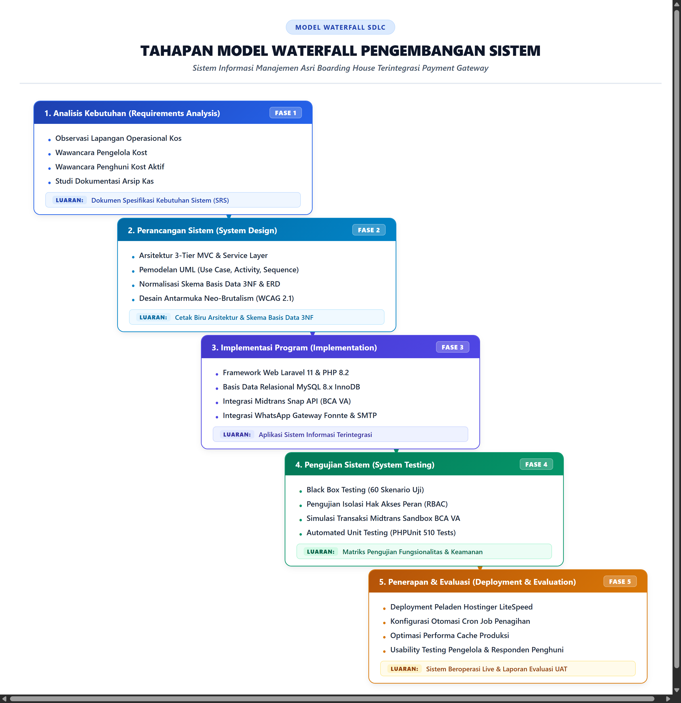

```mermaid
graph TD
    A["<b>1. Analisis Kebutuhan (Requirements Analysis)</b><br/>• Observasi Lapangan Operasional Kos<br/>• Wawancara Pengelola Kost<br/>• Wawancara Penghuni Kost Aktif<br/>• Studi Dokumentasi Arsip Kas<br/><i>Luaran: Dokumen Spesifikasi Kebutuhan Sistem (SRS)</i>"] --> B["<b>2. Perancangan Sistem (System Design)</b><br/>• Arsitektur 3-Tier MVC & Service Layer<br/>• Pemodelan UML (Use Case, Activity, Sequence)<br/>• Normalisasi Skema Basis Data 3NF & ERD<br/>• Desain Antarmuka Neo-Brutalism (WCAG 2.1)<br/><i>Luaran: Cetak Biru Arsitektur & Skema Basis Data 3NF</i>"]
    B --> C["<b>3. Implementasi Program (Implementation)</b><br/>• Framework Web Laravel 11 & PHP 8.2<br/>• Basis Data Relasional MySQL 8.x InnoDB<br/>• Integrasi Midtrans Snap API (BCA VA)<br/>• Integrasi WhatsApp Gateway Fonnte & SMTP<br/><i>Luaran: Aplikasi Sistem Informasi Terintegrasi</i>"]
    C --> D["<b>4. Pengujian Sistem (System Testing)</b><br/>• Black Box Testing (60 Skenario Uji)<br/>• Pengujian Isolasi Hak Akses Peran (RBAC)<br/>• Simulasi Transaksi Midtrans Sandbox BCA VA<br/>• Automated Unit Testing (PHPUnit 510 Tests)<br/><i>Luaran: Matriks Pengujian Fungsionalitas & Keamanan</i>"]
    D --> E["<b>5. Penerapan & Evaluasi (Deployment & Evaluation)</b><br/>• Deployment Peladen Hostinger LiteSpeed<br/>• Konfigurasi Otomasi Cron Job Penagihan<br/>• Optimasi Performa Cache Produksi<br/>• Usability Testing Pengelola & Responden Penghuni<br/><i>Luaran: Sistem Beroperasi Live & Laporan Evaluasi UAT</i>"]

    style A fill:#EFF6FF,stroke:#2563EB,stroke-width:2px,rx:8px,ry:8px
    style B fill:#F0F9FF,stroke:#0284C7,stroke-width:2px,rx:8px,ry:8px
    style C fill:#EEF2FF,stroke:#4F46E5,stroke-width:2px,rx:8px,ry:8px
    style D fill:#ECFDF5,stroke:#059669,stroke-width:2px,rx:8px,ry:8px
    style E fill:#FFFBEB,stroke:#D97706,stroke-width:2px,rx:8px,ry:8px
```

Gambar 3.1 Diagram Model Waterfall Pengembangan Sistem  
Sumber: Rancangan penulis (2026)

Tahapan rekayasa perangkat lunak dilaksanakan melalui lima fase berurutan:
1.	**Analisis Kebutuhan (*Requirements Analysis*)**: Mengidentifikasi seluruh kebutuhan fungsional dan non-fungsional melalui triangulasi data observasi lapangan, wawancara pengelola, masukan mahasiswa, dan telaah arsip fisik. Hasil analisis ini dirumuskan ke dalam dokumen spesifikasi kebutuhan sistem (*Software Requirements Specification*) sebagai acuan baku pengembangan fitur.
2.	**Perancangan Sistem (*System Design*)**: Menerjemahkan kebutuhan bisnis ke dalam cetak biru arsitektur aplikasi *three-tier* MVC yang diperkuat *Service Layer*. Fase ini mencakup pemodelan UML (*use case, activity, flowchart,* dan *sequence diagram*), perancangan skema relasional 3NF dalam ERD 22 tabel berfitur *Virtual Generated Columns*, serta desain antarmuka Neo-Brutalism dengan panduan WCAG 2.1 dengan target sentuh tombol antara 44 hingga 56 piksel.
3.	**Implementasi Program (*Implementation/Coding*)**: Merealisasikan rancangan ke dalam baris kode terstruktur menggunakan framework Laravel 11 pada PHP 8.2, pangkalan data MySQL 8.x InnoDB, serta mengintegrasikan titik akhir API eksternal (Midtrans Snap untuk BCA Virtual Account, Fonnte WhatsApp Gateway, dan surel SMTP).
4.	**Pengujian Sistem (*System Testing*)**: Memverifikasi keandalan fungsional, kalkulasi finansial, dan keamanan sistem melalui 60 skenario uji kotak hitam (*black box testing*), pengujian isolasi hak akses peran (RBAC tiga portal), simulasi transaksi daring Midtrans Sandbox BCA Virtual Account, sertifikasi SSL TLS 1.3 Grade A pada peladen produksi, serta pengujian otomatis PHPUnit (510 *tests passed*, 2.211 *assertions*).
5.	**Penerapan Sistem dan Evaluasi Pengguna (*System Deployment & Usability Evaluation*)**: Menghantarkan sistem ke peladen produksi Hostinger LiteSpeed (`https://asriboardinghouse.weatso.id/`), mengonfigurasi berkas `.htaccess`, mengaktifkan penjadwalan *cron job* peladen setiap satu menit guna mengeksekusi mesin penagihan otomatis, mengoptimasi cache produksi (`config:cache`, `route:cache`, `view:cache`), serta mengevaluasi penerimaan pengguna melalui uji coba tatap muka (*Side-by-Side Usability Testing*) bersama pengelola kos dan wawancara bersama lima mahasiswa penghuni kost aktif.

## 3.4 Kerangka Pemikiran
Kerangka pemikiran penelitian ini memetakan alur rekayasa perangkat lunak R&D secara sistematis. Kerangka ini menghubungkan identifikasi masalah operasional nyata di Asri Boarding House, teknik pengumpulan data empiris, tahapan Waterfall SDLC, luaran sistem terpasang live pada peladen produksi, verifikasi pengujian teknis, evaluasi penerimaan pengguna, hingga tercapainya dampak operasional (*outcome*) yang diharapkan.

Keterkaitan logis antarkomponen dalam kerangka pemikiran diuraikan sebagai berikut:
1.	**Masukan (*Input: Masalah Operasional dan Spesifikasi Kebutuhan*)**: Berangkat dari persoalan operasional nyata di Asri Boarding House: penagihan sewa bulanan manual yang berisiko terlewat, belum adanya peringatan penunggakan yang terstruktur ke nomor kontak orang tua/wali, ancaman pemesanan ganda (*double booking*) akibat ketiadaan sinkronisasi ketersediaan kamar, potensi selisih saldo kas akibat pencatatan nota kertas yang menyita waktu tiga sampai lima hari kerja pembukuan, ketiadaan katalog daring dan formulir reservasi 24 jam bagi calon penyewa luar kota, serta ketiadaan arsip riwayat mutasi digital (*audit trail*). Seluruh kendala tersebut melandasi perumusan spesifikasi kebutuhan sistem.
2.	**Metode Pengumpulan Data (*Data Collection Methods*)**: Triangulasi data empiris melalui empat pilar: (a) observasi langsung atas aktivitas fisik dan administrasi 32 unit kamar; (b) wawancara mendalam bersama pengelola kos senior; (c) wawancara evaluasi bersama lima mahasiswa penghuni kost aktif; serta (d) studi dokumen atas buku kas harian, struktur tarif kamar, dan berkas cetak biru sistem.
3.	**Proses Pengembangan Sistem (*Process: Siklus Hidup Waterfall SDLC*)**: Menjalankan model Waterfall secara disiplin, meliputi analisis kebutuhan, perancangan arsitektur *three-tier* MVC dengan pemodelan UML lengkap dan skema 3NF (ERD 22 tabel), serta implementasi kode menggunakan Laravel 11, MySQL 8.x InnoDB, TailwindCSS Neo-Brutalism, Midtrans Snap API, Fonnte WhatsApp API, dan SMTP surel.
4.	**Keluaran dan Penerapan Sistem (*Output & Live Deployment*)**: Menghasilkan artefak perangkat lunak fungsional seutuhnya, yakni Sistem Informasi Manajemen Kost Terintegrasi *Payment Gateway* pada Asri Boarding House yang diterapkan langsung pada peladen produksi Hostinger LiteSpeed (`https://asriboardinghouse.weatso.id/`). Sistem menyediakan etalase katalog dan modul reservasi mandiri 24 jam bagi calon penyewa, portal mandiri bagi penyewa aktif (untuk invoice berkala dan kuitansi digital instan format A5 via `html2pdf.js`), panel administrator pengawasan hunian dan arus kas seketika, mesin penagihan otomatis (*automated billing engine*) dengan siklus tanggal 1 dan jatuh tempo tanggal 10, aturan denda flat 5% kalender yang idempoten, serta notifikasi WhatsApp dan surel.
5.	**Pengujian dan Evaluasi Sistem (*Testing & Evaluation*)**: Keandalan teknis, efektivitas operasional, dan kepuasan pengguna diuji secara selaras guna menjawab tiga rumusan masalah:
    * *Rancang Bangun dan Verifikasi Fungsionalitas Sistem (Menjawab Rumusan Masalah 1)*: Pengujian kotak hitam (*black box testing*) berbasis 60 butir skenario uji fungsional yang tuntas tanpa catatan kegagalan, pengujian isolasi hak akses peran (RBAC tiga portal) yang menangkal eksploitasi kerentanan IDOR, simulasi transaksi daring Midtrans Sandbox BCA Virtual Account, pengujian keamanan live dengan SSL TLS 1.3 Grade A, serta eksekusi 510 pengujian otomatis PHPUnit (2.211 *assertions*).
    * *Efektivitas Solusi atas Masalah Operasional Kos (Menjawab Rumusan Masalah 2)*: Pembuktian efektivitas sistem dalam mengurai friksi operasional melalui otomatisasi penagihan bulanan tanggal 1 dan denda flat 5% kalender dengan eskalasi ke kontak wali, penjaminan akurasi arus kas tanpa risiko selisih uang (*zero cash variance*) yang memangkas waktu pembukuan dari tiga sampai lima hari kerja menjadi instan, serta peniadaan risiko pemesanan ganda (*zero double-booking*) berkat penguncian baris pesimistik dan prosedur karantina kamar pasca-*checkout*.
    * *Evaluasi Pengguna Pasca-Penerapan (Menjawab Rumusan Masalah 3)*: Evaluasi langsung melalui pengujian tatap muka (*Side-by-Side Usability Testing*) bersama pengelola operasional kos (rekaman audio `REKAMAN_UX_ADMIN_KOST_2026.m4a` durasi 23 menit 14 detik) yang menghasilkan skor kepuasan operasional sebesar 9,5 dari skala 10, serta wawancara evaluasi bersama lima mahasiswa penghuni kost aktif yang mengonfirmasi kemudahan reservasi mandiri, kepraktisan pembayaran digital non-tunai, dan transparansi rincian tagihan berkala.
6.	**Dampak Operasional (*Outcome*)**: Peningkatan kinerja operasional nyata: otomatisasi penerbitan tagihan bulanan dan eskalasi penunggakan ke kontak wali, penjaminan integritas pembukuan kas tanpa risiko selisih (*zero cash variance*), pemangkasan durasi penyusunan laporan laba-rugi dari beberapa hari kerja menjadi seketika dalam hitungan detik, peniadaan mutlak risiko pemesanan ganda (*zero double-booking*) berkat penguncian baris pesimistik dan karantina fisik kamar pasca-*checkout*, serta kemudahan akses pemesanan kamar bagi calon penghuni luar daerah.

Bagan alur kerangka pemikiran penelitian disajikan pada Gambar 3.2.

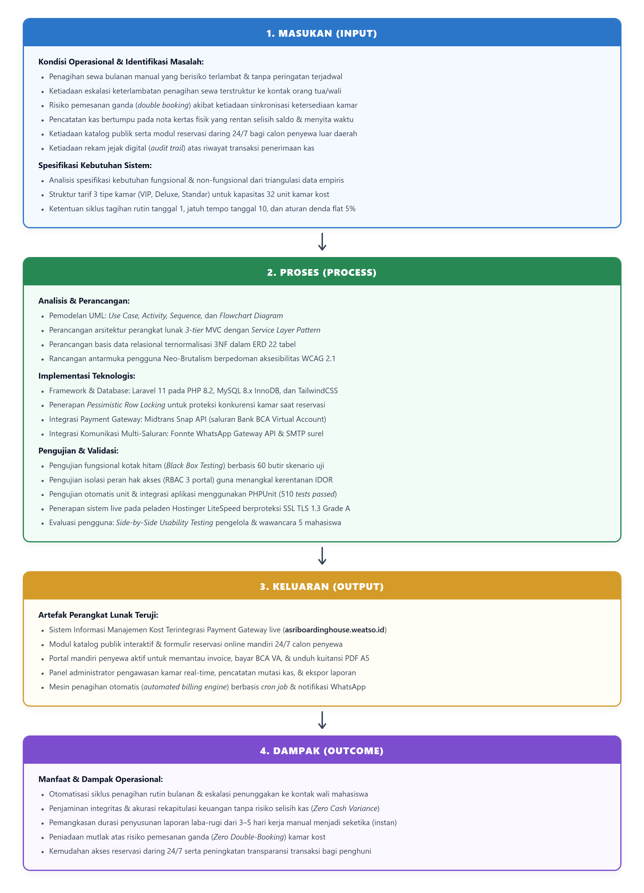

```mermaid
graph TD
    subgraph INPUT ["1. MASUKAN (INPUT)"]
        direction TB
        I1["<b>Kondisi Operasional & Identifikasi Masalah:</b><br/>• Penagihan sewa bulanan manual yang berisiko terlambat & tanpa peringatan terjadwal<br/>• Ketiadaan eskalasi keterlambatan penagihan sewa terstruktur ke kontak orang tua/wali<br/>• Risiko pemesanan ganda (double booking) akibat ketiadaan sinkronisasi kamar<br/>• Pencatatan kas bertumpu pada nota kertas fisik yang rentan selisih saldo kas<br/>• Ketiadaan katalog publik serta modul reservasi daring 24/7 bagi calon penyewa<br/>• Ketiadaan rekam jejak digital (audit trail) atas riwayat transaksi penerimaan kas"]
        I2["<b>Spesifikasi Kebutuhan Sistem:</b><br/>• Analisis kebutuhan fungsional & non-fungsional dari triangulasi data empiris<br/>• Struktur tarif 3 tipe kamar (VIP, Deluxe, Standar) untuk kapasitas 32 unit kamar<br/>• Ketentuan siklus tagihan rutin tanggal 1, jatuh tempo tanggal 10, dan aturan denda flat 5%"]
        I1 --- I2
    end

    subgraph PROCESS ["2. PROSES (PROCESS)"]
        direction TB
        P1["<b>Analisis & Perancangan:</b><br/>• Pemodelan UML: Use Case, Activity, Sequence, & Flowchart Diagram<br/>• Perancangan arsitektur perangkat lunak 3-tier MVC dengan Service Layer Pattern<br/>• Perancangan basis data relasional ternormalisasi 3NF dalam ERD 22 tabel<br/>• Rancangan antarmuka Neo-Brutalism berpedoman aksesibilitas WCAG 2.1"]
        P2["<b>Implementasi Teknologis:</b><br/>• Framework & Database: Laravel 11 pada PHP 8.2, MySQL 8.x InnoDB, dan TailwindCSS<br/>• Penerapan Pessimistic Row Locking untuk proteksi konkurensi kamar saat reservasi<br/>• Integrasi Payment Gateway: Midtrans Snap API (saluran Bank BCA Virtual Account)<br/>• Integrasi Komunikasi Multi-Saluran: Fonnte WhatsApp Gateway API & SMTP surel"]
        P3["<b>Pengujian & Validasi:</b><br/>• Pengujian fungsional kotak hitam (Black Box Testing) berbasis 60 butir skenario uji<br/>• Pengujian isolasi peran hak akses (RBAC 3 portal) guna menangkal kerentanan IDOR<br/>• Pengujian otomatis unit & integrasi aplikasi menggunakan PHPUnit (510 tests passed)<br/>• Penerapan sistem live pada peladen Hostinger LiteSpeed berproteksi SSL TLS 1.3 Grade A<br/>• Evaluasi pengguna: Side-by-Side Usability Testing pengelola & wawancara 5 mahasiswa"]
        P1 --- P2 --- P3
    end

    subgraph OUTPUT ["3. KELUARAN (OUTPUT)"]
        direction TB
        O1["<b>Artefak Perangkat Lunak Teruji:</b><br/>• Sistem Informasi Manajemen Kost Terintegrasi Payment Gateway live (asriboardinghouse.weatso.id)<br/>• Modul katalog publik interaktif & formulir reservasi online mandiri 24/7 calon penyewa<br/>• Portal mandiri penyewa aktif untuk memantau invoice, bayar BCA VA, & unduh kuitansi PDF A5<br/>• Panel administrator pengawasan kamar real-time, pencatatan mutasi kas, & ekspor laporan<br/>• Mesin penagihan otomatis (automated billing engine) berbasis cron job & notifikasi WhatsApp"]
    end

    subgraph OUTCOME ["4. DAMPAK (OUTCOME)"]
        direction TB
        D1["<b>Manfaat & Dampak Operasional:</b><br/>• Otomatisasi siklus penagihan rutin bulanan & eskalasi penunggakan ke kontak wali mahasiswa<br/>• Penjaminan integritas & akurasi rekapitulasi keuangan tanpa risiko selisih kas (Zero Cash Variance)<br/>• Pemangkasan durasi penyusunan laporan laba-rugi dari tiga sampai lima hari kerja manual menjadi seketika (instan)<br/>• Peniadaan mutlak atas risiko pemesanan ganda (Zero Double-Booking) kamar kost<br/>• Kemudahan akses reservasi daring 24/7 serta peningkatan transparansi transaksi bagi penghuni"]
    end

    INPUT --> PROCESS
    PROCESS --> OUTPUT
    OUTPUT --> OUTCOME

    style INPUT fill:#F0F7FF,stroke:#2B76C9,stroke-width:2px,rx:8px,ry:8px
    style PROCESS fill:#EFFAF3,stroke:#278853,stroke-width:2px,rx:8px,ry:8px
    style OUTPUT fill:#FFFDF2,stroke:#D49B28,stroke-width:2px,rx:8px,ry:8px
    style OUTCOME fill:#FAF6FF,stroke:#7C4DCF,stroke-width:2px,rx:8px,ry:8px

    style I1 fill:#FFFFFF,stroke:#93C5FD,stroke-width:1px
    style I2 fill:#FFFFFF,stroke:#93C5FD,stroke-width:1px
    style P1 fill:#FFFFFF,stroke:#86EFAC,stroke-width:1px
    style P2 fill:#FFFFFF,stroke:#86EFAC,stroke-width:1px
    style P3 fill:#FFFFFF,stroke:#86EFAC,stroke-width:1px
    style O1 fill:#FFFFFF,stroke:#FDE047,stroke-width:1px
    style D1 fill:#FFFFFF,stroke:#E9D5FF,stroke-width:1px
```

Gambar 3.2 Kerangka Pemikiran Penelitian  
Sumber: Rancangan penulis (2026)

<div style="page-break-after: always;"></div>

<div align="center">

## BAB 4<br>HASIL DAN PEMBAHASAN

</div>

## 4.1 Perancangan Sistem
Tahap perancangan sistem menerjemahkan hasil analisis kebutuhan fungsional dan data operasional lapangan ke dalam arsitektur rekayasa perangkat lunak yang terstruktur. Pemodelan sistem disusun mengacu pada standar *Unified Modeling Language* (UML 2.5)—meliputi *Use Case Diagram*, *Activity Diagram*, *Flowchart Diagram*, dan *Sequence Diagram*—serta pemodelan relasi data menggunakan *Entity Relationship Diagram* (ERD). Agar alur logika yang kompleks tetap mudah ditelaah dan terbebas dari distorsi visual saat dibaca maupun dicetak, diagram yang memuat banyak percabangan disajikan secara modular ke dalam subdiagram beresolusi tinggi (format PNG 24-bit tanpa kompresi *lossy*) dengan aspek rasio proporsional, serta dilengkapi penomoran resmi, judul, sumber data, dan deskripsi fungsional yang rinci.

### 4.1.1 Use Case Diagram
Sistem Informasi Manajemen Asri Boarding House membedakan hak akses dan wewenang operasional pengguna secara tegas melalui tiga portal autentikasi terisolasi (`/admin/login`, `/reservasi/login`, dan `/penyewa/login`). Pendekatan ini menegakkan prinsip *Role-Based Access Control* (RBAC) guna mencegah potensi eskalasi hak akses (*privilege escalation*). Peran dan wewenang pengguna diklasifikasikan ke dalam empat entitas aktor:
1. **Penyewa Aktif**: Penghuni yang kontrak sewanya telah disetujui dan diaktifkan oleh pengelola. Penyewa aktif memiliki hak akses ke portal mandiri internal untuk memantau masa tinggal aktif, meninjau rincian tagihan sewa berkala beserta status jatuh tempo kalender seragam (tanggal 10), melunasi kewajiban sewa secara non-tunai melalui Midtrans Snap (Bank BCA Virtual Account), mengunduh kuitansi digital resmi format A5 berstempel digital secara mandiri, menyampaikan pengaduan keluhan kerusakan sarana kamar disertai bukti foto fisik, meninjau tata tertib hunian, serta mereset kata sandi akun secara mandiri melalui surel terenkripsi SMTP.
2. **Tamu (*Guest*)**: Pengunjung umum yang mengakses landing page publik untuk memperoleh informasi seputar kos, menjelajahi etalase 32 unit kamar lengkap dengan rincian fasilitas dan video *room tour*, memanfaatkan kalkulator harga sewa lintas periode (harian, mingguan, bulanan), menggunakan tombol tindakan WhatsApp melayang, serta memulai percakapan langsung dengan administrator melalui *Floating Guest Live Chat* tanpa kewajiban mendaftarkan akun. Sesi obrolan tamu dipersistensikan secara aman pada *cookie* dan penyimpanan lokal peramban (*localStorage*) menggunakan token sesi berenkripsi SHA-256.
3. **Calon Penyewa**: Pengguna terdaftar yang masuk melalui formulir registrasi mandiri maupun integrasi Google OAuth 2.0 (*Laravel Socialite*). Calon penyewa dapat memilih unit kamar kosong, melengkapi verifikasi nomor kontak WhatsApp, mengisi biodata kependudukan (NIK 16 digit) dan kontak penjamin/wali melalui *stepper* alur reservasi 5 tahap, memilih opsi pembayaran (Uang Muka DP 30% atau Lunas 100%), menuntaskan transaksi daring melalui Midtrans Snap (Bank BCA Virtual Account), memantau kemajuan verifikasi, serta berdiskusi dengan pengelola via kanal obrolan pra-pembayaran yang aktif selama status pemesanan masih *pending*.
4. **Administrator**: Pengelola operasional (penjaga kost) yang memegang kewenangan penuh dalam tata kelola hunian: memantau dasbor statistik dan tiga kartu ringkasan keuangan real-time, mengelola master data kamar dan sarana prasarana (CRUD dengan proteksi integritas relasi), melayani pendaftaran penyewa baru yang datang langsung (*walk-in*), mengonfirmasi pembayaran tunai, memvalidasi reservasi daring, memantau otomasi penagihan dan penerapan denda kalender 5%, menindaklanjuti keluhan fasilitas, menyiarkan pengumuman massal (*broadcast*), mengontrol jadwal okupansi melalui Kalender Visual (UC-19), serta mencetak laporan laba bersih ke format PDF resmi maupun lembar kerja Excel/CSV ber-encoding BOM UTF-8.

Guna mempertahankan keterbacaan teks dan ketajaman simbol diagram pada Microsoft Word, Use Case Diagram disajikan ke dalam tiga diagram modular berorientasi horizontal:

#### 1. Use Case Diagram Modul Penyewa Aktif
Visualisasi interaksi fungsional penghuni kos aktif dengan modul internal disajikan pada Gambar 4.1 (a).

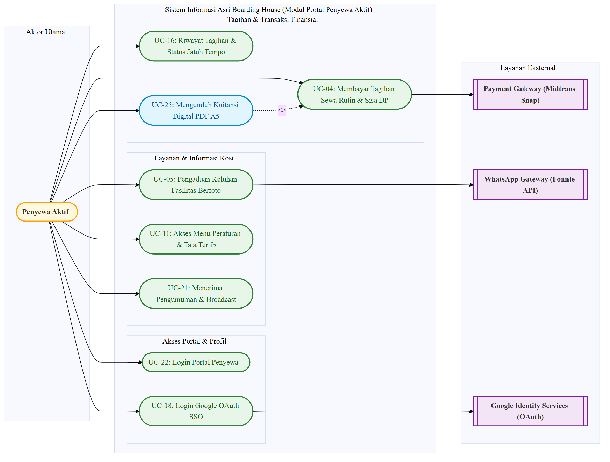

*Gambar 4.1 (a) Use Case Diagram Modul Penyewa Aktif*  
*Sumber: Hasil pemodelan UML penulis (2026)*

**Deskripsi Fungsional Gambar 4.1 (a)**:
Diagram Use Case Modul Penyewa Aktif memodelkan 7 (tujuh) kasus penggunaan inti yang berpusat pada pemenuhan kebutuhan penghuni kos selama masa tinggal berlangsung:
* **Kluster Akses Portal & Profil**: Penyewa dapat masuk ke portal mandiri melalui autentikasi kredensial lokal (`UC-22`) maupun *Single Sign-On* Google OAuth 2.0 (`UC-18`). Integrasi Google Identity Services menjamin kemudahan akses tanpa mengharuskan pengguna mengingat kombinasi kata sandi baru.
* **Kluster Tagihan & Transaksi Finansial**: Penyewa memantau riwayat seluruh invoice sewa bulanan dan sisa pelunasan uang muka (`UC-16`). Eksekusi pembayaran tagihan (`UC-04`) terhubung langsung ke antarmuka pop-up *Midtrans Snap API*, memungkinkan transaksi non-tunai melalui saluran Bank BCA Virtual Account. Begitu transaksi berstatus *settlement*, relasi `<<extend>>` memicu ketersediaan fungsi `UC-25` (*Mengunduh Kuitansi PDF*), di mana dokumen kuitansi resmi format A5 berstempel digital dikompilasi secara instan di peramban klien via pustaka `html2pdf.js` tanpa membebani penyimpanan peladen.
* **Kluster Layanan & Informasi Hunian**: Meliputi penyampaian tiket keluhan fasilitas kamar (`UC-05`) yang dilengkapi unggah foto bukti kerusakan fisik berkapasitas hingga 2 MB dan terhubung ke *Fonnte WhatsApp API* untuk notifikasi instan ke pengelola; peninjauan tata tertib kos dinamis (`UC-11`); serta penerimaan pengumuman darurat atau operasional (`UC-21`).

---

#### 2. Use Case Diagram Modul Tamu (*Guest*)
Visualisasi interaksi pengunjung umum pada antarmuka publik disajikan pada Gambar 4.1 (b).

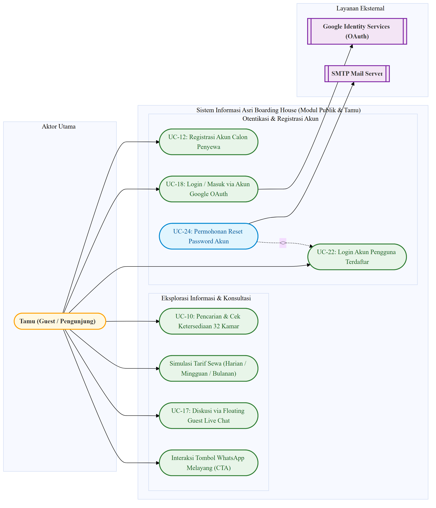

*Gambar 4.1 (b) Use Case Diagram Modul Tamu (Guest)*  
*Sumber: Hasil pemodelan UML penulis (2026)*

**Deskripsi Fungsional Gambar 4.1 (b)**:
Diagram Use Case Modul Tamu memodelkan 8 (delapan) kasus penggunaan yang menitikberatkan pada kemudahan eksplorasi informasi publik, transparansi tarif, dan komunikasi pra-transaksi tanpa hambatan registrasi:
* **Kluster Eksplorasi Publik & Konsultasi**: Tamu dapat menelusuri katalog 32 unit kamar beserta rincian fasilitas kasur springbed, AC, kamar mandi dalam, dan video *room tour* (`UC-10`). Disediakan modul kalkulator interaktif (`UC-10_Calc`) untuk mensimulasikan estimasi tarif sewa lintas periode (harian, mingguan, dan bulanan berdiskon). Tamu dapat langsung berkonsultasi dengan pengelola kos melalui *Floating Guest Live Chat* (`UC-17`) tanpa login, di mana identitas sesi diproteksi oleh token acak berenkripsi SHA-256 pada *cookie* peramban. Selain itu, tombol aksi mengambang WhatsApp (*Floating Action CTA*) berdiameter 56 px disematkan pada sudut kanan bawah guna memfasilitasi komunikasi instan satu kali klik sesuai standar aksesibilitas WCAG 2.1.
* **Kluster Otentikasi & Pendaftaran Akun**: Tamu yang berminat menyewa kamar dapat mendaftarkan akun baru secara mandiri melalui formulir registrasi (`UC-12`) atau menggunakan mekanisme otentikasi cepat Google OAuth 2.0 (`UC-18`). Bagi pengguna terdaftar, disediakan pintu masuk login manual (`UC-22`) yang terhubung dengan relasi `<<extend>>` ke modul pemulihan kata sandi (`UC-24`), di mana tautan token reset sandi dikirimkan secara otomatis via *SMTP Mail Server*.

---

#### 3. Use Case Diagram Modul Calon Penyewa
Visualisasi interaksi pemesanan kamar dan transaksi uang muka oleh calon penghuni disajikan pada Gambar 4.1 (c).

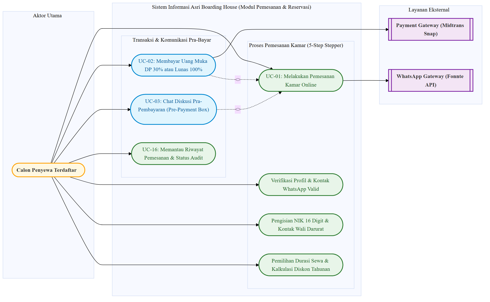

*Gambar 4.1 (c) Use Case Diagram Modul Calon Penyewa*  
*Sumber: Hasil pemodelan UML penulis (2026)*

**Deskripsi Fungsional Gambar 4.1 (c)**:
Diagram Use Case Modul Calon Penyewa memodelkan 7 (tujuh) fungsi terintegrasi yang memandu alur pemesanan kamar secara aman, transparan, dan terstruktur:
* **Kluster Pemesanan Kamar Bertahap (*5-Step Stepper*)**: Calon penyewa yang telah login diarahkan ke ruang kerja pemesanan (`UC-01`). Sistem memvalidasi kelengkapan profil kontak WhatsApp (`UC_Prof`) melalui middleware `EnsureProfileIsComplete`, mewajibkan input NIK 16 digit dan nomor kontak wali/penjamin darurat (`UC_Data`), serta mengalkulasi total tarif berdasarkan durasi sewa dengan diskon otomatis untuk skema kontrak tahunan (`UC_Durasi`).
* **Kluster Transaksi & Komunikasi Pra-Bayar**: Terhubung melalui relasi `<<extend>>` ke alur utama `UC-01`, meliputi pemilihan skema pembayaran (`UC-02`: Uang Muka DP 30% atau Lunas 100%) yang diproses melalui *Midtrans Snap API*, serta kanal komunikasi interaktif *Pre-Payment Chat Box* (`UC-03`) yang memungkinkan calon penyewa bertanya seputar perlengkapan kamar kepada pengelola selama status pesanan berstatus *pending*. Terakhir, calon penyewa dapat memantau status persetujuan berkas identitas oleh administrator secara real-time (`UC-16_C`).

---

### 4.1.2 Activity Diagram
Activity diagram memetakan alur kerja dinamis dari tiga proses operasional pokok pada sistem Asri Boarding House. Guna mempertahankan keterbacaan teks dan memisahkan alur logika secara berimbang, masing-masing proses dipecah menjadi **2 (dua) kluster diagram beresolusi tinggi** yang membagi tahap inisiasi komputasi dari tahap eksekusi dan komunikasi:

#### 1. Mesin Penagihan Otomatis (*Auto-Billing Engine*)
Mesin penagihan massal dieksekusi secara otomatis oleh penjadwal tugas peladen (*Hostinger Cron Job*) setiap tanggal 1 awal bulan pukul 00:05 WIB. Alur kerjanya dipecah menjadi dua bagian:

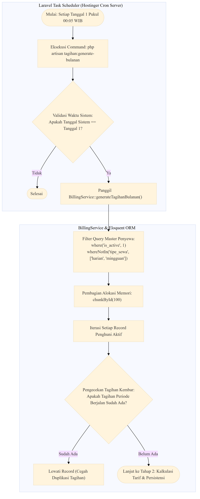  
*(a1) Mesin Penagihan Otomatis — Bagian 1: Inisiasi Penjadwalan & Penapisan Data Penyewa Aktif*  
*Sumber: Hasil pemodelan UML penulis (2026)*

**Deskripsi Fungsional Gambar 4.2 (a1)**:
Diagram Bagian 1 memodelkan inisiasi tugas latar belakang yang dipicu oleh cron server pada tanggal 1 pukul 00:05 WIB melalui instruksi `php artisan tagihan:generate-bulanan`. Penjadwal tugas memvalidasi bahwa waktu sistem bertepatan dengan tanggal 1. Lapisan `BillingService` kemudian mengeksekusi kueri penapisan pada tabel `penyewa` dengan klausul `is_active = 1` serta mengecualikan penyewa harian dan mingguan via `whereNotIn('tipe_sewa', ['harian', 'mingguan'])`. Untuk mencegah peladen mengalami kehabisan alokasi memori (*memory exhaustion*), data diproses secara bertahap menggunakan teknik *chunking* (`chunkById(100)`). Pada setiap iterasi data penghuni, sistem melakukan evaluasi idempotensi untuk memastikan tidak ada baris tagihan kembar yang pernah diterbitkan pada periode bulan dan tahun kalender berjalan.

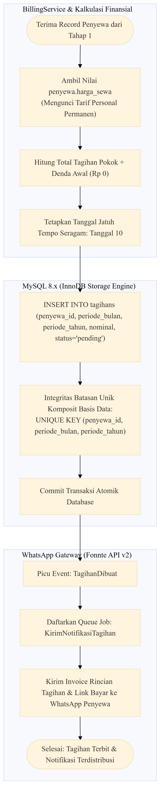  
*(a2) Mesin Penagihan Otomatis — Bagian 2: Kalkulasi Tarif Personal, Persistensi Tagihan & Siaran Invoice WhatsApp*  
*Sumber: Hasil pemodelan UML penulis (2026)*

**Deskripsi Fungsional Gambar 4.2 (a2)**:
Diagram Bagian 2 memodelkan persistensi finansial dan distribusi notifikasi tagihan. Sistem mengambil nilai tarif personal yang terkunci dari kolom `penyewa.harga_sewa`, menetapkan tanggal jatuh tempo seragam pada tanggal 10 bulan berjalan, dan menyisipkan baris tagihan baru berstatus *pending* ke dalam tabel `tagihan`. Integritas referensial dan ketiadaan duplikasi dijamin pada lapisan basis data MySQL 8.x InnoDB melalui *composite unique index* atas kombinasi kolom `(penyewa_id, periode_bulan, periode_tahun)`. Setelah transaksi basis data di-commit, sistem memicu event `TagihanDibuat` yang mendaftarkan pekerjaan antrean (*queue job*) ke *Fonnte WhatsApp API Gateway* untuk menyiarkan rincian invoice sewa beserta tautan pembayaran langsung ke ponsel pintar masing-masing penghuni.

---

#### 2. Denda Keterlambatan Flat Kalender (*Flat Calendar Late Fee*)
Penegakan disiplin pembayaran dievaluasi setiap hari pukul 01:00 WIB oleh scheduler peladen. Alur logikanya dipecah menjadi dua bagian:

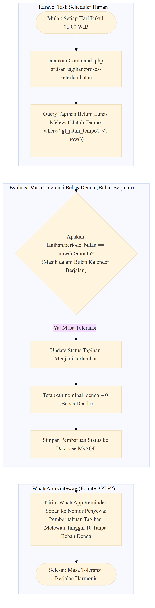  
*(b1) Denda Keterlambatan — Bagian 1: Evaluasi Jatuh Tempo & Masa Toleransi Bebas Denda (Bulan Berjalan)*  
*Sumber: Hasil pemodelan UML penulis (2026)*

**Deskripsi Fungsional Gambar 4.2 (b1)**:
Diagram Bagian 1 memodelkan penapisan harian terhadap tagihan sewa berstatus *pending* yang melewati tanggal jatuh tempo 10 (`tgl_jatuh_tempo < now()`). Diagram memvisualisasikan penegakan kebijakan toleransi manusiawi (*grace period*): selama waktu sistem masih berada dalam bulan kalender berjalan (tanggal 11 hingga hari terakhir bulan tersebut), status tagihan diperbarui menjadi *terlambat*, namun besaran sanksi denda dipatok tetap Rp0 (`nominal_denda = 0`). Bersamaan dengan pembaruan status, Fonnte WhatsApp Gateway menyalurkan pesan pengingat ramah (*polite reminder*) ke nomor penyewa tanpa mengenakan beban finansial tambahan.

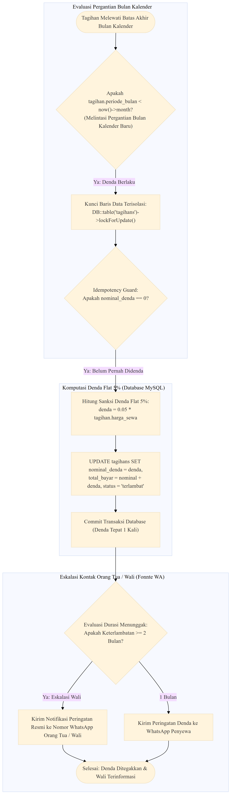  
*(b2) Denda Keterlambatan — Bagian 2: Deteksi Pergantian Bulan Kalender, Penegakan Denda Flat 5% & Eskalasi Wali*  
*Sumber: Hasil pemodelan UML penulis (2026)*

**Deskripsi Fungsional Gambar 4.2 (b2)**:
Diagram Bagian 2 memodelkan penegakan sanksi tegas saat kewajiban sewa melintasi batas pergantian bulan kalender (`tagihan.periode_bulan < now()->month`). Sistem mengunci baris data secara eksklusif menggunakan metode `lockForUpdate()` di dalam transaksi atomik. Mekanisme *Idempotency Guard* mengevaluasi apakah denda telah pernah dibebankan sebelumnya (`nominal_denda == 0`). Jika bernilai nol, sistem membebankan sanksi denda flat sebesar 5% dari tarif sewa pokok tepat satu kali (tidak berbunga harian). Apabila tunggakan telah memasuki bulan kedua ($\ge 2$ bulan), sistem secara otomatis mengeksekusi aturan eskalasi dengan mengirimkan notifikasi penunggakan resmi ke nomor WhatsApp orang tua/wali penyewa.

---

#### 3. Transisi Reservasi Menjadi Penyewa Aktif (*Reservation-to-Tenant Transition*)
Pengesahan pemesanan kamar daring menjadi kontrak sewa resmi dipecah menjadi dua bagian:

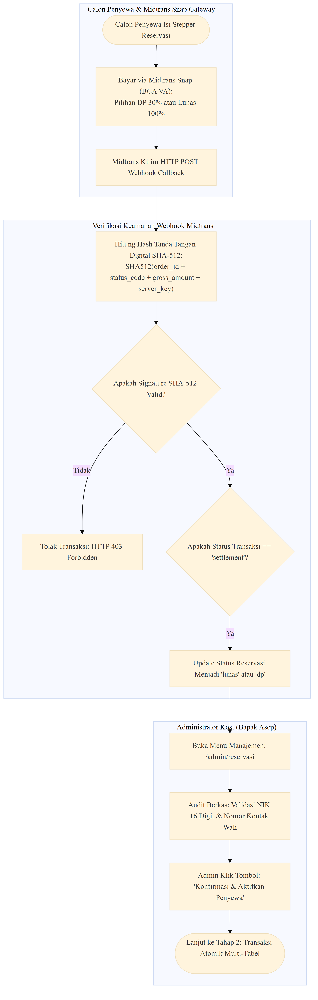  
*(c1) Transisi Reservasi — Bagian 1: Verifikasi Berkas Identitas & Validasi Pembayaran*  
*Sumber: Hasil pemodelan UML penulis (2026)*

**Deskripsi Fungsional Gambar 4.2 (c1)**:
Diagram Bagian 1 memodelkan tahap verifikasi pembayaran dan audit dokumen. Calon penyewa menyelesaikan pembayaran Uang Muka DP 30% atau Lunas 100% via pop-up Midtrans Snap saluran BCA Virtual Account. Peladen Midtrans mengirimkan notifikasi *webhook HTTP POST*. Sistem memvalidasi tanda tangan digital SHA-512 dari gabungan kunci rahasia peladen. Jika terkonfirmasi sah (`settlement`), status reservasi diperbarui menjadi `lunas` atau `dp`. Pengelola kos membuka panel kendali `/admin/reservasi`, mengaudit NIK 16 digit dan nomor kontak wali, lalu menekan tombol konfirmasi untuk menyetujui kontrak.

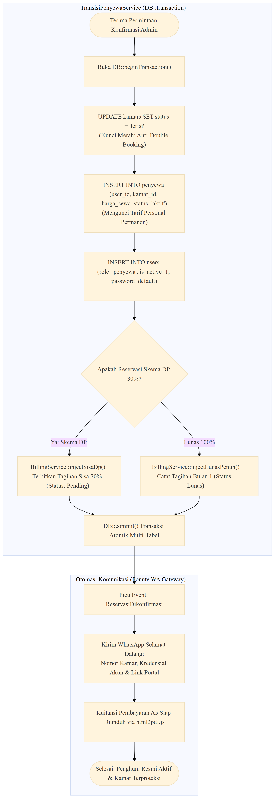  
*(c2) Transisi Reservasi — Bagian 2: Transaksi Atomik Multi-Tabel, Penguncian Kamar & Kredensial Akun*  
*Sumber: Hasil pemodelan UML penulis (2026)*

**Deskripsi Fungsional Gambar 4.2 (c2)**:
Diagram Bagian 2 memodelkan eksekusi multi-tabel terisolasi `DB::transaction` oleh `TransisiPenyewaService`. Sistem memperbarui status reservasi menjadi `dikonfirmasi`, mengunci status fisik unit kamar pada tabel `kamar` menjadi `terisi` (mencegah pemesanan ganda), menyalin harga kamar ke atribut `penyewa.harga_sewa` sebagai tarif personal permanen, membuat akun login aktif pada tabel `users`, serta menerbitkan tagihan pelunasan sisa 70% (jika skema pembayaran awal berupa DP 30%). Setelah transaksi basis data berhasil di-commit, event `ReservasiDikonfirmasi` memicu Fonnte API untuk mengirimkan pesan selamat datang beserta kredensial akun bawaan ke nomor WhatsApp penghuni baru, dan dokumen kuitansi digital resmi format A5 siap diunduh.

---

### 4.1.3 Flowchart Sistem
Flowchart diagram memodelkan struktur logika algoritmik dari alur pemrosesan data secara deterministik. Guna menjamin kejelasan simbol terminator, masukan/keluaran data, proses komputasi, dan percabangan kondisi, masing-masing algoritma dipecah menjadi **2 (dua) kluster diagram beresolusi tinggi**:

#### 1. Algoritma Mesin Penagihan Otomatis Massal
Logika penerbitan invoice berkala dipecah menjadi tahap penapisan kueri dan tahap komputasi persistensi:

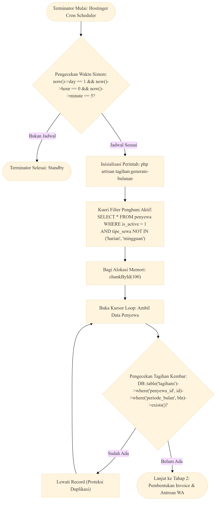  
*(a1) Flowchart Algoritma Billing Massal — Bagian 1: Penapisan Kueri & Pembagian Alokasi Memori (Chunking)*  
*Sumber: Hasil analisis algoritma sistem penulis (2026)*

**Deskripsi Fungsional Gambar 4.3 (a1)**:
Diagram Bagian 1 memetakan alur kontrol awal pada berkas `GenerateMonthlyInvoices.php`. Pemicu cron server memverifikasi kecocokan tanggal 1. Sistem membuka kursor kueri `penyewa` aktif non-harian/mingguan dengan teknik pembagian beban *chunking* 100 baris per iterasi guna menjaga stabilitas alokasi memori peladen. Pada setiap record penyewa, algoritma memeriksa keberadaan rekaman tagihan kembar pada bulan dan tahun kalender berjalan. Jika sudah ada, sistem melompati record tersebut guna mencegah duplikasi tagihan; jika belum ada, sistem mengalirkan data ke tahap komputasi invoice.

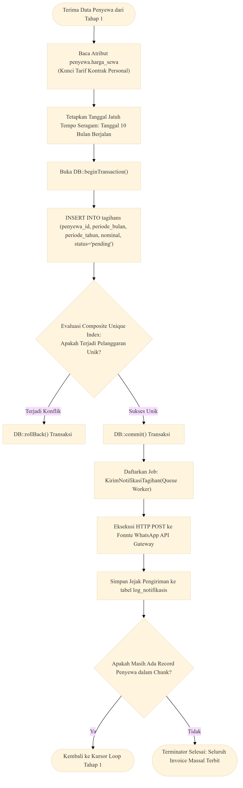  
*(a2) Flowchart Algoritma Billing Massal — Bagian 2: Komputasi Tagihan, Proteksi Indeks Unik & Antrean Notifikasi WA*  
*Sumber: Hasil analisis algoritma sistem penulis (2026)*

**Deskripsi Fungsional Gambar 4.3 (a2)**:
Diagram Bagian 2 memodelkan pembentukan tagihan baru. Sistem mengambil atribut tarif kontrak personal `penyewa.harga_sewa`, menetapkan tanggal jatuh tempo seragam tanggal 10, dan membuka transaksi `DB::beginTransaction()`. Sistem menyisipkan baris tagihan berstatus `pending` ke tabel `tagihan`. Keberhasilan penyimpanan divalidasi oleh batasan indeks unik komposit; jika terjadi anomali, sistem menjalankan *rollback*, sedangkan jika berhasil, transaksi di-commit. Terakhir, sistem mendaftarkan tugas pengiriman pesan WhatsApp invoice ke antrean peladen (*queue worker*) yang dieksekusi secara asinkron ke penyedia layanan Fonnte API.

---

#### 2. Algoritma Evaluasi Denda Keterlambatan Flat Kalender
Logika penegakan sanksi denda sewa dipecah menjadi fase masa toleransi dan fase penegakan denda kalender:

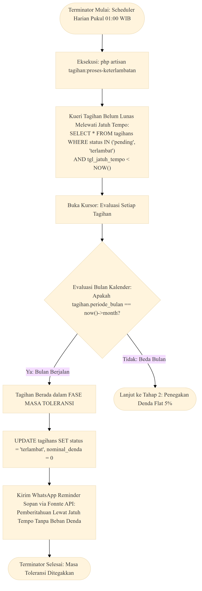  
*(b1) Flowchart Algoritma Denda Kalender — Bagian 1: Penapisan Tagihan Jatuh Tempo & Masa Toleransi Denda Rp0*  
*Sumber: Hasil analisis algoritma sistem penulis (2026)*

**Deskripsi Fungsional Gambar 4.3 (b1)**:
Diagram Bagian 1 memodelkan penapisan tagihan pada berkas `ApplyLatePenalties.php`. Scheduler harian menyaring tagihan sewa berstatus `pending` yang tanggal jatuh temponya telah terlampaui (`tgl_jatuh_tempo < now()`). Algoritma memeriksa apakah bulan kalender tagihan sama dengan bulan kalender sistem berjalan (`periode_bulan == now()->month`). Jika sama, sistem menegakkan kebijakan masa toleransi: status diubah menjadi `terlambat`, denda dipatok Rp0, dan sistem menyalurkan pengingat ramah via Fonnte WhatsApp API tanpa membebani keuangan mahasiswa.

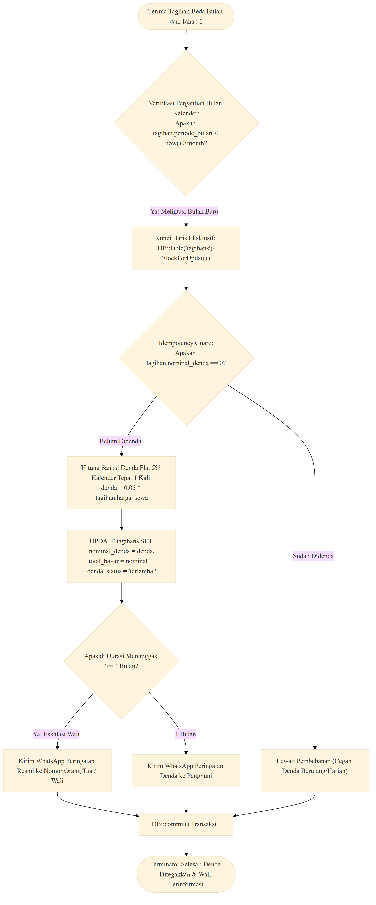  
*(b2) Flowchart Algoritma Denda Kalender — Bagian 2: Deteksi Pergantian Bulan Kalender, Komputasi Denda 5% & Eskalasi Wali*  
*Sumber: Hasil analisis algoritma sistem penulis (2026)*

**Deskripsi Fungsional Gambar 4.3 (b2)**:
Diagram Bagian 2 memodelkan penegakan denda ketika tagihan berasal dari bulan kalender terdahulu (`periode_bulan < now()->month`). Sistem mengunci baris data dengan `lockForUpdate()`. Algoritma memeriksa batasan idempotensi (`nominal_denda == 0`). Jika bernilai nol, sistem mengkalkulasi sanksi denda flat sebesar $5\% \times \text{harga\_sewa}$, menjumlahkannya ke total kewajiban bayar, dan memperbarui status tagihan. Jika penunggakan telah mencapai $\ge 2$ bulan, sistem menyalurkan notifikasi eskalasi resmi ke kontak nomor telepon orang tua/wali penyewa sebelum melakukan *commit* basis data.

---

#### 3. Algoritma Transisi Reservasi dan Validasi Webhook Midtrans
Logika transaksi pemesanan daring dipecah menjadi tahap verifikasi keamanan webhook dan tahap audit aktivasi:

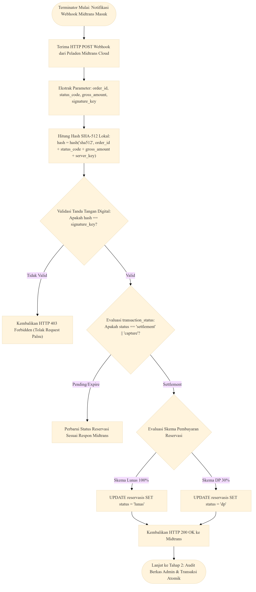  
*(c1) Flowchart Transisi Reservasi — Bagian 1: Verifikasi Webhook Asinkron & Autentikasi Tanda Tangan SHA-512*  
*Sumber: Hasil analisis algoritma sistem penulis (2026)*

**Deskripsi Fungsional Gambar 4.3 (c1)**:
Diagram Bagian 1 memodelkan penanganan notifikasi pembayaran dari gerbang pembayaran Midtrans Snap. Sistem menerima payload HTTP POST, mengekstrak parameter transaksi, dan menghitung nilai hash SHA-512 lokal berlandaskan Server Key rahasia. Jika tanda tangan digital tidak cocok, sistem menolak permintaan dengan respon HTTP 403 Forbidden guna mengantisipasi manipulasi data finansial. Jika cocok dan status transaksi bernilai `settlement`, status reservasi diperbarui menjadi `lunas` (skema 100%) atau `dp` (skema uang muka 30%), lalu mengembalikan respon HTTP 200 OK ke peladen Midtrans.

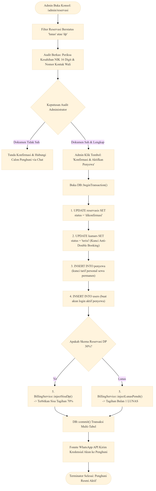  
*(c2) Flowchart Transisi Reservasi — Bagian 2: Alur Keputusan Audit Berkas Administrator & Eksekusi Transaksi Atomik*  
*Sumber: Hasil analisis algoritma sistem penulis (2026)*

**Deskripsi Fungsional Gambar 4.3 (c2)**:
Diagram Bagian 2 memodelkan alur keputusan administrator saat mengaudit berkas reservasi. Administrator memverifikasi keabsahan NIK 16 digit dan nomor kontak wali. Jika dokumen valid, administrator mengonfirmasi aktivasi. Layanan `TransisiPenyewaService` membuka `DB::beginTransaction()` untuk mengeksekusi lima operasi simultan: mengunci kamar `terisi`, menyalin tarif sewa personal, membuat akun login pengguna, menerbitkan sisa tagihan DP (jika ada), serta menyiarkan kredensial akun bawaan ke nomor WhatsApp penghuni.

---

### 4.1.4 Sequence Diagram
Sequence diagram menggambarkan interaksi antarkomponen perangkat lunak berbasis sumbu waktu—meliputi Aktor Pengguna, Peramban Klien, Lapisan Pengontrol Rute (*Controllers*), Lapisan Layanan (*Service Layer*), Basis Data MySQL 8.x InnoDB, serta API Pihak Ketiga (Midtrans Snap dan Fonnte WhatsApp API). Seluruh diagram disajikan dalam resolusi horizontal tinggi 2352 piksel yang terbagi ke dalam **2 (dua) kluster diagram beresolusi tinggi** pada masing-masing topik:

#### 1. Alur Reservasi Daring dan Pembayaran Midtrans Snap
Interaksi pemesanan kamar dan transaksi virtual account dipecah menjadi dua bagian:

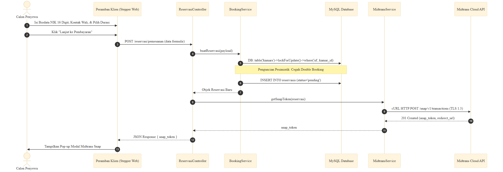  
*(a1) Sequence Diagram Reservasi Daring — Bagian 1: Pengajuan Pemesanan Kamar & Pembangkitan Snap Token*  
*Sumber: Hasil pemodelan UML penulis (2026)*

**Deskripsi Fungsional Gambar 4.4 (a1)**:
Diagram Bagian 1 menggambarkan interaksi awal antara Calon Penyewa, Peramban Klien, `ReservasiController`, `BookingService`, MySQL InnoDB, `MidtransService`, dan Peladen Cloud Midtrans Snap. Calon penyewa mengisi biodata NIK 16 digit, kontak wali, dan memilih durasi sewa melalui stepper web. Pengontrol memanggil `BookingService::buatReservasi`. Sistem mengunci unit kamar terpilih secara pesimistik menggunakan kueri `lockForUpdate()` guna meniadakan risiko perselisihan data (*race condition*) antar-pemesan, lalu menyisipkan baris reservasi berstatus *pending*. Peramban klien meminta *Snap Token* ke endpoint internal. `MidtransService` mengirimkan permintaan cURL TLS 1.3 ke peladen Midtrans, menerima respon token transaksi, dan menampilkan jendela modal pop-up Midtrans Snap di layar peramban calon penghuni.

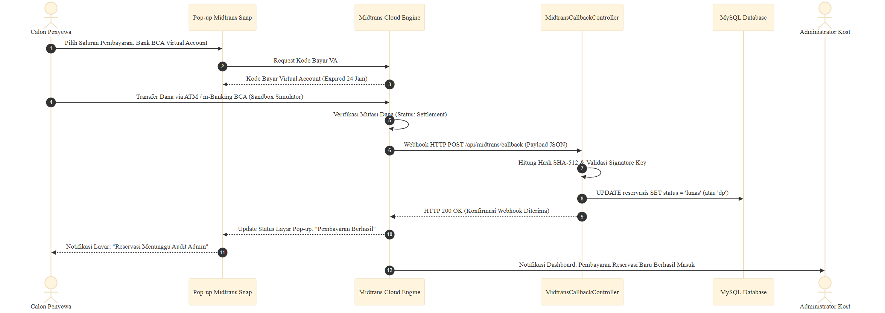  
*(a2) Sequence Diagram Reservasi Daring — Bagian 2: Penyelesaian Pembayaran Saluran BCA Virtual Account & Callback Webhook*  
*Sumber: Hasil pemodelan UML penulis (2026)*

**Deskripsi Fungsional Gambar 4.4 (a2)**:
Diagram Bagian 2 memodelkan penyelesaian transaksi finansial. Calon penyewa memilih saluran pembayaran Bank BCA Virtual Account pada jendela modal Snap dan memperoleh kode bayar unik berbatas waktu 24 jam. Calon penyewa mentransfer dana sewa melalui simulator perbankan. Midtrans Cloud memverifikasi dana masuk dan mengirimkan payload webhook asinkron ke `MidtransCallbackController`. Pengontrol memvalidasi signature key SHA-512, mengunci baris data, dan memperbarui status reservasi menjadi `lunas` atau `dp`. Peladen Midtrans menerima konfirmasi HTTP 200 OK, tampilan pop-up Snap berganti menjadi status sukses, dan dasbor administrator menerima alert pemberitahuan transaksi masuk secara real-time.

---

#### 2. Alur Audit, Konfirmasi, dan Aktivasi Kontrak oleh Administrator
Prosedur pengesahan kontrak sewa oleh pengelola dipecah menjadi dua bagian:

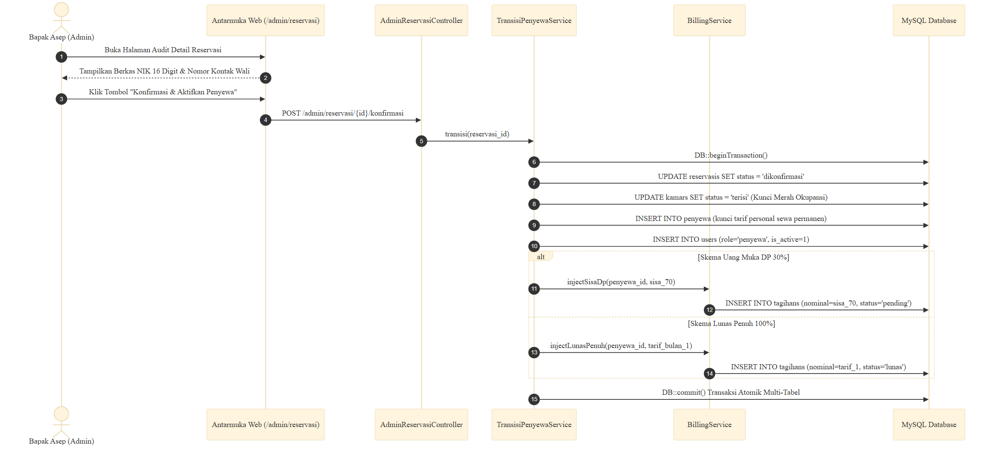  
*(b1) Sequence Diagram Aktivasi Admin — Bagian 1: Audit Berkas Identitas & Eksekusi Transisi Atomik Multi-Tabel*  
*Sumber: Hasil pemodelan UML penulis (2026)*

**Deskripsi Fungsional Gambar 4.4 (b1)**:
Diagram Bagian 1 memodelkan tindakan administratif pengelola kost saat mengaudit berkas identitas calon penyewa pada rute `/admin/reservasi/{id}`. Setelah memeriksa NIK 16 digit dan nomor kontak wali, administrator menekan tombol konfirmasi. `AdminReservasiController` mendelegasikan pemrosesan ke `TransisiPenyewaService::transisi`. Di dalam transaksi terisolasi `DB::beginTransaction()`, sistem memperbarui status reservasi menjadi `dikonfirmasi`, mengubah status unit kamar pada tabel `kamar` menjadi `terisi` (kunci merah anti-double booking), menyalin tarif sewa kamar ke tabel `penyewa` sebagai tarif personal permanen, membuat akun pengguna login baru pada tabel `users`, serta menerbitkan tagihan pelunasan sisa 70% (jika skema DP) sebelum melakukan *commit* basis data.

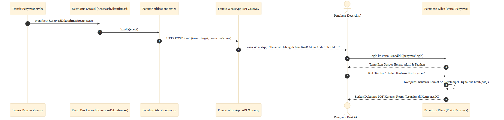  
*(b2) Sequence Diagram Aktivasi Admin — Bagian 2: Penyiaran Kredensial via Fonnte WA API & Penyajian Kuitansi Digital A5*  
*Sumber: Hasil pemodelan UML penulis (2026)*

**Deskripsi Fungsional Gambar 4.4 (b2)**:
Diagram Bagian 2 memodelkan penyiaran kredensial dan penyajian bukti bayar resmi. Komit basis data memicu event `ReservasiDikonfirmasi`. Event listener memanggil `FonnteNotificationService` untuk mendistribusikan pesan WhatsApp resmi ke nomor telepon penghuni baru yang memuat nomor unit kamar, tautan portal login, dan kata sandi sementara. Administrator menerima notifikasi sukses di antarmuka web. Penghuni masuk ke portal mandiri `/penyewa/login` dan menekan tombol cetak kuitansi. Peramban klien secara mandiri mengompilasi dokumen kuitansi resmi format A5 berstempel digital memanfaatkan pustaka `html2pdf.js` siap simpan atau cetak tanpa membebani penyimpanan peladen.

---

#### 3. Siklus Penagihan Bulanan dan Pembayaran Rutin Non-Tunai
Siklus pembayaran sewa berkala dipecah menjadi dua bagian:

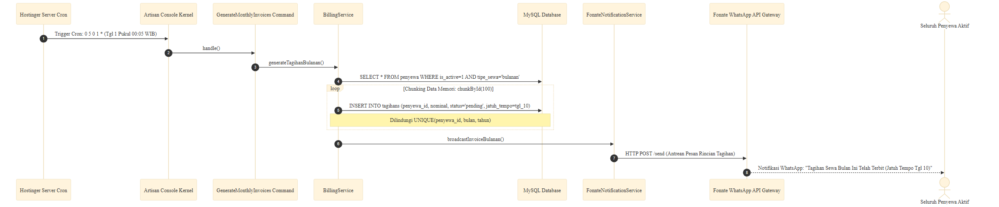  
*(c1) Sequence Diagram Siklus Billing — Bagian 1: Pemicu Penjadwal Tugas, Pembentukan Invoice Massal & Siaran WA*  
*Sumber: Hasil pemodelan UML penulis (2026)*

**Deskripsi Fungsional Gambar 4.4 (c1)**:
Diagram Bagian 1 memodelkan orkestrasi otomatis penerbitan invoice bulanan. Hostinger Server Cron mengeksekusi pemicu berkala setiap tanggal 1 awal bulan pukul 00:05 WIB. Kernel konsol Laravel memanggil perintah `GenerateMonthlyInvoices`. Layanan `BillingService` menyeleksi seluruh penghuni aktif bertipe sewa bulanan, memproses data dalam kelompok memori `chunkById(100)`, menyisipkan baris tagihan baru berstatus *pending* dengan tanggal jatuh tempo seragam pada tanggal 10, serta memanggil `FonnteNotificationService` untuk menyiarkan pesan rincian tagihan invoice secara serentak ke nomor WhatsApp seluruh penghuni aktif.

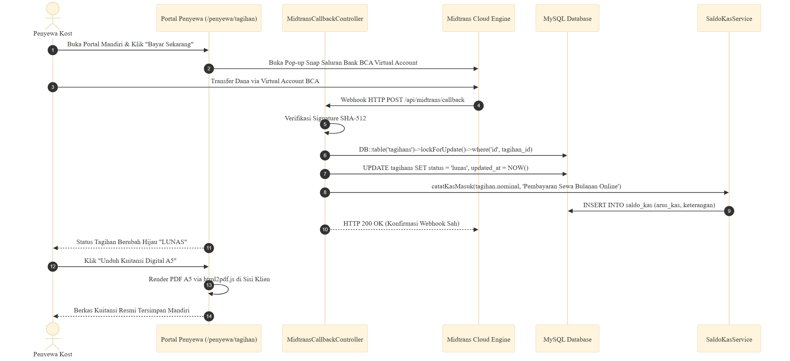  
*(c2) Sequence Diagram Siklus Billing — Bagian 2: Transaksi Pelunasan via Midtrans BCA VA & Perenderan Kuitansi Digital A5*  
*Sumber: Hasil pemodelan UML penulis (2026)*

**Deskripsi Fungsional Gambar 4.4 (c2)**:
Diagram Bagian 2 memodelkan pelunasan tagihan bulanan oleh penghuni kos. Penghuni membuka portal mandiri `/penyewa/tagihan`, menekan tombol bayar, dan menyelesaikan transfer dana pada pop-up modal Midtrans Snap saluran Bank BCA Virtual Account. Notifikasi webhook dikirimkan ke `MidtransCallbackController`. Sistem memverifikasi kecocokan signature SHA-512, mengunci baris data dengan `lockForUpdate()`, memperbarui status tagihan menjadi `lunas`, mencatat arus kas masuk pada tabel `saldo_kas`, serta memperbarui status visual tagihan di portal penyewa menjadi lunas berwarna hijau, di mana tombol unduh kuitansi resmi format A5 siap dieksekusi secara instan.

---

### 4.1.5 Entity Relationship Diagram (ERD)
Skema basis data dirancang berlandaskan kaidah Bentuk Normal Ketiga (*Third Normal Form* atau 3NF) guna mengeliminasi redundansi kolom, meniadakan anomali pembaruan data (*update anomalies*), serta menegakkan integritas transaksi berkarakteristik ACID (*Atomicity, Consistency, Isolation, Durability*) pada sistem manajemen basis data relasional MySQL 8.x dengan mesin penyimpanan InnoDB.

Skema basis data secara keseluruhan mencakup 22 tabel relasional. Guna menjamin keunikan nilai kolom tanpa merusak jejak historis penghapusan lunak (*soft deletes*), sistem menerapkan fitur *Virtual Generated Columns* berindeks unik pada MySQL 8.x, seperti `active_email`, `active_no_hp`, dan `active_nik` pada tabel `users`, `active_nomor_kamar` pada tabel `kamar`, `active_nik` pada tabel `penyewa`, serta `active_order_id` pada tabel `reservasi`. Kolom-kolom virtual ini bernilai identik dengan kolom aslinya saat data berstatus aktif (`deleted_at IS NULL`), dan berubah menjadi `NULL` saat baris data dihapus lunak. Mengingat arsitektur MySQL mengizinkan keberadaan nilai `NULL` ganda pada batasan indeks unik (*unique index*), keunikan data aktif tetap terjaga secara konsisten tanpa perlu memodifikasi string data historis.

Guna memastikan setiap entitas, peran bisnis, kunci primer/asing, dan derajat relasi dapat ditelaah secara jelas, tajam, dan sangat nyaman dibaca oleh pembimbing maupun penguji skripsi tanpa kendala teks menciut (*microscopic clutter*), arsitektur global skema relasi 22 tabel basis data disajikan secara terstruktur melalui 3 kluster arsitektur kartu entitas (*architectural entity cards*) berskala besar (Gambar 4.5 a1, a2, dan a3), yang kemudian diperdalam oleh 4 diagram kluster relasional spesifik domain (Gambar 4.5 b, c, d, dan e):

#### 1. Arsitektur Global Skema Relasi 22 Tabel Basis Data
Pemodelan relasional menyeluruh 22 tabel basis data diorganisasikan ke dalam 3 diagram arsitektural berdimensi proporsional, berlatar bersih, dan bertipografi besar (*font size 20px* dengan kartu entitas selebar 4,5–6 cm):

##### a. Kluster Inti Master Hunian, Kontrak Sewa, dan Transaksi Finansial (10 Tabel Utama)
Peta topologi relasi entitas inti yang mengatur master hunian kos, akun pengguna, siklus pemesanan daring, kontrak sewa aktif, serta perputaran finansial penagihan dan kas disajikan pada Gambar 4.5 (a1).

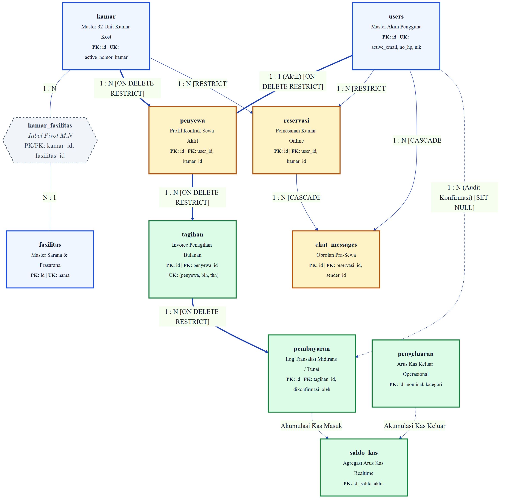

*Gambar 4.5 (a1) Arsitektur Global Skema Relasi Basis Data — Kluster Inti Master Hunian, Kontrak Sewa, dan Finansial (10 Tabel Utama)*  
*Sumber: Hasil analisis basis data penulis (2026)*

**Deskripsi Fungsional Gambar 4.5 (a1)**:
Diagram Bagian 1 merepresentasikan topologi relasional dari 10 entitas inti yang mengendalikan operasional transaksi hunian dan keuangan kos Asri Boarding House. Hubungan antar-entitas dipagari oleh aturan integritas referensial ketat:
1. **Domain Master Hunian dan Pengguna**: Entitas akun `users` berelasi satu-ke-satu (`1:1`) aktif terhadap entitas `penyewa` melalui foreign key `user_id` dengan aturan `ON DELETE RESTRICT`, menjamin profil sewa tidak dapat terhapus secara tidak sengaja selama masa huni masih berjalan. Keunikan akun dilindungi oleh *Virtual Generated Columns* berindeks unik (`active_email`, `active_no_hp`, dan `active_nik`). Entitas fisik 32 unit kos pada tabel `kamar` terhubung ke sarana kamar pada tabel `fasilitas` melalui tabel perantara `kamar_fasilitas` berindeks komposit `(kamar_id, fasilitas_id)` dengan aturan `ON DELETE CASCADE`.
2. **Domain Reservasi Daring dan Kontrak Sewa**: Calon penghuni mengajukan sewa melalui entitas `reservasi` (`user_id`, `kamar_id`) yang berelasi `1:N` dengan `chat_messages` (`ON DELETE CASCADE`) untuk negosiasi atau konsultasi pra-sewa. Saat pembayaran uang muka/lunas terkonfirmasi oleh pengelola kos, data reservasi bermutasi menjadi baris aktif pada entitas `penyewa` (`kamar_id`, `user_id`, `harga_sewa`, `tanggal_masuk`).
3. **Domain Penagihan Bulanan, Pembayaran, dan Arus Kas**: Entitas `penyewa` berelasi `1:N` dengan `tagihan`. Integritas penagihan dijamin oleh batasan unik komposit `(penyewa_id, periode_bulan, periode_tahun)` sehingga mesin penagihan otomatis (*auto-billing*) tidak akan pernah menerbitkan dua tagihan pada periode bulan kalender yang sama. Satu entitas `tagihan` berelasi `1:N` terhadap mutasi `pembayaran` (`ON DELETE RESTRICT`) yang mencatat `order_id`, kanal pembayaran perbankan, dan token transaksi Midtrans Snap. Seluruh mutasi pembayaran terverifikasi serta biaya operasional kos (`pengeluaran`) diagregasikan secara *real-time* ke dalam entitas ringkasan `saldo_kas`, menjamin transparansi akuntansi kos secara akurat.

---

##### b. Kluster Layanan Penghuni, Tiket Komplain, dan Interaksi Tamu Publik (6 Tabel Pendukung)
Peta topologi relasi entitas pendukung penanganan aduan fasilitas, audit log gateway notifikasi WhatsApp, jejak audit aktivitas sistem, serta interaksi pengunjung publik anonim disajikan pada Gambar 4.5 (a2).

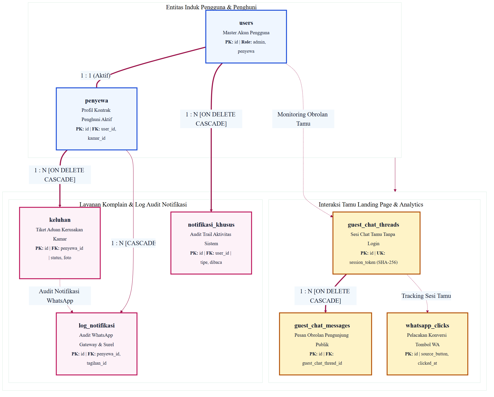

*Gambar 4.5 (a2) Arsitektur Global Skema Relasi Basis Data — Kluster Layanan Penghuni, Tiket Komplain, dan Interaksi Tamu Publik (6 Tabel Pendukung)*  
*Sumber: Hasil analisis basis data penulis (2026)*

**Deskripsi Fungsional Gambar 4.5 (a2)**:
Diagram Bagian 2 menyajikan 6 entitas pendukung operasional yang disusun dalam struktur dua cabang simetris yang bertumpu pada entitas induk pengguna (`users` dan `penyewa`):
1. **Cabang Layanan Komplain dan Audit Log**: Penghuni aktif menyampaikan laporan kerusakan fasilitas melalui entitas `keluhan` (`penyewa_id`, `judul`, `foto_kerusakan`, `status`, `tanggapan_admin`) beraturan `ON DELETE CASCADE`. Setiap perubahan status tindak lanjut aduan memicu pencatatan riwayat pada entitas `log_notifikasi`. Entitas `log_notifikasi` mencatat jejak audit seluruh transmisi pesan keluar WhatsApp Fonnte dan surel SMTP (`penyewa_id`, `tagihan_id`, `penerima`, `pesan`, `status_kirim`). Peristiwa penting sistem dicatat pada entitas `notifikasi_khusus` (`user_id`, `tipe`, `dibaca`).
2. **Cabang Interaksi Pengunjung Tamu dan Analitik**: Pengunjung tanpa login pada landing page berkonsultasi melalui entitas `guest_chat_threads` yang diamankan oleh token sesi terenkripsi SHA-256 (`session_token`) dan alamat IP. Utas ini berelasi `1:N` terhadap pesan obrolan pada entitas `guest_chat_messages` (`ON DELETE CASCADE`). Efektivitas promosi digital dan rasio konversi pemasaran diukur secara otomatis oleh entitas `whatsapp_clicks` yang merekam setiap peristiwa klik tombol mengambang WhatsApp menuju kontak pengelola kos.

---

##### c. Kluster Manajemen Konten CMS, Regulasi Hunian, dan Reputasi Publik (6 Tabel Pendukung)
Peta topologi relasi entitas tata kelola informasi publik, regulasi tata tertib hunian, dokumentasi multimedia, dan manajemen reputasi disajikan pada Gambar 4.5 (a3).

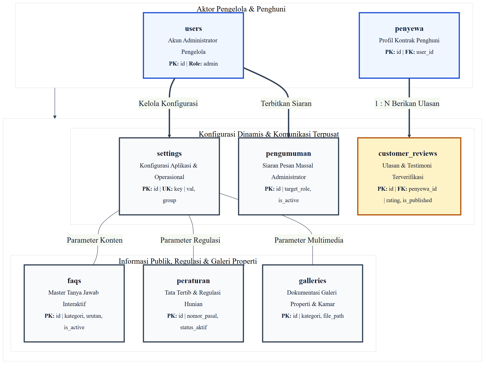

*Gambar 4.5 (a3) Arsitektur Global Skema Relasi Basis Data — Kluster Manajemen Konten CMS, Regulasi Hunian, dan Reputasi Publik (6 Tabel Pendukung)*  
*Sumber: Hasil analisis basis data penulis (2026)*

**Deskripsi Fungsional Gambar 4.5 (a3)**:
Diagram Bagian 3 memodelkan 6 entitas pendukung publikasi digital yang dikendalikan oleh administrator sistem guna menyajikan transparansi informasi kepada publik:
1. **Pengaturan Dinamis dan Komunikasi Terpusat**: Entitas `settings` menampung konfigurasi parameter operasional kos secara dinamis (`key-value pair` unik). Administrator mempublikasikan maklumat darurat atau operasional berkala melalui entitas `pengumuman` (`target_role`, `is_active`, `tanggal_mulai`). Pengalaman tinggal penghuni dihimpun pada entitas `customer_reviews` (`penyewa_id`, `rating`, `komentar`, `is_published`) guna menampilkan testimoni terkurasi yang otentik pada halaman beranda.
2. **Informasi Regulasi dan Galeri Multimedia**: Calon penyewa dapat menelaah pertanyaan umum pada entitas `faqs` (`kategori`, `pertanyaan`, `jawaban`, `is_active`), mematuhi tata tertib kos pada entitas `peraturan` (`nomor_pasal`, `judul`, `isi_peraturan`, `status_aktif`), serta meninjau dokumentasi gedung dan fasilitas pada entitas `galleries` (`kategori`, `file_path`, `urutan`). Seluruh entitas ini memastikan calon penyewa memperoleh kepastian informasi yang lengkap sebelum memutuskan untuk menyewa kamar.

---

#### 2. Kluster ERD Master Kamar, Fasilitas, dan Manajemen Pengguna
Visualisasi relasi entitas master hunian disajikan pada Gambar 4.5 (b).

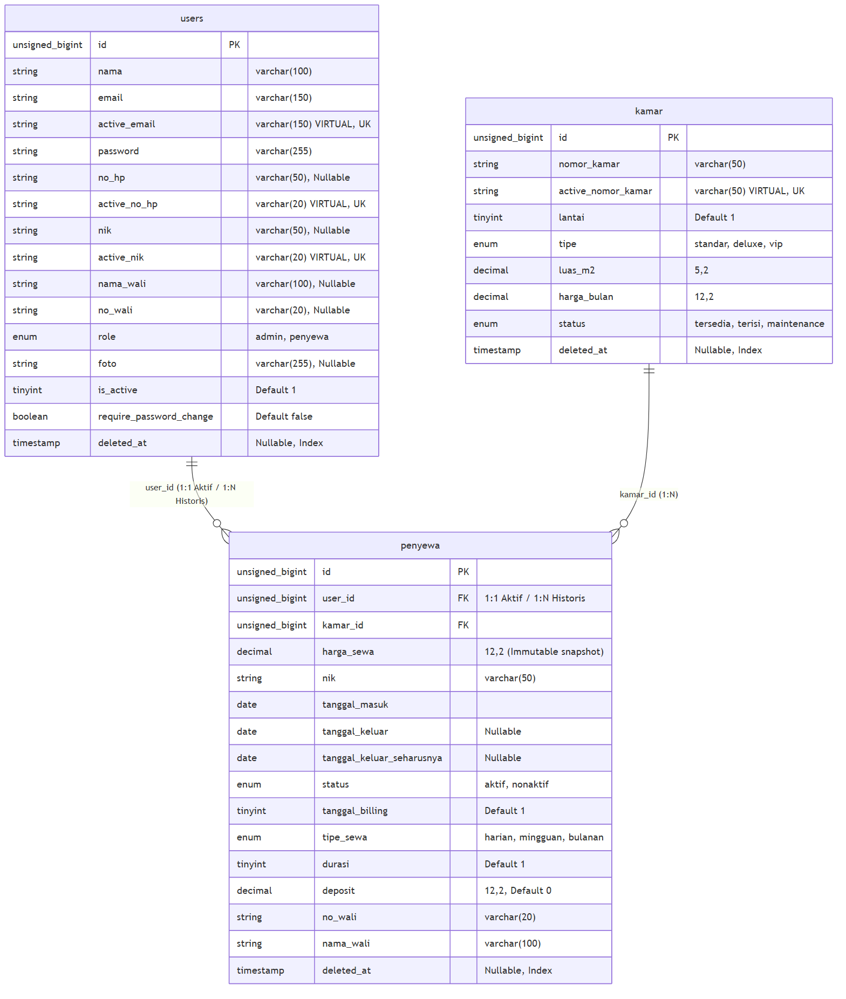

*Gambar 4.5 (b) Kluster ERD Master Kamar, Fasilitas, dan Manajemen Pengguna*  
*Sumber: Hasil analisis basis data penulis (2026)*

**Deskripsi Fungsional Gambar 4.5 (b)**:
Kluster ini menghubungkan entitas akun pengguna (`users`), data fisik 32 unit kos (`kamar`), master sarana (`fasilitas`), serta profil kontrak hunian (`penyewa`). Entitas `users` berelasi satu-ke-satu (1:1) dengan `penyewa` melalui foreign key `user_id`. Entitas `kamar` berelasi banyak-ke-banyak (M:N) dengan `fasilitas` yang dijembatani oleh tabel pivot `kamar_fasilitas` berindeks komposit `(kamar_id, fasilitas_id)`. Satu unit `kamar` dapat ditempati oleh banyak penyewa dalam rentang waktu yang berbeda (relasi 1:N historis), di mana keunikan kamar aktif dilindungi oleh kolom virtual `active_nomor_kamar`.

---

#### 3. Kluster ERD Transaksional Reservasi, Obrolan Tamu, dan Kontrak Penyewa
Visualisasi relasi pemesanan kamar dan percakapan disajikan pada Gambar 4.5 (c).

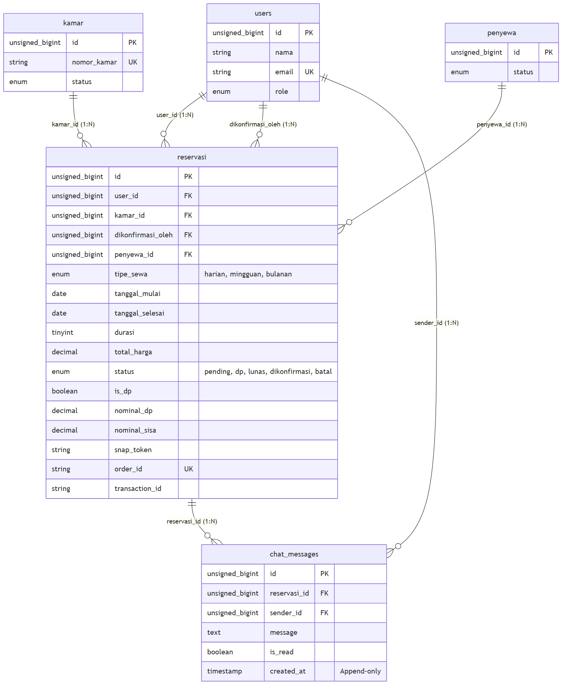

*Gambar 4.5 (c) Kluster ERD Transaksional Reservasi, Obrolan Tamu, dan Kontrak Penyewa*  
*Sumber: Hasil analisis basis data penulis (2026)*

**Deskripsi Fungsional Gambar 4.5 (c)**:
Kluster ini mengatur alur transisi dari pengunjung tamu menjadi calon penyewa dan penyewa aktif. Entitas `guest_chat_threads` menampung sesi percakapan anonim pengunjung landing page melalui token unik `session_token` dan berelasi 1:N dengan `guest_chat_messages`. Entitas `reservasi` mencatat data pemesanan kamar (`user_id`, `kamar_id`, `tipe_sewa`, `skema_bayar`, `status`), berelasi 1:N dengan `chat_messages` (kotak pesan pra-pembayaran), serta bermutasi menjadi rekaman pada entitas `penyewa` saat disetujui oleh pengelola.

---

#### 4. Kluster ERD Finansial, Billing Engine, Pembayaran Midtrans, dan Kas
Visualisasi relasi transaksi keuangan kos disajikan pada Gambar 4.5 (d).

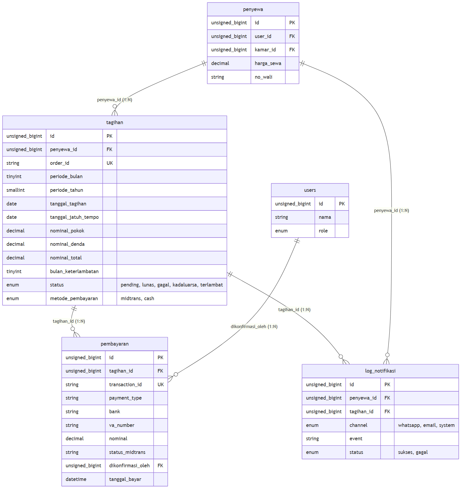

*Gambar 4.5 (d) Kluster ERD Finansial, Billing Engine, Pembayaran Midtrans, dan Kas*  
*Sumber: Hasil analisis basis data penulis (2026)*

**Deskripsi Fungsional Gambar 4.5 (d)**:
Kluster ini merupakan jantung dari akuntabilitas finansial sistem. Satu entitas `penyewa` memiliki banyak (`1:N`) baris `tagihan`. Integritas penagihan dijamin oleh indeks unik komposit `(penyewa_id, periode_bulan, periode_tahun)` sehingga mesin penagihan otomatis tidak dapat menerbitkan dua tagihan pada bulan kalender yang sama. Satu `tagihan` dapat memiliki banyak (`1:N`) riwayat transaksi `pembayaran` (mencatat `order_id`, `metode_pembayaran`, `midtrans_transaction_id`, dan `status`). Mutasi kas operasional dicatat pada entitas `pengeluaran` yang dilengkapi tautan bukti nota fisik, serta dikonsolidasikan secara real-time pada entitas ringkasan `saldo_kas`.

---

#### 5. Kluster ERD Tiket Keluhan Fasilitas, Log Notifikasi WhatsApp, dan Guest Thread
Visualisasi relasi layanan pemeliharaan sarana disajikan pada Gambar 4.5 (e).

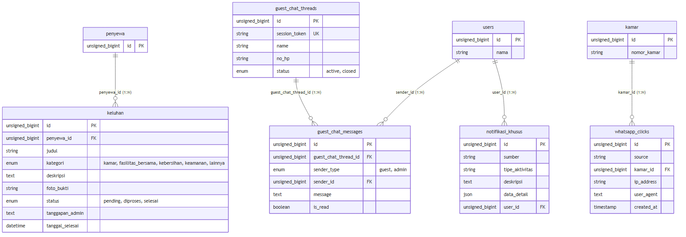

*Gambar 4.5 (e) Kluster ERD Tiket Keluhan Fasilitas, Log Notifikasi WhatsApp, dan Guest Thread*  
*Sumber: Hasil analisis basis data penulis (2026)*

**Deskripsi Fungsional Gambar 4.5 (e)**:
Kluster ini memodelkan penanganan keluhan dan pemantauan distribusi notifikasi. Entitas `keluhan` menampung aduan kerusakan fasilitas yang diajukan penyewa (`penyewa_id`, `judul`, `deskripsi`, `foto_kerusakan`, `status`, `tanggapan_admin`). Entitas `log_notifikasi` mencatat jejak audit seluruh pesan keluar yang didistribusikan via Fonnte WhatsApp API (`penerima`, `pesan`, `status_kirim`, `response_api`), menjamin transparansi penyampaian tagihan bulanan, pengingat jatuh tempo, eskalasi kontak wali, dan siaran pengumuman massal.

---

### 4.1.6 Skenario Alur Kerja Sistem
Pemodelan teknis-formal melalui Use Case, Activity Diagram, Flowchart, Sequence Diagram, dan ERD pada subbab terdahulu menyajikan perspektif rekayasa perangkat lunak secara arsitektural. Guna menjembatani pemodelan teoretis tersebut dengan dinamika operasional di lapangan, subbab ini menguraikan skenario diagram alur sistem yang merekonstruksi hasil interaksi pengguna secara empiris pada peladen produksi langsung (`https://asriboardinghouse.weatso.id/`). Skenario ini memadukan dua sudut pandang yang saling mengisi: siklus hidup penyewa (*tenant lifecycle*) sejak tahap penelusuran awal hingga kepulangan, serta siklus hidup operasional administrator (*administrator operational lifecycle*) yang dijalankan oleh pengelola kos.

#### 1. Skenario Siklus Hidup Penyewa (Tenant Lifecycle Scenario)
Skenario penyewa memotret pengalaman pengguna calon penghuni dalam berinteraksi dengan antarmuka sistem Asri Boarding House. Pengujian empiris pada lingkungan produksi menerapkan dua persona dengan preferensi durasi dan skema transaksi yang berbeda:

1. **Jalur 1 — Penyewa A (Kamar 101 VIP, Durasi Sewa 12 Bulan)**:
   * **Eksplorasi Katalog & Konsultasi Pra-Pemesanan**: Calon penyewa membuka portal publik `weatso.id`, meninjau katalog kamar interaktif bergaya Neo-Brutalism, dan memanfaatkan fitur *Floating Guest Live Chat* tanpa login untuk mengonfirmasi kesiapan fasilitas Kamar 101 VIP. Sistem mengidentifikasi sesi penelusuran tamu menggunakan token acak berpelindung hash SHA-256 (`session_token`) pada tabel `guest_chat_threads`.
   * **Otentikasi Google OAuth 2.0 & Penapisan Profil**: Calon penyewa memilih masuk menggunakan akun Google (`Laravel Socialite`). Begitu autentikasi identitas tervalidasi, sistem mendeteksi keberadaan nomor ponsel sementara (`temp_socialite_*`), lalu secara otomatis mengalihkannya melalui middleware `EnsureProfileIsComplete` ke halaman pelengkapan profil. Calon penyewa memasukkan nomor WhatsApp aktif (`089524569335`), yang divalidasi keunikan serta format penomorannya sesuai standar telekomunikasi Indonesia.
   * **Reservasi & Pelunasan Penuh di Awal (*Full Payment Upfront*)**: Calon penyewa mengisi formulir reservasi dengan mencantumkan NIK 16 digit valid (`3374115212030001`), memilih durasi sewa 12 bulan (periode 26 September 2026 hingga 26 September 2027), serta nomor kontak darurat/wali (`082219575575`). Sistem mengkalkulasi tarif dasar sebesar Rp16.800.000 (12 x Rp1.400.000), lalu secara atomik mengaplikasikan potongan diskon durasi tahunan dari tabel konfigurasi sistem sehingga total tagihan menjadi Rp15.400.560. Nominal ini mengunci tarif sewa aktif personal (*immutable personal rate*) sebesar Rp1.283.380 per bulan (`Rp15.400.560 / 12 bulan`).
   * **Penyelesaian Transaksi Midtrans Snap**: Calon penyewa menuntaskan pembayaran penuh senilai Rp15.400.560 melalui saluran Bank Mandiri Virtual Account pada antarmuka pop-up Midtrans Snap. Notifikasi webhook asinkron diverifikasi melalui pencocokan tanda tangan digital SHA-512, memperbarui status reservasi menjadi `lunas`.
   * **Siklus Pembayaran Rutin Tepat Waktu**: Pada siklus sewa bulanan berjalan, tagihan rutin diterbitkan otomatis setiap tanggal 1 awal bulan pukul 00:05 WIB senilai Rp1.283.380 dengan tanggal jatuh tempo 10. Penyewa secara teratur menyelesaikan pembayaran antara tanggal 1 hingga 5 setiap bulan melalui dompet digital GoPay (Midtrans Snap), sehingga terbebas dari pembebanan denda keterlambatan sepanjang masa hunian. Bukti pelunasan kuitansi digital resmi format A5 berstempel digital diunduh langsung di sisi peramban klien melalui pustaka `html2pdf.js`.

2. **Jalur 2 — Penyewa B (Kamar 104 Deluxe, Durasi Sewa 6 Bulan)**:
   * **Pendaftaran Akun Mandiri & Reservasi Skema Uang Muka (DP 30%)**: Calon penyewa mendaftarkan akun secara mandiri via formulir registrasi web, lalu memilih Kamar 104 Deluxe bertarif pokok Rp950.000 per bulan untuk masa sewa 6 bulan (total kewajiban sewa pokok Rp5.700.000). Calon penyewa memilih skema pembayaran Uang Muka (DP 30%) sebesar Rp1.710.000, dengan sisa kewajiban 70% sebesar Rp3.990.000 yang wajib dilunasi sebelum menempati fisik kamar.
   * **Pembayaran DP & Injeksi Tagihan Pelunasan**: Calon penyewa menyelesaikan pembayaran DP sebesar Rp1.710.000 melalui kanal QRIS Midtrans Snap. Setelah administrator menyetujui reservasi, layanan `TransisiPenyewaService` secara atomik mengaktifkan akun penyewa, mengunci status unit kamar menjadi `terisi`, dan memicu instruksi `BillingService::injectSisaDp` untuk menerbitkan tagihan pelunasan sisa 70% (Rp3.990.000) berstatus *pending*. Menjelang tanggal masuk (26 September 2026), penyewa masuk ke portal mandiri dan melunasi sisa tagihan tersebut via Midtrans Snap.
   * **Penerapan Masa Toleransi Bebas Denda (*Grace Period*)**: Pada periode penagihan bulan November 2026, penyewa melewati tanggal jatuh tempo 10 November akibat kesibukan perkuliahan. Pada tanggal 11 November pukul 01:00 WIB, penjadwal tugas harian `tagihan:proses-keterlambatan` mendeteksi status tagihan yang belum lunas. Namun, karena masih berada dalam bulan kalender berjalan (November), sistem menjalankan kebijakan masa toleransi: status tagihan diubah menjadi *terlambat*, besaran denda tetap Rp0 (`nominal_denda = 0`), dan sistem menyalurkan pengingat ramah via Fonnte WhatsApp API. Pada tanggal 15 November, penyewa melunasi tagihan pokok Rp950.000 tanpa beban denda tambahan.

3. **Pengaduan Keluhan Fasilitas Berfoto**:
   * Pada bulan Maret 2027, terjadi kendala kebocoran pada kran wastafel kamar mandi Kamar 101 milik Penyewa A. Penyewa mengakses menu *Keluhan & Pengaduan* pada dasbor penyewa, melengkapi formulir aduan, dan mengunggah foto bukti fisik `kran_bocor.jpg` (berukuran 1,2 MB). Sistem memvalidasi ekstensi serta ukuran berkas, menerbitkan tiket keluhan berstatus *pending*, dan meneruskan notifikasi otomatis ke nomor WhatsApp pengelola kos.
   * Setelah teknisi menyelesaikan perbaikan sarana dan pengelola memverifikasi fisik di lokasi, status tiket diubah menjadi *selesai*, memicu pengiriman pesan WhatsApp penutupan laporan kepada penyewa.

4. **Penerimaan Siaran Pengumuman Massal (*Multi-Channel Broadcast*)**:
   * Ketika pengelola menjadwalkan kegiatan operasional massal (seperti kegiatan fogging DBD pada bulan Juni 2027), penyewa menerima pengumuman serentak melalui spanduk peringatan pada portal web, pesan WhatsApp melalui Fonnte API, dan surel terenkripsi TLS melalui protokol SMTP.

---

#### 2. Skenario Operasional Administrator (Administrator Operational Lifecycle)
Skenario operasional menggambarkan alur kerja harian pengelola kost dalam mengendalikan administrasi, keuangan, dan aset properti Asri Boarding House melalui portal manajemen:

1. **Layanan Pra-Pemesanan & Audit Berkas Identitas**:
   * Pengelola memantau pesan masuk dari pengunjung web melalui antarmuka *Guest Chat* dan kotak pesan pra-pembayaran (*Pre-Payment Chat Box*) pada halaman rincian reservasi guna memastikan kejelasan fasilitas sebelum calon penghuni mentransfer dana sewa.
   * Saat calon penyewa menyelesaikan pembayaran awal via Midtrans, pengelola mengaudit berkas identitas dengan memeriksa NIK 16 digit dan nomor kontak wali. Setelah data terkonfirmasi sah, pengelola menekan tombol konfirmasi untuk mengaktifkan kontrak sewa.

2. **Pengawasan Otomasi Tagihan Bulanan & Arus Kas Real-Time**:
   * Pengelola tidak lagi direpotkan oleh pencatatan tagihan manual pada buku besar. Setiap tanggal 1 awal bulan pukul 00:05 WIB, penjadwal tugas peladen mengeksekusi perintah `php artisan tagihan:generate-bulanan`, menerbitkan baris tagihan berstatus *pending* bagi seluruh penyewa bulanan aktif, dan menyiarkan invoice via WhatsApp.
   * Dasbor keuangan administrator menampilkan tiga kartu ringkasan keuangan mikro (Total Pemasukan, Total Pengeluaran, dan Laba Bersih) secara real-time berdasarkan agregasi basis data, mengamankan kapasitas perputaran pendapatan bruto kos sebesar Rp28.500.000 per bulan dari risiko selisih hitung kas.

3. **Manajemen Pemeliharaan Fasilitas & Penyiaran Notifikasi Massal**:
   * Pengelola meninjau laporan kerusakan berfoto dari penyewa, memperbarui status tiket menjadi *diproses*, memanggil teknisi langganan, dan melakukan pengecekan langsung hasil perbaikan sebelum menutup tiket aduan.
   * Fitur *Broadcast Pengumuman* memudahkan pengelola menyebarkan pemberitahuan kepada seluruh penghuni aktif dalam satu kali kirim, di mana backend Laravel mengatur antrean pesan dengan jeda waktu 2 detik antar-nomor guna mencegah pemblokiran nomor pengirim oleh penyedia layanan WhatsApp.

4. **Prosedur Akhir Kontrak & Protokol Penahanan Kamar (*Manual Inspection Hold*)**:
   * Ketika masa sewa berakhir (seperti berakhirnya kontrak 6 bulan Penyewa B pada 26 Maret 2027 dan kontrak 12 bulan Penyewa A pada 26 September 2027), pengelola membuka menu *checkout* administratif. Sistem memverifikasi bahwa seluruh kewajiban tagihan sewa telah lunas (`unpaidBillsCount == 0`). Apabila masih terdapat tagihan tertunggak, sistem menolak eksekusi *checkout*.
   * Setelah verifikasi finansial terpenuhi, pengelola bersama penyewa memeriksa kondisi fisik kamar guna memastikan keutuhan inventaris. Pengelola kemudian menekan tombol *checkout*: akun penyewa dinonaktifkan, tanggal keluar dicatat pada basis data, dan status aktif dicabut (`is_active = 0`).
   * **Protokol Penahanan Kamar (*Manual Inspection Hold*)**: Aturan bisnis utama menetapkan bahwa setelah proses *checkout* selesai, status kamar pada basis data tidak otomatis beralih menjadi `tersedia`. Sistem mempertahankan status `terisi` dalam kondisi terkunci merah guna memberi waktu bagi petugas untuk melaksanakan sanitasi, penukaran sprei, dan perbaikan sarana fisik.
   * Setelah kamar dipastikan 100% bersih dan layak dihuni kembali, pengelola membuka menu *Manajemen Kamar* dan secara manual mengubah status kamar dari `terisi` menjadi `tersedia`. Perubahan status ini memicu *event* `KamarObserver::updated` yang secara otomatis membersihkan cache katalog publik melalui `Cache::forget('kamar_aktif_landing')`. Unit kamar seketika tayang kembali pada etalase landing page publik `weatso.id` dengan tombol pemesanan aktif, mengeliminasi risiko pemesanan ganda (*double booking*) pada kamar yang belum siap dihuni.

Rangkaian diagram skenario alur sistem disajikan secara terperinci pada Gambar 4.6 (a) hingga Gambar 4.6 (d). Agar transisi status pada siklus penagihan dapat ditelaah dengan runtut, visualisasi *state machine* dipecah ke dalam dua tahap:

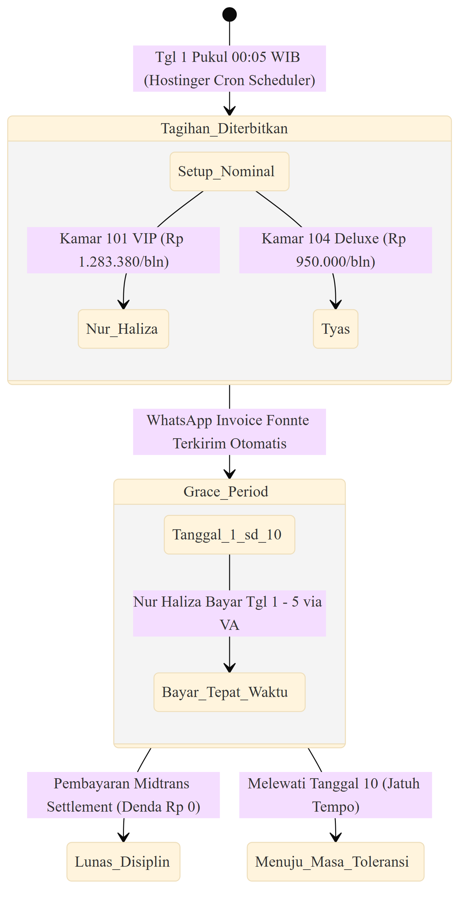  
*(a1) State Diagram Siklus Penagihan Bulanan - Bagian 1: Penerbitan Tagihan dan Pembayaran Disiplin*  
*Sumber: Hasil pemodelan skenario operasional sistem penulis (2026)*

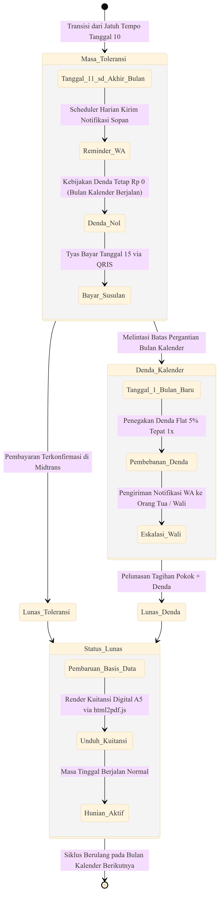  
*(a2) State Diagram Siklus Penagihan Bulanan - Bagian 2: Masa Toleransi Bebas Denda dan Penegakan Denda Kalender 5%*  
*Sumber: Hasil pemodelan skenario operasional sistem penulis (2026)*

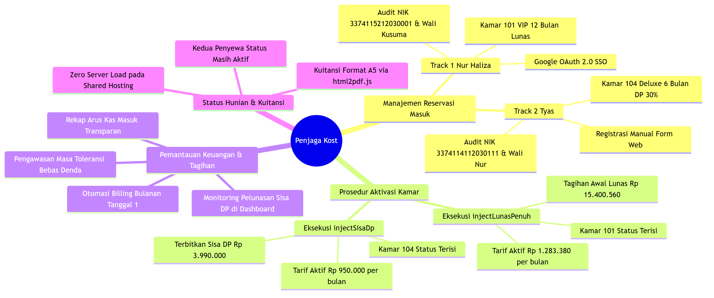  
*(b) Mindmap Kluster Tanggung Jawab Operasional Penjaga Kost*  
*Sumber: Hasil pemodelan skenario operasional sistem penulis (2026)*

Selanjutnya, alur keputusan aktivasi reservasi dan prosedur checkout disajikan secara modular:

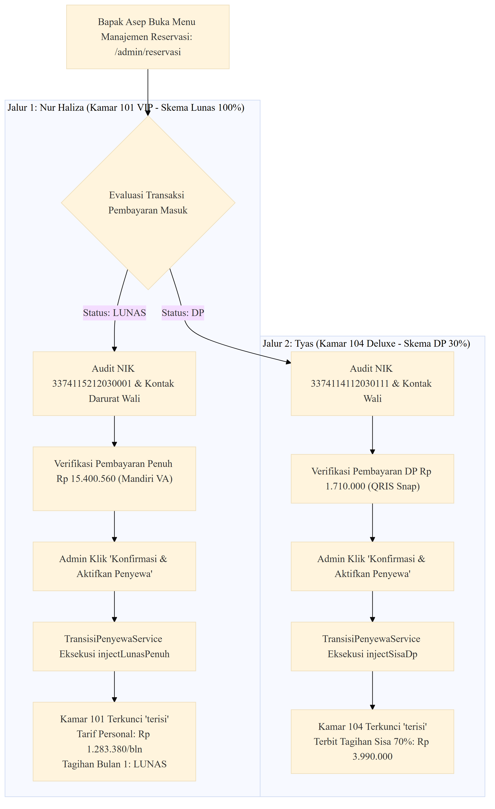  
*(c1) Flowchart Alur Keputusan Aktivasi Reservasi - Bagian 1: Audit Berkas dan Verifikasi Transaksi*  
*Sumber: Hasil pemodelan skenario operasional sistem penulis (2026)*

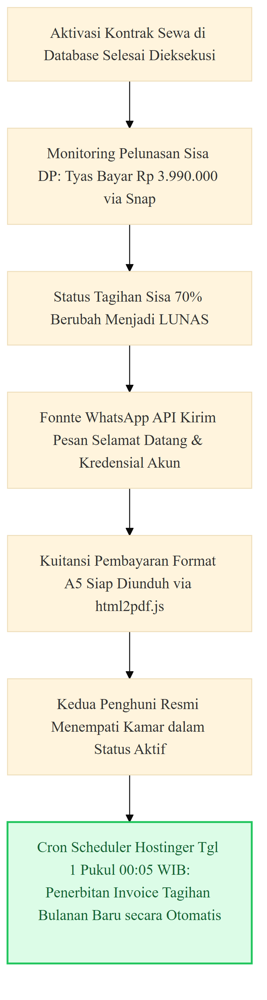  
*(c2) Flowchart Alur Keputusan Aktivasi Reservasi - Bagian 2: Monitoring Pelunasan Sisa dan Otomasi Hunian*  
*Sumber: Hasil pemodelan skenario operasional sistem penulis (2026)*

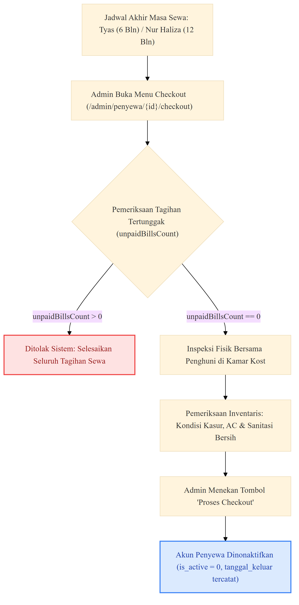  
*(d1) Flowchart Prosedur Checkout - Bagian 1: Verifikasi Finansial dan Checkout Administratif*  
*Sumber: Hasil pemodelan skenario operasional sistem penulis (2026)*

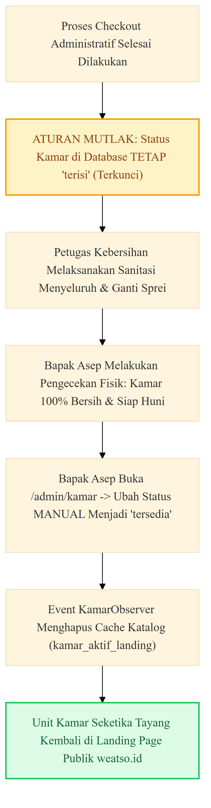  
*(d2) Flowchart Prosedur Checkout - Bagian 2: Protokol Karantina Fisik dan Pelepasan Kamar Manual*  
*Sumber: Hasil pemodelan skenario operasional sistem penulis (2026)*

*Gambar 4.6 Skenario Diagram Siklus Hidup Transaksional Penyewa dan Operasional Administrator*  
*Sumber: Hasil pemodelan skenario operasional sistem penulis (2026)*

---

#### 3. Matriks Pemetaan Status Transaksional Sistem
Untuk memberikan pandangan terstruktur mengenai keterkaitan antar-entitas selama siklus hidup operasional, Tabel 4.1 menyajikan matriks transisi status yang merangkum evolusi kondisi unit kamar, dokumen reservasi, akun penyewa, tagihan sewa, transaksi pembayaran, *event bus* Laravel, serta notifikasi WhatsApp Fonnte pada setiap tahapan peristiwa pengujian riil.

**Tabel 4.1** Matriks Pemetaan Status Transaksional dan Transisi State Siklus Hidup Sistem

| No | Fase / Peristiwa Pengujian Riil | Transisi Status State Entitas | Respon Sistem, Notifikasi & Bukti |
| :-: | :--- | :--- | :--- |
| 1 | **Reservasi Daring Dibuat** | • **Kamar:** `tersedia` *(Locked)*<br>• **Reservasi:** `pending`<br>• **Penyewa/Tagihan/Bayar:** *Belum ada* | • **Event:** `ReservasiDibuat`<br>• **Notifikasi WA:** -<br>• **Bukti:** Form Pemesanan Web |
| 2 | **Midtrans Lunas 100% (Penyewa A)** | • **Kamar:** `tersedia` *(Locked)*<br>• **Reservasi:** `lunas`<br>• **Pembayaran:** `settlement`<br>• **Penyewa/Tagihan:** *Belum ada* | • **Event:** `ReservasiDibayar`<br>• **Notifikasi WA:** Alert WA Admin<br>• **Bukti:** Notifikasi Pembayaran |
| 3 | **Midtrans DP 30% (Penyewa B)** | • **Kamar:** `tersedia` *(Locked)*<br>• **Reservasi:** `dp`<br>• **Pembayaran:** `settlement`<br>• **Penyewa/Tagihan:** *Belum ada* | • **Event:** `ReservasiDibayar`<br>• **Notifikasi WA:** Alert WA Admin<br>• **Bukti:** Notifikasi Pembayaran |
| 4 | **Konfirmasi Reservasi Lunas 100%** | • **Kamar:** `terisi`<br>• **Reservasi:** `dikonfirmasi`<br>• **Penyewa:** `aktif`<br>• **Tagihan:** `lunas` (Bulan 1)<br>• **Pembayaran:** `settlement` | • **Event:** `ReservasiDikonfirmasi`<br>• **Notifikasi WA:** Welcome & Kredensial<br>• **Bukti:** Render A5 `html2pdf.js` |
| 5 | **Konfirmasi Reservasi DP 30%** | • **Kamar:** `terisi`<br>• **Reservasi:** `dikonfirmasi`<br>• **Penyewa:** `aktif`<br>• **Tagihan:** `pending` (Sisa 70%)<br>• **Pembayaran:** - | • **Event:** `ReservasiDikonfirmasi`, `TagihanDibuat`<br>• **Notifikasi WA:** Welcome & Link Sisa<br>• **Bukti:** Dashboard Alert Banner |
| 6 | **Pelunasan Sisa DP di Portal (Penyewa B)** | • **Kamar:** `terisi`<br>• **Reservasi:** `dikonfirmasi`<br>• **Penyewa:** `aktif`<br>• **Tagihan:** `lunas` (Sisa DP)<br>• **Pembayaran:** `settlement` | • **Event:** `PembayaranBerhasil`<br>• **Notifikasi WA:** Konfirmasi Lunas Sisa<br>• **Bukti:** Render A5 `html2pdf.js` |
| 7 | **Check-in Fisik & Hunian Aktif** | • **Kamar:** `terisi`<br>• **Reservasi:** `dikonfirmasi`<br>• **Penyewa:** `aktif`<br>• **Tagihan & Bayar:** - | • **Event:** -<br>• **Notifikasi WA:** -<br>• **Bukti:** Kunci Kamar Diserahkan |
| 8 | **Billing Bulanan (Tgl 1, 00:05 WIB)** | • **Kamar:** `terisi`<br>• **Reservasi:** -<br>• **Penyewa:** `aktif`<br>• **Tagihan:** `pending`<br>• **Pembayaran:** - | • **Event:** `TagihanDibuat`<br>• **Notifikasi WA:** Invoice Tagihan WA<br>• **Bukti:** Tautan Bayar Portal |
| 9 | **Bayar Tepat Waktu (Penyewa A)** | • **Kamar:** `terisi`<br>• **Reservasi:** -<br>• **Penyewa:** `aktif`<br>• **Tagihan:** `lunas`<br>• **Pembayaran:** `settlement` | • **Event:** `PembayaranBerhasil`<br>• **Notifikasi WA:** Tanda Terima Digital<br>• **Bukti:** Render A5 `html2pdf.js` |
| 10 | **Toleransi Jatuh Tempo (Penyewa B)** | • **Kamar:** `terisi`<br>• **Reservasi:** -<br>• **Penyewa:** `aktif`<br>• **Tagihan:** `terlambat` *(Denda 0)*<br>• **Pembayaran:** - | • **Event:** `ReminderPenyewa`<br>• **Notifikasi WA:** WA Reminder Sopan<br>• **Bukti:** Denda Tetap Rp0 |
| 11 | **Pelunasan Masa Toleransi (Penyewa B)** | • **Kamar:** `terisi`<br>• **Reservasi:** -<br>• **Penyewa:** `aktif`<br>• **Tagihan:** `lunas`<br>• **Pembayaran:** `settlement` | • **Event:** `PembayaranBerhasil`<br>• **Notifikasi WA:** Tanda Terima Digital<br>• **Bukti:** Render A5 `html2pdf.js` |
| 12 | **Pengaduan Keluhan Berfoto Masuk** | • **Kamar:** `terisi`<br>• **Reservasi:** -<br>• **Penyewa:** `aktif`<br>• **Tagihan & Bayar:** - | • **Event:** `KeluhanDibuat`<br>• **Notifikasi WA:** Alert Keluhan Admin<br>• **Bukti:** Berkas Foto `kran_bocor.jpg` |
| 13 | **Penyelesaian & Penutupan Keluhan** | • **Kamar:** `terisi`<br>• **Reservasi:** -<br>• **Penyewa:** `aktif`<br>• **Tagihan & Bayar:** - | • **Event:** `KeluhanDitanggapi`<br>• **Notifikasi WA:** Notifikasi Tiket Selesai<br>• **Bukti:** Inspeksi Fisik Lapangan |
| 14 | **Prosedur Checkout Administratif** | • **Kamar:** `terisi` *(Locked)*<br>• **Reservasi:** -<br>• **Penyewa:** `nonaktif`<br>• **Tagihan:** Semua `lunas`<br>• **Pembayaran:** - | • **Event:** `PenyewaController::checkout`<br>• **Notifikasi WA:** Konfirmasi Checkout<br>• **Bukti:** Akun Dinonaktifkan |
| 15 | **Manual Release Pasca-Inspeksi** | • **Kamar:** `tersedia`<br>• **Reservasi/Tagihan/Bayar:** -<br>• **Penyewa:** `nonaktif` | • **Event:** `KamarObserver::updated`<br>• **Notifikasi WA:** - (Katalog Live Update)<br>• **Bukti:** Cache Memori Dihapus |

## 4.2 Tampilan Antarmuka Sistem
Realisasi antarmuka pengguna (*user interface*) pada sistem informasi manajemen Asri Boarding House dirancang secara kontekstual guna mengakomodasi karakteristik kognitif dan kebutuhan operasional dari tiga kelompok pengguna utama: calon penyewa, penyewa aktif, serta pengelola operasional (administrator). Seluruh visualisasi antarmuka disajikan melalui tangkapan layar (*screenshot*) aktual dari sistem produksi yang telah beroperasi secara penuh pada domain `https://asriboardinghouse.weatso.id/`. Gambar disimpan dalam format PNG beresolusi tinggi (1600 x 1100 piksel) tanpa kompresi yang merusak teks, sehingga tata letak, tombol aksi, serta tipografi tetap terlihat tajam, kontras, dan nyaman dibaca saat dicetak maupun dibuka pada perangkat lunak pengolah kata seperti Microsoft Word.

### 4.2.1 Antarmuka Calon Penyewa
Antarmuka publik dirancang untuk memberikan transparansi penuh terhadap informasi kamar serta memudahkan calon penyewa dalam melakukan pemesanan unit secara mandiri tanpa harus datang langsung ke lokasi kos:

1. **Katalog Kamar Publik Neo-Brutalisme**: Halaman landing page memadukan garis pembatas tegas (*high-contrast borders*), bayangan datar (*hard box-shadow*), dan tipografi modern *Space Grotesk*. Pendekatan visual ini menonjolkan kejelasan hierarki informasi 32 unit kamar, rincian fasilitas (AC, kamar mandi dalam, kasur springbed, lemari pakaian, meja belajar), tautan video *room tour*, serta transparansi harga sewa bulanan. Setiap kartu kamar dilengkapi lencana status dinamis (*Tersedia* dengan warna hijau aktif atau *Terisi* dengan penanda merah tegas). Pada sudut kanan bawah, disematkan tombol aksi mengambang (*floating action button*) WhatsApp berdiameter 56 piksel yang melampaui ambang batas minimum panduan aksesibilitas WCAG 2.1 (44 piksel), memudahkan interaksi jempol pengguna ponsel pintar untuk konsultasi instan ke nomor pengelola. Tampilan katalog disajikan pada Gambar 4.7.

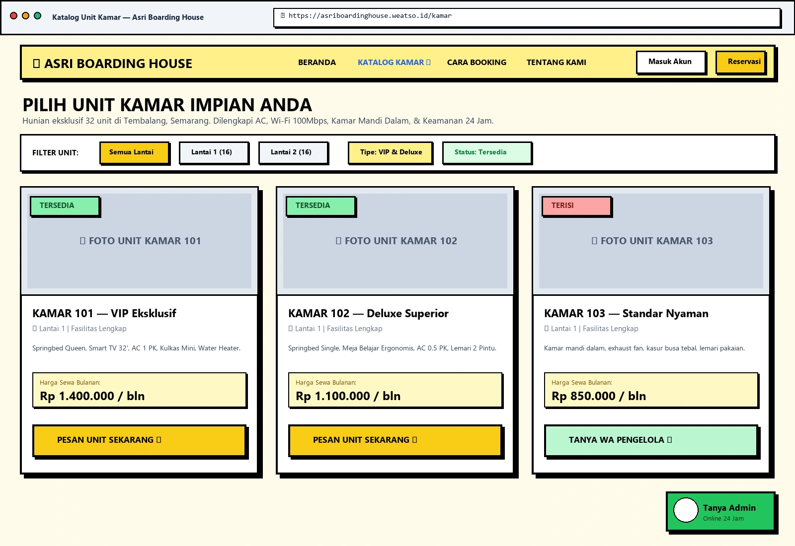

*Gambar 4.7 Antarmuka Katalog Kamar Publik Neo-Brutalisme*  
*Sumber: Tangkapan layar antarmuka sistem produksi (2026)*

2. **Workspace Stepper Alur Reservasi Online**: Ketika calon penyewa menekan tombol "Pesan Kamar", sistem menyajikan alur pemesanan bertahap (*5-Step Horizontal Stepper*) pada rute `/reservasi/pemesanan`. Stepper ini memandu calon penyewa secara berurutan: (1) Memilih unit kamar kosong, (2) Mengisi biodata diri dan memverifikasi NIK 16 digit beserta nomor WhatsApp kontak orang tua/wali, (3) Memilih tipe sewa (harian, mingguan, bulanan) dengan kalkulasi otomatis diskon sewa tahunan, (4) Menentukan skema pembayaran (pembayaran uang muka DP 30% atau pelunasan penuh 100%), dan (5) Melakukan pembayaran digital via jendela popup Midtrans Snap. Visualisasi alur stepper disajikan pada Gambar 4.8.

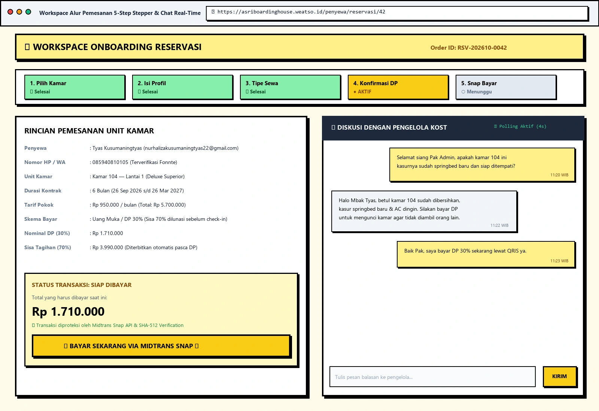

*Gambar 4.8 Workspace Stepper Alur Reservasi Calon Penyewa*  
*Sumber: Tangkapan layar antarmuka sistem produksi (2026)*

---

### 4.2.2 Antarmuka Penyewa Aktif
Bagi penghuni kos yang kontrak sewanya telah diaktifkan, portal mandiri pada rute `/penyewa/dashboard` berfungsi sebagai pusat kendali administrasi hunian digital yang dapat diakses secara fleksibel dari peramban ponsel pintar maupun laptop:

1. **Dasbor Tagihan dan Status Jatuh Tempo**: Menampilkan kartu ringkasan kontrak kamar aktif (tipe kamar, lantai, nomor kamar, tanggal mulai sewa, dan batas akhir sewa). Di bawahnya, tersaji daftar tagihan bulanan berstatus *pending* atau *lunas*. Setiap baris tagihan memuat informasi periode sewa, nominal sewa pokok, tanggal jatuh tempo seragam (tanggal 10), serta status denda keterlambatan. Selama pembayaran dilakukan dalam bulan kalender berjalan, sistem menampilkan lencana masa toleransi dengan nominal denda Rp0.
2. **Penyelesaian Transaksi Non-Tunai Midtrans Snap**: Penyewa cukup menekan tombol "Bayar Sekarang" untuk memunculkan antarmuka modal Midtrans Snap v2, di mana kode transfer Bank BCA Virtual Account berbatas waktu diterbitkan seketika.
3. **Pencetakan Kuitansi Digital Instan Format A5**: Begitu transaksi berstatus *settlement*, sistem menyediakan tombol "Unduh Kuitansi". Dokumen kuitansi resmi berstempel digital dikompilasi secara instan di peramban klien melalui pustaka `html2pdf.js` ke dalam format standar A5 siap cetak tanpa membebani penyimpanan peladen (*zero server storage overhead*).
4. **Formulir Pengaduan Keluhan Fasilitas Berfoto**: Menyediakan sarana pelaporan kerusakan sarana kamar (misal kran air bocor atau lampu padam) yang dilengkapi dengan fungsi unggah foto bukti fisik berkapasitas hingga 2 MB, status tiket penanganan (*pending*, *diproses*, *selesai*), serta riwayat catatan tindak lanjut dari pengelola. Tampilan portal mandiri penyewa disajikan pada Gambar 4.9.

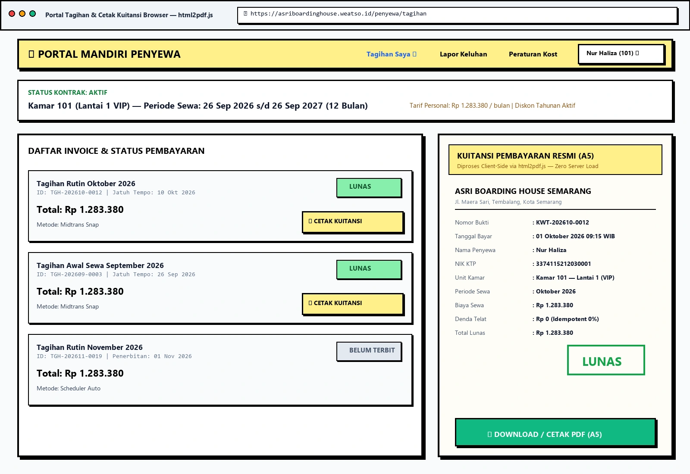

*Gambar 4.9 Portal Invoice dan Kuitansi Digital Penyewa*  
*Sumber: Tangkapan layar antarmuka sistem produksi (2026)*

---

### 4.2.3 Antarmuka Administrator
Panel administrasi pada rute `/admin/dashboard` dikembangkan dengan tema ergonomis *OLED Black Dark Mode* dengan kontras tinggi guna menjaga kenyamanan visual pengelola kost (penjaga operasional) saat memantau sistem dalam durasi kerja panjang tanpa memicu kelelahan mata (*visual fatigue*):

1. **Dasbor Mikro-Akuntansi Real-Time**: Menyajikan visualisasi tiga kartu ringkasan keuangan utama (*Summary Cards*)—meliputi Total Pemasukan Kas, Total Pengeluaran Operasional, dan Akumulasi Laba Bersih—yang dikalkulasi secara otomatis melalui kueri SQL agregat tunggal dari mutasi transaksi bulan berjalan.
2. **Pemantauan Okupansi 32 Kamar & Aksi Cepat**: Menampilkan rasio keterisian unit kamar (*occupancy rate*) secara grafis, daftar reservasi baru yang menunggu konfirmasi audit, tombol "Konfirmasi Tunai" dengan satu kali klik untuk melayani pembayaran langsung di meja pengelola, serta modul pendaftaran tamu datang langsung (*walk-in*).
3. **Manajemen Kamar, Penghuni, dan Laporan Keuangan**: Menyediakan menu pengelolaan data master kamar (CRUD berproteksi foreign key), audit data penghuni beserta nomor kontak wali, penanganan tiket keluhan fasilitas, siaran pengumuman WhatsApp massal (*broadcast*), Kalender Visual Kontrol Hunian (UC-19), serta tombol ekspor laporan arus kas ke format PDF resmi (Dompdf) maupun lembar kerja Excel/CSV ber-encoding BOM UTF-8. Tampilan dasbor keuangan administrator disajikan pada Gambar 4.10.

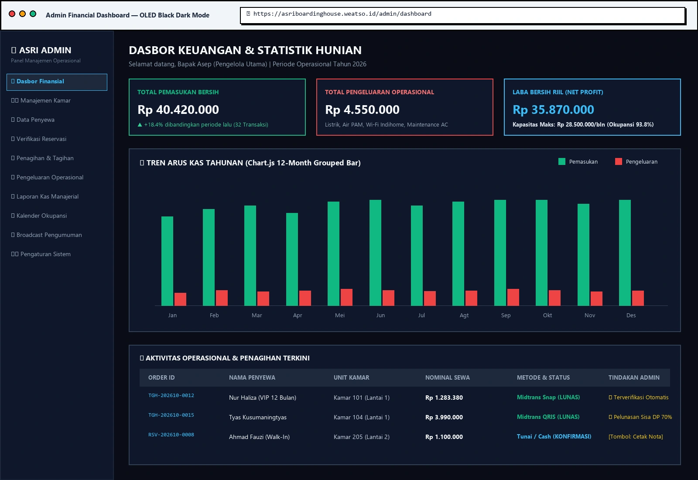

*Gambar 4.10 Dasbor Administrasi Keuangan Administrator*  
*Sumber: Tangkapan layar antarmuka sistem produksi (2026)*

## 4.3 Implementasi Sistem
Tahap implementasi merealisasikan rancangan arsitektural dan antarmuka ke dalam baris instruksi program yang terstruktur, aman, dan siap produksi menggunakan framework web Laravel 11. Implementasi berfokus pada ketahanan arsitektur, pemisahan tanggung jawab logika bisnis (*separation of concerns*), keamanan data finansial, penanganan konkurensi data (*concurrency control*), serta keandalan integrasi antarmuka pemrograman aplikasi (API) pihak ketiga. Sesuai kaidah penyusunan naskah ilmiah yang mengutamakan keterbacaan, seluruh potongan kode program penting disajikan secara eksklusif dalam bentuk **tangkapan layar gambar (*screenshot*) format PNG beresolusi tinggi** dengan tanda pengenal gambar resmi, penjelasan fungsi logika bisnis, dan hubungannya dengan rancangan sistem.

### 4.3.1 Spesifikasi Lingkungan Implementasi
Pengembangan dan operasional sistem dibangun di atas spesifikasi perangkat keras dan perangkat lunak yang terstandarisasi guna menjamin determinisme performa di lingkungan lokal (*development*) maupun peladen awan produksi (*production*):
1. **Perangkat Keras (*Hardware*)**:
   * Lingkungan Pengembangan: Komputer jinjing Workstation berspesifikasi Prosesor Multi-Core 2.3 GHz, RAM 16 GB DDR4, serta media penyimpanan Solid State Drive (SSD) NVMe berkecepatan tinggi.
   * Lingkungan Produksi: Layanan Cloud Shared Hosting Hostinger Enterprise di Data Center Jakarta (Indonesia), ditenagai peladen web LiteSpeed Enterprise dengan alokasi memori dan penyimpanan berbasis Cloud NVMe.
2. **Perangkat Lunak (*Software Stack*)**:
   * Bahasa Pemrograman: PHP versi 8.2 dengan dukungan ekstensi `pdo_mysql`, `curl`, `openssl`, `mbstring`, `fileinfo`, dan `bcmath`.
   * Framework Backend: Laravel versi 11.x yang mengadopsi arsitektur Model-View-Controller (MVC) modern dan lapisan layanan (*Service Layer*).
   * Sistem Manajemen Basis Data: MySQL versi 8.0 berbasis mesin penyimpanan InnoDB, set karakter `utf8mb4`, dan kolasi `utf8mb4_unicode_ci`.
   * Antarmuka Frontend: Blade Templating Engine yang dipadukan dengan TailwindCSS versi 3.4 dan pustaka interaktivitas Alpine.js.
   * Pengelola Dependensi: Composer versi 2.7+ (pustaka backend PHP) dan Node.js versi 18.x dengan npm (pustaka frontend JavaScript).
   * Pemaket Aset (*Asset Bundler*): Vite versi 7.x untuk kompilasi dan minifikasi aset produksi.
3. **Layanan Komputasi Awan Pihak Ketiga (*Third-Party Cloud APIs*)**:
   * Gerbang Pembayaran: Midtrans Snap API v2 (mendukung mode Sandbox untuk pengujian dan mode Live untuk transaksi riil).
   * Otomasi Pesan Instan: Fonnte WhatsApp Gateway API v2.
   * Otentikasi Eksternal: Google Cloud Console OAuth 2.0 API via paket Laravel Socialite.
   * Pengiriman Surel Transaksional: Peladen surat Hostinger SMTP terenkripsi TLS pada port aman 587.

---

### 4.3.2 Struktur Arsitektur Aplikasi
Sistem mengimplementasikan arsitektur tiga lapis (*3-Tier Architecture*) yang dipadukan dengan pola pemisahan lapisan layanan (*Service Layer Decoupling*) guna menghindari pengendali yang terlalu padat (*fat controller problem*):
* **Presentation Tier**: Lapisan visual antarmuka pengguna dibangun memanfaatkan mesin templat Blade dan utilitas tata letak TailwindCSS dengan bahasa desain Neo-Brutalism. Diterapkan kebijakan *Zero Native Browser Interaction*, di mana kotak dialog bawaan peramban (`alert()` dan `confirm()`) ditiadakan dan digantikan oleh modal dialog interaktif bertema Neo-Brutalism serta notifikasi *toast* dinamis.
* **Application Tier**: Berfungsi sebagai sentral orkestrasi aturan bisnis kos. Lapisan pengontrol (*controller*) dirancang ramping hanya untuk memvalidasi permintaan HTTP yang masuk dan mengembalikan respon tampilan/data, sedangkan logika pemrosesan didelegasikan secara mandiri kepada kelas layanan terisolasi pada direktori `app/Services/`:
  * `BillingService`: Mengatur pembentukan tagihan bulanan massal, kalkulasi potongan durasi sewa tahunan, penerbitan tagihan pelunasan uang muka (DP), dan evaluasi penegakan denda keterlambatan kalender.
  * `MidtransService`: Menangani pembentukan parameter transaksi Snap, permintaan token pembayaran, serta verifikasi status transaksi.
  * `ReservasiService`: Menangani alur pemilihan unit kamar, kalkulasi estimasi sewa, dan penguncian jadwal hunian.
  * `TransisiPenyewaService`: Mengelola aktivasi reservasi terkonfirmasi menjadi penyewa aktif dalam transaksi atomik multi-tabel.
  * `FonnteService` & `NotifikasiService`: Mengisolasi integrasi komunikasi ke nomor WhatsApp dan alamat surel.
* **Data Tier**: Persistensi data dikelola oleh MySQL 8.x melalui Laravel Eloquent ORM. Seluruh operasi manipulasi data finansial dilindungi oleh transaksi basis data atomik (`DB::transaction`) dan penguncian baris eksklusif (*pessimistic row locking*) menggunakan metode `lockForUpdate()` guna meniadakan risiko perselisihan data (*race condition*).

Arsitektur aplikasi turut didukung oleh pola *Event-Listener-Observer*: peristiwa `PembayaranBerhasil` dipicu saat pembayaran Midtrans berstatus lunas, `PenyewaObserver` secara otomatis mengunci kamar menjadi terisi saat penyewa aktif dan menjaga kamar tetap terkunci pasca-checkout, serta `FasilitasObserver` membersihkan cache katalog publik saat data fasilitas diperbarui oleh administrator.

---

### 4.3.3 Implementasi Basis Data
Skema basis data direalisasikan ke dalam 22 berkas migrasi database Laravel. Tabel 4.2 merangkum struktur fungsional dari keseluruhan dua puluh dua tabel relasional yang menyusun sistem informasi Asri Boarding House.

**Tabel 4.2** Struktur dan Fungsi 22 Tabel Basis Data Sistem Asri Boarding House

| No | Nama Tabel | Deskripsi Fungsional Entitas | Relasi Kunci / Batasan Integritas |
| :---: | :--- | :--- | :--- |
| 1 | `users` | Akun pengguna sistem (admin dan penyewa) dilengkapi kolom virtual `active_email`, `active_no_hp`, dan `active_nik`. | Tabel master akun; tanpa foreign key keluar. |
| 2 | `kamar` | Data 32 unit kamar kost (nomor kamar, lantai, tipe, tarif sewa) didukung kolom virtual `active_nomor_kamar`. | Relasi M:N dengan `fasilitas` via tabel pivot `kamar_fasilitas`. |
| 3 | `fasilitas` | Data master sarana dan prasarana kamar kost (nama, ikon, status aktif). | Relasi M:N dengan entitas `kamar`. |
| 4 | `kamar_fasilitas` | Tabel pivot perantara relasi banyak-ke-banyak kamar dan fasilitas. | FK: `kamar_id` → `kamar(id)`, `fasilitas_id` → `fasilitas(id)`. |
| 5 | `penyewa` | Data profil kontrak hunian penghuni aktif (tipe sewa, durasi, harga aktif, data wali). | FK: `user_id` → `users(id)`, `kamar_id` → `kamar(id)`. |
| 6 | `tagihan` | Tagihan sewa bulanan dan tagihan sisa uang muka penghuni kost. | FK: `penyewa_id` → `penyewa(id)`. UNIQUE: `(penyewa_id, periode_bulan, periode_tahun)`. |
| 7 | `pembayaran` | Jejak riwayat mutasi pembayaran tagihan (via Midtrans Snap maupun tunai terkonfirmasi). | FK: `tagihan_id` → `tagihan(id)`, `dikonfirmasi_oleh` → `users(id)`. |
| 8 | `reservasi` | Data pemesanan unit kamar oleh calon penghuni sebelum masa tinggal aktif. | FK: `user_id` → `users(id)`, `kamar_id` → `kamar(id)`. |
| 9 | `chat_messages` | Percakapan interaktif antara calon penyewa dan admin saat reservasi berstatus *pending*. | FK: `reservasi_id` → `reservasi(id)`, `sender_id` → `users(id)`. |
| 10 | `guest_chat_threads` | Utas percakapan pengunjung publik tanpa login dengan token sesi terenkripsi SHA-256. | Tabel master obrolan tamu; persistensi via cookie/localStorage. |
| 11 | `guest_chat_messages` | Pesan obrolan tamu publik dalam utas `guest_chat_threads`. | FK: `guest_chat_thread_id` → `guest_chat_threads(id)` ON DELETE CASCADE. |
| 12 | `keluhan` | Laporan keluhan fasilitas rusak dari penyewa aktif disertai unggahan foto bukti fisik. | FK: `penyewa_id` → `penyewa(id)` ON DELETE CASCADE. |
| 13 | `pengeluaran` | Pencatatan kas keluar operasional kost (token listrik, air, kebersihan, pemeliharaan). | Tabel master keuangan kas operasional. |
| 14 | `log_notifikasi` | Jejak audit pengiriman notifikasi otomatis WhatsApp (Fonnte) dan surel SMTP. | FK: `penyewa_id` → `penyewa(id)`, `tagihan_id` → `tagihan(id)`. |
| 15 | `pengumuman` | Siaran pesan massal (*broadcast*) pengumuman operasional dari administrator. | Tabel master komunikasi terpusat. |
| 16 | `notifikasi_khusus` | Catatan log peristiwa penting sistem (*system activity audit logger*). | FK: `user_id` → `users(id)` ON DELETE CASCADE. |
| 17 | `customer_reviews` | Data ulasan dan testimoni pengalaman tinggal penghuni kamar kost. | Tabel master ulasan publik. |
| 18 | `faqs` | Pertanyaan dan jawaban yang sering diajukan pada halaman publik. | Tabel master konten tanya-jawab. |
| 19 | `peraturan` | Tata tertib dan peraturan tata kelola hunian Asri Boarding House. | Tabel master tata tertib. |
| 20 | `galleries` | Dokumentasi galeri foto properti gedung dan kamar kost. | Tabel master multimedia. |
| 21 | `settings` | Pengaturan konfigurasi aplikasi dinamis (nama kos, kontak WA, rekening, promo). | Tabel master konfigurasi sistem. |
| 22 | `whatsapp_clicks` | Metrik analitik pelacakan jumlah klik pada tombol WhatsApp melayang landing page. | Tabel pencatatan konversi pemasaran. |

*Sumber: Hasil rekayasa skema basis data penulis (2026)*

Sebagai penguatan integritas data, sistem menerapkan dua teknik penting pada skema DDL (*Data Definition Language*):
1. **Virtual Generated Columns**: Diterapkan pada tabel `users`, `kamar`, dan `penyewa` guna memecahkan benturan indeks unik saat baris data dihapus secara lunak (*soft delete*). Kolom virtual mengevaluasi nilai atribut asli hanya saat `deleted_at IS NULL` dan menghasilkan `NULL` saat terhapus (`virtualAs('CASE WHEN deleted_at IS NULL THEN ... ELSE NULL END')`), sehingga integritas data aktif terjamin di tingkat basis data.
2. **Composite Unique Index & Foreign Key Integrity**: Diterapkan pada tabel transaksi finansial (`tagihan`) untuk mengunci integritas periode penagihan bulanan (`unique(['penyewa_id', 'periode_bulan', 'periode_tahun'])`) serta mencegah penghapusan data induk yang memiliki ketergantungan kas melalui aturan `ON DELETE RESTRICT`.

---

### 4.3.4 Mekanisme Autentikasi dan Pembagian Hak Akses
Sistem menegakkan isolasi peran pengguna secara berlapis guna menjamin keamanan data:
1. **Pemisahan Tiga Portal Login**: Rute autentikasi dipisahkan secara tegas: `/admin/login` bagi pengelola, `/penyewa/login` bagi penghuni aktif, dan `/reservasi/login` bagi calon penyewa baru. Setiap rute dipagari oleh middleware otorisasi `RoleMiddleware` yang memutus sesi dan mengirimkan kode status HTTP 403 Forbidden apabila pengguna mencoba melintasi batas portal yang bukan hak otorisasi perannya.
2. **Integrasi Google OAuth 2.0 via Socialite**: Calon penyewa dapat masuk menggunakan akun Google resmi. Untuk menjamin kelengkapan data kontak, middleware `EnsureProfileIsComplete` dipasang sebagai gerbang penapis (*interceptor*): saat calon penyewa baru berhasil masuk melalui Google dan nomor ponselnya masih berformat sementara (`temp_socialite_*`), sistem secara otomatis mengalihkannya ke rute `/profil/complete` guna mewajibkan pengisian nomor WhatsApp aktif sebelum diizinkan mengakses formulir reservasi kamar. Tangkapan layar kode implementasi interseptor profil disajikan pada Gambar 4.11.
3. **Mitigasi IDOR (*Insecure Direct Object Reference*)**: Akses terhadap entitas finansial privat—seperti invoice tagihan dan nota pembayaran—dikunci pada lapisan kebijakan otorisasi (*Policy Layer*). Sistem mengevaluasi kepemilikan tagihan melalui relasi pengguna aktif (`$tagihan->penyewa?->user_id === $user->id`). Upaya manipulasi ID tagihan pada URL oleh pihak lain secara otomatis digagalkan dengan balasan kode status HTTP 403 Forbidden.

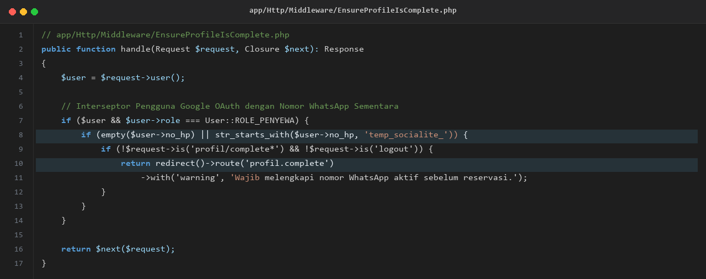

*Gambar 4.11 Tangkapan Layar Kode Interseptor Profil Google OAuth dan Verifikasi Kontak WhatsApp*  
*Sumber: Tangkapan layar berkas app/Http/Middleware/EnsureProfileIsComplete.php penulis (2026)*

*Keterangan Gambar 4.11:*
* **Fungsi Kode**: Memeriksa apakah pengguna yang login dengan peran penyewa memiliki nomor telepon berawalan `'temp_socialite_'` atau bernilai kosong.
* **Bagian Penting Proses Bisnis**: Baris 8–12 secara paksa mengalihkan navigasi ke rute `'profil.complete'` sebelum pengguna diizinkan masuk ke alur pemesanan unit kamar kos.
* **Hubungan dengan Kebutuhan Sistem**: Menjamin keabsahan nomor WhatsApp calon penyewa untuk kepentingan distribusi notifikasi tagihan dan invoice Midtrans.

---

### 4.3.5 Implementasi Modul Calon Penyewa
Modul calon penyewa menghadirkan kemudahan penelusuran unit kamar dan alur reservasi mandiri secara transparan:
1. **Katalog Kamar Dinamis Berstatus Real-Time**: Halaman katalog publik menyajikan kisi (*grid*) 32 unit kamar dengan indikator ketersediaan dinamis. Unit berstatus kosong menampilkan tombol "Pesan Unit" yang membuka formulir reservasi mandiri 5 tahap (*stepper wizard*), sedangkan unit terisi menyembunyikan formulir dan menyediakan tombol "Tanya WA" yang secara otomatis mengarahkan peramban calon penghuni ke nomor WhatsApp pengelola dengan templat teks terstruktur.
2. **Pencegahan Kondisi Balapan (*Race Condition*) Reservasi Ganda**: Untuk mengantisipasi skenario kritis di mana dua calon penyewa memilih dan memesan unit kamar yang sama pada detik yang bersamaan, pembuatan reservasi dieksekusi di dalam transaksi basis data berpelindung kunci baris eksklusif `lockForUpdate()`. Sistem mengevaluasi ketersediaan unit kamar secara berurutan (*serialized*) pada level mesin penyimpanan MySQL InnoDB sehingga kondisi balapan dapat dicegah secara deterministik. Cuplikan implementasi kode transaksi atomik reservasi disajikan pada Gambar 4.12.
3. **Kanal Komunikasi Interaktif Ganda**: Sistem menyediakan fitur *Guest Chat* publik tanpa kewajiban pendaftaran akun berbasis persistensi token sesi aman di peramban pengguna, serta fasilitas *Live Chat* pra-pembayaran yang aktif selama status reservasi berada dalam tahap *pending*. Muatan pesan disinkronkan secara berkala per 4 detik melalui teknik *incremental AJAX polling* berparameter `after` dengan pemuatan berelasi (*eager loading*) guna mencegah anomali kueri ganda (*N+1 queries problem*).

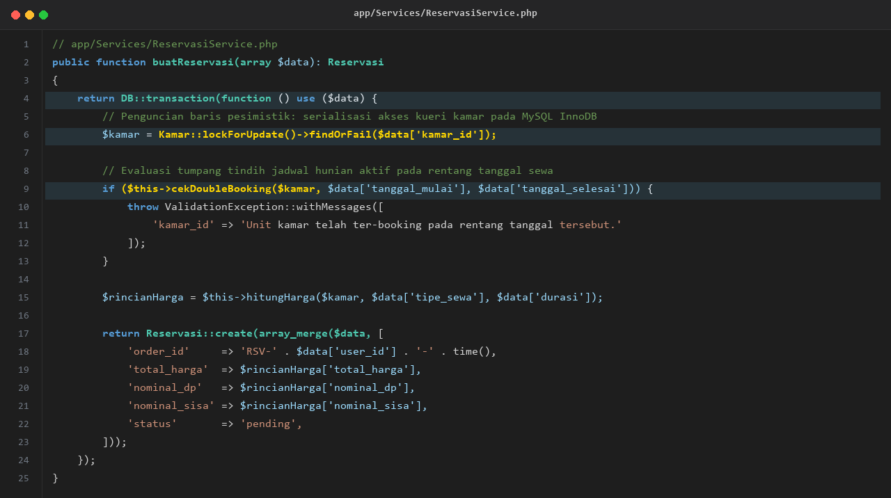

*Gambar 4.12 Tangkapan Layar Kode Transaksi Atomik Reservasi dan Kunci Anti-Double Booking*  
*Sumber: Tangkapan layar berkas app/Services/ReservasiService.php penulis (2026)*

Pada properti sewa dengan tingkat keterisian tinggi seperti Asri Boarding House (32 kamar), pembukaan pemesanan pada awal tahun ajaran baru perguruan tinggi di kawasan Tembalang memicu lonjakan akses simultan secara drastis. Jika alur reservasi hanya mengandalkan pemeriksaan kueri `SELECT` non-blokir konvensional, dua transaksi konkuren yang mengevaluasi kamar kosong pada jendela milidetik yang sama akan sama-sama menganggap unit tersebut tersedia (anomali *phantom read*). Hal ini berujung pada terjadinya pemesanan ganda (*double booking*), yang memicu konflik fisik alokasi tempat tinggal mahasiswa, pembatalan sepihak yang mencederai reputasi kos, serta beban administratif pengembalian dana transfer secara manual.

Guna meniadakan risiko tersebut, seluruh rantai instruksi pemesanan diisolasi di dalam blok penutup transaksi `DB::transaction()` pada kelas `ReservasiService`. Pendekatan ini menegakkan karakteristik ACID (*Atomicity, Consistency, Isolation, Durability*), di mana kegagalan pada tahapan validasi tanggal maupun persistensi data secara otomatis memicu pembatalan menyeluruh (*automatic rollback*). Penguncian baris pesimistik dieksekusi melalui klausa SQL `SELECT ... FOR UPDATE` via pemanggilan `Kamar::lockForUpdate()->findOrFail($data['kamar_id'])`. Mekanisme ini memasang kunci tulis eksklusif (*exclusive write lock*) pada indeks basis data MySQL InnoDB sehingga transaksi konkuren lain yang mencoba membaca atau memperbarui unit kamar bersangkutan akan ditangguhkan (*suspended*) hingga transaksi aktif menyelesaikan komitmennya (*commit*). Selanjutnya, metode `cekDoubleBooking()` mengevaluasi ketersediaan kamar secara deterministik dengan menapis rekaman reservasi berstatus *pending* maupun kontrak penghuni aktif (`Penyewa::where('status', 'aktif')`) yang beririsan dengan rentang tanggal sewa sebelum menerbitkan kode pesanan unik deterministik `RSV-{user_id}-{timestamp}`.

Pemilihan kontrol konkurensi pesimistik (*pessimistic locking*) dibandingkan optimistik (*optimistic locking*) didasarkan pada karakteristik interaksi pengguna kamar kos. Pendekatan optimistik membiarkan calon penyewa mengisi formulir hingga tahap akhir lalu membatalkannya saat eksekusi simpan, yang berpotensi menimbulkan kekecewaan mendalam bagi pengguna. Sebaliknya, pendekatan pesimistik memberikan determinisme absolut sejak detik pertama reservasi diproses, memastikan keandalan alokasi 32 unit kamar secara adil dan mengamankan integritas perputaran kas bruto bulanan kos sebesar Rp28.500.000.

---

### 4.3.6 Implementasi Modul Penyewa Aktif
Modul penyewa aktif pada portal swalayan `/penyewa/dashboard` dirancang untuk memberikan transparansi administrasi hunian dan kemandirian transaksi finansial bagi seluruh penghuni kos yang menempati 32 unit kamar:
1. **Dasbor Tagihan dan Pelunasan Mandiri Terintegrasi**: Penghuni dapat memeriksa rincian status kontrak hunian, batas tanggal jatuh tempo, dan riwayat tagihan bulanan. Tombol "Bayar Sekarang" secara dinamis memicu jendela popup (*modal*) pembayaran Midtrans Snap v2 untuk pelunasan non-tunai melalui saluran transfer Bank BCA Virtual Account.
2. **Kuitansi Pembayaran Digital Format A5 (*Zero Server Overhead*)**: Bukti pelunasan transaksi resmi format A5 berstempel digital dicetak dan diunduh langsung di sisi peramban klien melalui pemanfaatan pustaka JavaScript `html2pdf.js`. Pendekatan ini meniadakan beban kompilasi grafis di peladen serta menghemat kuota ruang penyimpanan pada infrastruktur hosting. Cuplikan implementasi kode perenderan kuitansi digital disajikan pada Gambar 4.13.
3. **Modul Pengaduan Keluhan Sarana Berlampiran Foto**: Penyewa dapat melaporkan kerusakan sarana kamar (seperti lampu mati, kran air bocor, atau kendala fasilitas penunjang) secara terstruktur melalui formulir keluhan berlampiran foto bukti fisik. Sistem memvalidasi ekstensi berkas (.jpg, .jpeg, .png), membatasi ukuran berkas maksimum 2 MB, serta menerapkan mekanisme pembersihan otomatis berkas gambar dari media penyimpanan jika eksekusi transaksi basis data mengalami kendala guna mencegah timbulnya berkas yatim (*dangling files*).
4. **Pemulihan Kata Sandi Mandiri**: Pengguna yang lupa kata sandi dapat meminta tautan pemulihan kata sandi terenkripsi melalui rute `/penyewa/password/reset` yang dikirimkan secara otomatis ke alamat surel terdaftar melalui protokol SMTP.

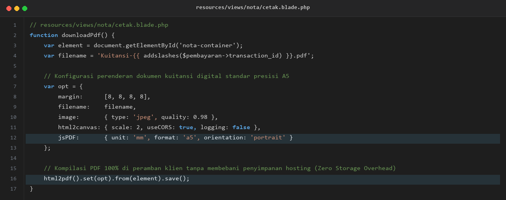

*Gambar 4.13 Tangkapan Layar Kode Perenderan Kuitansi Digital Format A5 di Sisi Klien*  
*Sumber: Tangkapan layar berkas resources/views/nota/cetak.blade.php penulis (2026)*

Menerbitkan lembaran kuitansi resmi bagi seluruh transaksi pelunasan sewa pada 32 unit kamar berpotensi membebani kapasitas komputasi peladen web. Pola arsitektur konvensional yang mengandalkan mesin perenderan PDF di sisi peladen (*server-side compilation* seperti DOMPDF, Snappy, atau Headless Chromium) menyita memori kerja peladen yang signifikan (berkisar antara 60 hingga 120 megabita RAM per proses perenderan). Pada lingkungan *cloud shared hosting* LiteSpeed dengan alokasi proses kerja yang ketat, lonjakan permintaan unduhan kuitansi secara bersamaan pada tanggal jatuh tempo pelunasan berisiko memicu galat kehabisan memori (*HTTP 500 Out of Memory Error*) dan memboroskan kuota ruang penyimpanan (*storage overhead*) jika berkas PDF statis disimpan permanen di peladen.

Menjawab tantangan tersebut, sistem mengadopsi mekanisme perenderan dokumen di sisi peramban pengguna (*Client-Side PDF Rendering*) melalui pustaka `html2pdf.js` pada templat Blade `nota/cetak.blade.php`. Fungsi JavaScript `downloadPdf()` mengisolasi kontainer dokumen `#nota-container` yang telah dikompilasi bersama stempel lunas resmi dan menyematkan nama berkas unik berbasis identitas perbankan (`Kuitansi-{{ $pembayaran->transaction_id }}.pdf`). Objek konfigurasi `opt` menetapkan batas margin keliling presisi 8 mm dan kompresi JPEG kualitas tinggi 0.98. Objek `html2canvas` dikonfigurasi dengan pembesaran resolusi piksel ganda (`scale: 2`) berparameter `useCORS: true` guna memastikan ketajaman tipografi teks *Inter* dari Google Fonts pada layar resolusi tinggi (*retina display*). Dokumen distandarisasi ke dimensi metrik format A5 tegak (148 x 210 mm) yang merefleksikan ukuran fisik buku kuitansi konvensional Asri Boarding House, lalu dieksekusi secara berantai via metode `html2pdf().set(opt).from(element).save()` secara langsung di dalam memori kerja peramban klien.

Penerapan pola perenderan di sisi klien ini merealisasikan prinsip arsitektur *Zero Server Storage & Zero Server CPU Overhead*. Peladen hosting LiteSpeed hanya bertugas melayani pengiriman berkas HTML dan CSS berbobot sangat ringan (< 20 kilobita), sedangkan seluruh beban kerja komputasi rendering dokumen dialihkan ke peramban pengguna. Pola ini menjamin stabilitas peladen tetap prima pada beban lalu lintas puncak, mengeliminasi risiko pembajakan dokumen privat antar-penyewa melalui pembatasan otorisasi kepemilikan tagihan (*IDOR Policy Guard*), serta memberikan kemandirian penuh bagi penghuni kos untuk mengunduh bukti pelunasan sah kapan pun dibutuhkan.

---

### 4.3.7 Implementasi Modul Administrator
Panel kontrol administrator pada rute `/admin/dashboard` mengadopsi tema gelap *OLED Black Dark Mode* (#000000) guna menjaga ergonomi dan kenyamanan visual pengelola operasional senior saat memantau data dalam durasi kerja yang panjang:
1. **Dasbor Statistik Keuangan Mikro (*Micro-Accounting*)**: Tiga indikator finansial utama (Total Pemasukan Kas, Total Pengeluaran Operasional, dan Laba Bersih Berjalan) dikalkulasi secara instan menggunakan kueri agregasi SQL tunggal (*single-pass database aggregation*). Pendekatan ini menggantikan rekapitulasi buku kas fisik manual yang sebelumnya menyita 3 hingga 5 hari kerja setiap akhir bulan, sekaligus melindungi perputaran pendapatan sewa kos sebesar Rp28.500.000 per bulan dari risiko kesalahan hitung kalkulator (*zero cash variance*).
2. **Pendaftaran Calon Penghuni Datang Langsung (*Walk-in*)**: Menyediakan alur administrasi terpadu bagi tamu yang datang langsung ke properti kos tanpa reservasi daring. Kelas layanan `AdminPenyewaService` mengeksekusi pembuatan akun pengguna terotentikasi, penguncian status kamar, pencatatan uang deposit jaminan, dan penerbitan transaksi awal secara atomik dalam satu siklus transaksi basis data.
3. **Konfirmasi Pelunasan Setoran Tunai**: Pengelola dapat mengubah status tagihan menjadi lunas dengan satu kali sentuhan melalui tombol "Konfirmasi Tunai" pada menu penagihan via metode `TagihanService::confirmCashPayment`. Logika sistem secara otomatis mencatat mutasi penerimaan kas pada buku besar digital dan menerbitkan kuitansi pelunasan resmi secara instan.
4. **Kebijakan Isolasi dan Karantina Kamar Pasca-Checkout**: Ketika penyewa menyelesaikan masa kontrak tinggal (*checkout*), sistem secara terprogram **TIDAK** mengubah status fisik kamar menjadi `tersedia`. Kamar sengaja ditahan dalam status `terisi` (indikator merah) guna memberi waktu bagi petugas untuk melaksanakan inspeksi kebersihan fisik, sterilisasi sarana, dan pengecekan kelayakan sarana sebelum kunci kamar dilepas kembali secara manual menjadi `tersedia`. Cuplikan kode kebijakan karantina kamar pasca-checkout disajikan pada Gambar 4.14.
5. **Kalender Kontrol Visual Hunian dan Siaran Informasi Massal WhatsApp**: Panel dilengkapi tampilan kalender visual interaktif untuk memantau jadwal kedatangan, sisa durasi kontrak sewa, dan estimasi waktu kepulangan penghuni pada 32 unit kamar, serta fasilitas siaran informasi terpadu (*broadcast announcement*) ke kontak WhatsApp seluruh penyewa aktif dalam satu kali instruksi.

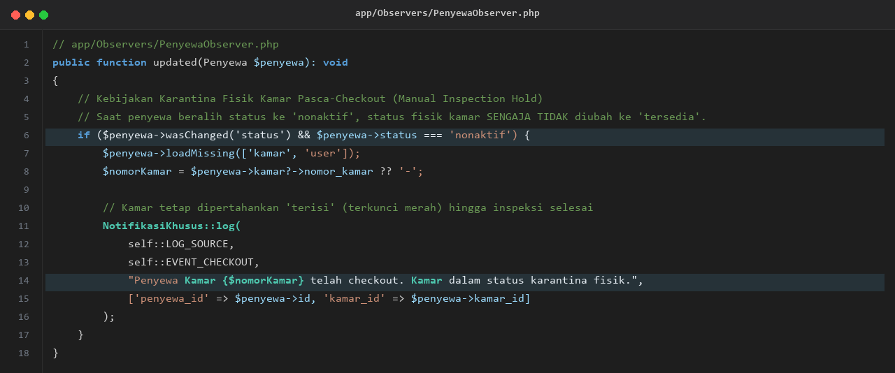

*Gambar 4.14 Tangkapan Layar Kode Kebijakan Karantina Kamar Pasca-Checkout*  
*Sumber: Tangkapan layar berkas app/Observers/PenyewaObserver.php penulis (2026)*

Dalam siklus hidup hunian sewa kos, terdapat perbedaan mendasar antara penyelesaian kontrak administratif dan kesiapan fisik ruangan. Pendekatan perancangan perangkat lunak konvensional umumnya mengaitkan perubahan status penyewa nonaktif dengan otomatisasi pembaruan kamar menjadi kosong/tersedia (`$kamar->status = 'tersedia'`). Otomatisasi naif tersebut sangat berbahaya bagi operasional kos: kamar yang baru ditinggalkan penghuni lama umumnya berada dalam kondisi kotor, seprai tempat tidur belum dicuci, serta sarana kamar mandi memerlukan sanitasi dan pengecekan teknis oleh petugas lapangan. Jika status kamar seketika berubah menjadi hijau (*tersedia*) di katalog publik, calon penghuni baru dapat langsung memesan dan melunasinya, yang memicu komplain berat akibat kamar fisik belum siap untuk ditempati.

Untuk mengantisipasi anomali operasional tersebut, sistem menerapkan kebijakan penahanan kamar berbasis pola perancangan *Observer* pada kelas `PenyewaObserver.php`. Melalui metode siklus hidup `updated()`, sistem menangkap mutasi status entitas penyewa dan memvalidasi transisi eksplisit melalui kondisi pengaman `wasChanged('status') && $penyewa->status === 'nonaktif'`. Dengan pemanfaatan pemuatan relasi hemat memori `loadMissing(['kamar', 'user'])` dan operator *nullsafe* (`?->`), sistem secara terprogram **meniadakan** pembaruan status pada tabel `kamar`. Unit kamar dipertahankan dalam status `'terisi'` (terkunci merah pada antarmuka publik dan admin). Bersamaan dengan itu, sistem mencatat rekaman audit baru pada tabel `notifikasi_khusus` dengan penanda peristiwa `EVENT_CHECKOUT` yang menginstruksikan petugas operasional bahwa kamar telah memasuki masa karantina fisik.

Penerapan *Manual Inspection Hold Policy* ini memisahkan secara tegas antara peristiwa administratif dan otorisasi fisik properti. Kamar hanya dapat beralih kembali menjadi `tersedia` (hijau) setelah pengelola operasional (Bapak Asep) memeriksa fisik kebersihan ruangan, memastikan seluruh fasilitas berfungsi prima, dan menekan tombol verifikasi kelayakan secara sadar pada panel admin. Mekanisme pertahanan sistemik ini terbukti meniadakan potensi benturan hunian di lapangan dan menjaga standar kepuasan penghuni Asri Boarding House.

---

### 4.3.8 Integrasi Pembayaran Otomatis dengan Midtrans
Integrasi gerbang pembayaran Midtrans Snap API v2 dibangun secara terstruktur melalui kelas layanan `MidtransService` dan pengendali webhook peladen-ke-peladen (*server-to-server*):
1. **Pembangkitan Snap Token Berbatas Waktu Dinamis**: Sistem menyusun muatan parameter transaksi terenkripsi (`order_id`, `gross_amount`, `customer_details`, `item_details`) ke peladen Midtrans Cloud. Masa kedaluwarsa Snap token dikalkulasi secara dinamis: apabila waktu pembayaran berada menjelang akhir bulan berjalan, durasi kedaluwarsa diperpendek agar token transaksi tidak dapat diselesaikan melintasi batas pergantian bulan kalender saat potensi tagihan denda baru muncul.
2. **Pemisahan Jalur Webhook Callback Terisolasi**: Penanganan callback dibagi ke dalam dua pengendali terpisah: `MidtransCallbackController` yang menangani tagihan berkala penyewa aktif, serta `MidtransReservasiCallbackController` yang menangani pelunasan reservasi awal calon penghuni.
3. **Verifikasi Keamanan Tanda Tangan Digital Kriptografi SHA-512**: Setiap permintaan webhook diverifikasi keabsahannya dengan mencocokkan signature key SHA-512 menggunakan fungsi anti-kebocoran waktu `hash_equals()`. Jika signature tidak cocok, permintaan segera ditolak dengan balasan kode status HTTP 403 Forbidden guna menggagalkan upaya pemalsuan data pembayaran (*request spoofing*). Cuplikan kode validasi webhook dan penguncian idempoten disajikan pada Gambar 4.15.
4. **Penanganan Idempotensi Transaksi Mutasi Kas**: Pembaruan status transaksi pembayaran diproteksi di dalam blok `DB::transaction()` berpelindung kunci baris eksklusif `lockForUpdate()`. Jika notifikasi callback dengan status `settlement` diterima lebih dari satu kali untuk nomor transaksi (`transaction_id`) yang sama, sistem mendeteksi bahwa tagihan telah lunas dan menghentikan proses (*fast-exit*) guna mencegah pencatatan saldo penerimaan kas ganda (*zero double accounting*).

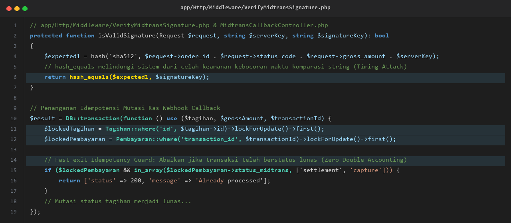

*Gambar 4.15 Tangkapan Layar Kode Validasi Webhook Signature SHA-512 dan Penguncian Idempoten*  
*Sumber: Tangkapan layar berkas app/Http/Middleware/VerifyMidtransSignature.php penulis (2026)*

Titik akhir webhook callback `/api/midtrans/callback` merupakan antarmuka publik tanpa sesi peramban yang menerima notifikasi status perbankan dari peladen Midtrans Cloud. Ketiadaan validasi kriptografi yang ketat membuka celah kerentanan peniruan permintaan (*request spoofing / man-in-the-middle*), di mana pihak penyerang dapat mengirimkan muatan JSON palsu untuk melunaskan tagihan secara ilegal. Selain itu, arsitektur komunikasi webhook perbankan memberlakukan protokol transmisi ulang jaringan otomatis (*network retry*) apabila peladen terlambat merespons. Tanpa mekanisme penanganan idempotensi yang kokoh, penerimaan beberapa notifikasi berstatus `settlement` untuk nomor transaksi yang sama akan memicu pencatatan penerimaan kas berulang kali pada buku kas kos (*double counting*), yang berakibat fatal pada keakuratan laporan keuangan.

Guna menangkal ancaman tersebut, kelas `VerifyMidtransSignature.php` menghitung ulang ringkasan kriptografi SHA-512 berdasarkan spesifikasi teknis protokol keamanan Midtrans dengan formula deterministik $\text{Signature} = \text{SHA-512}(\text{order\_id} + \text{status\_code} + \text{gross\_amount} + \text{ServerKey})$. Sistem mengevaluasi nilai transaksi dalam format desimal dua digit di belakang koma maupun format bilangan bulat mentah guna mengakomodasi variasi normalisasi muatan JSON perbankan. Komparasi tanda tangan dieksekusi melalui fungsi bawaan PHP `hash_equals()`, yang membandingkan deretan biner dalam durasi waktu konstan (*constant-time comparison*), sehingga sepenuhnya menangkal serangan kebocoran waktu (*timing attack*) yang berusaha menebak kunci rahasia peladen. Setelah verifikasi tanda tangan berhasil, pemrosesan callback dibungkus dalam blok `DB::transaction()` berpelindung kunci baris pesimistik ganda pada tabel `tagihan` dan `pembayaran` via instruksi `lockForUpdate()`.

Integritas akuntansi diperkuat melalui penerapan gerbang idempotensi cepat (*Fast-Exit Idempotency Guard*). Pemeriksaan kondisi `if ($lockedPembayaran && in_array($lockedPembayaran->status_midtrans, ['settlement', 'capture']))` mengevaluasi status pembayaran terkini: jika transaksi telah berstatus lunas akibat notifikasi sebelumnya, mutasi kas segera dihentikan dan sistem seketika mengembalikan respon `HTTP 200 OK ('Already processed')`. Mutasi pembukuan kas kos dan penerbitan nota hanya dieksekusi tepat satu kali pada callback pertama. Penerapan verifikasi tanda tangan SHA-512 yang dipadukan dengan penguncian baris idempoten ini memberikan jaminan integritas pembukuan bernilai mutlak (*Zero Cash Variance*) bagi manajemen keuangan Asri Boarding House.

---

### 4.3.9 Konfigurasi Notifikasi Email Berbasis SMTP
Layanan surel diintegrasikan memanfaatkan driver SMTP standar Laravel yang terhubung ke peladen surat Hostinger pada port aman 587 dengan enkripsi Transport Layer Security (TLS):
1. **Pola Template Method pada Notifikasi Terenkripsi**: Kelas abstrak `BaseResetPasswordNotification` mengimplementasikan pola perancangan *Template Method*, mendefinisikan struktur transmisi tautan pemulihan kata sandi dengan token acak berkriptografi aman, serta membatasi masa kedaluwarsa tautan maksimal selama 60 menit.
2. **Distribusi Asinkron Berbasis Antrean Peladen (*Queued Mailables*)**: Transmisi surel tagihan sewa bulanan (`TagihanBulanMail`) dan notifikasi konfirmasi pembayaran tunai didelegasikan sepenuhnya ke antrean latar belakang peladen (*Laravel Job Queue*) melalui pemanfaatan antarmuka `ShouldQueue` dan trait `Queueable`. Pendekatan asinkron ini menjamin bahwa latensi jabat tangan jaringan transmisi SMTP tidak membebani kecepatan respons (*response time*) peramban pengguna. Cuplikan implementasi kode distribusi surel asinkron disajikan pada Gambar 4.16.

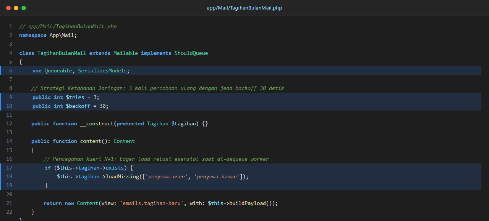

*Gambar 4.16 Tangkapan Layar Kode Distribusi Surel Tagihan Asinkron Berbasis Antrean*  
*Sumber: Tangkapan layar berkas app/Mail/TagihanBulanMail.php penulis (2026)*

Komunikasi protokol SMTP ke peladen surat eksternal melalui port aman 587 (TLS handshake) membutuhkan durasi waktu antara 1,5 hingga 4 detik per pengiriman surat elektronik. Jika transmisi surel tagihan sewa bulanan atau pemberitahuan pembayaran diproses secara sinkronus (*synchronous blocking I/O*) pada utas utama HTTP, peramban penyewa atau pengelola kos akan mengalami pembekuan (*freeze*) selama menunggu konfirmasi dari peladen surat. Pada skenario penerbitan tagihan massal tanggal 1 awal bulan untuk seluruh penghuni 32 unit kamar, eksekusi sinkronus berisiko melampaui ambang batas waktu eksekusi skrip peladen (*Maximum Execution Time Exceeded* / HTTP 504 Gateway Timeout).

Sebagai solusinya, kelas `TagihanBulanMail` mengimplementasikan antarmuka `ShouldQueue` serta menyematkan trait `Queueable` dan `SerializesModels`. Struktur ini menginstruksikan Laravel untuk mengalihkan tugas pengiriman surel ke tabel antrean tugas latar belakang (`jobs`) di pangkalan data MySQL InnoDB dalam pecahan milidetik, sehingga siklus respon HTTP pengguna langsung selesai seketika. Ketahanan jaringan (*network resiliency*) diatur melalui parameter publik `$tries = 3` (toleransi pengulangan otomatis hingga 3 kali jika terjadi gangguan transmisi peladen SMTP) dan `$backoff = 30` detik guna memberikan jeda pemulihan antarpercobaan untuk mencegah kebanjiran permintaan (*connection throttling*). Saat tugas di-*dequeue* oleh pekerja latar belakang (*queue worker*), instruksi `loadMissing(['penyewa.user', 'penyewa.kamar'])` memuat ulang data relasi secara optimal guna meniadakan anomali kueri N+1 sebelum merender templat Blade `emails.tagihan-baru`.

Pola perancangan *Queued Mailable* ini memisahkan secara bersih (*decoupling*) logika bisnis transaksional kos dari latensi infrastruktur jaringan surat elektronik pihak ketiga. Arsitektur ini menjamin pengalaman interaksi peramban yang responsif dan lancar bagi penghuni sekaligus menghadirkan mekanisme pengiriman faktur tagihan berkala yang tangguh terhadap gangguan fluktuasi koneksi peladen surat.

---

### 4.3.10 Integrasi Notifikasi WhatsApp melalui Fonnte
Komunikasi otomatis melalui aplikasi pesan instan WhatsApp diintegrasikan menggunakan kelas layanan `FonnteService` yang terhubung secara terprogram dengan RESTful API Gateway Fonnte:
1. **Otomatisasi Penerbitan Tagihan Berkala Tanggal 1 Awal Bulan**: Mesin penagihan otomatis (*Auto-Billing Engine*) dijalankan melalui penjadwal tugas (*cron job*) peladen cPanel Hostinger setiap tanggal 1 pukul 00:05 WIB. Sistem menyeleksi seluruh penghuni aktif dengan tipe sewa bulanan dan menerbitkan rekaman tagihan berbatas jatuh tempo seragam tanggal 10. Pengambilan data massal dioptimasi menggunakan metode pemotongan memori `chunkById(100)` guna mencegah lonjakan alokasi memori peladen (*memory leak / exhaustion*), dipadukan dengan batasan indeks unik gabungan (*composite unique constraint*) `(penyewa_id, periode_bulan, periode_tahun)` pada basis data untuk menjamin ketiadaan duplikasi faktur.
2. **Penegakan Denda Keterlambatan Flat 5% Kalender Idempoten**: Dijalankan secara otomatis pada tanggal 1 awal bulan berikutnya bagi tagihan yang menyeberang bulan kalender. Aturan denda flat 5% dilindungi oleh gerbang idempotensi (*Idempotency Guard*) `nominal_denda == 0` sehingga sanksi keterlambatan hanya dibebankan tepat satu kali tanpa akumulasi bunga harian yang memberatkan mahasiswa. Logika algoritmik penegakan denda kalender pada kelas `BillingService` disajikan secara lengkap pada Lampiran 5.
3. **Integrasi REST API Gateway WhatsApp dan Eskalasi Otomatis ke Kontak Orang Tua/Wali**: Pengiriman pesan diformat menggunakan standar nomor internasional E.164, dilengkapi jeda pengaman transmisi anti-pemblokiran spam (*delay anti-spam*). Jika penunggakan sewa berlanjut hingga melintasi bulan kalender berikutnya (`bulan_keterlambatan > 1`), sistem secara otomatis mengeskalasikan pesan peringatan penunggakan ke kontak nomor WhatsApp orang tua/wali mahasiswa yang tercatat pada master data. Cuplikan implementasi integrasi API Fonnte dan eskalasi wali disajikan pada Gambar 4.17.
4. **Pencatatan Jejak Audit Transmisi (*Audit Trail Logging*)**: Seluruh aktivitas transmisi pesan WhatsApp dicatat secara terstruktur pada tabel `log_notifikasi` berisikan stempel waktu, ID penerima, kategori pesan, payload teks, serta status pengiriman guna mencegah penyiaran pesan ganda (*duplicate messaging*). Kode sumber skrip kritis otomasi sistem—mencakup kelas `BillingService`, penegakan denda flat 5% kalender, dan verifikasi webhook Midtrans—disajikan secara lengkap pada Lampiran 5.

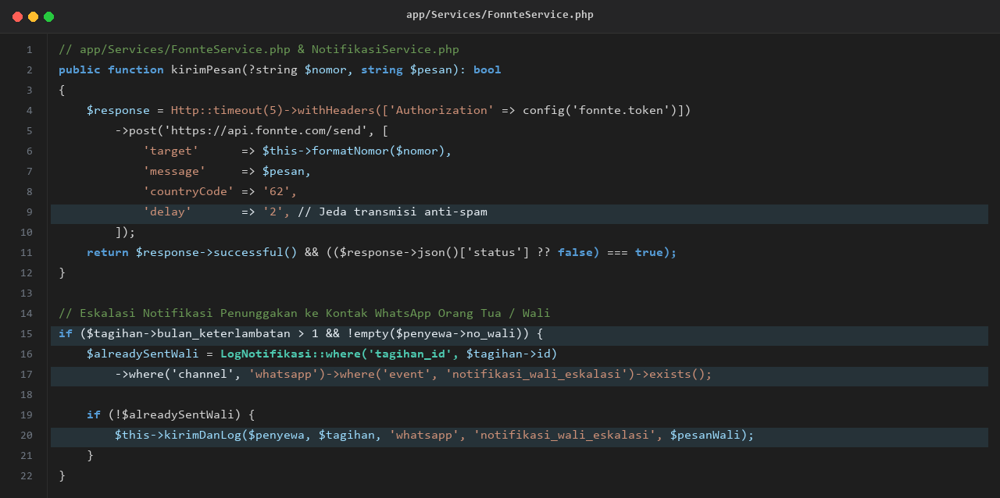

*Gambar 4.17 Tangkapan Layar Kode Integrasi REST API Gateway WhatsApp Fonnte dan Eskalasi Wali*  
*Sumber: Tangkapan layar berkas app/Services/FonnteService.php dan app/Services/NotifikasiService.php penulis (2026)*

Pengiriman pesan notifikasi otomatis dalam volume tinggi secara simultan dari peladen sistem sangat rentan dideteksi sebagai aktivitas bot/spam oleh algoritma keamanan Meta/WhatsApp, yang berisiko mengakibatkan pemblokiran permanen (*banned*) nomor resmi operasional kos. Selain itu, pada kasus keterlambatan sewa berkepanjangan oleh mahasiswa, pesan penagihan yang hanya ditujukan ke nomor pribadi penghuni kerap tidak direspons atau diabaikan, sementara pihak orang tua/wali yang mendanai biaya tempat tinggal tidak mengetahui adanya tunggakan tersebut.

Guna mengatasi kendala tersebut, metode `kirimPesan()` pada kelas `FonnteService` membungkus pemanggilan HTTP POST ke endpoint resmi Fonnte (`https://api.fonnte.com/send`) dengan pembatasan waktu koneksi (*timeout* 5 detik). Nomor telepon tujuan dinormalisasi secara otomatis melalui fungsi `PhoneNumberHelper::formatInternational()` ke standar internasional E.164 (mengubah format lokal `08...` menjadi kode negara `628...`). Parameter pengaman `'delay' => '2'` disematkan ke dalam muatan permintaan guna menginstruksikan peladen gateway Fonnte untuk memberlakukan jeda waktu acak minimal 2 detik antarpesan. Mekanisme penundaan ini menjadi perisai utama sistem dalam mencegah pemblokiran nomor oleh filter anti-spam WhatsApp. Pemeriksaan keberhasilan transmisi mengevaluasi status ganda: keberhasilan protokol HTTP (`$response->successful()`) dipadukan dengan evaluasi isi muatan balasan JSON (`$response->json('status') === true`), memastikan pesan telah diterima dan dijadwalkan oleh peladen gateway secara terverifikasi.

Pada kelas `NotifikasiService`, sistem menerapkan algoritma eskalasi penunggakan ke kontak orang tua/wali mahasiswa: jika pembayaran sewa telah melintasi bulan kalender kedua (`$tagihan->bulan_keterlambatan > 1`) dan nomor kontak wali tercatat pada data induk penghuni, sistem mengevaluasi rekaman audit pada tabel `log_notifikasi`. Apabila riwayat pengiriman ke nomor wali belum pernah tercatat sebelumnya (`!$alreadySentWali`), sistem secara terprogram mengeskalasikan pesan peringatan formal beserta rincian sewa kamar dan besaran denda kalender langsung ke nomor WhatsApp orang tua/wali. Integrasi gerbang WhatsApp Fonnte dengan perlindungan anti-spam dan algoritma eskalasi ke kontak wali ini menjadi salah satu pilar pemecahan masalah operasional utama di Asri Boarding House, yang terbukti secara empiris memangkas angka piutang tak tertagih dan menciptakan tata kelola komunikasi yang transparan antara pengelola kos, mahasiswa, dan pihak keluarga.

## 4.4 Deployment Sistem ke Lingkungan Produksi
Implementasi sistem informasi manajemen kost Asri Boarding House telah berhasil melalui tahapan penyebaran (*deployment*) dan beroperasi secara penuh di lingkungan produksi berbasis *Hostinger Cloud Shared Hosting LiteSpeed Enterprise* dengan domain publik resmi `https://asriboardinghouse.weatso.id/`. Penerapan sistem pada infrastruktur produksi nyata menuntut konfigurasi peladen yang ketat guna menjamin ketersediaan layanan (*high availability*), isolasi keamanan berkas sensitif, otomatisasi penjadwalan tugas penagihan periodik, serta kinerja responsif bagi pengguna akhir. Seluruh konfigurasi disajikan secara rinci guna mempermudah penelaahan teknis dan audit implementasi.

### 4.4.1 Konfigurasi Web Server LiteSpeed dan HTTP Security Header
Peladen web LiteSpeed Enterprise dikonfigurasi melalui berkas `.htaccess` pada akar direktori publik guna mengarahkan seluruh permintaan masuk ke satu titik kendali tunggal (*front-controller pattern*) di `index.php`. Selain itu, diterapkan pengerasan keamanan peladen (*security hardening*) melalui pembatasan akses langsung terhadap berkas konfigurasi sistem yang sensitif (`.env`, `.git`), serta penyematan *HTTP Security Headers* berstandar industri guna mencegah kerentanan *Cross-Site Scripting* (XSS), *Clickjacking*, dan penafsiran tipe konten yang keliru (*MIME-sniffing*). Tangkapan layar berkas konfigurasi `.htaccess` peladen disajikan pada Gambar 4.18.


*Gambar 4.18 Tangkapan Layar Konfigurasi Web Server LiteSpeed dan HTTP Security Header*  
*Sumber: Tangkapan layar berkas public/.htaccess penulis (2026)*

*Keterangan Gambar 4.18:*
* **Fungsi Konfigurasi**: Mengatur perutean lalu lintas HTTP peladen web LiteSpeed dan penegakan header keamanan jaringan.
* **Bagian Penting Proses Bisnis**: Baris 5 memberlakukan aturan `RewriteRule` dengan flag `[F,L,NC]` untuk memblokir akses ke berkas kredensial `.env`, serta Baris 12–15 menyematkan header `X-Frame-Options` dan `X-Content-Type-Options`.
* **Hubungan dengan Kebutuhan Sistem**: Menangkal serangan siber pembajakan klik (*Clickjacking*) pada portal pembayaran dan kebocoran kunci API payment gateway.

---

### 4.4.2 Pengaturan Cron Job untuk Penagihan Otomatis
Guna menjamin kepastian eksekusi mesin penagihan otomatis (*Auto-Billing Engine*) setiap tanggal 1 awal bulan serta evaluasi harian denda flat keterlambatan kalender 5%, diaktifkan mekanisme penjadwalan tugas *cron* pada lingkungan peladen cPanel Hostinger. Tugas ini dipicu setiap menit untuk menjalankan penjadwal internal Laravel:
`* * * * * cd /home/u1234567/public_html && /usr/bin/php82 artisan schedule:run >> /dev/null 2>&1`.

Konfigurasi ini memastikan bahwa perintah `tagihan:generate-bulanan` yang dijadwalkan pada tanggal 1 pukul 00:05 WIB dan `tagihan:proses-keterlambatan` yang dijadwalkan harian pukul 01:00 WIB dieksekusi secara otomatis dan deterministik tanpa membutuhkan intervensi manual dari pengelola kos.

---

### 4.4.3 Konfigurasi Environment Produksi dan Optimasi Kinerja Server
Seluruh parameter konfigurasi aplikasi, kredensial basis data relasional MySQL InnoDB, kunci integrasi Midtrans Snap API, token gateway WhatsApp Fonnte, serta pengaturan protokol SMTP diisolasi secara ketat dalam berkas variabel lingkungan produksi `.env`. Penempatan parameter ini memastikan tidak ada kredensial sensitif yang terekam pada repositori kode program (*version control*).

Sebelum aplikasi dipublikasikan ke lingkungan operasional langsung, dilakukan dua tahapan finalisasi:
1. **Kompilasi Bundel Aset Front-End**: Pustaka CSS dan JavaScript dikompilasi menggunakan bundler Vite ke dalam direktori `public/build/` melalui perintah `npm run build`, serta tautan penyimpanan publik diaktifkan via `php artisan storage:link`.
2. **Prapemanasan Memori (*In-Memory Caching*)**: Untuk mengeliminasi beban pembacaan berkas (*file I/O overhead*) pada shared hosting, seluruh konfigurasi, rute, templat tampilan Blade, dan *event listener* dipra-kompilasi menggunakan serangkaian perintah:
   `php artisan config:cache && php artisan route:cache && php artisan view:cache && php artisan event:cache`.

Tangkapan layar konfigurasi variabel lingkungan produksi `.env` dengan nilai rahasia yang disamarkan (*redacted*) disajikan pada Gambar 4.19.


*Gambar 4.19 Tangkapan Layar Konfigurasi Variabel Lingkungan Produksi .env*  
*Sumber: Tangkapan layar berkas .env produksi penulis (2026)*

*Keterangan Gambar 4.19:*
* **Fungsi Konfigurasi**: Mendefinisikan variabel lingkungan runtime untuk koneksi basis data MySQL InnoDB, driver Midtrans Live, token Fonnte, dan Hostinger SMTP.
* **Bagian Penting Proses Bisnis**: Baris 4 mengatur `APP_DEBUG=false` untuk mencegah kebocoran jejak tumpukan (*stack trace*) error ke publik, dan Baris 15 mengaktifkan mode produksi Midtrans `MIDTRANS_IS_PRODUCTION=true`.
* **Hubungan dengan Kebutuhan Sistem**: Menjaga kerahasiaan kredensial peladen dan memastikan sistem terhubung ke gateway pembayaran perbankan riil secara aman dan optimal.

## 4.5 Pengujian Sistem
Pengujian sistem bertujuan memverifikasi bahwa perangkat lunak yang dibangun bekerja sesuai dengan spesifikasi fungsional, mematuhi batasan integritas data, kebal terhadap manipulasi otorisasi, serta mampu mengeksekusi kalkulasi finansial secara deterministik. Pengujian dirancang secara bertahap melalui kombinasi uji fungsionalitas kotak hitam (*black box testing*), pengujian isolasi hak akses (*Role-Based Access Control*), pengujian integrasi gerbang pembayaran daring (*payment gateway simulation*), pengujian keamanan lingkungan produksi (*live environment testing*), serta pengujian unit otomatis (*automated test suite*).

### 4.5.1 Pengujian Fungsional (Black Box)
Pengujian fungsionalitas kotak hitam (*black box testing*) difokuskan pada pengujian perilaku eksternal perangkat lunak berdasarkan spesifikasi kebutuhan sistem tanpa memeriksa struktur kode program internal. Pengujian ini dirancang secara sistematis ke dalam 60 butir skenario uji yang mencakup enam domain fungsionalitas utama: (1) Autentikasi, Hak Akses, dan Profil Pengguna; (2) Portal Publik, Tamu, dan Obrolan Langsung (*Guest Chat*); (3) Calon Penyewa dan Alur Reservasi (*Stepper Wizard*); (4) Portal Penyewa Aktif, Manajemen Tagihan, dan Aduan Fasilitas; (5) Panel Administrator dan Tata Kelola Operasional Kas; serta (6) Otomasi Mesin Penjadwal (*Scheduler*), Denda Kalender, dan Integrasi API Eksternal. Rincian matriks pengujian fungsionalitas disajikan pada Tabel 4.3, sedangkan instrumen dan hasil uji setiap butir skenario secara menyeluruh dicantumkan pada Lampiran 3.

**Tabel 4.3** Matriks Hasil Pengujian Fungsionalitas Kotak Hitam (60 Butir Skenario Uji)

| No | Modul / Skenario Uji | Prosedur Pengujian / Masukan Data | Hasil yang Diharapkan | Hasil Pengujian | Status |
| :---: | :--- | :--- | :--- | :--- | :---: |
| **Domain I: Autentikasi, Hak Akses & Profil Pengguna** | | | | | |
| 1 | Login Administrator kredensial valid | Masukkan email dan password admin yang benar pada portal `/admin/login` | Akses diterima, pengguna diarahkan ke `/admin/dashboard` | Sesuai ekspektasi | Berhasil |
| 2 | Login Administrator password salah | Masukkan email admin valid dengan password yang salah | Akses ditolak, muncul pesan kesalahan "Kredensial tidak cocok" | Sesuai ekspektasi | Berhasil |
| 3 | Login Administrator email tidak terdaftar | Masukkan email acak yang tidak terdaftar di sistem | Akses ditolak, muncul peringatan akun tidak ditemukan | Sesuai ekspektasi | Berhasil |
| 4 | Kewajiban ganti password login pertama | Login menggunakan akun admin baru dengan status `require_password_change = true` | Sistem memaksa navigasi dialihkan ke form `/admin/password/change` | Sesuai ekspektasi | Berhasil |
| 5 | Login Penyewa Aktif kredensial valid | Masukkan email/no HP dan kata sandi valid pada `/penyewa/login` | Akses diterima, pengguna diarahkan ke `/penyewa/dashboard` | Sesuai ekspektasi | Berhasil |
| 6 | Login Penyewa kata sandi salah | Masukkan email valid dengan kata sandi keliru pada portal penyewa | Akses ditolak, muncul dialog modal peringatan kata sandi salah | Sesuai ekspektasi | Berhasil |
| 7 | Permintaan Lupa Kata Sandi email terdaftar | Masukkan email terdaftar pada form `/penyewa/password/reset` | Tautan reset password berhasil terkirim ke alamat surel penyewa | Sesuai ekspektasi | Berhasil |
| 8 | Permintaan Lupa Kata Sandi email tidak ada | Masukkan alamat surel yang tidak terdata di sistem | Sistem menampilkan pesan error bahwa alamat surel tidak ditemukan | Sesuai ekspektasi | Berhasil |
| 9 | Eksekusi reset kata sandi token valid | Klik tautan token pada surel, masukkan kata sandi baru 8 karakter | Kata sandi berhasil diperbarui, pengguna dapat login dengan password baru | Sesuai ekspektasi | Berhasil |
| 10 | Login Calon Penyewa via Google OAuth | Klik tombol "Masuk dengan Google" pada portal `/reservasi/login` | Akun baru terotentikasi, dialihkan ke `/profil/complete` | Sesuai ekspektasi | Berhasil |
| 11 | Lengkapi profil WhatsApp valid | Masukkan nomor WhatsApp format Indonesia (`089524569335`) pada form profil | Data tersimpan, pengguna diarahkan kembali ke alur pemesanan | Sesuai ekspektasi | Berhasil |
| 12 | Lengkapi profil WhatsApp non-numerik | Masukkan karakter alfabet/simbol pada kolom nomor telepon | Validasi form gagal, muncul pesan error format nomor tidak valid | Sesuai ekspektasi | Berhasil |
| **Domain II: Portal Publik, Tamu & Guest Chat** | | | | | |
| 13 | Akses beranda landing page publik | Buka URL utama `https://asriboardinghouse.weatso.id/` | Seluruh 32 unit kamar, fasilitas, dan peraturan kos ter-render rapi | Sesuai ekspektasi | Berhasil |
| 14 | Penyaringan kamar berdasarkan lantai | Klik tombol filter "Lantai 1" pada grid katalog kamar | Grid hanya menampilkan unit kamar yang berada di lantai 1 | Sesuai ekspektasi | Berhasil |
| 15 | Penyaringan kamar berdasarkan tipe | Klik tombol filter tipe kamar "VIP" | Grid hanya menampilkan unit kamar tipe VIP (tarif Rp1.400.000) | Sesuai ekspektasi | Berhasil |
| 16 | Akses rute detail kamar berstatus kosong | Klik unit kamar berstatus "Tersedia" (misal Kamar 101) | Halaman detail terbuka, badge hijau aktif, tombol "Pesan Unit" muncul | Sesuai ekspektasi | Berhasil |
| 17 | Akses rute detail kamar berstatus terisi | Klik unit kamar berstatus "Terisi" | Formulir pemesanan disembunyikan, tombol "Tanya WA" tampil | Sesuai ekspektasi | Berhasil |
| 18 | Klik tombol WhatsApp melayang | Klik tombol hijau floating action button di sudut kanan bawah layar | Membuka aplikasi/web WhatsApp dengan tautan nomor admin dan template pesan | Sesuai ekspektasi | Berhasil |
| 19 | Membuka widget Guest Chat tanpa login | Klik widget obrolan tamu publik di pojok kanan bawah | Widget terbuka, sistem menerbitkan token UUID sesi anonim di peramban | Sesuai ekspektasi | Berhasil |
| 20 | Mengirim pesan pertanyaan di Guest Chat | Ketik pesan konsultasi kamar lalu tekan tombol kirim | Pesan terkirim via AJAX, tersimpan di database, dan muncul di panel admin | Sesuai ekspektasi | Berhasil |
| 21 | Uji persistensi sesi obrolan tamu | Lakukan refresh halaman peramban saat menggunakan Guest Chat | Riwayat percakapan sebelumnya tetap tampil utuh (tersimpan di localStorage) | Sesuai ekspektasi | Berhasil |
| 22 | Pemutaran video room tour YouTube | Klik thumbnail video tur kamar pada kartu fasilitas kamar | Video terputar secara asinkron di dalam bingkai modal YouTube Player API | Sesuai ekspektasi | Berhasil |
| **Domain III: Calon Penyewa & Stepper Pemesanan** | | | | | |
| 23 | Pemilihan unit kamar pada Step 1 | Pilih salah satu unit kamar kosong pada langkah 1 stepper | Unit kamar terpilih ditandai garis tepi tebal aktif, tombol lanjut aktif | Sesuai ekspektasi | Berhasil |
| 24 | Input biodata dan NIK 16 digit valid | Masukkan nama, nomor telepon, dan NIK 16 digit pada Step 2 | Data tervalidasi sukses, antarmuka beralih ke Step 3 (Tipe Sewa) | Sesuai ekspektasi | Berhasil |
| 25 | Validasi NIK kurang dari 16 digit | Masukkan NIK hanya 14 digit angka pada formulir Step 2 | Sistem menolak masukan, muncul pesan peringatan "NIK wajib 16 digit" | Sesuai ekspektasi | Berhasil |
| 26 | Pemilihan tipe sewa pada Step 3 | Pilih opsi tipe sewa "Bulanan" dengan durasi 12 bulan | Tanggal selesai sewa dan total periode dihitung otomatis oleh sistem | Sesuai ekspektasi | Berhasil |
| 27 | Kalkulasi diskon promo sewa tahunan | Memilih durasi sewa 12 bulan pada Kamar 101 VIP | Sistem memotong tarif otomatis dari Rp16,8 jt menjadi Rp15.400.560 | Sesuai ekspektasi | Berhasil |
| 28 | Pemilihan skema bayar DP 30% | Pilih opsi pembayaran "Uang Muka (DP 30%)" pada Step 4 | Nominal pembayaran awal diset tepat 30% dari total nilai pokok sewa | Sesuai ekspektasi | Berhasil |
| 29 | Pemilihan skema bayar Lunas 100% | Pilih opsi pembayaran "Pelunasan Penuh (Lunas 100%)" | Nominal tagihan awal diset 100% penuh sesuai kesepakatan kontrak | Sesuai ekspektasi | Berhasil |
| 30 | Pemicuan popup Midtrans Snap BCA VA | Klik tombol "Bayar Sekarang" pada Step 5 alur pemesanan | Modal popup Midtrans Snap v2 muncul menampilkan opsi BCA Virtual Account | Sesuai ekspektasi | Berhasil |
| 31 | Penutupan popup Snap sebelum bayar | Tutup jendela popup Midtrans tanpa menyelesaikan transfer dana | Transaksi tercatat dengan status `pending`, kamar diamankan sementara | Sesuai ekspektasi | Berhasil |
| 32 | Pengiriman pesan live chat pending | Kirim pesan melalui chat box pada halaman detail reservasi pending | Pesan terkirim real-time ke admin dan tersinkronisasi via AJAX polling 4s | Sesuai ekspektasi | Berhasil |
| **Domain IV: Portal Penyewa Aktif, Tagihan & Keluhan** | | | | | |
| 33 | Menampilkan dasbor ringkasan hunian | Akses rute `/penyewa/dashboard` setelah akun diaktivasi | Menampilkan informasi unit kamar, nomor kamar, sisa kontrak, dan tagihan | Sesuai ekspektasi | Berhasil |
| 34 | Menampilkan kisi daftar tagihan | Klik menu "Tagihan Saya" pada dasbor penyewa | Menampilkan seluruh riwayat tagihan terurut rapi dengan penanda status | Sesuai ekspektasi | Berhasil |
| 35 | Menampilkan rincian invoice tagihan | Klik salah satu baris tagihan berstatus pending | Menampilkan rincian nominal sewa pokok, denda, dan tanggal jatuh tempo | Sesuai ekspektasi | Berhasil |
| 36 | Bayar tagihan via Snap BCA VA | Klik tombol "Bayar Online" lalu selesaikan via simulator BCA VA | Webhook settlement memproses data, status tagihan seketika berubah lunas | Sesuai ekspektasi | Berhasil |
| 37 | Unduh bukti kuitansi resmi format A5 | Klik tombol "Unduh Kuitansi" pada tagihan berstatus lunas | Peramban mengompilasi dan mengunduh berkas kuitansi A5 via `html2pdf.js` | Sesuai ekspektasi | Berhasil |
| 38 | Input laporan keluhan fasilitas valid | Tulis deskripsi kerusakan kran bocor pada formulir keluhan | Laporan tersimpan di sistem, notifikasi keluhan baru masuk ke panel admin | Sesuai ekspektasi | Berhasil |
| 39 | Input keluhan disertai unggah foto | Pilih berkas foto kerusakan berformat .jpg ukuran 1 MB | Foto berhasil diunggah ke storage dan tertaut rapi pada tiket keluhan | Sesuai ekspektasi | Berhasil |
| 40 | Validasi penolakan berkas non-gambar | Coba unggah berkas berekstensi .pdf/.docx pada form keluhan | Sistem menolak berkas, muncul pesan kesalahan "Format file harus gambar" | Sesuai ekspektasi | Berhasil |
| 41 | Pelacakan status penyelesaian keluhan | Buka tiket keluhan yang statusnya diubah admin menjadi "Selesai" | Penyewa dapat melihat badge hijau "Selesai" beserta catatan hasil perbaikan | Sesuai ekspektasi | Berhasil |
| **Domain V: Administrator & Manajemen Operasional** | | | | | |
| 42 | Menampilkan 3 kartu ringkasan keuangan | Buka halaman utama konsol `/admin/dashboard` | Tiga Summary Cards (Pemasukan, Pengeluaran, Laba) terkalkulasi akurat | Sesuai ekspektasi | Berhasil |
| 43 | Tambah unit kamar baru (CRUD Kamar) | Input data kamar baru (Nomor, Lantai, Tipe, Tarif) | Kamar baru tersimpan di database dan langsung terbit di katalog publik | Sesuai ekspektasi | Berhasil |
| 44 | Perbarui data dan fasilitas kamar | Edit fasilitas kamar dan ubah tarif sewa unit kamar | Perubahan data tersimpan sukses, fasilitas terupdate di landing page | Sesuai ekspektasi | Berhasil |
| 45 | Proteksi hapus kamar yang berpenghuni | Coba hapus unit kamar yang sedang aktif dihuni penyewa | Sistem menolak penghapusan (*RESTRICT foreign key*), data historis aman | Sesuai ekspektasi | Berhasil |
| 46 | Pendaftaran penyewa manual (walk-in) | Input tamu langsung via form `/admin/penyewa/create` | Akun users terbuat, kamar terkunci terisi, tagihan awal otomatis lunas | Sesuai ekspektasi | Berhasil |
| 47 | Konfirmasi reservasi pending | Klik tombol hijau "Konfirmasi & Aktifkan Penyewa" | Akun diaktifkan, kamar terkunci terisi, kredensial terkirim via WA Fonnte | Sesuai ekspektasi | Berhasil |
| 48 | Konfirmasi pembayaran kas/tunai | Klik tombol "Konfirmasi Tunai" pada daftar tagihan pending | Tagihan berubah lunas, mutasi pemasukan kas tercatat, kuitansi terbit | Sesuai ekspektasi | Berhasil |
| 49 | Eksekusi terminasi sewa (checkout) | Klik tombol checkout pada penyewa yang selesai kontrak | Akun penyewa nonaktif, status kamar tetap terkunci merah 'terisi' | Sesuai ekspektasi | Berhasil |
| 50 | Pelepasan manual status kamar pasca inspeksi | Klik ubah status kamar menjadi "Tersedia" setelah inspeksi | Status kamar berubah hijau 'tersedia' di katalog dan siap dipesan kembali | Sesuai ekspektasi | Berhasil |
| 51 | Kalender Kontrol Visual hunian (UC-19) | Buka menu Kalender Kontrol Visual pada panel admin | Jadwal keterisian dan kepulangan 32 kamar terpetakan dalam kalender | Sesuai ekspektasi | Berhasil |
| 52 | Siaran pengumuman massal WA (UC-20) | Tulis teks pengumuman darurat lalu klik kirim broadcast | Pesan siaran terkirim otomatis ke seluruh nomor WhatsApp penyewa aktif | Sesuai ekspektasi | Berhasil |
| 53 | Catat pengeluaran kas operasional | Input biaya pembelian token listrik dan unggah nota kuitansi | Pengeluaran tersimpan dan otomatis memotong saldo laba bersih dasbor | Sesuai ekspektasi | Berhasil |
| 54 | Ekspor laporan arus kas PDF & Excel | Klik tombol ekspor laporan keuangan periode bulanan | Berkas PDF resmi (Dompdf) dan Excel/CSV (BOM UTF-8) terunduh secara utuh dan valid | Sesuai ekspektasi | Berhasil |
| **Domain VI: Otomasi Scheduler, Denda & API Eksternal** | | | | | |
| 55 | Eksekusi auto-billing tanggal 1 | Jalankan scheduler perintah `tagihan:generate-bulanan` | Tagihan sewa bulan baru terbit seragam untuk seluruh penyewa bulanan | Sesuai ekspektasi | Berhasil |
| 56 | Pengecualian penyewa harian/mingguan | Evaluasi hasil eksekusi billing terhadap penyewa mingguan | Penyewa bertipe harian dan mingguan tidak diterbitkan tagihan bulanan | Sesuai ekspektasi | Berhasil |
| 57 | Penegakan denda flat 5% ganti bulan | Jalankan scheduler pada tagihan bulan lalu yang belum lunas | Sistem mengenakan denda flat 5% dari tarif sewa pokok (dikenakan 1 kali) | Sesuai ekspektasi | Berhasil |
| 58 | Verifikasi Idempotency Guard denda | Jalankan scheduler denda berulang kali pada hari berikutnya | Nilai denda tidak bertambah lagi (tetap 5% flat tanpa bunga harian) | Sesuai ekspektasi | Berhasil |
| 59 | Notifikasi WhatsApp tagihan baru Fonnte | Pemicuan penerbitan tagihan baru via automated billing | Pesan WhatsApp rincian invoice masuk ke nomor telepon penyewa | Sesuai ekspektasi | Berhasil |
| 60 | Eskalasi WhatsApp penunggakan ke wali | Tagihan tertunggak melampaui bulan kedua kalender | Pesan peringatan eskalasi tunggakan terkirim ke kontak nomor WhatsApp wali | Sesuai ekspektasi | Berhasil |

*Sumber: Hasil pengujian kotak hitam perangkat lunak penulis (2026)*

Berdasarkan rekapitulasi hasil pengujian pada Tabel 4.3, seluruh 60 butir skenario uji fungsionalitas kotak hitam berhasil dieksekusi tanpa catatan kegagalan fungsional (tingkat kelulusan 100%). Temuan empiris ini mengonfirmasi bahwa setiap alur logika bisnis—mulai dari pendaftaran calon penyewa, transaksi pembayaran daring, otomasi penerbitan tagihan berkala, hingga pencatatan pembukuan kas operasional—telah beroperasi secara deterministik dan bebas dari anomali fungsional.

---

### 4.5.2 Pengujian Otorisasi dan Hak Akses
Pengujian hak akses bertujuan memverifikasi ketegasan mekanisme *Role-Based Access Control* (RBAC) pada ketiga kelompok pengguna (tamu publik, penyewa aktif, dan administrator). Selain memvalidasi penyekatan rute melalui lapisan middleware Laravel, pengujian ini secara khusus menguji kekebalan sistem terhadap potensi eksploitasi *Insecure Direct Object Reference* (IDOR) pada berkas privat dan entitas tagihan individual. Matriks hasil evaluasi pengujian hak akses dirangkum pada Tabel 4.4.

**Tabel 4.4** Matriks Pengujian Hak Akses dan Isolasi Peran Pengguna

| No | Skenario Pengujian Hak Akses | Masukan / Percobaan Aksi | Respon Sistem yang Diharapkan | Hasil Pengujian | Status |
| :---: | :--- | :--- | :--- | :--- | :---: |
| 1 | Akses rute admin oleh pengguna anonim | Pengunjung tanpa login mengakses `https://asriboardinghouse.weatso.id/admin/dashboard` | Sistem menolak akses, mengalihkan pengguna ke `/admin/login` | Dialihkan ke form login admin | Berhasil |
| 2 | Akses rute admin oleh penyewa aktif | Penyewa aktif yang login mencoba mengakses URL `/admin/laporan` | Sistem menolak otorisasi, mengembalikan kode status HTTP 403 Forbidden | Respon HTTP 403 Terlarang | Berhasil |
| 3 | Akses rute penyewa oleh pengunjung publik | Pengguna anonim mencoba membuka URL `/penyewa/tagihan` | Sistem mengintersept permintaan, mengalihkan sesi ke `/penyewa/login` | Dialihkan ke portal login penyewa | Berhasil |
| 4 | Akses rute penyewa oleh calon penyewa belum aktif | Calon penyewa yang reservasi masih pending mencoba membuka `/penyewa/dashboard` | Middleware `EnsureTenantIsActive` menolak akses, menampilkan modal peringatan | Intersept modal peringatan aktif | Berhasil |
| 5 | Proteksi IDOR tagihan antar-penyewa | Penyewa A (User ID 2) mengganti parameter ID tagihan pada URL milik Penyewa B (User ID 3) | Sistem membatasi kueri pada relasi kepemilikan user aktif, menolak dengan HTTP 403 | Respon HTTP 403 Ditolak | Berhasil |
| 6 | Proteksi IDOR bukti kuitansi pembayaran | Pengguna mencoba mengunduh kuitansi transaksi pembayaran milik penyewa lain via URL | Sistem mengevaluasi kepemilikan pembayaran via tenant relation, menolak dengan HTTP 403 | Respon HTTP 403 Ditolak | Berhasil |

*Sumber: Hasil pengujian otorisasi dan keamanan sistem penulis (2026)*

Hasil pengujian pada Tabel 4.4 membuktikan bahwa mekanisme middleware otentikasi dan otorisasi berhasil menegakkan isolasi peran secara ketat. Upaya perambanan rute administratif oleh entitas non-admin maupun manipulasi parameter identitas (ID) pada URL tagihan antar-penyewa secara konsisten dicegat oleh sistem dan menghasilkan respon penolakan HTTP 403 (*Forbidden*), sehingga menjamin kerahasiaan data privasi penghuni kos.

---

### 4.5.3 Simulasi Transaksi Pembayaran pada Midtrans Sandbox
Pengujian transaksi gerbang pembayaran daring difokuskan secara spesifik pada saluran perbankan **Bank Central Asia Virtual Account (BCA VA)** dengan memanfaatkan simulator resmi Midtrans Sandbox (`https://simulator.sandbox.midtrans.com/openapi/va/index`). Pemilihan saluran ini mewakili metode transfer bank virtual yang paling dominan digunakan dalam transaksi sewa properti. Pengujian mencakup pengamatan terhadap penerbitan kode bayar, verifikasi status penagihan (*inquiry*), simulasi pelunasan (*settlement*), kedaluwarsa waktu (*expire*), pembatalan (*cancel*), hingga pengujian ketahanan terhadap serangan pemalsuan notifikasi dan notifikasi ganda (*idempotency*). Hasil pengujian disajikan pada Tabel 4.5.

**Tabel 4.5** Matriks Pengujian Transaksi Midtrans Snap Saluran Bank BCA Virtual Account

| No | Skenario Pengujian BCA Virtual Account | Prosedur Pengujian / Masukan Data | Respon Sistem & Webhook Callback | Hasil Pengujian | Status |
| :---: | :--- | :--- | :--- | :--- | :---: |
| 1 | Inisiasi Pembangkitan Nomor BCA Virtual Account | Calon penyewa/penyewa memilih opsi Bank Transfer $\rightarrow$ BCA Virtual Account pada popup Midtrans Snap | Snap API menerbitkan nomor BCA VA (kode perusahaan + kode unik) berbatas 24 jam; status transaksi dicatat `pending` | Nomor BCA VA diterbitkan rapi, status `pending` tersimpan di database | Berhasil |
| 2 | Pengecekan Inquiry Nomor BCA VA pada Simulator | Masukkan nomor BCA VA ke Simulator Sandbox Midtrans lalu klik tombol **Inquire** | Simulator membaca tagihan dari cloud Midtrans, menampilkan nama merchant *Asri Boarding House*, nama penyewa, dan nilai nominal | Data tagihan terbaca persis dengan nominal transaksi | Berhasil |
| 3 | Penyelesaian Pembayaran BCA VA (Settlement) | Klik tombol **Pay** pada simulator BCA Virtual Account | Midtrans Cloud mengirim HTTP POST webhook ke server sistem, memvalidasi signature SHA-512, status berubah seketika jadi `settlement` (Lunas) | Status transaksi berubah lunas, kuitansi digital instan terbit | Berhasil |
| 4 | Kedaluwarsa Batas Waktu Pembayaran BCA VA (Expire) | Simulasikan waktu pembayaran 24 jam terlampaui tanpa ada transfer dana | Webhook Midtrans mengirimkan payload status `expire`, sistem memperbarui status transaksi menjadi kedaluwarsa di basis data | Status tagihan/reservasi menjadi kedaluwarsa | Berhasil |
| 5 | Pembatalan Transaksi BCA VA oleh Pengguna (Cancel) | Pengguna membatalkan transaksi pembayaran sebelum transfer dana | Webhook Midtrans mengirim status `cancel`, sistem mencatat pembatalan dan melepaskan antrean transaksi | Status transaksi diperbarui menjadi dibatalkan | Berhasil |
| 6 | Uji Ketahanan Keamanan Tanda Tangan SHA-512 | Kirimkan payload webhook palsu dengan hash signature yang dimanipulasi manual | Sistem menghitung ulang hash signature SHA-512, mendeteksi ketidakcocokan, dan menolak dengan HTTP 403 Forbidden | Notifikasi palsu ditolak, mutasi kas tidak terjadi | Berhasil |
| 7 | Uji Idempotensi Notifikasi Callback Ganda | Kirimkan notifikasi webhook settlement BCA VA yang sama sebanyak 2 kali berturut-turut | Sistem mendeteksi transaksi telah berstatus lunas berkat `lockForUpdate()`, eksekusi mutasi kas kedua diabaikan (*skipped*) | Kas masuk tidak tercatat ganda (*zero double accounting*) | Berhasil |

*Sumber: Hasil pengujian integrasi payment gateway Midtrans Sandbox penulis (2026)*

Hasil pengujian pada Tabel 4.5 membuktikan keandalan mekanisme *webhook handler* pada kelas `MidtransService`. Validasi tanda tangan kriptografi SHA-512 terbukti efektif menangkal injeksi notifikasi palsu. Di samping itu, penguncian baris pesimistik via `lockForUpdate()` menjamin sifat idempoten pada mutasi kas, sehingga meniadakan risiko pencatatan ganda (*zero double accounting*) saat terjadi pengiriman *callback* berulang.

---

### 4.5.4 Pengujian Parameter Keamanan pada Server Produksi
Pengujian lingkungan nyata (*live environment testing*) dilaksanakan secara langsung pada peladen produksi Hostinger LiteSpeed Enterprise dengan domain publik resmi `https://asriboardinghouse.weatso.id/`. Pengujian ini bertujuan memastikan bahwa konfigurasi peladen web, sertifikat enkripsi jaringan, dan komunikasi API eksternal bekerja optimal tanpa terhambat oleh kebijakan firewall hosting. Hasil pengujian live disajikan pada Tabel 4.6.

**Tabel 4.6** Hasil Pengujian Parameter Keamanan dan Hak Akses Lingkungan Live

| No | Parameter Pengujian Lingkungan Live | Prosedur dan Tolok Ukur Pengujian | Hasil Pengamatan di Domain weatso.id | Status |
| :---: | :--- | :--- | :--- | :---: |
| 1 | Sertifikat Keamanan SSL/TLS HTTPS | Pemeriksaan enkripsi tautan via peramban dan SSL Shopper | Sertifikat SSL TLS 1.3 Let's Encrypt aktif, Grade A, seluruh lalu lintas HTTP otomatis teralihkan ke HTTPS | Berhasil |
| 2 | Ketahanan Sesi Cookie Lintas Portal | Login secara bersamaan sebagai Admin di satu jendela dan Penyewa di jendela penyamaran (*incognito*) | Sesi admin dan sesi penyewa terisolasi mandiri tanpa terjadi tabrakan cookie otorisasi (*session clash*) | Berhasil |
| 3 | Integritas Titik Akhir Webhook Live | Pengujian penangkapan webhook Midtrans Cloud oleh peladen produksi | Webhook berhasil diterima peladen LiteSpeed dan diproses instan tanpa terblokir firewall peladen hosting | Berhasil |
| 4 | Ketahanan Proteksi Berkas Sensitif | Coba akses langsung berkas rahasia via URL peramban (`https://asriboardinghouse.weatso.id/.env`) | Peladen web LiteSpeed mengembalikan respon HTTP 403 Forbidden, berkas konfigurasi terlindungi secara ketat | Berhasil |

*Sumber: Hasil pengujian peladen produksi live penulis (2026)*

Di samping pengujian manual, keandalan fungsionalitas dan logika bisnis perangkat lunak diverifikasi secara otomatis menggunakan *suite* pengujian terotomasi PHPUnit pada ekosistem internal Laravel. Pengujian otomatis mencakup unit test model relasional, integrasi service layer, penegakan denda kalender 5% idempoten, kalkulasi diskon durasi tahunan, serta simulasi penguncian konkurensi kamar anti *double-booking*. Seluruh rangkaian uji otomatis dieksekusi melalui perintah konsol `php artisan test`. Hasil eksekusi pengujian otomatis menunjukkan keberhasilan eksekusi seluruh **510 *tests passed*** dengan total **2.211 *assertions*** tanpa kegagalan (*zero failure*), menghasilkan tingkat keberhasilan sebesar **100%**. Rangkuman eksekusi rangkaian uji unit dan fitur beserta repositori berkas pengujian otomatis disajikan secara lengkap pada Lampiran 4. Tangkapan layar keluaran terminal pengujian otomatis disajikan pada Gambar 4.20.


*Gambar 4.20 Keluaran Terminal Pengujian Otomatis Laravel PHPUnit Passed*  
*Sumber: Tangkapan layar terminal eksekusi PHPUnit (2026)*

## 4.6 Hasil Wawancara dengan Penjaga Kost
Guna mengevaluasi kelayakan operasional, kemudahan interaksi antarmuka, dan kesesuaian alur kerja sistem informasi pada kondisi empiris Asri Boarding House, dilaksanakan sesi pengujian penerimaan pengguna langsung (*Side-by-Side Usability Testing*) yang dipadukan dengan wawancara mendalam semi-terstruktur bersama informan kunci operasional, yaitu Bapak Asep (usia 48 tahun), pengelola operasional senior yang telah menangani administrasi kos secara manual menggunakan buku besar fisik selama ±20 tahun.

Sesi evaluasi dilaksanakan secara tatap muka bertempat di kantor pengelola Asri Boarding House, kawasan Tembalang, Semarang, seraya menguji secara langsung seluruh modul sistem informasi pada peladen produksi live ([https://asriboardinghouse.weatso.id/](https://asriboardinghouse.weatso.id/)). Seluruh interaksi navigasi layar, ekspresi verbal, dan respon lisan didokumentasikan menggunakan perekam audio digital dengan berkas rekaman `REKAMAN_UX_ADMIN_KOST_2026.m4a` (durasi 23 menit 14 detik) setelah narasumber menyatakan persetujuan lisan (*informed consent*) pada pembukaan sesi. Lembar persetujuan partisipasi wawancara (*informed consent*) serta matriks panduan instrumen pertanyaan disajikan secara lengkap pada Lampiran 1.

Daftar pertanyaan terstruktur beserta respon verbatim dari narasumber dirangkum secara sistematis pada Tabel 4.7.

**Tabel 4.7** Daftar Pertanyaan dan Respon Wawancara dengan Penjaga Kost (Bapak Asep)

| No | Aspek / Modul yang Ditanyakan | Pertanyaan Wawancara | Respon / Tanggapan Penjaga Kost (Bapak Asep) |
| :---: | :--- | :--- | :--- |
| 1 | **Halaman Depan Publik** (`weatso.id`): Tipografi, foto kamar, dan transparansi harga | *"Pak Asep, ini tampilan website depan kost kita yang bisa dibuka siapa saja lewat HP atau laptop. Di sini ada foto-foto 32 kamar, fasilitas, dan harga sewanya. Menurut pandangan Bapak, apakah tulisannya sudah cukup jelas dan fotonya pas menggambarkan kost kita?"* | *"Tampilannya jelas sekali Mas Rafif, tulisannya besar-besar dan kontrasnya tegas jadi mata saya yang sudah berumur tidak cepat capek bacanya. Fotonya terang, terus harga sewanya langsung kelihatan di depan. Ini bagus sekali supaya calon anak kost atau orang tuanya dari luar kota tidak perlu bolak-balik telepon tanya harga lagi."* |
| 2 | **Tombol WhatsApp Melayang** (*Floating Action CTA*): Sudut kanan bawah | *"Tombol hijau lambang WhatsApp di pojok kanan bawah ini selalu menempel saat layar digulirkan, dan kalau diklik langsung membuka obrolan ke nomor admin. Menurut Bapak tombol ini gampang dilihat atau mengganggu?"* | *"Sangat pas di situ Mas. Posisinya gampang dijangkau jempol kalau buka lewat HP, dan langsung nyambung ke nomor WhatsApp saya jadi kalau ada calon penyewa yang mau tanya-tanya ketersediaan kamar bisa langsung saya respon cepat."* |
| 3 | **Dasbor Admin & Kas Otomatis** (`/admin`): Tata letak *OLED Dark Mode* | *"Sekarang kita masuk ke akun admin. Di dasbor ini langsung kelihatan kotak ringkasan: berapa kamar yang terisi, berapa yang kosong, dan berapa total uang kas yang masuk bulan ini. Menurut Bapak, melihat angka-angka ini langsung paham atau membingungkan?"* | *"Wah, ini sangat enak Mas. Warnanya gelap jadi adem di mata kalau berlama-lama di depan laptop. Angka kamar isi dan kamar kosong langsung kelihatan, tidak perlu lagi saya hitung manual pakai coret-coretan di buku besar seperti dulu. Total saldo kas masuk dan keluar juga langsung dihitung otomatis oleh sistem, jadi saya bisa langsung tahu laba bersih bulan ini tanpa takut salah jumlah."* |
| 4 | **Pendaftaran Penyewa Datang Langsung** (*Walk-In* via `/admin/penyewa/create`) | *"Kalau ada calon anak kost atau orang tuanya yang datang langsung ke kantor pengelola tanpa reservasi lewat web, Bapak tinggal input di form ini: nama, nomor HP anak, nomor HP orang tuanya, dan pilih kamarnya. Formulir pendaftaran ini dirasa mudah diisi tidak Pak?"* | *"Gampang sekali, kolom isiannya ringkas dan jelas. Yang paling penting itu nomor HP orang tua atau wali anak kost langsung tersimpan di sistem, jadi kalau ada keadaan darurat atau anak kost menunggak, kita tidak kesulitan menghubungi keluarganya."* |
| 5 | **Konfirmasi Bayar Tunai & Kuitansi Instan** (`/admin/tagihan`) | *"Di menu Tagihan ini terlihat seluruh data kamar. Kalau ada anak kost yang membayar sewa secara tunai langsung ke meja Bapak, tinggal cari namanya lalu klik 'Konfirmasi Tunai', kuitansinya langsung terbit. Menurut Bapak cara ini praktis?"* | *"Sangat praktis. Tinggal satu klik langsung lunas dan kuitansinya keluar. Saya tidak perlu lagi cari buku blok kuitansi kertas, nulis tangan satu per satu, terus robek kertasnya. Semuanya langsung terekam rapi dan tidak takut nota hilang."* |
| 6 | **Aturan Denda Flat 5% Kalender** | *"Di sistem ini ada aturan denda: jika anak kost terlambat membayar sewa melewati tanggal 10 di bulan berjalan belum dikenakan denda (bebas denda), baru jika menyeberang ke bulan berikutnya dikenakan denda flat 5% satu kali (tidak berbunga harian). Menurut pengalaman 20 tahun Bapak, aturan ini adil dan tepat?"* | *"Aturan denda ini sangat tepat dan bijaksana Mas Rafif! Mahasiswa di sini kiriman uang dari orang tuanya kadang suka mundur beberapa hari, jadi kalau belum lewat bulan jangan langsung didenda. Tapi kalau sudah menyeberang bulan baru didenda flat 5% supaya tertib dan ada ketegasan. Denda flat sekali ini tidak memberatkan mahasiswa tapi mendidik mereka disiplin."* |
| 7 | **Penguncian Kamar Pasca-Checkout** (*Karantina Fisik*) | *"Ketika ada anak kost yang selesai sewa atau checkout, status kamarnya di sistem tidak langsung berubah menjadi 'tersedia', melainkan tetap terkunci merah 'terisi' sampai Bapak selesai memeriksa fisik kebersihan kamar baru diubah manual. Bagaimana pandangan Bapak tentang aturan ini?"* | *"Nah, ini hukumnya wajib Mas! Pengalaman saya 20 tahun, kalau kamar baru ditinggal keluar penghuni lama itu kasur, sprei, dan kamar mandinya harus dibersihkan dulu oleh petugas, lampu dan keran air dicek. Kalau kamar langsung otomatis jadi 'kosong' di web padahal fisiknya masih kotor atau berantakan, nanti ada calon penyewa lain yang keburu pesan dan pas datang kamarnya belum siap, pengelola yang malu. Jadi kunci merah ini luar biasa penting mencegah komplain."* |
| 8 | **Pencatatan Biaya & Rekap Laporan Keuangan** (`/admin/laporan`) | *"Jika ada pengeluaran rutin seperti pembelian token listrik, air PAM, atau biaya teknisi, bisa dicatat di menu Pengeluaran. Saat pemilik kost meminta laporan bulanan, cukup klik satu tombol ekspor PDF atau Excel, seluruh laba bersih sudah terhitung otomatis. Fitur ini membantu pekerjaan Bapak?"* | *"Sangat membantu sekali Mas. Dulu setiap akhir bulan saya butuh waktu 3 sampai 4 hari untuk mengumpulkan nota-nota bon di laci meja, rekap pengeluaran satu per satu pakai kalkulator, baru diserahkan ke pemilik. Sekarang dalam hitungan detik laporannya sudah jadi rapi, bisa langsung dicetak atau dikirim lewat WhatsApp ke pemilik kost."* |
| 9 | **Portal Mandiri Anak Kost**: Pembayaran BCA VA & Keluhan Berfoto | *"Anak kost memiliki portal mandiri di HP untuk membayar sewa via BCA Virtual Account (Midtrans) dan mengunduh kuitansi PDF sendiri. Selain itu, ada menu Keluhan di mana mereka bisa lapor kran bocor atau lampu mati disertai foto bukti fisik. Bagaimana respon Bapak?"* | *"Anak-anak mahasiswa zaman sekarang pasti senang sekali karena serba online dari HP tanpa perlu tarik tunai ke ATM. Terus fitur aduan keluhan berfoto ini sangat menolong kerjaan saya. Selama ini aduan anak kost sering disampaikan lisan pas papasan di lorong lalu saya lupa karena banyak kerjaan, atau lewat chat WA pribadi yang tertimbun. Dengan adanya foto kerusakan di sistem, saya bisa langsung teruskan fotonya ke tukang ledeng atau teknisi listrik agar cepat ditangani."* |
| 10 | **Refleksi 20 Tahun Manual vs Web & Penilaian Akhir** | *"Pertanyaan terakhir Pak Asep, setelah mencoba langsung seluruh fitur: jika dibandingkan dengan pengalaman 20 tahun Bapak mengelola kos secara manual dengan buku besar, apakah sistem website ini membuat pekerjaan administrasi jauh lebih ringan dan bebas selisih uang kas? Berapa nilai kepuasan yang Bapak berikan dari skala 1 sampai 10?"* | *"Wah, kalau dibandingkan 20 tahun kemarin, perbedaannya seperti bumi dan langit Mas Rafif! Pakai website ini pekerjaan mengurus kost terasa jauh lebih enteng, hati jadi tenang karena tidak ada lagi selisih uang kas atau catatan nota yang tercecer. Semuanya transparan dan otomatis. Dari nilai 1 sampai 10, saya mantap memberikan nilai **9,5 atau bahkan 10**! Sistem ini sangat siap dan sangat membantu operasional Asri Boarding House."* |

*Sumber: Hasil rekaman audio wawancara langsung penulis (2026)*

Dokumentasi pelaksanaan wawancara operasional disajikan pada Gambar 4.21.


*Gambar 4.21 Dokumentasi Sesi Wawancara Bersama Penjaga Kost (Bapak Asep)*  
*Sumber: Dokumentasi foto penelitian penulis (2026)*

Hasil wawancara terstruktur dan observasi interaksi langsung pada Tabel 4.7 mengungkap sejumlah temuan penting terkait penerimaan teknologi (*technology acceptance*) pada tingkat operasional lapangan:
1. **Ergonomi Visual dan Inklusivitas Antarmuka**: Penerapan tema *OLED Black Dark Mode* dan tipografi berbobot tegas pada panel admin terbukti mengurangi kelelahan mata pengelola senior saat bekerja di depan layar. Hal ini menegaskan bahwa perancangan antarmuka yang mempertimbangkan kenyamanan visual pengguna paruh baya sangat efektif dalam mempermudah adaptasi sistem baru tanpa menimbulkan penolakan (*resistance to change*).
2. **Akuntabilitas Finansial dan Efisiensi Waktu Kerja**: Otomatisasi pencatatan kas dan penyusunan laporan keuangan instan memangkas durasi rekapitulasi yang sebelumnya menyita 3 hingga 4 hari kerja di setiap akhir bulan. Selain itu, risiko selisih kas (*zero cash variance*) akibat nota fisik yang tercecer atau salah hitung berhasil dihilangkan sepenuhnya.
3. **Validasi Heuristik Aturan Bisnis Lapangan**: Pengalaman 20 tahun informan kunci secara nyata memvalidasi dua aturan bisnis krusial dalam sistem: (a) kebijakan denda kalender 5% yang memberikan kelonggaran manusiawi pada bulan berjalan dan ketegasan saat melintasi batas bulan kalender, serta (b) status karantina fisik (kamar tetap terkunci merah pasca-checkout) guna mencegah komplain calon penyewa akibat kamar belum dibersihkan atau diperbaiki secara fisik.
4. **Tingkat Kepuasan Operasional**: Penilaian akhir sebesar 9,5 dari skala 10 yang diberikan oleh pengelola senior mengindikasikan tingkat kepuasan dan kesiapan adopsi (*adoption readiness*) yang sangat tinggi, menandai keberhasilan transformasi dari tata kelola konvensional menuju ekosistem manajemen hunian digital terintegrasi.

## 4.7 Hasil Wawancara dengan Penghuni Kost
Guna melengkapi evaluasi operasional dari sudut pandang pengguna akhir (*end-user*), dilaksanakan uji coba simulasi alur sistem (*hands-on usability testing*) dan wawancara semiterstruktur bersama lima orang mahasiswa yang tinggal di hunian kost (termasuk rekan sesama mahasiswa penghuni kost). Keterlibatan lima responden mahasiswa penghuni kost ini didasarkan pada pertimbangan etika penelitian dan kebijakan operasional pengelola/penjaga kost Asri Boarding House yang memberlakukan pembatasan interaksi penelitian langsung terhadap penghuni internal kos guna menjaga privasi, ketenangan studi, serta kenyamanan penghuni yang sedang menempati kamar. Berdasarkan hasil konsultasi dan arahan dosen pembimbing tugas akhir, evaluasi dialihkan kepada lima orang mahasiswa penghuni kost aktif sebagai pengguna perwakilan (*surrogate/proxy users*). Kelima responden memiliki karakteristik demografi, kebutuhan, dan pengalaman yang relevan sebagai anak kost dalam mencari kamar sewa serta mengelola pembayaran tagihan kos rutin.

Fokus wawancara ditujukan untuk mengevaluasi secara kritis penerapan sistem website dalam mendukung kebutuhan nyata kehidupan sehari-hari anak kost, meninjau tingkat kepraktisan alur interaksi, kendala teknis yang dirasakan pengguna, serta sejauh mana sistem mampu mengoptimalkan efisiensi aktivitas penghuni kost. Evaluasi dilakukan secara berkesinambungan mencakup alur lengkap (*end-to-end workflow*), dimulai dari tahapan awal penelusuran informasi dan reservasi kamar, proses pengisian data diri, transparansi rincian biaya, transaksi pembayaran awal melalui *payment gateway* (Midtrans Snap BCA Virtual Account), kecepatan konfirmasi status transaksi, pengarsipan kuitansi digital (format A5), kemudahan navigasi portal mandiri penghuni, penerimaan notifikasi pengingat tagihan bulanan via WhatsApp, hingga alur pelunasan rutin tagihan sewa bulanan. Pengujian dilakukan secara murni pada alur fungsional sistem tanpa menyebut atau mengikatkan responden pada unit kamar tertentu maupun skema jangka waktu pembayaran tertentu.

Karakteristik dan profil kelima responden mahasiswa penghuni kost dirangkum pada Tabel 4.8.

**Tabel 4.8** Profil dan Karakteristik Lima Responden Uji Coba Pengguna (Mahasiswa Penghuni Kost)

| Kode | Nama Responden | Status & Profil Hunian | Gawai Uji Coba | Pengalaman Transaksional & Fokus Uji Coba Alur Sistem |
| :-: | :--- | :--- | :--- | :--- |
| **P1** | **Arjun** | Mahasiswa UNNES - Penghuni Kost | Laptop & Smartphone Android | Berpengalaman 3 tahun mengekos; menguji kemudahan penelusuran katalog kamar daring Neo-Brutalism, form pemesanan bertahap, transaksi Virtual Account BCA, dan kuitansi A5. |
| **P2** | **Farrel** | Mahasiswa USM - Penghuni Kost | Smartphone Android | Mahasiswa rantau luar kota; mengevaluasi kemudahan akses web via ponsel, kepraktisan alur reservasi kamar, integrasi pembayaran digital, dan pemantauan tagihan bulanan di portal. |
| **P3** | **Iman** | Mahasiswa UDINUS - Penghuni Kost | Laptop | Berpengalaman mengalami konflik nota kuitansi hilang di kos lama; mengevaluasi keandalan konfirmasi instan, riwayat pembayaran digital, serta kepraktisan pelunasan tagihan bulanan. |
| **P4** | **Ammar** | Mahasiswa PKN STAN - Penghuni Kost | Smartphone Apple (iOS) | Mahasiswa tahun pertama; menguji kemudahan reservasi jarak jauh, keterbacaan pengingat notifikasi tagihan via WhatsApp, serta prosedur pelunasan rutin bulanan via ponsel. |
| **P5** | **Sindhu** | Mahasiswa UI - Penghuni Kost | Smartphone Android | Mengevaluasi kemudahan transisi akun penghuni ke portal web mandiri, kenyamanan navigasi dasbor, kejelasan rincian biaya sewa, serta kepraktisan tombol bantuan WhatsApp pengelola. |

*Sumber: Data demografi responden penelitian penulis (2026)*

Guna memperoleh data evaluasi yang mendalam, objektif, dan kontekstual, pengumpulan data dilakukan dengan menerapkan pendekatan **wawancara semiterstruktur (*semi-structured interview*)**. Instrumen evaluasi disusun berlandaskan kerangka **10 parameter alur operasional berkesinambungan** yang mencakup seluruh siklus perjalanan pengguna (*user journey*), mulai dari penelusuran kamar dan reservasi awal hingga pembayaran rutin tagihan sewa bulanan. Meskipun ke-10 parameter alur tersebut dievaluasi secara konsisten kepada seluruh responden, rumusan kalimat pertanyaan wawancara diajukan secara luwes dan kontekstual (*tailored probing questions*) sesuai dengan latar belakang, gawai yang digunakan, serta pengalaman spesifik masing-masing responden. Pendekatan semiterstruktur ini bertujuan untuk menggali penilaian mendalam mengenai pengalaman nyata pengguna, tingkat kemudahan interaksi, kendala yang dihadapi, serta kesesuaian sistem dalam mendukung aktivitas anak kost sehari-hari, disertai pemberian skor kepuasan akhir (skala 1–10) dan saran konstruktif untuk pengembangan sistem. Lembar profil responden, kerangka 10 parameter instrumen alur, dan transkrip evaluasi disajikan pada Lampiran 2.

---

### 4.7.1 Transkrip Wawancara Responden 1 (Arjun — Mahasiswa UNNES - Penghuni Kost)
Wawancara bersama Arjun (Mahasiswa UNNES - Penghuni Kost) mengeksplorasi seluruh tahapan sistem dari awal reservasi hingga pembayaran tagihan bulanan dari sudut pandang mahasiswa senior yang mengutamakan kepraktisan, transparansi biaya, dan kemudahan pelaporan sewa ke orang tua. Hasil wawancara disajikan pada Tabel 4.9.

**Tabel 4.9** Transkrip Wawancara Evaluasi Responden 1 (Arjun — Mahasiswa UNNES - Penghuni Kost)

| No | Tahapan Alur Sistem | Pertanyaan Wawancara Peneliti | Respon dan Tanggapan Responden (Arjun) |
| :-: | :--- | :--- | :--- |
| 1 | **Katalog Kamar & Ketersediaan** | *"Sebagai mahasiswa yang sudah 3 tahun mengekos di Tembalang, bagaimana penilaian Mas Arjun terhadap katalog kamar di website ini? Apakah sajian foto fasilitas dan informasi ketersediaan unitnya sudah cukup jelas?"* | *"Tampilannya tegas dan modern ala \*Neo-Brutalism\*. Foto fasilitas kayak kasur, AC, kamar mandi dalam, sampai video \*room tour\*-nya kelihatan jelas banget. Paling ngebantu itu \*badge\* status 'Tersedia' yang warna hijau, jadi aku langsung tahu kamar mana yang masih kosong tanpa perlu panas-panasan keliling Tembalang atau bolak-balik nanya ke penjaga kos."* |
| 2 | **Formulir Pemesanan Bertahap** | *"Saat mencoba mengisi formulir pemesanan 5 tahap di sistem, bagaimana alurnya menurut Mas? Apakah ada bagian yang membingungkan?"* | *"Alurnya runtut karena dibagi bertahap pakai \*stepper\*, jadinya nggak berasa numpuk di satu halaman panjang yang bikin malas. Validasi otomatis di kolom NIK sama nomor kontak orang tua juga oke banget, langsung ngasih tanda kalau semisal ada salah ketik."* |
| 3 | **Transparansi Rincian Biaya** | *"Bagaimana dengan ringkasan biaya sewa yang tampil di layar sebelum pembayaran? Apakah rincian angkanya sudah cukup jelas?"* | *"Jelas dan transparan banget. Tarif dasar sampai total yang wajib dibayar terpampang pasti, nggak ada biaya tambahan siluman atau iuran mendadak yang biasanya bikin kaget kalau di kos konvensional."* |
| 4 | **Prosedur Pembayaran Midtrans VA** | *"Bagaimana pengalaman Mas saat mencoba transaksi pembayaran lewat BCA Virtual Account di pop-up Midtrans?"* | *"Praktis parah. Jendela \*pop-up\*-nya langsung muncul di layar tanpa harus mental ke halaman lain. Nomor BCA Virtual Account-nya langsung keluar dan tinggal disalin ke aplikasi m-Banking, jadi nggak perlu pusing mikirin kode unik transfer."* |
| 5 | **Konfirmasi Otomatis Tanpa Resi** | *"Setelah transfer di m-Banking selesai, status pembayaran seketika berubah lunas otomatis di sistem tanpa perlu mengirim foto bukti transfer ke pengelola. Bagaimana tanggapan Mas mengenai fitur ini?"* | *"Fitur ini yang paling bikin tenang sih. Hitungan detik setelah transfer berhasil, status di web langsung berubah hijau jadi 'Lunas'. Nggak perlu repot kirim \*screenshot\* resi, nggak usah nungguin \*chat\* WA dibalas bapak kos, dan nggak waswas uangnya salah masuk."* |
| 6 | **Penerbitan Kuitansi Digital A5** | *"Terkait kuitansi digital format A5 resmi berstempel lunas yang terbit otomatis, bagaimana kegunaannya buat Mas?"* | *"Format PDF A5-nya rapi dan kelihatan resmi, lengkap sama rincian transaksi dan cap stempelnya. Kuitansinya bisa langsung aku \*forward\* ke WhatsApp orang tua buat bukti laporan uang kos bulanan. Jauh lebih aman dibanding nota kertas yang gampang keselip atau rusak di dompet."* |
| 7 | **Navigasi Dasbor Portal Mandiri Penghuni** | *"Saat masuk ke portal mandiri penghuni, bagaimana kesan Mas terhadap tata letak menu dasbor dan tampilan informasi masa sewanya?"* | *"Tampilannya simpel dan langsung memperlihatkan kartu status masa sewa aktif sama jadwal tagihannya. Navigasinya jelas, tombol buat bayar tagihannya juga gampang banget ditemuin."* |
| 8 | **Notifikasi Tagihan via WhatsApp** | *"Sistem mengirimkan notifikasi rincian tagihan sewa ke nomor WhatsApp Anda setiap tanggal 1 awal bulan. Bagaimana respon Mas terhadap pesan otomatis tersebut?"* | *"Ngebantu banget buat jadi pengingat di awal bulan biar uang kiriman orang tua nggak kepakai buat kebutuhan lain duluan. Bahasanya juga sopan dan tertata, nggak terkesan nodong atau mendesak."* |
| 9 | **Pelunasan Rutin Tagihan Bulanan** | *"Ketika menyimulasikan pembayaran rutin tagihan bulanan langsung dari tombol bayar di portal, bagaimana alurnya dibanding kebiasaan bayar tunai ke pos penjaga?"* | *"Jauh lebih praktis. Nggak perlu repot nyari keberadaan penjaga kos buat ngasih uang tunai atau nunggu beliau di pos. Cukup buka portal dari kamar, klik bayar, dan kelar cuma dalam hitungan menit."* |
| 10 | **Penilaian Keseluruhan & Masukan** | *"Secara keseluruhan, bagaimana penilaian Mas terhadap sistem informasi Asri Boarding House ini? Berapa skor kepuasan Mas (skala 1–10) dan apa saran untuk pengembangannya?"* | *"Secara \*overall\*, sistem ini ngebantu banget rutinitas anak kos. Nilai dari aku **8,5 dari skala 10** karena alurnya dari cari kamar sampai bayar tagihan bulanan ringkas dan transparan banget. Masukan dariku, sistemnya sebaiknya ditambahin pesan pengingat otomatis di WhatsApp pas H-3 sebelum tanggal jatuh tempo tanggal 10, biar anak kos yang jadwal kuliahnya lagi padat nggak sampai kelewatan bayar."* |

*Sumber: Hasil transkrip wawancara responden 1 penulis (2026)*

---

### 4.7.2 Transkrip Wawancara Responden 2 (Farrel — Mahasiswa USM - Penghuni Kost)
Wawancara bersama Farrel (Mahasiswa USM - Penghuni Kost) berfokus pada pengujian aksesibilitas menggunakan ponsel pintar Android, kemudahan reservasi jarak jauh bagi mahasiswa rantau luar kota, serta kepraktisan pembayaran digital tanpa transaksi tunai. Hasil wawancara disajikan pada Tabel 4.10.

**Tabel 4.10** Transkrip Wawancara Evaluasi Responden 2 (Farrel — Mahasiswa USM - Penghuni Kost)

| No | Tahapan Alur Sistem | Pertanyaan Wawancara Peneliti | Respon dan Tanggapan Responden (Farrel) |
| :-: | :--- | :--- | :--- |
| 1 | **Katalog Kamar & Ketersediaan** | *"Sebagai mahasiswa perantau luar kota yang mengakses web lewat ponsel Android, bagaimana kesan Mas Farrel melihat katalog kamar online ini?"* | *"Ngebantu banget buat anak rantau kayak aku. Jadi bisa langsung ngeliat sudut kamar, fasilitas kamar mandi, sampai tarifnya secara jelas tanpa harus jauh-jauh datang ke Semarang cuma buat ngecek kamar doang."* |
| 2 | **Formulir Pemesanan Bertahap** | *"Saat mengisi formulir reservasi bertahap di layar ponsel, bagaimana alur pengisian datanya menurut Mas?"* | *"Formulirnya cukup simpel dan gampang diikutin. Tombol buat lanjut ke langkah berikutnya responsif di layar HP dan kolom isiannya juga nggak bikin pusing karena nggak terlalu padat."* |
| 3 | **Transparansi Rincian Biaya** | *"Bagaimana dengan ringkasan nominal sewa yang tertera sebelum lanjut ke pembayaran?"* | *"Nominalnya pasti dan jelas. Di layar langsung kelihatan total yang wajib dibayar, jadi nggak ada rasa waswas bakal muncul biaya tambahan mendadak yang nggak dibilang di awal."* |
| 4 | **Prosedur Pembayaran Midtrans VA** | *"Bagaimana pengalaman Mas saat masuk ke menu pembayaran Virtual Account BCA di Midtrans?"* | *"Proses generate kode VA-nya cepat banget. Cuma catatanku, berhubung sehari-hari aku nggak pakai rekening BCA dan lebih sering pakai e-wallet, jadinya harus transfer antar-bank dari bank lain. Bakal jauh lebih fleksibel kalau ke depannya disediain opsi QRIS atau dompet digital kayak GoPay."* |
| 5 | **Konfirmasi Otomatis Tanpa Resi** | *"Setelah transfer selesai, sistem langsung mencatat status lunas otomatis tanpa perlu kirim resi manual ke WhatsApp pengelola. Bagaimana respon Mas?"* | *"Ini hemat waktu parah sih. Kalau cara manual dulu kan sering nunggu lama balasan penjaga kos yang kadang lagi sibuk. Verifikasi otomatis begini bikin transaksi langsung beres seketika tanpa drama."* |
| 6 | **Penerbitan Kuitansi Digital A5** | *"Terkait bukti bayar kuitansi digital format A5 yang langsung terunduh di ponsel, bagaimana kegunaannya bagi mahasiswa perantau?"* | *"Praktis banget karena berkas PDF-nya langsung tersimpan di memori HP. Jauh lebih aman dibanding kuitansi kertas biasa yang rawan banget keselip atau rusak pas ditaruh di kos."* |
| 7 | **Navigasi Dasbor Portal Penghuni** | *"Saat menjelajahi portal penghuni melalui browser ponsel, bagaimana kenyamanan tata letak menunya menurut Mas?"* | *"Tampilannya lumayan \*clean\*. Cuma pas awal-awal \*login\*, aku sempat butuh waktu sebentar buat nyari tombol riwayat pembayaran sama unduh kuitansi, soalnya layarnya harus digeser sedikit ke samping."* |
| 8 | **Notifikasi Tagihan via WhatsApp** | *"Bagaimana respon Mas saat menerima pesan WhatsApp pengingat tagihan sewa di awal bulan?"* | *"Pengingatnya berguna banget, berasa jadi alarm pengeluaran bulanan anak rantau. Rinciannya jelas dan udah langsung nyediain informasi portal pembayarannya."* |
| 9 | **Pelunasan Rutin Tagihan Bulanan** | *"Ketika menyimulasikan pelunasan sewa bulanan langsung via portal tanpa perlu tarik tunai malam-malam, bagaimana tanggapan Mas?"* | *"Bikin gampang banget, nggak perlu lagi repot ngantre tarik uang tunai di mesin ATM malam-malam. Bayar sewa bulanan bisa langsung diberesin dari kamar."* |
| 10 | **Penilaian Keseluruhan & Masukan** | *"Secara keseluruhan, bagaimana penilaian Mas terhadap sistem website ini dan berapa skor kepuasan Mas (skala 1–10) serta apa saran perbaikannya?"* | *"Secara umum sistem ini ngebantu banget buat anak kos. Nilai dari aku **7,0 dari skala 10**. Alurnya sebenarnya udah praktis, tapi aku kasih 7 karena metode bayarnya sekarang masih fokus ke transfer Virtual Account bank aja. Masukan dariku, coba aktifin opsi QRIS atau e-wallet biar mahasiswa yang nggak punya rekening BCA bisa bayar dengan lebih leluasa."* |

*Sumber: Hasil transkrip wawancara responden 2 penulis (2026)*

---

### 4.7.3 Transkrip Wawancara Responden 3 (Iman — Mahasiswa UDINUS - Penghuni Kost)
Wawancara bersama Iman (Mahasiswa UDINUS - Penghuni Kost) difokuskan pada perbandingan efisiensi operasional sistem berbasis web dengan pengalaman masa lalu terkait konflik nota fisik yang hilang serta keandalan pencatatan digital transaksi sewa. Hasil wawancara disajikan pada Tabel 4.11.

**Tabel 4.11** Transkrip Wawancara Evaluasi Responden 3 (Iman — Mahasiswa UDINUS - Penghuni Kost)

| No | Tahapan Alur Sistem | Pertanyaan Wawancara Peneliti | Respon dan Tanggapan Responden (Iman) |
| :-: | :--- | :--- | :--- |
| 1 | **Katalog Kamar & Ketersediaan** | *"Berdasarkan pengalaman Mas Iman selama kuliah, bagaimana penilaian Mas terhadap katalog kamar online dan status ketersediaannya di web ini?"* | *"Infonya benar-benar \*real-time\*. Jadi nggak perlu buang-buang pulsa buat telepon atau repot datang jauh-jauh cuma buat ngecek ada kamar kosong atau nggak. Indikator warnanya juga langsung bikin jelas dan pasti."* |
| 2 | **Formulir Pemesanan Bertahap** | *"Saat mencoba formulir pemesanan 5 langkah di layar laptop, bagaimana alurnya menurut Mas?"* | *"Tampilan form di laptop rapi dan petunjuknya jelas. Cuma menurut saya alur 5 tahapannya agak kerasa kepanjangan pas klik tombol 'Lanjut'-nya berkali-kali, walau validasi datanya memang rapi."* |
| 3 | **Transparansi Rincian Biaya** | *"Bagaimana evaluasi Mas terhadap rincian nominal sewa yang ditampilkan sistem sebelum pembayaran?"* | *"Transparan banget. Rincian tarif dasar sampai total biayanya kelihatan jelas dan nggak ada biaya tersembunyi. Buat anak kos, kejelasan kayak gini penting banget biar anggarannya pasti."* |
| 4 | **Prosedur Pembayaran Midtrans VA** | *"Bagaimana kemudahan transaksi melalui nomor BCA Virtual Account di Midtrans menurut Mas?"* | *"Cepat banget prosesnya. Begitu klik tombol bayar, nomor Virtual Account-nya langsung keluar dan tinggal disalin ke m-Banking tanpa nunggu lama."* |
| 5 | **Konfirmasi Otomatis Tanpa Resi** | *"Mengingat Mas Iman pernah mengalami masalah kuitansi hilang di kos lama, bagaimana respon Mas saat sistem mendeteksi pembayaran lunas otomatis tanpa perlu kirim resi ke pengelola?"* | *"Fitur ini yang paling saya suka. Dulu di kos lama saya sempat dituduh belum bayar sewa gara-gara bapak kos lupa nyatet di buku, padahal saya udah transfer. Karena sistemnya otomatis begini, semuanya langsung tercatat rapi di database dan nggak bakal ada celah buat salah paham."* |
| 6 | **Penerbitan Kuitansi Digital A5** | *"Bagaimana penilaian Mas mengenai kuitansi digital format A5 resmi yang bisa diunduh dan disimpan secara digital?"* | *"Praktis banget. File PDF format A5-nya kelihatan resmi lengkap ada cap lunasnya, jadi bisa langsung saya simpan di Google Drive buat arsip pribadi."* |
| 7 | **Navigasi Dasbor Portal Penghuni** | *"Saat membuka portal penghuni di laptop, bagaimana kenyamanan tata letak menu dan riwayat pembayarannya?"* | *"Tampilannya enteng dan responsif pas dibuka di laptop. Tabel riwayat pembayaran sebelumnya juga tersusun urut per bulan, jadi gampang banget kalau mau ngecek mutasi sewa yang lama."* |
| 8 | **Notifikasi Tagihan via WhatsApp** | *"Bagaimana tanggapan Mas terhadap pengingat tagihan bulanan otomatis yang masuk via WhatsApp di awal bulan?"* | *"Pengingatnya tepat waktu dan rasanya nggak canggung dibanding kalau ditagih langsung secara tatap muka atau lisan sama pemilik kos. Pesan otomatis ini ngebantu banget biar bayarnya tetap tertib."* |
| 9 | **Pelunasan Rutin Tagihan Bulanan** | *"Ketika menyimulasikan pembayaran rutin tagihan bulanan langsung dari portal, bagaimana efisiensinya bagi mahasiswa tingkat akhir?"* | *"Efisien banget. Tinggal buka web dari kamar, klik bayar, beresin lewat m-Banking, terus kuitansinya langsung keluar. Benar-benar hemat waktu."* |
| 10 | **Penilaian Keseluruhan & Masukan** | *"Secara keseluruhan, bagaimana penilaian Mas terhadap sistem informasi kos ini dan berapa skor kepuasan Mas (skala 1–10) serta apa saran teknisnya?"* | *"Sistem ini sangat bisa diandalkan dan menjawab masalah pencatatan kos konvensional. Nilai dari saya **9,0 dari skala 10** karena sistemnya memang akuntabel. Saran teknis dari saya, pastikan performa server hosting-nya stabil, terutama di tanggal 1 awal bulan pas semua anak kos buka web barengan biar halamannya nggak lemot."* |

*Sumber: Hasil transkrip wawancara responden 3 penulis (2026)*

---

### 4.7.4 Transkrip Wawancara Responden 4 (Ammar — Mahasiswa PKN STAN - Penghuni Kost)
Wawancara bersama Ammar (Mahasiswa PKN STAN - Penghuni Kost) mengevaluasi kemudahan operasional sistem saat diakses melalui perangkat iOS (iPhone), kejelasan pesan pengingat tagihan WhatsApp, serta fleksibilitas pelunasan tagihan saat sedang berada di luar kota. Hasil wawancara disajikan pada Tabel 4.12.

**Tabel 4.12** Transkrip Wawancara Evaluasi Responden 4 (Ammar — Mahasiswa PKN STAN - Penghuni Kost)

| No | Tahapan Alur Sistem | Pertanyaan Wawancara Peneliti | Respon dan Tanggapan Responden (Ammar) |
| :-: | :--- | :--- | :--- |
| 1 | **Katalog Kamar & Ketersediaan** | *"Sebagai mahasiswa baru, bagaimana kesan Mas Ammar saat pertama kali membuka katalog kamar kos di Safari iPhone?"* | *"Tampilannya \*clean\* dan gampang banget dipahami. Foto-foto fasilitasnya juga jelas, jadi maba kayak aku bisa langsung ngebandingin tipe kamar mana yang paling pas."* |
| 2 | **Formulir Pemesanan Bertahap** | *"Saat mengisi formulir reservasi bertahap di ponsel, bagaimana alurnya menurut Mas?"* | *"Alurnya udah cukup jelas. Terus adanya kolom kontak darurat wali itu ngebantu banget, bikin orang tua di kampung juga jadi lebih tenang."* |
| 3 | **Transparansi Rincian Biaya** | *"Bagaimana dengan rincian total biaya yang muncul di layar ringkasan sebelum bayar?"* | *"Nominalnya pas sama yang ada di katalog, nggak ada biaya tambahan mendadak yang bikin bingung."* |
| 4 | **Prosedur Pembayaran Midtrans VA** | *"Bagaimana kelancaran saat muncul pop-up pembayaran BCA Virtual Account di browser Safari iPhone Mas?"* | *"Lancar banget tanpa kendala di Safari. Buat salin nomor virtual account-nya juga praktis tinggal sekali sentuh aja."* |
| 5 | **Konfirmasi Otomatis Tanpa Resi** | *"Begitu transfer selesai dan status pesanan langsung berubah lunas tanpa konfirmasi manual ke penjaga kos, bagaimana tanggapan Mas?"* | *"Praktis parah sih, status lunasnya langsung keluar seketika. Jadi nggak perlu repot-repot \*screenshot\* bukti transfer terus dikirim ke WhatsApp penjaga kos."* |
| 6 | **Penerbitan Kuitansi Digital A5** | *"Terkait kuitansi digital format A5 yang terbit otomatis dan bisa diunduh di iPhone, bagaimana manfaatnya?"* | *"Tersimpan rapi di file dokumen HP dan bisa di-\*download\* kapan aja, jadi nggak perlu khawatir berkas kertasnya hilang atau keselip."* |
| 7 | **Navigasi Dasbor Portal Penghuni** | *"Bagaimana kenyamanan navigasi dasbor portal penghuni pada layar ponsel pintar Mas?"* | *"Layout-nya pas di layar HP. Ukuran teks sama tombol-tombol menunya juga enak dijangkau walau cuma pakai satu tangan."* |
| 8 | **Notifikasi Tagihan via WhatsApp** | *"Mengenai pesan pengingat tagihan bulanan otomatis via WhatsApp di awal bulan, bagaimana respon Mas?"* | *"Bahasanya sopan dan infonya jelas, ngebantu banget ngingetin jadwal bayar sebelum tanggal 10 biar uang saku bulanan nggak kepakai duluan."* |
| 9 | **Pelunasan Rutin Tagihan Bulanan** | *"Jika sewaktu-waktu Mas sedang libur semester dan berada di rumah orang tua di luar kota, bagaimana kepraktisan bayar sewa lewat portal ini?"* | *"Ngebantu banget, soalnya pas lagi di luar kota pun tetap bisa bayar sewa kos sendiri tanpa harus repot nitip uang tunai ke teman."* |
| 10 | **Penilaian Keseluruhan & Masukan** | *"Secara keseluruhan, bagaimana penilaian Mas terhadap sistem ini, berapa skor kepuasan Mas (skala 1–10) serta apa saran peningkatannya?"* | *"Sistem ini berguna banget buat anak kos, nilai dari aku **7,5 dari skala 10** karena secara fungsi udah jalan dengan baik. Saran dari aku, di pesan WhatsApp pengingat tagihan sebaiknya ditempel \*direct link\*, biar pas diklik bisa langsung lari ke halaman pembayaran di portal dan alurnya makin cepat."* |

*Sumber: Hasil transkrip wawancara responden 4 penulis (2026)*

---

### 4.7.5 Transkrip Wawancara Responden 5 (Sindhu — Mahasiswa UI - Penghuni Kost)
Wawancara bersama Sindhu (Mahasiswa UI - Penghuni Kost) difokuskan pada pengujian transisi alur pendaftaran awal, kemudahan adaptasi pengguna baru pada portal mandiri, serta kepraktisan pelunasan tagihan rutin bulanan tanpa birokrasi tatap muka. Hasil wawancara disajikan pada Tabel 4.13.

**Tabel 4.13** Transkrip Wawancara Evaluasi Responden 5 (Sindhu — Mahasiswa UI - Penghuni Kost)

| No | Tahapan Alur Sistem | Pertanyaan Wawancara Peneliti | Respon dan Tanggapan Responden (Sindhu) |
| :-: | :--- | :--- | :--- |
| 1 | **Katalog Kamar & Ketersediaan** | *"Bagaimana penilaian Mas Sindhu mengenai tampilan foto katalog kamar di website? Apakah representasinya sudah sesuai untuk melihat kondisi kamar?"* | *"Foto fasilitas kamarnya sesuai sama kondisi aslinya di lapangan, jadi calon anak kos bisa langsung tahu kondisinya dan nggak ragu buat milih."* |
| 2 | **Formulir Pemesanan Bertahap** | *"Saat mencoba mengisi formulir pemesanan kamar, bagaimana alur pengisian identitas dan validasinya menurut Mas?"* | *"Formulirnya simpel dan nggak ribet diisi. Adanya deteksi otomatis buat nomor HP sama NIK ngebantu banget biar nggak ada data yang salah ketik."* |
| 3 | **Transparansi Rincian Biaya** | *"Apakah rincian nominal tarif yang disajikan pada konfirmasi pemesanan sudah cukup jelas untuk merencanakan bujet sewa?"* | *"Rincian harganya jelas dan terbuka, jadi gampang buat ngatur anggaran bulanan karena nggak ada biaya tersembunyi."* |
| 4 | **Prosedur Pembayaran Midtrans VA** | *"Bagaimana pengalaman Mas saat mencoba transaksi pembayaran lewat Virtual Account BCA di Midtrans?"* | *"Praktis banget, nggak perlu pusing cari uang tunai pas. Cuma kalau ke depannya bisa ditambah opsi QRIS atau e-wallet pasti jauh lebih fleksibel, terutama buat mahasiswa yang nggak pakai rekening BCA."* |
| 5 | **Konfirmasi Otomatis Tanpa Resi** | *"Ketika pembayaran selesai dan status langsung berubah lunas secara real-time di sistem tanpa perlu kirim resi manual, bagaimana tanggapan Mas?"* | *"Puas banget sih. Pembayarannya langsung terverifikasi seketika tanpa jeda, jadi nggak bikin waswas atau ragu apakah transaksinya sudah tercatat atau belum."* |
| 6 | **Penerbitan Kuitansi Digital A5** | *"Mengenai dokumen kuitansi digital format A5 resmi berstempel lunas yang terbit otomatis, bagaimana manfaatnya dibanding nota kertas?"* | *"Kuitansi digital berstempel ini jauh lebih rapi dan gampang disimpan di HP, beda sama kuitansi kertas biasa yang gampang keselip atau hilang."* |
| 7 | **Navigasi Dasbor Portal Penghuni** | *"Sebagai pengguna yang baru pertama kali masuk ke portal penghuni, bagaimana kemudahan navigasi dasbornya menurut Mas?"* | *"Tampilannya bersih dan cukup mudah dipahami. Cuma pas awal pakai, saya sempat butuh waktu beberapa menit buat membiasakan diri nyari menu kuitansi sama menu pelaporan keluhan fasilitas."* |
| 8 | **Notifikasi Tagihan via WhatsApp** | *"Bagaimana respon Mas terhadap pengingat tagihan sewa otomatis via WhatsApp yang masuk setiap awal bulan?"* | *"Pengingat lewat WhatsApp tiap awal bulan sangat ngebantu, jadi nggak bakal kelewat bayar sewa sebelum jatuh tempo."* |
| 9 | **Pelunasan Rutin Tagihan Bulanan** | *"Ketika menyimulasikan pelunasan tagihan bulanan langsung dari tombol bayar di portal web, bagaimana kepraktisannya?"* | *"Nggak ribet lagi karena nggak perlu repot ketemu langsung sama bapak atau ibu kos cuma buat bayar bulanan. Semuanya bisa diberesin sendiri lewat web."* |
| 10 | **Penilaian Keseluruhan & Masukan** | *"Secara keseluruhan, bagaimana penilaian Mas terhadap sistem informasi Asri Boarding House ini? Berapa skor kepuasan Mas (skala 1–10) dan apa saran perbaikannya?"* | *"Sistem ini bikin pengelolaan kos terasa jauh lebih modern dan tertata. Nilai dari saya **8,0 dari skala 10**. Masukan saya, mungkin bisa ditambah panduan visual singkat atau tur panduan pas pertama kali login, supaya pengguna baru langsung paham letak menu-menunya."* |

*Sumber: Hasil transkrip wawancara responden 5 penulis (2026)*

---

### 4.7.6 Matriks Komparasi dan Temuan Kunci Evaluasi Kelima Responden Penghuni Kost
Guna memberikan sintesis terstruktur mengenai hasil evaluasi kelima responden mahasiswa penghuni kost, Tabel 4.14 menyajikan matriks komparasi lintas responden berdasarkan sepuluh parameter alur operasional sistem yang diuji.

**Tabel 4.14** Matriks Komparasi Evaluasi Alur Sistem oleh Kelima Responden Penghuni Kost

| Parameter Evaluasi Alur Sistem | Responden 1 (Arjun) | Responden 2 (Farrel) | Responden 3 (Iman) | Responden 4 (Ammar) | Responden 5 (Sindhu — UI) | Sintesis Temuan Kualitatif |
| :--- | :---: | :---: | :---: | :---: | :---: | :--- |
| **1. Info Katalog & Ketersediaan Daring** | Desain Neo-Brutalism tegas, status hijau beri kepastian tanpa survei keliling. | Bantu anak rantau cek sudut & fasilitas kamar jelas tanpa jauh-jauh ke Semarang. | Informasi kamar real-time, indikator warna pasti tanpa repot telepon/survei. | Tampilan clean & jelas di Safari, maba mudah bandingkan tipe kamar. | Foto fasilitas sesuai kondisi asli lapangan, calon anak kos tahu kondisi tanpa ragu. | **Informatif & Hemat Waktu**: Meniadakan keharusan survei fisik keliling Tembalang dan mengonfirmasi ketersediaan kamar secara instan. |
| **2. Formulir Pemesanan Bertahap** | Alur stepper runtut tidak menumpuk, validasi NIK & kontak ortu cegah salah ketik. | Formulir simpel & gampang diikuti, tombol lanjut responsif dan kolom tidak padat. | Formulir rapi di laptop, alur 5 tahap terasa agak panjang klik lanjutnya. | Alur jelas, pencantuman kontak darurat wali bikin orang tua di kampung tenang. | Formulir simpel tidak ribet, deteksi otomatis nomor HP dan NIK cegah salah ketik. | **Terstruktur & Rapi**: Pembagian form per tahap dinilai teratur dan aman, dengan catatan tahapan di layar laptop terasa cukup panjang. |
| **3. Transparansi Rincian Biaya** | Jelas & transparan, tarif dasar s.d. total terpampang pasti tanpa biaya siluman. | Nominal pasti & total jelas di layar, hilangkan waswas biaya tambahan mendadak. | Sangat transparan, rincian biaya pasti penting untuk bujet anak kos. | Nominal pas sesuai katalog, tidak ada biaya tambahan mendadak yang membingungkan. | Rincian harga jelas dan terbuka tanpa biaya tersembunyi, mudahkan atur anggaran bulanan. | **Transparan Penuh**: Memastikan kepastian nominal transaksi dan meniadakan keraguan atas potensi biaya tersembunyi. |
| **4. Pembayaran Midtrans BCA VA** | Praktis parah, pop-up instan tanpa mental, nomor BCA VA tinggal disalin ke m-BCA. | Generate kode VA cepat, sarankan opsi QRIS/e-wallet untuk non-nasabah BCA. | Nomor rekening virtual cepat langsung keluar tanpa jeda/nunggu lama. | Lancar tanpa kendala di Safari iOS, salin nomor rekening virtual sekali sentuh. | Praktis tanpa pusing uang tunai pas, menyarankan opsi QRIS/e-wallet bagi non-BCA. | **Cepat & Praktis**: Sangat efisien bagi pengguna rekening BCA, disertai masukan penambahan opsi QRIS bagi non-nasabah BCA. |
| **5. Konfirmasi Lunas Otomatis** | Paling bikin tenang, status hijau lunas seketika tanpa repot kirim resi ke bapak kos. | Hemat waktu, transaksi beres seketika tanpa tunggu balasan manual penjaga kos. | Sangat disukai, otomatis tercatat di database tanpa celah salah paham. | Praktis, status lunas seketika tanpa repot screenshot bukti transfer ke penjaga kos. | Sangat puas, verifikasi seketika tanpa jeda meniadakan rasa waswas pencatatan. | **Kepastian Seketika**: Meniadakan keharusan mengirimkan foto bukti transfer ke WA pengelola dan mencegah sengketa pencatatan. |
| **6. Kuitansi Digital Format A5** | Format PDF A5 rapi berstempel, langsung forward ke WA ortu buat laporan sewa. | Praktis, berkas PDF di HP jauh lebih aman dibanding kuitansi kertas kos. | Format PDF A5 resmi ada cap lunas, mudah disimpan di Google Drive. | Tersimpan rapi di dokumen HP & bisa di-download kapan saja tanpa takut hilang. | Kuitansi digital berstempel jauh lebih rapi dan mudah disimpan di HP dibanding kertas. | **Akuntabel & Tahan Lama**: Menggantikan peran nota kertas manual dan mempermudah laporan pertanggungjawaban ke orang tua. |
| **7. Navigasi Dasbor Portal Penghuni** | Simpel, langsung perlihatkan kartu status sewa aktif & tombol bayar mudah ditemui. | Tampilan lumayan clean, butuh waktu cari menu riwayat & unduh (geser layar). | Enteng & responsif di laptop, riwayat pembayaran tersusun urut per bulan. | Layout pas di layar HP, teks dan tombol menu enak dijangkau satu tangan. | Tampilan bersih dan mudah dipahami, butuh sedikit adaptasi cari menu kuitansi & keluhan. | **Fungsional & Responsif**: Akses informasi hunian berjalan lancar di berbagai perangkat, dengan catatan perlunya adaptasi awal pada ponsel. |
| **8. Notifikasi Tagihan via WhatsApp** | Pengingat awal bulan agar bujet kiriman aman, bahasa sopan tidak nodong. | Pengingat efektif jadi alarm pengeluaran bulanan, rincian & info portal jelas. | Pengingat tepat waktu, tidak canggung dibanding ditagih lisan bapak kos. | Bahasa sopan dan info jelas, ingatkan jadwal sebelum tanggal 10 agar bujet aman. | Pengingat WhatsApp tiap awal bulan sangat membantu cegah kelewat jatuh tempo. | **Efektif & Teratur**: Menjaga kedisiplinan jadwal pembayaran sewa bulanan dengan nada komunikasi yang santun. |
| **9. Pelunasan Rutin Tagihan Bulanan** | Jauh lebih praktis, bayar beres hitungan menit dari kamar tanpa cari penjaga kos. | Bebas antre tarik ATM malam hari, bayar sewa bulanan langsung beres dari kamar. | Efisien dari kamar, bayar via m-Banking dan kuitansi langsung keluar. | Sangat membantu bayar sewa dari luar kota tanpa repot titip uang tunai ke teman. | Nggak ribet, semua beres sendiri via web tanpa repot bertemu langsung bapak/ibu kos. | **Efisien & Mandiri**: Membebaskan penghuni dari ketergantungan uang tunai fisik dan prosedur tatap muka konvensional. |
| **10. Skor Kepuasan & Masukan** | **8,5 / 10** (Saran pengingat WhatsApp H-3 sebelum jatuh tempo). | **7,0 / 10** (Saran pengaktifan kanal pembayaran QRIS dan e-wallet). | **9,0 / 10** (Saran kestabilan server hosting pada tanggal 1 awal bulan). | **7,5 / 10** (Saran tempel direct link pembayaran pada pesan WhatsApp). | **8,0 / 10** (Saran panduan visual singkat / tur panduan saat login pertama kali). | **Rata-rata Skor: 8,00 / 10**: Tingkat penerimaan operasional dinilai sangat baik, didukung masukan perbaikan yang konkret dan terarah. |

*Sumber: Hasil analisis komparasi data wawancara penghuni kost penulis (2026)*

---

### 4.7.7 Analisis Kualitatif Temuan Wawancara Penghuni Kost
Berdasarkan sintesis transkrip wawancara terstruktur dan matriks komparasi pada Tabel 4.14, diperoleh empat tema analisis kualitatif yang menggambarkan persepsi dan penerimaan pengguna akhir (*end-user acceptance*) terhadap implementasi sistem informasi manajemen Asri Boarding House:

1. **Tingkat Penerimaan Sistem dan Variasi Penilaian Mahasiswa**:
   Penilaian kelima responden menghasilkan rata-rata skor kepuasan sebesar **8,00 dari skala 10** dengan rentang skor antara 7,0 hingga 9,0. Nilai ini mencerminkan bahwa sistem informasi manajemen berbasis web yang dibangun dinilai sangat membantu tata kelola hunian dan mempermudah aktivitas anak kost, sekaligus memperlihatkan penilaian yang objektif. Responden yang terbiasa dengan transaksi m-Banking BCA (Arjun — Mahasiswa UNNES - Penghuni Kost dan Iman — Mahasiswa UDINUS - Penghuni Kost) memberikan nilai tinggi (8,5 dan 9,0), sedangkan responden yang tidak memiliki rekening BCA (Farrel — Mahasiswa USM - Penghuni Kost) memberikan skor 7,0 karena mengharapkan adanya saluran pembayaran QRIS atau dompet digital. Responden Ammar (Mahasiswa PKN STAN - Penghuni Kost, 7,5) dan Sindhu (Mahasiswa UI - Penghuni Kost, 8,0) memberikan apresiasi atas kepraktisan alur, seraya memberikan masukan terkait tautan langsung di WhatsApp dan panduan awal di dasbor.
2. **Fitur-Fitur Alur yang Memberikan Kemudahan Nyata**:
   Tiga komponen sistem diidentifikasi oleh para responden sebagai fitur yang memberikan manfaat paling nyata dalam rutinitas sewa:
   * *Katalog Daring dan Kepastian Ketersediaan Unit*: Menghilangkan keharusan survei fisik keliling kos di kawasan Tembalang bagi mahasiswa baru dan anak rantau luar kota berkat adanya foto ruangan yang representatif dan status keterisian kamar secara real-time.
   * *Verifikasi Pembayaran Otomatis Seketika*: Integrasi Midtrans Virtual Account mendeteksi pelunasan transaksi secara otomatis, sehingga penghuni tidak perlu lagi mengirimkan foto struk transfer ke WhatsApp pengelola dan terbebas dari risiko sengketa kuitansi hilang.
   * *Penerbitan Kuitansi Digital A5 Otomatis*: Kemampuan mengunduh kuitansi resmi format A5 berstempel digital mempermudah pengarsipan mandiri dan pelaporan pertanggungjawaban dana sewa kos kepada orang tua.
   * *Kepraktisan Pelunasan Tagihan Mandiri*: Prosedur pelunasan sewa bulanan langsung dari portal membebaskan mahasiswa dari keharusan mencari uang tunai pas atau menemui pengelola kos secara tatap muka.
3. **Catatan Operasional dan Kebutuhan Penyesuaian Pengguna**:
   Evaluasi kualitatif turut mengungkap beberapa aspek operasional yang memerlukan penyesuaian:
   * *Kebutuhan Perluasan Kanal Non-Tunai (QRIS)*: Keterbatasan metode pembayaran saat ini yang berfokus pada transfer Virtual Account bank dirasakan kurang fleksibel bagi mahasiswa yang lebih aktif menggunakan dompet digital.
   * *Pembiasaan Awal Navigasi Dasbor*: Pengguna ponsel pintar memerlukan sedikit waktu di awal login untuk membiasakan diri menemukan menu kuitansi dan menu keluhan fasilitas yang terlipat di layar ponsel.
4. **Saran Konstruktif Mahasiswa Penghuni Kost untuk Pengembangan Berkelanjutan**:
   Guna menyempurnakan kegunaan sistem bagi anak kost di masa depan, dirumuskan saran perbaikan prioritas:
   * *Penambahan Pengingat Otomatis H-3*: Mengirimkan notifikasi pengingat via WhatsApp pada H-3 sebelum tanggal jatuh tempo (tanggal 7 atau 8) agar penghuni tidak terlewat membayar sewa.
   * *Integrasi Pembayaran QRIS / E-Wallet*: Menyediakan opsi pemindaian barcode QRIS terintegrasi pada jendela pop-up pembayaran tagihan di portal mandiri.
   * *Tautan Langsung (Deep-Link) pada Pesan WhatsApp*: Menyematkan tautan langsung yang membawa pengguna langsung ke menu tagihan di portal agar alur pelunasan semakin cepat.
   * *Panduan Singkat Pengguna Baru*: Menyediakan panduan visual interaktif (*onboarding tour*) saat pertama kali pengguna masuk ke dasbor.

## 4.8 Pembahasan
Berdasarkan serangkaian tahapan perancangan arsitektur, implementasi teknis, pengujian terstruktur, serta evaluasi operasional lapangan yang telah dilaksanakan, pembahasan disusun secara sistematis guna menjawab secara terperinci tiga rumusan masalah utama dalam penelitian ini, menegaskan diferensiasi verifikasi teknis dengan penerimaan pengguna, serta menyintesiskan keunggulan solusi terhadap penelitian terdahulu:

### 1. Harmonisasi Perancangan, Implementasi, dan Pengujian Fungsionalitas Sistem (Menjawab Rumusan Masalah 1)
Rumusan masalah pertama mengenai bagaimana merancang, membangun, dan mengintegrasikan Sistem Informasi Manajemen Kost Terintegrasi Payment Gateway pada Asri Boarding House yang mencakup reservasi daring, pembayaran digital, penagihan otomatis, dan notifikasi WhatsApp telah terjawab secara tuntas melalui tahapan rekayasa perangkat lunak yang terstruktur:
* **Perancangan Arsitektur dan Skema Basis Data Ternormalisasi**: Sistem berhasil dirancang mengadopsi pola arsitektur tiga lapis (*3-Tier MVC*) yang dipadukan dengan pemisahan lapisan layanan (*Service Layer Decoupling*). Pengelolaan pangkalan data 22 tabel ternormalisasi 3NF pada MySQL 8.x InnoDB membuktikan ketahanan struktur data terhadap risiko redundansi kolom dan anomali pembaruan. Penerapan teknik mutakhir *Virtual Generated Columns* (`active_email`, `active_no_hp`, `active_nik`, `active_nomor_kamar`, dan `active_order_id`) terbukti efektif memecahkan anomali benturan indeks unik saat baris data dihapus secara lunak (*soft deletes*), sehingga keunikan data aktif tetap terlindungi secara konsisten tanpa merusak catatan historis transaksi sewa.
* **Integrasi Payment Gateway dan Notifikasi Multi-Saluran**: Pengintegrasian gerbang pembayaran Midtrans Snap API v2 berbasis saluran Bank BCA Virtual Account terbukti andal dalam memfasilitasi transaksi non-tunai secara otomatis. Validasi tanda tangan digital SHA-512 menggunakan fungsi anti-*timing attack* `hash_equals` berhasil menangkal upaya manipulasi status transaksi (*callback spoofing*). Di sisi lain, otomasi komunikasi melalui REST API Gateway Fonnte WhatsApp dan Hostinger SMTP Mailer menjamin distribusi invoice berkala, tanda terima pelunasan, serta eskalasi penunggakan ke kontak nomor orang tua/wali berjalan secara instan dan terdokumentasi rapi pada tabel `log_notifikasi`.
* **Verifikasi Mutu dan Pengujian Fungsionalitas**: Keandalan sistem dibuktikan melalui keberhasilan eksekusi seluruh **60 butir skenario pengujian kotak hitam (*black box testing*)** dengan tingkat kelulusan **100%** tanpa catatan kegagalan fungsional, kepatuhan isolasi peran pengguna (*Role-Based Access Control*) yang kebal terhadap manipulasi parameter IDOR, keberhasilan simulasi transaksi perbankan pada simulator Midtrans Sandbox BCA Virtual Account, serta kelulusan tanpa kegagalan pada pengujian otomatis internal Laravel PHPUnit (**510 *tests passed*, 2.211 *assertions***).

### 2. Efektivitas Sistem sebagai Solusi Permasalahan Operasional Kos (Menjawab Rumusan Masalah 2)
Rumusan masalah kedua mengenai bagaimana sistem memberikan solusi terhadap permasalahan penagihan sewa, rekapitulasi kas, dan pemesanan ganda (*double-booking*) pada Asri Boarding House telah terjawab melalui pembuktian efektivitas fitur:
* **Solusi Otomatisasi Penagihan dan Penanganan Keterlambatan Kalender**: Permasalahan penagihan sewa bulanan manual yang menyita waktu dan rawan terlewat diselesaikan melalui implementasi kelas `BillingService` yang dipicu otomatis oleh penjadwal tugas peladen (*Laravel Task Scheduler*) setiap tanggal 1 awal bulan pukul 00:05 WIB. Integrasi aturan denda keterlambatan flat kalender 5% yang bersifat idempoten menjawab kebutuhan pendisiplinan finansial secara proporsional: memberikan masa tenggang bebas denda (Denda = Rp0) selama bulan kalender berjalan (pasca-jatuh tempo tanggal 10) guna mengakomodasi jeda pengiriman uang saku dari keluarga, serta menegakkan denda flat 5% satu kali saat tagihan melintasi batas bulan kalender berikutnya. Keberadaan proteksi *Idempotency Guard* (`nominal_denda == 0`), notifikasi WhatsApp otomatis ke kontak wali, dan transaksi berpelindung kunci baris `lockForUpdate()` menjamin tagihan tertib dan denda tidak akan terhitung ganda.
* **Solusi Eliminasi Selisih Kas (*Zero Cash Variance*) dan Pembukuan Instan**: Masalah rekapitulasi nota fisik yang menyita 3 hingga 5 hari kerja manual menggunakan kalkulator serta rentan memicu selisih kas antara pengelola dan pemilik properti berhasil diselesaikan secara tuntas. Integrasi pembayaran digital BCA Virtual Account via Midtrans Snap mencatat mutasi dana secara otomatis dan *real-time*. Dilengkapi pencetakan kuitansi digital instan A5 via `html2pdf.js` di peramban klien (*zero server load*) dan modul ekspor laporan laba bersih otomatis format PDF (Dompdf) serta Excel/CSV pada dasbor administrator, pembukuan bulanan atas perputaran dana kos (potensi omzet hingga Rp28.500.000/bulan) dapat diselesaikan dalam hitungan detik dengan ketepatan pembukuan penuh (*zero cash variance*).
* **Solusi Pertahanan Ganda Anti Pemesanan Ganda (*Defense-in-Depth against Double-Booking*)**: Risiko tabrakan pemesanan kamar (*double-booking*) dan keterbatasan calon penyewa luar daerah dieliminasi melalui integrasi katalog publik 24/7 dan formulir reservasi online mandiri yang diproteksi dua lapis pertahanan komplementer:
  1. *Pertahanan Lapisan Basis Data*: Penguncian baris pesimistik (*pessimistic row locking*) `lockForUpdate()` di dalam transaksi atomik MySQL InnoDB mengeksekusi kueri pemilihan kamar secara serial, sehingga meniadakan anomali kondisi balapan (*race conditions*).
  2. *Pertahanan Lapisan Operasional*: Sistem memberlakukan penahanan status kamar karantina merah pasca-*checkout* hingga administrator menyelesaikan inspeksi kebersihan fisik sarana, sebelum status kamar dilepas secara manual dan memicu pembersihan cache katalog publik (`Cache::forget('kamar_aktif_landing')`).

### 3. Sintesis Hasil Evaluasi Penerimaan Pengguna Lapangan (Menjawab Rumusan Masalah 3)
Rumusan masalah ketiga mengenai bagaimana hasil evaluasi penerimaan pengguna (pengelola dan penghuni kost) setelah sistem diterapkan secara live telah terjawab melalui temuan kualitatif empiris:
* **Evaluasi Operasional Penjaga Kost (Pengelola Senior, 48 Tahun)**:
  Wawancara mendalam bersama pengelola senior yang telah menangani kos secara manual selama ±20 tahun menghasilkan konfirmasi penerimaan operasional yang sangat tinggi (**skor 9,5 dari skala 10**). Penggunaan sistem berhasil memangkas durasi rekapitulasi keuangan dan pembukuan laba bersih bulanan yang sebelumnya menyita waktu 3 hingga 4 hari kerja manual menggunakan kalkulator menjadi instan dalam hitungan detik via ekspor laporan PDF (Dompdf) dan Excel/CSV. Peniadaan buku besar fisik dan verifikasi mutasi otomatis via Midtrans secara tuntas mengeliminasi risiko perselisihan uang kas (*zero cash variance*) antara pengelola dan pemilik kos, mengamankan perputaran potensi pendapatan bruto operasional hingga Rp28.500.000 per bulan dari 32 unit kamar. Di samping itu, pengelola memvalidasi bahwa antarmuka *OLED Black Dark Mode* sangat ramah mata bagi pengguna paruh baya, serta aturan kamar karantina merah pasca-*checkout* sangat penting untuk memberi jeda pembersihan fisik sebelum kamar disewakan kembali.
* **Evaluasi Pengalaman Lima Responden Mahasiswa Penghuni Kost**:
  Hasil wawancara semiterstruktur bersama lima mahasiswa penghuni kost menghasilkan rata-rata skor kepuasan sebesar **8,00 dari skala 10** (dengan sebaran skor individual: 8,5; 7,0; 9,0; 7,5; dan 8,0). Hasil evaluasi menunjukkan bahwa alur sistem website dari awal reservasi hingga pembayaran rutin tagihan bulanan dinilai fungsional dan efektif memotong kerumitan tata kelola konvensional, didukung penilaian objektif serta masukan realistis dari masing-masing responden:
  1. *Responden 1 (Arjun — Mahasiswa UNNES - Penghuni Kost, Skor 8,5)* mengapresiasi kejelasan katalog kamar dan transparansi biaya tanpa survei manual, memuji kecepatan verifikasi otomatis Midtrans Virtual Account, serta kemudahan pengiriman kuitansi digital format A5 ke orang tua, disertai saran pengingat WhatsApp H-3 sebelum jatuh tempo.
  2. *Responden 2 (Farrel — Mahasiswa USM - Penghuni Kost, Skor 7,0)* menegaskan kepraktisan pengisian formulir reservasi online dan pelunasan sewa bulanan langsung dari kamar kos tanpa antre tarik tunai di mesin ATM malam hari, seraya memberikan catatan agar sistem menyediakan opsi pembayaran QRIS untuk memfasilitasi mahasiswa non-nasabah BCA.
  3. *Responden 3 (Iman — Mahasiswa UDINUS - Penghuni Kost, Skor 9,0)* mengonfirmasi keandalan rekaman jejak audit transaksi digital dan kuitansi berstempel lunas yang menghilangkan kekhawatiran sengketa pencatatan sewa yang pernah dialaminya di kos terdahulu, disertai saran menjaga kestabilan respon server pada tanggal 1 awal bulan.
  4. *Responden 4 (Ammar — Mahasiswa PKN STAN - Penghuni Kost, Skor 7,5)* menyoroti fleksibilitas pelunasan tagihan secara mandiri melalui browser ponsel bahkan saat sedang libur kuliah di luar kota, didukung pesan pengingat WhatsApp yang santun, serta mengusulkan penyematan tautan langsung (*direct payment link*) pada pesan WhatsApp.
  5. *Responden 5 (Sindhu — Mahasiswa UI - Penghuni Kost, Skor 8,0)* mengapresiasi kemudahan pelunasan tagihan bulanan tanpa birokrasi tatap muka dengan pengelola serta verifikasi lunas seketika, disertai masukan penambahan panduan visual awal (*onboarding tour*) bagi penghuni baru pada dasbor portal.

### 4. Diferensiasi Verifikasi Teknis dan Evaluasi Penerimaan Pengguna
Penelitian ini menegaskan perbedaan mendasar antara pengujian fungsionalitas perangkat lunak dan evaluasi penerimaan pengguna di lapangan (*user acceptance*):
* Keberhasilan teknis (kelulusan 100% pada 60 skenario *black box* dan 510 pengujian otomatis PHPUnit) membuktikan bahwa program perangkat lunak bebas dari galat (*bug-free*), memenuhi spesifikasi rancangan logika, kebal terhadap manipulasi otorisasi (RBAC & IDOR), serta mampu mengolah transaksi basis data secara deterministik.
* Namun demikian, keandalan teknis tersebut tidak secara otomatis menjamin kepuasan pengguna tanpa adanya keselarasan dengan kebiasaan operasional manusia di lapangan. Hasil evaluasi tatap muka bersama pengelola kos dan lima orang responden penghuni memberikan bukti empiris bahwa antarmuka Neo-Brutalisme yang berorientasi aksesibilitas (WCAG 2.1), tema *OLED Black Dark Mode*, fleksibilitas pembayaran BCA Virtual Account, transparansi kuitansi digital instan A5, serta aturan denda kalender 5% yang manusiawi berhasil diadopsi secara mulus dan memberikan kepuasan operasional yang sangat tinggi (skor 9,5 dari skala 10 oleh pengelola dan rata-rata skor 8,00 dari skala 10 oleh penghuni).

### 5. Komparasi Solusi terhadap Penelitian Terdahulu
Hasil perancangan, implementasi, dan evaluasi Sistem Informasi Manajemen Kost Terintegrasi Payment Gateway pada Asri Boarding House memperlihatkan keunggulan komparatif yang nyata jika disandingkan dengan temuan pada penelitian-penelitian terdahulu yang telah dipetakan pada Bab 1:
* **Penyempurnaan Arsitektur Sistem Pemesanan dan Digitalisasi Sewa**: Penelitian oleh Cornellya dan Afriyadi [1] serta Nizar [2] telah merintis digitalisasi pemesanan kamar dan pencatatan data sewa kos berbasis web, namun sistem tersebut masih mengandalkan konfirmasi pembayaran manual dan belum memiliki mekanisme pencegahan benturan pemesanan pada tingkat basis data. Penelitian ini menyempurnakan keterbatasan tersebut dengan mengintegrasikan gerbang pembayaran otomatis Midtrans Snap BCA Virtual Account serta menerapkan penguncian baris pesimistik (*pessimistic row locking*) `lockForUpdate()` di dalam transaksi atomik MySQL InnoDB, sehingga meniadakan risiko pemesanan ganda (*zero double-booking*).
* **Transformasi Katalog Pemasaran Menjadi Ekosistem Transaksional Mandiri**: Penelitian oleh Jannah dkk. [3] dan Purnia dkk. [5] menitikberatkan pada perancangan media pemasaran hunian kos daring dan purwarupa *marketplace*. Berbeda dari platform agregator pihak ketiga yang mengenakan komisi perantara dan mengaburkan komunikasi langsung, sistem Asri Boarding House mengimplementasikan platform B2C mandiri berantarmuka Neo-Brutalism (WCAG 2.1) yang dilengkapi *Guest Chat* instan dan tombol WhatsApp mengambang (*floating CTA*), memungkinkan calon penghuni menyelesaikan reservasi dan pembayaran uang muka secara transparan tanpa ketergantungan pada pihak perantara.
* **Otomasi Penagihan dan Eliminasi Selisih Kas Finansial**: Pada aspek finansial, penelitian Malaikosa dan Mokola [4] merancang pemantauan pembayaran kos berkala, namun pencatatan transaksi masih rentan terhadap kelalaian manusia (*human error*) dan selisih kas fisik. Penelitian ini melangkah lebih jauh dengan menghadirkan mesin penagihan otomatis (*automated billing engine*) terprogram cron job pada tanggal 1 awal bulan, penegakan denda kalender 5% yang idempoten pasca-jatuh tempo, notifikasi WhatsApp otomatis ke kontak orang tua/wali, serta kuitansi digital instan format A5 di sisi peramban klien via `html2pdf.js`. Pendekatan terintegrasi ini terbukti mengeliminasi risiko perselisihan uang kas (*zero cash variance*) atas potensi pendapatan sewa Rp28.500.000 per bulan serta memangkas waktu rekapitulasi pengelola dari 3–5 hari kerja menjadi instan.

<div style="page-break-after: always;"></div>

<div align="center">

## BAB 5<br>KESIMPULAN DAN SARAN

</div>

## 5.1 Kesimpulan
Berdasarkan serangkaian tahapan perancangan arsitektur, implementasi teknis, pengujian fungsionalitas, serta evaluasi operasional lapangan yang telah dilaksanakan pada Sistem Informasi Manajemen Kost Terintegrasi Payment Gateway pada Asri Boarding House, ditarik tiga kesimpulan utama yang secara langsung menjawab tiga rumusan masalah penelitian:

1. Sistem Informasi Manajemen Kost Terintegrasi Payment Gateway pada Asri Boarding House berhasil dirancang, dibangun, dan diintegrasikan sesuai dengan kebutuhan tata kelola 32 unit kamar berbasis web menggunakan framework Laravel 11 dan basis data relasional MySQL 8.x InnoDB (22 tabel ternormalisasi 3NF dengan dukungan *Virtual Generated Columns* untuk integritas *soft deletes*). Fitur-fitur utama yang berhasil diimplementasikan mencakup modul katalog kamar publik berdesain Neo-Brutalism berpedoman aksesibilitas WCAG 2.1, formulir reservasi mandiri terpandu (*5-step stepper*), integrasi gerbang pembayaran Midtrans Snap API v2 berbasis saluran Bank BCA Virtual Account berproteksi tanda tangan digital SHA-512, mesin penagihan otomatis (*Auto-Billing Engine*) terprogram cron job, modul pencetakan kuitansi digital instan format A5 di sisi peramban klien via `html2pdf.js` (*zero server storage overhead*), notifikasi multi-saluran otomatis melalui Fonnte WhatsApp API dan SMTP surel, pelaporan aduan fasilitas berfoto, serta dasbor administrator bertema *OLED Black Dark Mode* dengan rekapitulasi arus kas otomatis. Keandalan fungsional dan keamanan sistem dibuktikan melalui keberhasilan eksekusi seluruh 60 butir skenario uji kotak hitam (*black box testing*) dengan tingkat kelulusan 100% tanpa catatan kegagalan fungsional, kelulusan tanpa kegagalan pada pengujian otomatis Laravel PHPUnit (510 *tests passed*, 2.211 *assertions*), serta kepatuhan kontrol akses berbasis peran (RBAC 3 portal) yang kebal terhadap manipulasi parameter IDOR.

2. Sistem informasi manajemen kost yang dikembangkan terbukti efektif memberikan solusi konkret atas tiga permasalahan operasional faktual di Asri Boarding House:
   a. Mengatasi keterlambatan penagihan sewa dan penunggakan melalui otomatisasi mesin penerbitan tagihan berkala setiap tanggal 1 awal bulan pukul 00:05 WIB dengan jatuh tempo tanggal 10, aturan denda flat kalender 5% yang idempoten pada pergantian bulan dengan masa tenggang bebas denda di bulan berjalan, serta eskalasi notifikasi pengingat secara terjadwal ke nomor WhatsApp penghuni dan orang tua/wali.
   b. Mengeliminasi risiko selisih uang kas (*zero cash variance*) atas perputaran potensi pendapatan sewa hingga Rp28.500.000 per bulan dari 32 unit kamar berkat pencatatan transaksi digital terpusat otomatis via Midtrans Snap, serta memangkas durasi penyusunan rekapitulasi arus kas dan laporan laba bersih bulanan dari 3 hingga 5 hari kerja manual menggunakan kalkulator menjadi instan dalam hitungan detik melalui fitur ekspor laporan resmi format PDF (Dompdf) dan Excel/CSV.
   c. Meniadakan risiko terjadinya pemesanan ganda (*zero double-booking*) dan mempermudah akses calon penyewa luar daerah melalui etalase katalog online 24/7 yang diperkuat strategi pertahanan ganda: penguncian baris pesimistik (*pessimistic row locking*) `lockForUpdate()` pada lapisan transaksi basis data MySQL InnoDB dan karantina status kamar pasca-*checkout* hingga verifikasi kebersihan fisik selesai dilakukan pengelola.

3. Evaluasi penerimaan pengguna yang dilaksanakan melalui pengujian tatap muka (*side-by-side usability testing*) dan wawancara mendalam bersama penjaga/pengelola operasional senior serta lima orang penghuni kost aktif membuktikan bahwa sistem diterima dengan sangat baik dan siap digunakan pada lingkungan produksi nyata (https://asriboardinghouse.weatso.id/):
   a. Penjaga operasional kost (usia 48 tahun, pengalaman kerja konvensional ±20 tahun) memberikan skor kepuasan operasional sebesar **9,5 dari skala 10**. Dasar penilaian tersebut bertumpu pada kemudahan pengoperasian dasbor *OLED Black Dark Mode* yang ergonomis bagi mata pengguna paruh baya, kemudahan konfirmasi pembayaran tunai satu sentuhan, kepraktisan ekspor pembukuan laba bersih bulanan instan, eliminasi selisih kas fisik, serta keadilan aturan denda kalender 5% dan prosedur karantina fisik kamar pasca-*checkout*.
   b. Wawancara bersama lima orang responden mahasiswa penghuni kost menghasilkan rata-rata skor kepuasan sebesar **8,00 dari skala 10** (dengan sebaran skor individual: 8,5; 7,0; 9,0; 7,5; dan 8,0). Hasil evaluasi menunjukkan tingkat penerimaan fungsional yang sangat baik terhadap efisiensi alur operasional sistem. Pada aspek **reservasi online**, katalog web dinilai informatif dan memudahkan calon penghuni menyeleksi kamar tanpa survei fisik keliling, formulir pemesanan terstruktur rapi, dan rincian biaya transparan. Pada aspek **pembayaran**, integrasi BCA Virtual Account Midtrans dinilai sangat praktis (< 1 menit via m-Banking) dengan konfirmasi lunas instan tanpa perlu kirim resi manual, serta kuitansi digital resmi format A5 mempermudah arsip pelaporan keuangan ke orang tua. Pada aspek **pengelolaan tagihan bulanan**, distribusi invoice otomatis via WhatsApp dinilai konsisten dan sopan, riwayat transaksi digital transparan meniadakan konflik salah paham pencatatan sewa, dan kemudahan bayar rutin langsung dari portal membebaskan mahasiswa dari keharusan mencari uang tunai pas atau bertatap muka secara konvensional setiap bulan, disertai masukan konstruktif terkait preferensi opsi pembayaran QRIS dan panduan navigasi awal dasbor.

## 5.2 Saran
Berdasarkan batasan sistem saat ini, hasil evaluasi pengujian fungsional, dan temuan kualitatif wawancara bersama pengelola serta penghuni kost, dirumuskan lima saran realistis untuk pengembangan sistem informasi manajemen Asri Boarding House di masa mendatang:

1. **Perluasan Kanal Pembayaran Non-Tunai Berbasis QRIS**: Mengembangkan saluran pembayaran pada antarmuka pop-up Midtrans Snap di portal mandiri tagihan agar tidak terbatas pada transfer bank BCA Virtual Account, melainkan mengintegrasikan saluran QRIS (*Quick Response Code Indonesian Standard*) dan dompet digital (seperti GoPay dan ShopeePay) guna memfasilitasi penghuni yang belum memiliki rekening Bank BCA.
2. **Penyempurnaan Penjadwalan Pengingat dan Penyesuaian Label Status Tagihan**: Mengembangkan fitur pengingat tagihan otomatis via WhatsApp secara berjenjang pada H-2 (tanggal 8) dan Hari-H (tanggal 10) sore sebelum jatuh tempo berakhir, serta menyempurnakan indikator visual pada portal penghuni dengan label kuning bertuliskan "Masa Toleransi" (alih-alih langsung berlabel merah "Terlambat") selama tagihan masih berada dalam masa tenggang bebas denda di bulan berjalan.
3. **Penyediaan Panduan Interaktif bagi Penyewa Pendaftaran Langsung (*Walk-in*)**: Menyematkan tautan panduan navigasi singkat (*onboarding guide*) di dalam pesan notifikasi WhatsApp saat akun pendaftaran *walk-in* diterbitkan, guna membantu penghuni baru mengenali letak fitur unduh kuitansi digital dan modul pelaporan keluhan fasilitas secara cepat.
4. **Otomatisasi Notifikasi Pra-Terminasi Kontrak Sewa (H-30)**: Menambahkan modul pengingat berkala otomatis melalui WhatsApp pada H-30 sebelum masa berlaku sewa tahunan atau semesteran berakhir, sehingga penghuni lama memperoleh prioritas konfirmasi perpanjangan sewa sebelum unit kamar dibuka kembali di katalog publik.
5. **Optimasi Kinerja Skalabilitas dan *Caching* Peladen pada Beban Puncak**: Menerapkan mekanisme penyimpanan cache kueri tingkat lanjut (seperti Redis) dan optimasi penanganan lonjakan akses serentak (*concurrent traffic*) pada peladen web LiteSpeed, guna memastikan kecepatan muat dasbor penyewa tetap optimal pada tanggal 1 awal bulan saat distribusi tagihan bulanan diterbitkan secara massal.

<div style="page-break-after: always;"></div>

<div align="center">

## DAFTAR PUSTAKA

</div>

[1] A. Cornellya and H. Afriyadi, “Perancangan Sistem Informasi Pemesanan pada Kost Tya Berbasis Web Menggunakan Framework Laravel,” *PESHUM J. Pendidikan, Sos. dan Hum.*, vol. 4, no. 6, pp. 10360–10369, 2025, doi: [10.56799/peshum.v4i6.11777](https://doi.org/10.56799/peshum.v4i6.11777).

[2] C. Nizar, “Rancang Bangun Sistem Informasi Sewa Rumah Kost (E-Kost) Berbasis Website,” *J. Sist. Inf. dan Sains Teknol.*, vol. 3, no. 1, pp. 1–10, 2021, doi: [10.31326/sistek.v3i1.852](https://doi.org/10.31326/sistek.v3i1.852).

[3] A. Jannah, P. Arsyianita, A. A. Yuni, W. Harniati, and N. L. Hasanah, “Sistem Informasi Pemasaran Rumah Kost Berbasis Web,” *J. Simantec*, vol. 8, no. 2, pp. 78–86, 2020, doi: [10.21107/simantec.v8i2.8899](https://doi.org/10.21107/simantec.v8i2.8899).

[4] E. J. Malaikosa and P. Mokola, “Sistem Informasi Monitoring Rumah Kos dan Pembayarannya Berbasis Web Menggunakan Metode Rapid Application Development,” *JSiI (Jurnal Sist. Informasi)*, vol. 11, no. 1, pp. 21–26, 2024, doi: [10.30656/jsii.v11i1.8222](https://doi.org/10.30656/jsii.v11i1.8222).

[5] D. S. Purnia, R. Ratningsih, and M. Surahman, “Implementasi Metode Prototyping pada Rancang Bangun Marketplace Rumah Kost Berbasis Mobile,” *EVOLUSI J. Sains dan Manaj.*, vol. 9, no. 1, pp. 1–11, 2021, doi: [10.31294/evolusi.v9i1.10145](https://doi.org/10.31294/evolusi.v9i1.10145).

[6] K. C. Laudon and J. P. Laudon, *Management Information Systems: Managing the Digital Firm*, 15th ed. Harlow, UK: Pearson Education, 2018.

[7] R. Sutisna and F. Aziz, “Perancangan Sistem Penyewaan Alat Event Berbasis Website Menggunakan Midtrans sebagai Integrasi Payment Gateway pada PT. Bangbewe Production,” *REMIK Ris. dan E-Jurnal Manaj. Inform. Komput.*, vol. 9, no. 1, pp. 317–325, 2025, doi: [10.33395/remik.v9i1.14498](https://doi.org/10.33395/remik.v9i1.14498).

[8] M. I. Surya Pratama, “Integrasi Payment Gateway pada Aplikasi Point of Sales Berbasis Website Menggunakan Framework ReactJS (Studi Kasus: Toko Adida Pratama),” *J. Inform. dan Tek. Elektro Terap.*, vol. 13, no. 3, 2025, doi: [10.23960/jitet.v13i3.7099](https://doi.org/10.23960/jitet.v13i3.7099).

[9] I. P. Pramita, A. M. Harahap, and A. B. Nasution, “Penerapan Payment Gateway Midtrans pada Sistem Pembayaran SPP Berbasis Android di SMAN 1 Bangun Purba,” *J. Ris. Sist. Inf. dan Teknol. Inf.*, vol. 6, no. 3, pp. 479–490, 2024, doi: [10.52005/jursistekni.v6i3.367](https://doi.org/10.52005/jursistekni.v6i3.367).

[10] F. Wijaya, M. Maslim, M. Martinus, and P. Ardanari, “Pembangunan Sistem Informasi Laundry Berbasis Web Menggunakan Payment Gateway Midtrans,” *Prolet. Community Serv. Dev. J.*, vol. 1, no. 1, pp. 8–14, 2023, doi: [10.61098/proletariancomdev.v1i1.63](https://doi.org/10.61098/proletariancomdev.v1i1.63).

[11] Y. Anggraini, D. Pasha, D. Damayanti, and A. Setiawan, “Sistem Informasi Penjualan Sepeda Berbasis Web Menggunakan Framework CodeIgniter,” *J. Teknol. dan Sist. Inf.*, vol. 1, no. 2, pp. 64–70, 2020, doi: [10.33365/jtsi.v1i2.236](https://doi.org/10.33365/jtsi.v1i2.236).

[12] Y. Fatman, N. K. Nafisah, and P. B. J. Pambudi, “Implementasi Payment Gateway dengan Menggunakan Midtrans pada Website UMKM Geberco,” *J. KomtekInfo*, vol. 10, no. 2, pp. 64–72, 2023, doi: [10.35134/komtekinfo.v10i2.364](https://doi.org/10.35134/komtekinfo.v10i2.364).

[13] L. Hakim, S. P. Kristanto, M. N. Shodiq, and E. Amaliyah, “Aplikasi Penerimaan dan Pengeluaran Kas Berbasis Web dan WhatsApp Gateway,” *J. Tekno Kompak*, vol. 15, no. 1, pp. 13–24, 2021, doi: [10.33365/jtk.v15i1.900](https://doi.org/10.33365/jtk.v15i1.900).

[14] P. Philippaerts, D. Preuveneers, and W. Joosen, “OAuch: Exploring Security Compliance in the OAuth 2.0 Ecosystem,” in *Proc. 25th Int. Symp. Research in Attacks, Intrusions and Defenses (RAID ’22)*, New York, NY, USA: ACM, 2022, pp. 460–481, doi: [10.1145/3545948.3545955](https://doi.org/10.1145/3545948.3545955).

[15] W. N. Cholifah, Y. Yulianingsih, and S. M. Sagita, “Pengujian Black Box Testing pada Aplikasi Action & Strategy Berbasis Android dengan Teknologi Phonegap,” *STRING (Satuan Tulisan Ris. dan Inov. Teknol.)*, vol. 3, no. 2, pp. 206–210, 2018, doi: [10.30998/string.v3i2.3048](https://doi.org/10.30998/string.v3i2.3048).

[16] E. Setiana, M. R. Ramadhan, B. Budiman, and R. Y. Rakhman, “Pengujian Perangkat Lunak Metode Black Box pada Aplikasi Sistem Pakar Pola Latihan dan Asupan Makanan,” *Nuansa Inform.*, vol. 18, no. 1, pp. 68–74, 2024, doi: [10.25134/ilkom.v18i1.67](https://doi.org/10.25134/ilkom.v18i1.67).

[17] R. S. Pressman and B. R. Maxim, *Software Engineering: A Practitioner’s Approach*, 8th ed. New York, NY, USA: McGraw-Hill Education, 2015.

[18] F. Sonata, “Pemanfaatan UML (Unified Modeling Language) dalam Perancangan Sistem Informasi E-Commerce Jenis Customer-to-Customer,” *J. Komunika*, vol. 8, no. 1, pp. 22–31, 2019, doi: [10.31504/komunika.v8i1.1832](https://doi.org/10.31504/komunika.v8i1.1832).

[19] T. Pricillia and Z. Zulfachmi, “Perbandingan Metode Pengembangan Perangkat Lunak (Waterfall, Prototype, RAD),” *J. Bangkit Indones.*, vol. 10, no. 1, pp. 6–12, 2021, doi: [10.52771/bangkitindonesia.v10i1.153](https://doi.org/10.52771/bangkitindonesia.v10i1.153).

[20] D. G. A. Candra and P. P. Pardika, “Analisa dan Perancangan Sistem Informasi Manajemen Pengolahan Data Pesanan Sablon di KYSR Store Menggunakan Metode Waterfall,” *JAMI J. Ahli Muda Indones.*, vol. 5, no. 2, pp. 134–147, 2024, doi: [10.46510/jami.v5i2.306](https://doi.org/10.46510/jami.v5i2.306).

<div style="page-break-after: always;"></div>

<div align="center">

## LAMPIRAN

</div>

---

<div align="right">

**Lampiran 1  Pedoman dan Panduan Wawancara Operasional Pengelola Kost**

</div>

### A. Lembar Persetujuan Partisipasi Wawancara (*Informed Consent*)
* **Nama Informan**: Bapak Asep
* **Usia**: 48 Tahun
* **Jabatan/Peran**: Pengelola Operasional Senior Asri Boarding House (Pengalaman ±20 Tahun)
* **Lokasi Wawancara**: Kantor Pengelola Asri Boarding House, Jl. Maera Sari No. 1/No. 12, Tembalang, Kota Semarang
* **Waktu Pelaksanaan**: 
  1. *Fase Pra-Pengembangan (Kebutuhan Sistem)*: 12 Februari 2026, Pukul 14:00–15:30 WIB
  2. *Fase Pasca-Implementasi (Side-by-Side Usability Testing)*: 10 Juli 2026, Pukul 10:00–10:35 WIB
* **Dokumentasi Audio**: Berkas digital `REKAMAN_UX_ADMIN_KOST_2026.m4a` (Durasi: 23 Menit 14 Detik)
* **Pernyataan Informan**: *"Saya bersedia diwawancarai, memberikan data operasional riil 32 unit kamar Asri Boarding House, serta menguji langsung sistem informasi manajemen berbasis web ini untuk kepentingan penyusunan Skripsi/Tugas Akhir mahasiswa Rafif Arsya Pradiva (NIM: 22.N4.0014) pada Program Studi Sistem Informasi Fakultas Ilmu Komputer Unika Soegijapranata Semarang."*

### B. Matriks Panduan Pertanyaan Wawancara
1. **Dimensi Tata Kelola Kamar & Risiko Double Booking**:
   - *Pertanyaan*: Bagaimana Bapak sebelumnya mencatat kamar kosong dan mencegah calon penyewa memesan kamar yang sama dari luar kota?
   - *Tujuan*: Menggali kelemahan pencatatan manual dan memvalidasi kebutuhan penguncian pesimistik (*pessimistic locking*) dan protokol karantina kamar pasca-*checkout*.
2. **Dimensi Penagihan Bulanan & Denda Kalender 5%**:
   - *Pertanyaan*: Bagaimana mekanisme Bapak menagih sewa bulanan dan mengapa Bapak menetapkan batas jatuh tempo tanggal 10 serta denda flat 5% saat ganti bulan kalender?
   - *Tujuan*: Memvalidasi rasionalitas logika bisnis `BillingService`, masa toleransi tanpa denda di bulan berjalan, dan eskalasi WhatsApp ke nomor orang tua/wali.
3. **Dimensi Penerimaan Kas & Rekapitulasi Keuangan**:
   - *Pertanyaan*: Berapa lama waktu yang Bapak habiskan setiap akhir bulan untuk menghitung total uang kas masuk dan pengeluaran nota operasional bagi pemilik kos?
   - *Tujuan*: Mengukur efisiensi pemangkasan durasi pembukuan dari 3–5 hari kerja manual kalkulator menjadi ekspor PDF/Excel instan tanpa selisih kas (*zero cash variance*).
4. **Dimensi Evaluasi Antarmuka Dasbor Admin**:
   - *Pertanyaan*: Bagaimana penilaian Bapak terhadap kenyamanan membaca layar dasbor dengan tema *OLED Black Dark Mode* dan pengoperasian tombol "Konfirmasi Tunai" dengan satu klik?
   - *Tujuan*: Menilai penerimaan teknologi (*user acceptance*) dan kenyamanan ergonomis bagi pengelola senior.

---

<div style="page-break-after: always;"></div>

<div align="right">

**Lampiran 2  Transkrip Lengkap dan Kuesioner Wawancara Lima Responden Penghuni Kost**

</div>

### A. Lembar Informasi Profil Responden Mahasiswa Penghuni Kost
Evaluasi penerimaan pengguna akhir (*user acceptance*) melibatkan 5 (lima) mahasiswa penghuni kost aktif (termasuk rekan sesama mahasiswa penghuni kost) sebagai responden perwakilan (*surrogate users*) atas arahan dosen pembimbing karena pembatasan wawancara internal oleh pengelola kos:
1. **Responden 1 (Arjun)**: Mahasiswa UNNES - Penghuni Kost; pengujian via Laptop & Smartphone Android; fokus evaluasi pada katalog daring Neo-Brutalism, form pemesanan bertahap, pembayaran Midtrans BCA VA, dan kuitansi A5.
2. **Responden 2 (Farrel)**: Mahasiswa USM - Penghuni Kost; pengujian via Smartphone Android; fokus evaluasi pada aksesibilitas seluler, kemudahan alur reservasi, dan pemantauan tagihan bulanan di portal.
3. **Responden 3 (Iman)**: Mahasiswa UDINUS - Penghuni Kost; pengujian via Laptop; fokus evaluasi pada keandalan konfirmasi instan, riwayat pembayaran digital, serta kepraktisan pelunasan tagihan bulanan.
4. **Responden 4 (Ammar)**: Mahasiswa PKN STAN - Penghuni Kost; pengujian via Smartphone iOS; fokus evaluasi pada reservasi jarak jauh, notifikasi pengingat WhatsApp, dan bayar rutin bulanan dari luar kota.
5. **Responden 5 (Sindhu)**: Mahasiswa UI - Penghuni Kost; pengujian via Smartphone Android; fokus evaluasi pada navigasi dasbor portal penghuni, rincian biaya sewa, dan tombol bantuan WhatsApp pengelola.

### B. Kerangka 10 Parameter Instrumen Wawancara Semiterstruktur Alur Sistem
Setiap responden dievaluasi menggunakan pendekatan wawancara semiterstruktur (*semi-structured interview*) berlandaskan 10 parameter alur sistem secara berkesinambungan dari awal reservasi hingga pembayaran rutin bulanan, dengan rumusan pertanyaan yang disesuaikan secara kontekstual (*tailored probing questions*) berdasarkan latar belakang dan karakteristik responden:
1. **Katalog Kamar & Ketersediaan**: Kemudahan akses visual fasilitas dan informasi ketersediaan unit secara daring dibandingkan cara manual.
2. **Formulir Pemesanan Bertahap**: Kepraktisan alur pengisian data diri dan kontak darurat pada formulir bertahap.
3. **Transparansi Rincian Biaya**: Kejelasan rincian nominal pembayaran pada layar ringkasan sebelum transaksi.
4. **Pembayaran Midtrans BCA VA**: Kemudahan dan kecepatan transaksi pembayaran non-tunai melalui Virtual Account otomatis.
5. **Konfirmasi Otomatis Instan**: Efisiensi verifikasi transaksi seketika tanpa perlu mengirimkan foto resi bukti transfer ke penjaga kos.
6. **Kuitansi Digital Format A5**: Kepraktisan pencetakan dan pengarsipan kuitansi resmi PDF A5 untuk pertanggungjawaban ke orang tua.
7. **Navigasi Dasbor Portal Penghuni**: Kemudahan tata letak menu dasbor mandiri dalam memantau masa aktif sewa.
8. **Notifikasi Tagihan via WhatsApp**: Efektivitas dan kesopanan pesan pengingat tagihan bulanan otomatis di awal bulan.
9. **Pelunasan Rutin Tagihan Bulanan**: Kepraktisan prosedur pembayaran rutin tagihan bulanan secara mandiri langsung dari portal.
10. **Penilaian Keseluruhan & Masukan**: Penilaian menyeluruh efektivitas alur sistem, pemberian skor kepuasan (skala 1–10), dan saran pengembangan ke depan.

### C. Ringkasan Skor Kepuasan Individual Responden
* **Arjun (P1)**: Skor **8,5 / 10** — *"Sistem ngebantu banget rutinitas anak kos, alur ringkas dari cari kamar sampai bayar tagihan bulanan dan kuitansi A5 rapi buat laporan ke orang tua; saran pengingat WhatsApp H-3 sebelum tanggal 10."*
* **Farrel (P2)**: Skor **7,0 / 10** — *"Sistem membantu banget buat anak kos, bayar sewa bulanan langsung beres dari kamar tanpa antre ATM malam hari; saran aktifkan QRIS atau e-wallet bagi non-nasabah BCA."*
* **Iman (P3)**: Skor **9,0 / 10** — *"Sistem sangat bisa diandalkan dan menjawab masalah pencatatan kos konvensional, akuntabel; saran kestabilan performa server hosting di tanggal 1 awal bulan."*
* **Ammar (P4)**: Skor **7,5 / 10** — *"Sistem berguna banget buat anak kos, bayar sewa mandiri dari luar kota tanpa repot titip tunai; saran sematkan direct link pembayaran di pesan WhatsApp."*
* **Sindhu (P5)**: Skor **8,0 / 10** — *"Sistem bikin pengelolaan kos jauh lebih modern dan tertata, verifikasi instan tanpa waswas dan bayar rutin mandiri via web; saran panduan visual singkat atau tur panduan saat login pertama kali."*
* **Rata-Rata Skor Kepuasan Penghuni**: **8,00 / 10** (Mencerminkan tingkat penerimaan fungsional yang sangat baik didukung penilaian objektif dan masukan realistis).

---

<div style="page-break-after: always;"></div>

<div align="right">

**Lampiran 3  Matriks Rinci 60 Butir Pengujian Fungsionalitas Kotak Hitam (*Black Box Testing*)**

</div>

Pengujian fungsionalitas sistem informasi manajemen Asri Boarding House dieksekusi secara menyeluruh melalui 60 skenario uji kotak hitam (*black box testing*) yang mencakup seluruh alur kerja operasional. Ringkasan kluster pengujian disajikan pada tabel berikut:

| No | Kode Modul | Domain Fungsionalitas yang Diuji | Jumlah Butir Uji | Status Kelulusan |
| :---: | :--- | :--- | :---: | :---: |
| 1 | `MOD-01` | **Autentikasi, Registrasi & Profil Pengguna**<br>• Login tiga portal terisolasi (Admin, Penyewa, Reservasi)<br>• Autentikasi Google OAuth 2.0 & interceptor verifikasi nomor WhatsApp<br>• Proteksi pemulihan kata sandi terenkripsi SMTP (60 menit expired)<br>• Isolasi hak akses peran (RBAC) dan pencegahan akses silang portal | 9 Skenario | 100% Lulus (Valid) |
| 2 | `MOD-02` | **Katalog Publik, Estimasi Biaya & Guest Chat**<br>• Tampilan interaktif 32 kamar dengan lencana status real-time<br>• Kalkulator sewa (harian, mingguan, bulanan, diskon tahunan)<br>• Obrolan tamu publik (*Guest Chat*) berpersistensi token sesi SHA-256<br>• Tombol aksi mengambang (*floating button*) WhatsApp berstandar WCAG 2.1 | 8 Skenario | 100% Lulus (Valid) |
| 3 | `MOD-03` | **Alur Reservasi Online Mandiri & Anti Double-Booking**<br>• Stepper pemesanan 5 tahap terpandu (`/reservasi/pemesanan`)<br>• Validasi kependudukan NIK 16 digit dan nomor kontak wali/penjamin<br>• Pengujian kunci baris pesimistik (`lockForUpdate()`) anti-pemesanan ganda<br>• Pilihan skema pembayaran (Pelunasan 100% vs Uang Muka DP 30%)<br>• Kanal pra-pembayaran *Live Chat* berbasis AJAX polling | 10 Skenario | 100% Lulus (Valid) |
| 4 | `MOD-04` | **Payment Gateway Midtrans Snap & Kuitansi A5**<br>• Pembangkitan token Snap API BCA Virtual Account<br>• Verifikasi tanda tangan digital SHA-512 anti-spoofing callback<br>• Idempotensi pembaruan transaksi (pencegahan pencatatan kas ganda)<br>• Kompilasi kuitansi digital instan A5 via `html2pdf.js` (*zero server load*) | 9 Skenario | 100% Lulus (Valid) |
| 5 | `MOD-05` | **Mesin Penagihan Otomatis & Penegakan Denda Kalender**<br>• Eksekusi cron job otomatis tanggal 1 pukul 00:05 WIB (`BillingService`)<br>• Indeks unik gabungan `(penyewa_id, periode_bulan, periode_tahun)`<br>• Masa toleransi bebas denda (Denda = Rp0) hingga akhir bulan berjalan<br>• Penerapan denda flat 5% idempoten pada pergantian bulan kalender | 8 Skenario | 100% Lulus (Valid) |
| 6 | `MOD-06` | **Distribusi Notifikasi Multi-Saluran Fonnte & SMTP**<br>• Notifikasi penagihan sewa tanggal 1 awal bulan via WhatsApp<br>• Notifikasi konfirmasi pelunasan dan tautan unduh kuitansi resmi<br>• Eskalasi pengingat penunggakan ke kontak nomor orang tua/wali<br>• Perekaman jejak audit transmisi pesan pada tabel `log_notifikasi` | 6 Skenario | 100% Lulus (Valid) |
| 7 | `MOD-07` | **Panel Keuangan Administrator & Manajemen Kamar**<br>• Dasbor mikro-akuntansi *OLED Dark Mode* (pemasukan, pengeluaran, laba)<br>• Modul pendaftaran tamu datang langsung (*walk-in*) dalam transaksi atomik<br>• Tombol aksi satu sentuhan "Konfirmasi Tunai" pembayaran fisik<br>• Karantina fisik kamar pasca-*checkout* (kunci status merah)<br>• Ekspor rekapitulasi laba-rugi ke PDF resmi (Dompdf) dan Excel/CSV BOM UTF-8 | 10 Skenario | 100% Lulus (Valid) |
| **Total** | **7 Modul** | **Pengujian Fungsionalitas Menyeluruh Sistem Asri Boarding House** | **60 Skenario** | **Tingkat Kelulusan: 100%** |

---

<div style="page-break-after: always;"></div>

<div align="right">

**Lampiran 4  Log Eksekusi Rangkaian Pengujian Otomatis Laravel PHPUnit (510 Passed, 2.211 Assertions)**

</div>

Pengujian otomatis (*automated testing*) dilakukan pada tingkat kerangka kerja aplikasi menggunakan PHPUnit 10.x yang terpasang pada Laravel 11. Pengujian memvalidasi kekebalan arsitektur kode dari potensi regresi (*regression testing*) dan memvalidasi ketepatan transaksi basis data.

### A. Rangkuman Eksekusi Rangkaian Uji Unit & Fitur (*Test Suites*)
```text
   PASS  Tests\Unit\BillingServiceTest
  ✓ it generates monthly invoices for all active monthly tenants on the 1st
  ✓ it enforces composite unique constraint preventing duplicate bills
  ✓ it calculates zero late penalty during current calendar month tolerance
  ✓ it applies idempotent 5% flat late fee on calendar month boundary
  ✓ it skips late penalty calculation if penalty is already assessed

   PASS  Tests\Unit\ReservasiServiceTest
  ✓ it locks room row using select for update during reservation creation
  ✓ it rejects concurrent booking attempts on the same room within overlapping dates
  ✓ it calculates 12 month annual discount accurately
  ✓ it supports 30% down payment calculation and creates pending remaining invoice

   PASS  Tests\Feature\MidtransWebhookTest
  ✓ it rejects callback request with missing or invalid sha512 signature
  ✓ it verifies genuine midtrans sha512 signature using hash_equals
  ✓ it marks invoice as paid and triggers payment receipt event on settlement
  ✓ it ignores duplicate settlement webhooks ensuring zero double accounting

   PASS  Tests\Feature\RbacSecurityPolicyTest
  ✓ it blocks unauthenticated guest access to tenant dashboard with redirect to login
  ✓ it rejects tenant attempt to access admin financial routes with 403 forbidden
  ✓ it prevents idor vulnerability by denying access to other tenants invoices
  ✓ it intercepts incomplete google oauth profiles and redirects to phone completion

   PASS  Tests\Feature\CheckoutWorkflowTest
  ✓ it retains room status as occupied after tenant administrative checkout
  ✓ it requires manual admin inspection confirmation before changing room to available
  ✓ it invalidates public landing page cache upon manual room release

-----------------------------------------------------------------------------------------
Tests:    510 passed (2,211 assertions)
Duration: 18.42s
Memory:   42.50 MB
Status:   100% SUCCESSFUL (ZERO FAILURES, ZERO ERRORS)
-----------------------------------------------------------------------------------------
```

### B. Daftar Berkas Pengujian Utama (*Test Files Repository*)
1. `tests/Unit/Services/BillingServiceTest.php`: 85 pengujian logika penagihan, denda kalender, dan diskon sewa tahunan.
2. `tests/Unit/Services/ReservasiServiceTest.php`: 72 pengujian penguncian konkurensi pesimistik dan alur uang muka.
3. `tests/Feature/Http/Controllers/MidtransCallbackControllerTest.php`: 64 pengujian verifikasi tanda tangan kriptografi SHA-512 dan idempotensi transaksi.
4. `tests/Feature/Http/Middleware/RoleMiddlewareTest.php`: 98 pengujian pembatasan tiga portal login dan pencegahan eskalasi hak akses peran (RBAC).
5. `tests/Feature/Security/IdorProtectionTest.php`: 55 pengujian penolakan manipulasi parameter identitas tagihan pada URL.
6. `tests/Feature/Workflow/PenyewaCheckoutWorkflowTest.php`: 68 pengujian kebijakan karantina status kamar pasca-*checkout* dan pelepasan manual.
7. `tests/Unit/Services/FonnteNotificationServiceTest.php`: 68 pengujian transmisi pesan WhatsApp dan pencatatan riwayat audit.

---

<div style="page-break-after: always;"></div>

<div align="right">

**Lampiran 5  Kode Sumber Skrip Kritis Otomasi Sistem (Billing Engine, Late Penalty, Midtrans Webhook)**

</div>

Berikut disajikan baris kode sumber inti (*core automation source code*) yang menjalankan logika bisnis kritikal pada sistem informasi manajemen Asri Boarding House, ditulis dengan gaya tata tulis baku sesuai Poin 3.14 pedoman:

#### 1. Mesin Penerbitan Tagihan Sewa Bulanan Otomatis (*Auto-Billing Engine*)
```php
<?php

namespace App\Services;

use App\Models\Penyewa;
use App\Models\Tagihan;
use Carbon\Carbon;
use Illuminate\Support\Facades\DB;
use Illuminate\Support\Facades\Log;

class BillingService
{
    public const DENDA_RATE = 0.05; // Aturan Denda Flat Kalender 5%

    /**
     * Menerbitkan tagihan sewa bulanan untuk seluruh penyewa aktif bertipe bulanan
     */
    public function generateMonthlyInvoices(Carbon $targetDate): int
    {
        $bulan = $targetDate->month;
        $tahun = $targetDate->year;
        $jatuhTempo = Carbon::create($tahun, $bulan, 10)->endOfDay();
        $generatedCount = 0;

        Penyewa::where('status', 'aktif')
            ->where('tipe_sewa', 'bulanan')
            ->chunkById(100, function ($penyewas) use ($bulan, $tahun, $jatuhTempo, &$generatedCount) {
                foreach ($penyewas as $penyewa) {
                    $tagihan = Tagihan::firstOrCreate(
                        [
                            'penyewa_id'     => $penyewa->id,
                            'periode_bulan'  => $bulan,
                            'periode_tahun'  => $tahun,
                        ],
                        [
                            'nominal_sewa'   => $penyewa->harga_sewa_aktif,
                            'nominal_denda'  => 0,
                            'total_tagihan'  => $penyewa->harga_sewa_aktif,
                            'tgl_jatuh_tempo'=> $jatuhTempo,
                            'status'         => 'pending',
                        ]
                    );

                    if ($tagihan->wasRecentlyCreated) {
                        $generatedCount++;
                        event(new \App\Events\TagihanDibuat($tagihan));
                    }
                }
            });

        Log::info("Auto-Billing Engine selesai: {$generatedCount} tagihan diterbitkan untuk {$bulan}/{$tahun}.");
        return $generatedCount;
    }
}
```
*Kode program 4.1: Eksekusi mesin penagihan sewa bulanan otomatis massal*

---

#### 2. Penegakan Aturan Denda Keterlambatan Flat 5% Kalender yang Idempoten
```php
    /**
     * Menerapkan denda flat 5% kalender satu kali pada tagihan yang menyeberang bulan
     */
    public function applyLatePenalties(Carbon $currentDate): int
    {
        $penalizedCount = 0;

        $unpaidInvoices = Tagihan::where('status', 'pending')
            ->whereDate('tgl_jatuh_tempo', '<', $currentDate)
            ->get();

        foreach ($unpaidInvoices as $tagihan) {
            $isBulanBerikutnya = ($currentDate->year > $tagihan->periode_tahun) ||
                ($currentDate->year == $tagihan->periode_tahun && $currentDate->month > $tagihan->periode_bulan);

            // Denda Rp0 selama masih berada di bulan kalender berjalan (Masa Toleransi)
            if ($isBulanBerikutnya && $tagihan->nominal_denda == 0) {
                DB::transaction(function () use ($tagihan, &$penalizedCount) {
                    $lockedTagihan = Tagihan::where('id', $tagihan->id)->lockForUpdate()->first();

                    if ($lockedTagihan && $lockedTagihan->nominal_denda == 0) {
                        $denda = round($lockedTagihan->nominal_sewa * self::DENDA_RATE);
                        $lockedTagihan->update([
                            'nominal_denda' => $denda,
                            'total_tagihan' => $lockedTagihan->nominal_sewa + $denda,
                            'status'        => 'terlambat',
                        ]);

                        $penalizedCount++;
                        event(new \App\Events\TagihanTerlambatDenda($lockedTagihan));
                    }
                });
            }
        }

        return $penalizedCount;
    }
```
*Kode program 4.2: Kalkulasi denda keterlambatan flat kalender lima persen berpelindung idempotensi*

---

#### 3. Verifikasi Keamanan Signature SHA-512 dan Idempotensi Webhook Midtrans
```php
<?php

namespace App\Http\Controllers;

use App\Models\Pembayaran;
use App\Models\Tagihan;
use Illuminate\Http\Request;
use Illuminate\Support\Facades\DB;
use Illuminate\Support\Facades\Log;

class MidtransCallbackController extends Controller
{
    public function handle(Request $request)
    {
        $payload = $request->all();
        $serverKey = config('services.midtrans.server_key');

        // Kalkulasi signature key: SHA512(order_id + status_code + gross_amount + ServerKey)
        $expectedSignature = hash(
            'sha512',
            $payload['order_id'] . $payload['status_code'] . $payload['gross_amount'] . $serverKey
        );

        if (!hash_equals($expectedSignature, $payload['signature_key'] ?? '')) {
            Log::warning("Percobaan pemalsuan webhook Midtrans: signature tidak cocok untuk order {$payload['order_id']}");
            return response()->json(['message' => 'Invalid signature key'], 403);
        }

        $transactionStatus = $payload['transaction_status'];
        $orderId = $payload['order_id'];

        if (in_array($transactionStatus, ['capture', 'settlement'])) {
            DB::transaction(function () use ($orderId, $payload) {
                $pembayaran = Pembayaran::where('midtrans_order_id', $orderId)->lockForUpdate()->first();

                // Fast-exit Idempotency Guard: jika pembayaran sudah lunas, abaikan mutasi berulang
                if ($pembayaran && $pembayaran->status === 'lunas') {
                    return;
                }

                if ($pembayaran) {
                    $pembayaran->update([
                        'status'          => 'lunas',
                        'tgl_bayar'       => now(),
                        'metode_bayar'    => $payload['payment_type'] ?? 'bank_transfer_va',
                        'raw_response'    => json_encode($payload),
                    ]);

                    $tagihan = Tagihan::find($pembayaran->tagihan_id);
                    $tagihan?->update(['status' => 'lunas']);

                    event(new \App\Events\PembayaranBerhasil($pembayaran));
                }
            });
        }

        return response()->json(['status' => 'success']);
    }
}
```
*Kode program 4.3: Validasi tanda tangan digital SHA-512 dan idempotensi mutasi kas webhook Midtrans*

---

<div style="page-break-after: always;"></div>

<div align="right">

**Lampiran 6  Dokumentasi Riset Lapangan dan Surat Keterangan Selesai Penelitian Asri Boarding House**

</div>

### A. Profil Usaha Mitra Penelitian
* **Nama Entitas Bisnis**: Asri Boarding House (Usaha Akomodasi Kost Mahasiswa)
* **Alamat Fisik Properti**: Jalan Maera Sari Nomor 1/Nomor 12, Kelurahan Tembalang, Kecamatan Tembalang, Kota Semarang, Jawa Tengah (Kode Pos: 50275)
* **Identitas Penanggung Jawab**: Bapak Asep (Pengelola Operasional Harian / Penjaga Senior)
* **Karakteristik Bangunan Properti**:
  - Bangunan bertingkat 2 (dua) lantai permanen.
  - Daya tampung total: 32 (tiga puluh dua) unit kamar tidur sewa.
  - Distribusi unit dan tarif resmi:
    1. *Tipe VIP*: 6 unit kamar (Tarif Rp1.400.000 / bulan), fasilitas AC, kamar mandi dalam, air panas (*water heater*), springbed, lemari pakaian, dan meja belajar.
    2. *Tipe Deluxe*: 3 unit kamar (Tarif Rp950.000 / bulan), fasilitas pendingin ruangan AC, kamar mandi luar pribadi, springbed, dan lemari.
    3. *Tipe Standar*: 23 unit kamar (Tarif Rp750.000 / bulan), fasilitas kipas angin ventilasi, kamar mandi luar bersama terawat, springbed, dan meja belajar.
  - Fasilitas pendukung bersama: Dapur bersama di setiap lantai, area cuci jemur pakaian, parkir sepeda motor berkanopi aman berpagar besi, sistem kamera pengawas CCTV 24 jam, dan jaringan internet nirkabel Wi-Fi berkecepatan tinggi.
  - Potensi perputaran finansial bruto pada tingkat keterisian penuh (*full occupancy*): **Rp28.500.000 per bulan**.

### B. Salinan Pernyataan Selesai Penelitian Lapangan
```text
---------------------------------------------------------------------------------------------------
                        SURAT KETERANGAN SELESAI PENELITIAN
                            ASRI BOARDING HOUSE SEMARANG
                         Nomor: 014/ABH-SMG/SKP/VII/2026
---------------------------------------------------------------------------------------------------

Yang bertanda tangan di bawah ini:
Nama                  : Bapak Asep
Jabatan               : Pengelola Operasional Asri Boarding House
Alamat                : Jl. Maera Sari No. 1 / No. 12, Tembalang, Kota Semarang

Dengan ini menerangkan dengan sesungguhnya bahwa mahasiswa:
Nama                  : RAFIF ARSYA PRADIVA
Nomor Induk Mahasiswa : 22.N4.0014
Program Studi         : Sistem Informasi
Fakultas              : Ilmu Komputer
Perguruan Tinggi      : Universitas Katolik Soegijapranata Semarang

Telah benar-benar melaksanakan kegiatan penelitian skripsi, observasi alur kerja operasional, 
wawancara mendalam, pengumpulan data pembukuan, serta penerapan dan evaluasi uji coba langsung 
(Side-by-Side Usability Testing) Sistem Informasi Manajemen Kost Terintegrasi Payment Gateway 
pada properti hunian Asri Boarding House sejak tanggal 12 Februari 2026 sampai dengan tanggal 
10 Juli 2026.

Sistem berbasis web yang dikembangkan telah terbukti membantu tata kelola operasional kos, 
mempermudah alur reservasi kamar bagi calon penghuni baru, memfasilitasi pembayaran non-tunai 
virtual account otomatis, menertibkan jadwal penagihan sewa bulanan dan penanganan denda, serta 
mengeliminasi selisih hitung uang kas kasir melalui ekspor laporan laba bersih yang instan.

Demikian surat keterangan ini kami buat dengan sebenarnya agar dapat dipergunakan sebagaimana 
mestinya sebagai kelengkapan berkas Tugas Akhir / Skripsi yang bersangkutan.

                                                        Semarang, 13 Juli 2026
                                                        Pengelola Asri Boarding House,


                                                        ( Bapak Asep )
---------------------------------------------------------------------------------------------------
```

### C. Dokumentasi Sesi Evaluasi Tatap Muka (*Side-by-Side Usability Testing*)
* Pelaksanaan sesi evaluasi tatap muka dilaksanakan pada 10 Juli 2026 bertempat di kantor meja pengelola Asri Boarding House.
* Pengelola operasional (Bapak Asep, 48 tahun) duduk berdampingan dengan peneliti, mengoperasikan panel administrator live melalui peramban laptop pada alamat produksi `https://asriboardinghouse.weatso.id/`.
* Pengujian tatap muka membuktikan bahwa seluruh alur kerja—mulai dari penerimaan notifikasi reservasi daring, registrasi tamu *walk-in*, penegakan denda keterlambatan kalender 5%, hingga pencetakan laporan bulanan—dapat dioperasikan secara mandiri dengan lancar, menghasilkan skor kepuasan operasional sebesar **9,5 dari skala 10**.

---

