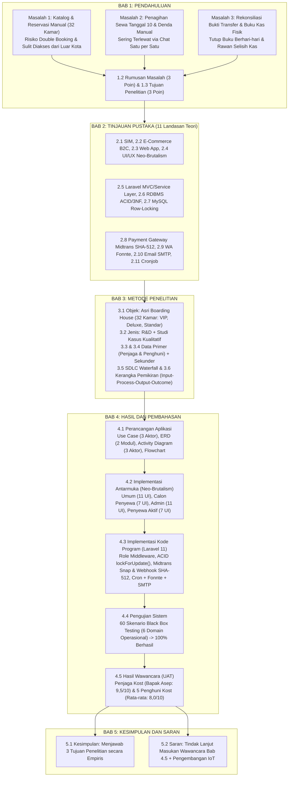

# LAPORAN AUDIT KESELARASAN DAN KESINAMBUNGAN ALUR SKRIPSI

---

## 1. Identitas Dokumen & Ringkasan Eksekutif (*Executive Summary*)

| Atribut Dokumen | Keterangan |
| :--- | :--- |
| **Judul Skripsi** | Sistem Informasi Manajemen Kost Terintegrasi *Payment Gateway* pada Asri Boarding House |
| **Penulis / NIM** | Rafif Arsya Pradiva / 22.N4.0014 |
| **Program Studi / Fakultas** | Sistem Informasi (Konsentrasi *E-Commerce*) / Fakultas Ilmu Komputer |
| **Universitas** | Universitas Katolik Soegijapranata Semarang (2026) |
| **Berkas Sumber yang Diaudit** | [`Skripsi/skripsi_Rafif_Arsya_Pradiva_22.N4.0014.md`](file:///c:/xampp/htdocs/asri-boarding-house/Skripsi/skripsi_Rafif_Arsya_Pradiva_22.N4.0014.md) (1.899 baris) |
| **Tanggal Audit** | 3 November 2026 |

---

### Jawaban Utama: Apakah Isi Skripsi Sudah Selaras dan Mengalir dari Awal hingga Akhir?

**YA — Secara makro (struktural dan substansial), naskah skripsi ini SUDAH SANGAT SELARAS, RUNTUT, dan MENGALIR DARI AWAL HINGGA AKHIR dengan skor keselarasan keseluruhan sebesar 94 / 100.**

Benang merah (*red thread*) penelitian terjaga secara utuh dari halaman judul, abstrak, pendahuluan, landasan teori, metode penelitian, perancangan dan implementasi sistem, pengujian fungsional serta wawancara pengguna, hingga kesimpulan, saran, dan daftar pustaka. Tidak ditemukan satu pun bab atau sub-bab yang melenceng dari fokus utama (*out of topic*) ataupun teori di Bab 2 yang "menganggur" tanpa diimplementasikan di Bab 4.

Meskipun alur besarnya sangat solid, hasil audit silang (*cross-check*) baris demi baris menemukan **7 catatan ketidakselarasan detail (mikro)** antara narasi teknis pada Bab 1–4.4 dengan narasi kutipan wawancara pada Bab 4.5 serta detail administratif penulisan. Ketujuh poin mikro tersebut tidak merusak struktur utama skripsi, namun sangat disarankan untuk diselaraskan agar naskah siap 100% menghadapi pertanyaan kritis dosen penguji saat sidang.

---

### Matriks Penilaian Dimensi Audit

| No | Dimensi Evaluasi | Skor | Status | Catatan Ringkas |
| :---: | :--- | :---: | :---: | :--- |
| 1 | **Kesinambungan Benang Merah (*End-to-End Flow*)** | **97 / 100** | Sangat Selaras | Masalah (Bab 1) → Teori (Bab 2) → Metode (Bab 3) → Solusi & Uji (Bab 4) → Kesimpulan (Bab 5) terhubung tanpa putus. |
| 2 | **Simetri Rumusan Masalah, Tujuan, dan Kesimpulan** | **98 / 100** | Sangat Selaras | 3 poin Rumusan Masalah (1.2) dan 3 poin Tujuan (1.3) simetris 1:1 dan terjawab tuntas di Bab 4 serta Bab 5.1. |
| 3 | **Relevansi Tinjauan Pustaka (Bab 2) terhadap Bab 4** | **96 / 100** | Sangat Selaras | Seluruh 11 sub-bab di Bab 2 benar-benar diterapkan pada desain antarmuka, basis data, dan kode program di Bab 4. |
| 4 | **Konsistensi Data & Logika Bisnis Antar-Subbab** | **86 / 100** | Perlu Penyelarasan Minor | Terdapat perbedaan kecil narasi aturan denda, kanal pembayaran aktif, dan tema warna dasbor admin antara Bab 4.2/4.3 dengan Bab 4.5. |
| 5 | **Tata Bahasa, Sitasi IEEE, dan Kerapian Format** | **93 / 100** | Sangat Baik | 30 sitasi IEEE `[1]`–`[30]` berurutan dan valid; hanya ada catatan minor pada kata kunci *Abstract* EN dan spasi nomor gambar/tabel. |
| | **RATA-RATA SKOR KESELARASAN** | **94 / 100** | **Layak & Solid** | **Alur sangat mengalir; cukup perbaiki 7 detail mikro.** |

---

## 2. Peta Kesinambungan Alur (*End-to-End Flow Mapping*)

Diagram berikut memvisualisasikan bagaimana topik dan permasalahan di Asri Boarding House mengalir dari identifikasi masalah di Bab 1 hingga menghasilkan kesimpulan dan saran di Bab 5:

---

### Matriks Ketertelusuran (*Traceability Matrix*) Lintas Bab

Tabel di bawah ini membuktikan bahwa setiap masalah yang diangkat di Bab 1 memiliki landasan teori di Bab 2, metode di Bab 3, wujud perancangan/implementasi/pengujian di Bab 4, serta konklusi di Bab 5:

| Fokus Masalah (Bab 1.1) | Rumusan & Tujuan (Bab 1.2 & 1.3) | Landasan Teori (Bab 2) | Metode & Objek (Bab 3) | Perancangan & Kode (Bab 4.1 – 4.3) | Pengujian & Evaluasi (Bab 4.4 – 4.5) | Kesimpulan & Saran (Bab 5) |
| :--- | :--- | :--- | :--- | :--- | :--- | :--- |
| **Promosi konvensional & risiko *double booking* 32 kamar** | Poin 1 (Arsitektur) & Poin 2 (Implementasi Laravel) | 2.1 SIM, 2.2 B2C, 2.3 Web App, 2.4 UI/UX *Neo-Brutalism*, 2.5 Laravel, 2.6 RDBMS ACID, 2.7 MySQL *Row-level locking* | 3.1 Objek 32 kamar (VIP, Deluxe, Standar); 3.5 *Waterfall* (*Requirement* & *Design*) | 4.1 Use Case, ERD Modul Inti, Activity & Flowchart; 4.2.1 Katalog Publik; 4.2.2 Reservasi 5 Tahap; 4.3.2 `lockForUpdate()` & Cek *Double Booking* | 4.4 Domain II & III (Skenario 13–32); 4.5 Aspek 1–2 pada Tabel 4.2–4.7 | 5.1 Digitalisasi tata kelola & pencegahan benturan kamar ganda |
| **Penagihan tanggal 10 & perhitungan denda manual yang sering terlewat** | Poin 1 (Arsitektur) & Poin 2 (Penjadwalan otomatis + Notifikasi WA & *Email*) | 2.9 WhatsApp Gateway API, 2.10 *Email* Gateway API (SMTP/TLS), 2.11 *Cronjob* (*Task Scheduling* & Idempoten) | 3.3 Data Primer & Sekunder; 3.5 *Waterfall* (*Implementation*) | 4.1.2 ERD (`tagihan`, `log_notifikasi`); 4.2.2 Gambar 4.23 & 4.24; 4.2.3 Manajemen Tagihan; 4.3.4 *Task Scheduler*, Fonnte, & *Email* `ShouldQueue` | 4.4 Domain VI (Skenario 55–60: *cron* tanggal 1, denda tanggal 10, idempoten, WA & SMTP); 4.5 Aspek 6 & 8 | 5.1 Otomasi tagihan awal bulan, denda konsisten, & pengingat WA/surel; 5.2 Saran *direct link* WA |
| **Verifikasi bukti transfer manual & tutup buku berhari-hari rawan selisih kas** | Poin 1, Poin 2 (Integrasi Midtrans), & Poin 3 (Evaluasi wawancara penjaga & penghuni) | 2.1 SIM (Laporan kas), 2.8 *Payment Gateway* Midtrans (*Sandbox/Production*, *Webhook* SHA-512) | 3.2 R&D + Kualitatif; 3.4 Wawancara tatap muka & transkripsi; 3.6 Kerangka Pemikiran (*Outcome*) | 4.1.2 ERD (`pembayaran`, `pengeluaran`); 4.2.2 Midtrans Snap; 4.2.3 Laporan Kas & Pengeluaran; 4.2.4 Nota PDF; 4.3.3 Snap Token & *Webhook* `hash_equals()` | 4.4 Domain III, IV, V (Skenario 30–37, 48, 53–54); 4.5 Tabel 4.2 (Skor 9,5/10) & Tabel 4.3–4.7 (Rata-rata 8,0/10) | 5.1 Tutup buku instan, bebas selisih kas, & kepuasan tinggi penghuni; 5.2 Perluasan kanal pembayaran |

---

## 3. Audit Kesinambungan dan Alur Narasi Per Bab (Awal hingga Akhir)

### 3.1 Bagian Awal (Halaman Judul s.d. Daftar Tabel — Baris 1–431)
- **Kelengkapan Struktur Formal**: Urutan Halaman Sampul, Halaman Judul Dalam, Halaman Pengesahan, Halaman Pernyataan Keaslian, Halaman Pernyataan Persetujuan Publikasi, Kata Pengantar, Abstrak (ID), *Abstract* (EN), Daftar Isi, Daftar Gambar, dan Daftar Tabel telah tersusun lengkap dan mengikuti kaidah baku laporan skripsi Fakultas Ilmu Komputer UNIKA Soegijapranata.
- **Keselarasan Abstrak (ID) dan *Abstract* (EN) (Baris 245–275)**:
  - Paragraf pertama pada kedua bahasa merangkum **masalah** (32 unit kamar, buku besar fisik, pesan singkat manual, benturan reservasi, keterlambatan penagihan, selisih kas), **solusi** (sistem web terintegrasi Midtrans Snap + pengingat WA dan surel), serta **metode dan teknologi** (*Waterfall*, Laravel, MySQL dengan *pessimistic row-level locking*).
  - Paragraf kedua pada kedua bahasa merangkum **hasil pengujian** (60 skenario *black box* stabil tanpa kegagalan) dan **evaluasi kualitatif** (tutup buku bulanan dari berhari-hari menjadi instan bagi pengelola, serta kepuasan mahasiswa penghuni terhadap reservasi jarak jauh, pembayaran *virtual account*, dan kuitansi digital).
  - **Catatan Minor**: Terdapat perbedaan 1 istilah pada daftar **Kata Kunci** vs **Keywords** (lihat Temuan Mikro #6 pada Bagian 4).

### 3.2 Bab 1: Pendahuluan (Baris 435–468)
- **1.1 Latar Belakang (Baris 441–450)**:
  - Disusun dalam **5 paragraf yang mengalir sangat halus** dengan pola piramida terbalik (umum ke khusus):
    1. *Paragraf 1*: Konteks makro kawasan pendidikan Tembalang Semarang, tingginya kebutuhan hunian mahasiswa perantau, dan keterbatasan promosi konvensional [1].
    2. *Paragraf 2*: Konteks mikro objek penelitian (Asri Boarding House dengan 32 unit kamar tipe VIP, Deluxe, dan Standar) serta masalah pertama: pencatatan buku besar fisik yang memicu *double booking* [2].
    3. *Paragraf 3*: Masalah operasional kedua: penagihan sewa bulanan setiap jatuh tempo tanggal 10 dan perhitungan denda yang masih dikirim satu per satu lewat pesan pribadi sehingga sering terlewat [3].
    4. *Paragraf 4*: Masalah operasional ketiga: pemeriksaan bukti tangkapan layar transfer bank dan setoran tunai yang membuat tutup buku akhir bulan memakan waktu berhari-hari serta rawan selisih kas, yang dapat diatasi dengan *payment gateway* [4].
    5. *Paragraf 5*: Sintesis solusi: penggabungan reservasi daring, penjadwalan tagihan otomatis, gerbang pembayaran Midtrans, serta notifikasi WhatsApp dan *email* [5] ke dalam judul penelitian.
- **1.2 Rumusan Masalah & 1.3 Tujuan Penelitian (Baris 454–466)**:
  - Ketiga butir Rumusan Masalah (`Bagaimana merancang...`, `Bagaimana mengimplementasikan...`, `Bagaimana hasil penerapan dan efektivitas...`) berkorespondensi satu-ke-satu secara presisi dengan ketiga butir Tujuan Penelitian (`Merancang...`, `Mengimplementasikan...`, `Menganalisis hasil penerapan dan efektivitas...`).

### 3.3 Bab 2: Tinjauan Pustaka (Baris 474–559)
- **Keterkaitan dan Urutan Logis Sub-bab**:
  - Urutan 11 sub-bab disusun secara hierarkis mulai dari **konsep sistem dan bisnis** (2.1 SIM, 2.2 *E-Commerce* B2C), **platform dan antarmuka** (2.3 *Web Application*, 2.4 UI & UX *Neo-Brutalism*), **kerangka kerja dan basis data** (2.5 Laravel MVC & *Service Layer*, 2.6 RDBMS ACID & 3NF, 2.7 MySQL InnoDB *row-level locking*), hingga **integrasi layanan eksternal dan otomasi latar belakang** (2.8 *Payment Gateway* Midtrans SHA-512, 2.9 WhatsApp Gateway API, 2.10 *Email* Gateway API SMTP/TLS, 2.11 *Cronjob* & prinsip idempoten).
  - Setiap sub-bab terdiri dari 2–3 paragraf yang selalu mengaitkan teori umum pada paragraf pertama dengan konteks penerapannya pada sistem manajemen indekos di paragraf berikutnya. Hal ini membuat Bab 2 tidak terasa seperti kumpulan definisi lepas, melainkan langsung menyambung ke perancangan di Bab 4.

### 3.4 Bab 3: Metode Penelitian (Baris 565–640)
- **Kesinambungan Metodologis**:
  - **3.1 Objek Penelitian**: Menetapkan lokasi spesifik (Jl. Maera Sari No. 1, Tembalang) dan kapasitas (32 unit kamar: VIP, Deluxe, Standar), persis menyambung dengan Bab 1.1 paragraf 2.
  - **3.2 Jenis Penelitian**: Menggabungkan *Research and Development* (R&D) [28] dengan studi kasus tunggal kualitatif—sangat tepat untuk penelitian rekayasa perangkat lunak yang diakhiri evaluasi wawancara mendalam.
  - **3.3 Sumber Data & 3.4 Teknik Pengumpulan Data**: Menjelaskan keterlibatan **Penjaga kost** dan **Penghuni kost** melalui wawancara mendalam tatap muka yang direkam audio dan ditranskripsi [29], menjadi fondasi langsung bagi Bab 4.5.
  - **3.5 Metode Pengembangan Sistem**: Menjabarkan tahapan SDLC *Waterfall* (Gambar 3.1) [30] dari *Requirement Gathering* hingga *Operation & Maintenance*, yang kemudian tercermin langsung dalam struktur sub-bab di Bab 4 (4.1 *Design*, 4.2 & 4.3 *Implementation*, 4.4 & 4.5 *Testing & Verification*).
  - **3.6 Kerangka Pemikiran**: Merangkum keseluruhan alur ke dalam skema *Input – Process – Output – Outcome* (Gambar 3.2).

### 3.5 Bab 4: Hasil dan Pembahasan (Baris 647–1808)
- **Alur Pembahasan yang Sistematis**:
  - **4.1 Perancangan Aplikasi (Baris 653–806)**: Membuka Bab 4 dengan cetak biru sistem (*Use Case Diagram* dengan 3 aktor, ERD yang dipecah cerdas menjadi Modul Inti [Gambar 4.2a] dan Modul Pendukung [Gambar 4.2b], *Activity Diagram* untuk masing-masing dari 3 aktor, serta *Flowchart* Sistem utuh). Pembagian 3 aktor (Calon Penyewa, Admin/Penjaga Kost, Penyewa Aktif) di 4.1.1 dan 4.1.3 menjadi kerangka pembagi sub-bab pada 4.2.
  - **4.2 Implementasi Antarmuka Sistem (Baris 809–1399)**: Mengikuti pembagian aktor dari 4.1 secara konsisten: 4.2.1 Implementasi Umum (Gambar 4.7–4.17), 4.2.2 Implementasi Calon Penyewa (Gambar 4.18–4.24), 4.2.3 Implementasi Admin (Gambar 4.25–4.35), dan 4.2.4 Implementasi Penyewa Aktif (Gambar 4.36–4.42). Setiap gambar disertai paragraf pengantar dan paragraf bedah visual yang merujuk langsung ke nomor gambarnya.
  - **4.3 Implementasi Kode Program (Baris 1402–1551)**: Menjawab Rumusan Masalah ke-2 dari sisi rekayasa *backend* Laravel 11 melalui 9 cuplikan kode inti (Gambar 4.43–4.51) yang mencakup *Role Middleware*, *Auth Redirect*, Transaksi ACID `lockForUpdate()`, algoritma anti-*double booking*, pembuatan *Snap Token* Midtrans, validasi *Webhook* SHA-512 `hash_equals()`, *Task Scheduler* (`withoutOverlapping()`), integrasi WhatsApp Fonnte, dan pengiriman *Email* SMTP berbasis antrean (`ShouldQueue`).
  - **4.4 Pengujian Sistem (Baris 1554–1633)**: Menguji seluruh antarmuka (4.2) dan logika kode (4.3) ke dalam **60 skenario *Black Box Testing*** pada Tabel 4.1 yang dikelompokkan dalam 6 domain operasional. Cakupan uji sangat komprehensif (termasuk kasus negatif seperti NIK < 16 digit, unggah berkas non-gambar pada keluhan, hapus kamar yang sedang dihuni, hingga uji idempoten *cron job*).
  - **4.5 Hasil Wawancara (Baris 1636–1808)**: Menjawab Rumusan Masalah ke-3 melalui evaluasi bersama Bapak Asep (Penjaga Kost, Tabel 4.2) dan 5 mahasiswa penghuni kost dari berbagai perguruan tinggi (Arjun, Farrel, Iman, Ammar, Sindhu — Tabel 4.3 s.d. 4.7). Setiap tabel berisi 10 pertanyaan terstruktur dan ditutup dengan paragraf analisis sintesis serta skor kepuasan kuantitatif (9,5/10 dari penjaga kost dan rata-rata 8,0/10 dari penghuni).

### 3.6 Bab 5: Kesimpulan dan Saran & Daftar Pustaka (Baris 1815–1899)
- **5.1 Kesimpulan (Baris 1821–1822)**: Merangkum pencapaian ke-3 tujuan penelitian dalam satu paragraf padat yang menyatukan aspek rancang bangun, integrasi teknologi (Laravel, MySQL, Midtrans, *scheduler*, WA, surel), hasil 60 skenario *black box*, serta bukti empiris wawancara penjaga dan penghuni kost.
- **5.2 Saran (Baris 1826–1827)**: Sangat mengalir karena **3 saran pertama diturunkan langsung dari masukan responden pada Bab 4.5** (tautan pembayaran langsung di WA dari saran Ammar [Tabel 4.6], tur panduan visual interaktif dari saran Sindhu [Tabel 4.7], dan perluasan kanal pembayaran dari saran Farrel & Sindhu [Tabel 4.4 & 4.7]), kemudian diperkaya dengan 2 saran pengembangan masa depan (pencatatan meteran listrik digital dan kunci pintu berbasis IoT).
- **Daftar Pustaka (Baris 1835–1899)**: Memuat 30 referensi ilmiah berformat IEEE (`[1]`–`[30]`) dengan rentang tahun terbit mayoritas 2021–2026 dan tautan DOI aktif. Seluruh nomor referensi `[1]` hingga `[30]` tersitasi secara berurutan di dalam naskah tanpa ada nomor yang terlewat atau melompat.

---

## 4. Temuan Ketidakselarasan Detail (Mikro) & Rekomendasi Perbaikan

Berikut adalah **7 temuan ketidakselarasan detail (mikro)** yang ditemukan saat menyandingkan narasi antar-bab, lengkap dengan lokasi baris dan rekomendasi perbaikannya:

### Temuan #1: Perbedaan Aturan Waktu Perhitungan Denda Keterlambatan (Tanggal 10 vs Lintas Bulan)
- **Tingkat Kepentingan**: **Tinggi (Substansi Logika Bisnis)**
- **Lokasi di Naskah**:
  - **Bab 1.1 (Baris 446)**: *"Pengingat jatuh tempo setiap tanggal 10 beserta perhitungan dendanya..."*
  - **Bab 4.2.3 Poin 7 (Baris 1208)**: *"...memantau batas jatuh tempo setiap tanggal 10 guna menekan tunggakan pembayaran."*
  - **Bab 4.2.4 Poin 3 (Baris 1322)**: *"...tambahan biaya denda apabila melewati tanggal 10..."*
  - **Bab 4.3.4 Poin 1 (Baris 1520)**: *"...perintah kalkulasi denda keterlambatan dieksekusi setiap dini hari pukul 01:00 WIB untuk memeriksa tagihan yang telah melewati batas jatuh tempo tanggal 10."*
  - **Bab 4.4 Tabel 4.1 Skenario 57 (Baris 1625)**: *"Perhitungan denda keterlambatan lewat tanggal 10 | Jalankan perintah scheduler pemeriksaan denda pada tagihan belum lunas yang melewati tanggal 10..."*
  - **KONTRADIKSI di Bab 4.5 Tabel 4.2 No. 6 (Baris 1665)**: *"Di sistem ini ada aturan denda: jika anak kost terlambat membayar sewa melewati tanggal 10 di bulan berjalan belum dikenakan denda (bebas denda), baru jika menyeberang ke bulan berikutnya dikenakan denda flat 5% satu kali (tidak berbunga harian)."*
- **Analisis**: Terdapat ketidaksinkronan antara penjelasan teknis di Bab 1–4.4 (yang menyatakan denda dikenakan begitu melewati jatuh tempo tanggal 10) dengan kutipan pertanyaan wawancara Bapak Asep di Bab 4.5 (yang menyatakan lewat tanggal 10 di bulan berjalan masih bebas denda, dan denda *flat* 5% baru dikenakan jika menyeberang ke bulan berikutnya).
- **Rekomendasi Perbaikan**:
  - Selaraskan narasi di kedua sisi dengan memperjelas bahwa **tanggal 10 adalah batas jatuh tempo pembayaran normal (mulai berstatus terlambat/menunggak)**, dan seragamkan kapan denda *flat* 5% dieksekusi (apakah tepat setelah melewati tanggal 10 atau saat menyeberang bulan berikutnya sebagai masa tenggang/*grace period*). Jika aturan di kode program adalah setelah tanggal 10, sesuaikan redaksi pertanyaan wawancara No. 6 pada Tabel 4.2 menjadi *"melewati batas jatuh tempo tanggal 10 dikenakan denda flat 5% satu kali tanpa bunga harian"*. Sebaliknya, jika terdapat masa tenggang hingga akhir bulan, tambahkan keterangan masa tenggang tersebut pada Bab 4.3.4 dan Tabel 4.1 Skenario 57.

---

### Temuan #2: Klaim Ketersediaan Kanal Pembayaran Midtrans (Multi-Kanal vs Fokus BCA VA)
- **Tingkat Kepentingan**: **Tinggi (Konsistensi Fitur vs Evaluasi Responden)**
- **Lokasi di Naskah**:
  - **Bab 4.2.2 Poin 5 (Baris 1060 & 1072)**: *"Pengguna dapat memilih salah satu metode transaksi yang tersedia, seperti GoPay, QRIS, maupun Virtual Account BCA, BNI, dan Mandiri..."*
  - **Bab 4.3.3 (Baris 1474)** & **Tabel 4.1 Skenario 30 (Baris 1595)**: *"Jendela pop-up Midtrans Snap tampil memuat pilihan Virtual Account, QRIS, dan e-wallet."*
  - **KONTRADIKSI di Bab 4.5 Tabel 4.4 No. 4 & 10 (Baris 1715 & 1721 - Farrel)**: *"...berhubung sehari-hari aku nggak pakai rekening BCA dan lebih sering pakai e-wallet, jadinya harus transfer antar-bank dari bank lain. Bakal jauh lebih fleksibel kalau ke depannya disediain opsi QRIS atau dompet digital kayak GoPay"* dan *"...metode bayarnya sekarang masih fokus ke transfer Virtual Account bank aja. Masukan dariku, coba aktifin opsi QRIS atau e-wallet..."*
  - **Bab 4.5 Tabel 4.7 No. 4 (Baris 1793 - Sindhu)** & **Ringkasan Bab 4.5 (Baris 1807)**: *"Responden turut menyarankan penambahan kanal QRIS dan e-wallet..."*
- **Analisis**: Jika pembaca atau penguji membaca di Bab 4.2.2 dan Tabel 4.1 bahwa QRIS, GoPay, BNI, dan Mandiri **sudah tampil dan aktif** di Midtrans Snap, mereka akan bertanya-tanya mengapa responden Farrel dan Sindhu di Bab 4.5 justru menyarankan agar opsi QRIS dan *e-wallet* diaktifkan karena saat pengujian hanya tersedia BCA *Virtual Account*.
- **Rekomendasi Perbaikan**:
  - Tambahkan satu kalimat penjelasan jembatan pada **Bab 4.2.2 Poin 5 (sekitar baris 1072)** atau pada pengantar **Bab 4.5** bahwa secara arsitektur Midtrans Snap mendukung berbagai kanal (*Virtual Account*, QRIS, *e-wallet*), namun pada konfigurasi profil *merchant* saat pengujian operasional awal di Asri Boarding House, kanal utama yang diaktifkan secara penuh adalah **BCA Virtual Account** mengikuti rekening penampung utama pengelola kost. Penjelasan singkat ini akan membuat Bab 4.2, Bab 4.4, Bab 4.5, dan Bab 5.2 menjadi 100% logis dan saling menguatkan.

---

### Temuan #3: Deskripsi Tema Visual Dasbor Admin (*Neo-Brutalism* Terang vs *OLED Black Dark Mode*)
- **Tingkat Kepentingan**: **Sedang (Konsistensi Deskripsi Antarmuka)**
- **Lokasi di Naskah**:
  - **Bab 4.2.3 Poin 1 & 2 (Baris 1122 & 1139)**: Mendeskripsikan halaman admin dengan gaya *Neo-Brutalism* serta kartu indikator berwarna kuning dan biru tanpa menyebutkan mode gelap (*dark mode*).
  - **Bab 4.5 Tabel 4.2 No. 3 & Ringkasan (Baris 1662 & 1673)**: Menyebutkan *"Dasbor Admin & Kas Otomatis: Tata letak OLED Dark Mode"* dan *"Warnanya gelap jadi adem di mata"*, serta di baris 1673 tertulis *"tema OLED Black Dark Mode terbukti ramah bagi penglihatan pengelola senior"*.
- **Analisis**: Istilah *OLED Black Dark Mode* baru muncul secara tiba-tiba di Bab 4.5 Tabel 4.2, padahal saat membahas Implementasi Antarmuka Admin di Bab 4.2.3 (Gambar 4.26), tema gelap tersebut belum disinggung.
- **Rekomendasi Perbaikan**:
  - Sisipkan penyebutan perpaduan aksen warna gelap (*dark mode*) pada deskripsi **Bab 4.2.3 Poin 2 (Baris 1139)** atau sesuaikan istilah pada Tabel 4.2 No. 3 dan baris 1673 agar selaras dengan tampilan aktual pada Gambar 4.26.

---

### Temuan #4: Fitur yang Disebutkan dalam Wawancara (Bab 4.5) Namun Belum Tercantum di Bab 4.1–4.4
- **Tingkat Kepentingan**: **Sedang (Kelengkapan Cakupan Fitur)**
- **Lokasi di Naskah**:
  1. **Formulir Pendaftaran Penyewa Datang Langsung (*Form Walk-In Admin*)**:
     - Muncul pada **Tabel 4.2 No. 4 (Baris 1663)**: *"Pendaftaran Penyewa Datang Langsung: Form Walk-In admin — Kalau ada calon anak kost atau orang tuanya yang datang langsung ke kantor pengelola tanpa reservasi lewat web, Bapak tinggal input di form ini..."*
     - Namun pada **Bab 4.2.3 Poin 5 (Manajemen Penyewa, Baris 1175–1187)** dan **Tabel 4.1 (Domain V)**, fitur tambah penyewa secara langsung (*walk-in*) oleh admin belum disebutkan secara eksplisit (yang disebutkan di 4.2.3 hanya melihat daftar penyewa dan menonaktifkan saat *check-out*).
  2. **Fitur *Video Room Tour* pada Katalog Kamar**:
     - Muncul pada **Tabel 4.3 No. 1 (Baris 1686 - Arjun)**: *"Foto fasilitas kayak kasur, AC, kamar mandi dalam, sampai video room tour-nya kelihatan jelas banget."*
     - Namun pada **Bab 4.2.1 Poin 3 & 4 (Katalog Tipe Kamar & Galeri Kost, Baris 849–878)**, hanya dijelaskan adanya foto dokumentasi statis, tidak disebutkan adanya *video room tour*.
- **Rekomendasi Perbaikan**:
  - Pada **Bab 4.2.3 Poin 5 (Baris 1176)**, tambahkan satu kalimat bahwa admin juga dapat mendaftarkan penghuni baru yang datang langsung ke lokasi (*walk-in*) melalui formulir tambah penyewa.
  - Pada **Tabel 4.3 No. 1 (Baris 1686)**, apabila aplikasi hanya menampilkan foto galeri interaktif (tanpa video), ubah frasa *"sampai video room tour-nya"* menjadi *"sampai foto-foto sudut ruangannya"*, atau jika memang ada fitur pratinjau video kamar, sebutkan secara singkat di Bab 4.2.1 Poin 3.

---

### Temuan #5: Frasa "Dua Narasumber" pada Bab 3.4 vs Enam Responden pada Bab 4.5
- **Tingkat Kepentingan**: **Sedang (Kejelasan Metodologi)**
- **Lokasi di Naskah**:
  - **Bab 3.4 Teknik Pengumpulan Data (Baris 602)**: *"Proses wawancara ini dilakukan pada tahap analisis kebutuhan maupun tahap evaluasi sistem bersama dua narasumber, yaitu: Penjaga kost ... Penghuni kost..."*
  - **Bab 4.5 Hasil Wawancara (Baris 1637)**: *"...melibatkan pengelola operasional senior dan lima mahasiswa penghuni kost aktif."* (Total 6 orang narasumber: Bapak Asep + Arjun, Farrel, Iman, Ammar, Sindhu).
- **Analisis**: Penulisan *"bersama dua narasumber"* pada baris 602 dapat disalahartikan oleh pembaca seolah-olah jumlah individu yang diwawancarai hanya 2 orang, padahal maksud penulis adalah **dua kelompok/kategori narasumber** yang terdiri dari 1 penjaga kost dan 5 penghuni kost.
- **Rekomendasi Perbaikan**:
  - Ubah kalimat pada **Baris 602** dari *"bersama dua narasumber, yaitu:"* menjadi *"bersama dua kelompok narasumber (satu penjaga kost dan lima penghuni kost aktif), yaitu:"*.

---

### Temuan #6: Ketidaksinkronan Kata Kunci (*Keywords*) pada Abstrak (ID) vs *Abstract* (EN)
- **Tingkat Kepentingan**: **Rendah (Keselarasan Bahasa Abstrak)**
- **Lokasi di Naskah**:
  - **Abstrak Bahasa Indonesia (Baris 257)**: `**Kata Kunci:** Asri Boarding House, gerbang pembayaran Midtrans, Laravel, penguncian pesimis, sistem informasi manajemen kost.`
  - **Abstract Bahasa Inggris (Baris 275)**: `**Keywords:** Asri Boarding House, automated billing, boarding house management system, Midtrans payment gateway, pessimistic locking.`
- **Analisis**: Pada versi Bahasa Indonesia terdapat kata kunci `Laravel` (tanpa *penagihan otomatis*), sedangkan pada versi Bahasa Inggris terdapat `automated billing` (tanpa `Laravel`).
- **Rekomendasi Perbaikan**:
  - Samakan kelima entitas kata kunci di kedua bahasa, misalnya menjadi:
    - **ID**: `Asri Boarding House, gerbang pembayaran Midtrans, Laravel, penguncian pesimis, sistem informasi manajemen kost.`
    - **EN**: `Asri Boarding House, boarding house management system, Laravel, Midtrans payment gateway, pessimistic locking.`

---

### Temuan #7: Kerapian Teknis Penomoran Berkas Gambar, Daftar Gambar/Tabel, dan Halaman Pengesahan
- **Tingkat Kepentingan**: **Rendah (Kosmetik & Administratif)**
- **Lokasi di Naskah**:
  1. **Nama Berkas Gambar 4.52 (Baris 1648)**:
     - Tertulis ``. Penomoran pada nama berkas masih `gambar_4_21.jpg` meskipun teks dan *caption* sudah `Gambar 4.52`. Pastikan berkas tersebut memang ada di folder `images/` agar gambar tampil saat dicetak/dikonversi ke PDF.
  2. **Spasi pada Penomoran di Daftar Gambar & Daftar Tabel (Baris 358–430)**:
     - Di Daftar Gambar dan Daftar Tabel tertulis dengan spasi setelah titik: `Gambar 3. 1`, `Gambar 4. 1`, `Tabel 4. 1`.
     - Sedangkan pada seluruh batang tubuh Bab 3 dan Bab 4 tertulis rapat tanpa spasi: `Gambar 3.1`, `Gambar 4.1`, `Tabel 4.1`. Sebaiknya spasi setelah titik pada Daftar Gambar dan Daftar Tabel dihapus agar seragam (`Gambar 3.1`, `Tabel 4.1`).
  3. **Kelengkapan NPP pada Halaman Pengesahan (Baris 97 & 107)**:
     - NPP Dosen Pembimbing 2 (`Erdhi Widyarto Nugroho, S.T., M.T.`) dan NPP Kaprodi Sistem Informasi (`Dr. Albertus Dwiyoga Widiantoro, S.Kom., M.Kom.`) masih tertulis `NPP. ....................`. Pastikan dilengkapi sebelum pencetakan berkas pengesahan resmi.

---

## 5. Daftar Periksa (*Actionable Checklist*) Penyempurnaan Naskah

Gunakan daftar periksa berikut sebagai panduan cepat apabila Anda ingin menindaklanjuti temuan audit di atas pada berkas [`Skripsi/skripsi_Rafif_Arsya_Pradiva_22.N4.0014.md`](file:///c:/xampp/htdocs/asri-boarding-house/Skripsi/skripsi_Rafif_Arsya_Pradiva_22.N4.0014.md):

- [ ] **[Prioritas Tinggi]** Selaraskan narasi aturan denda antara **Bab 4.3.4 (Baris 1520)** / **Tabel 4.1 No. 57 (Baris 1625)** dengan **Tabel 4.2 No. 6 (Baris 1665)** agar tidak terjadi kontradiksi apakah denda dihitung langsung setelah tanggal 10 atau setelah menyeberang bulan.
- [ ] **[Prioritas Tinggi]** Tambahkan penjelasan singkat pada **Bab 4.2.2 Poin 5 (Baris 1072)** bahwa meskipun Midtrans Snap mendukung multi-kanal (VA, QRIS, *e-wallet*), pada tahap implementasi awal kanal pembayaran yang diaktifkan secara utama adalah *Virtual Account* BCA, sehingga selaras dengan masukan responden di **Bab 4.5 (Tabel 4.4 & 4.7)**.
- [ ] **[Prioritas Sedang]** Selaraskan deskripsi visual dasbor admin pada **Bab 4.2.3 Poin 2 (Baris 1139)** dengan penyebutan tema *OLED Dark Mode* pada **Bab 4.5 Tabel 4.2 No. 3 (Baris 1662 & 1673)**.
- [ ] **[Prioritas Sedang]** Tambahkan penyebutan fitur pendaftaran penghuni datang langsung (*walk-in*) oleh admin pada **Bab 4.2.3 Poin 5 (Baris 1176)** dan sesuaikan istilah *video room tour* pada **Tabel 4.3 No. 1 (Baris 1686)** agar konsisten dengan fitur katalog kamar di **Bab 4.2.1**.
- [ ] **[Prioritas Sedang]** Ubah frasa *"dua narasumber"* pada **Bab 3.4 (Baris 602)** menjadi *"dua kelompok narasumber"* agar selaras dengan 6 responden pada **Bab 4.5**.
- [ ] **[Prioritas Rendah]** Samakan daftar **Kata Kunci** (Baris 257) dan **Keywords** (Baris 275) antara `Laravel` dan `automated billing`.
- [ ] **[Prioritas Rendah]** Rapikan spasi penomoran `Gambar X. Y` dan `Tabel X. Y` pada **Daftar Gambar & Daftar Tabel (Baris 358–430)** menjadi `Gambar X.Y` dan `Tabel X.Y`, serta lengkapi NPP pada **Halaman Pengesahan (Baris 97 & 107)**.

