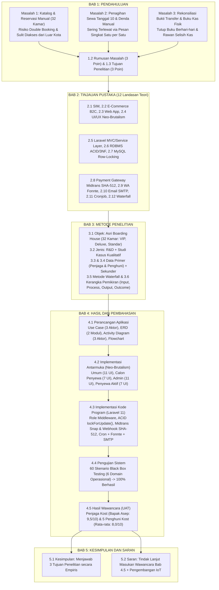

# LAPORAN AUDIT KESELARASAN DAN KESINAMBUNGAN ALUR SKRIPSI

---

## 1. Identitas Dokumen dan Ringkasan Audit

| Atribut Dokumen | Keterangan |
| :--- | :--- |
| **Judul Skripsi** | Sistem Informasi Manajemen Kost Terintegrasi *Payment Gateway* pada Asri Boarding House |
| **Penulis / NIM** | Rafif Arsya Pradiva / 22.N4.0014 |
| **Program Studi / Fakultas** | Sistem Informasi (Konsentrasi *E-Commerce*) / Fakultas Ilmu Komputer |
| **Universitas** | Universitas Katolik Soegijapranata Semarang (2026) |
| **Berkas Sumber yang Diaudit** | [`Skripsi/skripsi_Rafif_Arsya_Pradiva_22.N4.0014.md`](file:///c:/xampp/htdocs/asri-boarding-house/Skripsi/skripsi_Rafif_Arsya_Pradiva_22.N4.0014.md) (1.899 baris) |
| **Tanggal Audit** | 3 November 2026 |

---

### Kesimpulan Utama Audit

**Naskah skripsi ini sudah selaras, runtut, dan mengalir dengan baik dari halaman awal hingga daftar pustaka dengan skor kelayakan keseluruhan 94 / 100.**

Alur penelitian terjaga utuh mulai dari pemetaan masalah operasional di Bab 1, pemilihan landasan teori di Bab 2, penentuan metode rekayasa perangkat lunak di Bab 3, perancangan serta pengujian sistem di Bab 4, hingga penarikan kesimpulan di Bab 5. Seluruh konsep teoretis yang diangkat pada tinjauan pustaka benar-benar diterapkan ke dalam skema basis data, antarmuka pengguna, dan potongan kode program. Tidak ada satu pun sub-bab yang keluar dari fokus kajian.

Di balik struktur utamanya yang kuat, pemeriksaan silang baris demi baris terhadap naskah, kode program, dan tangkapan layar aplikasi menemukan **7 catatan penyelarasan detail (mikro)**. Ketujuh poin ini terletak pada persinggungan antara penjelasan teknis di Bab 1 sampai Bab 4.4, kutipan wawancara di Bab 4.5, serta kerapian penulisan administratif. Perbaikan ringan pada ketujuh titik tersebut akan membuat naskah semakin matang dan siap menghadapi pertanyaan penguji saat sidang.

---

### Matriks Penilaian Dimensi Audit

| No | Dimensi Evaluasi | Skor | Status | Catatan Ringkas |
| :---: | :--- | :---: | :---: | :--- |
| 1 | **Kesinambungan Alur Antarbab** | **97 / 100** | Sangat Selaras | Masalah di Bab 1 terhubung langsung ke teori Bab 2, metode Bab 3, implementasi Bab 4, hingga simpulan Bab 5. |
| 2 | **Kesesuaian Rumusan Masalah, Tujuan, dan Kesimpulan** | **98 / 100** | Sangat Selaras | Tiga poin rumusan masalah (1.2) dan tujuan penelitian (1.3) terjawab tuntas di Bab 4 serta dirangkum di Bab 5.1. |
| 3 | **Ketepatan Tinjauan Pustaka (Bab 2) terhadap Bab 4** | **96 / 100** | Sangat Selaras | Dua belas sub-bab teori di Bab 2 diterapkan seluruhnya pada desain antarmuka, basis data, dan kode program di Bab 4. |
| 4 | **Konsistensi Data dan Logika Bisnis Antarsubbab** | **86 / 100** | Perlu Penyelarasan Minor | Ada sedikit perbedaan rincian aturan masa keringanan denda, kanal pembayaran aktif, dan tema gelap dasbor admin antara Bab 4.2/4.3 dan Bab 4.5. |
| 5 | **Tata Bahasa, Sitasi IEEE, dan Kerapian Format** | **93 / 100** | Sangat Baik | Tiga puluh sitasi IEEE `[1]` sampai `[30]` tersusun urut dan valid. Catatan minor hanya pada kata kunci *Abstract* dan spasi nomor gambar/tabel. |
| | **RATA-RATA SKOR KESELARASAN** | **94 / 100** | **Layak & Solid** | **Alur pembahasan sangat mengalir, cukup selaraskan 7 detail mikro.** |

---

## 2. Peta Kesinambungan Alur Penelitian

Bagan di bawah ini memetakan bagaimana tiga permasalahan lapangan di Asri Boarding House dijawab secara bertahap dari Bab 1 hingga Bab 5:

---

### Matriks Ketertelusuran Lintas Bab

Tabel berikut menunjukkan keterkaitan langsung antara masalah di Bab 1, teori di Bab 2, metode di Bab 3, implementasi dan pengujian di Bab 4, serta simpulan di Bab 5:

| Fokus Masalah (Bab 1.1) | Rumusan & Tujuan (Bab 1.2 & 1.3) | Landasan Teori (Bab 2) | Metode & Objek (Bab 3) | Perancangan & Kode (Bab 4.1 sampai 4.3) | Pengujian & Evaluasi (Bab 4.4 & 4.5) | Kesimpulan & Saran (Bab 5) |
| :--- | :--- | :--- | :--- | :--- | :--- | :--- |
| **Promosi konvensional & risiko *double booking* 32 kamar** | Poin 1 (Arsitektur) & Poin 2 (Implementasi Laravel) | 2.1 SIM, 2.2 B2C, 2.3 Web App, 2.4 UI/UX *Neo-Brutalism*, 2.5 Laravel, 2.6 RDBMS ACID, 2.7 MySQL *Row-level locking*, 2.12 *Waterfall* | 3.1 Objek 32 kamar (VIP, Deluxe, Standar); 3.5 *Waterfall* (*Requirement* & *Design*) | 4.1 Use Case, ERD Modul Inti, Activity & Flowchart; 4.2.1 Katalog Publik; 4.2.2 Reservasi 5 Tahap; 4.3.2 `lockForUpdate()` & Cek *Double Booking* | 4.4 Domain II & III (Skenario 13 sampai 32); 4.5 Aspek 1 & 2 pada Tabel 4.2 sampai 4.7 | 5.1 Digitalisasi tata kelola & pencegahan benturan kamar ganda |
| **Penagihan tanggal 10 & perhitungan denda manual yang sering terlewat** | Poin 1 (Arsitektur) & Poin 2 (Penjadwalan otomatis + Notifikasi WA & *Email*) | 2.9 WhatsApp Gateway API, 2.10 *Email* Gateway API (SMTP/TLS), 2.11 *Cronjob* (*Task Scheduling* & Idempoten) | 3.3 Data Primer & Sekunder; 3.5 *Waterfall* (*Implementation*) | 4.1.2 ERD (`tagihan`, `log_notifikasi`); 4.2.2 Gambar 4.23 & 4.24; 4.2.3 Manajemen Tagihan; 4.3.4 *Task Scheduler*, Fonnte, & *Email* `ShouldQueue` | 4.4 Domain VI (Skenario 55 sampai 60: *cron* tanggal 1, denda tanggal 10, idempoten, WA & SMTP); 4.5 Aspek 6 & 8 | 5.1 Otomasi tagihan awal bulan, denda konsisten, & pengingat WA/surel; 5.2 Saran *direct link* WA |
| **Verifikasi bukti transfer manual & tutup buku berhari-hari rawan selisih kas** | Poin 1, Poin 2 (Integrasi Midtrans), & Poin 3 (Evaluasi wawancara penjaga & penghuni) | 2.1 SIM (Laporan kas), 2.8 *Payment Gateway* Midtrans (*Sandbox/Production*, *Webhook* SHA-512) | 3.2 R&D + Kualitatif; 3.4 Wawancara tatap muka & transkripsi; 3.6 Kerangka Pemikiran (*Outcome*) | 4.1.2 ERD (`pembayaran`, `pengeluaran`); 4.2.2 Midtrans Snap; 4.2.3 Laporan Kas & Pengeluaran; 4.2.4 Nota PDF; 4.3.3 Snap Token & *Webhook* `hash_equals()` | 4.4 Domain III, IV, V (Skenario 30 sampai 37, 48, 53, 54); 4.5 Tabel 4.2 (Skor 9,5/10) & Tabel 4.3 sampai 4.7 (Rata-rata 8,0/10) | 5.1 Tutup buku instan, bebas selisih kas, & kepuasan tinggi penghuni; 5.2 Perluasan kanal pembayaran |

---

## 3. Evaluasi Alur Narasi Per Bab

### 3.1 Bagian Awal (Halaman Judul sampai Daftar Tabel, Baris 1 sampai 431)
- **Kelengkapan Struktur Formal**: Urutan Halaman Sampul, Halaman Judul Dalam, Halaman Pengesahan, Pernyataan Keaslian, Persetujuan Publikasi, Kata Pengantar, Abstrak (ID), *Abstract* (EN), Daftar Isi, Daftar Gambar, hingga Daftar Tabel sudah tersusun lengkap sesuai pedoman penulisan skripsi Fakultas Ilmu Komputer Unika Soegijapranata.
- **Keselarasan Abstrak (ID) dan *Abstract* (EN) (Baris 245 sampai 275)**:
  - Paragraf pertama pada kedua bahasa merangkum masalah pengelolaan 32 unit kamar yang masih bergantung pada buku besar fisik dan pesan singkat manual. Paragraf ini kemudian memperkenalkan solusi aplikasi web berarsitektur Laravel dan MySQL dengan penguncian baris pesimis, pembayaran Midtrans Snap, serta pengingat otomatis WhatsApp dan surel yang dikembangkan menggunakan metode *Waterfall*.
  - Paragraf kedua memaparkan hasil pengujian 60 skenario *black box* yang berjalan stabil tanpa kegagalan transaksi. Evaluasi bersama pengelola membuktikan waktu tutup buku terpangkas dari berhari-hari menjadi instan tanpa selisih kas, sedangkan wawancara mahasiswa penghuni mengonfirmasi kepuasan tinggi atas kemudahan reservasi jarak jauh, pembayaran *Virtual Account*, dan kuitansi digital.
  - **Catatan Minor**: Terdapat perbedaan satu entitas istilah antara baris **Kata Kunci** dan **Keywords** (dibahas pada Temuan Mikro #6).

### 3.2 Bab 1: Pendahuluan (Baris 435 sampai 468)
- **1.1 Latar Belakang (Baris 441 sampai 450)**:
  - Lima paragraf disusun mengalir dari konteks umum ke masalah spesifik di lokasi penelitian:
    1. *Paragraf 1*: Mengangkat tingginya kebutuhan hunian mahasiswa perantau di kawasan Tembalang Semarang dan keterbatasan promosi konvensional yang menyulitkan pengecekan kamar kosong dari luar kota [1].
    2. *Paragraf 2*: Mengerucut ke objek penelitian Asri Boarding House (32 unit kamar tipe VIP, Deluxe, dan Standar) beserta masalah pencatatan buku besar fisik yang kerap memicu *double booking* [2].
    3. *Paragraf 3*: Membahas kendala penagihan sewa setiap jatuh tempo tanggal 10 dan perhitungan denda yang masih dikirim satu per satu lewat pesan pribadi sehingga sering terlewat [3].
    4. *Paragraf 4*: Menguraikan rumitnya verifikasi tangkapan layar bukti transfer bank dan setoran tunai yang membuat tutup buku akhir bulan memakan waktu berhari-hari serta rawan selisih kas, yang dapat diselesaikan melalui *payment gateway* [4].
    5. *Paragraf 5*: Merangkum solusi sistem manajemen terpusat yang menggabungkan reservasi daring, penjadwalan tagihan otomatis, gerbang pembayaran Midtrans, serta pengingat WhatsApp dan *email* [5].
- **1.2 Rumusan Masalah & 1.3 Tujuan Penelitian (Baris 454 sampai 466)**:
  - Tiga butir rumusan masalah (perancangan arsitektur, implementasi teknis Laravel dan Midtrans, serta evaluasi efektivitas operasional) berpasangan langsung dengan tiga butir tujuan penelitian.

### 3.3 Bab 2: Tinjauan Pustaka
- **Urutan dan Keterkaitan Subbab**:
  - Dua belas sub-bab disusun berjenjang mulai dari konsep manajerial dan bisnis (2.1 SIM, 2.2 *E-Commerce* B2C), arsitektur platform dan visual (2.3 *Web Application*, 2.4 UI & UX *Neo-Brutalism*), kerangka kerja dan basis data (2.5 Laravel MVC & *Service Layer*, 2.6 RDBMS ACID & 3NF, 2.7 MySQL InnoDB *row-level locking*), integrasi layanan pihak ketiga dan otomasi server (2.8 *Payment Gateway* Midtrans SHA-512, 2.9 WhatsApp Gateway API, 2.10 *Email* Gateway API SMTP/TLS, 2.11 *Cronjob* & prinsip idempoten), hingga metodologi rekayasa perangkat lunak (2.12 Metode *Waterfall* [28]).
  - Tiap sub-bab terdiri atas 2 sampai 3 paragraf. Paragraf pertama selalu mengulas konsep dasar teknologi, lalu paragraf berikutnya langsung mengaitkannya dengan kebutuhan pengelolaan indekos sehingga menyambung mulus ke Bab 3 dan Bab 4.

### 3.4 Bab 3: Metode Penelitian
- **Kesinambungan Metodologis**:
  - **3.1 Objek Penelitian**: Menetapkan lokasi di Jl. Maera Sari No. 1, Tembalang dengan kapasitas 32 unit kamar (VIP, Deluxe, Standar), konsisten dengan Bab 1.1.
  - **3.2 Jenis Penelitian**: Memadukan *Research and Development* (R&D) [29] dengan studi kasus tunggal kualitatif. Pendekatan ini pas untuk penelitian rekayasa perangkat lunak yang diuji langsung bersama pengguna di lapangan.
  - **3.3 Sumber Data & 3.4 Teknik Pengumpulan Data**: Menjelaskan pengumpulan data primer dari penjaga kost dan penghuni kost melalui wawancara tatap muka yang direkam audio dan ditranskripsi [30], menjadi pijakan metodologis bagi Bab 4.5.
  - **3.5 Metode Pengembangan Sistem**: Menguraikan lima tahapan metode *Waterfall* (Gambar 3.1) dari *Requirement Gathering* hingga *Operation & Maintenance*, yang tercermin langsung pada struktur pembahasan Bab 4.
  - **3.6 Kerangka Pemikiran**: Memetakan alur kerja penelitian ke dalam bagan *Input, Process, Output,* dan *Outcome* (Gambar 3.2).

### 3.5 Bab 4: Hasil dan Pembahasan (Baris 647 sampai 1808)
- **Sistematika Pembahasan Teknis dan Evaluasi**:
  - **4.1 Perancangan Aplikasi (Baris 653 sampai 806)**: Membuka pembahasan dengan pemodelan *Use Case Diagram* tiga aktor, ERD yang dibagi menjadi Modul Inti (Gambar 4.2a) dan Modul Pendukung (Gambar 4.2b), tiga *Activity Diagram* per aktor, serta *Flowchart* Sistem. Pembagian tiga aktor (Calon Penyewa, Admin/Penjaga Kost, Penyewa Aktif) menjadi dasar pengelompokan antarmuka pada sub-bab 4.2.
  - **4.2 Implementasi Antarmuka Sistem (Baris 809 sampai 1399)**: Menampilkan 36 tangkapan layar aplikasi bergaya *Neo-Brutalism* yang terbagi ke dalam 4.2.1 Implementasi Umum (Gambar 4.7 sampai 4.17), 4.2.2 Implementasi Calon Penyewa (Gambar 4.18 sampai 4.24), 4.2.3 Implementasi Admin (Gambar 4.25 sampai 4.35), dan 4.2.4 Implementasi Penyewa Aktif (Gambar 4.36 sampai 4.42).
  - **4.3 Implementasi Kode Program (Baris 1402 sampai 1551)**: Menjawab rumusan masalah kedua lewat sembilan potongan kode inti Laravel 11 (Gambar 4.43 sampai 4.51), meliputi *Role Middleware*, *Auth Redirect*, transaksi ACID `lockForUpdate()`, algoritma pencegah *double booking*, pembuatan *Snap Token* Midtrans, validasi *Webhook* SHA-512 `hash_equals()`, *Task Scheduler* (`withoutOverlapping()`), integrasi WhatsApp Fonnte, dan pengiriman *Email* SMTP berbasis antrean (`ShouldQueue`).
  - **4.4 Pengujian Sistem (Baris 1554 sampai 1633)**: Menguji seluruh fitur ke dalam **60 skenario *Black Box Testing*** pada Tabel 4.1 yang terbagi atas 6 domain operasional. Skenario uji sudah mencakup pengujian input positif maupun negatif (seperti NIK kurang dari 16 digit, unggahan berkas non-gambar pada tiket keluhan, penolakan hapus kamar berpenghuni, serta uji idempoten *cron job*).
  - **4.5 Hasil Wawancara (Baris 1636 sampai 1808)**: Menjawab rumusan masalah ketiga melalui wawancara evaluasi bersama Bapak Asep selaku penjaga kost (Tabel 4.2) dan 5 mahasiswa penghuni aktif dari berbagai kampus (Arjun, Farrel, Iman, Ammar, dan Sindhu pada Tabel 4.3 sampai 4.7). Setiap tabel memuat 10 aspek pertanyaan dan diakhiri analisis sintesis beserta skor kepuasan (9,5/10 dari penjaga kost dan rata-rata 8,0/10 dari penghuni).

### 3.6 Bab 5: Kesimpulan dan Saran serta Daftar Pustaka
- **5.1 Kesimpulan**: Disusun ke dalam tiga paragraf padat (masing-masing tiga kalimat *to the point* dengan ritme *burstiness* dinamis) yang menjawab ketiga butir rumusan masalah secara berurutan: perancangan arsitektur sistem terpusat 32 kamar, implementasi Laravel terintegrasi Midtrans beserta penjadwal *cron job* dan pengujian 60 skenario *black box*, hingga evaluasi wawancara penjaga kost (9,5/10) dan lima penghuni kost (rata-rata 8,0/10).
- **5.2 Saran**: Disajikan dalam 5 poin bernomor bersubjek SPOK yang singkat dan *to the point*, mencakup integrasi perangkat IoT (*smart lock* dan meteran listrik digital), perluasan platform multi-cabang untuk cabang indekos baru, pengingat H-3 disertai *direct link* pembayaran di WhatsApp, pengembangan aplikasi *mobile* (Android & iOS) dengan tur panduan visual (*onboarding tour*), serta fitur kontrak sewa digital (*e-contract*) dan *chatbot* otomatis 24 jam.
- **Daftar Pustaka**: Mencantumkan 30 referensi ilmiah berformat IEEE (`[1]` sampai `[30]`) dengan tahun terbit dominan 2021 hingga 2026 disertai tautan DOI aktif. Seluruh nomor sitasi muncul berurutan di dalam naskah.

---

## 4. Temuan Ketidakselarasan Detail (Mikro) dan Rekomendasi Perbaikan

Pemeriksaan silang antara teks naskah, implementasi kode pada [`BillingService.php`](file:///c:/xampp/htdocs/asri-boarding-house/app/Services/BillingService.php), dan berkas gambar di folder `Skripsi/images/` menemukan **7 detail mikro** yang perlu diselaraskan:

### Temuan #1: Penjelasan Waktu Eksekusi Denda Keterlambatan (Tanggal 10 vs Masa Keringanan Bulan Berjalan)
- **Tingkat Kepentingan**: **Tinggi (Konsistensi Logika Bisnis)**
- **Lokasi di Naskah**:
  - **Bab 1.1 (Baris 446)**: *"Pengingat jatuh tempo setiap tanggal 10 beserta perhitungan dendanya..."*
  - **Bab 4.2.4 Poin 3 (Baris 1322)**: *"...tambahan biaya denda apabila melewati tanggal 10..."*
  - **Bab 4.3.4 Poin 1 (Baris 1520)**: *"...perintah kalkulasi denda keterlambatan dieksekusi setiap dini hari pukul 01:00 WIB untuk memeriksa tagihan yang telah melewati batas jatuh tempo tanggal 10."*
  - **Bab 4.4 Tabel 4.1 Skenario 57 (Baris 1625)**: *"Perhitungan denda keterlambatan lewat tanggal 10 | Jalankan perintah scheduler pemeriksaan denda pada tagihan belum lunas yang melewati tanggal 10..."*
  - **Berbeda dengan Bab 4.5 Tabel 4.2 No. 6 (Baris 1665)**: *"Di sistem ini ada aturan denda: jika anak kost terlambat membayar sewa melewati tanggal 10 di bulan berjalan belum dikenakan denda (bebas denda), baru jika menyeberang ke bulan berikutnya dikenakan denda flat 5% satu kali (tidak berbunga harian)."*
- **Analisis**: Jika mengacu pada kode program asli di [`BillingService.php`](file:///c:/xampp/htdocs/asri-boarding-house/app/Services/BillingService.php#L104-L186) (metode `prosesKeterlambatan()`), penjelasan pada Tabel 4.2 No. 6 justru merupakan aturan yang paling akurat sesuai kode aplikasi. Di dalam kode tersebut, tagihan yang melewati tanggal 10 pada bulan berjalan diubah statusnya menjadi `terlambat` dan dikirimi pengingat (*masa keringanan bebas denda*), sedangkan denda *flat* 5% baru ditambahkan ke tagihan apabila keterlambatan sudah melintasi pergantian bulan (`$isBulanBerikutnya`). Narasi di Bab 4.2.4, Bab 4.3.4, dan Tabel 4.1 Skenario 57 terdengar seolah-olah denda langsung dikenakan pada tanggal 11.
- **Rekomendasi Perbaikan**:
  - Tambahkan keterangan singkat pada **Bab 4.3.4 Poin 1 (Baris 1520)** dan **Tabel 4.1 Skenario 57 (Baris 1625)** bahwa pemeriksaan harian setelah tanggal 10 mengubah status tagihan menjadi terlambat dalam masa keringanan bulan berjalan, lalu menerapkan denda *flat* 5% satu kali apabila tagihan belum dilunasi hingga melewati pergantian bulan. Dengan begitu, narasi teknis di Bab 4.3/4.4 dan wawancara Bapak Asep di Bab 4.5 menjadi selaras.

---

### Temuan #2: Penjelasan Kanal Pembayaran Midtrans (Multi-Kanal vs Fokus BCA Virtual Account)
- **Tingkat Kepentingan**: **Tinggi (Konsistensi Fitur terhadap Evaluasi Responden)**
- **Lokasi di Naskah**:
  - **Bab 4.2.2 Poin 5 (Baris 1060 & 1072)**: *"Pengguna dapat memilih salah satu metode transaksi yang tersedia, seperti GoPay, QRIS, maupun Virtual Account BCA, BNI, dan Mandiri..."*
  - **Bab 4.3.3 (Baris 1474)** & **Tabel 4.1 Skenario 30 (Baris 1595)**: *"Jendela pop-up Midtrans Snap tampil memuat pilihan Virtual Account, QRIS, dan e-wallet."*
  - **Berbeda dengan Bab 4.5 Tabel 4.4 No. 4 & 10 (Baris 1715 & 1721, Farrel)**: *"...berhubung sehari-hari aku nggak pakai rekening BCA dan lebih sering pakai e-wallet, jadinya harus transfer antar-bank dari bank lain. Bakal jauh lebih fleksibel kalau ke depannya disediain opsi QRIS atau dompet digital kayak GoPay"* serta *"...metode bayarnya sekarang masih fokus ke transfer Virtual Account bank aja."*
  - **Bab 4.5 Tabel 4.7 No. 4 (Baris 1793, Sindhu)** & **Ringkasan Bab 4.5 (Baris 1807)**: *"Responden turut menyarankan penambahan kanal QRIS dan e-wallet..."*
- **Analisis**: Tangkapan layar aktual pada berkas `gambar_4_22_payment_gateway_midtrans.png` menampilkan instruksi pembayaran **Bank BCA Virtual Account**. Apabila di Bab 4.2.2 tertulis pengguna sudah bisa memilih GoPay dan QRIS pada Gambar 4.22, pembaca atau dosen penguji dapat mempertanyakan mengapa responden Farrel dan Sindhu di Bab 4.5 justru meminta agar opsi QRIS dan *e-wallet* diaktifkan.
- **Rekomendasi Perbaikan**:
  - Sesuaikan deskripsi **Bab 4.2.2 Poin 5 (Baris 1072)** dengan menyebutkan bahwa secara arsitektur Midtrans Snap mendukung berbagai kanal pembayaran, namun pada konfigurasi operasional awal di Asri Boarding House (sebagaimana tampil pada Gambar 4.22), kanal utama yang diaktifkan adalah **BCA Virtual Account** mengikuti rekening penampung pengelola kost. Penjelasan ini membuat masukan responden di Bab 4.5 dan saran di Bab 5.2 sangat logis.

---

### Temuan #3: Deskripsi Visual Dasbor Admin (*Neo-Brutalism* Terang vs Tombol *OLED Dark Mode*)
- **Tingkat Kepentingan**: **Sedang (Konsistensi Deskripsi Antarmuka)**
- **Lokasi di Naskah**:
  - **Bab 4.2.3 Poin 2 (Baris 1139)**: Mendeskripsikan tampilan Gambar 4.26 dengan kartu indikator berwarna-warni bergaya *Neo-Brutalism* tanpa menyebutkan adanya tombol pengubah mode gelap (*dark mode*) di sudut kanan atas bilah navigasi.
  - **Bab 4.5 Tabel 4.2 No. 3 & Analisis (Baris 1662 & 1673)**: Menyebutkan *"Dasbor Admin & Kas Otomatis: Tata letak OLED Dark Mode"*, *"Warnanya gelap jadi adem di mata"*, serta *"tema OLED Black Dark Mode terbukti ramah bagi penglihatan pengelola senior"*.
- **Analisis**: Pada tangkapan layar `gambar_4_26_dashboard_admin.png`, dasbor ditampilkan dalam mode terang namun memiliki tombol ikon bulan sabit (*dark mode toggle*) di sebelah profil `Admin Asep`. Karena fitur mode gelap tersebut belum disinggung di Bab 4.2.3, kemunculan istilah *OLED Black Dark Mode* di Bab 4.5 terasa mendadak.
- **Rekomendasi Perbaikan**:
  - Tambahkan satu kalimat pada **Bab 4.2.3 Poin 2 (Baris 1139)** bahwa bilah atas dasbor admin juga dilengkapi tombol pengalih tema gelap (*OLED Dark Mode*) di samping menu profil agar layar nyaman dipandang oleh pengelola dalam durasi lama.

---

### Temuan #4: Fitur dan Detail Visual antara Bab 4.2 dan Wawancara Bab 4.5
- **Tingkat Kepentingan**: **Sedang (Ketepatan Deskripsi Gambar dan Fitur)**
- **Lokasi di Naskah**:
  1. **Fitur Tambah Penyewa Datang Langsung (*Form Walk-In Admin*)**:
     - Pada **Tabel 4.2 No. 4 (Baris 1663)** dibahas mengenai *Form Walk-In admin* untuk mendaftarkan penyewa yang datang langsung ke lokasi kost. Pada gambar `gambar_4_29_manajemen_penyewa.png` memang terdapat tombol kuning **`+ TAMBAH PENYEWA`** di kanan atas tabel, tetapi pada teks **Bab 4.2.3 Poin 5 (Baris 1175 sampai 1187)** tombol pendaftaran manual tersebut belum disebutkan.
  2. **Deskripsi Gambar 4.9 (Katalog Tipe Kamar) dan Istilah *Video Room Tour***:
     - Pada **Bab 4.2.1 Poin 3 (Baris 860)** tertulis Gambar 4.9 menampilkan kartu tipe kamar Deluxe dengan tombol biru `"Pemesanan Kamar"`, sedangkan gambar `gambar_4_9_tipe_kamar_kost.png` sebenarnya menampilkan deretan kartu Kamar 105, 106, dan 107 (tipe Standar, Rp750.000/bln) dengan tombol hijau `"TANYA WA / KETERSEDIAAN"` dan tombol hitam `"PESAN UNIT"`. Selain itu, pada **Tabel 4.3 No. 1 (Baris 1686)** terdapat penyebutan *"video room tour-nya"*, padahal katalog web menampilkan foto-foto sudut ruangan tanpa pemutar video.
- **Rekomendasi Perbaikan**:
  - Sebutkan keberadaan tombol **"Tambah Penyewa"** untuk pendaftaran penghuni datang langsung (*walk-in*) pada **Bab 4.2.3 Poin 5 (Baris 1186)**.
  - Sesuaikan deskripsi visual **Gambar 4.9 (Baris 860)** agar cocok dengan tangkapan layar aktual, dan ubah frasa *"sampai video room tour-nya"* pada **Tabel 4.3 No. 1 (Baris 1686)** menjadi *"sampai foto-foto detail ruangannya"*.

---

### Temuan #5: Penulisan "Dua Narasumber" pada Bab 3.4 dibanding Enam Responden pada Bab 4.5
- **Tingkat Kepentingan**: **Sedang (Kejelasan Metodologi)**
- **Lokasi di Naskah**:
  - **Bab 3.4 Teknik Pengumpulan Data (Baris 602)**: *"Proses wawancara ini dilakukan pada tahap analisis kebutuhan maupun tahap evaluasi sistem bersama dua narasumber, yaitu: Penjaga kost ... Penghuni kost..."*
  - **Bab 4.5 Hasil Wawancara (Baris 1637)**: *"...melibatkan pengelola operasional senior dan lima mahasiswa penghuni kost aktif."* (Total 6 orang responden: Bapak Asep bersama Arjun, Farrel, Iman, Ammar, dan Sindhu).
- **Analisis**: Frasa *"bersama dua narasumber"* pada baris 602 dapat menimbulkan kesan bahwa jumlah orang yang diwawancarai hanya dua individu, padahal yang dimaksud adalah dua kategori narasumber.
- **Rekomendasi Perbaikan**:
  - Ubah frasa pada **Baris 602** menjadi *"bersama dua kelompok narasumber (satu penjaga kost dan lima penghuni kost aktif), yaitu:"*.

---

### Temuan #6: Perbedaan Satu Istilah pada Kata Kunci Abstrak (ID) dan *Keywords Abstract* (EN)
- **Tingkat Kepentingan**: **Rendah (Keselarasan Bahasa Abstrak)**
- **Lokasi di Naskah**:
  - **Abstrak Bahasa Indonesia (Baris 257)**: `**Kata Kunci:** Asri Boarding House, gerbang pembayaran Midtrans, Laravel, penguncian pesimis, sistem informasi manajemen kost.`
  - **Abstract Bahasa Inggris (Baris 275)**: `**Keywords:** Asri Boarding House, automated billing, boarding house management system, Midtrans payment gateway, pessimistic locking.`
- **Analisis**: Versi Bahasa Indonesia mencantumkan `Laravel` (tanpa penagihan otomatis), sedangkan versi Bahasa Inggris mencantumkan `automated billing` (tanpa `Laravel`).
- **Rekomendasi Perbaikan**:
  - Seragamkan kelima kata kunci di kedua bahasa, misalnya mengganti `automated billing` pada baris 275 menjadi `Laravel` sehingga urutannya menjadi: `Asri Boarding House, boarding house management system, Laravel, Midtrans payment gateway, pessimistic locking.`

---

### Temuan #7: Kerapian Penomoran Daftar Gambar/Tabel, Nama Berkas Gambar 4.52, dan NPP Pengesahan
- **Tingkat Kepentingan**: **Rendah (Administratif dan Format Penulisan)**
- **Lokasi di Naskah**:
  1. **Spasi Penomoran pada Daftar Gambar dan Daftar Tabel (Baris 358 sampai 430)**:
     - Pada Daftar Gambar dan Daftar Tabel tertulis menggunakan spasi setelah tanda titik (`Gambar 3. 1`, `Gambar 4. 1`, `Tabel 4. 1`), sedangkan pada seluruh pembahasan Bab 3 dan Bab 4 ditulis rapat (`Gambar 3.1`, `Gambar 4.1`, `Tabel 4.1`). Hapus spasi setelah titik pada Daftar Gambar dan Daftar Tabel agar konsisten.
  2. **Atribut Nama Berkas pada Gambar 4.52 (Baris 1648)**:
     - Tertulis ``. Berkas `gambar_4_21.jpg` memang tersedia di folder `Skripsi/images/`, namun jika ingin rapi mengikuti urutan nomor gambar di naskah, berkas tersebut dapat disalin atau dinamai ulang menjadi `gambar_4_52_wawancara_bapak_asep.jpg`.
  3. **Kelengkapan NPP pada Halaman Pengesahan (Baris 97 & 107)**:
     - NPP Dosen Pembimbing 2 (`Erdhi Widyarto Nugroho, S.T., M.T.`) dan NPP Kaprodi Sistem Informasi (`Dr. Albertus Dwiyoga Widiantoro, S.Kom., M.Kom.`) masih berupa titik-titik (`NPP. ....................`) dan perlu dilengkapi sebelum pencetakan akhir.

---

## 5. Daftar Periksa Penyempurnaan Naskah

Gunakan daftar periksa berikut sebagai panduan saat menyelaraskan berkas [`Skripsi/skripsi_Rafif_Arsya_Pradiva_22.N4.0014.md`](file:///c:/xampp/htdocs/asri-boarding-house/Skripsi/skripsi_Rafif_Arsya_Pradiva_22.N4.0014.md):

- [ ] **[Prioritas Tinggi]** Selaraskan penjelasan aturan denda pada **Bab 4.3.4 (Baris 1520)** dan **Tabel 4.1 No. 57 (Baris 1625)** dengan aturan masa keringanan tanggal 10 dan denda *flat* 5% lintas bulan pada **Tabel 4.2 No. 6 (Baris 1665)** sesuai logika `BillingService.php`.
- [ ] **[Prioritas Tinggi]** Jelaskan pada **Bab 4.2.2 Poin 5 (Baris 1072)** bahwa kanal pembayaran Midtrans yang diaktifkan penuh pada tahap operasional awal (Gambar 4.22) adalah BCA *Virtual Account*, sehingga nyambung dengan saran perluasan kanal QRIS dan *e-wallet* di **Bab 4.5 (Tabel 4.4 & 4.7)**.
- [ ] **[Prioritas Sedang]** Tambahkan keterangan fitur pengalih tema gelap (*OLED Dark Mode*) pada deskripsi **Bab 4.2.3 Poin 2 (Baris 1139)** agar selaras dengan pernyataan Bapak Asep pada **Tabel 4.2 No. 3 (Baris 1662 & 1673)**.
- [ ] **[Prioritas Sedang]** Sebutkan tombol **"Tambah Penyewa"** (*walk-in*) pada **Bab 4.2.3 Poin 5 (Baris 1186)**, sesuaikan deskripsi kartu kamar pada **Gambar 4.9 (Baris 860)**, dan ubah istilah *video room tour* pada **Tabel 4.3 No. 1 (Baris 1686)** menjadi foto detail ruangan.
- [ ] **[Prioritas Sedang]** Ubah frasa *"dua narasumber"* pada **Bab 3.4 (Baris 602)** menjadi *"dua kelompok narasumber"* agar cocok dengan 6 responden di **Bab 4.5**.
- [ ] **[Prioritas Rendah]** Samakan daftar **Kata Kunci** (Baris 257) dan **Keywords** (Baris 275) antara `Laravel` dan `automated billing`.
- [ ] **[Prioritas Rendah]** Rapikan spasi penomoran `Gambar X. Y` dan `Tabel X. Y` pada **Daftar Gambar & Daftar Tabel (Baris 358 sampai 430)** menjadi `Gambar X.Y` dan `Tabel X.Y`, serta lengkapi NPP pada **Halaman Pengesahan (Baris 97 & 107)**.
