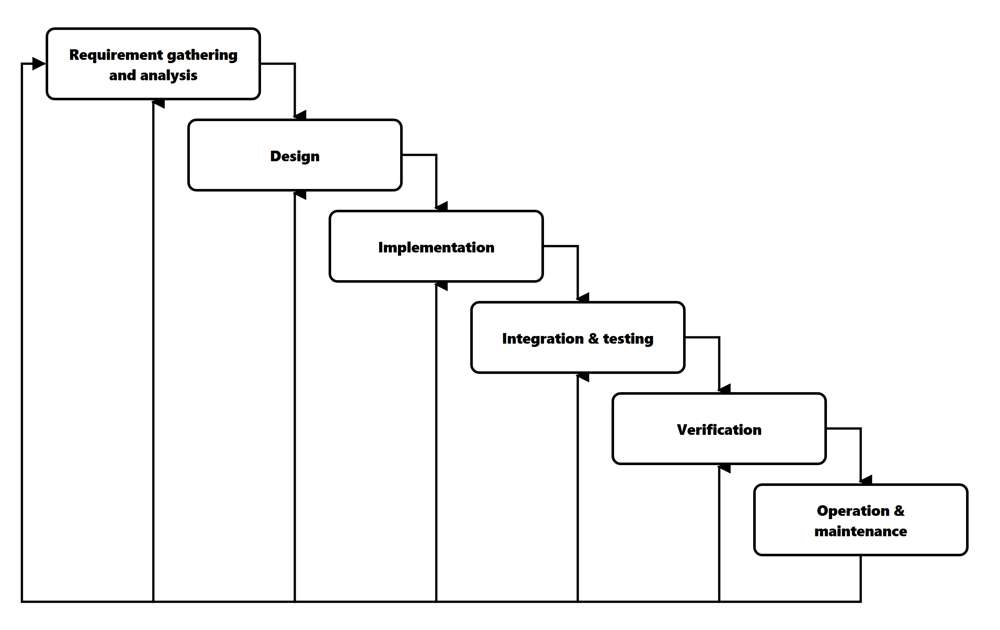
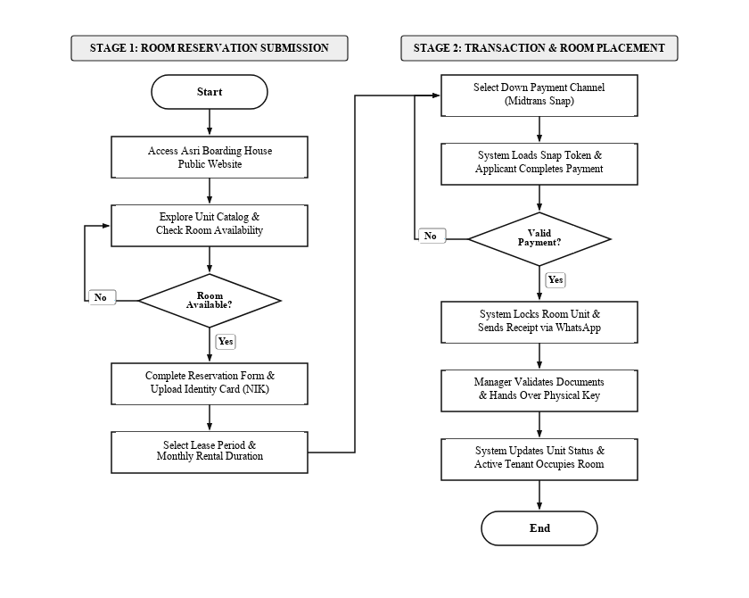
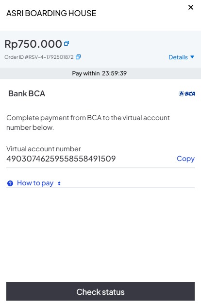
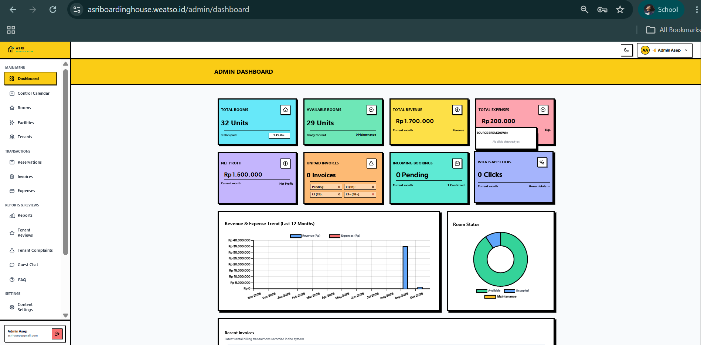

<!--
  =============================================================================
  TAHAP 1: PENGATURAN HALAMAN DAN TATA LETAK UMUM (PAGE SETUP)
  - Ukuran Kertas        : A-4 (21.0 cm x 29.7 cm)
  - Margin               : 2.5 cm di setiap sisi (Atas, Bawah, Kiri, Kanan)
  - Format Kolom         : Dua Kolom (Two Columns), jarak antar kolom 0.5 cm
  - Huruf Utama (Font)   : Times New Roman, 12 pt, Regular
  - Spasi (Line Spacing) : 1.0 (Single Spacing)
  - Batas Maksimal       : Maksimal 8 Halaman
  =============================================================================
-->

<!-- TAHAP 2: BAGIAN KEPALA ARTIKEL (JUDUL, PENULIS, AFILIASI, DAN EMAIL) -->

## **BOARDING HOUSE MANAGEMENT INFORMATION SYSTEM INTEGRATED WITH PAYMENT GATEWAY AT ASRI BOARDING HOUSE**

  1Rafif Arsya Pradiva, 2Andre Kurniawan Pamudji, 3Erdhi Widyarto Nugroho

  Department of Information Systems, Faculty of Computer Science 
  Soegijapranata Catholic University, Semarang, Indonesia

  122n40014@student.unika.ac.id, 2andre.kurniawan@unika.ac.id, 3erdhi@unika.ac.id

---

<!-- TAHAP 3: ABSTRAK DAN KATA KUNCI (ABSTRACT & KEYWORDS) -->

  <strong><em>Abstract</em></strong>

  <strong>Paper ledgers and manual chat messages have long governed daily administration across the 32 rental rooms at Asri Boarding House. That workflow causes room booking collisions, delayed monthly rent collection, and cash mismatches during multi-day bank transfer audits. This study designs and builds a web-based boarding house management information system that automates payment verification and tenant billing reminders. Development followed the Waterfall model using the Laravel framework and a MySQL database. Pessimistic row-level locking protects the database layer against duplicate reservations during simultaneous checkouts, while financial settlements and billing notices connect directly to Midtrans Snap, WhatsApp API, and email services. Functional checks across 60 black-box test scenarios confirmed reliable execution across every module without transaction or validation errors. Post-deployment evaluation with the resident manager showed that month-end closing dropped from several days to instant reports with zero cash variance, and resident student interviews recorded high satisfaction with online Virtual Account payments and downloadable digital receipts.</strong>

  <strong><em>Keywords:</em></strong> Asri Boarding House, boarding house management system, Laravel, Midtrans payment gateway, pessimistic locking

---

<!-- TAHAP 4: BAB I. INTRODUCTION -->
### **I. INTRODUCTION**

  Each academic year, growing student migration to the Tembalang university district in Semarang drives steady demand for rental housing, yet conventional marketing prevents applicants from checking room availability remotely [1]. Asri Boarding House on Jalan Maera Sari No. 1 manages 32 VIP, Deluxe, and Standard rooms on physical paper ledgers, which delays status updates and causes double bookings when two applicants claim the same unit within minutes [2].

  Monthly billing also suffers because due-date reminders for the 10th of each month and late penalties go out individually through personal chat messages, letting collection dates slip and arrears pile up [3]. Matching bank transfer screenshots and cash receipts at month end forces the manager to spend days reconciling records, leaving the cash book vulnerable to human calculation errors [4].

  Adopting a Management Information System (MIS) brings room stock, tenant agreements, and cash flow reports into one searchable hub for faster operational control [5]. Through a Business-to-Consumer (B2C) web portal, property owners connect directly with prospective student tenants while avoiding third-party agent commissions [6]. On the storefront layer, a high-contrast Neo-Brutalism design system paired with clear navigation cues helps visitors complete online bookings without confusion [7]. Behind that interface, Laravel's Model-View-Controller (MVC) structure cleanly separates business rules from display templates for easier maintenance [8]. Coupling the application with a Third Normal Form (3NF) MySQL InnoDB database removes duplicate entries and preserves relational data integrity across tenant histories [9].

  Many existing web catalogs for boarding houses still rely on manual transfer receipt uploads, whereas integrating the Midtrans payment gateway with SHA-512 webhook signatures verifies Virtual Account payments automatically [10]. Running scheduled server cron jobs takes over recurring monthly invoice generation and idempotent late-fee checks without manual operator tracking [11]. Automated billing reminders and confirmation alerts reach tenants promptly through the Fonnte WhatsApp API [12]. Official payment receipts and account updates travel in parallel over TLS-encrypted SMTP email relays for permanent archiving [13].

  To address these operational and technical gaps, this study pursues three main aims: (1) designing the architecture of an integrated boarding house management information system with a payment gateway at Asri Boarding House to stop room booking collisions and bookkeeping delays, (2) building the web application in Laravel with Midtrans integration, scheduled billing automation, and WhatsApp plus email notifications, and (3) evaluating system performance through functional testing and stakeholder interviews.

<!-- TAHAP 5: BAB II. METHOD -->
### **II. METHOD**

  Fieldwork took place at Asri Boarding House on Jalan Maera Sari No. 1, Tembalang, Semarang, applying a software engineering Research and Development (R&amp;D) approach and a single case study structured around four linked phases: input (manual ledger bottlenecks across 32 rooms), process (system design, coding, and testing), output (a verified web management platform), and outcome (accurate bookkeeping and simple digital rent payment) [14]. Primary data came from recorded face-to-face interviews with the resident manager and active student tenants, while secondary data covered internal ledgers, transfer slips, expense notes, room tariffs, technical API manuals, and prior literature [15].

  Application engineering followed the sequential Waterfall software development life cycle illustrated in Figure 1, progressing through requirement gathering and analysis, design, implementation, integration and testing, verification, and operation and maintenance [16].

  
   
  <strong>Figure 1.</strong> WATERFALL SYSTEM DEVELOPMENT MODEL

  During design, access boundaries for three actors (prospective tenant, administrator, and active tenant) were mapped in Unified Modeling Language (UML) diagrams alongside a 3NF MySQL InnoDB Entity Relationship Diagram (ERD) covering core transactional and supporting tables [17]. Implementation ran on Laravel MVC and MySQL InnoDB using ACID transactions with pessimistic row-level locking (<em>lockForUpdate()</em>) to prevent simultaneous reservation collisions on the same room [18]. Payment orchestration integrated Midtrans Snap tokens (24-hour validity) and SHA-512 webhook verification (<em>hash_equals()</em>), paired with cron commands for monthly invoice creation on the 1st (<em>tagihan:generate-bulanan</em>), daily late-fee checks (<em>tagihan:proses-keterlambatan</em>), Fonnte WhatsApp alerts, and queued SMTP emails [19]. For integration, testing, and verification, functional checks evaluated 60 black-box test scenarios across six operational domains (12 authentication and profile cases, 10 public portal cases, 10 five-step booking cases, 9 tenant portal cases, 13 admin operations cases, and 6 scheduler and API cases), followed after production deployment by side-by-side usability trials and semi-structured 10-point interviews with the resident manager and five active student tenants [20].

<!-- TAHAP 6: BAB III. RESULTS AND DISCUSSION -->
### **III. RESULTS AND DISCUSSION**

#### **A. RESULT**

  Access rules separate three roles: prospective tenants browse rooms, chat live, verify identity, and complete five-step bookings; active tenants view monthly bills, download receipts, and log repair complaints; and the administrator oversees room inventory, contracts, expenses, and cash ledgers. To support these workflows cleanly, the MySQL InnoDB schema was normalized to Third Normal Form (3NF), with Figure 2 showing the six core transactional tables (<em>users</em>, <em>kamar</em>, <em>penyewa</em>, <em>reservasi</em>, <em>tagihan</em>, and <em>pembayaran</em>). Through a one-to-many link, <em>penyewa</em> stores a historical snapshot of the agreed rent price, move-in date, lease expiry, and guardian phone contact so master rate updates never alter active contracts, while supporting operational tables handle complaints (<em>keluhan</em>), expenses (<em>pengeluaran</em>), notification logs (<em>log_notifikasi</em>), live guest chat (<em>guest_chat_threads</em> and <em>chat_messages</em>), reviews (<em>customer_reviews</em>), house rules (<em>peraturan</em>), and FAQs (<em>faqs</em>).

  
   
  <strong>Figure 2.</strong> CORE RESIDENCY AND FINANCIAL 3NF ENTITY RELATIONSHIP DIAGRAM

  Figure 3 traces the reservation, payment webhook, and billing flow from start to finish. When an applicant selects an empty room, uploads a 16-digit National Identity (NIK) card, and checks out, the backend opens an ACID database transaction with <em>lockForUpdate()</em> row locking and date-overlap checks to block duplicate bookings. Once Midtrans sends an HTTP webhook carrying a SHA-512 signature validated with <em>hash_equals()</em>, the system marks the invoice paid, promotes the user to active tenant, and sends a digital receipt via WhatsApp and email. For active residents, the server scheduler runs monthly billing on the 1st and checks overdue invoices daily past the 10th due date using idempotent <em>withoutOverlapping()</em> execution.

  
   
  <strong>Figure 3.</strong> END-TO-END RESERVATION, PAYMENT GATEWAY WEBHOOK, AND BILLING FLOWCHART

  Implementation delivered 36 responsive Neo-Brutalism web pages where visitors can inspect all 32 rooms across VIP, Deluxe, and Standard tiers along with live occupancy status, sizes, facilities, and monthly rates before booking. After choosing an available room and passing 16-digit NIK validation, the applicant moves through the five-step reservation workspace linked to the Midtrans Snap modal shown in Figure 4. The reservation stepper (Figure 4a) tracks room selection, readiness confirmation via chat, and full or down-payment checkout, while Midtrans Snap (Figure 4b) issues a 24-hour Virtual Account or QRIS code that removes manual transfer screenshot uploads.

  
  
   
  <strong>Figure 4.</strong> ONLINE BOOKING WORKFLOW: (a) FIVE-STEP RESERVATION WORKSPACE; (b) MIDTRANS SNAP VIRTUAL ACCOUNT MODAL

  Administrative operations converge on an executive dashboard and automated cash reporting module presented in Figure 5. The dashboard (Figure 5a) summarizes live room counts (32 total units), occupancy ratios, monthly revenue, operational expenses, net profit, unpaid bills, incoming bookings, a 12-month financial trend chart, and a room status donut chart. In parallel, the financial report view (Figure 5b) reconciles paid rent inflows against recorded expenses and exports formatted PDF and Excel statements in one click. On the tenant portal, residents review unpaid or settled invoices and generate an A5 horizontal PDF receipt stamped <em>PAID</em> with the Midtrans invoice ID for transparent family reporting.

  
  
   
  <strong>Figure 5.</strong> ADMINISTRATOR PORTAL: (a) LIVE EXECUTIVE DASHBOARD; (b) FINANCIAL RECONCILIATION AND EXPORT MODULE

  Functional verification across all 60 black-box scenarios in six operational domains reached a 100% pass rate with zero validation or transaction errors. Tier filters, 16-digit NIK validation, post-checkout room quarantine locks, PDF receipt downloads, and PDF/Excel report exports all behaved as expected. Post-launch side-by-side trials and audio-recorded interviews on a 10-point scale confirmed strong field adoption: the senior resident manager gave a score of 9.5/10, and five active student tenants recorded an average satisfaction rating of 8.0/10 (individual scores ranging from 7.0 to 9.0).

#### **B. DISCUSSION**

  Qualitative interview evidence indicates that pairing automated payment callbacks with row-level database locks resolves the daily administrative bottlenecks at Asri Boarding House. From the management side, automated reconciliation reduced month-end book closing from three or four days of checking paper slips and cash ledgers to instant PDF and Excel reporting with zero cash discrepancy. Inside the billing scheduler, keeping an intra-month grace window after the 10th due date and applying an idempotent 5% rollover fine only when arrears cross into the following month strikes a fair balance between clear enforcement and tenant flexibility. In addition, the post-checkout quarantine lock keeps newly vacated rooms off the public catalog until staff finish cleaning and physical inspection.

  From the resident perspective, student interviewees reported that the self-service catalog and high-contrast Neo-Brutalism interface helped them compare room amenities, reserve rooms remotely from their hometowns, and pay monthly rent via Virtual Account on Android or iPhone browsers without late-night ATM trips. Downloadable A5 horizontal PDF receipts also provided verifiable proof of settlement to share with parents, preventing disputes over lost paper slips. Respondents noted useful enhancements for later releases, including an H-3 WhatsApp reminder containing a direct invoice payment link, a brief onboarding walkthrough, a dedicated mobile application, capacity tuning during peak billing dates, and digital lease contracts.

  Compared with conventional boarding house portals that depend on manual transfer slip uploads without concurrency controls, combining ACID transactions, <em>lockForUpdate()</em> row locking, and post-checkout room quarantine prevents double bookings across all 32 rooms during simultaneous submissions. Likewise, replacing manual bank statement verification with Midtrans Snap and SHA-512 signature checks via <em>hash_equals()</em> updates the ledger automatically at the moment of settlement. Unlike one-off retail checkout integrations that end after a single purchase, linking payment webhooks with recurring monthly cron tasks, WhatsApp alerts, and queued SMTP emails automates the full multi-month rental lifecycle within one unified platform.

<!-- TAHAP 7: BAB IV. CONCLUSION -->
### **IV. CONCLUSION**

  The system architecture for Asri Boarding House combines structured UML modeling with a 3NF MySQL InnoDB database separating core transactional records from supporting operations. Defining strict boundaries across prospective tenants, active tenants, and the administrator brings 32 rental rooms and financial ledgers into one platform, replacing manual paper logs and preventing double bookings.

  The web application integrates the Laravel MVC framework, pessimistic row locking (<em>lockForUpdate()</em>), and Midtrans Snap payment callbacks verified through SHA-512 signatures. Automated server cron jobs generate monthly invoices, assess rollover late fees idempotently, and dispatch alerts via the Fonnte WhatsApp API and SMTP email, passing all 60 black-box test scenarios reliably.

  Live stakeholder evaluation showed a 9.5/10 satisfaction score from the resident manager as month-end book closing dropped from several days to instant exports without cash discrepancies. Five resident student tenants recorded an average score of 8.0/10 for convenient remote booking, Virtual Account payments, and A5 PDF receipts, confirming that the platform streamlines daily operations at Asri Boarding House.

<!-- TAHAP 8: ACKNOWLEDGMENT (TANPA NOMOR BAB) -->
### **ACKNOWLEDGMENT**

  The authors thank the Department of Information Systems, Faculty of Computer Science, Soegijapranata Catholic University, Semarang, for academic guidance and research support throughout this study. Appreciation is also extended to the property owner, the resident manager, and the student tenants of Asri Boarding House in Tembalang for their open cooperation during field interviews and system trials.

<!-- TAHAP 9: REFERENCES (TANPA NOMOR BAB, 10 PT REGULAR & 10 PT ITALIC IEEE) -->
### **REFERENCES**

  [1] A. Cornellya and H. Afriyadi, "Perancangan Sistem Informasi Pemesanan pada Kost Tya Berbasis Web Menggunakan Framework Laravel," <em>PESHUM J. Pendidikan, Sos. dan Hum.</em>, vol. 4, no. 6, pp. 10360-10369, 2025, doi: 10.56799/peshum.v4i6.11777. 
  [2] C. Nizar, "Rancang Bangun Sistem Informasi Sewa Rumah Kost (E-Kost) Berbasis Website," <em>J. Sist. Inf. dan Sains Teknol.</em>, vol. 3, no. 1, pp. 1-10, 2021, doi: 10.31326/sistek.v3i1.852. 
  [3] E. J. Malaikosa and P. Mokola, "Sistem Informasi Monitoring Rumah Kos dan Pembayarannya Berbasis Web Menggunakan Metode Rapid Application Development," <em>JSiI (Jurnal Sist. Informasi)</em>, vol. 11, no. 1, pp. 21-26, 2024, doi: 10.30656/jsii.v11i1.8222. 
  [4] R. Sutisna and F. Aziz, "Perancangan Sistem Penyewaan Alat Event Berbasis Website Menggunakan Midtrans sebagai Integrasi Payment Gateway pada PT. Bangbewe Production," <em>REMIK Ris. dan E-Jurnal Manaj. Inform. Komput.</em>, vol. 9, no. 1, pp. 317-325, 2025, doi: 10.33395/remik.v9i1.14498. 
  [5] A. Syahputra, R. Wiranti, and W. Astita, "Peran Sistem Informasi Manajemen Organisasi Dalam Pengambilan Keputusan," <em>J. Manaj. Sist. Inf.</em>, vol. 1, no. 1, pp. 26-31, 2022, doi: 10.35870/jmasif.v1i1.67. 
  [6] I. A. Nurhasanah, M. Brilliant, K. Reni, and A. Mulyanto, "Analisis Perancangan E-Business B2C (Business to Consumer) Upaya Digitalisasi Pengembangan UMKM (Studi Kasus : Kabupaten Pesawaran, Indonesia)," <em>J. Nas. Pendidik. Tek. Inform. JANAPATI</em>, vol. 11, no. 3, pp. 236-248, 2022, doi: 10.23887/janapati.v11i3.49787. 
  [7] A. R. Setiawan, M. Asfi, A. Sevtiana, S. Pranata, and W. E. Septian, "Design System pada Perancangan Antarmuka Perangkat Lunak Sistem Akses Digital," <em>J. Teknol. Terpadu</em>, vol. 9, no. 1, pp. 56-64, 2023, doi: 10.54914/jtt.v9i1.619. 
  [8] L. Rahmawati and Sumarsono, "Desain Pengembangan Website dengan Arsitektur Model View Controller pada Framework Laravel," <em>J. Teknol. dan Sist. Inf. Bisnis</em>, vol. 6, no. 4, pp. 785-790, 2024, doi: 10.47233/jteksis.v6i4.1497. 
  [9] D. F. M. Dina, "Normalisasi Database Rancangan Sistem Penyewaan Buku Berbayar," <em>Computing Insight J. Comput. Sci.</em>, vol. 4, no. 1, pp. 56-61, 2024, doi: 10.30651/comp_insight.v4i1.15814. 
  [10] M. Nurhayati and R. Setiawan, "Implementasi Payment Gateway Midtrans Pada Aplikasi Toko Mas Berbasis Web," <em>J. Algoritma</em>, vol. 21, no. 2, pp. 366-377, 2024, doi: 10.33364/algoritma/v.21-2.1686. 
  [11] A. Wibowo, A. Fathimah, D. Waskito, and R. A. Aprilianto, "Cron Job Implementation for Automated Data Processing and Transfer in Cloud Infrastructure," <em>Sainteknol J. Sains dan Teknol.</em>, vol. 23, no. 1, pp. 11-20, 2025, doi: 10.15294/sainteknol.v23i1.22649. 
  [12] I. M. B. Waton, A. N. Weking, and B. Deta, "Penerapan Api Whatsapp Fonnte Untuk Sistem Pengingat Jadwal Bimbingan Tugas Akhir Mahasiswa Berbasis Web," <em>J. Tek. Mesin, Elektro dan Ilmu Komput.</em>, vol. 5, no. 2, pp. 229-241, 2025, doi: 10.55606/teknik.v5i2.7614. 
  [13] M. A. Syahputra and R. A. Putri, "Sistem Informasi Monitoring Pembelajaran dengan Fitur Notifikasi Email Berbasis Web," <em>Decode J. Pendidik. Teknol. Inf.</em>, vol. 5, no. 2, pp. 505-515, 2025, doi: 10.51454/decode.v5i2.1206. 
  [14] M. W. Mauludy and Fathahillah, "Pengembangan Sistem Informasi Pengarsipan File Menggunakan Metode R&amp;D," <em>J. Informatics Manag. Inf. Technol.</em>, vol. 5, no. 2, pp. 118-125, 2025, doi: 10.47065/jimat.v5i2.484. 
  [15] Sugiyono, <em>Metode Penelitian Kuantitatif, Kualitatif, dan R&amp;D</em>. Bandung: Alfabeta, 2022. 
  [16] E. Rahmi, E. Yumami, and N. Hidayasari, "Analisis Metode Pengembangan Sistem Informasi Berbasis Website: Systematic Literature Review," <em>REMIK Ris. dan E-Jurnal Manaj. Inform. Komput.</em>, vol. 7, no. 1, pp. 821-834, 2023, doi: 10.33395/remik.v7i1.12177. 
  [17] Y. Adisa and M. I. P. Nasution, "Konsep Dan Peran Sistem Manajemen Basis Data Relasional Pada Sistem Informasi Manajemen," <em>MASIP J. Manaj. Adm. Bisnis dan Publik Terapan</em>, vol. 1, no. 3, pp. 76-83, 2023, doi: 10.59061/masip.v1i3.314. 
  [18] J. V. Dachi and J. Suhada, "Implementasi Basis Data Sederhana Menggunakan MySQL/PostgreSQL," <em>Router J. Tek. Inform. dan Terap.</em>, vol. 3, no. 1, pp. 49-59, 2025, doi: 10.62951/router.v3i1.621. 
  [19] R. C. Buwono, R. Kartadie, and M. K. Ramadhan, "Perancangan dan Implementasi Sistem Payment Gateway MIDTRANS untuk UMKM Batik Lurik," <em>INFOTECH J. Inform. dan Teknol.</em>, vol. 5, no. 2, pp. 228-238, 2024, doi: 10.37373/infotech.v5i2.1334. 
  [20] J. K. Aditya and A. T. Hidayat, "Sistem Informasi Manajemen Kos Berbasis Web Menggunakan Metode Blackbox: (Studi Kasus: Kos Putri Humba)," <em>JUSIM (Jurnal Sist. Inf. Musirawas)</em>, vol. 10, no. 2, pp. 229-241, 2025, doi: 10.32767/jusim.v10i2.2782.

