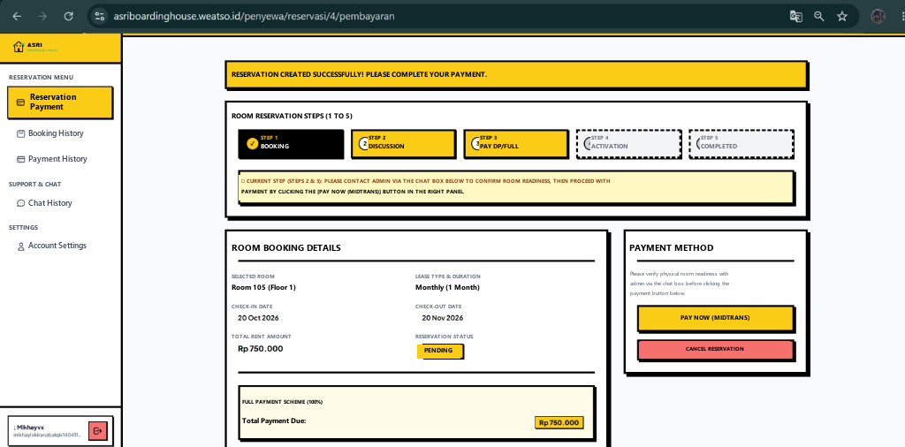

<!--
  =============================================================================
  TAHAP 1: PENGATURAN HALAMAN DAN TATA LETAK UMUM (PAGE SETUP)
  - Ukuran Kertas        : A-4 (21.0 cm x 29.7 cm)
  - Margin               : 2.5 cm di setiap sisi (Atas, Bawah, Kiri, Kanan)
  - Format Kolom         : Dua Kolom (Two Columns), jarak antar kolom 0.5 cm
  - Huruf Utama (Font)   : Times New Roman, 12 pt, Regular
  - Spasi (Line Spacing) : 1.0 (Single Spacing)
  - Batas Maksimal       : Maksimal 8 Halaman
  =============================================================================
-->

<!-- TAHAP 2: BAGIAN KEPALA ARTIKEL (JUDUL, PENULIS, AFILIASI, DAN EMAIL) -->

## **BOARDING HOUSE MANAGEMENT INFORMATION SYSTEM INTEGRATED WITH PAYMENT GATEWAY AT ASRI BOARDING HOUSE**

  1Rafif Arsya Pradiva, 2Andre Kurniawan Pamudji, 3Erdhi Widyarto Nugroho

  Department of Information Systems, Faculty of Computer Science 
  Soegijapranata Catholic University, Semarang, Indonesia

  122n40014@student.unika.ac.id, 2andre.kurniawan@unika.ac.id, 3erdhi@unika.ac.id

---

<!-- TAHAP 3: ABSTRAK DAN KATA KUNCI (ABSTRACT & KEYWORDS) -->

  <strong><em>Abstract</em></strong>

  <strong>Daily administration for the 32 rooms at Asri Boarding House still relies on paper ledgers. Because staff coordinate bookings and rent collection through personal chats, room reservations often collide, 10th-of-the-month billing reminders slip, and month-end cash reconciliation takes up to four days. This study designs and builds a web-based management information system to centralize reservations, recurring billing, and financial bookkeeping. Following a Research and Development (R&amp;D) approach, software construction adopts the Waterfall model. Built on Laravel and a 3NF MySQL database, the platform applies pessimistic row locking to block duplicate bookings during simultaneous reservation requests. Midtrans Snap verifies cashless payments automatically via SHA-512 webhooks, while server cron jobs issue monthly invoices, calculate cross-month late fees, and dispatch alerts through WhatsApp and SMTP email. All 60 black-box test scenarios across six operational domains passed without error. In field trials, the resident manager gave a 9.5/10 score as month-end closing became instant with zero cash variance, while five student tenants averaged 8.0/10 for Virtual Account payments and downloadable PDF receipts.</strong>

  <strong><em>Keywords:</em></strong> Asri Boarding House, boarding house management system, Laravel, Midtrans payment gateway, pessimistic locking

---

<!-- TAHAP 4: BAB I. INTRODUCTION -->
### **I. INTRODUCTION**

  Every new academic year brings a wave of out-of-town students to the Tembalang university district in Semarang, yet word-of-mouth marketing still forces applicants to check room vacancies in person [1]. Asri Boarding House on Jalan Maera Sari No. 1 faces this exact bottleneck across its 32 VIP, Deluxe, and Standard rooms. The caretaker records occupancy in a paper ledger while answering inquiries over personal chat, so slow status updates frequently trigger double bookings when two applicants request the same room at once [2].

  Manual administration also slows down monthly rent collection. The caretaker must check every 10th-of-the-month due date, calculate 5% cross-month late fines, and message tenants individually, which often lets reminders slip and arrears build up [3]. At month end, reconciling cash payments, transfer screenshots, and operational expense notes takes three to four days, leaving the cash book prone to human miscalculation [4].

  A centralized Management Information System (MIS) resolves these bottlenecks by uniting room inventory, lease contracts, and cash books in one database [5]. Through a Business-to-Consumer (B2C) web portal, the property owner markets available units directly to prospective students without paying third-party broker fees [6]. A high-contrast Neo-Brutalism interface then guides visitors through each booking step without visual clutter [7]. Behind the scenes, Laravel's Model-View-Controller (MVC) architecture separates business logic from page views [8], while a Third Normal Form (3NF) MySQL InnoDB schema eliminates duplicate records and protects historical lease rates [9].

  Most existing boarding house websites only digitize the room catalog. Tenants still upload transfer screenshots for manual checking, whereas integrating the Midtrans payment gateway with SHA-512 webhook verification settles Virtual Account and QRIS payments automatically [10]. On the server side, scheduled cron jobs generate monthly invoices on the 1st and run idempotent late-fee checks after the 10th without manual tracking [11]. Whenever an invoice is issued or settled, the platform sends instant alerts through the Fonnte WhatsApp API [12] and delivers official receipts via SMTP email [13].

  Based on these operational problems, this study sets three objectives. It aims to (1) design a web-based boarding house management information system architecture for Asri Boarding House, (2) build the platform in Laravel and MySQL with pessimistic row locking, Midtrans payment webhooks, cron-based billing automation, and WhatsApp plus email alerts, and (3) evaluate functional reliability and user adoption through black-box testing and field interviews with the caretaker and student tenants.

<!-- TAHAP 5: BAB II. METHOD -->
### **II. METHOD**

  This study was conducted at Asri Boarding House in Tembalang, Semarang. It combines a software engineering Research and Development (R&amp;D) approach with a single case study. The research framework moves from initial input on manual ledger bottlenecks across 32 rooms, through system design, coding, and testing, to a verified web platform and accurate digital bookkeeping as the final outcome [14]. Primary data came from face-to-face interviews with the caretaker and active student tenants, which were audio-recorded and transcribed into written text during initial requirement analysis and final evaluation. Secondary data were gathered from physical cash books, transfer slips, expense notes, room tariffs, official API manuals, and prior literature [15].

  Software construction followed the Waterfall model shown in Figure 1. This sequential life cycle suited the project because room booking rules and monthly billing schedules were already clearly defined during fieldwork. Development progressed step by step through requirement gathering and analysis, design, implementation, integration and testing, verification, and operation and maintenance, with each stage reviewed before advancing to the next [16].

  
   
  <strong>Figure 1.</strong> WATERFALL SYSTEM DEVELOPMENT MODEL

  In the design stage, access rights for prospective tenants, active tenants, and the administrator were modeled using Unified Modeling Language (UML) diagrams. Database structures were normalized into a Third Normal Form (3NF) MySQL InnoDB Entity Relationship Diagram (ERD) separating core lease and financial records from supporting operational tables [17]. System implementation ran on the Laravel MVC framework using ACID database transactions with <em>lockForUpdate()</em> pessimistic row locking so simultaneous booking requests could not claim the same room [18]. Cashless payments integrated 24-hour Midtrans Snap tokens with SHA-512 webhook signature validation through the <em>hash_equals()</em> function. In parallel, server cron jobs automated 1st-of-the-month invoicing, post-10th late-fee checks, Fonnte WhatsApp alerts, and queued SMTP emails [19]. During integration, testing, and verification, 60 black-box test scenarios were executed across six functional modules: authentication and profile, public catalog, five-step booking, tenant portal, admin operations, and background schedulers. After deployment to the production server, final evaluation paired direct usage trials with semi-structured 10-point interviews involving the caretaker and five active student tenants [20].

<!-- TAHAP 6: BAB III. RESULTS AND DISCUSSION -->
### **III. RESULTS AND DISCUSSION**

#### **A. RESULT**

  The platform divides user access into three distinct roles. Prospective tenants browse rooms, chat live with staff, verify identity, and submit five-step bookings, whereas active tenants track monthly bills, download receipts, and report room repairs. Meanwhile, the administrator manages room inventory, lease contracts, operational expenses, and cash ledgers. Figure 2 illustrates the Third Normal Form (3NF) MySQL InnoDB schema built around six core transactional tables: <em>users</em>, <em>kamar</em>, <em>penyewa</em>, <em>reservasi</em>, <em>tagihan</em>, and <em>pembayaran</em>. Inside <em>penyewa</em>, the database saves a fixed snapshot of the agreed rental tariff, move-in date, lease expiry, and parent contact so future room rate adjustments never alter running contracts. Eight supporting tables then record complaints (<em>keluhan</em>), expenses (<em>pengeluaran</em>), notification logs (<em>log_notifikasi</em>), live chat (<em>guest_chat_threads</em> and <em>chat_messages</em>), tenant reviews (<em>customer_reviews</em>), house rules (<em>peraturan</em>), and FAQs (<em>faqs</em>).

  
   
  <strong>Figure 2.</strong> CORE RESIDENCY AND FINANCIAL 3NF ENTITY RELATIONSHIP DIAGRAM

  Figure 3 maps the end-to-end reservation, payment webhook, and recurring billing workflow. An applicant first selects a vacant unit, uploads a 16-digit National Identity (NIK) card, and submits a booking request. The backend then wraps the request in an ACID database transaction using <em>lockForUpdate()</em> row locking and date-overlap checks to prevent double bookings. After payment, Midtrans dispatches an HTTP webhook carrying a SHA-512 signature verified through <em>hash_equals()</em>. Validated callbacks immediately mark the invoice paid, upgrade the account to active tenant status, and send digital receipts over WhatsApp and email. For recurring rent, server cron jobs issue new bills on the 1st and run idempotent <em>withoutOverlapping()</em> late-fee checks after the 10th.

  
   
  <strong>Figure 3.</strong> END-TO-END RESERVATION, PAYMENT GATEWAY WEBHOOK, AND BILLING FLOWCHART

  The web interface spans 36 responsive Neo-Brutalism pages covering all 32 VIP, Deluxe, and Standard rooms. Visitors can filter live room availability, dimensions, facilities, and monthly tariffs before applying. Figure 4 displays the five-step reservation workspace alongside the embedded Midtrans Snap checkout window. The step-by-step form (Figure 4a) guides applicants through identity upload, live chat confirmation, and full or down-payment selection, whereas the Midtrans Snap modal (Figure 4b) generates a 24-hour Virtual Account or QRIS code for instant cashless settlement.

  
  
   
  <strong>Figure 4.</strong> ONLINE BOOKING WORKFLOW: (a) FIVE-STEP RESERVATION WORKSPACE; (b) MIDTRANS SNAP VIRTUAL ACCOUNT MODAL

  Daily property oversight centers on the executive dashboard and financial reporting module in Figure 5. The main dashboard (Figure 5a) displays real-time metrics across all 32 rooms, including occupancy rates, monthly income, operational costs, net profit, unpaid bills, and pending reservations. It also plots a 12-month cash flow chart beside a room status donut graph. Meanwhile, the bookkeeping view (Figure 5b) matches settled rent payments against daily expenses and exports ready-to-print PDF or Excel ledgers in one click. From the resident portal, tenants check their billing history and download an A5 horizontal PDF receipt stamped <em>PAID</em> with the official Midtrans transaction ID.

  
  
   
  <strong>Figure 5.</strong> ADMINISTRATOR PORTAL: (a) LIVE EXECUTIVE DASHBOARD; (b) FINANCIAL RECONCILIATION AND EXPORT MODULE

  All 60 black-box test scenarios across the six functional modules passed without validation or transaction failures. Room tier filters, 16-digit NIK checks, post-checkout room quarantine locks, PDF receipt generation, and ledger exports worked reliably during testing. Field trials and recorded interviews using a 10-point scale also showed positive user reception. The caretaker awarded the platform 9.5/10, while five active student tenants gave an average rating of 8.0/10, with individual scores between 7.0 and 9.0.

#### **B. DISCUSSION**

  Field interviews confirm that combining automated payment webhooks with row-level database locks removes the core administrative bottlenecks at Asri Boarding House. Automated ledger updates cut month-end closing from three or four days of cross-checking chat screenshots and paper notes to instant PDF and Excel exports. Cash discrepancies dropped to zero. On the billing side, granting an intra-month grace period past the 10th due date and charging an idempotent 5% fine only when unpaid balances roll into the next month keeps rent collection firm yet fair for students. Furthermore, the post-checkout quarantine state hides newly vacated rooms from public booking until staff finish room cleaning and inspection.

  Student tenants noted that the self-service catalog and high-contrast Neo-Brutalism layout made it easy to compare room facilities and book units remotely from their hometowns. Paying rent via Virtual Account on Android or iPhone browsers also eliminated late-night trips to the ATM. Once paid, tenants could forward the A5 horizontal PDF receipt directly to their parents as official proof of payment, avoiding confusion over misplaced paper slips. For future updates, interviewees suggested adding a WhatsApp reminder with a direct checkout link three days before the due date, a short user guide, a mobile app, server tuning for peak billing days, and digital lease agreements.

  Most basic boarding house websites still rely on manual transfer receipt uploads and lack database concurrency guards. By contrast, pairing ACID transactions with <em>lockForUpdate()</em> row locking and post-checkout quarantine blocks double bookings across all 32 rooms even when multiple applicants check out at once. Midtrans Snap and SHA-512 signature checks via <em>hash_equals()</em> likewise replace manual bank statement audits with instant ledger settlement. Rather than stopping after a single retail checkout, this architecture connects payment webhooks directly to monthly cron schedulers, WhatsApp alerts, and queued SMTP emails to run the entire multi-month tenancy cycle automatically.

<!-- TAHAP 7: BAB IV. CONCLUSION -->
### **IV. CONCLUSION**

  The management information system architecture for Asri Boarding House pairs UML modeling with a 3NF MySQL InnoDB database. The schema separates six core lease and financial tables from eight supporting operational tables while dividing access across prospective tenants, active tenants, and the administrator. This unified structure replaces manual paper logs and prevents double bookings across all 32 rooms.

  Built on the Laravel MVC framework, the web application combines ACID transactions and <em>lockForUpdate()</em> pessimistic row locking with SHA-512 Midtrans Snap webhooks. Server cron jobs then issue monthly invoices on the 1st, apply 5% cross-month late fines idempotently, and dispatch Fonnte WhatsApp and queued SMTP email alerts. All 60 black-box test scenarios across the six functional modules passed without error.

  In field evaluations, the caretaker gave the platform a 9.5/10 score as month-end closing dropped from four days to instant exports with zero cash variance. Meanwhile, five active student tenants averaged 8.0/10 for self-service remote booking, Virtual Account checkout, and downloadable A5 PDF receipts. These results confirm that the system resolves daily administrative bottlenecks at Asri Boarding House.

<!-- TAHAP 8: ACKNOWLEDGMENT (TANPA NOMOR BAB) -->
### **ACKNOWLEDGMENT**

  The authors thank the Department of Information Systems, Faculty of Computer Science, Soegijapranata Catholic University, Semarang, for guiding and supporting this study. We are also grateful to the property owner and the caretaker of Asri Boarding House in Tembalang for sharing their daily ledgers and testing the web platform. Special thanks go to the active student tenants for their candid feedback during field trials.

<!-- TAHAP 9: REFERENCES (TANPA NOMOR BAB, 10 PT REGULAR & 10 PT ITALIC IEEE) -->
### **REFERENCES**

  [1] A. Cornellya and H. Afriyadi, "Perancangan Sistem Informasi Pemesanan pada Kost Tya Berbasis Web Menggunakan Framework Laravel," <em>PESHUM J. Pendidikan, Sos. dan Hum.</em>, vol. 4, no. 6, pp. 10360-10369, 2025, doi: 10.56799/peshum.v4i6.11777. 
  [2] C. Nizar, "Rancang Bangun Sistem Informasi Sewa Rumah Kost (E-Kost) Berbasis Website," <em>J. Sist. Inf. dan Sains Teknol.</em>, vol. 3, no. 1, pp. 1-10, 2021, doi: 10.31326/sistek.v3i1.852. 
  [3] E. J. Malaikosa and P. Mokola, "Sistem Informasi Monitoring Rumah Kos dan Pembayarannya Berbasis Web Menggunakan Metode Rapid Application Development," <em>JSiI (Jurnal Sist. Informasi)</em>, vol. 11, no. 1, pp. 21-26, 2024, doi: 10.30656/jsii.v11i1.8222. 
  [4] R. Sutisna and F. Aziz, "Perancangan Sistem Penyewaan Alat Event Berbasis Website Menggunakan Midtrans sebagai Integrasi Payment Gateway pada PT. Bangbewe Production," <em>REMIK Ris. dan E-Jurnal Manaj. Inform. Komput.</em>, vol. 9, no. 1, pp. 317-325, 2025, doi: 10.33395/remik.v9i1.14498. 
  [5] A. Syahputra, R. Wiranti, and W. Astita, "Peran Sistem Informasi Manajemen Organisasi Dalam Pengambilan Keputusan," <em>J. Manaj. Sist. Inf.</em>, vol. 1, no. 1, pp. 26-31, 2022, doi: 10.35870/jmasif.v1i1.67. 
  [6] I. A. Nurhasanah, M. Brilliant, K. Reni, and A. Mulyanto, "Analisis Perancangan E-Business B2C (Business to Consumer) Upaya Digitalisasi Pengembangan UMKM (Studi Kasus : Kabupaten Pesawaran, Indonesia)," <em>J. Nas. Pendidik. Tek. Inform. JANAPATI</em>, vol. 11, no. 3, pp. 236-248, 2022, doi: 10.23887/janapati.v11i3.49787. 
  [7] A. R. Setiawan, M. Asfi, A. Sevtiana, S. Pranata, and W. E. Septian, "Design System pada Perancangan Antarmuka Perangkat Lunak Sistem Akses Digital," <em>J. Teknol. Terpadu</em>, vol. 9, no. 1, pp. 56-64, 2023, doi: 10.54914/jtt.v9i1.619. 
  [8] L. Rahmawati and Sumarsono, "Desain Pengembangan Website dengan Arsitektur Model View Controller pada Framework Laravel," <em>J. Teknol. dan Sist. Inf. Bisnis</em>, vol. 6, no. 4, pp. 785-790, 2024, doi: 10.47233/jteksis.v6i4.1497. 
  [9] D. F. M. Dina, "Normalisasi Database Rancangan Sistem Penyewaan Buku Berbayar," <em>Computing Insight J. Comput. Sci.</em>, vol. 4, no. 1, pp. 56-61, 2024, doi: 10.30651/comp_insight.v4i1.15814. 
  [10] M. Nurhayati and R. Setiawan, "Implementasi Payment Gateway Midtrans Pada Aplikasi Toko Mas Berbasis Web," <em>J. Algoritma</em>, vol. 21, no. 2, pp. 366-377, 2024, doi: 10.33364/algoritma/v.21-2.1686. 
  [11] A. Wibowo, A. Fathimah, D. Waskito, and R. A. Aprilianto, "Cron Job Implementation for Automated Data Processing and Transfer in Cloud Infrastructure," <em>Sainteknol J. Sains dan Teknol.</em>, vol. 23, no. 1, pp. 11-20, 2025, doi: 10.15294/sainteknol.v23i1.22649. 
  [12] I. M. B. Waton, A. N. Weking, and B. Deta, "Penerapan Api Whatsapp Fonnte Untuk Sistem Pengingat Jadwal Bimbingan Tugas Akhir Mahasiswa Berbasis Web," <em>J. Tek. Mesin, Elektro dan Ilmu Komput.</em>, vol. 5, no. 2, pp. 229-241, 2025, doi: 10.55606/teknik.v5i2.7614. 
  [13] M. A. Syahputra and R. A. Putri, "Sistem Informasi Monitoring Pembelajaran dengan Fitur Notifikasi Email Berbasis Web," <em>Decode J. Pendidik. Teknol. Inf.</em>, vol. 5, no. 2, pp. 505-515, 2025, doi: 10.51454/decode.v5i2.1206. 
  [14] M. W. Mauludy and Fathahillah, "Pengembangan Sistem Informasi Pengarsipan File Menggunakan Metode R&amp;D," <em>J. Informatics Manag. Inf. Technol.</em>, vol. 5, no. 2, pp. 118-125, 2025, doi: 10.47065/jimat.v5i2.484. 
  [15] Sugiyono, <em>Metode Penelitian Kuantitatif, Kualitatif, dan R&amp;D</em>. Bandung: Alfabeta, 2022. 
  [16] E. Rahmi, E. Yumami, and N. Hidayasari, "Analisis Metode Pengembangan Sistem Informasi Berbasis Website: Systematic Literature Review," <em>REMIK Ris. dan E-Jurnal Manaj. Inform. Komput.</em>, vol. 7, no. 1, pp. 821-834, 2023, doi: 10.33395/remik.v7i1.12177. 
  [17] Y. Adisa and M. I. P. Nasution, "Konsep Dan Peran Sistem Manajemen Basis Data Relasional Pada Sistem Informasi Manajemen," <em>MASIP J. Manaj. Adm. Bisnis dan Publik Terapan</em>, vol. 1, no. 3, pp. 76-83, 2023, doi: 10.59061/masip.v1i3.314. 
  [18] J. V. Dachi and J. Suhada, "Implementasi Basis Data Sederhana Menggunakan MySQL/PostgreSQL," <em>Router J. Tek. Inform. dan Terap.</em>, vol. 3, no. 1, pp. 49-59, 2025, doi: 10.62951/router.v3i1.621. 
  [19] R. C. Buwono, R. Kartadie, and M. K. Ramadhan, "Perancangan dan Implementasi Sistem Payment Gateway MIDTRANS untuk UMKM Batik Lurik," <em>INFOTECH J. Inform. dan Teknol.</em>, vol. 5, no. 2, pp. 228-238, 2024, doi: 10.37373/infotech.v5i2.1334. 
  [20] J. K. Aditya and A. T. Hidayat, "Sistem Informasi Manajemen Kos Berbasis Web Menggunakan Metode Blackbox: (Studi Kasus: Kos Putri Humba)," <em>JUSIM (Jurnal Sist. Inf. Musirawas)</em>, vol. 10, no. 2, pp. 229-241, 2025, doi: 10.32767/jusim.v10i2.2782.

