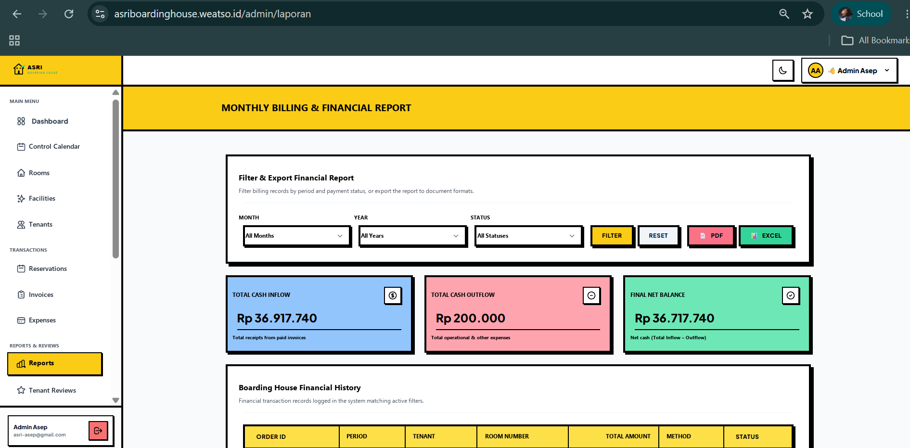

<!--
  =============================================================================
  TAHAP 1: PENGATURAN HALAMAN DAN TATA LETAK UMUM (PAGE SETUP)
  - Ukuran Kertas        : A-4 (21.0 cm x 29.7 cm)
  - Margin               : 2.5 cm di setiap sisi (Atas, Bawah, Kiri, Kanan)
  - Format Kolom         : Dua Kolom (Two Columns), jarak antar kolom 0.5 cm
  - Huruf Utama (Font)   : Times New Roman, 12 pt, Regular
  - Spasi (Line Spacing) : 1.0 (Single Spacing)
  - Batas Maksimal       : Maksimal 8 Halaman
  =============================================================================
-->

<!-- TAHAP 2: BAGIAN KEPALA ARTIKEL (JUDUL, PENULIS, AFILIASI, DAN EMAIL) -->

## **BOARDING HOUSE MANAGEMENT INFORMATION SYSTEM INTEGRATED WITH PAYMENT GATEWAY AT ASRI BOARDING HOUSE**

  1Rafif Arsya Pradiva, 2Andre Kurniawan Pamudji, 3Erdhi Widyarto Nugroho

  Department of Information Systems, Faculty of Computer Science 
  Soegijapranata Catholic University, Semarang, Indonesia

  122n40014@student.unika.ac.id, 2andre.kurniawan@unika.ac.id, 3erdhi@unika.ac.id

---

<!-- TAHAP 3: ABSTRAK DAN KATA KUNCI (ABSTRACT & KEYWORDS) -->

  <strong><em>Abstract</em></strong>

  <strong>Asri Boarding House in Semarang previously ran its 32 rental rooms on paper ledgers and personal chat messages. Delayed room updates caused occasional double bookings, reminders for rent due on the 10th often slipped, and month-end bookkeeping took three to four days. We designed and built a web-based management information system linked to a payment gateway so reservations, monthly bills, and cash reports stay in one place. The project followed a Research and Development (R&amp;D) approach with the Waterfall model, using Laravel and a 3NF MySQL database. Pessimistic row locking stops concurrent requests from booking the same room, while Midtrans Snap settles cashless payments automatically via SHA-512 webhooks. Server cron jobs create bills on the 1st, add a single 5% cross-month late fine, and send WhatsApp and email notices. All 60 black-box tests passed across six modules. In live trials, the caretaker scored the platform 9.5/10 as month-end closing dropped to seconds with no cash variance. Five student tenants averaged 8.0/10, highlighting Virtual Account payments and A5 PDF receipts.</strong>

  <strong><em>Keywords:</em></strong> Asri Boarding House, boarding house management system, Laravel, Midtrans payment gateway, pessimistic row locking

---

<!-- TAHAP 4: BAB I. INTRODUCTION -->
### **I. INTRODUCTION**

  Every new semester brings out-of-town students to Semarang's Tembalang campus district in search of housing near lecture halls. Where boarding houses rely on word of mouth, prospective tenants must visit in person or wait for chat replies just to check vacant rooms [1]. Asri Boarding House on Jalan Maera Sari No. 1 operates 32 rooms under this routine: 6 VIP, 3 Deluxe, and 23 Standard. The caretaker writes occupancy changes in a paper book while answering inquiries over personal chat, so delayed notes sometimes let two applicants book the same unit at once [2].

  Paper administration slows down monthly rent collection too. Rent falls due on the 10th with a grace window until month end, while unpaid balances crossing into the next month carry a single 5% flat fine. When staff check due dates by hand and message tenants one by one, reminders easily slip and arrears grow [3]. Tenants also wait for manual approval after sending transfer screenshots and must keep paper receipts that easily go missing. At month end, sorting through cash deposits, transfer proofs, and expense slips takes three to four days, creating calculation risks that an online payment gateway can eliminate [4].

  A centralized Management Information System (MIS) places room stock, leases, and cash books in one database so daily decisions happen faster [5]. Through a Business-to-Consumer (B2C) web catalog, the owner markets open units directly to students without broker fees [6]. High-contrast Neo-Brutalism design keeps prices and booking buttons clear on both phones and laptops [7]. Laravel's Model-View-Controller (MVC) pattern separates database queries, business rules, and page views so the codebase remains easy to maintain [8]. A Third Normal Form (3NF) MySQL InnoDB schema removes duplicate entries and update anomalies [9]. Each lease record also saves a fixed copy of the agreed rent to shield active contracts from later price increases, while InnoDB row locking stops concurrent booking requests from colliding.

  Many boarding-house websites only display room photos and still require tenants to upload transfer receipts for manual review. Midtrans payment gateway integration removes that wait by settling cashless payments, including Virtual Accounts, once an incoming SHA-512 webhook signature passes verification [10]. Server cron jobs take over monthly billing without manual operator tracking [11]. Those scheduled tasks create bills on the 1st and run late checks after the 10th so each cross-month fine applies only once. The Fonnte WhatsApp API then sends instant phone alerts whenever a bill is issued or paid [12], while queued SMTP emails deliver formal payment records and receipt links for permanent archiving [13].

  Based on those field problems, this study sets three objectives. First, we design a unified web-based management information system for Asri Boarding House covering bookings, monthly billing, and cash reports. Second, we build the platform in Laravel and MySQL with pessimistic row locking, SHA-512 Midtrans webhooks, automated cron billing, and WhatsApp plus email notices. Third, we test system reliability and user acceptance through black-box testing, live trials, and interviews with the caretaker and active student tenants.

<!-- TAHAP 5: BAB II. METHOD -->
### **II. METHOD**

  We conducted this study at Asri Boarding House in Tembalang, Semarang, pairing software engineering Research and Development (R&amp;D) with a single case study. Work moved from mapping manual ledger bottlenecks across 32 rooms, through design, coding, and testing, to a verified web platform with reliable digital bookkeeping [14]. Both primary and secondary data guided development [15]. Primary evidence came from site observation and audio-recorded, transcribed interviews with the caretaker and five active student tenants during early requirement gathering and final evaluation. Secondary sources included physical cash books, transfer proofs, expense notes, tariff sheets, API manuals, and prior studies.

  Software construction followed the Waterfall model in Figure 1 [16]. A sequential plan suited this site because its operating rules were already settled during fieldwork: 32 rooms, 30% down-payment or full-payment options, 10th-of-the-month due dates, 5% flat cross-month fines, and post-checkout room quarantine. Work progressed through six stages: requirement gathering and analysis, design, implementation, integration and testing, verification, and operation and maintenance. Each stage underwent review before advancing, and the return arrows in Figure 1 allowed bugs found during testing or live trials to trigger direct fixes in earlier stages.

  
   
  <strong>Figure 1.</strong> WATERFALL SYSTEM DEVELOPMENT MODEL

  In design, Unified Modeling Language (UML) use case, activity, and flowchart diagrams mapped workflows for prospective tenants, active residents, and the administrator. A 3NF MySQL InnoDB Entity Relationship Diagram (ERD) split six core lease and payment tables from eight supporting tables [17], paired with high-contrast Neo-Brutalism layouts for mobile and desktop clarity. Implementation used Laravel 12 MVC, a dedicated service layer, and role middleware to protect private routes. Room bookings run inside ACID transactions using <em>lockForUpdate()</em> row locking and date-overlap checks to block simultaneous claims [18]. Cashless checkout requests 24-hour Midtrans Snap tokens and verifies SHA-512 webhook signatures in constant time with <em>hash_equals()</em> [19]. Server cron jobs guarded by <em>withoutOverlapping()</em> automate 1st-of-the-month billing, post-10th late checks, and hourly cleanup of expired bookings, while the Fonnte WhatsApp API and queued SMTP emails send automated notices.

  Integration and testing linked all internal modules to external APIs and executed 60 black-box test scenarios across six domains: authentication and profile, public catalog, five-step booking, tenant portal, admin operations, and background schedulers [20]. These checks covered standard flows and invalid-input guards, such as 16-digit identity rules and blocks against deleting occupied units. Verification then moved on site at Asri Boarding House, where the caretaker and five active student tenants tested real tasks on their own devices before answering semi-structured 10-point interviews. Finally, operation and maintenance deployed the platform to production with active cron jobs and ongoing monitoring of database health, notification logs, and user feedback.

<!-- TAHAP 6: BAB III. RESULTS AND DISCUSSION -->
### **III. RESULTS AND DISCUSSION**

#### **A. RESULTS**

  The live platform supports three user groups: prospective tenants, active residents, and the administrator. Prospective and active tenants share one <em>tenant</em> role in <em>users</em>, and a post-login redirect service routes each account based on active contract status. Figure 2 shows the core 3NF MySQL InnoDB schema across six transactional tables: <em>users</em>, <em>kamar</em>, <em>penyewa</em>, <em>reservasi</em>, <em>tagihan</em>, and <em>pembayaran</em>. Inside <em>penyewa</em>, each contract stores a fixed snapshot of the agreed rent, move-in date, planned end date, and guardian phone, so future tariff changes never alter active leases. Eight supporting tables record repair complaints, expenses, notification logs, guest chat threads and messages, reviews, house rules, and FAQs. Production columns keep Indonesian names, and <em>kamar</em> adds a <em>maintenance</em> status beside <em>available</em> and <em>occupied</em>.

  
   
  <strong>Figure 2.</strong> CORE ROOM, TENANCY, AND FINANCIAL 3NF ENTITY RELATIONSHIP DIAGRAM

  Figure 3 traces room reservation from catalog lookup to physical key handover. After selecting an open room, the applicant provides a 16-digit National Identity Number (NIK), guardian contacts, and stay duration. The conceptual flowchart labels this step as an ID card upload, but the live site keeps only the 16-digit number online for privacy and leaves physical ID inspection for arrival. Each request runs in an ACID transaction with <em>lockForUpdate()</em> row locking and schedule-overlap checks so two applicants cannot claim the same unit together. Once Midtrans settles payment, an asynchronous webhook verifies the SHA-512 signature via <em>hash_equals()</em>, checks the amount and idempotency log, and locks the reservation. At check-in, the caretaker inspects the physical ID, hands over the key, and activates tenancy, sending WhatsApp and queued SMTP email confirmations. Scheduled <em>withoutOverlapping()</em> cron jobs then issue monthly bills on the 1st, track overdue grace windows past the 10th, add a one-time 5% rollover fine, and cancel unpaid bookings hourly.

  
   
  <strong>Figure 3.</strong> END-TO-END ROOM RESERVATION, MIDTRANS PAYMENT, AND TENANT ACTIVATION FLOWCHART

  The interface spans 36 responsive Neo-Brutalism screens across public pages and the applicant, resident, and admin portals. Visitors filter all 32 VIP, Deluxe, and Standard units by tier or room number to inspect live availability, dimensions, facilities, and monthly rates without messaging staff first. Occupied room cards replace the booking button with a direct WhatsApp inquiry shortcut. Figure 4 displays the five-step booking tracker next to the Midtrans checkout window. On the tracking page (Figure 4a), applicants follow booking, discussion, payment, activation, and completion steps while confirming room readiness via live chat before choosing a 30% down payment or full settlement. When an applicant initiates payment, Midtrans Snap opens (Figure 4b) and issues a 24-hour Bank BCA Virtual Account number for instant cashless settlement.

  
  
   
  <strong>Figure 4.</strong> ONLINE BOOKING WORKFLOW: (a) FIVE-STEP RESERVATION WORKSPACE; (b) MIDTRANS SNAP VIRTUAL ACCOUNT MODAL

  Property oversight centers on the admin portal in Figure 5. The main dashboard (Figure 5a) shows current-month figures across all 32 rooms in eight live cards: total occupancy, available units, revenue, expenses, net profit, unpaid invoices, incoming bookings, and WhatsApp clicks. A 12-month bar chart tracks cash flow next to a room-status donut graph, and an OLED dark mode switch in the top bar eases evening viewing. The financial report page (Figure 5b) compares settled rent against daily expenses across single months or cumulative periods and exports PDF or Excel ledgers in one click. Active residents use their portal to inspect billing history, file photo-attached repair tickets, and download browser-rendered A5 PDF receipts stamped <em>PAID</em> with the Midtrans transaction ID.

  
  
   
  <strong>Figure 5.</strong> ADMINISTRATOR PORTAL: (a) LIVE EXECUTIVE DASHBOARD; (b) FINANCIAL REPORTING AND EXPORT MODULE

  Black-box testing ran 60 scenarios across all six modules, passing every case without validation or transaction failures. Positive tests verified room filters, multi-month discounts, Virtual Account callbacks, client-side A5 receipts, ledger exports, and automated WhatsApp and email notices. Negative checks blocked 14-digit NIK entries, non-image complaint files, occupied-room deletion, and duplicate monthly fine runs. On-site trials and recorded 10-point interviews confirmed those lab checks. The senior caretaker, after twenty years of managing paper ledgers, rated the platform 9.5/10, while five active student tenants who tested the website on Android phones, iPhones, and laptops gave scores from 7.0 to 9.0 for an 8.0/10 average.

#### **B. DISCUSSION**

  Site interviews confirm that automatic payment callbacks paired with clear operational rules remove the main daily delays at Asri Boarding House. Automatic ledger posting cut month-end closing from three or four days of sorting paper notes and chat screenshots down to instant PDF and Excel exports with zero cash discrepancies. Everyday office tasks became easier too. OLED dark mode reduced evening eye strain, walk-in registration captured guardian numbers upfront, one-click cash confirmation replaced handwritten receipt books, and photo-attached tickets kept hallway repair requests documented. Two offline steps were also kept on purpose: staff still verify original ID cards at arrival to protect applicant privacy online, and newly vacated rooms stay in quarantine until cleaning and inspection finish. A same-month grace period past the 10th before a single 5% rollover fine also fits student allowance schedules without harsh daily compounding.

  Student interviews clarify both the platform's practical appeal and why individual scores spanned 7.0 to 9.0. Out-of-town applicants appreciated inspecting live room availability and clear rates from home before traveling to Semarang. Tenants could pay rent through Virtual Accounts on Android browsers, iPhone Safari, or laptops, ending late-night ATM trips and disputes over missed ledger notes. Once payment cleared, residents forwarded the A5 PDF receipt to parents or saved it in cloud storage as clear proof. Live trials also revealed minor usability friction: wide payment tables required sideways scrolling on small phones, and five booking steps felt slightly long on desktop monitors. First-time users also needed extra minutes to locate the receipt and repair menus. Those insights point the next release toward H-3 WhatsApp direct-pay reminders, stacked mobile table cards, a short onboarding guide, peak-day caching on the 1st, digital leases, and a mobile app.

  Many boarding-house websites still rely on manual transfer receipt uploads and leave booking concurrency unprotected. This design tackles both gaps directly. At checkout, InnoDB <em>lockForUpdate()</em> locks work alongside date-overlap checks and post-checkout room quarantine so multiple applicants cannot reserve the same room across all 32 units. For bookkeeping accuracy, constant-time <em>hash_equals()</em> SHA-512 checks, month-end aware Snap token expiry, and idempotent callbacks replace manual bank audits with automatically updated cash records. Those webhooks feed into monthly <em>withoutOverlapping()</em> schedulers, WhatsApp alerts, and queued SMTP emails, supporting the full multi-month stay rather than a single checkout. Even so, field validation has clear scope limits: testing covered one 32-room house with six users, and initial launch enabled only the Bank BCA Virtual Account channel to match the owner's bank. Because the schema and service layer stay decoupled, adding QRIS, e-wallets, or future branches needs minimal core rework.

<!-- TAHAP 7: BAB IV. CONCLUSION -->
### **IV. CONCLUSION**

  This work produced a unified web architecture for Asri Boarding House linking reservations, rent collection, and cash reporting across all 32 units. UML diagrams define separate workspaces for prospective applicants, active residents, and management across 36 responsive Neo-Brutalism pages. At the database tier, a 3NF MySQL InnoDB design organizes core tenancy and payment data in six primary tables supported by eight operational tables, keeping fixed contract-rate snapshots so rent updates leave running leases untouched. Essential physical checks stay intact, as staff inspect original ID cards on arrival and hold vacated rooms until cleaning completes.

  The production application runs on Laravel 12 MVC with role-based route protection and a dedicated service layer. Atomic ACID booking transactions combine schedule-conflict checks and <em>lockForUpdate()</em> locks to eliminate double bookings. Midtrans Snap handles cashless payments via 24-hour Virtual Account numbers, while SHA-512 webhook checks using <em>hash_equals()</em> reject duplicate or forged callbacks before settling invoices. Scheduled cron jobs clear expired reservations every hour and generate monthly bills on the 1st without overlapping runs. Only arrears crossing into another month incur a single 5% fine, and Fonnte WhatsApp plus queued SMTP email deliver every notice automatically.

  Evaluation confirmed both software reliability and practical usability on site. Every one of the 60 functional scenarios across six modules passed without error. The senior caretaker rated the platform 9.5/10 as month-end closing shrank from several days of manual reconciliation to instant exports with no cash mismatch. Five student residents scored the portal between 7.0 and 9.0 (8.0/10 average), praising remote room lookup, screenshot-free Virtual Account settlement, and stamped A5 receipts. Field validation remained scoped to one 32-room property, six participants, and an initial Bank BCA Virtual Account channel. Future updates can expand payment options to QRIS and e-wallets while adding H-3 WhatsApp payment links, stacked mobile cards, first-login guidance, peak-day caching, digital leases, and a mobile app.

<!-- TAHAP 8: ACKNOWLEDGMENT (TANPA NOMOR BAB) -->
### **ACKNOWLEDGMENT**

  We thank the Department of Information Systems and the Faculty of Computer Science at Soegijapranata Catholic University, Semarang, for academic guidance and research support throughout this study. Our sincere gratitude also goes to the property owner of Asri Boarding House in Tembalang for welcoming our fieldwork. We appreciate the senior caretaker for sharing daily ledgers, explaining boarding rules, and testing the admin portal. Finally, we thank the five active student tenants who tried the resident portal on their own devices and shared candid feedback.

<!-- TAHAP 9: REFERENCES (TANPA NOMOR BAB, 10 PT REGULAR & 10 PT ITALIC IEEE) -->
### **REFERENCES**

  [1] A. Cornellya and H. Afriyadi, "Perancangan Sistem Informasi Pemesanan pada Kost Tya Berbasis Web Menggunakan Framework Laravel," <em>PESHUM J. Pendidikan, Sos. dan Hum.</em>, vol. 4, no. 6, pp. 10360-10369, 2025, doi: 10.56799/peshum.v4i6.11777. 
  [2] C. Nizar, "Rancang Bangun Sistem Informasi Sewa Rumah Kost (E-Kost) Berbasis Website," <em>J. Sist. Inf. dan Sains Teknol.</em>, vol. 3, no. 1, pp. 1-10, 2021, doi: 10.31326/sistek.v3i1.852. 
  [3] E. J. Malaikosa and P. Mokola, "Sistem Informasi Monitoring Rumah Kos dan Pembayarannya Berbasis Web Menggunakan Metode Rapid Application Development," <em>JSiI (Jurnal Sist. Informasi)</em>, vol. 11, no. 1, pp. 21-26, 2024, doi: 10.30656/jsii.v11i1.8222. 
  [4] R. Sutisna and F. Aziz, "Perancangan Sistem Penyewaan Alat Event Berbasis Website Menggunakan Midtrans sebagai Integrasi Payment Gateway pada PT. Bangbewe Production," <em>REMIK Ris. dan E-Jurnal Manaj. Inform. Komput.</em>, vol. 9, no. 1, pp. 317-325, 2025, doi: 10.33395/remik.v9i1.14498. 
  [5] A. Syahputra, R. Wiranti, and W. Astita, "Peran Sistem Informasi Manajemen Organisasi Dalam Pengambilan Keputusan," <em>J. Manaj. Sist. Inf.</em>, vol. 1, no. 1, pp. 26-31, 2022, doi: 10.35870/jmasif.v1i1.67. 
  [6] I. A. Nurhasanah, M. Brilliant, K. Reni, and A. Mulyanto, "Analisis Perancangan E-Business B2C (Business to Consumer) Upaya Digitalisasi Pengembangan UMKM (Studi Kasus : Kabupaten Pesawaran, Indonesia)," <em>J. Nas. Pendidik. Tek. Inform. JANAPATI</em>, vol. 11, no. 3, pp. 236-248, 2022, doi: 10.23887/janapati.v11i3.49787. 
  [7] A. R. Setiawan, M. Asfi, A. Sevtiana, S. Pranata, and W. E. Septian, "Design System pada Perancangan Antarmuka Perangkat Lunak Sistem Akses Digital," <em>J. Teknol. Terpadu</em>, vol. 9, no. 1, pp. 56-64, 2023, doi: 10.54914/jtt.v9i1.619. 
  [8] L. Rahmawati and Sumarsono, "Desain Pengembangan Website dengan Arsitektur Model View Controller pada Framework Laravel," <em>J. Teknol. dan Sist. Inf. Bisnis</em>, vol. 6, no. 4, pp. 785-790, 2024, doi: 10.47233/jteksis.v6i4.1497. 
  [9] D. F. M. Dina, "Normalisasi Database Rancangan Sistem Penyewaan Buku Berbayar," <em>Computing Insight J. Comput. Sci.</em>, vol. 4, no. 1, pp. 56-61, 2024, doi: 10.30651/comp_insight.v4i1.15814. 
  [10] M. Nurhayati and R. Setiawan, "Implementasi Payment Gateway Midtrans Pada Aplikasi Toko Mas Berbasis Web," <em>J. Algoritma</em>, vol. 21, no. 2, pp. 366-377, 2024, doi: 10.33364/algoritma/v.21-2.1686. 
  [11] A. Wibowo, A. Fathimah, D. Waskito, and R. A. Aprilianto, "Cron Job Implementation for Automated Data Processing and Transfer in Cloud Infrastructure," <em>Sainteknol J. Sains dan Teknol.</em>, vol. 23, no. 1, pp. 11-20, 2025, doi: 10.15294/sainteknol.v23i1.22649. 
  [12] I. M. B. Waton, A. N. Weking, and B. Deta, "Penerapan Api Whatsapp Fonnte Untuk Sistem Pengingat Jadwal Bimbingan Tugas Akhir Mahasiswa Berbasis Web," <em>J. Tek. Mesin, Elektro dan Ilmu Komput.</em>, vol. 5, no. 2, pp. 229-241, 2025, doi: 10.55606/teknik.v5i2.7614. 
  [13] M. A. Syahputra and R. A. Putri, "Sistem Informasi Monitoring Pembelajaran dengan Fitur Notifikasi Email Berbasis Web," <em>Decode J. Pendidik. Teknol. Inf.</em>, vol. 5, no. 2, pp. 505-515, 2025, doi: 10.51454/decode.v5i2.1206. 
  [14] M. W. Mauludy and Fathahillah, "Pengembangan Sistem Informasi Pengarsipan File Menggunakan Metode R&amp;D," <em>J. Informatics Manag. Inf. Technol.</em>, vol. 5, no. 2, pp. 118-125, 2025, doi: 10.47065/jimat.v5i2.484. 
  [15] Sugiyono, <em>Metode Penelitian Kuantitatif, Kualitatif, dan R&amp;D</em>. Bandung: Alfabeta, 2022. 
  [16] E. Rahmi, E. Yumami, and N. Hidayasari, "Analisis Metode Pengembangan Sistem Informasi Berbasis Website: Systematic Literature Review," <em>REMIK Ris. dan E-Jurnal Manaj. Inform. Komput.</em>, vol. 7, no. 1, pp. 821-834, 2023, doi: 10.33395/remik.v7i1.12177. 
  [17] Y. Adisa and M. I. P. Nasution, "Konsep Dan Peran Sistem Manajemen Basis Data Relasional Pada Sistem Informasi Manajemen," <em>MASIP J. Manaj. Adm. Bisnis dan Publik Terapan</em>, vol. 1, no. 3, pp. 76-83, 2023, doi: 10.59061/masip.v1i3.314. 
  [18] J. V. Dachi and J. Suhada, "Implementasi Basis Data Sederhana Menggunakan MySQL/PostgreSQL," <em>Router J. Tek. Inform. dan Terap.</em>, vol. 3, no. 1, pp. 49-59, 2025, doi: 10.62951/router.v3i1.621. 
  [19] R. C. Buwono, R. Kartadie, and M. K. Ramadhan, "Perancangan dan Implementasi Sistem Payment Gateway MIDTRANS untuk UMKM Batik Lurik," <em>INFOTECH J. Inform. dan Teknol.</em>, vol. 5, no. 2, pp. 228-238, 2024, doi: 10.37373/infotech.v5i2.1334. 
  [20] J. K. Aditya and A. T. Hidayat, "Sistem Informasi Manajemen Kos Berbasis Web Menggunakan Metode Blackbox: (Studi Kasus: Kos Putri Humba)," <em>JUSIM (Jurnal Sist. Inf. Musirawas)</em>, vol. 10, no. 2, pp. 229-241, 2025, doi: 10.32767/jusim.v10i2.2782.

