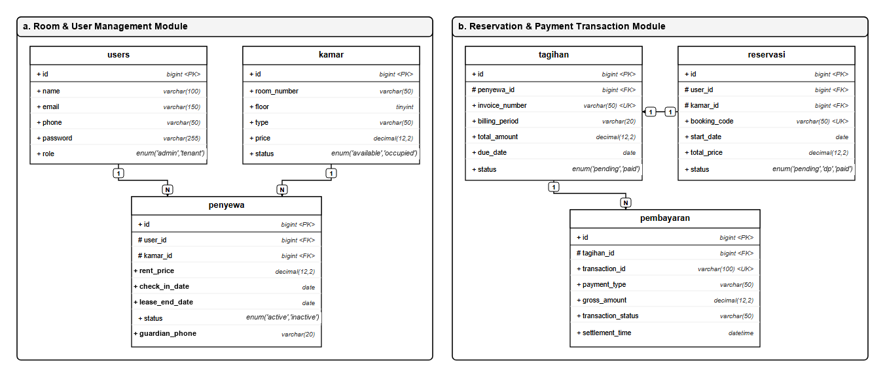

<!--
  =============================================================================
  TAHAP 1: PENGATURAN HALAMAN DAN TATA LETAK UMUM (PAGE SETUP)
  - Ukuran Kertas        : A-4 (21.0 cm x 29.7 cm)
  - Margin               : 2.5 cm di setiap sisi (Atas, Bawah, Kiri, Kanan)
  - Format Kolom         : Dua Kolom (Two Columns), jarak antar kolom 0.5 cm
  - Huruf Utama (Font)   : Times New Roman, 12 pt, Regular
  - Spasi (Line Spacing) : 1.0 (Single Spacing)
  - Batas Maksimal       : Maksimal 8 Halaman
  =============================================================================
-->

<!-- TAHAP 2: BAGIAN KEPALA ARTIKEL (JUDUL, PENULIS, AFILIASI, DAN EMAIL) -->

## **BOARDING HOUSE MANAGEMENT INFORMATION SYSTEM INTEGRATED WITH PAYMENT GATEWAY AT ASRI BOARDING HOUSE**

  1Rafif Arsya Pradiva, 2Andre Kurniawan Pamudji, 3Erdhi Widyarto Nugroho

  Department of Information Systems, Faculty of Computer Science 
  Soegijapranata Catholic University, Semarang, Indonesia

  1rafif.arsya.pradiva@gmail.com, 2andre.kurniawan@unika.ac.id, 3erdhi@unika.ac.id

---

<!-- TAHAP 3: ABSTRAK DAN KATA KUNCI (ABSTRACT & KEYWORDS) -->

  <strong><em>Abstract</em></strong>

  <strong>The caretaker at Asri Boarding House tracks 32 rooms manually. Because staff handle inquiries over personal chat and log payments in paper books, simultaneous requests often double-book a unit, 10th-of-the-month rent reminders slip, and month-end cash reconciliation takes up to four days. This Research and Development (R&amp;D) study develops a web-based management information system through the Waterfall model. Laravel and a Third Normal Form (3NF) MySQL database run pessimistic row locking so two applicants cannot reserve the same unit at once. Cashless payments clear automatically on Midtrans Snap once its SHA-512 webhook passes verification; scheduled server cron jobs also issue monthly invoices, add cross-month late fines, and send WhatsApp plus SMTP email notices. All 60 black-box test scenarios across six modules passed. In live trials, the resident caretaker gave a 9.5/10 score because month-end closing finished in seconds with zero cash variance, and five student tenants averaged 8.0/10 for Virtual Account payments and downloadable PDF receipts.</strong>

  <strong><em>Keywords:</em></strong> Asri Boarding House, boarding house management system, Laravel, Midtrans payment gateway, pessimistic locking

---

<!-- TAHAP 4: BAB I. INTRODUCTION -->
### **I. INTRODUCTION**

  Every new academic year brings a wave of out-of-town students to the Tembalang university district in Semarang, yet word-of-mouth marketing still forces applicants to check room vacancies in person [1]. Asri Boarding House on Jalan Maera Sari No. 1 faces this exact bottleneck across its 32 VIP, Deluxe, and Standard rooms. The caretaker records occupancy in a paper ledger while answering inquiries over personal chat, so slow status updates frequently trigger double bookings when two applicants request the same room at once [2].

  Monthly rent collection adds more manual work. After the 10th-of-the-month due date, the caretaker checks unpaid rooms by hand, calculates 5% cross-month late fines, and messages each tenant one by one, so overdue reminders often get missed and arrears grow [3]. Month-end closing then takes three to four days because staff cross-check cash notes, chat transfer screenshots, and paper expense slips manually, which often leads to calculation errors in the cash book [4].

  A single Management Information System (MIS) puts room inventory, lease contracts, and cash books in one database [5]. The property owner can then advertise vacant units directly to prospective students through a Business-to-Consumer (B2C) web portal without paying commissions to third-party brokers [6]. High-contrast Neo-Brutalism layouts cut visual clutter during checkout [7]. At the code layer, Laravel's Model-View-Controller (MVC) pattern separates business rules from page views [8], and a Third Normal Form (3NF) MySQL InnoDB schema prevents duplicate rows while preserving historical lease tariffs [9].

  Typical boarding house websites stop at an online catalog. Because tenants on those sites still upload transfer screenshots for manual verification, connecting the Midtrans payment gateway with SHA-512 webhook checks is required to settle Virtual Account and QRIS transactions automatically [10]. Cron jobs on the server issue monthly invoices every 1st and check late fees idempotently after the 10th [11]. Tenants receive Fonnte WhatsApp alerts [12] and official SMTP email receipts [13] as soon as a bill opens or clears.

  Based on these operational problems, this study sets three objectives. It aims to (1) design a web-based boarding house management information system architecture for Asri Boarding House, (2) build the platform in Laravel and MySQL with pessimistic row locking, Midtrans payment webhooks, cron-based billing automation, and WhatsApp plus email alerts, and (3) evaluate functional reliability and user adoption through black-box testing and field interviews with the caretaker and student tenants.

<!-- TAHAP 5: BAB II. METHOD -->
### **II. METHOD**

  Fieldwork took place at Asri Boarding House in Tembalang, Semarang. This study applies a software engineering Research and Development (R&amp;D) method to a single 32-room case study so that manual ledger bottlenecks are replaced by a verified web application for daily bookkeeping [14]. Face-to-face interviews with the resident caretaker and active student tenants supplied primary data during both initial requirement gathering and post-deployment evaluation. Every interview session was audio-recorded and transcribed verbatim. Physical cash books, bank transfer slips, operational expense notes, room tariff sheets, official API manuals, and published studies provided secondary references [15].

  Figure 1 outlines the Waterfall software life cycle. Because Asri Boarding House already enforced fixed booking rules and monthly billing dates, system requirements did not shift mid-build. Engineering work therefore moved sequentially across six Waterfall phases: requirement gathering and analysis, design, implementation, integration and testing, verification, and operation and maintenance, where each phase passed review before the next began [16].

  
   
  <strong>Figure 1.</strong> WATERFALL SYSTEM DEVELOPMENT MODEL

  During design, Unified Modeling Language (UML) diagrams defined access rules for prospective tenants, active tenants, and the administrator; a Third Normal Form (3NF) MySQL InnoDB Entity Relationship Diagram (ERD) also split core lease and payment tables from operational logs [17]. Backend routes and controllers run on Laravel MVC. Inside MySQL, ACID transactions apply <em>lockForUpdate()</em> pessimistic row locking so concurrent checkout requests cannot grab the same room [18]. Midtrans Snap issues 24-hour checkout tokens and checks incoming SHA-512 webhook signatures via <em>hash_equals()</em>, while server cron jobs handle 1st-of-the-month bills, post-10th late-fee checks, Fonnte WhatsApp notices, and queued SMTP emails [19]. Sixty black-box test cases checked all six modules: authentication and profile, public catalog, five-step booking, tenant portal, admin operations, and background schedulers. Live trials followed on the production server. The caretaker and five active student tenants ran real transactions on the site before scoring it in semi-structured 10-point interviews [20].

<!-- TAHAP 6: BAB III. RESULTS AND DISCUSSION -->
### **III. RESULTS AND DISCUSSION**

#### **A. RESULT**

  Users sign in under three access levels. Prospective tenants browse rooms, chat live with staff, upload identity cards, and submit five-step bookings; active tenants check monthly bills, download receipts, and send repair reports. The administrator manages room inventory, lease contracts, daily expenses, and cash books. Figure 2 shows the six Third Normal Form (3NF) MySQL InnoDB tables that store core transactions: <em>users</em>, <em>kamar</em>, <em>penyewa</em>, <em>reservasi</em>, <em>tagihan</em>, and <em>pembayaran</em>. Inside <em>penyewa</em>, each contract keeps a fixed snapshot of the agreed rental tariff, move-in date, lease expiry, and parent contact so future room rate changes never alter running leases. Eight supporting tables store maintenance complaints (<em>keluhan</em>), operational costs (<em>pengeluaran</em>), notification logs (<em>log_notifikasi</em>), live chat (<em>guest_chat_threads</em> and <em>chat_messages</em>), tenant reviews (<em>customer_reviews</em>), house rules (<em>peraturan</em>), and FAQs (<em>faqs</em>).

  
   
  <strong>Figure 2.</strong> CORE RESIDENCY AND FINANCIAL 3NF ENTITY RELATIONSHIP DIAGRAM

  In Figure 3, an applicant picks a vacant unit and uploads a 16-digit National Identity (NIK) card to submit a booking. Simultaneous requests cannot book the same unit. Laravel runs each submission in an ACID database transaction with <em>lockForUpdate()</em> row locking and date-overlap checks. Once the applicant pays, Midtrans posts an HTTP webhook carrying a SHA-512 signature that the server checks with <em>hash_equals()</em>; valid callbacks mark the invoice paid, activate the tenant account, and send digital receipts over WhatsApp and email. Monthly bills then go out via server cron jobs on the 1st, and idempotent <em>withoutOverlapping()</em> checks add late fees after the 10th.

  
   
  <strong>Figure 3.</strong> END-TO-END RESERVATION, PAYMENT GATEWAY WEBHOOK, AND BILLING FLOWCHART

  Prospective students browse 36 responsive Neo-Brutalism pages for all 32 VIP, Deluxe, and Standard rooms. Catalog filters sort live vacancy, dimensions, facilities, and monthly tariffs. Inside the booking screen (Figure 4a), a five-step form collects the identity upload, confirms inquiry details via live chat, and records either full payment or a down payment before opening the embedded Midtrans Snap popup (Figure 4b). Snap then generates a 24-hour Virtual Account number or QRIS code for instant cashless settlement.

  
   
  
   
  <strong>Figure 4.</strong> ONLINE BOOKING WORKFLOW: (a) FIVE-STEP RESERVATION WORKSPACE; (b) MIDTRANS SNAP VIRTUAL ACCOUNT MODAL

  The caretaker monitors daily operations from the administrator portal in Figure 5. On the main dashboard (Figure 5a), live counters across all 32 rooms show occupancy rates, monthly income, operational costs, net profit, unpaid bills, and pending reservations next to a 12-month cash flow chart and a room-status donut graph. PDF and Excel ledgers export in one click. Those ready-to-print files come from the bookkeeping page (Figure 5b), which matches settled rent payments against daily expenses. Active tenants check their own billing history in the resident portal and download an A5 horizontal PDF receipt stamped <em>PAID</em> with the official Midtrans transaction ID.

  
   
  
   
  <strong>Figure 5.</strong> ADMINISTRATOR PORTAL: (a) LIVE EXECUTIVE DASHBOARD; (b) FINANCIAL RECONCILIATION AND EXPORT MODULE

  Every one of the 60 black-box test scenarios passed. Across all six functional modules, room tier filters, 16-digit NIK checks, post-checkout room quarantine locks, PDF receipt builders, and ledger exports ran without validation or transaction failures. Recorded 10-point field interviews confirmed positive reception after launch. The caretaker rated the system 9.5/10, while five active student tenants posted an 8.0/10 average rating with individual scores ranging from 7.0 to 9.0.

#### **B. DISCUSSION**

  Post-deployment interviews show how automated payment webhooks and row-level database locks solved daily office bottlenecks at Asri Boarding House. Cash discrepancies dropped to zero. The caretaker no longer spends three or four days matching chat screenshots against paper notes because settled transactions flow straight into instant PDF and Excel exports. Rent rules also fit student cash flow: tenants receive an intra-month grace window past the 10th due date, and the system adds an idempotent 5% fine only when an unpaid balance crosses into the next month. Newly vacated rooms stay hidden in a post-checkout quarantine state until staff finish cleaning and inspection.

  Out-of-town students found it easy to compare room facilities on the high-contrast Neo-Brutalism catalog and book units remotely from their hometowns. Virtual Account checkout on Android and iPhone browsers also ended late-night trips to the ATM. Parents received clear proof of payment too. Tenants forwarded the A5 horizontal PDF receipt straight home instead of keeping paper slips that were easy to lose. Five practical requests came up during interviews for future updates: a WhatsApp reminder with a direct checkout link three days before the due date, a short user guide, a mobile app, server tuning for peak billing days, and digital lease agreements.

  Basic boarding house websites still ask tenants for manual transfer receipt uploads and leave database concurrency unguarded. In this system, ACID transactions with <em>lockForUpdate()</em> row locking and post-checkout quarantine stop double bookings across all 32 rooms during simultaneous checkouts; Midtrans Snap callbacks verified via <em>hash_equals()</em> SHA-512 checks also update the ledger without manual bank statement audits. That workflow covers the entire multi-month tenancy. Verified payment webhooks feed directly into monthly cron schedulers, WhatsApp alerts, and queued SMTP emails.

<!-- TAHAP 7: BAB IV. CONCLUSION -->
### **IV. CONCLUSION**

  The web architecture built for Asri Boarding House replaces paper occupancy books across all 32 rooms. Unified Modeling Language (UML) access rules separate prospective tenants, active tenants, and the administrator, while a Third Normal Form (3NF) MySQL InnoDB database splits six core lease and payment tables from eight operational tables. Double bookings are prevented at the database level.

  Laravel MVC combines ACID transactions and <em>lockForUpdate()</em> pessimistic row locks with SHA-512 Midtrans Snap payment webhooks. Server cron jobs handle recurring administration automatically: new invoices go out every 1st, idempotent 5% cross-month late fines run past the 10th, and payment notices reach tenants over Fonnte WhatsApp plus queued SMTP email. All 60 black-box tests across six modules passed.

  In field evaluations, the caretaker gave the platform a 9.5/10 score as month-end closing dropped from four days to instant exports with zero cash variance. Meanwhile, five active student tenants averaged 8.0/10 for self-service remote booking, Virtual Account checkout, and downloadable A5 PDF receipts. These results confirm that the system resolves daily administrative bottlenecks at Asri Boarding House.

<!-- TAHAP 8: ACKNOWLEDGMENT (TANPA NOMOR BAB) -->
### **ACKNOWLEDGMENT**

  The authors thank the Department of Information Systems, Faculty of Computer Science, Soegijapranata Catholic University, Semarang, for guiding and supporting this study. We are also grateful to the property owner and the caretaker of Asri Boarding House in Tembalang for sharing their daily ledgers and testing the web platform. Special thanks go to the active student tenants for their candid feedback during field trials.

<!-- TAHAP 9: REFERENCES (TANPA NOMOR BAB, 10 PT REGULAR & 10 PT ITALIC IEEE) -->
### **REFERENCES**

  [1] A. Cornellya and H. Afriyadi, “Perancangan Sistem Informasi Pemesanan pada Kost Tya Berbasis Web Menggunakan Framework Laravel,” <em>PESHUM J. Pendidikan, Sos. dan Hum.</em>, vol. 4, no. 6, pp. 10360–10369, 2025, doi: 10.56799/peshum.v4i6.11777. 
  [2] C. Nizar, “Rancang Bangun Sistem Informasi Sewa Rumah Kost (E-Kost) Berbasis Website,” <em>J. Sist. Inf. dan Sains Teknol.</em>, vol. 3, no. 1, pp. 1–10, 2021, doi: 10.31326/sistek.v3i1.852. 
  [3] E. J. Malaikosa and P. Mokola, “Sistem Informasi Monitoring Rumah Kos dan Pembayarannya Berbasis Web Menggunakan Metode Rapid Application Development,” <em>JSiI (Jurnal Sist. Informasi)</em>, vol. 11, no. 1, pp. 21–26, 2024, doi: 10.30656/jsii.v11i1.8222. 
  [4] R. Sutisna and F. Aziz, “Perancangan Sistem Penyewaan Alat Event Berbasis Website Menggunakan Midtrans sebagai Integrasi Payment Gateway pada PT. Bangbewe Production,” <em>REMIK Ris. dan E-Jurnal Manaj. Inform. Komput.</em>, vol. 9, no. 1, pp. 317–325, 2025, doi: 10.33395/remik.v9i1.14498. 
  [5] A. Syahputra, R. Wiranti, and W. Astita, “Peran Sistem Informasi Manajemen Organisasi Dalam Pengambilan Keputusan,” <em>J. Manaj. Sist. Inf.</em>, vol. 1, no. 1, pp. 26–31, 2022, doi: 10.35870/jmasif.v1i1.67. 
  [6] I. A. Nurhasanah, M. Brilliant, K. Reni, and A. Mulyanto, “Analisis Perancangan E-Business B2C (Business to Consumer) Upaya Digitalisasi Pengembangan UMKM (Studi Kasus : Kabupaten Pesawaran, Indonesia),” <em>J. Nas. Pendidik. Tek. Inform. JANAPATI</em>, vol. 11, no. 3, pp. 236–248, 2022, doi: 10.23887/janapati.v11i3.49787. 
  [7] A. R. Setiawan, M. Asfi, A. Sevtiana, S. Pranata, and W. E. Septian, “Design System pada Perancangan Antarmuka Perangkat Lunak Sistem Akses Digital,” <em>J. Teknol. Terpadu</em>, vol. 9, no. 1, pp. 56–64, 2023, doi: 10.54914/jtt.v9i1.619. 
  [8] L. Rahmawati and Sumarsono, “Desain Pengembangan Website dengan Arsitektur Model View Controller pada Framework Laravel,” <em>J. Teknol. dan Sist. Inf. Bisnis</em>, vol. 6, no. 4, pp. 785–790, 2024, doi: 10.47233/jteksis.v6i4.1497. 
  [9] D. F. M. Dina, “Normalisasi Database Rancangan Sistem Penyewaan Buku Berbayar,” <em>Comput. Insight J. Comput. Sci.</em>, vol. 4, no. 1, pp. 56–61, 2024, doi: 10.30651/comp_insight.v4i1.15814. 
  [10] M. Nurhayati and R. Setiawan, “Implementasi Payment Gateway Midtrans Pada Aplikasi Toko Mas Berbasis Web,” <em>J. Algoritm.</em>, vol. 21, no. 2, pp. 366–377, 2024, doi: 10.33364/algoritma/v.21-2.1686. 
  [11] A. Wibowo, A. Fathimah, D. Waskito, and R. A. Aprilianto, “Cron Job Implementation for Automated Data Processing and Transfer in Cloud Infrastructure,” <em>Sainteknol J. Sains dan Teknol.</em>, vol. 23, no. 1, pp. 11–20, 2025, doi: 10.15294/sainteknol.v23i1.22649. 
  [12] I. M. B. Waton, A. N. Weking, and B. Deta, “Penerapan Api Whatsapp Fonnte Untuk Sistem Pengingat Jadwal Bimbingan Tugas Akhir Mahasiswa Berbasis Web,” <em>J. Tek. Mesin, Elektro dan Ilmu Komput.</em>, vol. 5, no. 2, pp. 229–241, 2025, doi: 10.55606/teknik.v5i2.7614. 
  [13] M. A. Syahputra and R. A. Putri, “Sistem Informasi Monitoring Pembelajaran dengan Fitur Notifikasi Email Berbasis Web,” <em>Decod. J. Pendidik. Teknol. Inf.</em>, vol. 5, no. 2, pp. 505–515, 2025, doi: 10.51454/decode.v5i2.1206. 
  [14] M. W. Mauludy and Fathahillah, “Pengembangan Sistem Informasi Pengarsipan File Menggunakan Metode R&amp;D,” <em>J. Informatics Manag. Inf. Technol.</em>, vol. 5, no. 2, pp. 118–125, 2025, doi: 10.47065/jimat.v5i2.484. 
  [15] Sugiyono, <em>Metode Penelitian Kuantitatif, Kualitatif, dan R&amp;D</em>. Bandung: Alfabeta, 2022. 
  [16] E. Rahmi, E. Yumami, and N. Hidayasari, “Analisis Metode Pengembangan Sistem Informasi Berbasis Website: Systematic Literature Review,” <em>REMIK Ris. dan E-Jurnal Manaj. Inform. Komput.</em>, vol. 7, no. 1, pp. 821–834, 2023, doi: 10.33395/remik.v7i1.12177. 
  [17] Y. Adisa and M. I. P. Nasution, “Konsep Dan Peran Sistem Manajemen Basis Data Relasional Pada Sistem Informasi Manajemen,” <em>MASIP J. Manaj. Adm. Bisnis dan Publik Terap.</em>, vol. 1, no. 3, pp. 76–83, 2023, doi: 10.59061/masip.v1i3.314. 
  [18] J. V Dachi and J. Suhada, “Implementasi Basis Data Sederhana Menggunakan MySQL/PostgreSQL,” <em>Router J. Tek. Inform. dan Ter.</em>, vol. 3, no. 1, pp. 49–59, 2025, doi: 10.62951/router.v3i1.621. 
  [19] R. C. Buwono, R. Kartadie, and M. K. Ramadhan, “Perancangan dan Implementasi Sistem Payment Gateway MIDTRANS untuk UMKM Batik Lurik,” <em>INFOTECH J. Inform. dan Teknol.</em>, vol. 5, no. 2, pp. 228–238, 2024, doi: 10.37373/infotech.v5i2.1334. 
  [20] J. K. Aditya and A. T. Hidayat, “Sistem Informasi Manajemen Kos Berbasis Web Menggunakan Metode Blackbox: (Studi Kasus: Kos Putri Humba),” <em>JUSIM (Jurnal Sist. Inf. Musirawas)</em>, vol. 10, no. 2, pp. 229–241, 2025, doi: 10.32767/jusim.v10i2.2782.

