

### LAPORAN SKRIPSI

 

## SISTEM INFORMASI MANAJEMEN KOST TERINTEGRASI PAYMENT GATEWAY PADA ASRI BOARDING HOUSE

  

   

**Disusun oleh:**

 

**Rafif Arsya Pradiva**

 

**22.N4.0014**

   

**PROGRAM STUDI SISTEM INFORMASI**  
**FAKULTAS ILMU KOMPUTER**  
**UNIVERSITAS KATOLIK SOEGIJAPRANATA**  
**SEMARANG**  
**2026**

### LAPORAN SKRIPSI

 

## SISTEM INFORMASI MANAJEMEN KOST TERINTEGRASI PAYMENT GATEWAY PADA ASRI BOARDING HOUSE

  

**Diajukan dalam Rangka Memenuhi**  
**Salah Satu Syarat Memperoleh**  
**Gelar Sarjana Komputer**

  

   

**Disusun oleh:**

 

**Rafif Arsya Pradiva**

 

**22.N4.0014**

   

**PROGRAM STUDI SISTEM INFORMASI**  
**FAKULTAS ILMU KOMPUTER**  
**UNIVERSITAS KATOLIK SOEGIJAPRANATA**  
**SEMARANG**  
**2026**

### HALAMAN PERNYATAAN ORISINALITAS

 

Yang bertanda tangan di bawah ini:

 

Nama &nbsp;&nbsp;&nbsp;&nbsp;&nbsp;&nbsp;&nbsp;&nbsp;&nbsp;&nbsp;&nbsp;&nbsp;&nbsp;&nbsp;&nbsp;&nbsp;&nbsp;&nbsp;&nbsp;&nbsp;&nbsp;: Rafif Arsya Pradiva  
NIM &nbsp;&nbsp;&nbsp;&nbsp;&nbsp;&nbsp;&nbsp;&nbsp;&nbsp;&nbsp;&nbsp;&nbsp;&nbsp;&nbsp;&nbsp;&nbsp;&nbsp;&nbsp;&nbsp;&nbsp;&nbsp;&nbsp;&nbsp;: 22.N4.0014  
Progdi / Konsentrasi &nbsp;: Sistem Informasi  
Fakultas &nbsp;&nbsp;&nbsp;&nbsp;&nbsp;&nbsp;&nbsp;&nbsp;&nbsp;&nbsp;&nbsp;&nbsp;&nbsp;&nbsp;&nbsp;&nbsp;&nbsp;: Ilmu Komputer

  

Dengan ini menyatakan bahwa Laporan Tugas Akhir dengan judul Sistem Informasi Manajemen Kost Terintegrasi *Payment Gateway* pada Asri Boarding House tersebut bebas plagiasi. Akan tetapi bila terbukti melakukan plagiasi maka bersedia menerima sanksi sesuai dengan ketentuan yang berlaku.

   

Semarang, 13 Juli 2026 
Yang menyatakan,

  

*Meterai Rp10.000* 
*(tanda tangan)*

  

**Rafif Arsya Pradiva**

### HALAMAN PERNYATAAN BEBAS PLAGIASI

 

Yang bertanda tangan di bawah ini:

Nama &nbsp;&nbsp;&nbsp;&nbsp;&nbsp;&nbsp;&nbsp;&nbsp;&nbsp;&nbsp;&nbsp;&nbsp;&nbsp;&nbsp;&nbsp;&nbsp;&nbsp;&nbsp;&nbsp;&nbsp;&nbsp;: Rafif Arsya Pradiva  
NIM &nbsp;&nbsp;&nbsp;&nbsp;&nbsp;&nbsp;&nbsp;&nbsp;&nbsp;&nbsp;&nbsp;&nbsp;&nbsp;&nbsp;&nbsp;&nbsp;&nbsp;&nbsp;&nbsp;&nbsp;&nbsp;&nbsp;&nbsp;: 22.N4.0014  
Program Studi &nbsp;&nbsp;&nbsp;&nbsp;&nbsp;&nbsp;&nbsp;&nbsp;: Sistem Informasi  
Fakultas &nbsp;&nbsp;&nbsp;&nbsp;&nbsp;&nbsp;&nbsp;&nbsp;&nbsp;&nbsp;&nbsp;&nbsp;&nbsp;&nbsp;&nbsp;&nbsp;&nbsp;: Ilmu Komputer  

Dengan ini menyatakan bahwa naskah Tugas Akhir dengan judul:  
**“SISTEM INFORMASI MANAJEMEN KOST TERINTEGRASI *PAYMENT GATEWAY* PADA ASRI BOARDING HOUSE”**  
benar-benar bebas dari segala bentuk dan unsur plagiasi. Seluruh gagasan, kutipan, tabel, kode program, serta ilustrasi yang bersumber dari karya pihak lain telah diakui dan dikutip sesuai kaidah tata cara pengutipan ilmiah yang baku.

Apabila di kemudian hari ditemukan dan/atau terbukti bahwa karya ilmiah ini mengandung unsur plagiasi, saya menyatakan bersedia bertanggung jawab sepenuhnya dan bersedia menerima sanksi akademik yang berlaku di lingkungan Fakultas Ilmu Komputer Universitas Katolik Soegijapranata Semarang, termasuk pencabutan gelar kesarjanaan yang telah dianugerahkan.

  

Semarang, 13 Juli 2026 
Yang menyatakan,

  

*Meterai Rp10.000* 
*(tanda tangan)*

  

**Rafif Arsya Pradiva** 
NIM. 22.N4.0014

### HALAMAN PENGESAHAN

 

**SISTEM INFORMASI MANAJEMEN KOST TERINTEGRASI *PAYMENT GATEWAY* PADA ASRI BOARDING HOUSE**

  

Diajukan oleh : 
**RAFIF ARSYA PRADIVA** 
**22.N4.0014**

  

Telah disetujui, tanggal 13 Juli 2026 
Oleh

  

| Dosen Pembimbing 1, | Dosen Pembimbing 2, |
| :---: | :---: |
|      |      |
| **Ir. Andre Kurniawan Pamudji, S.Kom., M.Ling.** | **Erdhi Widyarto Nugroho, S.T., M.T.** |
| NPP. 058.1.1994.161 | NPP. .................... |

  

Mengetahui / menyetujui 
Ka. Progdi Sistem Informasi,

    

**( ............................................................ )** 
NPP. ....................

### HALAMAN PERNYATAAN PUBLIKASI KARYA ILMIAH UNTUK KEPENTINGAN AKADEMIS

 

Yang bertanda tangan di bawah ini:

 

Nama &nbsp;&nbsp;&nbsp;&nbsp;&nbsp;&nbsp;&nbsp;&nbsp;&nbsp;&nbsp;&nbsp;&nbsp;&nbsp;&nbsp;&nbsp;&nbsp;&nbsp;&nbsp;&nbsp;&nbsp;&nbsp;: Rafif Arsya Pradiva  

 

Program Studi &nbsp;&nbsp;&nbsp;&nbsp;&nbsp;&nbsp;&nbsp;&nbsp;: Sistem Informasi  

 

Fakultas &nbsp;&nbsp;&nbsp;&nbsp;&nbsp;&nbsp;&nbsp;&nbsp;&nbsp;&nbsp;&nbsp;&nbsp;&nbsp;&nbsp;&nbsp;&nbsp;&nbsp;: Ilmu Komputer  

 

Jenis Karya &nbsp;&nbsp;&nbsp;&nbsp;&nbsp;&nbsp;&nbsp;&nbsp;&nbsp;&nbsp;&nbsp;&nbsp;&nbsp;: Skripsi  

 

Menyetujui untuk memberikan kepada Universitas Katolik Soegijapranata Semarang Hak Bebas Royalti Nonekslusif atas karya ilmiah yang berjudul **“Sistem Informasi Manajemen Kost Terintegrasi *Payment Gateway* pada Asri Boarding House”** beserta perangkat yang ada (jika diperlukan). Dengan Hak Bebas Royalti Nonekslusif ini Universitas Katolik Soegijapranata berhak menyimpan, mengalihkan media/formatkan, mengelola dalam bentuk pangkalan data (database), merawat, dan mempublikasikan tugas akhir ini selama tetap mencantumkan nama saya sebagai penulis / pencipta dan sebagai pemilik Hak Cipta.

Demikian pernyataan ini saya buat dengan sebenarnya.

   

Semarang, 13 Juli 2026  
Yang menyatakan

    

*(tanda tangan)*

  

Rafif Arsya Pradiva

### KATA PENGANTAR

 

Dengan penuh rasa syukur kepada Allah SWT atas rahmat dan petunjuk-Nya, sehingga skripsi yang berjudul "Sistem Informasi Manajemen Kost Terintegrasi *Payment Gateway* pada Asri Boarding House" ini dapat terselesaikan dengan baik. Skripsi ini ditulis untuk memenuhi sebagian syarat memperoleh gelar Sarjana Komputer (S.Kom.) pada Program Studi Sistem Informasi di Universitas Katolik Soegijapranata Semarang.

Dalam proses penyusunan skripsi ini, penulis menyadari masih terdapat berbagai kekurangan, sehingga penulis sangat terbuka terhadap kritik dan saran yang membangun. Penulis juga mengucapkan terima kasih yang tulus kepada seluruh pihak yang telah memberikan bantuan, bimbingan, serta dukungan. Dengan ini, penulis ingin menyampaikan terima kasih yang sebesar-besarnya kepada:

1. Bapak Prof. Dr. Ridwan Sanjaya S.E., S.Kom., MS.IEC selaku Dekan Fakultas Ilmu Komputer, yang telah memberikan fasilitas dan kemudahan selama masa studi.
2. Bapak Dr. Albertus Dwiyoga Widiantoro S.Kom., M.Kom selaku Ketua Program Studi Sistem Informasi, atas dukungan dan sarana yang memungkinkan penulis menyelesaikan pendidikan dengan baik.
3. Bapak Ir. Andre Kurniawan Pamudji, S.Kom., M.Ling. selaku dosen pembimbing 1, yang telah memberikan bimbingan, arahan, serta dukungan penuh selama proses penulisan skripsi ini.
4. Bapak Erdhi Widyarto Nugroho, S.T., M.T. selaku dosen pembimbing 2, atas segala masukan, perhatian, serta pendampingan selama proses penulisan skripsi ini.
5. Bapak/Ibu dosen dan staf di lingkungan Fakultas Ilmu Komputer, khususnya Program Studi Sistem Informasi yang telah banyak membantu selama masa studi.
6. Orang tua dan keluarga tercinta yang selalu memberikan doa, dukungan moral, serta motivasi kepada penulis.

7. Teman-teman dan kolega di Universitas Katolik Soegijapranata yang telah memberikan bantuan dan dukungan selama proses penyusunan skripsi.
8. Semua pihak yang tidak dapat penulis sebutkan satu per satu, yang telah memberikan dukungan secara langsung dan tidak langsung selama proses penyusunan skripsi ini.

Akhir kata penulis mengucapkan terima kasih kepada semua pihak yang telah membantu dan penulis berharap semoga skripsi ini dapat bermanfaat dan berkontribusi bagi dunia pendidikan, khususnya di bidang teknologi informasi dan sistem informasi.

   

Semarang, 13 Juli 2026

    

*(tanda tangan)*

  

Rafif Arsya Pradiva

### ABSTRAK

 

Pengelolaan operasional 32 unit kamar di Asri Boarding House selama ini bertumpu pada pembukuan buku besar fisik dan pesan singkat manual. Ketiadaan sistem pemantauan terpusat memicu benturan reservasi kamar, penagihan sewa bulanan yang kerap terlewat, serta penumpukan selisih kas akibat rekonsiliasi bukti transfer bank yang memakan waktu berhari-hari. Untuk mengatasi hambatan tersebut, penelitian ini merancang dan membangun sistem informasi manajemen kost berbasis web dengan integrasi gerbang pembayaran Midtrans Snap serta otomasi pengingat via WhatsApp dan surel. Pengembangan sistem menerapkan metode *Waterfall* menggunakan kerangka kerja Laravel dan basis data MySQL yang dilengkapi penguncian baris pesimis guna menjamin ketersediaan kamar secara *real-time* tanpa risiko alokasi ganda.

Hasil pengujian fungsionalitas melalui 60 skenario *black box* menunjukkan seluruh fitur bekerja stabil tanpa kegagalan alur transaksi maupun validasi data. Evaluasi langsung bersama pengelola indekos membuktikan bahwa sistem memangkas waktu penutupan buku bulanan dari beberapa hari menjadi instan, meniadakan selisih kas fisik, dan mencegah benturan jadwal sewa. Selain itu, wawancara terhadap mahasiswa penghuni menegaskan kepuasan tinggi terhadap kemudahan pemesanan jarak jauh, kepraktisan pembayaran tagihan melalui *virtual account*, serta keterbukaan informasi kuitansi digital.

 

**Kata Kunci:** Asri Boarding House, gerbang pembayaran Midtrans, Laravel, penguncian pesimis, sistem informasi manajemen kost.

### ABSTRACT

 

Operational management across 32 rental units at Asri Boarding House previously relied on physical paper ledgers and unstructured instant messaging. The absence of a centralized system caused frequent room booking collisions, overlooked monthly rental collections, and recurring cash reconciliation delays driven by manual bank transfer verification. To eliminate these bottlenecks, this study designs and implements a web-based boarding house management information system integrated with the Midtrans Snap payment gateway alongside automated WhatsApp and email notification engines. Developed under the Waterfall software development lifecycle, the application leverages the Laravel framework and MySQL database, incorporating pessimistic row-level locking to ensure real-time room availability without duplicate allocations.

Functional evaluation across 60 black-box testing scenarios verified that all operational modules executed reliably without transaction failures or validation errors. Direct assessment with the boarding house manager confirmed that the platform compressed monthly book-closing from several working days to instant reporting, eliminated physical cash discrepancies, and prevented reservation schedule conflicts. Furthermore, evaluative interviews with resident students revealed high satisfaction regarding straightforward remote room booking, practical bill settlements through virtual accounts, and transparent digital receipts.

 

**Keywords:** Asri Boarding House, automated billing, boarding house management system, Midtrans payment gateway, pessimistic locking.

## DAFTAR ISI

 

HALAMAN JUDUL &emsp; i  
HALAMAN PERNYATAAN ORISINALITAS &emsp; ii  
HALAMAN PERNYATAAN BEBAS PLAGIASI &emsp; iii  
HALAMAN PENGESAHAN &emsp; iv  
HALAMAN PERNYATAAN PUBLIKASI KARYA ILMIAH UNTUK KEPENTINGAN AKADEMIS &emsp; v  
KATA PENGANTAR &emsp; vi  
ABSTRAK &emsp; viii  
ABSTRACT &emsp; ix  
DAFTAR ISI &emsp; x  
DAFTAR TABEL &emsp; xi  
DAFTAR GAMBAR &emsp; xii  
DAFTAR LAMPIRAN &emsp; xiii  

**BAB 1 PENDAHULUAN** &emsp; **1**  
1.1 Latar Belakang &emsp; 1  
1.2 Rumusan Masalah &emsp; 3  
1.3 Tujuan Penelitian &emsp; 4  

**BAB 2 TINJAUAN PUSTAKA** &emsp; **5**  
2.1 Sistem Informasi Manajemen &emsp; 5  
2.2 E-Commerce B2C &emsp; 6  
2.3 Web Application &emsp; 7  
2.4 UI & UX &emsp; 8  
2.5 Laravel &emsp; 9  
2.6 RDBMS &emsp; 10  
2.7 MySQL Database &emsp; 11  
2.8 Payment Gateway &emsp; 12  
2.9 WhatsApp Gateway API &emsp; 13  
2.10 Email Gateway API &emsp; 14  
2.11 Cron Job &emsp; 15  

**BAB 3 METODE PENELITIAN** &emsp; **16**  
3.1 Objek Penelitian &emsp; 16  
3.2 Jenis Penelitian &emsp; 16  
3.3 Sumber Data &emsp; 17  
3.4 Teknik Pengumpulan Data &emsp; 17  
3.5 Metode Pengembangan Sistem &emsp; 18  
3.6 Kerangka Pemikiran &emsp; 19  

**BAB 4 HASIL DAN PEMBAHASAN** &emsp; **20**  
4.1 Perancangan Aplikasi &emsp; 20  
&emsp; 4.1.1 Use Case Diagram &emsp; 20  
&emsp; 4.1.2 Entity Relationship Diagram (ERD) &emsp; 21  
&emsp; 4.1.3 Activity Diagram &emsp; 22  
&emsp; 4.1.4 Flowchart Sistem &emsp; 25  
4.2 Implementasi Antarmuka Sistem &emsp; 26  
&emsp; 4.2.1 Implementasi Umum &emsp; 26  
&emsp; 4.2.2 Implementasi Calon Penyewa &emsp; 37  
&emsp; 4.2.3 Implementasi Admin &emsp; 44  
&emsp; 4.2.4 Implementasi Penyewa Aktif &emsp; 55  
4.3 Implementasi Kode Program &emsp; 62  
&emsp; 4.3.1 Implementasi Autentikasi dan Hak Akses &emsp; 62  
&emsp; 4.3.2 Implementasi Pemesanan Kamar &emsp; 64  
&emsp; 4.3.3 Implementasi *Payment Gateway* &emsp; 66  
&emsp; 4.3.4 Implementasi Penjadwalan dan Notifikasi &emsp; 68  
4.4 Pengujian Sistem &emsp; 71  
4.5 Hasil Wawancara &emsp; 71  

**BAB 5 KESIMPULAN DAN SARAN** &emsp; **84**  
5.1 Kesimpulan &emsp; 84  
5.2 Saran &emsp; 84  

**DAFTAR PUSTAKA** &emsp; **85**  

## DAFTAR TABEL

 

Tabel 4.1 &emsp; Hasil Pengujian Fungsionalitas Sistem (*Black Box Testing*) &emsp; 71  
Tabel 4.2 &emsp; Hasil Wawancara Penjaga Kost (Bapak Asep) &emsp; 72  
Tabel 4.3 &emsp; Hasil Wawancara Responden 1 (Arjun, Mahasiswa UNDIP) &emsp; 74  
Tabel 4.4 &emsp; Hasil Wawancara Responden 2 (Farrel, Mahasiswa USM) &emsp; 76  
Tabel 4.5 &emsp; Hasil Wawancara Responden 3 (Iman, Mahasiswa UDINUS) &emsp; 78  
Tabel 4.6 &emsp; Hasil Wawancara Responden 4 (Ammar, Mahasiswa PKN STAN) &emsp; 80  
Tabel 4.7 &emsp; Hasil Wawancara Responden 5 (Sindhu, Mahasiswa UI) &emsp; 82  

 

## DAFTAR GAMBAR

 

Gambar 3.1 &emsp; Tahapan Metode SDLC Waterfall &emsp; 18  
Gambar 3.2 &emsp; Kerangka Pemikiran Penelitian &emsp; 19  
Gambar 4.1 &emsp; Use Case Diagram &emsp; 20  
Gambar 4.2 &emsp; Entity Relationship Diagram (ERD) &emsp; 21  
Gambar 4.3 &emsp; Activity Diagram Calon Penyewa &emsp; 22  
Gambar 4.4 &emsp; Activity Diagram Admin (Penjaga Kost) &emsp; 23  
Gambar 4.5 &emsp; Activity Diagram Penyewa Aktif &emsp; 24  
Gambar 4.6 &emsp; Flowchart Sistem &emsp; 25  
Gambar 4.7 &emsp; Antarmuka Halaman Beranda (Home Page) &emsp; 26  
Gambar 4.8 &emsp; Antarmuka Daftar Fasilitas Kost &emsp; 27  
Gambar 4.9 &emsp; Antarmuka Tipe dan Spesifikasi Kamar Kost &emsp; 28  
Gambar 4.10 &emsp; Antarmuka Galeri Foto Kost &emsp; 29  
Gambar 4.11 &emsp; Antarmuka Panduan Alur Cara Reservasi &emsp; 30  
Gambar 4.12 &emsp; Antarmuka Testimoni dan Ulasan Penghuni &emsp; 31  
Gambar 4.13 &emsp; Antarmuka Pertanyaan Umum (FAQ) &emsp; 32  
Gambar 4.14 &emsp; Antarmuka Halaman Tentang Kami &emsp; 33  
Gambar 4.15 &emsp; Antarmuka Halaman Login Pengguna &emsp; 34  
Gambar 4.16 &emsp; Antarmuka Halaman Pendaftaran Akun (Register) &emsp; 35  
Gambar 4.17 &emsp; Antarmuka Fitur Chat Real Time Pengunjung &emsp; 36  
Gambar 4.18 &emsp; Antarmuka Pengisian Kelengkapan Profil Pemesan &emsp; 37  
Gambar 4.19 &emsp; Antarmuka Dasbor Reservasi Calon Penyewa &emsp; 38  
Gambar 4.20 &emsp; Antarmuka Simulasi Biaya Kamar dan Reservasi &emsp; 39  
Gambar 4.21 &emsp; Antarmuka Pemantauan Alur Lima Tahap dan Pembayaran Reservasi &emsp; 40  
Gambar 4.22 &emsp; Antarmuka Jendela Pembayaran Digital Midtrans Snap &emsp; 41  
Gambar 4.23 &emsp; Implementasi Pesan Aktivasi Hunian via WhatsApp Fonnte &emsp; 42  
Gambar 4.24 &emsp; Implementasi Surat Elektronik Konfirmasi Aktivasi Penyewa via SMTP &emsp; 43  
Gambar 4.25 &emsp; Antarmuka Halaman Login Administrator &emsp; 44  
Gambar 4.26 &emsp; Antarmuka Dasbor Operasional dan Keuangan Administrator &emsp; 45  
Gambar 4.27 &emsp; Antarmuka Pengelolaan Master Data Kamar &emsp; 46  
Gambar 4.28 &emsp; Antarmuka Pengelolaan Fasilitas Kost &emsp; 47  
Gambar 4.29 &emsp; Antarmuka Pengelolaan Data Penghuni Kost &emsp; 48  
Gambar 4.30 &emsp; Antarmuka Pengelolaan Pesanan Reservasi Masuk &emsp; 49  
Gambar 4.31 &emsp; Antarmuka Pengelolaan Tagihan Sewa Bulanan dan Denda &emsp; 50  
Gambar 4.32 &emsp; Antarmuka Pencatatan Pengeluaran Operasional Kost &emsp; 51  
Gambar 4.33 &emsp; Antarmuka Laporan Rekapitulasi Kas dan Ekspor Dokumen &emsp; 52  
Gambar 4.34 &emsp; Antarmuka Pengelolaan Tiket Keluhan Fasilitas &emsp; 53  
Gambar 4.35 &emsp; Antarmuka Pengelolaan Obrolan Tamu (Guest Chat Admin) &emsp; 54  
Gambar 4.36 &emsp; Antarmuka Login Portal Penyewa Aktif &emsp; 55  
Gambar 4.37 &emsp; Antarmuka Dasbor Portal Penyewa Aktif &emsp; 56  
Gambar 4.38 &emsp; Antarmuka Riwayat dan Pembayaran Tagihan Sewa Penyewa &emsp; 57  
Gambar 4.39 &emsp; Antarmuka Pengaturan Profil Penghuni &emsp; 58  
Gambar 4.40 &emsp; Antarmuka Riwayat Transaksi Pembayaran &emsp; 59  
Gambar 4.41 &emsp; Antarmuka Riwayat dan Pengajuan Keluhan Kamar &emsp; 60  
Gambar 4.42 &emsp; Antarmuka Tanda Terima Kuitansi Digital (Nota PDF) &emsp; 61  
Gambar 4.43 &emsp; Potongan Kode Pembatasan Hak Akses Peran Pengguna (Role Middleware) &emsp; 62  
Gambar 4.44 &emsp; Potongan Kode Pengalihan Portal Pengguna Pasca Autentikasi &emsp; 63  
Gambar 4.45 &emsp; Potongan Kode Transaksi ACID dan Penguncian Unit Kamar &emsp; 64  
Gambar 4.46 &emsp; Potongan Kode Algoritma Pengecekan Benturan Jadwal Reservasi &emsp; 65  
Gambar 4.47 &emsp; Potongan Kode Pembuatan Snap Token Pembayaran Midtrans &emsp; 66  
Gambar 4.48 &emsp; Potongan Kode Validasi Keamanan Signature Key Webhook Midtrans &emsp; 67  
Gambar 4.49 &emsp; Potongan Kode Konfigurasi Penjadwal Tugas Otomatis Laravel &emsp; 68  
Gambar 4.50 &emsp; Potongan Kode Integrasi Pengiriman Pesan WhatsApp Fonnte &emsp; 69  
Gambar 4.51 &emsp; Potongan Kode Pengiriman Dokumen Tagihan via Email Gateway SMTP &emsp; 70  
Gambar 4.52 &emsp; Dokumentasi Sesi Wawancara Bersama Penjaga Kost (Bapak Asep) &emsp; 72  

## DAFTAR LAMPIRAN

 

## BAB 1 PENDAHULUAN

 

## 1.1 Latar Belakang
Kawasan pendidikan Tembalang di Kota Semarang terus dipadati mahasiswa perantau setiap tahunnya. Kondisi ini meningkatkan kebutuhan akan hunian sewa yang praktis, transparan, dan mudah diakses dari luar kota. Sayangnya, media promosi konvensional masih menyulitkan calon penyewa untuk mengecek sisa kamar kosong tanpa datang sendiri ke lokasi. Kehadiran sistem pemesanan berbasis web dapat mengatasi kendala jarak tersebut sekaligus merapikan pencatatan reservasi sejak awal [1].

Kendala serupa terjadi di Asri Boarding House Tembalang yang menyediakan 32 unit kamar sewa dalam tipe VIP, Deluxe, dan Standar. Selama ini, seluruh pendataan kamar masih dicatat pada buku besar fisik sehingga penjaga kost kesulitan memperbarui status keterisian unit dengan cepat. Akibatnya, benturan pemesanan ganda (*double booking*) sering tidak terhindarkan ketika beberapa calon penghuni memesan kamar yang sama dalam waktu berdekatan [2].

Masalah operasional juga muncul pada proses penagihan sewa bulanan. Pengingat jatuh tempo setiap tanggal 10 beserta perhitungan dendanya masih dikirim lewat pesan pribadi satu per satu kepada penghuni. Cara manual ini membuat jadwal penagihan sering terlewat dan memicu menumpuknya tunggakan sewa. Padahal, fitur pengawasan jadwal otomatis pada sistem informasi dapat membantu pengelola menertibkan siklus tagihan bulanan serta menekan keterlambatan pembayaran [3].

Urusan pembukuan menjadi semakin rumit karena pemeriksaan pembayaran sewa masih mengandalkan bukti tangkapan layar transfer bank dan setoran tunai. Saat tutup buku di akhir bulan, penjaga kost membutuhkan waktu berhari-hari hanya untuk mencocokkan nota pengeluaran dengan bukti kas masuk. Masalah ini sebenarnya dapat diatasi melalui integrasi gerbang pembayaran digital (*payment gateway*). Verifikasi transaksi non-tunai yang berjalan otomatis akan menutup celah selisih kas fisik dan memastikan catatan keuangan selalu akurat [4].

Berangkat dari rangkaian masalah tersebut, Asri Boarding House membutuhkan sistem manajemen terpusat yang menggabungkan fitur reservasi daring, penjadwalan tagihan otomatis, dan gerbang pembayaran Midtrans. Dukungan pengingat tagihan melalui WhatsApp dan *email* pada aplikasi web juga diperlukan agar informasi tagihan tersampaikan secara *real-time* sekaligus menjaga transparansi pembukuan [5]. Oleh karena itu, penelitian ini membangun Sistem Informasi Manajemen Kost Terintegrasi *Payment Gateway* pada Asri Boarding House untuk menghadirkan tata kelola indekos yang rapi, efisien, dan bebas selisih kas.

 

## 1.2 Rumusan Masalah
Berdasarkan latar belakang permasalahan yang telah diuraikan, rumusan masalah dalam penelitian ini dirumuskan sebagai berikut:
1. Bagaimana merancang arsitektur Sistem Informasi Manajemen Kost Terintegrasi *Payment Gateway* pada Asri Boarding House sebagai solusi atas kendala pemesanan unit, pencatatan pembukuan manual, dan keterlambatan penagihan sewa?
2. Bagaimana mengimplementasikan sistem tersebut menggunakan kerangka kerja Laravel yang dipadukan dengan gerbang pembayaran Midtrans, penjadwalan tagihan otomatis berkala, serta pengiriman notifikasi melalui WhatsApp dan *email*?
3. Bagaimana hasil penerapan dan efektivitas sistem berdasarkan evaluasi wawancara bersama penjaga kost serta penghuni kost pada operasional harian Asri Boarding House?

 

## 1.3 Tujuan Penelitian
Berpijak pada rumusan masalah yang telah diuraikan, tujuan yang hendak dicapai dalam penelitian ini adalah sebagai berikut:
1. Merancang arsitektur Sistem Informasi Manajemen Kost Terintegrasi *Payment Gateway* pada Asri Boarding House sebagai solusi terpadu atas kendala pemesanan unit, pencatatan pembukuan manual, dan keterlambatan penagihan sewa.
2. Mengimplementasikan sistem tersebut menggunakan kerangka kerja Laravel yang dipadukan dengan gerbang pembayaran Midtrans, penjadwalan tagihan otomatis berkala, serta pengiriman notifikasi melalui WhatsApp dan *email*.
3. Menganalisis hasil penerapan dan efektivitas sistem berdasarkan evaluasi wawancara bersama penjaga kost serta penghuni kost pada operasional harian Asri Boarding House.

 

## BAB 2 TINJAUAN PUSTAKA

 

## 2.1 Sistem Informasi Manajemen
Sistem Informasi Manajemen (SIM) memadukan perangkat keras, perangkat lunak, prosedur kerja, dan sumber daya manusia untuk mengolah data transaksi mentah menjadi informasi yang siap pakai. Melalui pengolahan data yang terstruktur, pencatatan tidak lagi tercecer secara manual. Pihak pengelola pun dapat memantau jalannya organisasi secara menyeluruh. Informasi yang akurat dan cepat ini sangat membantu proses evaluasi kerja serta pengambilan keputusan manajerial [6].

Dalam pengelolaan indekos, SIM berperan sebagai pusat data tunggal yang menyatukan daftar inventaris kamar, identitas penghuni, riwayat pembayaran sewa, hingga laporan kas operasional. Penyimpanan data yang terpusat mampu mencegah salah catat pada buku besar dan menghindarkan risiko kamar terpesan ganda (*double booking*). Selain mempermudah pemantauan masa sewa penghuni, sistem berbasis web juga menyajikan laporan keuangan yang transparan bagi pengelola properti [7].

 

## 2.2 E-Commerce B2C
Perdagangan elektronik model *Business-to-Consumer* (B2C) mempertemukan penyedia jasa langsung dengan konsumen akhir melalui internet. Model ini memotong jalur distribusi konvensional. Calon pelanggan pun bebas melihat katalog, memilih layanan, dan bertransaksi secara mandiri kapan saja. Rincian harga yang jelas serta alur pesan yang praktis membuat calon pembeli lebih yakin untuk segera menyelesaikan pembayaran. Oleh sebab itu, penerapan konsep B2C banyak dimanfaatkan bisnis lokal untuk menjangkau pasar yang lebih luas sekaligus mempermudah transaksi digital [8].

Pada usaha penyewaan indekos, situs web berbasis B2C menghubungkan pengelola langsung dengan calon penghuni tanpa perantara pihak ketiga. Pengelola dapat menerima pendapatan sewa secara utuh tanpa potongan komisi agen sekaligus lebih leluasa mengatur tarif kamar. Di sisi lain, calon penghuni bisa langsung mengecek sisa kamar kosong, memesan unit dari jarak jauh, dan menerima tagihan bulanan secara rapi. Perpaduan antara pemasaran B2C dan sistem manajemen properti ini berdampak positif pada peningkatan keterisian kamar serta kerapian administrasi reservasi [9].

 

## 2.3 Web Application
Aplikasi berbasis web beroperasi menggunakan arsitektur *client-server* yang mengandalkan protokol HTTP atau HTTPS sebagai jalur komunikasi data melalui jaringan internet. Peramban web (*web browser*) pada komputer maupun ponsel cerdas berperan sebagai *thin client* yang menampilkan antarmuka visual, sedangkan *web server* bertugas mengeksekusi logika bisnis serta mengelola pertukaran kueri basis data. Pola komputasi terpusat ini memungkinkan pengguna mengakses seluruh fitur operasional sistem secara langsung tanpa memerlukan instalasi aplikasi tambahan pada perangkat masing-masing [10].

Kemampuan memperbarui informasi secara *real-time* menjadikan aplikasi web sangat cocok untuk menunjang operasional bisnis modern. Proses perawatan sistem pun jauh lebih praktis karena setiap pembaruan fitur cukup dilakukan di *server* pusat tanpa perlu mengatur perangkat pengguna satu per satu. Umumnya, aplikasi web komersial memisahkan bagian tampilan, pengatur logika bisnis, dan penyimpanan data agar sistem mudah dikembangkan ke skala yang lebih besar. Struktur modular seperti ini membuat waktu respons transaksi lebih cepat serta memudahkan penambahan fitur baru di kemudian hari [11].

 

## 2.4 UI & UX
Antarmuka pengguna (*User Interface* atau UI) merupakan tampilan visual yang menjembatani interaksi antara manusia dan perangkat lunak. Salah satu pendekatan visual modern pada aplikasi web adalah gaya *Neo-Brutalism*, yang identik dengan garis tepi tebal, bayangan tegas berkontras tinggi, serta tata letak geometris yang lugas. Ciri visual tersebut membuat tombol aksi dan formulir data terlihat menonjol sehingga pengguna dapat langsung mengenali fungsi setiap elemen di layar. Pembagian ruang yang tegas tanpa gradasi rumit juga mempermudah pengguna membaca status transaksi. Konsistensi desain antarmuka ini membantu menjaga kerapian tata letak sekaligus mempercepat adaptasi pengguna saat mengoperasikan aplikasi [12].

Sementara itu, pengalaman pengguna (*User Experience* atau UX) menitikberatkan pada kenyamanan dan kemudahan alur kerja sistem. Alur interaksi yang baik dirancang ringkas agar pengguna dapat menyelesaikan keperluannya tanpa kebingungan. Susunan menu yang terarah membantu pengguna menuntaskan transaksi hanya dalam beberapa langkah sederhana, sedangkan penyajian data yang bertingkat memudahkan pembacaan ringkasan operasional harian. Perancangan UX yang berfokus pada kebutuhan pengguna ini mampu menghemat waktu kerja operasional dan memudahkan pengguna saat bertransaksi [13].

 

## 2.5 Laravel
Laravel adalah kerangka kerja (*framework*) pengembangan web berbasis PHP yang menggunakan pola arsitektur *Model-View-Controller* (MVC) untuk memisahkan pengelolaan data, tampilan antarmuka, dan logika bisnis. Kerangka kerja ini menyediakan fitur *Eloquent Object-Relational Mapping* (ORM) yang memudahkan pengolahan tabel basis data lewat pemodelan objek, serta mesin templat *Blade* untuk merakit halaman web dinamis. Selain itu, Laravel sudah dilengkapi fitur keamanan bawaan terhadap serangan *Cross-Site Request Forgery* (CSRF) dan injeksi SQL sehingga aplikasi lebih terlindungi sejak awal pembuatan [14].

Dalam pengembangan aplikasi web berskala menengah hingga besar, struktur kode perlu disusun secara modular agar mudah dirawat. Logika bisnis yang rumit dapat dipisahkan dari *controller* ke dalam lapisan khusus (*Service Layer*) supaya setiap komponen kode memiliki tugas yang spesifik. Pemisahan ini mencegah penumpukan kode pada satu berkas dan mempermudah proses pengujian fitur. Penataan kode yang rapi pada arsitektur MVC ini membuat kinerja sistem lebih optimal serta memudahkan pengembangan aplikasi dalam jangka panjang [15].

 

## 2.6 RDBMS
Sistem Manajemen Basis Data Relasional (Relational Database Management System atau RDBMS) mengelola kumpulan data terstruktur ke dalam tabel-tabel dua dimensi yang saling terhubung melalui relasi kunci utama (*primary key*) dan kunci asing (*foreign key*). Arsitektur relasional ini menjaga integritas referensial antar-tabel serta mendukung kepatuhan transaksi ACID (*Atomicity, Consistency, Isolation, Durability*) agar setiap pencatatan operasional tetap akurat dan terlindungi dari korupsi data. Penggunaan model data relasional menjadi fondasi utama dalam sistem informasi modern karena mampu memproses kueri data berskala besar secara konsisten dan terorganisasi dengan baik [16].

Agar basis data bekerja optimal, skema tabel yang kompleks perlu dirancang melalui proses normalisasi hingga Bentuk Normal Ketiga (3NF). Tahapan ini memecah tabel menjadi struktur yang lebih sederhana untuk mencegah duplikasi data maupun anomali saat proses tambah, ubah, dan hapus data. Basis data yang telah dinormalisasi membuat seluruh riwayat transaksi dan status operasional tersimpan secara konsisten setiap hari [17].

 

## 2.7 MySQL Database
MySQL merupakan perangkat lunak RDBMS sumber terbuka (*open-source*) yang menggunakan bahasa *Structured Query Language* (SQL) sebagai standar pengolahan datanya. Sistem ini bekerja dengan arsitektur *client-server multithread* yang mampu menangani proses baca dan tulis data secara bersamaan tanpa membebani kinerja *server*. Penggunaan memori yang hemat serta dukungannya yang penuh terhadap *framework* Laravel menjadikan MySQL sangat andal untuk menjalankan operasi CRUD (*Create, Read, Update, Delete*) secara cepat dan stabil [18].

Melalui mesin penyimpanan (*storage engine*) InnoDB, MySQL telah mendukung prinsip transaksi ACID serta fitur penguncian tingkat baris (*row-level locking*). Fitur tersebut mencegah bentrokan data ketika beberapa pengguna mengakses baris data yang sama di waktu bersamaan. Selain itu, penggunaan indeks (*indexing*) dan aturan kunci asing (*foreign key constraints*) pada MySQL menjaga keutuhan relasi transaksi sekaligus mempercepat waktu respons pencarian data [19].

 

## 2.8 Payment Gateway
Gerbang pembayaran (*payment gateway*) adalah layanan perantara transaksi elektronik yang menghubungkan aplikasi web langsung dengan jaringan perbankan dan penyedia dompet digital. Di Indonesia, salah satu penyedia layanan ini adalah Midtrans, yang memfasilitasi pembayaran tagihan lewat *Virtual Account* berbagai bank, *e-wallet*, hingga kartu kredit dalam satu pintu. Pengelola usaha tidak perlu lagi membuka rekening penampung di tiap bank secara terpisah. Bagi penyewa, pilihan metode bayar yang beragam ini mempermudah pelunasan tagihan tanpa harus mengunggah foto bukti transfer yang rawan manipulasi [20].

Dalam tahap pengembangannya, layanan *payment gateway* menyediakan dua ruang kerja terpisah, yakni mode *Sandbox* untuk uji coba transaksi dan mode *Production* untuk transaksi uang asli. Lewat mode simulasi, pengembang dapat menguji alur pembayaran, memeriksa respons perbankan, hingga menangani status tagihan kedaluwarsa dengan aman sebelum aplikasi diluncurkan. Pengaturan kunci akses melalui berkas konfigurasi (*environment variable*) juga memudahkan peralihan sistem dari mode uji coba ke mode produksi tanpa harus mengubah kode program.

Secara teknis, integrasi *payment gateway* bekerja menggunakan API dan mekanisme *webhook callback* yang dilengkapi validasi keamanan *signature key* berstandar kriptografi SHA-512. Begitu pembayaran diverifikasi oleh bank, *webhook* akan langsung memperbarui status tagihan di basis data secara otomatis. Mekanisme ini menghapus kebutuhan pengecekan mutasi manual, mencegah salah catat kas, dan menjaga keakuratan rekapitulasi keuangan. Oleh karena itu, integrasi *payment gateway* berperan penting agar pencatatan keuangan daring tetap rapi dan dapat dipertanggungjawabkan [21].

 

## 2.9 WhatsApp Gateway API
Layanan antarmuka pemrograman aplikasi (API) pada *gateway* WhatsApp memungkinkan aplikasi web mengirim pesan notifikasi secara otomatis ke nomor pengguna tanpa perlu mengoperasikan ponsel fisik secara manual. Integrasi pesan instan ini banyak dipilih karena tingkat keterbacaannya (*open rate*) jauh lebih tinggi dan cepat direspons dibandingkan SMS maupun *email* [22].

Pertukaran data pada gerbang pesan instan ini berjalan melalui protokol *HTTP POST request* yang diamankan dengan autentikasi token khusus untuk mengirim pesan secara terprogram. Berkat pengiriman terjadwal, pengelola tidak perlu lagi mengetik dan mengirim pesan pengingat satu per satu secara manual. Informasi penting pun dapat diterima pengguna tepat waktu. Otomatisasi pesan instan ini membantu meningkatkan kedisiplinan respons pengguna sekaligus menjaga keandalan layanan informasi pada sistem [23].

 

## 2.10 Email Gateway API
Pengiriman surat elektronik (*email*) pada jaringan internet bekerja menggunakan aturan baku *Simple Mail Transfer Protocol* (SMTP) yang dilengkapi enkripsi keamanan TLS (*Transport Layer Security*). Di dalam aplikasi web, *email* berperan penting sebagai media pengiriman dokumen administrasi yang sifatnya resmi dan permanen. Pengguna pun dapat dengan mudah menyimpan dan mengarsipkan pesan tersebut sebagai bukti transaksi yang sah [24].

Pada kerangka kerja web, pengiriman *email* memanfaatkan layanan *mail relay* terenkripsi agar kerahasiaan dan keaslian dokumen digital tetap terjaga. Jalur komunikasi ini digunakan untuk mengirimkan berbagai dokumen administrasi secara otomatis, mulai dari bukti pembayaran, *invoice* digital, hingga tautan verifikasi keamanan akun. Penggunaan layanan pengirim *email* dengan reputasi keamanan yang baik juga mencegah pesan masuk ke folder *spam*, sehingga melengkapi pesan instan WhatsApp sebagai jalur pengiriman bukti resmi kepada pengguna [25].

 

## 2.11 Cron Job
*Cron job* adalah fitur penjadwal tugas berbasis waktu (*time-based job scheduler*) pada sistem operasi keluarga Unix yang menjalankan perintah program secara otomatis pada jadwal menit, jam, tanggal, atau bulan tertentu. Proses latar belakang ini bekerja mandiri di *server* tanpa perlu dijalankan secara manual oleh operator di depan layar komputer. Fitur penjadwal ini sangat dibutuhkan untuk menjalankan pemeliharaan data, perhitungan denda berkala, maupun tugas berulang lainnya agar selalu dieksekusi tepat waktu sesuai jadwal yang telah diatur [26].

Dalam pengelolaan notifikasi aplikasi, konfigurasi *cron job* bertugas menjalankan perintah konsol secara berkala untuk mengirimkan pengingat tagihan lewat WhatsApp dan *email*. Melalui pengaturan waktu yang presisi, skrip penjadwal akan memeriksa tanggal jatuh tempo *invoice* di basis data, lalu secara otomatis meneruskan perintah pengiriman pesan ke gerbang komunikasi eksternal [27].

Pada tingkat kerangka kerja aplikasi (*task scheduling*), cukup satu *daemon cron* di sistem operasi yang diaktifkan untuk menjalankan seluruh jadwal pemrosesan data di latar belakang. Cara ini membuat penerbitan tagihan dan perhitungan denda selalu berjalan tepat waktu sesuai aturan bisnis tanpa membebani operator dengan pekerjaan berulang. Penerapan prinsip idempoten pada skrip penjadwal juga memastikan bahwa meskipun perintah dieksekusi berulang, sistem tidak akan menerbitkan tagihan ganda sehingga siklus transaksi tetap stabil.

 

## BAB 3 METODE PENELITIAN

 

## 3.1 Objek Penelitian
Objek penelitian ini adalah Asri Boarding House yang berlokasi di Jalan Maera Sari Nomor 1, Tembalang, Kota Semarang. Usaha penyewaan indekos ini menyediakan 32 unit kamar dalam tipe VIP, Deluxe, dan Standar untuk memenuhi kebutuhan tempat tinggal mahasiswa maupun pekerja di sekitar kawasan kampus. Fokus kajian pada objek ini meliputi alur reservasi kamar, penagihan sewa bulanan, hingga pembukuan kas operasional. Selama ini, seluruh aktivitas tersebut masih dicatat secara manual pada buku besar fisik. Kondisi operasional itulah yang mendasari perancangan sistem informasi manajemen kost berbasis web dengan integrasi gerbang pembayaran digital di Asri Boarding House.

 

## 3.2 Jenis Penelitian
Penelitian ini menerapkan metode Penelitian dan Pengembangan atau *Research and Development* (R&D) melalui pendekatan rekayasa perangkat lunak. Metode ini dipilih karena tujuan utama penelitian bukan sekadar mengkaji fenomena secara teoretis, melainkan merancang, membangun, dan menguji perangkat lunak fungsional untuk menyelesaikan masalah operasional di lapangan [28]. Lewat tahapan pengembangan yang terukur, sistem informasi yang dihasilkan diharapkan dapat menjawab kebutuhan pengelolaan bisnis indekos secara akurat.

Metode R&D tersebut dipadukan dengan studi kasus tunggal untuk membedah alur bisnis sewa kamar di Asri Boarding House secara menyeluruh. Pada tahap awal, pengumpulan data lapangan menggunakan analisis deskriptif kualitatif untuk memetakan kendala pencatatan kas manual, penagihan jatuh tempo, dan pemesanan kamar. Selanjutnya, pada tahap akhir dilakukan pengujian fungsi serta evaluasi penggunaan sistem bersama pengguna untuk memastikan aplikasi berjalan sesuai kebutuhan.

 

## 3.3 Sumber Data
Sumber data yang dihimpun dalam penelitian ini dikelompokkan menjadi dua kategori utama, yaitu data primer dan data sekunder. Kedua kelompok data tersebut dimanfaatkan untuk memetakan alur proses bisnis serta mendasari perancangan modul pada Sistem Informasi Manajemen Kost Terintegrasi *Payment Gateway* di Asri Boarding House.

1. Data Primer  
Data primer merupakan data utama yang dihimpun dari narasumber di Asri Boarding House melalui wawancara mendalam, meliputi:
* **Penjaga kost**, sebagai sumber informasi mengenai prosedur operasional harian, alur pencatatan sewa kamar, serta kendala pembukuan pada buku kas fisik.
* **Penghuni kost**, sebagai sumber informasi terkait alur pemesanan kamar, kendala pembayaran sewa bulanan, serta kebutuhan akan bukti transaksi yang rapi.

2. Data Sekunder  
Data sekunder diperoleh dari berbagai dokumen internal dan literatur pendukung untuk melengkapi landasan analisis penelitian, yaitu:
* Arsip pembukuan internal yang mencakup buku besar manual, bukti transfer sewa, nota pengeluaran operasional, serta daftar tarif 32 unit kamar Asri Boarding House.
* Dokumentasi teknis API Midtrans, *gateway* notifikasi WhatsApp, serta dokumentasi resmi kerangka kerja Laravel.
* Artikel jurnal ilmiah, buku referensi, dan publikasi akademik yang membahas pengembangan sistem informasi indekos serta integrasi gerbang pembayaran digital.

 

## 3.4 Teknik Pengumpulan Data
Pengumpulan data pada penelitian ini menggunakan pendekatan kualitatif melalui teknik wawancara mendalam di Asri Boarding House [29]. Teknik ini dipilih untuk menggali kebutuhan operasional indekos, kendala pencatatan sewa manual, hingga tanggapan pengguna setelah mencoba sistem informasi berbasis web yang dibangun.

Kegiatan wawancara dilakukan secara tatap muka menggunakan bantuan alat perekam suara. Rekaman percakapan tersebut kemudian disalin (ditranskripsi) ke dalam teks tertulis supaya seluruh keterangan narasumber terdokumentasi dengan rapi dan tidak ada informasi penting yang terlewat saat dianalisis. Proses wawancara ini dilakukan pada tahap analisis kebutuhan maupun tahap evaluasi sistem bersama dua narasumber, yaitu:
* **Penjaga kost**, dengan fokus pembahasan pada evaluasi pembukuan kas, kemudahan memantau sisa kamar dari 32 unit yang tersedia, kepraktisan penagihan otomatis, serta efisiensi kerja setelah beralih dari buku besar manual.
* **Penghuni kost**, dengan fokus pembahasan pada pengalaman memesan kamar, kejelasan rincian tagihan bulanan, kemudahan membayar sewa melalui *payment gateway*, serta kejelasan bukti pembayaran digital yang diterima.

 

## 3.5 Metode Pengembangan Sistem
Pengembangan sistem informasi manajemen pada Asri Boarding House menerapkan metode *Waterfall* dalam *Software Development Life Cycle* (SDLC) [30]. Metode ini menjalankan proses pengembangan perangkat lunak secara bertahap mulai dari analisis kebutuhan, perancangan antarmuka, penulisan kode, pengujian, hingga pemeliharaan berkala. Ciri utama alur ini yaitu setiap tahap harus diselesaikan dan dicek terlebih dahulu sebelum melangkah ke tahap berikutnya.

Metode *Waterfall* dipilih karena kebutuhan pengelolaan indekos, seperti alur pemesanan kamar dan penagihan sewa bulanan, sudah terpetakan dengan jelas sejak awal melalui studi lapangan. Tahapan kerja yang terstruktur ini membuat pembangunan sistem dan integrasi *payment gateway* dapat berjalan terarah tanpa terkendala perubahan spesifikasi di tengah jalan.

 

*Gambar 3.1 Tahapan Metode SDLC Waterfall [30]*  

 

Berdasarkan Gambar 3.1, pengembangan sistem dimulai dari tahap *requirement gathering and analysis* untuk menghimpun kebutuhan operasional indekos melalui wawancara mendalam. Tahap kedua adalah *design*, yakni menyusun rancangan tampilan antarmuka, alur kerja sistem, serta skema basis data. Rancangan tersebut selanjutnya diterjemahkan pada tahap *implementation* dengan menulis kode program menggunakan *framework* Laravel dan mengintegrasikan *payment gateway* Midtrans. Begitu seluruh modul selesai dibangun, proses masuk ke tahap *integration & testing* serta *verification* melalui pengujian *black box testing*. Pengujian ini memastikan setiap fitur dan transaksi pembayaran sewa berjalan bebas kendala. Tahap terakhir, *operation & maintenance*, meliputi pengunggahan aplikasi ke *server hosting*, pemantauan operasional harian, serta perbaikan berkala apabila ditemukan kendala teknis.

 

## 3.6 Kerangka Pemikiran
Kerangka pemikiran dalam penelitian ini disusun mengikuti alur pendekatan *Research and Development* (R&D) untuk menghasilkan produk sistem informasi yang teruji bagi Asri Boarding House. Melalui kerangka ini, berbagai kendala operasional di lapangan dihubungkan secara terukur dengan solusi perancangan aplikasi berbasis web, mulai dari identifikasi masalah hingga evaluasi akhir.

 

*Gambar 3.2 Kerangka Pemikiran Penelitian*  

 

Sebagaimana ditunjukkan pada Gambar 3.2, alur penelitian dimulai dari bagian masukan (*input*) yang merangkum kondisi operasional indekos, masalah pencatatan manual, serta rincian kebutuhan sistem. Bagian kedua adalah proses (*process*), yang mencakup tahapan analisis dan perancangan, penulisan kode program, hingga pengujian fitur aplikasi. Seluruh tahapan tersebut menghasilkan keluaran (*output*) berupa perangkat lunak manajemen kost yang telah teruji dan siap dioperasikan. Pada bagian akhir, dampak (*outcome*) penelitian ini terlihat dari tertatanya pembukuan kas serta makin praktisnya proses pembayaran sewa bagi penjaga maupun penghuni kost.

 

## BAB 4 HASIL DAN PEMBAHASAN

 

## 4.1 Perancangan Aplikasi

Perancangan aplikasi dilakukan untuk menerjemahkan kebutuhan operasional Asri Boarding House ke dalam cetak biru teknis sebelum tahap penulisan kode program dimulai. Pemodelan sistem pada tahap ini mencakup perancangan *use case diagram*, *Entity Relationship Diagram* (ERD), *activity diagram*, serta *flowchart* sistem.

 

### 4.1.1 Use Case Diagram
Batasan hak akses dan fungsi layanan pada Sistem Informasi Manajemen Kost Asri Boarding House dipetakan menggunakan *use case diagram*. Melalui Gambar 4.1, dapat dilihat pembagian wewenang beserta cakupan fitur yang dapat diakses oleh setiap pengguna di dalam aplikasi web.

 

 

*Gambar 4.1 Use Case Diagram*  

 

Berdasarkan Gambar 4.1, operasional sistem melibatkan tiga aktor utama, yakni calon penyewa, admin (penjaga kost), dan penyewa aktif. Setiap aktor memiliki hak akses yang terpisah agar alur pemesanan kamar hingga pengelolaan tagihan bulanan tetap terkontrol.

1. Calon Penyewa  
Calon penyewa merupakan pengunjung publik yang mencari informasi kamar kosong, fasilitas, dan tarif sewa Asri Boarding House melalui situs web. Apabila menemukan unit yang cocok, calon penghuni harus mendaftarkan akun terlebih dahulu untuk mengisi formulir reservasi secara daring tanpa perlu datang ke lokasi. Pemesanan kamar baru dinyatakan sah setelah pemesan melunasi uang muka lewat gerbang pembayaran Midtrans. Pembayaran yang berhasil akan langsung mengunci status unit kamar di sistem sehingga terhindar dari benturan pesanan ganda.

2. Admin (Penjaga Kost)  
Kendali operasional harian indekos dipegang sepenuhnya oleh admin atau penjaga kost. Melalui dasbor pengelola, admin mengatur ketersediaan 32 unit kamar, memperbarui harga sewa, serta memeriksa kelengkapan identitas penghuni baru. Pemantauan kas masuk juga berjalan lebih praktis. Penjaga kost tidak perlu lagi memeriksa mutasi rekening bank secara manual karena status pelunasan sewa diperbarui otomatis oleh sistem, sehingga waktu kerjanya dapat difokuskan untuk menindaklanjuti laporan kerusakan fasilitas dari penghuni.

3. Penyewa Kost (Penyewa Aktif)  
Aktor ini adalah penghuni resmi yang telah menempati kamar dan memiliki akun khusus untuk mengakses portal penyewa. Setiap awal periode penagihan, penghuni dapat melihat rincian *invoice* bulanan beserta tanggal jatuh tempo secara transparan. Pelunasan sewa maupun denda keterlambatan dilakukan langsung melalui kanal pembayaran digital yang otomatis menerbitkan kuitansi elektronik begitu transaksi terverifikasi. Selain urusan pembayaran, penghuni juga dapat mengirimkan tiket keluhan lewat portal ini apabila mendapati kerusakan sarana di kamarnya.

 

### 4.1.2 Entity Relationship Diagram (ERD)
Struktur penyimpanan data pada sistem manajemen kost ini dirancang menggunakan model basis data relasional. Mengingat kompleksitas relasi dan banyaknya atribut kolom, diagram ERD pada Gambar 4.2 dipisahkan menjadi dua bagian tampilan, yaitu bagian (a) untuk modul transaksi dan hunian inti, serta bagian (b) untuk modul operasional dan layanan informasi.

 

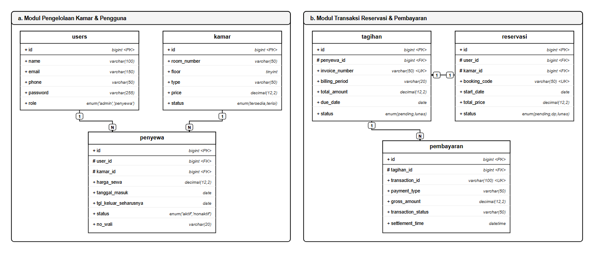

 

*(a) Modul Pengelolaan Kamar, Pengguna, Reservasi, dan Pembayaran*  

  

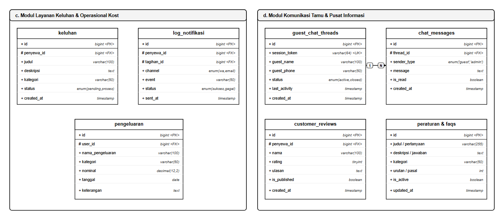

 

*(b) Modul Layanan Keluhan, Operasional Kost, Komunikasi, dan Informasi*  

  

*Gambar 4.2 Entity Relationship Diagram (ERD)*  

 

Secara keseluruhan, skema basis data pada Gambar 4.2 dirancang untuk memisahkan domain transaksi inti dari layanan pendukung operasional yang terbagi ke dalam dua modul fungsional berikut:

1. Modul Pengelolaan Kamar, Pengguna, Reservasi, dan Pembayaran (Gambar 4.2 (a))  
Pendataan hunian bertumpu pada keterkaitan antara tabel *users*, *kamar*, dan tabel penghubung *penyewa*. Tabel *users* mengelola akun login pengelola serta penyewa, sedangkan tabel *kamar* memuat rincian fisik 32 unit kamar beserta tarif dan status ketersediaannya. Kedua tabel master tersebut dipersatukan oleh tabel *penyewa* melalui relasi satu-ke-banyak (1:N) untuk mencatat penempatan unit kamar secara spesifik. Struktur ini mengunci nilai sewa riil (*snapshot* harga), tanggal masuk, batas akhir sewa, dan nomor darurat wali agar data kontrak tetap konsisten meskipun harga kamar di masa depan disesuaikan pengelola.

Arus transaksi keuangan dikelola melalui keterhubungan tabel *reservasi*, *tagihan*, dan *pembayaran*. Pengajuan sewa daring dicatat ke tabel *reservasi* dengan kode pemesanan unik, lalu sistem menerbitkan rincian uang muka atau sewa berkala pada tabel *tagihan*. Begitu tagihan dilunasi via *payment gateway* Midtrans, sinyal *webhook* otomatis mencatat nomor transaksi perbankan dan waktu penyelesaian ke tabel *pembayaran*.

 

2. Modul Layanan Keluhan, Operasional Kost, Komunikasi, dan Informasi (Gambar 4.2 (b))  
Pemeliharaan sarana hunian dan pencatatan kas keluar dipusatkan pada tabel *keluhan*, *pengeluaran*, serta *log_notifikasi*. Laporan kerusakan fasilitas dari penghuni dihimpun ke dalam tabel *keluhan* lengkap dengan kategori sarana dan foto bukti agar segera diperbaiki oleh penjaga kost. Seluruh biaya operasional rutin seperti pembelian token listrik bersama, iuran air, dan jasa teknisi gedung dicatat pada tabel *pengeluaran* sebagai acuan perhitungan kas bersih. Sementara itu, tabel *log_notifikasi* merekam jejak pengiriman pesan pengingat tagihan otomatis melalui gerbang WhatsApp Fonnte dan *email* SMTP.

Kebutuhan informasi publik dan komunikasi pengunjung ditangani oleh tabel *guest_chat_threads*, *chat_messages*, *customer_reviews*, serta tabel *peraturan* dan *faqs*. Pengunjung situs web dapat berkonsultasi langsung tanpa membuat akun melalui sesi *guest_chat_threads* yang berelasi satu-ke-banyak (1:N) dengan tabel *chat_messages*. Sebagai pelengkap transparansi, tabel *customer_reviews* menampilkan ulasan pengalaman penghuni, sedangkan tabel *peraturan* dan *faqs* memuat tata tertib hunian serta tanya-jawab umum di halaman beranda.

 

### 4.1.3 Activity Diagram
Urutan proses bisnis dan interaksi antara pengguna, aplikasi web, serta layanan pihak ketiga dijabarkan menggunakan *activity diagram*. Pada Gambar 4.3, Gambar 4.4, dan Gambar 4.5, alur aktivitas ini dipisahkan menjadi tiga bagian mengikuti peran calon penyewa, admin, dan penyewa aktif agar pembagian hak aksesnya terlihat jelas.

 

1. Calon Penyewa  
Alur aktivitas calon penyewa dirancang untuk mempermudah pemesanan unit kamar secara mandiri dari jarak jauh. Seluruh tahapan mulai dari pemilihan kamar di katalog, pengisian biodata sewa, hingga pembayaran uang muka dapat diselesaikan langsung seperti yang tampak pada Gambar 4.3.

 

 

*Gambar 4.3 Activity Diagram Calon Penyewa*  

 

Sebagaimana ditunjukkan pada Gambar 4.3, proses diawali ketika calon penyewa memilih salah satu unit kosong dari 32 kamar yang tersedia. Aplikasi kemudian memeriksa kelengkapan data pemesanan sebelum meminta token transaksi ke *server* Midtrans Snap. Setelah jendela pembayaran tampil, pemesan dapat melunasi uang muka melalui transfer *Virtual Account* atau dompet digital. Begitu pembayaran terkonfirmasi lunas, sistem otomatis mengunci status unit kamar di basis data dan mengirimkan bukti reservasi ke nomor WhatsApp pemesan melalui layanan Fonnte.

 

2. Admin (Penjaga Kost)  
Pada sisi pengelola, aktivitas sistem berfokus pada kemudahan mengelola inventaris kamar, memvalidasi penghuni, serta menyusun pembukuan kas bulanan. Rangkaian aktivitas penjaga kost dalam mengoperasikan sistem ditunjukkan pada Gambar 4.4.

 

 

*Gambar 4.4 Activity Diagram Admin (Penjaga Kost)*  

 

Alur kerja pada Gambar 4.4 dimulai saat penjaga kost melakukan autentikasi akun untuk masuk ke dasbor admin. Melalui halaman tersebut, pengelola memantau keterisian 32 unit kamar, memperbarui tarif sewa, serta memverifikasi berkas identitas penghuni baru. Sistem selanjutnya memperbarui data hunian dan menerbitkan tagihan bulanan yang dikirimkan otomatis ke WhatsApp penyewa. Di akhir periode, admin cukup memeriksa rekapitulasi pembayaran yang masuk dan mencatat pengeluaran rutin untuk menutup laporan keuangan bulanan.

 

3. Penyewa Aktif  
Aktivitas penyewa aktif berpusat pada penggunaan portal layanan mandiri selama masa sewa berlangsung. Melalui portal ini, penghuni dapat memeriksa tagihan rutin, melunasi sewa secara non-tunai, serta melaporkan kerusakan fasilitas kamar sebagaimana diperlihatkan pada Gambar 4.5.

 

 

*Gambar 4.5 Activity Diagram Penyewa Aktif*  

 

Merujuk pada Gambar 4.5, penghuni yang telah masuk ke portal penyewa dapat langsung meninjau rincian tagihan sewa yang mendekati jatuh tempo. Saat tombol bayar ditekan, layar akan menampilkan jendela *pop-up* Midtrans Snap tanpa harus berpindah halaman situs. Pelunasan tagihan lewat transfer bank maupun dompet digital akan langsung memperpanjang masa aktif sewa kamar di dalam sistem. Setelah transaksi selesai, penghuni dapat mengunduh kuitansi digital berformat PDF atau membuka menu keluhan apabila membutuhkan perbaikan sarana kamar.

 

### 4.1.4 Flowchart Sistem
Urutan logika kerja sistem dari tahap pemesanan awal hingga pengaktifan status penghuni di Asri Boarding House dipetakan secara utuh menggunakan *flowchart* sistem pada Gambar 4.6. Bagan alir ini memperlihatkan titik-titik pengambilan keputusan (*decision*) saat sistem memproses reservasi dan memvalidasi transaksi pembayaran.

 

 

*Gambar 4.6 Flowchart Sistem*  

 

Berdasarkan Gambar 4.6, alur proses berawal ketika calon penyewa membuka situs web Asri Boarding House untuk mengecek ketersediaan 32 unit kamar. Apabila unit yang diminati masih kosong, pemesan diarahkan untuk mengisi formulir reservasi, mengunggah foto kartu identitas, serta menentukan durasi sewa. Sistem kemudian meneruskan proses ke gerbang pembayaran Midtrans agar pemesan dapat memilih metode transfer bank atau dompet digital. Pada tahap pengecekan transaksi, pembayaran yang gagal atau melewati batas waktu akan dikembalikan ke menu pemilihan metode bayar. Sebaliknya, jika pembayaran tervalidasi lunas oleh sistem, unit kamar langsung dikunci pada basis data dan bukti reservasi resmi dikirimkan otomatis melalui pesan WhatsApp Fonnte. Seluruh rangkaian alur ini berakhir saat calon penghuni tiba di lokasi kost, menyerahkan berkas fisik untuk diverifikasi penjaga kost, menerima kunci kamar, dan diaktifkan statusnya sebagai penyewa resmi.

 

## 4.2 Implementasi Antarmuka Sistem
Implementasi antarmuka sistem menerjemahkan hasil perancangan visual ke dalam wujud halaman web fungsional yang siap diakses pengguna. Seluruh komponen antarmuka dibangun menggunakan pendekatan visual *Neo-Brutalism* dengan garis tepi tegas, kontras tinggi, dan tata letak yang responsif. Pembahasan antarmuka pada sub-bab ini dikelompokkan ke dalam empat bagian sesuai hak akses pengguna, meliputi antarmuka umum, calon penyewa, admin atau penjaga kost, serta penyewa aktif.

 

### 4.2.1 Implementasi Umum
Implementasi umum mencakup sebelas antarmuka publik yang dapat diakses langsung oleh pengunjung tanpa harus masuk ke dalam akun terlebih dahulu. Kumpulan halaman ini menyajikan informasi seputar profil indekos, ketersediaan kamar, rincian fasilitas, panduan pemesanan, hingga gerbang autentikasi dan layanan obrolan tamu.

1. Implementasi Antarmuka *Home Page*  
Halaman beranda utama (*home page*) menjadi titik temu pertama bagi mahasiswa maupun pekerja yang mencari hunian sewa di kawasan Tembalang. Melalui halaman ini, pengunjung dapat melihat gambaran umum Asri Boarding House beserta pilihan tipe kamar dan fasilitas unggulan tanpa perlu datang langsung ke lokasi. Tata letaknya juga telah disesuaikan agar rincian tarif sewa tetap terbaca jelas baik melalui layar komputer maupun ponsel pintar, sebagaimana ditampilkan pada Gambar 4.7.

 

*Gambar 4.7 Antarmuka Halaman Beranda (Home Page)*  

Mengacu pada Gambar 4.7, sisi teratas halaman menampilkan bilah navigasi utama yang memuat tautan menuju katalog kamar, daftar fasilitas, panduan *booking*, serta tombol akses akun. Area tengah layar terbagi menjadi dua bagian, yakni spanduk pengenalan indekos lengkap dengan tombol pintasan pencarian kamar di sebelah kiri dan foto fisik bangunan di sebelah kanan. Selain itu, sudut kanan bawah layar dilengkapi tombol obrolan interaktif supaya pengunjung dapat langsung bertanya kepada penjaga kost.

 

2. Implementasi Antarmuka Fasilitas Kost  
Halaman fasilitas kost merinci berbagai sarana penunjang hunian yang dapat dimanfaatkan bersama oleh seluruh penghuni Asri Boarding House. Penyajian informasi sarana secara terbuka ini membantu calon penyewa menilai kelayakan dan kenyamanan lingkungan tempat tinggal sebelum memutuskan untuk memesan kamar.

Setiap item fasilitas disertai keterangan singkat mengenai fungsi serta aturan penggunaannya di lingkungan indekos. Tampilan halaman daftar fasilitas tersebut dapat dilihat pada Gambar 4.8.

 

*Gambar 4.8 Antarmuka Daftar Fasilitas Kost*  

Pada tampilan Gambar 4.8, daftar fasilitas disusun menggunakan tata letak kartu berbasis kisi (*grid*) yang mengelompokkan sarana umum seperti dapur bersama, area parkir kendaraan, jaringan internet nirkabel (*Wi-Fi*), dan kamera pengawas (CCTV). Setiap kartu memuat foto dokumentasi asli di lapangan, judul fasilitas berhuruf tebal, serta deskripsi singkat mengenai peruntukannya. Penyusunan kartu yang rapi ini memudahkan pengunjung memeriksa kelengkapan fasilitas hunian hanya dengan menggulirkan layar.

 

3. Implementasi Antarmuka Tipe Kamar Kost  
Katalog tipe kamar kost menampilkan spesifikasi ruang dan kelengkapan perabot untuk masing-masing unit sewa di Asri Boarding House. Rincian luas kamar, ketersediaan kamar mandi dalam, hingga harga sewa per bulan dicantumkan secara jelas agar calon penghuni dapat menyesuaikan pilihan unit dengan kebutuhan dan anggaran mereka. Apabila sudah menemukan tipe kamar yang cocok, pengunjung cukup menekan tombol pemesanan pada kartu kamar terkait untuk memulai transaksi sewa seperti yang ditunjukkan pada Gambar 4.9.

 

*Gambar 4.9 Antarmuka Tipe dan Spesifikasi Kamar Kost*  

Sebagaimana terlihat pada Gambar 4.9, kartu katalog untuk tipe kamar Deluxe menampilkan foto bagian dalam kamar tidur beserta kamar mandi dalamnya. Tepat di bawah foto tersebut, tertera nominal harga sewa bulanan, lencana penanda sisa unit kosong, serta daftar inventaris kamar yang meliputi kasur, meja belajar, lemari pakaian, AC, dan pemanas air (*water heater*). Tombol **"Pemesanan Kamar"** berwarna biru di bagian bawah kartu berfungsi mengarahkan calon penyewa langsung ke halaman pengajuan reservasi.

 

4. Implementasi Antarmuka Galeri Kost  
Antarmuka galeri kost menghimpun dokumentasi foto bangunan fisik dan suasana lingkungan harian di Asri Boarding House. Kehadiran potret tampak depan gedung, lorong antar-kamar, tempat parkir, hingga kondisi ruang komunal ini bertujuan memberikan gambaran nyata kepada calon penyewa dari luar kota.

Seluruh dokumentasi visual tersebut ditata dalam susunan kisi yang proporsional dan dapat diperbesar saat diklik. Rincian tampilan galeri foto indekos disajikan pada Gambar 4.10.

 

*Gambar 4.10 Antarmuka Galeri Foto Kost*  

Melalui halaman pada Gambar 4.10, pengunjung dapat mengamati deretan foto area indekos mulai dari fasad bangunan, lahan parkir, koridor kamar di lantai satu dan dua, hingga area dapur bersama. Masing-masing bingkai foto dilengkapi efek transisi halus ketika kursor diarahkan ke atas gambar. Penataan dokumentasi visual ini membantu meyakinkan calon penghuni akan kebersihan dan keteraturan tempat tinggal yang dikelola.

 

5. Implementasi Antarmuka Alur Cara Reservasi  
Agar pengunjung baru tidak mengalami kebingungan saat hendak menyewa kamar secara daring, sistem menyediakan halaman panduan alur cara reservasi. Halaman ini menguraikan tahapan pemesanan dari awal hingga akhir, mulai dari pembuatan akun, pemilihan kamar kosong, pengisian biodata, sampai pelunasan uang muka. Dengan adanya petunjuk visual yang tercantum pada Gambar 4.11, calon penyewa dapat menyiapkan dokumen identitas diri yang dibutuhkan sebelum mengisi formulir pemesanan.

 

*Gambar 4.11 Antarmuka Panduan Alur Cara Reservasi*  

Tampilan pada Gambar 4.11 memvisualisasikan lima langkah berurutan dalam memesan kamar, yaitu registrasi akun, pemilihan unit kamar, pengisian kelengkapan profil, pembayaran uang muka melalui Midtrans, serta penerimaan bukti reservasi. Tiap tahapan ditandai dengan nomor urut berbingkai tebal yang disertai kartu penjelasan singkat mengenai tindakan yang harus dilakukan pengguna. Penyajian alur yang runtut ini membuat calon penghuni dapat memahami prosedur sewa tanpa harus berulang kali menanyakannya kepada penjaga kost.

 

6. Implementasi Antarmuka Testimoni Penyewa Kost  
Bagian testimoni menampilkan ulasan serta penilaian langsung dari para penghuni yang pernah atau sedang menetap di Asri Boarding House. Kehadiran ulasan ini memberikan gambaran objektif mengenai kebersihan lingkungan, keamanan gedung, hingga kesigapan pengelola sehari-hari, sehingga calon penyewa memiliki bahan pertimbangan tambahan sebelum memesan unit kamar. Komponen ulasan penghuni tersebut ditampilkan pada Gambar 4.12.

 

*Gambar 4.12 Antarmuka Testimoni dan Ulasan Penghuni*  

Antarmuka pada Gambar 4.12 menyusun ulasan penghuni ke dalam deretan kartu geser (*carousel*) yang dapat digulir ke kanan maupun ke kiri. Masing-masing kartu memuat kutipan pengalaman penyewa, foto profil, nama samaran, tipe kamar yang ditempati, serta deretan lima ikon bintang sebagai indikator kepuasan layanan.

 

7. Implementasi Antarmuka FAQ  
Halaman *Frequently Asked Questions* (FAQ) merangkum berbagai pertanyaan umum yang paling sering diajukan calon penyewa terkait peraturan dan prosedur sewa di Asri Boarding House. Topik yang dibahas meliputi batas jam malam, aturan membawa tamu menginap, ketentuan uang muka (*down payment*), hingga tata cara perpanjangan sewa bulanan.

Penyediaan halaman tanya jawab mandiri ini turut meringankan beban penjaga kost dalam menjawab pertanyaan dasar yang berulang setiap hari. Susunan antarmuka FAQ tersebut diperlihatkan pada Gambar 4.13.

 

*Gambar 4.13 Antarmuka Pertanyaan Umum (FAQ)*  

Merujuk pada Gambar 4.13, daftar pertanyaan dikemas menggunakan komponen panel lipat (*accordion*) yang tertata bersih. Pengunjung cukup menekan ikon panah di ujung kanan bilah pertanyaan untuk membuka rincian jawaban atau menutupnya kembali. Pengelompokan informasi seperti ini mempercepat calon penyewa menemukan penjelasan aturan indekos tanpa perlu berpindah-pindah halaman.

 

8. Implementasi Antarmuka Tentang Kami  
Antarmuka Tentang Kami memperkenalkan profil usaha, komitmen kenyamanan hunian, serta titik koordinat lokasi Asri Boarding House di kawasan pendidikan Tembalang. Kejelasan identitas pengelola dan lokasi gedung yang terhubung langsung dengan peta digital ini memberikan rasa tenang bagi mahasiswa baru maupun perantau dari luar daerah. Selain informasi profil, halaman yang disajikan pada Gambar 4.14 ini juga mencantumkan saluran komunikasi resmi pengelola indekos.

 

*Gambar 4.14 Antarmuka Halaman Tentang Kami*  

Pada Gambar 4.14, kartu profil di sisi utama memaparkan latar belakang singkat berdirinya Asri Boarding House beserta standar pelayanan yang diterapkan. Di sebelahnya, terdapat sematan peta interaktif *Google Maps* yang menunjukkan posisi presisi bangunan indekos terhadap area kampus sekitar. Bagian bawah halaman turut melampirkan nomor telepon pengelola, alamat *email* resmi, serta jam layanan administrasi harian.

 

9. Implementasi Antarmuka *Login User*  
Halaman *login user* berfungsi sebagai pintu masuk autentikasi bagi calon penyewa yang telah mendaftar maupun penghuni yang ingin mengakses akunnya. Modul ini mencocokkan alamat *email* dan kata sandi yang dimasukkan pengguna dengan kredensial terenkripsi di dalam basis data MySQL.

Apabila pengguna lupa kata sandi akunnya, tersedia tautan pemulihan akses yang terhubung ke surat elektronik terdaftar. Tampilan halaman autentikasi pengguna tersebut ditunjukkan pada Gambar 4.15.

 

*Gambar 4.15 Antarmuka Halaman Login Pengguna*  

Sebagaimana tampak pada Gambar 4.15, formulir *login* dirancang menggunakan kartu bergaya *Neo-Brutalism* dengan garis tepi hitam tebal di atas latar berwarna kuning cerah. Di dalamnya tersedia kolom input alamat *email*, kolom kata sandi yang dilengkapi ikon penampil teks, kotak centang **"Ingat Saya"**, serta tombol biru **"Masuk ke Akun"**. Bagi pengunjung yang belum memiliki akun, bagian bawah kartu menyediakan tautan langsung menuju halaman registrasi.

 

10. Implementasi Antarmuka *Register User*  
Calon penyewa yang baru pertama kali hendak memesan kamar diwajibkan membuat akun melalui halaman *register user*. Formulir ini menghimpun data awal pemohon yang terdiri atas nama lengkap, nomor WhatsApp aktif, alamat *email*, serta kata sandi akun. Sistem akan langsung memeriksa keunikan alamat *email* dan kecocokan konfirmasi kata sandi sebelum menyimpan data pengguna baru, seperti yang diperlihatkan pada Gambar 4.16.

 

*Gambar 4.16 Antarmuka Halaman Pendaftaran Akun (Register)*  

Tampilan Gambar 4.16 memperlihatkan kartu formulir bertajuk **"Buat Akun Baru"** yang mengusung aksen geometris tegas. Pengunjung diminta mengisi kolom nama lengkap, nomor WhatsApp, alamat *email*, kata sandi, dan ulangi kata sandi yang disertai indikator peringatan apabila format masukan belum sesuai. Penekanan tombol **"Daftar Akun"** berwarna biru di bagian bawah akan mendaftarkan identitas pengguna ke basis data sekaligus mengarahkannya ke tahap pelengkapan profil.

 

11. Implementasi Antarmuka *Chat Real Time Guest*  
Fitur *chat real-time guest* memfasilitasi pengunjung situs untuk bertanya langsung kepada penjaga kost tanpa harus memiliki akun terlebih dahulu. Tamu cukup mencantumkan nama panggilan dan nomor kontak singkat untuk menanyakan sisa kamar kosong atau membuat janji survei lokasi.

Seluruh pesan yang dikirim melalui jendela ini langsung diteruskan ke dasbor pengelola agar dapat segera dibalas. Wujud *widget* percakapan tamu tersebut dapat dilihat pada Gambar 4.17.

 

*Gambar 4.17 Antarmuka Fitur Chat Real Time Pengunjung*  

Melalui jendela obrolan yang tampak pada Gambar 4.17, *widget* percakapan muncul mengambang di pojok kanan bawah layar dengan kepala jendela berwarna kuning cerah dan tombol pengecil tampilan (*minimize*). Ruang tengah jendela menampilkan riwayat balasan antara pengunjung dan admin lengkap dengan keterangan waktu kirim. Di bagian paling bawah, tersedia kolom pengetikan teks beserta tombol kirim untuk meneruskan pesan secara langsung ke meja kerja pengelola.

 

### 4.2.2 Implementasi Calon Penyewa
Sub-bab ini menguraikan tujuh antarmuka dan layanan integrasi yang digunakan oleh calon penyewa setelah berhasil membuat akun. Rangkaian modul di dalamnya mencakup pengisian identitas kependudukan, pemantauan dasbor reservasi, simulasi perhitungan sewa, hingga pelunasan uang muka melalui Midtrans serta pengiriman bukti transaksi via WhatsApp dan *email*.

1. Implementasi Antarmuka Lengkapi Profil  
Sebelum diizinkan memilih dan mengunci unit kamar, calon penyewa diwajibkan melengkapi biodata resmi pada halaman pelengkap profil. Formulir ini meminta Nomor Induk Kependudukan (NIK), nama serta nomor telepon kerabat darurat, asal kampus atau instansi tempat bekerja, hingga unggahan foto Kartu Tanda Penduduk (KTP) asli. Pendataan identitas sejak awal sangat penting untuk menjaga keamanan dan ketertiban lingkungan penghuni di Asri Boarding House.

Seluruh dokumen identitas yang diunggah disimpan ke dalam direktori terbatas yang hanya dapat dibuka oleh administrator saat proses verifikasi. Tampilan formulir kelengkapan profil tersebut disajikan pada Gambar 4.18.

 

*Gambar 4.18 Antarmuka Pengisian Kelengkapan Profil Pemesan*  

Pada Gambar 4.18, halaman menyajikan kolom isian nomor KTP, kontak darurat keluarga, nomor telepon penjamin, serta area unggah foto identitas diri. Sistem juga menampilkan petunjuk batas ukuran berkas dan kotak pratinjau gambar guna memastikan foto KTP yang diunggah tidak buram. Setelah seluruh kolom terisi lengkap, pemohon dapat menekan tombol hijau **"Simpan Profil"** untuk melanjutkan proses pemesanan kamar.

 

2. Implementasi Antarmuka *Dashboard* Reservasi  
*Dashboard* reservasi berperan sebagai halaman pantau utama bagi calon penyewa yang sedang mengajukan pemesanan kamar. Halaman ini merangkum status pengajuan sewa, nomor tagihan uang muka, serta riwayat reservasi yang pernah dibuat sebelumnya, sebagaimana ditampilkan pada Gambar 4.19.

 

*Gambar 4.19 Antarmuka Dasbor Reservasi Calon Penyewa*  

Merujuk pada Gambar 4.19, bagian atas halaman memuat sapaan pengguna dan kartu ringkasan pesanan yang mencantumkan kode reservasi, unit kamar yang dipilih, serta status pemeriksaan berkas. Di bagian tengah, terdapat bilah indikator tahapan yang menunjukkan posisi proses reservasi saat ini, mulai dari verifikasi dokumen hingga konfirmasi pelunasan. Panel sebelah kanan turut menyediakan tombol **"Bayar Uang Muka"** beserta tautan unduh tanda terima pemesanan apabila transaksi telah selesai.

 

3. Implementasi Antarmuka Simulasi Biaya Kamar  
Guna membantu calon penghuni memperkirakan anggaran tempat tinggal, sistem menyediakan fitur kalkulator simulasi biaya kamar. Modul ini menghitung akumulasi tarif sewa pokok, uang jaminan (*deposit*), hingga potongan harga khusus apabila pemohon memilih durasi sewa jangka panjang. Rincian nominal yang terbuka sejak awal menghindarkan kesalahpahaman perhitungan biaya antara calon penyewa dan pihak pengelola indekos.

Pengguna bebas mengganti opsi durasi sewa mulai dari bulanan, tiga bulanan, hingga tahunan untuk membandingkan total tagihan yang harus disiapkan. Antarmuka simulasi perhitungan biaya tersebut diperlihatkan pada Gambar 4.20.

 

*Gambar 4.20 Antarmuka Simulasi Biaya Kamar dan Reservasi*  

Sebagaimana ditunjukkan pada Gambar 4.20, sisi kiri layar memuat kartu kalkulator yang dilengkapi menu *dropdown* pilihan durasi sewa dan opsi fasilitas tambahan. Begitu parameter diubah, tabel rincian biaya di sisi kanan langsung menyesuaikan nilai sewa pokok, nominal *deposit*, serta total pembayaran bersih tanpa perlu memuat ulang halaman. Apabila nominal tersebut sudah sesuai, calon penyewa dapat menekan tombol biru **"Lanjutkan Pemesanan"** di bawah tabel untuk masuk ke alur transaksi.

 

4. Implementasi Antarmuka Pembayaran 5 Tahap Reservasi  
Proses penyelesaian reservasi dirancang ke dalam antarmuka pemantauan lima tahap agar calon penyewa mengetahui urutan langkah yang sedang berlangsung. Kelima tahapan tersebut meliputi konfirmasi rincian sewa, pemilihan metode bayar, pemeriksaan tagihan, pelunasan melalui gerbang pembayaran, serta penerbitan nota tanda jadi. Pengaturan alur bertahap yang tampak pada Gambar 4.21 ini menjaga agar unit kamar yang sedang dipesan tidak diambil oleh pengguna lain selama batas waktu pembayaran masih aktif.

 

*Gambar 4.21 Antarmuka Pemantauan Alur Lima Tahap dan Pembayaran Reservasi*  

Melalui antarmuka pada Gambar 4.21, bilah langkah di bagian atas menandai tahapan yang sedang aktif menggunakan lingkaran nomor berwarna hijau. Area utama halaman merinci spesifikasi kamar yang dipesan, nominal uang muka yang wajib dilunasi, hitung mundur batas waktu pembayaran, serta tombol pemicu transaksi digital. Di bagian bawah, tertera catatan pengingat agar pemohon tidak menutup peramban web sebelum proses verifikasi pembayaran selesai.

 

5. Implementasi *Payment Gateway* Midtrans  
Pelunasan uang muka reservasi maupun sewa kamar ditangani melalui integrasi layanan *payment gateway* Midtrans Snap. Kehadiran modul ini memudahkan calon penghuni memilih berbagai saluran pembayaran non-tunai, mulai dari *Virtual Account* perbankan, dompet digital (*e-wallet*), kode QRIS, hingga gerai ritel modern.

Begitu dana berhasil ditransfer, mekanisme *webhook callback* dari server Midtrans akan langsung memperbarui status pesanan di basis data tanpa menunggu pemeriksaan mutasi manual oleh penjaga kost. Tampilan jendela pembayaran Midtrans Snap tersebut disajikan pada Gambar 4.22.

 

*Gambar 4.22 Antarmuka Jendela Pembayaran Digital Midtrans Snap*  

Pada Gambar 4.22, jendela *pop-up* Midtrans Snap tampil di tengah layar dengan mencantumkan total tagihan beserta batas akhir waktu pelunasan. Pengguna dapat memilih salah satu metode transaksi yang tersedia, seperti GoPay, QRIS, maupun *Virtual Account* BCA, BNI, dan Mandiri, lengkap dengan panduan langkah pembayarannya. Seluruh pertukaran data transaksi pada jendela ini telah diamankan menggunakan validasi kriptografi dari server resmi Midtrans.

 

6. Implementasi *WhatsApp Gateway* Fonnte  
Sesaat setelah pembayaran uang muka terkonfirmasi lunas oleh Midtrans, sistem memicu pengiriman pesan otomatis ke nomor ponsel pemohon melalui integrasi API *WhatsApp Gateway* Fonnte. Pesan instan tersebut memuat nomor referensi transaksi, tipe dan nomor kamar yang berhasil dikunci, nominal setoran, serta tanggal mulai masuk kamar (*check-in*). Bukti konfirmasi yang dikirimkan langsung ke aplikasi WhatsApp pengguna dapat dilihat pada Gambar 4.23.

 

*Gambar 4.23 Implementasi Pesan Aktivasi Hunian via WhatsApp Fonnte*  

Tangkapan layar pada Gambar 4.23 memperlihatkan pesan otomatis yang diterima calon penyewa dari nomor layanan resmi Asri Boarding House. Isi pesan merangkum ucapan konfirmasi, kode pemesanan, rincian unit kamar, status pembayaran lunas, serta tautan untuk mengunduh nota digital. Notifikasi instan ini menjadi pegangan sah bagi calon penghuni saat datang mengambil kunci kamar di lokasi indekos.

 

7. Implementasi *Email Gateway* SMTP  
Selain mengirimkan notifikasi pesan singkat via WhatsApp, aplikasi juga meneruskan bukti pembayaran resmi dan rincian ketentuan sewa ke alamat surat elektronik calon penyewa menggunakan protokol SMTP. Pengiriman dokumen melalui *email* ini menyediakan arsip administrasi formal yang mudah disimpan maupun dicetak ulang oleh penghuni kapan saja.

Pesan dikirimkan dalam format templat HTML beridentitas resmi Asri Boarding House beserta lampiran kuitansi digital. Tampilan surat elektronik konfirmasi reservasi tersebut diperlihatkan pada Gambar 4.24.

 

*Gambar 4.24 Implementasi Surat Elektronik Konfirmasi Aktivasi Penyewa via SMTP*  

Mengacu pada Gambar 4.24, surat elektronik yang masuk ke kotak pesan penyewa menampilkan kop resmi Asri Boarding House bertajuk **"Bukti Pembayaran Reservasi Kamar Kost"**. Bagian isi pesan menyajikan tabel rincian transaksi, jadwal *check-in*, ringkasan tata tertib penghuni, serta lampiran berkas nota berformat PDF. Kombinasi pengiriman bukti melalui WhatsApp dan *email* ini memastikan setiap transaksi terekam secara rapi di sisi pengguna maupun pengelola.

 

### 4.2.3 Implementasi Admin
Implementasi admin merangkum sebelas antarmuka kendali operasional yang dirancang khusus bagi penjaga kost Asri Boarding House. Melalui ruang kerja ini, pengelola dapat mengawasi keterisian 32 unit kamar, memverifikasi reservasi masuk, mengelola tagihan sewa bulanan, mencatat pengeluaran kas, mengekspor laporan keuangan, hingga menanggapi keluhan fasilitas dan obrolan pengunjung.

1. Implementasi Antarmuka *Admin Login*  
Halaman *admin login* dirancang khusus sebagai jalur masuk terbatas bagi penjaga kost Asri Boarding House. Pemisahan pintu autentikasi ini bertujuan menjaga agar data master kamar, pembukuan kas, dan dokumen identitas penghuni tidak dapat diakses oleh pengguna umum. Selain itu, sistem membatasi jumlah percobaan masuk yang gagal secara beruntun guna mengantisipasi upaya peretasan akun, sebagaimana diperlihatkan pada Gambar 4.25.

 

*Gambar 4.25 Antarmuka Halaman Login Administrator*  

Pada tampilan Gambar 4.25, formulir autentikasi pengelola dibingkai menggunakan kartu bergaya *Neo-Brutalism* bergaris tepi hitam pekat dengan tajuk **"Masuk Portal Admin"**. Pengelola cukup memasukkan alamat *email* administrator serta kata sandi pada kolom input yang disamarkan, lalu menekan tombol **"Masuk Dasbor"** berwarna hitam di bagian bawah untuk membuka ruang kendali utama.

 

2. Implementasi Antarmuka *Dashboard Admin*  
Begitu proses autentikasi berhasil, penjaga kost diarahkan menuju *dashboard admin* yang merangkum metrik operasional dan keuangan Asri Boarding House dalam satu layar. Melalui halaman ini, pengelola dapat langsung melihat tingkat keterisian dari 32 unit kamar, total kas masuk bulan berjalan, jumlah penghuni aktif, serta daftar keluhan fasilitas yang masih menunggu penanganan.

Penyajian data ringkas yang dilengkapi grafik tren bulanan ini memudahkan pengelola memantau perkembangan usaha indekos setiap hari. Tampilan halaman utama dasbor administrator tersebut disajikan pada Gambar 4.26.

 

*Gambar 4.26 Antarmuka Dasbor Operasional dan Keuangan Administrator*  

Sebagaimana terlihat pada Gambar 4.26, bagian atas layar memuat deretan kartu indikator berwarna kuning dan biru yang menampilkan persentase okupansi kamar, jumlah penyewa aktif, akumulasi pendapatan, serta tiket aduan tertunda. Area tengah menyajikan grafik batang pemasukan bulanan yang berdampingan dengan tabel pengajuan reservasi terbaru. Di sisi paling kiri, terdapat bilah navigasi vertikal untuk berpindah antar-modul manajemen dengan cepat.

 

3. Implementasi Antarmuka Manajemen Kamar  
Modul manajemen kamar memberikan wewenang penuh kepada penjaga kost untuk mengelola inventaris 32 unit kamar sewa di Asri Boarding House. Pengelola dapat menambahkan data unit baru, memperbarui status keterisian kamar, maupun menyesuaikan tarif sewa dan rincian fasilitas per tipe kamar. Pencatatan status kamar yang terpusat di dalam basis data ini menutup celah terjadinya benturan pesanan ganda (*double booking*), seperti yang ditunjukkan pada Gambar 4.27.

 

*Gambar 4.27 Antarmuka Pengelolaan Master Data Kamar*  

Merujuk pada Gambar 4.27, daftar seluruh unit kamar disajikan dalam bentuk tabel yang memuat nomor unit, kategori tipe kamar (VIP, Deluxe, atau Standar), posisi lantai, tarif sewa per bulan, serta lencana status ketersediaan. Di bagian atas tabel, tersedia tombol **"Tambah Kamar Baru"** berwarna kuning, kolom pencarian kata kunci, serta *filter* penyaring untuk menampilkan kamar yang masih kosong. Kolom paling kanan pada setiap baris menyediakan tombol **"Edit"** dan **"Hapus"** guna mempermudah pembaruan data unit kamar.

 

4. Implementasi Antarmuka Manajemen Fasilitas  
Antarmuka manajemen fasilitas digunakan oleh pengelola untuk mengatur daftar sarana umum yang ditampilkan pada halaman katalog publik. Apabila terdapat penambahan fasilitas baru atau perubahan aturan pemakaian ruang bersama, admin dapat langsung memperbarui foto dokumentasi beserta keterangannya melalui modul ini.

Selain mengubah teks dan gambar, pengelola juga dapat mengatur urutan tampil setiap fasilitas agar sarana unggulan indekos ditempatkan di posisi teratas. Tampilan halaman pengelolaan fasilitas tersebut diperlihatkan pada Gambar 4.28.

 

*Gambar 4.28 Antarmuka Pengelolaan Fasilitas Kost*  

Melalui halaman pada Gambar 4.28, setiap sarana umum dirangkum ke dalam tabel yang menampilkan nama fasilitas, uraian fungsi ruang, ikon kategori, serta pratinjau foto dokumentasi. Bagian kepala tabel dilengkapi tombol **"Tambah Fasilitas"** dan kolom *filter* pencarian untuk memudahkan pengelolaan data. Apabila suatu sarana sedang dalam masa perbaikan fisik, admin dapat mengubah statusnya melalui kolom aksi di sisi kanan agar informasi di *website* tetap sesuai dengan kondisi lapangan.

 

5. Implementasi Antarmuka Manajemen Penyewa  
Seluruh data penghuni yang sedang aktif menempati kamar di Asri Boarding House dihimpun di dalam antarmuka manajemen penyewa. Halaman ini mencatat identitas lengkap penghuni, nomor telepon darurat kerabat, nomor kamar yang dihuni, hingga masa berlaku kontrak sewanya. Ketika masa sewa seorang penghuni telah berakhir dan yang bersangkutan pindah (*check-out*), penjaga kost dapat langsung menonaktifkan status huniannya melalui halaman yang tercantum pada Gambar 4.29.

 

*Gambar 4.29 Antarmuka Pengelolaan Data Penghuni Kost*  

Pada Gambar 4.29, tabel daftar penghuni memuat informasi nama lengkap penyewa, nomor WhatsApp aktif, unit kamar yang ditempati, tanggal mulai menghuni, serta lencana berstatus **"Aktif"**. Pengelola dapat memanfaatkan kolom pencarian nama atau penyaring lantai kamar di bagian atas tabel untuk mencari data penghuni tertentu dengan cepat. Penekanan tombol **"Detail"** di ujung kanan baris akan menampilkan salinan foto KTP penghuni beserta rekam jejak pembayaran sewanya.

 

6. Implementasi Antarmuka Manajemen Reservasi  
Antarmuka manajemen reservasi berfungsi memproses daftar pengajuan sewa kamar yang masuk dari calon penyewa baru. Melalui halaman ini, penjaga kost dapat memeriksa kelengkapan berkas KTP pemohon, memastikan uang muka telah terverifikasi lunas oleh Midtrans, lalu menyetujui penempatan unit kamar.

Sistem juga menyediakan mekanisme pembatalan untuk pesanan yang melewati batas waktu pembayaran agar unit kamar tersebut kembali terbuka bagi calon penyewa lain. Rincian tampilan modul pengelolaan reservasi ini dapat dilihat pada Gambar 4.30.

 

*Gambar 4.30 Antarmuka Pengelolaan Pesanan Reservasi Masuk*  

Tampilan pada Gambar 4.30 menyajikan tabel daftar pesanan kamar yang mencantumkan kode reservasi, nama pemohon, tipe kamar pilihan, rencana tanggal masuk, serta status pelunasan uang muka. Di bagian atas tabel, terdapat deretan tombol *filter* untuk memilah pesanan berdasarkan status **"Menunggu Pembayaran"**, **"Terverifikasi"**, atau **"Dibatalkan"**. Pada kolom aksi di sisi kanan, penjaga kost cukup menekan tombol **"Konfirmasi"** untuk mengaktifkan status hunian pemohon setelah dokumen fisiknya dinyatakan sesuai.

 

7. Implementasi Antarmuka Manajemen Tagihan  
Siklus penagihan sewa bulanan dan perhitungan denda keterlambatan bagi seluruh penghuni dikendalikan melalui antarmuka manajemen tagihan. Modul ini terhubung dengan penjadwal otomatis (*cron job*) yang menerbitkan faktur sewa serta memantau batas jatuh tempo setiap tanggal 10 guna menekan tunggakan pembayaran. Tampilan halaman pengelolaan tagihan bulanan tersebut disajikan pada Gambar 4.31.

 

*Gambar 4.31 Antarmuka Pengelolaan Tagihan Sewa Bulanan dan Denda*  

Sebagaimana tampak pada Gambar 4.31, kartu bertajuk **"Daftar Tagihan Bulanan Penyewa"** menampilkan tabel rekapitulasi yang memuat nomor *invoice*, nama penghuni, nomor kamar, nominal tagihan beserta denda, tanggal jatuh tempo, dan lencana status pembayaran. Bagian atas tabel dilengkapi tombol sinkronisasi tagihan serta kolom pencarian untuk memudahkan pengawasan kas masuk. Apabila diperlukan, admin dapat menekan tombol **"Detail"** pada baris tagihan untuk memeriksa rincian komponen biaya atau mengirim ulang pengingat tagihan ke penghuni.

 

8. Implementasi Antarmuka Manajemen Pengeluaran  
Agar perhitungan laba bersih indekos tetap akurat, seluruh arus kas keluar untuk kebutuhan operasional harian dicatat melalui antarmuka manajemen pengeluaran. Penjaga kost dapat mendata pembayaran tagihan listrik, air PDAM, pembelian alat kebersihan, hingga biaya perbaikan fasilitas kamar ke dalam sistem.

Setiap transaksi pengeluaran yang dicatat dapat disertai keterangan peruntukan dana dan nama petugas yang bertanggung jawab. Antarmuka pencatatan biaya operasional tersebut diperlihatkan pada Gambar 4.32.

 

*Gambar 4.32 Antarmuka Pencatatan Pengeluaran Operasional Kost*  

Mengacu pada Gambar 4.32, halaman ini memadukan kartu ringkasan total pengeluaran bulan berjalan di bagian atas dengan tabel riwayat kas keluar di bagian bawah. Tabel tersebut mencantumkan tanggal transaksi, kategori biaya, rincian penggunaan dana, nominal pengeluaran, serta staf pencatat. Ketika terdapat belanja operasional baru, penjaga kost cukup menekan tombol **"Tambah Biaya Operasional"** untuk memasukkan rincian nota ke dalam pembukuan.

 

9. Implementasi Antarmuka Manajemen Laporan Pemasukan  
Modul laporan pemasukan mengolah seluruh data pembayaran sewa yang masuk melalui Midtrans dan catatan pengeluaran operasional menjadi laporan keuangan terpadu. Melalui rekapitulasi ini, pemilik maupun penjaga kost tidak perlu lagi mencocokkan mutasi bank dan buku kas fisik satu per satu saat tutup buku di akhir bulan. Hasil olahan laporan kas tersebut juga dapat diunduh ke dalam format berkas Excel maupun PDF untuk keperluan arsip resmi, seperti yang ditunjukkan pada Gambar 4.33.

 

*Gambar 4.33 Antarmuka Laporan Rekapitulasi Kas dan Ekspor Dokumen*  

Pada Gambar 4.33, bagian atas halaman menampilkan tiga kartu metrik utama yang menyandingkan total pendapatan kotor, akumulasi beban operasional, serta nilai laba bersih usaha. Di bawahnya, terdapat grafik garis tren pendapatan bulanan beserta tabel rincian transaksi kas masuk yang dapat disaring menurut rentang tanggal tertentu. Sudut kanan atas kartu dilengkapi tombol hijau **"Ekspor Excel"** dan tombol merah **"Unduh PDF"** guna mencetak dokumen laporan keuangan sewaktu-waktu.

 

10. Implementasi Antarmuka Manajemen Keluhan Penyewa  
Laporan kerusakan fasilitas kamar maupun gangguan kenyamanan lingkungan yang dikirimkan oleh penghuni dikelola secara terpusat melalui antarmuka manajemen keluhan penyewa. Modul ini membantu penjaga kost memetakan tingkat urgensi aduan, seperti kebocoran saluran air, gangguan kelistrikan, atau kerusakan perabot kamar, agar perbaikan fisik dapat segera dijadwalkan.

Setiap perkembangan tindak lanjut perbaikan dapat diperbarui statusnya oleh admin sehingga penghuni yang melapor mengetahui progres penanganan keluhannya. Tampilan halaman pengelolaan tiket keluhan tersebut disajikan pada Gambar 4.34.

 

*Gambar 4.34 Antarmuka Pengelolaan Tiket Keluhan Fasilitas*  

Melalui tabel pada Gambar 4.34, setiap tiket aduan memuat informasi nama penghuni pelapor, nomor kamar, kategori kerusakan sarana, tanggal pengajuan, serta lencana status penanganan. Penjaga kost dapat memanfaatkan panel *filter* di bagian atas tabel untuk memprioritaskan laporan yang berstatus baru masuk. Tombol aksi di sisi kanan baris berfungsi membuka lampiran foto bukti kerusakan sekaligus mengubah status tiket menjadi **"Diproses"** atau **"Selesai"**.

 

11. Implementasi Antarmuka Manajemen Fitur *Chat Guest*  
Pertanyaan yang dikirimkan oleh pengunjung publik melalui *widget* obrolan di halaman depan akan masuk ke antarmuka manajemen fitur *chat guest* pada sisi admin. Ruang pesan dua arah ini memudahkan penjaga kost menjawab pertanyaan calon penyewa seputar ketersediaan kamar maupun jadwal kunjungan survei lokasi tanpa harus berpindah perangkat. Tampilan antarmuka pengelolaan obrolan tamu tersebut dapat dilihat pada Gambar 4.35.

 

*Gambar 4.35 Antarmuka Pengelolaan Obrolan Tamu (Guest Chat Admin)*  

Sebagaimana terlihat pada Gambar 4.35, layar obrolan dibagi menjadi dua panel, yaitu daftar antrean pesan pengunjung di sebelah kiri dan ruang percakapan aktif di sebelah kanan. Di dalam jendela percakapan, seluruh riwayat tanya jawab ditampilkan secara berurutan lengkap dengan penanda waktu kirim. Bagian bawah panel turut dilengkapi pilihan templat balasan cepat (*quick reply*) agar penjaga kost dapat merespons pertanyaan umum dengan lebih praktis.

 

### 4.2.4 Implementasi Penyewa Aktif
Bagian terakhir ini membahas tujuh antarmuka khusus yang diakses oleh penyewa aktif selama masa tinggalnya di Asri Boarding House. Portal layanan mandiri ini memfasilitasi penghuni untuk memantau masa sewa, melunasi tagihan bulanan via Midtrans, memperbarui data profil, memeriksa riwayat transaksi, mengajukan tiket keluhan kamar, hingga mengunduh kuitansi pembayaran berformat PDF.

1. Implementasi Antarmuka *Login* Penyewa Aktif  
Penghuni yang telah resmi menempati kamar di Asri Boarding House mengakses layanan mandiri melalui halaman *login* penyewa aktif. Pemisahan jalur masuk ini mengarahkan penghuni langsung ke portal pengelolaan sewa bulanan tanpa melewati alur pemesanan kamar lagi.

Setiap sesi masuk dilindungi menggunakan enkripsi kredensial agar riwayat tagihan dan data pribadi penghuni tetap terjaga kerahasiaannya. Tampilan halaman autentikasi penyewa aktif tersebut diperlihatkan pada Gambar 4.36.

 

*Gambar 4.36 Antarmuka Login Portal Penyewa Aktif*  

Merujuk pada Gambar 4.36, halaman autentikasi penghuni tampil dengan bingkai kartu *Neo-Brutalism* berlatar kuning cerah dan bertajuk **"Masuk Portal Penghuni Aktif"**. Penghuni cukup mengisi kolom alamat *email* dan kata sandi terdaftar, mencentang opsi pengingat sesi bila diperlukan, lalu menekan tombol biru **"Masuk ke Portal"** untuk membuka dasbor pribadinya.

 

2. Implementasi Antarmuka *Dashboard* Penyewa  
*Dashboard* penyewa menyajikan ringkasan informasi hunian dan status kewajiban sewa bagi masing-masing penghuni Asri Boarding House. Pada halaman utama ini, penghuni dapat memeriksa nomor unit kamar yang ditempati, sisa masa berlaku sewa, rincian tagihan bulan berjalan, serta papan pengumuman resmi dari penjaga kost. Seluruh menu layanan mandiri ditata ke dalam pintasan kartu yang mudah dijangkau, sebagaimana ditampilkan pada Gambar 4.37.

 

*Gambar 4.37 Antarmuka Dasbor Portal Penyewa Aktif*  

Pada Gambar 4.37, bagian atas halaman menampilkan sapaan nama penghuni beserta kartu informasi hunian yang merinci nomor kamar aktif, kategori tipe kamar, dan tanggal jatuh tempo pembayaran berikutnya. Tepat di bagian tengah, terdapat kartu pemberitahuan tagihan berwarna kuning cerah yang dilengkapi tombol pintasan **"Bayar Tagihan Sekarang"**. Area bawah halaman menyediakan deretan menu cepat untuk mengajukan laporan kerusakan fasilitas, melihat arsip kuitansi sewa, dan membaca pengumuman indekos.

 

3. Implementasi Antarmuka Tagihan Penyewa  
Rincian kewajiban pembayaran sewa kamar setiap bulannya dapat diperiksa secara transparan oleh penghuni melalui antarmuka tagihan penyewa. Halaman ini menguraikan nominal sewa pokok, tambahan biaya denda apabila melewati tanggal 10, serta batas waktu pelunasan tagihan.

Untuk memudahkan pelunasan, tombol pembayaran pada halaman ini telah diintegrasikan langsung dengan modul Midtrans Snap. Visualisasi halaman tagihan sewa bulanan tersebut disajikan pada Gambar 4.38.

 

*Gambar 4.38 Antarmuka Riwayat dan Pembayaran Tagihan Sewa Penyewa*  

Sebagaimana ditunjukkan pada Gambar 4.38, kartu tagihan menampilkan nomor *invoice*, periode bulan penagihan, total biaya yang harus dibayar, serta tanggal jatuh tempo. Tagihan yang masih menunggak ditandai dengan lencana berwarna kuning bertuliskan **"Belum Dibayar"**. Penghuni cukup menekan tombol hijau **"Bayar Tagihan"** di bagian bawah kartu untuk memunculkan jendela *pop-up* Midtrans Snap dan menyelesaikan pembayaran melalui transfer bank atau dompet digital.

 

4. Implementasi Antarmuka Profil  
Antarmuka profil memberikan keleluasaan bagi penyewa aktif untuk memperbarui data kontak pribadi dan pengaturan keamanan akunnya. Apabila penghuni mengganti nomor WhatsApp atau ingin mengubah kata sandi akun, perubahan tersebut dapat dilakukan sendiri tanpa harus meminta bantuan penjaga kost. Keterbaruan nomor kontak penghuni dan kerabat darurat ini sangat penting apabila sewaktu-waktu terjadi keadaan mendesak di lingkungan indekos, seperti yang diperlihatkan pada Gambar 4.39.

 

*Gambar 4.39 Antarmuka Pengaturan Profil Penghuni*  

Tampilan pada Gambar 4.39 membagi halaman menjadi dua bagian utama, yakni kartu biodata penghuni di sisi kiri dan formulir pengaturan keamanan di sisi kanan. Kartu biodata menampilkan foto profil, nama lengkap, nomor KTP, nomor WhatsApp aktif, serta kontak darurat keluarga yang sebagian digitnya disamarkan demi menjaga privasi. Sementara itu, panel sebelah kanan menyediakan kolom validasi kata sandi lama dan kata sandi baru yang dapat disimpan dengan menekan tombol kuning **"Simpan Perubahan"**.

 

5. Implementasi Antarmuka Riwayat Pembayaran  
Seluruh transaksi pelunasan sewa yang pernah dilakukan penghuni selama menetap di Asri Boarding House tercatat secara kronologis di dalam antarmuka riwayat pembayaran. Halaman ini menyimpan kode referensi transaksi, tanggal pelunasan, kanal pembayaran yang digunakan, serta nominal dana yang telah disetorkan.

Keberadaan arsip pembayaran digital ini memudahkan penghuni melacak pengeluaran sewa bulanan sekaligus mengunduh ulang bukti kuitansi resmi kapan pun dibutuhkan. Susunan halaman riwayat transaksi tersebut dapat dilihat pada Gambar 4.40.

 

*Gambar 4.40 Antarmuka Riwayat Transaksi Pembayaran*  

Melalui tabel rekapitulasi pada Gambar 4.40, setiap baris transaksi menampilkan tanggal bayar, nomor pesanan, metode pembayaran melalui *Virtual Account* atau dompet digital, jumlah uang yang dibayarkan, serta lencana hijau berstatus **"Berhasil"**. Di ujung kanan masing-masing baris, tersedia tombol biru **"Cetak Nota"** yang berfungsi menghasilkan salinan kuitansi resmi dalam bentuk berkas PDF.

 

6. Implementasi Antarmuka Keluhan  
Apabila penghuni mendapati kerusakan fasilitas di dalam kamar maupun di area umum indekos, laporan kendala dapat langsung diajukan melalui antarmuka keluhan. Penghuni cukup memilih kategori masalah, menuliskan deskripsi kerusakan, dan melampirkan foto bukti fisik tanpa harus mencari penjaga kost secara tatap muka. Selain mempercepat penyampaian laporan, halaman yang disajikan pada Gambar 4.41 ini juga memungkinkan penghuni memantau progres perbaikan yang sedang dikerjakan oleh petugas.

 

*Gambar 4.41 Antarmuka Riwayat dan Pengajuan Keluhan Kamar*  

Mengacu pada Gambar 4.41, bagian atas halaman memuat formulir **"Tambah Laporan Keluhan"** yang terdiri dari pilihan kategori sarana, kolom uraian masalah, serta bidang unggah foto dokumentasi kerusakan. Di bagian bawahnya, tertera tabel riwayat aduan yang pernah dikirimkan oleh penghuni lengkap dengan lencana status tindak lanjut dari pihak pengelola.

 

7. Implementasi Nota PDF  
Setiap transaksi pembayaran uang muka maupun tagihan sewa bulanan yang telah terverifikasi lunas akan menghasilkan dokumen tanda terima resmi berupa nota PDF. Dokumen elektronik ini mencantumkan nomor faktur, identitas penyewa, nomor kamar yang dihuni, rincian nominal sewa, serta cap lunas digital dari sistem.

Format ukuran dan tata letak nota telah diatur secara proporsional agar siap dicetak kapan saja tanpa ada bagian teks yang terpotong. Wujud dokumen kuitansi digital berformat PDF tersebut ditampilkan pada Gambar 4.42.

 

*Gambar 4.42 Antarmuka Tanda Terima Kuitansi Digital (Nota PDF)*  

Sebagaimana terlihat pada Gambar 4.42, kuitansi digital dirancang dengan bingkai garis tegas yang memuat kepala surat resmi Asri Boarding House beserta alamat lengkapnya di kawasan Tembalang. Bagian isi dokumen merinci nomor referensi nota, tanggal pelunasan, nomor unit kamar, nama penyewa yang disamarkan sebagian untuk keamanan data, serta nilai transaksi sebesar Rp1.700.000 dengan teraan stempel **"LUNAS"** di bagian tengah. Pada kaki dokumen, tercantum keterangan bahwa pembayaran telah diverifikasi secara otomatis oleh sistem beserta kode unik transaksi sebagai bukti keabsahan dokumen.

 

## 4.3 Implementasi Kode Program
Tahap implementasi kode program menerjemahkan seluruh rancangan arsitektur dan alur proses bisnis ke dalam instruksi terstruktur menggunakan bahasa pemrograman PHP pada kerangka kerja Laravel 11. Setiap modul program dirancang menggunakan pemisahan logika layanan (*Service Layer*) agar proses validasi data, penguncian transaksi kamar, dan integrasi API eksternal dapat berjalan mandiri serta aman. Pembahasan kode program ini dikelompokkan ke dalam empat sub-bab tematik sesuai domain fungsinya, meliputi implementasi autentikasi dan hak akses, pemesanan kamar, *payment gateway*, serta penjadwalan dan notifikasi.

 

### 4.3.1 Implementasi Autentikasi dan Hak Akses
Kelompok modul autentikasi bertugas mengatur keamanan hak masuk serta mengarahkan pengguna ke portal kerja yang tepat sesuai perannya di Asri Boarding House. Lapisan ini memisahkan wewenang antara calon penyewa, penjaga kost, dan penyewa aktif agar tidak terjadi pelanggaran hak akses pada rute privat sistem.

1. Implementasi Pembatasan Hak Akses Peran Pengguna (*Role Middleware*)  
Lapisan penengah (*middleware*) ini bekerja mencegat setiap permintaan halaman web sebelum diteruskan ke fungsi pengontrol utama. Di dalamnya, sistem memeriksa apakah pengguna telah masuk ke dalam akun dan memiliki label peran yang diizinkan untuk membuka rute tersebut, sebagaimana diperlihatkan pada Gambar 4.43.

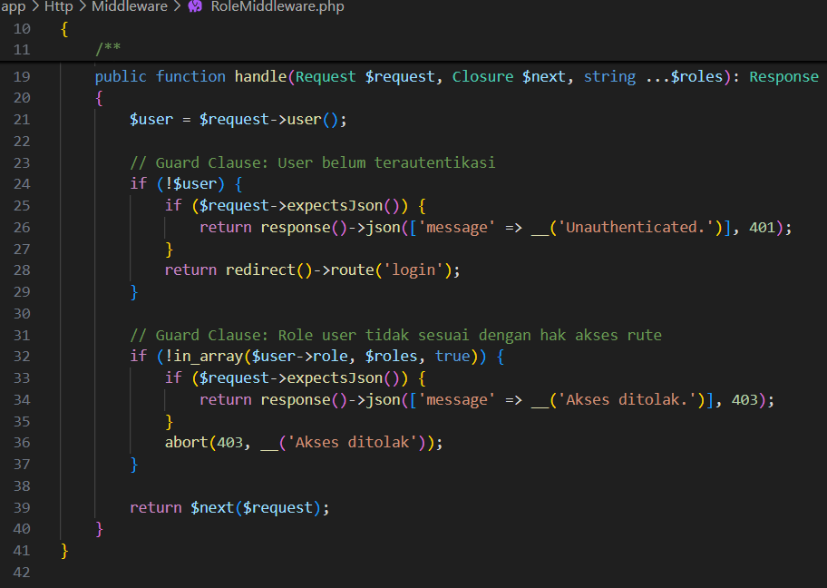

 

*Gambar 4.43 Potongan Kode Pembatasan Hak Akses Peran Pengguna (Role Middleware)*  

Merujuk pada Gambar 4.43, baris awal kode memeriksa keberadaan data sesi *login* akun yang sedang aktif. Apabila pengguna belum terautentikasi, sistem langsung mengarahkannya kembali ke formulir *login* utama. Selanjutnya, baris kode di bawahnya memvalidasi kecocokan peran pengguna dan langsung menghentikan eksekusi permintaan halaman apabila hak aksesnya tidak sesuai.

 

2. Implementasi Pengalihan Portal Pasca-autentikasi (*Auth Redirect*)  
Setelah kredensial akun tervalidasi benar, sistem menjalankan logika pemandu untuk menentukan rute halaman tujuan masing-masing pengguna. Logika ini memeriksa kelengkapan nomor kontak, status aktif penyewa, hingga riwayat reservasi yang sedang menunggu pelunasan. Alur pengalihan sesi pengguna menuju portal yang tepat disajikan pada Gambar 4.44.

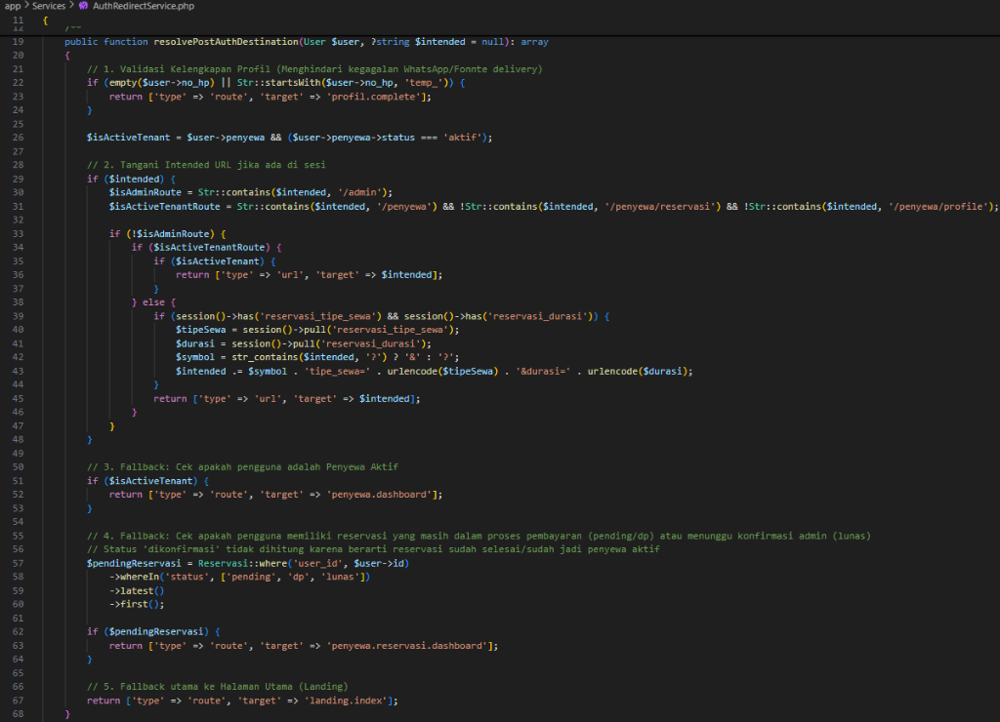

 

*Gambar 4.44 Potongan Kode Pengalihan Portal Pengguna Pasca Autentikasi*  

Sebagaimana tampak pada Gambar 4.44, akun berstatus admin langsung dialihkan menuju dasbor pengelolaan operasional indekos. Sementara itu, pengguna yang tercatat sebagai penghuni aktif diarahkan masuk ke portal penyewa untuk memantau tagihan sewa kamar, sedangkan calon penyewa dengan transaksi pemesanan berjalan dipandu langsung ke halaman detail reservasinya.

 

### 4.3.2 Implementasi Pemesanan Kamar
Logika bisnis pemesanan kamar menangani seluruh alur penguncian inventaris 32 unit kamar di Asri Boarding House secara akurat. Modul ini menjadi benteng utama dalam mencegah terjadinya benturan pesanan ganda (*double booking*) saat banyak calon penghuni mengakses sistem pada waktu bersamaan.

1. Implementasi Transaksi ACID dan Penguncian Baris Unit Kamar  
Persaingan akses data saat dua calon penghuni memilih unit kamar yang sama pada detik bersamaan ditangani menggunakan prinsip transaksi ACID. Logika pemesanan ini memanfaatkan metode penguncian baris data kamar secara eksklusif agar status unit tidak dapat diubah oleh proses lain sebelum transaksi selesai, seperti yang diperlihatkan pada Gambar 4.45.

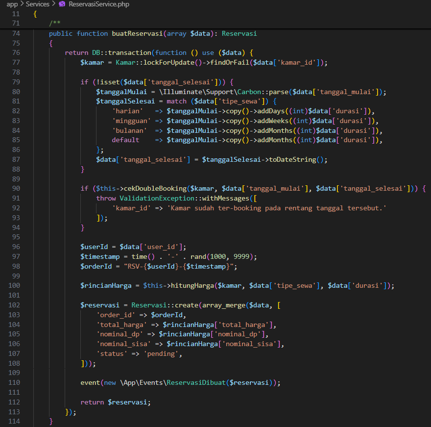

 

*Gambar 4.45 Potongan Kode Transaksi ACID dan Penguncian Unit Kamar*  

Berdasarkan Gambar 4.45, seluruh tahapan pembuatan reservasi dibungkus di dalam blok transaksi basis data guna menjamin keutuhan relasi antar-tabel. Pemanggilan metode *lockForUpdate()* bertugas mengunci baris data kamar terpilih sampai seluruh tahapan validasi tanggal tuntas dieksekusi. Apabila kamar tersebut terbukti telah terisi oleh pemesan terdahulu, sistem langsung membatalkan transaksi dan menampilkan pesan peringatan kepada calon penyewa.

 

2. Implementasi Algoritma Pengecekan Benturan (*Double Booking*) Kamar  
Keakuratan status ketersediaan 32 unit kamar sewa di Asri Boarding House dijaga melalui algoritma pendeteksi benturan jadwal pesanan. Fungsi ini memeriksa apakah rentang tanggal mulai hingga tanggal selesai sewa yang diajukan pemohon bertabrakan dengan jadwal reservasi lain yang masih aktif. Selain itu, pemeriksaan juga disandingkan dengan masa berlaku kontrak seluruh penghuni aktif yang sedang menempati kamar, sebagaimana ditunjukkan pada Gambar 4.46.

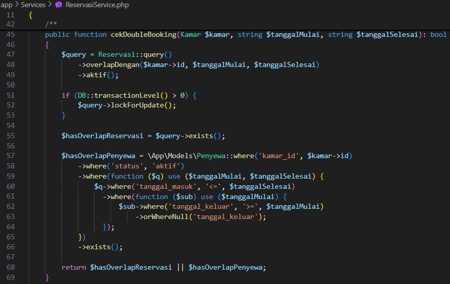

 

*Gambar 4.46 Potongan Kode Algoritma Pengecekan Benturan Jadwal Reservasi*  

Mengacu pada Gambar 4.46, kueri pertama menyaring data reservasi aktif yang memiliki irisan tanggal pada unit kamar terkait, sedangkan kueri kedua memeriksa catatan kontrak penghuni aktif untuk memastikan kamar tersebut belum dihuni pada periode yang dipilih. Apabila salah satu dari kedua kondisi benturan jadwal tersebut terdeteksi, sistem akan mengembalikan nilai logika benar (*true*) untuk menolak pengajuan sewa baru.

 

### 4.3.3 Implementasi *Payment Gateway*
Penerapan gerbang pembayaran digital Midtrans memfasilitasi transaksi non-tunai melalui *Virtual Account*, QRIS, dan dompet digital secara praktis. Modul ini menghubungkan antarmuka aplikasi web langsung dengan *server* perbankan serta memperbarui status pelunasan tagihan secara otomatis melalui mekanisme *webhook*.

1. Implementasi Pembuatan Transaksi dan *Snap Token* Midtrans  
Proses pembayaran sewa kamar secara daring diawali dengan pembuatan token transaksi melalui layanan Midtrans Snap. Fungsi ini merangkum rincian sewa pokok beserta akumulasi denda keterlambatan ke dalam struktur data yang terverifikasi sebelum dikirimkan ke *server* gerbang pembayaran. Melalui integrasi yang tampak pada Gambar 4.47, calon penyewa maupun penghuni aktif akan menerima instruksi pembayaran resmi dengan masa berlaku pelunasan selama 24 jam.

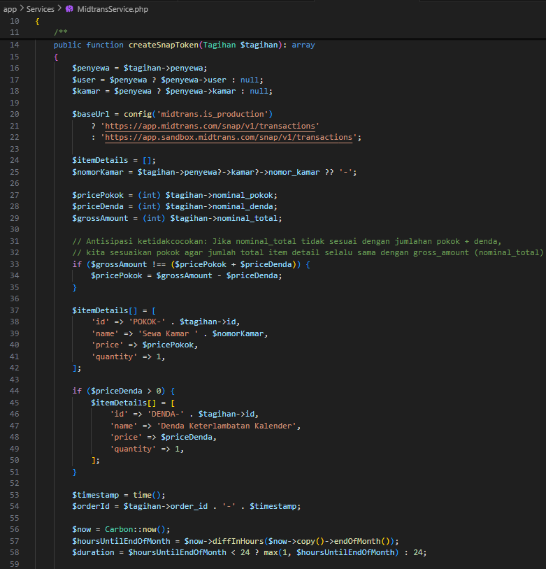

 

*Gambar 4.47 Potongan Kode Pembuatan Snap Token Pembayaran Midtrans*  

Sebagaimana tampak pada Gambar 4.47, sistem terlebih dahulu memetakan nominal pokok dan denda keterlambatan ke dalam larik rincian *item* transaksi. Bagian tengah kode menetapkan identitas pesanan unik berbasis penanda waktu (*timestamp*) beserta batas kadaluwarsa pembayaran 24 jam, lalu baris akhir mengeksekusi permintaan *HTTP POST* terenkripsi menggunakan autentikasi *server key* untuk memperoleh *Snap token* resmi.

 

2. Implementasi Validasi *Signature Key* dan *Webhook Callback* Midtrans  
Pembaruan status transaksi sewa bulanan dan uang muka reservasi diproses secara otomatis melalui mekanisme *webhook callback* dari Midtrans. Setiap kiriman data notifikasi dari *server* pembayaran wajib melewati verifikasi tanda tangan digital berbasis algoritma kriptografi SHA-512 agar terhindar dari manipulasi pihak luar. Mekanisme pemeriksaan keamanan dan pencatatan transaksi lunas tersebut dapat dilihat pada Gambar 4.48.

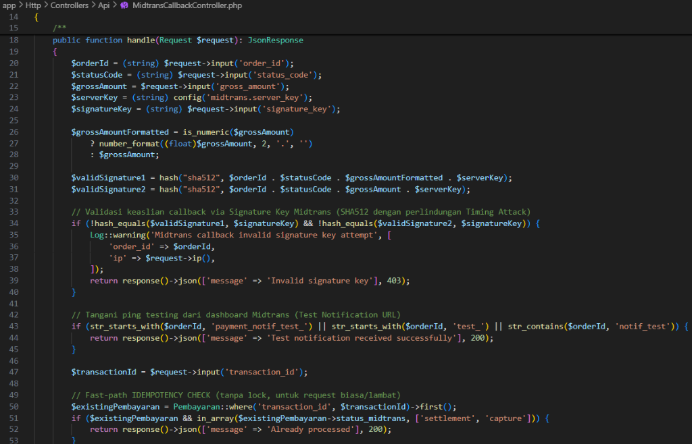

 

*Gambar 4.48 Potongan Kode Validasi Keamanan Signature Key Webhook Midtrans*  

Melalui tampilan Gambar 4.48, keaslian tanda tangan digital diverifikasi menggunakan fungsi *hash_equals()* guna mencegah celah serangan berbasis selisih waktu respons (*timing attack*). Sistem selanjutnya memeriksa status transaksi terdahulu untuk menjaga sifat idempoten agar tidak terjadi pencatatan kas masuk ganda. Begitu pembayaran dinyatakan sah, status tagihan pada basis data lokal langsung diperbarui menjadi lunas secara otomatis.

 

### 4.3.4 Implementasi Penjadwalan dan Notifikasi
Otomasi operasional indekos dijalankan melalui perpaduan penjadwal tugas berkala di tingkat *server* dengan layanan pengiriman pesan instan dan surat elektronik resmi. Modul ini menghapus ketergantungan pada pengingat manual penjaga kost sehingga penagihan bulanan setiap tanggal 10 dan penerbitan bukti kuitansi selalu terkirim tepat waktu.

1. Implementasi Penjadwalan Tugas Otomatis (*Task Scheduler Cron Job*)  
Pengelolaan tagihan rutin tanggal 10 dan pembersihan transaksi kedaluwarsa diotomatisasi melalui fitur penjadwal tugas pada kerangka kerja Laravel. Cukup satu layanan penjadwal di tingkat *server* yang diaktifkan untuk menggerakkan seluruh perintah konsol sistem informasi secara mandiri di latar belakang, sebagaimana ditampilkan pada Gambar 4.49.

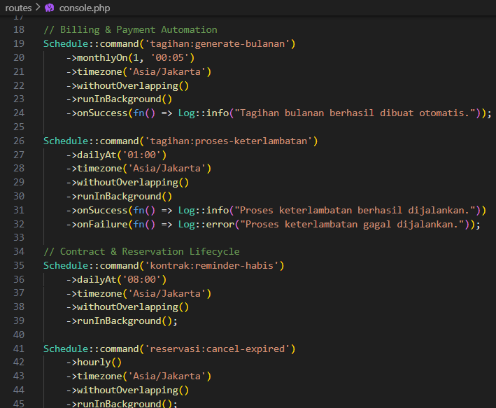

 

*Gambar 4.49 Potongan Kode Konfigurasi Penjadwal Tugas Otomatis Laravel*  

Pada tampilan Gambar 4.49, perintah penerbitan tagihan sewa bulanan dijadwalkan berjalan otomatis setiap tanggal 1 pukul 00:05 WIB. Sementara itu, perintah kalkulasi denda keterlambatan dieksekusi setiap dini hari pukul 01:00 WIB untuk memeriksa tagihan yang telah melewati batas jatuh tempo tanggal 10. Metode *withoutOverlapping()* turut disematkan pada rantai kode agar proses penjadwalan yang masih berjalan tidak dieksekusi secara tumpang-tindih.

 

2. Implementasi Integrasi Layanan Pesan *WhatsApp Gateway* Fonnte  
Notifikasi tagihan bulanan dan konfirmasi pelunasan reservasi kamar dikirimkan langsung ke nomor ponsel penyewa melalui integrasi API Fonnte. Sebelum meneruskan pesan teks melalui protokol HTTP, sistem menstandarkan format nomor telepon pengguna terlebih dahulu agar sesuai dengan kode panggilan internasional. Rincian fungsi pengiriman pesan instan otomatis tersebut diperlihatkan pada Gambar 4.50.

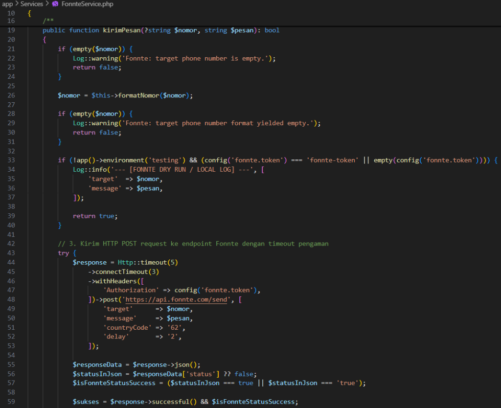

 

*Gambar 4.50 Potongan Kode Integrasi Pengiriman Pesan WhatsApp Fonnte*  

Sebagaimana terlihat pada Gambar 4.50, nomor kontak pengguna diformat ke dalam standar penomoran internasional menggunakan awalan kode negara Indonesia. Fungsi kemudian mengirimkan permintaan *HTTP POST* yang dilengkapi *header* token otorisasi rahasia menuju *server* Fonnte, lalu memastikan keberhasilan pengiriman melalui pemeriksaan kode status koneksi beserta nilai respons JSON yang diterima.

 

3. Implementasi Integrasi Pengiriman Dokumen Tagihan via *Email Gateway* SMTP  
Dokumen penagihan resmi dan rincian kuitansi sewa kamar dikirimkan secara otomatis ke alamat surat elektronik penghuni melalui protokol SMTP dengan enkripsi TLS. Penerapan antrean pesan (*message queue*) pada modul ini membuat proses pengiriman berkas berjalan di latar belakang tanpa memperlambat interaksi pengguna pada antarmuka web. Susunan kelas pengirim surat tagihan digital tersebut disajikan pada Gambar 4.51.

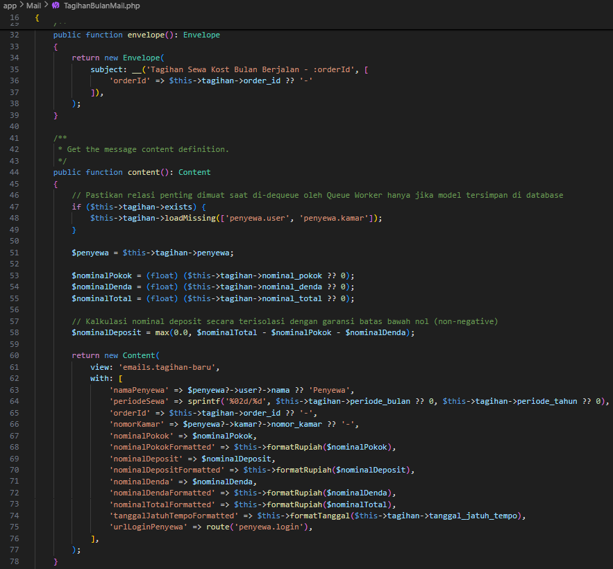

 

*Gambar 4.51 Potongan Kode Pengiriman Dokumen Tagihan via Email Gateway SMTP*  

Merujuk pada Gambar 4.51, kelas pengirim menerapkan antarmuka *ShouldQueue* agar pemrosesan surat elektronik dieksekusi secara asinkron melalui antrean *server*. Di dalam kelas tersebut, metode *envelope()* bertugas menetapkan subjek surat resmi yang memuat nomor tagihan milik penghuni. Selanjutnya, metode *content()* memadukan rincian sewa pokok, biaya denda, dan tautan masuk portal penyewa ke dalam templat tampilan *email* yang rapi.

 

## 4.4 Pengujian Sistem
Pengujian fungsionalitas sistem informasi Asri Boarding House dilakukan menggunakan metode pengujian kotak hitam (*black box testing*) untuk memastikan setiap fitur berjalan sesuai kebutuhan pengguna. Evaluasi ini berfokus pada kesesuaian antara masukan data dan respons antarmuka aplikasi tanpa memeriksa struktur kode program di dalamnya. Seluruh skenario uji dikelompokkan ke dalam enam bagian operasional utama, meliputi autentikasi dan hak akses, katalog publik, alur reservasi calon penyewa, portal penyewa aktif, manajemen admin, hingga penjadwal tugas otomatis di *server*. Rincian prosedur pengujian, respons sistem yang diharapkan, serta status keberhasilan fitur dirangkum pada Tabel 4.1.

 

**Tabel 4.1** Hasil Pengujian Fungsionalitas Sistem (*Black Box Testing*)

| No | Modul / Skenario Uji | Prosedur Pengujian / Masukan Data | Hasil yang Diharapkan | Hasil Pengujian | Status |
| :---: | :--- | :--- | :--- | :--- | :---: |
| **Domain I: Autentikasi, Hak Akses & Profil Pengguna** | | | | | |
| 1 | *Login* Administrator kredensial valid | Masukkan *email* dan *password* admin yang benar pada halaman `/admin/login` | Akses diterima, pengguna diarahkan ke `/admin/dashboard` | Sesuai ekspektasi | Berhasil |
| 2 | *Login* Administrator *password* salah | Masukkan *email* admin yang valid dengan *password* yang salah | Akses ditolak, muncul pesan kesalahan "Kredensial tidak cocok" | Sesuai ekspektasi | Berhasil |
| 3 | *Login* Administrator *email* tidak terdaftar | Masukkan *email* acak yang belum terdaftar di dalam sistem | Akses ditolak, muncul peringatan bahwa akun tidak ditemukan | Sesuai ekspektasi | Berhasil |
| 4 | Kewajiban ganti *password* saat *login* pertama | Lakukan *login* menggunakan akun admin baru dengan status wajib ganti kata sandi aktif | Sistem mengalihkan navigasi secara otomatis ke formulir `/admin/password/change` | Sesuai ekspektasi | Berhasil |
| 5 | *Login* Penyewa Aktif kredensial valid | Masukkan *email* dan kata sandi yang valid pada halaman `/penyewa/login` | Akses diterima, pengguna diarahkan ke `/penyewa/dashboard` | Sesuai ekspektasi | Berhasil |
| 6 | *Login* Penyewa kata sandi salah | Masukkan *email* valid dengan kata sandi yang keliru pada portal penyewa | Akses ditolak, muncul jendela peringatan bahwa kata sandi salah | Sesuai ekspektasi | Berhasil |
| 7 | Permintaan lupa kata sandi *email* terdaftar | Masukkan *email* terdaftar pada formulir `/penyewa/password/reset` | Tautan pemulihan kata sandi berhasil dikirimkan ke alamat *email* penyewa | Sesuai ekspektasi | Berhasil |
| 8 | Permintaan lupa kata sandi *email* tidak terdaftar | Masukkan alamat *email* yang tidak tercatat di dalam basis data | Sistem menampilkan pesan kesalahan bahwa alamat *email* tidak ditemukan | Sesuai ekspektasi | Berhasil |
| 9 | Pembaruan kata sandi dengan token valid | Klik tautan token pada *email*, lalu masukkan kata sandi baru minimal 8 karakter | Kata sandi berhasil diperbarui dan pengguna dapat *login* kembali | Sesuai ekspektasi | Berhasil |
| 10 | Pendaftaran akun baru Calon Penyewa | Isi nama lengkap, nomor WhatsApp, *email*, dan kata sandi pada halaman registrasi | Akun baru berhasil dibuat dan pengguna diarahkan ke halaman pelengkapan profil | Sesuai ekspektasi | Berhasil |
| 11 | Lengkapi profil dengan nomor WhatsApp valid | Masukkan nomor WhatsApp format Indonesia (`081234567890`) dan unggah foto KTP pada formulir profil | Data profil tersimpan dan pengguna diarahkan kembali ke alur pemesanan kamar | Sesuai ekspektasi | Berhasil |
| 12 | Lengkapi profil dengan nomor telepon tidak valid | Masukkan karakter huruf atau simbol pada kolom nomor telepon | Validasi formulir gagal dan muncul pesan peringatan format nomor tidak valid | Sesuai ekspektasi | Berhasil |
| **Domain II: Portal Publik, Katalog & Guest Chat** | | | | | |
| 13 | Akses halaman beranda (*home page*) publik | Buka alamat situs web utama Asri Boarding House pada peramban web | Informasi 32 unit kamar, daftar fasilitas, dan panduan reservasi tampil dengan rapi | Sesuai ekspektasi | Berhasil |
| 14 | Penyaringan kamar berdasarkan lantai | Klik tombol *filter* "Lantai 1" pada katalog kamar | Katalog hanya menampilkan daftar unit kamar yang berada di lantai 1 | Sesuai ekspektasi | Berhasil |
| 15 | Penyaringan kamar berdasarkan tipe | Klik tombol *filter* tipe kamar "VIP" pada katalog | Katalog hanya menampilkan daftar unit kamar dengan kategori tipe VIP | Sesuai ekspektasi | Berhasil |
| 16 | Akses halaman detail kamar berstatus kosong | Klik salah satu kartu unit kamar yang berstatus "Tersedia" | Halaman detail terbuka, lencana hijau tampil aktif, dan tombol pemesanan muncul | Sesuai ekspektasi | Berhasil |
| 17 | Akses halaman detail kamar berstatus terisi | Klik salah satu kartu unit kamar yang berstatus "Terisi" | Tombol pemesanan disembunyikan dan digantikan dengan tombol tanya admin | Sesuai ekspektasi | Berhasil |
| 18 | Klik tombol pintasan WhatsApp pengelola | Klik tombol pintasan kontak di bagian bawah halaman publik | Peramban membuka halaman WhatsApp menuju nomor resmi pengelola kost | Sesuai ekspektasi | Berhasil |
| 19 | Membuka *widget* *Guest Chat* tanpa *login* | Klik *widget* obrolan tamu di pojok kanan bawah layar | Jendela obrolan terbuka dan sistem membuat sesi percakapan tamu secara otomatis | Sesuai ekspektasi | Berhasil |
| 20 | Mengirim pesan pertanyaan melalui *Guest Chat* | Ketik pesan pertanyaan ketersediaan kamar lalu tekan tombol kirim | Pesan terkirim tanpa memuat ulang halaman, tersimpan di basis data, dan masuk ke dasbor admin | Sesuai ekspektasi | Berhasil |
| 21 | Uji ketahanan sesi obrolan tamu saat *refresh* | Muat ulang (*refresh*) halaman peramban saat sedang menggunakan *Guest Chat* | Riwayat percakapan sebelumnya tetap tampil utuh pada jendela obrolan | Sesuai ekspektasi | Berhasil |
| 22 | Penampilan galeri foto dan detail fasilitas | Klik salah satu foto pada halaman galeri kost dan panel lipat FAQ | Pratinjau foto tampil jelas dan panel jawaban FAQ terbuka sesuai kategori yang dipilih | Sesuai ekspektasi | Berhasil |
| **Domain III: Calon Penyewa & Alur Pemesanan 5 Tahap** | | | | | |
| 23 | Pemilihan unit kamar pada Tahap 1 | Pilih salah satu unit kamar kosong pada langkah pertama pemesanan | Unit kamar terpilih ditandai garis tepi tebal dan tombol lanjut menjadi aktif | Sesuai ekspektasi | Berhasil |
| 24 | Pengisian biodata dan NIK 16 digit valid | Masukkan biodata diri dan 16 digit angka NIK pada formulir Tahap 2 | Data berhasil divalidasi dan antarmuka beralih menuju langkah pemilihan durasi sewa | Sesuai ekspektasi | Berhasil |
| 25 | Validasi NIK kurang dari 16 digit | Masukkan nomor NIK hanya 14 digit angka pada formulir Tahap 2 | Sistem menolak masukan dan menampilkan peringatan bahwa NIK wajib 16 digit | Sesuai ekspektasi | Berhasil |
| 26 | Pemilihan durasi sewa pada simulasi biaya | Pilih opsi sewa bulanan dengan durasi 12 bulan pada langkah simulasi biaya | Tanggal selesai sewa dan total periode masa tinggal dihitung otomatis oleh sistem | Sesuai ekspektasi | Berhasil |
| 27 | Perhitungan potongan harga sewa tahunan | Pilih durasi sewa 12 bulan pada kalkulator simulasi biaya kamar | Sistem menghitung potongan harga sewa jangka panjang secara otomatis pada tabel rincian | Sesuai ekspektasi | Berhasil |
| 28 | Pemilihan skema pembayaran uang muka (DP) | Pilih opsi pembayaran uang muka (*down payment*) pada langkah skema bayar | Nominal tagihan awal disesuaikan secara proporsional dari total biaya sewa pokok | Sesuai ekspektasi | Berhasil |
| 29 | Pemilihan skema pembayaran lunas penuh | Pilih opsi pelunasan penuh (100%) pada langkah skema bayar | Nominal tagihan awal ditetapkan penuh sesuai total nilai kontrak sewa | Sesuai ekspektasi | Berhasil |
| 30 | Pemicuan jendela pembayaran Midtrans Snap | Klik tombol bayar pada langkah akhir reservasi kamar | Jendela *pop-up* Midtrans Snap tampil memuat pilihan *Virtual Account*, QRIS, dan *e-wallet* | Sesuai ekspektasi | Berhasil |
| 31 | Penutupan jendela Snap sebelum transfer | Tutup jendela *pop-up* Midtrans tanpa menyelesaikan pembayaran | Pesanan tercatat berstatus *pending* dan unit kamar dikunci sementara selama masa tunggu | Sesuai ekspektasi | Berhasil |
| 32 | Pembayaran uang muka hingga lunas | Selesaikan pembayaran uang muka melalui simulator pembayaran Midtrans | Status reservasi berubah terverifikasi, unit kamar terkunci, serta bukti kirim masuk ke WhatsApp dan *email* | Sesuai ekspektasi | Berhasil |
| **Domain IV: Portal Penyewa Aktif, Tagihan & Keluhan** | | | | | |
| 33 | Menampilkan dasbor ringkasan hunian | Buka halaman `/penyewa/dashboard` setelah status penghuni diaktifkan | Layar menampilkan nomor kamar, sisa masa sewa, dan ringkasan tagihan berjalan | Sesuai ekspektasi | Berhasil |
| 34 | Menampilkan daftar riwayat tagihan sewa | Klik menu tagihan penyewa pada bilah navigasi portal penghuni | Sistem menampilkan daftar seluruh tagihan sewa bulanan beserta lencana statusnya | Sesuai ekspektasi | Berhasil |
| 35 | Menampilkan rincian komponen *invoice* | Klik salah satu kartu tagihan yang berstatus belum dibayar | Sistem menampilkan rincian nominal sewa pokok, biaya denda, dan tanggal jatuh tempo | Sesuai ekspektasi | Berhasil |
| 36 | Pelunasan tagihan sewa via Midtrans Snap | Klik tombol "Bayar Tagihan" lalu selesaikan pembayaran melalui *Virtual Account* | *Webhook* Midtrans memvalidasi transaksi dan status tagihan langsung berubah menjadi lunas | Sesuai ekspektasi | Berhasil |
| 37 | Pengunduhan kuitansi resmi berformat PDF | Klik tombol cetak nota pada baris transaksi yang telah berstatus lunas | Sistem menghasilkan dan mengunduh dokumen kuitansi digital resmi berformat PDF | Sesuai ekspektasi | Berhasil |
| 38 | Pengajuan laporan keluhan fasilitas kamar | Pilih kategori kerusakan dan tulis deskripsi kendala pada formulir keluhan | Tiket keluhan tersimpan di basis data dan langsung tampil pada daftar keluhan di dasbor admin | Sesuai ekspektasi | Berhasil |
| 39 | Pengajuan keluhan disertai lampiran foto | Unggah berkas foto bukti kerusakan berformat `.jpg` dengan ukuran 1 MB | Foto berhasil disimpan ke direktori penyimpanan dan tertaut pada tiket keluhan terkait | Sesuai ekspektasi | Berhasil |
| 40 | Validasi penolakan berkas bukan gambar | Unggah berkas dokumen berformat `.pdf` atau `.docx` pada kolom foto keluhan | Sistem menolak berkas dan menampilkan peringatan bahwa format lampiran harus berupa gambar | Sesuai ekspektasi | Berhasil |
| 41 | Pemantauan status penyelesaian keluhan | Buka halaman keluhan setelah status tiketnya diperbarui oleh admin menjadi "Selesai" | Penghuni dapat melihat lencana hijau berstatus "Selesai" beserta catatan tindak lanjut perbaikan | Sesuai ekspektasi | Berhasil |
| **Domain V: Administrator & Manajemen Operasional** | | | | | |
| 42 | Menampilkan kartu ringkasan operasional | Buka halaman utama `/admin/dashboard` menggunakan akun penjaga kost | Kartu indikator okupansi kamar, total pemasukan, pengeluaran, dan keluhan tampil akurat | Sesuai ekspektasi | Berhasil |
| 43 | Penambahan data unit kamar baru | Masukkan nomor kamar, lantai, kategori tipe, dan tarif pada formulir tambah kamar | Data kamar baru tersimpan di basis data dan langsung tampil pada katalog halaman depan | Sesuai ekspektasi | Berhasil |
| 44 | Pembaruan tarif dan spesifikasi kamar | Ubah nominal harga sewa dan deskripsi inventaris pada salah satu unit kamar | Perubahan data berhasil disimpan dan informasi tarif di halaman katalog ikut diperbarui | Sesuai ekspektasi | Berhasil |
| 45 | Pencegahan hapus kamar yang sedang dihuni | Tekan tombol hapus pada unit kamar yang masih memiliki penghuni aktif | Sistem menolak penghapusan data demi menjaga keutuhan relasi riwayat transaksi sewa | Sesuai ekspektasi | Berhasil |
| 46 | Pengelolaan data master fasilitas kost | Tambahkan data fasilitas umum baru beserta foto dokumentasinya pada menu fasilitas | Data sarana baru berhasil disimpan dan tampil pada halaman daftar fasilitas publik | Sesuai ekspektasi | Berhasil |
| 47 | Konfirmasi aktivasi reservasi masuk | Klik tombol konfirmasi pada pesanan kamar yang telah melunasi uang muka dan verifikasi KTP | Status pemohon berubah menjadi penyewa aktif dan pemberitahuan aktivasi dikirim via WhatsApp Fonnte | Sesuai ekspektasi | Berhasil |
| 48 | Pencatatan pelunasan tagihan secara tunai | Klik tombol konfirmasi pembayaran pada daftar tagihan penghuni yang membayar tunai | Status tagihan berubah menjadi lunas, kas masuk tercatat di pembukuan, dan nota digital diterbitkan | Sesuai ekspektasi | Berhasil |
| 49 | Penonaktifan status hunian (*check-out*) | Klik tombol nonaktifkan pada data penghuni yang masa kontrak sewanya telah berakhir | Status akun penyewa berubah menjadi nonaktif dan riwayat sewanya tersimpan di arsip | Sesuai ekspektasi | Berhasil |
| 50 | Pembaruan status kamar pasca-inspeksi | Ubah status unit kamar menjadi "Tersedia" setelah pemeriksaan kebersihan kamar selesai | Status kamar kembali menjadi kosong di katalog publik dan siap dipesan oleh calon penyewa baru | Sesuai ekspektasi | Berhasil |
| 51 | Pengelolaan tindak lanjut tiket keluhan | Buka tiket aduan masuk, periksa foto kerusakan, lalu ubah statusnya menjadi "Diproses" | Perubahan status tiket tersimpan dan dapat langsung dipantau oleh penghuni yang melapor | Sesuai ekspektasi | Berhasil |
| 52 | Membalas pesan pengunjung pada *Guest Chat* | Pilih antrean obrolan tamu pada panel admin, ketik jawaban, lalu tekan tombol kirim | Balasan pesan terkirim secara langsung ke jendela obrolan pengunjung di halaman publik | Sesuai ekspektasi | Berhasil |
| 53 | Pencatatan pengeluaran operasional kost | Masukkan rincian biaya perawatan gedung dan nominal pengeluaran pada menu pengeluaran | Catatan kas keluar tersimpan dan otomatis memperbarui perhitungan laba bersih bulanan | Sesuai ekspektasi | Berhasil |
| 54 | Ekspor laporan keuangan ke PDF dan Excel | Pilih rentang periode bulan laporan, lalu tekan tombol "Ekspor Excel" dan "Unduh PDF" | Dokumen rekapitulasi arus kas bulanan berhasil terunduh dalam format Excel maupun PDF dengan rapi | Sesuai ekspektasi | Berhasil |
| **Domain VI: Otomasi Task Scheduler, Denda & API Eksternal** | | | | | |
| 55 | Penerbitan tagihan sewa otomatis tanggal 1 | Jalankan perintah konsol `tagihan:generate-bulanan` melalui penjadwal tugas Laravel | Tagihan sewa periode bulan berjalan otomatis diterbitkan untuk seluruh penghuni aktif | Sesuai ekspektasi | Berhasil |
| 56 | Pencegahan penerbitan tagihan ganda | Jalankan kembali perintah `tagihan:generate-bulanan` pada periode bulan yang sama | Sistem memeriksa tagihan yang sudah terbit dan tidak membuat duplikasi *invoice* pada bulan tersebut | Sesuai ekspektasi | Berhasil |
| 57 | Perhitungan denda keterlambatan lewat tanggal 10 | Jalankan perintah *scheduler* pemeriksaan denda pada tagihan belum lunas yang melewati tanggal 10 | Sistem menambahkan nominal denda keterlambatan secara otomatis pada tagihan yang menunggak | Sesuai ekspektasi | Berhasil |
| 58 | Penanganan sifat idempoten perhitungan denda | Jalankan kembali perintah *scheduler* denda secara berulang pada hari yang sama | Nilai denda tetap konsisten sesuai aturan tanpa terjadi penggandaan nominal yang keliru | Sesuai ekspektasi | Berhasil |
| 59 | Pengiriman pengingat tagihan via WhatsApp Fonnte | Jalankan proses penerbitan tagihan bulanan yang terhubung dengan layanan API Fonnte | Pesan WhatsApp berisi rincian *invoice* dan tanggal jatuh tempo berhasil diterima di nomor ponsel penyewa | Sesuai ekspektasi | Berhasil |
| 60 | Pengiriman dokumen tagihan via Email SMTP | Jalankan proses pengiriman surat tagihan melalui antrean *server* (*message queue*) | Surat elektronik resmi berisi rincian biaya sewa dan tautan pembayaran berhasil masuk ke kotak masuk *email* penyewa | Sesuai ekspektasi | Berhasil |

 

Berdasarkan hasil pengujian pada Tabel 4.1, seluruh 60 skenario uji fungsional berhasil dijalankan sesuai spesifikasi kebutuhan tanpa kendala teknis. Setiap proses validasi formulir, penguncian transaksi kamar dengan prinsip ACID, hingga pertukaran data dengan layanan Midtrans, Fonnte, dan SMTP beroperasi secara presisi di *server*. Hasil evaluasi wawancara bersama penjaga dan penghuni kost turut mengonfirmasi efektivitas sistem dalam mempermudah pemantauan hunian, penerbitan tagihan otomatis, serta verifikasi pembayaran sewa secara akurat.

 

## 4.5 Hasil Wawancara
Pengujian penerimaan pengguna (*User Acceptance Testing*) dilaksanakan untuk mengukur kelayakan operasional sistem informasi Asri Boarding House dengan melibatkan pengelola operasional senior dan lima mahasiswa penghuni kost aktif. Seluruh rangkaian evaluasi dijalankan melalui uji coba langsung berdampingan (*side-by-side usability testing*) serta wawancara semiterstruktur yang didokumentasikan melalui rekaman suara sebagai bukti otentik pengujian. Ruang lingkup wawancara ini meninjau aspek kejelasan katalog daring, formulir reservasi bertahap, pembayaran digital Midtrans, kuitansi instan, hingga pembukuan kas harian.

 

Sesi evaluasi bersama Bapak Asep difokuskan untuk menguji fungsionalitas panel pengelola serta kemudahan operasional harian kost setelah 20 tahun terbiasa menggunakan buku besar manual. Seluruh dialog berlangsung secara tatap muka di kantor pengelola dengan rekaman audio sebagai bukti verifikasi yang otentik.

 

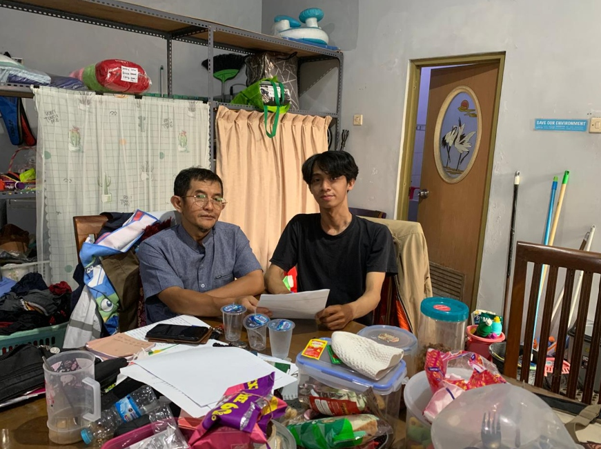

*Gambar 4.52 Dokumentasi Sesi Wawancara Bersama Penjaga Kost (Bapak Asep)*  

 

**Tabel 4.2** Hasil Wawancara Penjaga Kost (Bapak Asep)

| No | Aspek Pengujian | Pertanyaan | Tanggapan |
| :---: | :--- | :--- | :--- |
| 1 | Halaman Depan Publik: Tipografi, foto kamar, dan transparansi harga | Pak Asep, ini tampilan website depan kost kita yang bisa dibuka siapa saja lewat HP atau laptop. Di sini ada foto-foto 32 kamar, fasilitas, dan harga sewanya. Menurut pandangan Bapak, apakah tulisannya sudah cukup jelas dan fotonya pas menggambarkan kost kita? | Tampilannya jelas sekali Mas Rafif, tulisannya besar-besar dan kontrasnya tegas jadi mata saya yang sudah berumur tidak cepat capek bacanya. Fotonya terang, terus harga sewanya langsung kelihatan di depan. Ini bagus sekali supaya calon anak kost atau orang tuanya dari luar kota tidak perlu bolak-balik telepon tanya harga lagi. |
| 2 | Tombol WhatsApp Melayang: Sudut kanan bawah | Tombol hijau lambang WhatsApp di pojok kanan bawah ini selalu menempel saat layar digulirkan, dan kalau diklik langsung membuka obrolan ke nomor admin. Menurut Bapak tombol ini gampang dilihat atau mengganggu? | Sangat pas di situ Mas. Posisinya gampang dijangkau jempol kalau buka lewat HP, dan langsung nyambung ke nomor WhatsApp saya jadi kalau ada calon penyewa yang mau tanya-tanya ketersediaan kamar bisa langsung saya respon cepat. |
| 3 | Dasbor Admin & Kas Otomatis: Tata letak OLED Dark Mode | Sekarang kita masuk ke akun admin. Di dasbor ini langsung kelihatan kotak ringkasan: berapa kamar yang terisi, berapa yang kosong, dan berapa total uang kas yang masuk bulan ini. Menurut Bapak, melihat angka-angka ini langsung paham atau membingungkan? | Wah, ini sangat enak Mas. Warnanya gelap jadi adem di mata kalau berlama-lama di depan laptop. Angka kamar isi dan kamar kosong langsung kelihatan, tidak perlu lagi saya hitung manual pakai coret-coretan di buku besar seperti dulu. Total saldo kas masuk dan keluar juga langsung dihitung otomatis oleh sistem, jadi saya bisa langsung tahu laba bersih bulan ini tanpa takut salah jumlah. |
| 4 | Pendaftaran Penyewa Datang Langsung: Form Walk-In admin | Kalau ada calon anak kost atau orang tuanya yang datang langsung ke kantor pengelola tanpa reservasi lewat web, Bapak tinggal input di form ini: nama, nomor HP anak, nomor HP orang tuanya, dan pilih kamarnya. Formulir pendaftaran ini dirasa mudah diisi tidak Pak? | Gampang sekali, kolom isiannya ringkas dan jelas. Yang paling penting itu nomor HP orang tua atau wali anak kost langsung tersimpan di sistem, jadi kalau ada keadaan darurat atau anak kost menunggak, kita tidak kesulitan menghubungi keluarganya. |
| 5 | Konfirmasi Bayar Tunai & Kuitansi Instan: Menu Tagihan | Di menu Tagihan ini terlihat seluruh data kamar. Kalau ada anak kost yang membayar sewa secara tunai langsung ke meja Bapak, tinggal cari namanya lalu klik Konfirmasi Tunai, kuitansinya langsung terbit. Menurut Bapak cara ini praktis? | Sangat praktis. Tinggal satu klik langsung lunas dan kuitansinya keluar. Saya tidak perlu lagi cari buku blok kuitansi kertas, nulis tangan satu per satu, terus robek kertasnya. Semuanya langsung terekam rapi dan tidak takut nota hilang. |
| 6 | Aturan Denda Flat 5% Kalender | Di sistem ini ada aturan denda: jika anak kost terlambat membayar sewa melewati tanggal 10 di bulan berjalan belum dikenakan denda (bebas denda), baru jika menyeberang ke bulan berikutnya dikenakan denda flat 5% satu kali (tidak berbunga harian). Menurut pengalaman 20 tahun Bapak, aturan ini adil dan tepat? | Aturan denda ini sangat tepat dan bijaksana Mas Rafif! Mahasiswa di sini kiriman uang dari orang tuanya kadang suka mundur beberapa hari, jadi kalau belum lewat bulan jangan langsung didenda. Tapi kalau sudah menyeberang bulan baru didenda flat 5% supaya tertib dan ada ketegasan. Denda flat sekali ini tidak memberatkan mahasiswa tapi mendidik mereka disiplin. |
| 7 | Penguncian Kamar Pasca-Checkout: Karantina Fisik | Ketika ada anak kost yang selesai sewa atau checkout, status kamarnya di sistem tidak langsung berubah menjadi tersedia, melainkan tetap terkunci merah terisi sampai Bapak selesai memeriksa fisik kebersihan kamar baru diubah manual. Bagaimana pandangan Bapak tentang aturan ini? | Nah, ini hukumnya wajib Mas! Pengalaman saya 20 tahun, kalau kamar baru ditinggal keluar penghuni lama itu kasur, sprei, dan kamar mandinya harus dibersihkan dulu oleh petugas, lampu dan keran air dicek. Kalau kamar langsung otomatis jadi kosong di web padahal fisiknya masih kotor atau berantakan, nanti ada calon penyewa lain yang keburu pesan dan pas datang kamarnya belum siap, pengelola yang malu. Jadi kunci merah ini luar biasa penting mencegah komplain. |
| 8 | Pencatatan Biaya & Rekap Laporan Keuangan: Menu Laporan | Jika ada pengeluaran rutin seperti pembelian token listrik, air PAM, atau biaya teknisi, bisa dicatat di menu Pengeluaran. Saat pemilik kost meminta laporan bulanan, cukup klik satu tombol ekspor PDF atau Excel, seluruh laba bersih sudah terhitung otomatis. Fitur ini membantu pekerjaan Bapak? | Sangat membantu sekali Mas. Dulu setiap akhir bulan saya butuh waktu 3 sampai 4 hari untuk mengumpulkan nota-nota bon di laci meja, rekap pengeluaran satu per satu pakai kalkulator, baru diserahkan ke pemilik. Sekarang dalam hitungan detik laporannya sudah jadi rapi, bisa langsung dicetak atau dikirim lewat WhatsApp ke pemilik kost. |
| 9 | Portal Mandiri Anak Kost: Pembayaran BCA VA & Keluhan Berfoto | Anak kost memiliki portal mandiri di HP untuk membayar sewa via BCA Virtual Account (Midtrans) dan mengunduh kuitansi PDF sendiri. Selain itu, ada menu Keluhan di mana mereka bisa lapor kran bocor atau lampu mati disertai foto bukti fisik. Bagaimana respon Bapak? | Anak-anak mahasiswa zaman sekarang pasti senang sekali karena serba online dari HP tanpa perlu tarik tunai ke ATM. Terus fitur aduan keluhan berfoto ini sangat menolong kerjaan saya. Selama ini aduan anak kost sering disampaikan lisan pas papasan di lorong lalu saya lupa karena banyak kerjaan, atau lewat chat WA pribadi yang tertimbun. Dengan adanya foto kerusakan di sistem, saya bisa langsung teruskan fotonya ke tukang ledeng atau teknisi listrik agar cepat ditangani. |
| 10 | Refleksi 20 Tahun Manual vs Web & Penilaian Akhir | Pertanyaan terakhir Pak Asep, setelah mencoba langsung seluruh fitur: jika dibandingkan dengan pengalaman 20 tahun Bapak mengelola kos secara manual dengan buku besar, apakah sistem website ini membuat pekerjaan administrasi jauh lebih ringan dan bebas selisih uang kas? Berapa nilai kepuasan yang Bapak berikan dari skala 1 sampai 10? | Wah, kalau dibandingkan 20 tahun kemarin, perbedaannya seperti bumi dan langit Mas Rafif! Pakai website ini pekerjaan mengurus kost terasa jauh lebih enteng, hati jadi tenang karena tidak ada lagi selisih uang kas atau catatan nota yang tercecer. Semuanya transparan dan otomatis. Dari nilai 1 sampai 10, saya mantap memberikan nilai 9,5 atau bahkan 10! Sistem ini sangat siap dan sangat membantu operasional Asri Boarding House. |

 

Berdasarkan hasil wawancara pada Tabel 4.2, Bapak Asep memberikan skor kepuasan 9,5 dari skala 10 karena antarmuka web dan tema OLED Black Dark Mode terbukti ramah bagi penglihatan pengelola senior. Rekapitulasi kas otomatis memangkas durasi pembukuan dari berhari-hari menjadi hitungan detik serta menghapus risiko selisih kas fisik dengan pemilik hunian. Aturan denda flat 5% dinilai tepat mendisiplinkan penyewa secara manusiawi, sementara status karantina kamar pasca-checkout terbukti krusial mencegah komplain pemesanan sebelum unit selesai dibersihkan.

 

Wawancara dengan Arjun menggali pengalaman penghuni lama dalam menelusuri katalog kamar dan menyelesaikan transaksi sewa lewat m-Banking. Sesi pengujian mandiri ini direkam secara audio guna memastikan seluruh impresi penggunaan antarmuka tercatat secara utuh.

 

**Tabel 4.3** Hasil Wawancara Responden 1 (Arjun, Mahasiswa UNDIP - Penghuni Kost)

| No | Aspek Pengujian | Pertanyaan | Tanggapan |
| :---: | :--- | :--- | :--- |
| 1 | Katalog Kamar & Ketersediaan | Sebagai mahasiswa yang sudah 3 tahun mengekos di Tembalang, bagaimana penilaian Mas Arjun terhadap katalog kamar di website ini? Apakah sajian foto fasilitas dan informasi ketersediaan unitnya sudah cukup jelas? | Tampilannya tegas dan modern ala Neo-Brutalism. Foto fasilitas kayak kasur, AC, kamar mandi dalam, sampai video room tour-nya kelihatan jelas banget. Paling ngebantu itu badge status Tersedia yang warna hijau, jadi aku langsung tahu kamar mana yang masih kosong tanpa perlu panas-panasan keliling Tembalang atau bolak-balik nanya ke penjaga kos. |
| 2 | Formulir Pemesanan Bertahap | Saat mencoba mengisi formulir pemesanan 5 tahap di sistem, bagaimana alurnya menurut Mas? Apakah ada bagian yang membingungkan? | Alurnya runtut karena dibagi bertahap pakai stepper, jadinya nggak berasa numpuk di satu halaman panjang yang bikin malas. Validasi otomatis di kolom NIK sama nomor kontak orang tua juga oke banget, langsung ngasih tanda kalau semisal ada salah ketik. |
| 3 | Transparansi Rincian Biaya | Bagaimana dengan ringkasan biaya sewa yang tampil di layar sebelum pembayaran? Apakah rincian angkanya sudah cukup jelas? | Jelas dan transparan banget. Tarif dasar sampai total yang wajib dibayar terpampang pasti, nggak ada biaya tambahan siluman atau iuran mendadak yang biasanya bikin kaget kalau di kos konvensional. |
| 4 | Prosedur Pembayaran Midtrans VA | Bagaimana pengalaman Mas saat mencoba transaksi pembayaran lewat BCA Virtual Account di pop-up Midtrans? | Praktis parah. Jendela pop-up-nya langsung muncul di layar tanpa harus mental ke halaman lain. Nomor BCA Virtual Account-nya langsung keluar dan tinggal disalin ke aplikasi m-Banking, jadi nggak perlu pusing mikirin kode unik transfer. |
| 5 | Konfirmasi Otomatis Tanpa Resi | Setelah transfer di m-Banking selesai, status pembayaran seketika berubah lunas otomatis di sistem tanpa perlu mengirim foto bukti transfer ke pengelola. Bagaimana tanggapan Mas mengenai fitur ini? | Fitur ini yang paling bikin tenang sih. Hitungan detik setelah transfer berhasil, status di web langsung berubah hijau jadi Lunas. Nggak perlu repot kirim screenshot resi, nggak usah nungguin chat WA dibalas bapak kos, dan nggak waswas uangnya salah masuk. |
| 6 | Penerbitan Kuitansi Digital A5 | Terkait kuitansi digital format A5 resmi berstempel lunas yang terbit otomatis, bagaimana kegunaannya buat Mas? | Format PDF A5-nya rapi dan kelihatan resmi, lengkap sama rincian transaksi dan cap stempelnya. Kuitansinya bisa langsung aku forward ke WhatsApp orang tua buat bukti laporan uang kos bulanan. Jauh lebih aman dibanding nota kertas yang gampang keselip atau rusak di dompet. |
| 7 | Navigasi Dasbor Portal Mandiri Penghuni | Saat masuk ke portal mandiri penghuni, bagaimana kesan Mas terhadap tata letak menu dasbor dan tampilan informasi masa sewanya? | Tampilannya simpel dan langsung memperlihatkan kartu status masa sewa aktif sama jadwal tagihannya. Navigasinya jelas, tombol buat bayar tagihannya juga gampang banget ditemuin. |
| 8 | Notifikasi Tagihan via WhatsApp | Sistem mengirimkan notifikasi rincian tagihan sewa ke nomor WhatsApp Anda setiap tanggal 1 awal bulan. Bagaimana respon Mas terhadap pesan otomatis tersebut? | Ngebantu banget buat jadi pengingat di awal bulan biar uang kiriman orang tua nggak kepakai buat kebutuhan lain duluan. Bahasanya juga sopan dan tertata, nggak terkesan nodong atau mendesak. |
| 9 | Pelunasan Rutin Tagihan Bulanan | Ketika menyimulasikan pembayaran rutin tagihan bulanan langsung dari tombol bayar di portal, bagaimana alurnya dibanding kebiasaan bayar tunai ke pos penjaga? | Jauh lebih praktis. Nggak perlu repot nyari keberadaan penjaga kos buat ngasih uang tunai atau nunggu beliau di pos. Cukup buka portal dari kamar, klik bayar, dan kelar cuma dalam hitungan menit. |
| 10 | Penilaian Keseluruhan & Masukan | Secara keseluruhan, bagaimana penilaian Mas terhadap sistem informasi Asri Boarding House ini? Berapa skor kepuasan Mas (skala 1-10) dan apa saran untuk pengembangannya? | Secara overall, sistem ini ngebantu banget rutinitas anak kos. Nilai dari aku 8,5 dari skala 10 karena alurnya dari cari kamar sampai bayar tagihan bulanan ringkas dan transparan banget. Masukan dariku, sistemnya sebaiknya ditambahin pesan pengingat otomatis di WhatsApp pas H-3 sebelum tanggal jatuh tempo tanggal 10, biar anak kos yang jadwal kuliahnya lagi padat nggak sampai kelewatan bayar. |

 

Berdasarkan hasil wawancara pada Tabel 4.3, Arjun memberikan skor kepuasan 8,5 dari skala 10 dan menilai katalog Neo-Brutalism berhasil meniadakan keharusan survei fisik berkat kejelasan foto kamar serta badge ketersediaan hijau. Integrasi BCA Virtual Account Midtrans mempermudah transaksi instan tanpa kirim resi manual, didukung kuitansi format A5 resmi yang praktis untuk laporan sewa ke orang tua. Responden menyarankan penambahan fitur pengingat otomatis via WhatsApp pada H-3 sebelum tanggal 10 agar mahasiswa yang memiliki jadwal kuliah padat tidak terlambat membayar tagihan.

 

Pengujian bersama Farrel menyoroti perspektif mahasiswa perantau luar kota saat mengakses sistem reservasi melalui ponsel Android. Seluruh proses tanya jawab didokumentasikan lewat rekaman suara guna merekam kendala pembayaran non-BCA secara presisi.

 

**Tabel 4.4** Hasil Wawancara Responden 2 (Farrel, Mahasiswa USM - Penghuni Kost)

| No | Aspek Pengujian | Pertanyaan | Tanggapan |
| :---: | :--- | :--- | :--- |
| 1 | Katalog Kamar & Ketersediaan | Sebagai mahasiswa perantau luar kota yang mengakses web lewat ponsel Android, bagaimana kesan Mas Farrel melihat katalog kamar online ini? | Ngebantu banget buat anak rantau kayak aku. Jadi bisa langsung ngeliat sudut kamar, fasilitas kamar mandi, sampai tarifnya secara jelas tanpa harus jauh-jauh datang ke Semarang cuma buat ngecek kamar doang. |
| 2 | Formulir Pemesanan Bertahap | Saat mengisi formulir reservasi bertahap di layar ponsel, bagaimana alur pengisian datanya menurut Mas? | Formulirnya cukup simpel dan gampang diikutin. Tombol buat lanjut ke langkah berikutnya responsif di layar HP dan kolom isiannya juga nggak bikin pusing karena nggak terlalu padat. |
| 3 | Transparansi Rincian Biaya | Bagaimana dengan ringkasan nominal sewa yang tertera sebelum lanjut ke pembayaran? | Nominalnya pasti dan jelas. Di layar langsung kelihatan total yang wajib dibayar, jadi nggak ada rasa waswas bakal muncul biaya tambahan mendadak yang nggak dibilang di awal. |
| 4 | Prosedur Pembayaran Midtrans VA | Bagaimana pengalaman Mas saat masuk ke menu pembayaran Virtual Account BCA di Midtrans? | Proses generate kode VA-nya cepat banget. Cuma catatanku, berhubung sehari-hari aku nggak pakai rekening BCA dan lebih sering pakai e-wallet, jadinya harus transfer antar-bank dari bank lain. Bakal jauh lebih fleksibel kalau ke depannya disediain opsi QRIS atau dompet digital kayak GoPay. |
| 5 | Konfirmasi Otomatis Tanpa Resi | Setelah transfer selesai, sistem langsung mencatat status lunas otomatis tanpa perlu kirim resi manual ke WhatsApp pengelola. Bagaimana respon Mas? | Ini sangat menghemat waktu sih. Kalau cara manual dulu kan sering nunggu lama balasan penjaga kos yang kadang lagi sibuk. Verifikasi otomatis begini bikin transaksi langsung beres seketika tanpa drama. |
| 6 | Penerbitan Kuitansi Digital A5 | Terkait bukti bayar kuitansi digital format A5 yang langsung terunduh di ponsel, bagaimana kegunaannya bagi mahasiswa perantau? | Praktis banget karena berkas PDF-nya langsung tersimpan di memori HP. Jauh lebih aman dibanding kuitansi kertas biasa yang rawan banget keselip atau rusak pas ditaruh di kos. |
| 7 | Navigasi Dasbor Portal Penghuni | Saat menjelajahi portal penghuni melalui browser ponsel, bagaimana kenyamanan tata letak menunya menurut Mas? | Tampilannya lumayan clean. Cuma pas awal-awal login, aku sempat butuh waktu sebentar buat nyari tombol riwayat pembayaran sama unduh kuitansi, soalnya layarnya harus digeser sedikit ke samping. |
| 8 | Notifikasi Tagihan via WhatsApp | Bagaimana respon Mas saat menerima pesan WhatsApp pengingat tagihan sewa di awal bulan? | Pengingatnya berguna banget, berasa jadi alarm pengeluaran bulanan anak rantau. Rinciannya jelas dan udah langsung nyediain informasi portal pembayarannya. |
| 9 | Pelunasan Rutin Tagihan Bulanan | Ketika menyimulasikan pelunasan sewa bulanan langsung via portal tanpa perlu tarik tunai malam-malam, bagaimana tanggapan Mas? | Bikin gampang banget, nggak perlu lagi repot ngantre tarik uang tunai di mesin ATM malam-malam. Bayar sewa bulanan bisa langsung diberesin dari kamar. |
| 10 | Penilaian Keseluruhan & Masukan | Secara keseluruhan, bagaimana penilaian Mas terhadap sistem website ini dan berapa skor kepuasan Mas (skala 1-10) serta apa saran perbaikannya? | Secara umum sistem ini ngebantu banget buat anak kos. Nilai dari aku 7,0 dari skala 10. Alurnya sebenarnya udah praktis, tapi aku kasih 7 karena metode bayarnya sekarang masih fokus ke transfer Virtual Account bank aja. Masukan dariku, coba aktifin opsi QRIS atau e-wallet biar mahasiswa yang nggak punya rekening BCA bisa bayar dengan lebih leluasa. |

 

Merujuk pada Tabel 4.4, Farrel memberikan nilai kepuasan 7,0 dari skala 10 dan mengapresiasi kemudahan akses via ponsel Android yang membantu mahasiswa perantau memesan kamar dari luar kota. Pelunasan tagihan mandiri lewat portal web dinilai sangat praktis karena menghilangkan antrean tarik uang tunai di ATM malam hari. Responden mengharapkan pengembangan metode pembayaran dengan mengaktifkan saluran QRIS dan dompet digital agar mempermudah mahasiswa yang tidak memiliki rekening bank BCA.

 

Wawancara bersama Iman membedah keandalan pencatatan pembayaran digital pada portal penghuni serta transparansi riwayat mutasi bulanan. Sesi interaksi diuji langsung pada laptop dengan bukti rekaman audio untuk memvalidasi tanggapan pengguna.

 

**Tabel 4.5** Hasil Wawancara Responden 3 (Iman, Mahasiswa UDINUS - Penghuni Kost)

| No | Aspek Pengujian | Pertanyaan | Tanggapan |
| :---: | :--- | :--- | :--- |
| 1 | Katalog Kamar & Ketersediaan | Berdasarkan pengalaman Mas Iman selama kuliah, bagaimana penilaian Mas terhadap katalog kamar online dan status ketersediaannya di web ini? | Infonya benar-benar real-time. Jadi nggak perlu buang-buang pulsa buat telepon atau repot datang jauh-jauh cuma buat ngecek ada kamar kosong atau nggak. Indikator warnanya juga langsung bikin jelas dan pasti. |
| 2 | Formulir Pemesanan Bertahap | Saat mencoba formulir pemesanan 5 langkah di layar laptop, bagaimana alurnya menurut Mas? | Tampilan form di laptop rapi dan petunjuknya jelas. Cuma menurut saya alur 5 tahapannya agak kerasa kepanjangan pas klik tombol Lanjut-nya berkali-kali, walau validasi datanya memang rapi. |
| 3 | Transparansi Rincian Biaya | Bagaimana evaluasi Mas terhadap rincian nominal sewa yang ditampilkan sistem sebelum pembayaran? | Transparan banget. Rincian tarif dasar sampai total biayanya kelihatan jelas dan nggak ada biaya tersembunyi. Buat anak kos, kejelasan kayak gini penting banget biar anggarannya pasti. |
| 4 | Prosedur Pembayaran Midtrans VA | Bagaimana kemudahan transaksi melalui nomor BCA Virtual Account di Midtrans menurut Mas? | Cepat banget prosesnya. Begitu klik tombol bayar, nomor Virtual Account-nya langsung keluar dan tinggal disalin ke m-Banking tanpa nunggu lama. |
| 5 | Konfirmasi Otomatis Tanpa Resi | Mengingat Mas Iman pernah mengalami masalah kuitansi hilang di kos lama, bagaimana respon Mas saat sistem mendeteksi pembayaran lunas otomatis tanpa perlu kirim resi ke pengelola? | Fitur ini yang paling saya suka. Dulu di kos lama saya sempat dituduh belum bayar sewa gara-gara bapak kos lupa nyatet di buku, padahal saya udah transfer. Karena sistemnya otomatis begini, semuanya langsung tercatat rapi di database dan nggak bakal ada celah buat salah paham. |
| 6 | Penerbitan Kuitansi Digital A5 | Bagaimana penilaian Mas mengenai kuitansi digital format A5 resmi yang bisa diunduh dan disimpan secara digital? | Praktis banget. File PDF format A5-nya kelihatan resmi lengkap ada cap lunasnya, jadi bisa langsung saya simpan di Google Drive buat arsip pribadi. |
| 7 | Navigasi Dasbor Portal Penghuni | Saat membuka portal penghuni di laptop, bagaimana kenyamanan tata letak menu dan riwayat pembayarannya? | Tampilannya enteng dan responsif pas dibuka di laptop. Tabel riwayat pembayaran sebelumnya juga tersusun urut per bulan, jadi gampang banget kalau mau ngecek mutasi sewa yang lama. |
| 8 | Notifikasi Tagihan via WhatsApp | Bagaimana tanggapan Mas terhadap pengingat tagihan bulanan otomatis yang masuk via WhatsApp di awal bulan? | Pengingatnya tepat waktu dan rasanya nggak canggung dibanding kalau ditagih langsung secara tatap muka atau lisan sama pemilik kos. Pesan otomatis ini ngebantu banget biar bayarnya tetap tertib. |
| 9 | Pelunasan Rutin Tagihan Bulanan | Ketika menyimulasikan pembayaran rutin tagihan bulanan langsung dari portal, bagaimana efisiensinya bagi mahasiswa tingkat akhir? | Efisien banget. Tinggal buka web dari kamar, klik bayar, beresin lewat m-Banking, terus kuitansinya langsung keluar. Benar-benar hemat waktu. |
| 10 | Penilaian Keseluruhan & Masukan | Secara keseluruhan, bagaimana penilaian Mas terhadap sistem informasi kos ini dan berapa skor kepuasan Mas (skala 1-10) serta apa saran teknisnya? | Sistem ini sangat bisa diandalkan dan menjawab masalah pencatatan kos konvensional. Nilai dari saya 9,0 dari skala 10 karena sistemnya memang akuntabel. Saran teknis dari saya, pastikan performa server hosting-nya stabil, terutama di tanggal 1 awal bulan pas semua anak kos buka web barengan biar halamannya nggak lemot. |

 

Berdasarkan hasil wawancara pada Tabel 4.5, Iman memberikan skor kepuasan 9,0 dari skala 10 atas keandalan pencatatan mutasi otomatis yang menghapus risiko sengketa kuitansi hilang. Format kuitansi PDF A5 berstempel digital dan tabel riwayat sewa bulanan dinilai sangat akuntabel sebagai arsip pribadi mahasiswa tingkat akhir. Saran teknis yang diberikan berfokus pada pemeliharaan stabilitas server hosting agar performa situs tetap responsif saat terjadi lonjakan akses serentak di awal bulan.

 

Pengujian bersama Ammar meninjau respon mahasiswa baru saat menavigasi alur pemesanan dan pembayaran via peramban Safari di iPhone. Diskusi pengujian terekam dalam audio guna menangkap masukan terkait integrasi tautan pesan WhatsApp secara mendalam.

 

**Tabel 4.6** Hasil Wawancara Responden 4 (Ammar, Mahasiswa PKN STAN - Penghuni Kost)

| No | Aspek Pengujian | Pertanyaan | Tanggapan |
| :---: | :--- | :--- | :--- |
| 1 | Katalog Kamar & Ketersediaan | Sebagai mahasiswa baru, bagaimana kesan Mas Ammar saat pertama kali membuka katalog kamar kos di Safari iPhone? | Tampilannya clean dan gampang banget dipahami. Foto-foto fasilitasnya juga jelas, jadi maba kayak aku bisa langsung ngebandingin tipe kamar mana yang paling pas. |
| 2 | Formulir Pemesanan Bertahap | Saat mengisi formulir reservasi bertahap di ponsel, bagaimana alurnya menurut Mas? | Alurnya udah cukup jelas. Terus adanya kolom kontak darurat wali itu ngebantu banget, bikin orang tua di kampung juga jadi lebih tenang. |
| 3 | Transparansi Rincian Biaya | Bagaimana dengan rincian total biaya yang muncul di layar ringkasan sebelum bayar? | Nominalnya pas sama yang ada di katalog, nggak ada biaya tambahan mendadak yang bikin bingung. |
| 4 | Prosedur Pembayaran Midtrans VA | Bagaimana kelancaran saat muncul pop-up pembayaran BCA Virtual Account di browser Safari iPhone Mas? | Lancar banget tanpa kendala di Safari. Buat salin nomor virtual account-nya juga praktis tinggal sekali sentuh aja. |
| 5 | Konfirmasi Otomatis Tanpa Resi | Begitu transfer selesai dan status pesanan langsung berubah lunas tanpa konfirmasi manual ke penjaga kos, bagaimana tanggapan Mas? | Sangat praktis sih, status lunasnya langsung keluar seketika. Jadi nggak perlu repot-repot screenshot bukti transfer terus dikirim ke WhatsApp penjaga kos. |
| 6 | Penerbitan Kuitansi Digital A5 | Terkait kuitansi digital format A5 yang terbit otomatis dan bisa diunduh di iPhone, bagaimana manfaatnya? | Tersimpan rapi di file dokumen HP dan bisa di-download kapan aja, jadi nggak perlu khawatir berkas kertasnya hilang atau keselip. |
| 7 | Navigasi Dasbor Portal Penghuni | Bagaimana kenyamanan navigasi dasbor portal penghuni pada layar ponsel pintar Mas? | Layout-nya pas di layar HP. Ukuran teks sama tombol-tombol menunya juga enak dijangkau walau cuma pakai satu tangan. |
| 8 | Notifikasi Tagihan via WhatsApp | Mengenai pesan pengingat tagihan bulanan otomatis via WhatsApp di awal bulan, bagaimana respon Mas? | Bahasanya sopan dan infonya jelas, ngebantu banget ngingetin jadwal bayar sebelum tanggal 10 biar uang saku bulanan nggak kepakai duluan. |
| 9 | Pelunasan Rutin Tagihan Bulanan | Jika sewaktu-waktu Mas sedang libur semester dan berada di rumah orang tua di luar kota, bagaimana kepraktisan bayar sewa lewat portal ini? | Ngebantu banget, soalnya pas lagi di luar kota pun tetap bisa bayar sewa kos sendiri tanpa harus repot nitip uang tunai ke teman. |
| 10 | Penilaian Keseluruhan & Masukan | Secara keseluruhan, bagaimana penilaian Mas terhadap sistem ini, berapa skor kepuasan Mas (skala 1-10) serta apa saran peningkatannya? | Sistem ini berguna banget buat anak kos, nilai dari aku 7,5 dari skala 10 karena secara fungsi udah jalan dengan baik. Saran dari aku, di pesan WhatsApp pengingat tagihan sebaiknya ditempel direct link, biar pas diklik bisa langsung lari ke halaman pembayaran di portal dan alurnya makin cepat. |

 

Mengacu pada Tabel 4.6, Ammar memberikan nilai kepuasan 7,5 dari skala 10 dan menilai antarmuka web sangat nyaman diakses menggunakan peramban Safari pada iPhone. Kolom kontak darurat wali memberikan ketenangan bagi keluarga di daerah asal, sementara sistem pembayaran daring memudahkan pelunasan sewa saat libur semester di luar kota. Responden mengusulkan penyematan tautan langsung pada pesan WhatsApp agar penghuni dapat langsung membuka halaman pembayaran tagihan dalam satu kali klik.

 

Sesi wawancara bersama Sindhu difokuskan pada pengujian kenyamanan navigasi dasbor portal hunian serta kecepatan verifikasi pembayaran instan. Percakapan evaluasi didokumentasikan lewat rekaman suara untuk menjaring saran terkait panduan interaktif bagi pengguna baru.

 

**Tabel 4.7** Hasil Wawancara Responden 5 (Sindhu, Mahasiswa UI - Penghuni Kost)

| No | Aspek Pengujian | Pertanyaan | Tanggapan |
| :---: | :--- | :--- | :--- |
| 1 | Katalog Kamar & Ketersediaan | Bagaimana penilaian Mas Sindhu mengenai tampilan foto katalog kamar di website? Apakah representasinya sudah sesuai untuk melihat kondisi kamar? | Foto fasilitas kamarnya sesuai sama kondisi aslinya di lapangan, jadi calon anak kos bisa langsung tahu kondisinya dan nggak ragu buat milih. |
| 2 | Formulir Pemesanan Bertahap | Saat mencoba mengisi formulir pemesanan kamar, bagaimana alur pengisian identitas dan validasinya menurut Mas? | Formulirnya simpel dan nggak ribet diisi. Adanya deteksi otomatis buat nomor HP sama NIK ngebantu banget biar nggak ada data yang salah ketik. |
| 3 | Transparansi Rincian Biaya | Apakah rincian nominal tarif yang disajikan pada konfirmasi pemesanan sudah cukup jelas untuk merencanakan bujet sewa? | Rincian harganya jelas dan terbuka, jadi gampang buat ngatur anggaran bulanan karena nggak ada biaya tersembunyi. |
| 4 | Prosedur Pembayaran Midtrans VA | Bagaimana pengalaman Mas saat mencoba transaksi pembayaran lewat Virtual Account BCA di Midtrans? | Praktis banget, nggak perlu pusing cari uang tunai pas. Cuma kalau ke depannya bisa ditambah opsi QRIS atau e-wallet pasti jauh lebih fleksibel, terutama buat mahasiswa yang nggak pakai rekening BCA. |
| 5 | Konfirmasi Otomatis Tanpa Resi | Ketika pembayaran selesai dan status langsung berubah lunas secara real-time di sistem tanpa perlu kirim resi manual, bagaimana tanggapan Mas? | Puas banget sih. Pembayarannya langsung terverifikasi seketika tanpa jeda, jadi nggak bikin waswas atau ragu apakah transaksinya sudah tercatat atau belum. |
| 6 | Penerbitan Kuitansi Digital A5 | Mengenai dokumen kuitansi digital format A5 resmi berstempel lunas yang terbit otomatis, bagaimana manfaatnya dibanding nota kertas? | Kuitansi digital berstempel ini jauh lebih rapi dan gampang disimpan di HP, beda sama kuitansi kertas biasa yang gampang keselip atau hilang. |
| 7 | Navigasi Dasbor Portal Penghuni | Sebagai pengguna yang baru pertama kali masuk ke portal penghuni, bagaimana kemudahan navigasi dasbornya menurut Mas? | Tampilannya bersih dan cukup mudah dipahami. Cuma pas awal pakai, saya sempat butuh waktu beberapa menit buat membiasakan diri nyari menu kuitansi sama menu pelaporan keluhan fasilitas. |
| 8 | Notifikasi Tagihan via WhatsApp | Bagaimana respon Mas terhadap pengingat tagihan sewa otomatis via WhatsApp yang masuk setiap awal bulan? | Pengingat lewat WhatsApp tiap awal bulan sangat ngebantu, jadi nggak bakal kelewat bayar sewa sebelum jatuh tempo. |
| 9 | Pelunasan Rutin Tagihan Bulanan | Ketika menyimulasikan pelunasan tagihan bulanan langsung dari tombol bayar di portal web, bagaimana kepraktisannya? | Nggak ribet lagi karena nggak perlu repot ketemu langsung sama bapak atau ibu kos cuma buat bayar bulanan. Semuanya bisa diberesin sendiri lewat web. |
| 10 | Penilaian Keseluruhan & Masukan | Secara keseluruhan, bagaimana penilaian Mas terhadap sistem informasi Asri Boarding House ini? Berapa skor kepuasan Mas (skala 1-10) dan apa saran perbaikannya? | Sistem ini bikin pengelolaan kos terasa jauh lebih modern dan tertata. Nilai dari saya 8,0 dari skala 10. Masukan saya, mungkin bisa ditambah panduan visual singkat atau tur panduan pas pertama kali login, supaya pengguna baru langsung paham letak menu-menunya. |

 

Berdasarkan hasil wawancara pada Tabel 4.7, Sindhu memberikan skor kepuasan 8,0 dari skala 10 dan memuji kesesuaian visual kamar pada web dengan kondisi fisik di lapangan. Transparansi rincian biaya tanpa biaya tersembunyi mempermudah pengelolaan bujet bulanan mahasiswa, serta pelunasan daring menghapus rasa canggung bertatap muka saat membayar sewa. Sebagai penyempurnaan, responden menyarankan penambahan tur panduan visual singkat bagi pengguna baru saat pertama kali masuk ke portal hunian.

 

## BAB 5 KESIMPULAN DAN SARAN

 

## 5.1 Kesimpulan
Pembangunan Sistem Informasi Manajemen Kost pada Asri Boarding House berbasis kerangka kerja Laravel dan basis data MySQL berhasil mendigitalisasi tata kelola hunian secara terpusat untuk mengatasi kelemahan promosi konvensional, risiko benturan pemesanan kamar ganda, dan kerumitan pembukuan manual. Sistem ini memadukan gerbang pembayaran digital Midtrans dengan penjadwal tugas otomatis yang mengeksekusi penerbitan tagihan bulanan setiap awal bulan, perhitungan denda keterlambatan secara konsisten, serta pengiriman notifikasi pengingat melalui WhatsApp dan surat elektronik. Pengujian penerimaan sistem melalui enam puluh skenario fungsional *black box* membuktikan seluruh modul bekerja stabil dan akurat sesuai spesifikasi kebutuhan tanpa ditemukannya galat teknis. Hasil wawancara mendalam bersama pengelola indekos mengonfirmasi bahwa aplikasi ini memangkas waktu rekapitulasi tutup buku bulanan, meniadakan selisih kas fisik melalui verifikasi pembayaran non-tunai instan, dan mempermudah pemantauan okupansi tiga puluh dua unit kamar. Di sisi lain, evaluasi wawancara bersama lima mahasiswa penghuni kost menunjukkan tingkat kepuasan yang tinggi terhadap kepraktisan pelunasan sewa jarak jauh lewat *virtual account*, keterbukaan rincian tarif tanpa biaya tersembunyi, serta kemudahan akses kuitansi digital resmi.

 

## 5.2 Saran
Pesan pengingat tagihan WhatsApp disarankan memuat tautan pembayaran langsung agar penghuni dapat segera menyelesaikan kewajiban sewa dalam satu kali klik tanpa harus mencari menu tagihan secara mandiri. Pengelola bersama pengembang sebaiknya melengkapi dasbor portal dengan tur panduan visual interaktif guna mempercepat adaptasi pengguna baru dalam mengenali tata letak menu dan fitur layanan. Kanal transaksi pada modul gerbang pembayaran digital dapat diperluas ke berbagai jaringan perbankan nasional tambahan untuk memudahkan penghuni yang tidak memiliki rekening pada mitra utama saat ini. Fitur pemantauan utilitas mandiri berbasis pencatatan meteran listrik digital perlu dipertimbangkan agar kalkulasi pengeluaran energi tiap kamar tercatat lebih transparan bagi penghuni. Pengembangan sistem di masa mendatang dapat mengintegrasikan mekanisme kunci pintu digital berbasis IoT yang terhubung langsung dengan status keaktifan kontrak sewa di basis data.

 

## DAFTAR PUSTAKA

 

[1] A. Cornellya and H. Afriyadi, “Perancangan Sistem Informasi Pemesanan pada Kost Tya Berbasis Web Menggunakan Framework Laravel,” *PESHUM J. Pendidikan, Sos. dan Hum.*, vol. 4, no. 6, pp. 10360-10369, 2025, doi: [10.56799/peshum.v4i6.11777](https://doi.org/10.56799/peshum.v4i6.11777).

[2] C. Nizar, “Rancang Bangun Sistem Informasi Sewa Rumah Kost (E-Kost) Berbasis Website,” *J. Sist. Inf. dan Sains Teknol.*, vol. 3, no. 1, pp. 1-10, 2021, doi: [10.31326/sistek.v3i1.852](https://doi.org/10.31326/sistek.v3i1.852).

[3] E. J. Malaikosa and P. Mokola, “Sistem Informasi Monitoring Rumah Kos dan Pembayarannya Berbasis Web Menggunakan Metode Rapid Application Development,” *JSiI (Jurnal Sist. Informasi)*, vol. 11, no. 1, pp. 21-26, 2024, doi: [10.30656/jsii.v11i1.8222](https://doi.org/10.30656/jsii.v11i1.8222).

[4] R. Sutisna and F. Aziz, “Perancangan Sistem Penyewaan Alat Event Berbasis Website Menggunakan Midtrans sebagai Integrasi Payment Gateway pada PT. Bangbewe Production,” *REMIK Ris. dan E-Jurnal Manaj. Inform. Komput.*, vol. 9, no. 1, pp. 317-325, 2025, doi: [10.33395/remik.v9i1.14498](https://doi.org/10.33395/remik.v9i1.14498).

[5] L. Hakim, S. P. Kristanto, M. N. Shodiq, and E. Amaliyah, “Aplikasi Penerimaan dan Pengeluaran Kas Berbasis Web dan WhatsApp Gateway,” *J. Tekno Kompak*, vol. 15, no. 1, pp. 13-24, 2021, doi: [10.33365/jtk.v15i1.900](https://doi.org/10.33365/jtk.v15i1.900).

[6] A. Syahputra, R. Wiranti, and W. Astita, “Peran Sistem Informasi Manajemen Organisasi Dalam Pengambilan Keputusan,” *J. Manaj. Sist. Inf.*, vol. 1, no. 1, pp. 26-31, 2022, doi: [10.35870/jmasif.v1i1.67](https://doi.org/10.35870/jmasif.v1i1.67).

[7] J. K. Aditya and A. T. Hidayat, “Sistem Informasi Manajemen Kos Berbasis Web Menggunakan Metode Blackbox: (Studi Kasus: Kos Putri Humba),” *JUSIM (Jurnal Sist. Inf. Musirawas)*, vol. 10, no. 2, pp. 229-241, 2025, doi: [10.32767/jusim.v10i2.2782](https://doi.org/10.32767/jusim.v10i2.2782).

[8] I. A. Nurhasanah, M. Brilliant, K. Reni, and A. Mulyanto, “Analisis Perancangan E-Business B2C (Business to Consumer) Upaya Digitalisasi Pengembangan UMKM (Studi Kasus : Kabupaten Pesawaran, Indonesia),” *J. Nas. Pendidik. Tek. Inform. JANAPATI*, vol. 11, no. 3, pp. 236–248, 2022, doi: [10.23887/janapati.v11i3.49787](https://doi.org/10.23887/janapati.v11i3.49787).

[9] E. Y. Sutrisno, A. C. Hidayat, and A. Sutanto, “Pemanfaatan E-Commerce dan Property Management System Dalam Kegiatan Bisnis Perhotelan di Era Revolusi Industri 4.0,” *J. Kepariwisataan Indones.*, vol. 17, no. 1, pp. 85–98, 2023, doi: [10.47608/jki.v17i12023.85-98](https://doi.org/10.47608/jki.v17i12023.85-98).

[10] W. Wahyudin and S. Bela, “Rancang Bangun Sistem Informasi Inventory Stock Barang Berbasis Web,” *J. Tek. Komput.*, vol. 7, no. 2, pp. 208–214, 2021, doi: [10.31294/jtk.v7i2.10683](https://doi.org/10.31294/jtk.v7i2.10683).

[11] Y. Anggraini, D. Pasha, D. Damayanti, and A. Setiawan, “Sistem Informasi Penjualan Sepeda Berbasis Web Menggunakan Framework CodeIgniter,” *J. Teknol. dan Sist. Inf.*, vol. 1, no. 2, pp. 64–70, 2020, doi: [10.33365/jtsi.v1i2.236](https://doi.org/10.33365/jtsi.v1i2.236).

[12] A. R. Setiawan, M. Asfi, A. Sevtiana, S. Pranata, and W. E. Septian, “Design System pada Perancangan Antarmuka Perangkat Lunak Sistem Akses Digital,” *J. Teknol. Terpadu*, vol. 9, no. 1, pp. 56–64, 2023, doi: [10.54914/jtt.v9i1.619](https://doi.org/10.54914/jtt.v9i1.619).

[13] O. N. Faizah, N. R. Oktadini, B. W. Putra, P. E. Sevtiyuni, P. Putra, and A. Meiriza, “UI/UX Design of Web-based Software License Management System using User-Centered Design and System Usability Scale,” *J. Nas. Teknol. dan Sist. Inf.*, vol. 9, no. 3, pp. 255–263, 2023, doi: [10.25077/TEKNOSI.v9i3.2023.255-263](https://doi.org/10.25077/TEKNOSI.v9i3.2023.255-263).

[14] L. Rahmawati and Sumarsono, “Desain Pengembangan Website dengan Arsitektur Model View Controller pada Framework Laravel,” *J. Teknol. dan Sist. Inf. Bisnis*, vol. 6, no. 4, pp. 785–790, 2024, doi: [10.47233/jteksis.v6i4.1497](https://doi.org/10.47233/jteksis.v6i4.1497).

[15] A. Prakarsya, L. Rahmadi, and M. S. Nurfatih, “Implementasi Konsep Model View Controller Pada Pengembangan Aplikasi Web Menggunakan Framework Laravel,” *SISKOMTI J. Sist. Inf. Komput. dan Teknol. Inf.*, vol. 5, no. 1, pp. 8–15, 2023, doi: [10.54342/agyr3903](https://doi.org/10.54342/agyr3903).

[16] Y. Adisa and M. I. P. Nasution, “Konsep Dan Peran Sistem Manajemen Basis Data Relasional Pada Sistem Informasi Manajemen,” *MASIP J. Manaj. Adm. Bisnis dan Publik Terapan*, vol. 1, no. 3, pp. 76–83, 2023, doi: [10.59061/masip.v1i3.314](https://doi.org/10.59061/masip.v1i3.314).

[17] D. F. M. Dina, “Normalisasi Database Rancangan Sistem Penyewaan Buku Berbayar,” *Computing Insight J. Comput. Sci.*, vol. 4, no. 1, pp. 56–61, 2024, doi: [10.30651/comp_insight.v4i1.15814](https://doi.org/10.30651/comp_insight.v4i1.15814).

[18] J. V. Dachi and J. Suhada, “Implementasi Basis Data Sederhana Menggunakan MySQL/PostgreSQL,” *Router J. Tek. Inform. dan Terap.*, vol. 3, no. 1, pp. 49–59, 2025, doi: [10.62951/router.v3i1.621](https://doi.org/10.62951/router.v3i1.621).

[19] I. Thoib, B. P. Candra, N. Sururi, and D. S. Nugraha, “Perbandingan Performa Pencarian Data Berbasis Teks dengan Dan Tanpa Full-text Index pada Basis Data MySQL,” *INSOLOGI J. Sains dan Teknol.*, vol. 3, no. 6, pp. 663–673, 2024, doi: [10.55123/insologi.v3i6.4596](https://doi.org/10.55123/insologi.v3i6.4596).

[20] M. Nurhayati and R. Setiawan, “Implementasi Payment Gateway Midtrans Pada Aplikasi Toko Mas Berbasis Web,” *J. Algoritma*, vol. 21, no. 2, pp. 366–377, 2024, doi: [10.33364/algoritma/v.21-2.1686](https://doi.org/10.33364/algoritma/v.21-2.1686).

[21] R. C. Buwono, R. Kartadie, and M. K. Ramadhan, “Perancangan dan Implementasi Sistem Payment Gateway MIDTRANS untuk UMKM Batik Lurik,” *INFOTECH J. Inform. dan Teknol.*, vol. 5, no. 2, pp. 228–238, 2024, doi: [10.37373/infotech.v5i2.1334](https://doi.org/10.37373/infotech.v5i2.1334).

[22] I. M. B. Waton, A. N. Weking, and B. Deta, “Penerapan Api Whatsapp Fonnte Untuk Sistem Pengingat Jadwal Bimbingan Tugas Akhir Mahasiswa Berbasis Web,” *J. Tek. Mesin, Elektro dan Ilmu Komput.*, vol. 5, no. 2, pp. 229–241, 2025, doi: [10.55606/teknik.v5i2.7614](https://doi.org/10.55606/teknik.v5i2.7614).

[23] A. R. Manik, D. Kiswanto, M. B. Akbar, and J. Purba, “Academic Portal with MFA (WhatsApp OTP via Fonnte), Role-Based Access Control, and Logging System for Network Monitoring,” *J. Ilm. Sist. Inf.*, vol. 4, no. 3, pp. 674–687, 2025, doi: [10.51903/qwz6pt87](https://doi.org/10.51903/qwz6pt87).

[24] A. Harbani and A. Sidiyantoro, “Implementasi Simple Mail Transfer Protocol Relay Pada Mail Gateway Untuk Menentukan Konten Email Spam,” *TeknoIS J. Ilm. Teknol. Inf. dan Sains*, vol. 12, no. 1, pp. 57–66, 2022, doi: [10.36350/jbs.v12i1.130](https://doi.org/10.36350/jbs.v12i1.130).

[25] M. A. Syahputra and R. A. Putri, “Sistem Informasi Monitoring Pembelajaran dengan Fitur Notifikasi Email Berbasis Web,” *Decode J. Pendidik. Teknol. Inf.*, vol. 5, no. 2, pp. 505–515, 2025, doi: [10.51454/decode.v5i2.1206](https://doi.org/10.51454/decode.v5i2.1206).

[26] A. Wibowo, A. Fathimah, D. Waskito, and R. A. Aprilianto, “Cron Job Implementation for Automated Data Processing and Transfer in Cloud Infrastructure,” *Sainteknol J. Sains dan Teknol.*, vol. 23, no. 1, pp. 11–20, 2025, doi: [10.15294/sainteknol.v23i1.22649](https://doi.org/10.15294/sainteknol.v23i1.22649).

[27] Iqbal, W. Nugraha, and R. Sa'adah, “Optimasi Notifikasi Agenda Kegiatan Pemerintahan Berbasis Web Menggunakan Firebase Cloud Messaging dan WhatsApp Gateway,” *JSITIK J. Sist. Inf. dan Teknol. Inf. Komput.*, vol. 5, no. 1, pp. 29–38, 2026, doi: [10.53624/jsitik.v5i1.951](https://doi.org/10.53624/jsitik.v5i1.951).

[28] M. W. Mauludy and Fathahillah, “Pengembangan Sistem Informasi Pengarsipan File Menggunakan Metode R&D,” *J. Informatics Manag. Inf. Technol.*, vol. 5, no. 2, pp. 118–125, 2025, doi: [10.47065/jimat.v5i2.484](https://doi.org/10.47065/jimat.v5i2.484).

[29] Sugiyono, *Metode Penelitian Kuantitatif, Kualitatif, dan R&D*, Bandung: Alfabeta, 2022.

[30] E. Rahmi, E. Yumami, and N. Hidayasari, “Analisis Metode Pengembangan Sistem Informasi Berbasis Website: Systematic Literature Review,” *REMIK Ris. dan E-Jurnal Manaj. Inform. Komput.*, vol. 7, no. 1, pp. 821–834, 2023, doi: [10.33395/remik.v7i1.12177](https://doi.org/10.33395/remik.v7i1.12177).
