

### LAPORAN SKRIPSI

 

## SISTEM INFORMASI MANAJEMEN KOST TERINTEGRASI PAYMENT GATEWAY PADA ASRI BOARDING HOUSE

  

   

**Disusun oleh:**

 

**Rafif Arsya Pradiva**

 

**22.N4.0014**

   

**PROGRAM STUDI SISTEM INFORMASI**  
**FAKULTAS ILMU KOMPUTER**  
**UNIVERSITAS KATOLIK SOEGIJAPRANATA**  
**SEMARANG**  
**2026**

### LAPORAN SKRIPSI

 

## SISTEM INFORMASI MANAJEMEN KOST TERINTEGRASI PAYMENT GATEWAY PADA ASRI BOARDING HOUSE

  

**Diajukan dalam Rangka Memenuhi**  
**Salah Satu Syarat Memperoleh**  
**Gelar Sarjana Komputer**

  

   

**Disusun oleh:**

 

**Rafif Arsya Pradiva**

 

**22.N4.0014**

   

**PROGRAM STUDI SISTEM INFORMASI**  
**FAKULTAS ILMU KOMPUTER**  
**UNIVERSITAS KATOLIK SOEGIJAPRANATA**  
**SEMARANG**  
**2026**

### HALAMAN PERNYATAAN ORISINALITAS

 

Yang bertanda tangan di bawah ini:

 

Nama &nbsp;&nbsp;&nbsp;&nbsp;&nbsp;&nbsp;&nbsp;&nbsp;&nbsp;&nbsp;&nbsp;&nbsp;&nbsp;&nbsp;&nbsp;&nbsp;&nbsp;&nbsp;&nbsp;&nbsp;&nbsp;: Rafif Arsya Pradiva  
NIM &nbsp;&nbsp;&nbsp;&nbsp;&nbsp;&nbsp;&nbsp;&nbsp;&nbsp;&nbsp;&nbsp;&nbsp;&nbsp;&nbsp;&nbsp;&nbsp;&nbsp;&nbsp;&nbsp;&nbsp;&nbsp;&nbsp;&nbsp;: 22.N4.0014  
Progdi / Konsentrasi &nbsp;: Sistem Informasi  
Fakultas &nbsp;&nbsp;&nbsp;&nbsp;&nbsp;&nbsp;&nbsp;&nbsp;&nbsp;&nbsp;&nbsp;&nbsp;&nbsp;&nbsp;&nbsp;&nbsp;&nbsp;: Ilmu Komputer

  

Dengan ini menyatakan bahwa Laporan Tugas Akhir dengan judul Sistem Informasi Manajemen Kost Terintegrasi *Payment Gateway* pada Asri Boarding House tersebut bebas plagiasi. Akan tetapi bila terbukti melakukan plagiasi maka bersedia menerima sanksi sesuai dengan ketentuan yang berlaku.

   

Semarang, 13 Juli 2026 
Yang menyatakan,

  

*Meterai Rp10.000* 
*(tanda tangan)*

  

**Rafif Arsya Pradiva**

### HALAMAN PERNYATAAN BEBAS PLAGIASI

 

Yang bertanda tangan di bawah ini:

Nama &nbsp;&nbsp;&nbsp;&nbsp;&nbsp;&nbsp;&nbsp;&nbsp;&nbsp;&nbsp;&nbsp;&nbsp;&nbsp;&nbsp;&nbsp;&nbsp;&nbsp;&nbsp;&nbsp;&nbsp;&nbsp;: Rafif Arsya Pradiva  
NIM &nbsp;&nbsp;&nbsp;&nbsp;&nbsp;&nbsp;&nbsp;&nbsp;&nbsp;&nbsp;&nbsp;&nbsp;&nbsp;&nbsp;&nbsp;&nbsp;&nbsp;&nbsp;&nbsp;&nbsp;&nbsp;&nbsp;&nbsp;: 22.N4.0014  
Program Studi &nbsp;&nbsp;&nbsp;&nbsp;&nbsp;&nbsp;&nbsp;&nbsp;: Sistem Informasi  
Fakultas &nbsp;&nbsp;&nbsp;&nbsp;&nbsp;&nbsp;&nbsp;&nbsp;&nbsp;&nbsp;&nbsp;&nbsp;&nbsp;&nbsp;&nbsp;&nbsp;&nbsp;: Ilmu Komputer  

Dengan ini menyatakan bahwa naskah Tugas Akhir dengan judul:  
**“SISTEM INFORMASI MANAJEMEN KOST TERINTEGRASI *PAYMENT GATEWAY* PADA ASRI BOARDING HOUSE”**  
benar-benar bebas dari segala bentuk dan unsur plagiasi. Seluruh gagasan, kutipan, tabel, kode program, serta ilustrasi yang bersumber dari karya pihak lain telah diakui dan dikutip sesuai kaidah tata cara pengutipan ilmiah yang baku.

Apabila di kemudian hari ditemukan dan/atau terbukti bahwa karya ilmiah ini mengandung unsur plagiasi, saya menyatakan bersedia bertanggung jawab sepenuhnya dan bersedia menerima sanksi akademik yang berlaku di lingkungan Fakultas Ilmu Komputer Universitas Katolik Soegijapranata Semarang, termasuk pencabutan gelar kesarjanaan yang telah dianugerahkan.

  

Semarang, 13 Juli 2026 
Yang menyatakan,

  

*Meterai Rp10.000* 
*(tanda tangan)*

  

**Rafif Arsya Pradiva** 
NIM. 22.N4.0014

### HALAMAN PENGESAHAN

 

**SISTEM INFORMASI MANAJEMEN KOST TERINTEGRASI *PAYMENT GATEWAY* PADA ASRI BOARDING HOUSE**

  

Diajukan oleh : 
**RAFIF ARSYA PRADIVA** 
**22.N4.0014**

  

Telah disetujui, tanggal 13 Juli 2026 
Oleh

  

| Dosen Pembimbing 1, | Dosen Pembimbing 2, |
| :---: | :---: |
|      |      |
| **Ir. Andre Kurniawan Pamudji, S.Kom., M.Ling.** | **Erdhi Widyarto Nugroho, S.T., M.T.** |
| NPP. 058.1.1994.161 | NPP. .................... |

  

Mengetahui / menyetujui 
Ka. Progdi Sistem Informasi,

    

**( ............................................................ )** 
NPP. ....................

### HALAMAN PERNYATAAN PUBLIKASI KARYA ILMIAH UNTUK KEPENTINGAN AKADEMIS

 

Yang bertanda tangan di bawah ini:

 

Nama &nbsp;&nbsp;&nbsp;&nbsp;&nbsp;&nbsp;&nbsp;&nbsp;&nbsp;&nbsp;&nbsp;&nbsp;&nbsp;&nbsp;&nbsp;&nbsp;&nbsp;&nbsp;&nbsp;&nbsp;&nbsp;: Rafif Arsya Pradiva  

 

Program Studi &nbsp;&nbsp;&nbsp;&nbsp;&nbsp;&nbsp;&nbsp;&nbsp;: Sistem Informasi  

 

Fakultas &nbsp;&nbsp;&nbsp;&nbsp;&nbsp;&nbsp;&nbsp;&nbsp;&nbsp;&nbsp;&nbsp;&nbsp;&nbsp;&nbsp;&nbsp;&nbsp;&nbsp;: Ilmu Komputer  

 

Jenis Karya &nbsp;&nbsp;&nbsp;&nbsp;&nbsp;&nbsp;&nbsp;&nbsp;&nbsp;&nbsp;&nbsp;&nbsp;&nbsp;: Skripsi  

 

Menyetujui untuk memberikan kepada Universitas Katolik Soegijapranata Semarang Hak Bebas Royalti Nonekslusif atas karya ilmiah yang berjudul **“Sistem Informasi Manajemen Kost Terintegrasi *Payment Gateway* pada Asri Boarding House”** beserta perangkat yang ada (jika diperlukan). Dengan Hak Bebas Royalti Nonekslusif ini Universitas Katolik Soegijapranata berhak menyimpan, mengalihkan media/formatkan, mengelola dalam bentuk pangkalan data (database), merawat, dan mempublikasikan tugas akhir ini selama tetap mencantumkan nama saya sebagai penulis / pencipta dan sebagai pemilik Hak Cipta.

Demikian pernyataan ini saya buat dengan sebenarnya.

   

Semarang, 13 Juli 2026  
Yang menyatakan

    

*(tanda tangan)*

  

Rafif Arsya Pradiva

### KATA PENGANTAR

 

Dengan penuh rasa syukur kepada Allah SWT atas rahmat dan petunjuk-Nya, sehingga skripsi yang berjudul "Sistem Informasi Manajemen Kost Terintegrasi *Payment Gateway* pada Asri Boarding House" ini dapat terselesaikan dengan baik. Skripsi ini ditulis untuk memenuhi sebagian syarat memperoleh gelar Sarjana Komputer (S.Kom.) pada Program Studi Sistem Informasi di Universitas Katolik Soegijapranata Semarang.

Dalam proses penyusunan skripsi ini, penulis menyadari masih terdapat berbagai kekurangan, sehingga penulis sangat terbuka terhadap kritik dan saran yang membangun. Penulis juga mengucapkan terima kasih yang tulus kepada seluruh pihak yang telah memberikan bantuan, bimbingan, serta dukungan. Dengan ini, penulis ingin menyampaikan terima kasih yang sebesar-besarnya kepada:

1. Bapak Prof. Dr. Ridwan Sanjaya S.E., S.Kom., MS.IEC selaku Dekan Fakultas Ilmu Komputer, yang telah memberikan fasilitas dan kemudahan selama masa studi.
2. Bapak Dr. Albertus Dwiyoga Widiantoro S.Kom., M.Kom selaku Ketua Program Studi Sistem Informasi, atas dukungan dan sarana yang memungkinkan penulis menyelesaikan pendidikan dengan baik.
3. Bapak Ir. Andre Kurniawan Pamudji, S.Kom., M.Ling. selaku dosen pembimbing 1, yang telah memberikan bimbingan, arahan, serta dukungan penuh selama proses penulisan skripsi ini.
4. Bapak Erdhi Widyarto Nugroho, S.T., M.T. selaku dosen pembimbing 2, atas segala masukan, perhatian, serta pendampingan selama proses penulisan skripsi ini.
5. Bapak/Ibu dosen dan staf di lingkungan Fakultas Ilmu Komputer, khususnya Program Studi Sistem Informasi yang telah banyak membantu selama masa studi.
6. Orang tua dan keluarga tercinta yang selalu memberikan doa, dukungan moral, serta motivasi kepada penulis.

7. Teman-teman dan kolega di Universitas Katolik Soegijapranata yang telah memberikan bantuan dan dukungan selama proses penyusunan skripsi.
8. Semua pihak yang tidak dapat penulis sebutkan satu per satu, yang telah memberikan dukungan secara langsung dan tidak langsung selama proses penyusunan skripsi ini.

Akhir kata penulis mengucapkan terima kasih kepada semua pihak yang telah membantu dan penulis berharap semoga skripsi ini dapat bermanfaat dan berkontribusi bagi dunia pendidikan, khususnya di bidang teknologi informasi dan sistem informasi.

   

Semarang, 13 Juli 2026

    

*(tanda tangan)*

  

Rafif Arsya Pradiva

### ABSTRAK

 

 

 

 

Kata Kunci:

## DAFTAR ISI

 

HALAMAN JUDUL &emsp; i  
HALAMAN PERNYATAAN ORISINALITAS &emsp; ii  
HALAMAN PERNYATAAN BEBAS PLAGIASI &emsp; iii  
HALAMAN PENGESAHAN &emsp; iv  
HALAMAN PERNYATAAN PUBLIKASI KARYA ILMIAH UNTUK KEPENTINGAN AKADEMIS &emsp; v  
KATA PENGANTAR &emsp; vi  
ABSTRAK &emsp; viii  
DAFTAR ISI &emsp; ix  
DAFTAR TABEL &emsp; x  
DAFTAR GAMBAR &emsp; xi  
DAFTAR LAMPIRAN &emsp; xii  

**BAB 1 PENDAHULUAN** &emsp; **1**  
1.1 Latar Belakang &emsp; 1  
1.2 Rumusan Masalah &emsp; 3  
1.3 Tujuan Penelitian &emsp; 4  

**BAB 2 TINJAUAN PUSTAKA** &emsp; **5**  
2.1 Sistem Informasi Manajemen &emsp; 5  
2.2 E-Commerce B2C &emsp; 6  
2.3 Web Application &emsp; 7  
2.4 UI & UX &emsp; 8  
2.5 Laravel &emsp; 9  
2.6 RDBMS &emsp; 10  
2.7 MySQL Database &emsp; 11  
2.8 Payment Gateway &emsp; 12  
2.9 WhatsApp Gateway API &emsp; 13  
2.10 Email Gateway API &emsp; 14  
2.11 Cron Job &emsp; 15  

**BAB 3 METODE PENELITIAN** &emsp; **16**  
3.1 Objek Penelitian &emsp; 16  
3.2 Jenis Penelitian &emsp; 16  
3.3 Sumber Data &emsp; 17  
3.4 Teknik Pengumpulan Data &emsp; 17  
3.5 Metode Pengembangan Sistem &emsp; 18  
3.6 Kerangka Pemikiran &emsp; 19  

**BAB 4 HASIL DAN PEMBAHASAN** &emsp; **20**  
4.1 Perancangan Aplikasi &emsp; 20  
&emsp; 4.1.1 Use Case Diagram &emsp; 20  
&emsp; 4.1.2 Entity Relationship Diagram (ERD) &emsp; 20  
&emsp; 4.1.3 Activity Diagram &emsp; 20  
&emsp; 4.1.4 Flowchart Sistem &emsp; 20  

**DAFTAR PUSTAKA** &emsp; **21**  

## DAFTAR TABEL

 

## DAFTAR GAMBAR

 

Gambar 3.1 &emsp; Tahapan Metode SDLC Waterfall &emsp; 18  
Gambar 3.2 &emsp; Kerangka Pemikiran Penelitian &emsp; 19  
Gambar 4.1 &emsp; Use Case Diagram &emsp; 20  
Gambar 4.2 &emsp; Entity Relationship Diagram (ERD) &emsp; 20  
Gambar 4.3 &emsp; Activity Diagram Calon Penyewa &emsp; 20  
Gambar 4.4 &emsp; Activity Diagram Admin (Penjaga Kost) &emsp; 20  
Gambar 4.5 &emsp; Activity Diagram Penyewa Aktif &emsp; 20  
Gambar 4.6 &emsp; Flowchart Sistem &emsp; 20  

## DAFTAR LAMPIRAN

 

## BAB 1 PENDAHULUAN

 

## 1.1 Latar Belakang
Kawasan pendidikan Tembalang di Kota Semarang terus dipadati mahasiswa perantau setiap tahunnya. Kondisi ini meningkatkan kebutuhan akan hunian sewa yang praktis, transparan, dan mudah diakses dari luar kota. Sayangnya, media promosi konvensional masih menyulitkan calon penyewa untuk mengecek sisa kamar kosong tanpa datang sendiri ke lokasi. Kehadiran sistem pemesanan berbasis web dapat mengatasi kendala jarak tersebut sekaligus merapikan pencatatan reservasi sejak awal [1].

Kendala serupa terjadi di Asri Boarding House Tembalang yang menyediakan 32 unit kamar sewa dalam tipe VIP, Deluxe, dan Standar. Selama ini, seluruh pendataan kamar masih dicatat pada buku besar fisik sehingga penjaga kost kesulitan memperbarui status keterisian unit dengan cepat. Akibatnya, benturan pemesanan ganda (*double booking*) sering tidak terhindarkan ketika beberapa calon penghuni memesan kamar yang sama dalam waktu berdekatan [2].

Masalah operasional juga muncul pada proses penagihan sewa bulanan. Pengingat jatuh tempo setiap tanggal 10 beserta perhitungan dendanya masih dikirim lewat pesan pribadi satu per satu kepada penghuni. Cara manual ini membuat jadwal penagihan sering terlewat dan memicu menumpuknya tunggakan sewa. Padahal, fitur pengawasan jadwal otomatis pada sistem informasi dapat membantu pengelola menertibkan siklus tagihan bulanan serta menekan keterlambatan pembayaran [3].

Urusan pembukuan menjadi semakin rumit karena pemeriksaan pembayaran sewa masih mengandalkan bukti tangkapan layar transfer bank dan setoran tunai. Saat tutup buku di akhir bulan, penjaga kost membutuhkan waktu berhari-hari hanya untuk mencocokkan nota pengeluaran dengan bukti kas masuk. Masalah ini sebenarnya dapat diatasi melalui integrasi gerbang pembayaran digital (*payment gateway*). Verifikasi transaksi non-tunai yang berjalan otomatis akan menutup celah selisih kas fisik dan memastikan catatan keuangan selalu akurat [4].

Berangkat dari rangkaian masalah tersebut, Asri Boarding House membutuhkan sistem manajemen terpusat yang menggabungkan fitur reservasi daring, penjadwalan tagihan otomatis, dan gerbang pembayaran Midtrans. Dukungan pengingat tagihan melalui WhatsApp dan *email* pada aplikasi web juga diperlukan agar informasi tagihan tersampaikan secara *real-time* sekaligus menjaga transparansi pembukuan [5]. Oleh karena itu, penelitian ini membangun Sistem Informasi Manajemen Kost Terintegrasi *Payment Gateway* pada Asri Boarding House untuk menghadirkan tata kelola indekos yang rapi, efisien, dan bebas selisih kas.

 

## 1.2 Rumusan Masalah
Berdasarkan latar belakang permasalahan yang telah diuraikan, rumusan masalah dalam penelitian ini dirumuskan sebagai berikut:
1. Bagaimana merancang arsitektur Sistem Informasi Manajemen Kost Terintegrasi *Payment Gateway* pada Asri Boarding House sebagai solusi atas kendala pemesanan unit, pencatatan pembukuan manual, dan keterlambatan penagihan sewa?
2. Bagaimana mengimplementasikan sistem tersebut menggunakan kerangka kerja Laravel yang dipadukan dengan gerbang pembayaran Midtrans, penjadwalan tagihan otomatis berkala, serta pengiriman notifikasi melalui WhatsApp dan *email*?
3. Bagaimana hasil penerapan dan efektivitas sistem berdasarkan evaluasi wawancara bersama penjaga kost serta penghuni kost pada operasional harian Asri Boarding House?

 

## 1.3 Tujuan Penelitian
Berpijak pada rumusan masalah yang telah diuraikan, tujuan yang hendak dicapai dalam penelitian ini adalah sebagai berikut:
1. Merancang arsitektur Sistem Informasi Manajemen Kost Terintegrasi *Payment Gateway* pada Asri Boarding House sebagai solusi terpadu atas kendala pemesanan unit, pencatatan pembukuan manual, dan keterlambatan penagihan sewa.
2. Mengimplementasikan sistem tersebut menggunakan kerangka kerja Laravel yang dipadukan dengan gerbang pembayaran Midtrans, penjadwalan tagihan otomatis berkala, serta pengiriman notifikasi melalui WhatsApp dan *email*.
3. Menganalisis hasil penerapan dan efektivitas sistem berdasarkan evaluasi wawancara bersama penjaga kost serta penghuni kost pada operasional harian Asri Boarding House.

 

## BAB 2 TINJAUAN PUSTAKA

 

## 2.1 Sistem Informasi Manajemen
Sistem Informasi Manajemen (SIM) memadukan perangkat keras, perangkat lunak, prosedur kerja, dan sumber daya manusia untuk mengolah data transaksi mentah menjadi informasi yang siap pakai. Melalui pengolahan data yang terstruktur, pencatatan tidak lagi tercecer secara manual. Pihak pengelola pun dapat memantau jalannya organisasi secara menyeluruh. Informasi yang akurat dan cepat ini sangat membantu proses evaluasi kerja serta pengambilan keputusan manajerial [6].

Dalam pengelolaan indekos, SIM berperan sebagai pusat data tunggal yang menyatukan daftar inventaris kamar, identitas penghuni, riwayat pembayaran sewa, hingga laporan kas operasional. Penyimpanan data yang terpusat mampu mencegah salah catat pada buku besar dan menghindarkan risiko kamar terpesan ganda (*double booking*). Selain mempermudah pemantauan masa sewa penghuni, sistem berbasis web juga menyajikan laporan keuangan yang transparan bagi pengelola properti [7].

 

## 2.2 E-Commerce B2C
Perdagangan elektronik model *Business-to-Consumer* (B2C) mempertemukan penyedia jasa langsung dengan konsumen akhir melalui internet. Model ini memotong jalur distribusi konvensional. Calon pelanggan pun bebas melihat katalog, memilih layanan, dan bertransaksi secara mandiri kapan saja. Rincian harga yang jelas serta alur pesan yang praktis membuat calon pembeli lebih yakin untuk segera menyelesaikan pembayaran. Oleh sebab itu, penerapan konsep B2C banyak dimanfaatkan bisnis lokal untuk menjangkau pasar yang lebih luas sekaligus mempermudah transaksi digital [8].

Pada usaha penyewaan indekos, situs web berbasis B2C menghubungkan pengelola langsung dengan calon penghuni tanpa perantara pihak ketiga. Pengelola dapat menerima pendapatan sewa secara utuh tanpa potongan komisi agen sekaligus lebih leluasa mengatur tarif kamar. Di sisi lain, calon penghuni bisa langsung mengecek sisa kamar kosong, memesan unit dari jarak jauh, dan menerima tagihan bulanan secara rapi. Perpaduan antara pemasaran B2C dan sistem manajemen properti ini berdampak positif pada peningkatan keterisian kamar serta kerapian administrasi reservasi [9].

 

## 2.3 Web Application
Aplikasi berbasis web beroperasi menggunakan arsitektur *client-server* yang mengandalkan protokol HTTP atau HTTPS sebagai jalur komunikasi data melalui jaringan internet. Peramban web (*web browser*) pada komputer maupun ponsel cerdas berperan sebagai *thin client* yang menampilkan antarmuka visual, sedangkan *web server* bertugas mengeksekusi logika bisnis serta mengelola pertukaran kueri basis data. Pola komputasi terpusat ini memungkinkan pengguna mengakses seluruh fitur operasional sistem secara langsung tanpa memerlukan instalasi aplikasi tambahan pada perangkat masing-masing [10].

Kemampuan memperbarui informasi secara *real-time* menjadikan aplikasi web sangat cocok untuk menunjang operasional bisnis modern. Proses perawatan sistem pun jauh lebih praktis karena setiap pembaruan fitur cukup dilakukan di *server* pusat tanpa perlu mengatur perangkat pengguna satu per satu. Umumnya, aplikasi web komersial memisahkan bagian tampilan, pengatur logika bisnis, dan penyimpanan data agar sistem mudah dikembangkan ke skala yang lebih besar. Struktur modular seperti ini membuat waktu respons transaksi lebih cepat serta memudahkan penambahan fitur baru di kemudian hari [11].

 

## 2.4 UI & UX
Antarmuka pengguna (*User Interface* atau UI) merupakan tampilan visual yang menjembatani interaksi antara manusia dan perangkat lunak. Salah satu pendekatan visual modern pada aplikasi web adalah gaya *Neo-Brutalism*, yang identik dengan garis tepi tebal, bayangan tegas berkontras tinggi, serta tata letak geometris yang lugas. Ciri visual tersebut membuat tombol aksi dan formulir data terlihat menonjol sehingga pengguna dapat langsung mengenali fungsi setiap elemen di layar. Pembagian ruang yang tegas tanpa gradasi rumit juga mempermudah pengguna membaca status transaksi. Konsistensi desain antarmuka ini membantu menjaga kerapian tata letak sekaligus mempercepat adaptasi pengguna saat mengoperasikan aplikasi [12].

Sementara itu, pengalaman pengguna (*User Experience* atau UX) menitikberatkan pada kenyamanan dan kemudahan alur kerja sistem. Alur interaksi yang baik dirancang ringkas agar pengguna dapat menyelesaikan keperluannya tanpa kebingungan. Susunan menu yang terarah membantu pengguna menuntaskan transaksi hanya dalam beberapa langkah sederhana, sedangkan penyajian data yang bertingkat memudahkan pembacaan ringkasan operasional harian. Perancangan UX yang berfokus pada kebutuhan pengguna ini mampu menghemat waktu kerja operasional dan memudahkan pengguna saat bertransaksi [13].

 

## 2.5 Laravel
Laravel adalah kerangka kerja (*framework*) pengembangan web berbasis PHP yang menggunakan pola arsitektur *Model-View-Controller* (MVC) untuk memisahkan pengelolaan data, tampilan antarmuka, dan logika bisnis. Kerangka kerja ini menyediakan fitur *Eloquent Object-Relational Mapping* (ORM) yang memudahkan pengolahan tabel basis data lewat pemodelan objek, serta mesin templat *Blade* untuk merakit halaman web dinamis. Selain itu, Laravel sudah dilengkapi fitur keamanan bawaan terhadap serangan *Cross-Site Request Forgery* (CSRF) dan injeksi SQL sehingga aplikasi lebih terlindungi sejak awal pembuatan [14].

Dalam pengembangan aplikasi web berskala menengah hingga besar, struktur kode perlu disusun secara modular agar mudah dirawat. Logika bisnis yang rumit dapat dipisahkan dari *controller* ke dalam lapisan khusus (*Service Layer*) supaya setiap komponen kode memiliki tugas yang spesifik. Pemisahan ini mencegah penumpukan kode pada satu berkas dan mempermudah proses pengujian fitur. Penataan kode yang rapi pada arsitektur MVC ini membuat kinerja sistem lebih optimal serta memudahkan pengembangan aplikasi dalam jangka panjang [15].

 

## 2.6 RDBMS
Sistem Manajemen Basis Data Relasional (Relational Database Management System atau RDBMS) mengelola kumpulan data terstruktur ke dalam tabel-tabel dua dimensi yang saling terhubung melalui relasi kunci utama (*primary key*) dan kunci asing (*foreign key*). Arsitektur relasional ini menjaga integritas referensial antar-tabel serta mendukung kepatuhan transaksi ACID (*Atomicity, Consistency, Isolation, Durability*) agar setiap pencatatan operasional tetap akurat dan terlindungi dari korupsi data. Penggunaan model data relasional menjadi fondasi utama dalam sistem informasi modern karena mampu memproses kueri data berskala besar secara konsisten dan terorganisasi dengan baik [16].

Agar basis data bekerja optimal, skema tabel yang kompleks perlu dirancang melalui proses normalisasi hingga Bentuk Normal Ketiga (3NF). Tahapan ini memecah tabel menjadi struktur yang lebih sederhana untuk mencegah duplikasi data maupun anomali saat proses tambah, ubah, dan hapus data. Basis data yang telah dinormalisasi membuat seluruh riwayat transaksi dan status operasional tersimpan secara konsisten setiap hari [17].

 

## 2.7 MySQL Database
MySQL merupakan perangkat lunak RDBMS sumber terbuka (*open-source*) yang menggunakan bahasa *Structured Query Language* (SQL) sebagai standar pengolahan datanya. Sistem ini bekerja dengan arsitektur *client-server multithread* yang mampu menangani proses baca dan tulis data secara bersamaan tanpa membebani kinerja *server*. Penggunaan memori yang hemat serta dukungannya yang penuh terhadap *framework* Laravel menjadikan MySQL sangat andal untuk menjalankan operasi CRUD (*Create, Read, Update, Delete*) secara cepat dan stabil [18].

Melalui mesin penyimpanan (*storage engine*) InnoDB, MySQL telah mendukung prinsip transaksi ACID serta fitur penguncian tingkat baris (*row-level locking*). Fitur tersebut mencegah bentrokan data ketika beberapa pengguna mengakses baris data yang sama di waktu bersamaan. Selain itu, penggunaan indeks (*indexing*) dan aturan kunci asing (*foreign key constraints*) pada MySQL menjaga keutuhan relasi transaksi sekaligus mempercepat waktu respons pencarian data [19].

 

## 2.8 Payment Gateway
Gerbang pembayaran (*payment gateway*) adalah layanan perantara transaksi elektronik yang menghubungkan aplikasi web langsung dengan jaringan perbankan dan penyedia dompet digital. Di Indonesia, salah satu penyedia layanan ini adalah Midtrans, yang memfasilitasi pembayaran tagihan lewat *Virtual Account* berbagai bank, *e-wallet*, hingga kartu kredit dalam satu pintu. Pengelola usaha tidak perlu lagi membuka rekening penampung di tiap bank secara terpisah. Bagi penyewa, pilihan metode bayar yang beragam ini mempermudah pelunasan tagihan tanpa harus mengunggah foto bukti transfer yang rawan manipulasi [20].

Dalam tahap pengembangannya, layanan *payment gateway* menyediakan dua ruang kerja terpisah, yakni mode *Sandbox* untuk uji coba transaksi dan mode *Production* untuk transaksi uang asli. Lewat mode simulasi, pengembang dapat menguji alur pembayaran, memeriksa respons perbankan, hingga menangani status tagihan kedaluwarsa dengan aman sebelum aplikasi diluncurkan. Pengaturan kunci akses melalui berkas konfigurasi (*environment variable*) juga memudahkan peralihan sistem dari mode uji coba ke mode produksi tanpa harus mengubah kode program.

Secara teknis, integrasi *payment gateway* bekerja menggunakan API dan mekanisme *webhook callback* yang dilengkapi validasi keamanan *signature key* berstandar kriptografi SHA-512. Begitu pembayaran diverifikasi oleh bank, *webhook* akan langsung memperbarui status tagihan di basis data secara otomatis. Mekanisme ini menghapus kebutuhan pengecekan mutasi manual, mencegah salah catat kas, dan menjaga keakuratan rekapitulasi keuangan. Oleh karena itu, integrasi *payment gateway* berperan penting agar pencatatan keuangan daring tetap rapi dan dapat dipertanggungjawabkan [21].

 

## 2.9 WhatsApp Gateway API
Layanan antarmuka pemrograman aplikasi (API) pada *gateway* WhatsApp memungkinkan aplikasi web mengirim pesan notifikasi secara otomatis ke nomor pengguna tanpa perlu mengoperasikan ponsel fisik secara manual. Integrasi pesan instan ini banyak dipilih karena tingkat keterbacaannya (*open rate*) jauh lebih tinggi dan cepat direspons dibandingkan SMS maupun *email* [22].

Pertukaran data pada gerbang pesan instan ini berjalan melalui protokol *HTTP POST request* yang diamankan dengan autentikasi token khusus untuk mengirim pesan secara terprogram. Berkat pengiriman terjadwal, pengelola tidak perlu lagi mengetik dan mengirim pesan pengingat satu per satu secara manual. Informasi penting pun dapat diterima pengguna tepat waktu. Otomatisasi pesan instan ini membantu meningkatkan kedisiplinan respons pengguna sekaligus menjaga keandalan layanan informasi pada sistem [23].

 

## 2.10 Email Gateway API
Pengiriman surat elektronik (*email*) pada jaringan internet bekerja menggunakan aturan baku *Simple Mail Transfer Protocol* (SMTP) yang dilengkapi enkripsi keamanan TLS (*Transport Layer Security*). Di dalam aplikasi web, *email* berperan penting sebagai media pengiriman dokumen administrasi yang sifatnya resmi dan permanen. Pengguna pun dapat dengan mudah menyimpan dan mengarsipkan pesan tersebut sebagai bukti transaksi yang sah [24].

Pada kerangka kerja web, pengiriman *email* memanfaatkan layanan *mail relay* terenkripsi agar kerahasiaan dan keaslian dokumen digital tetap terjaga. Jalur komunikasi ini digunakan untuk mengirimkan berbagai dokumen administrasi secara otomatis, mulai dari bukti pembayaran, *invoice* digital, hingga tautan verifikasi keamanan akun. Penggunaan layanan pengirim *email* dengan reputasi keamanan yang baik juga mencegah pesan masuk ke folder *spam*, sehingga melengkapi pesan instan WhatsApp sebagai jalur pengiriman bukti resmi kepada pengguna [25].

 

## 2.11 Cron Job
*Cron job* adalah fitur penjadwal tugas berbasis waktu (*time-based job scheduler*) pada sistem operasi keluarga Unix yang menjalankan perintah program secara otomatis pada jadwal menit, jam, tanggal, atau bulan tertentu. Proses latar belakang ini bekerja mandiri di *server* tanpa perlu dijalankan secara manual oleh operator di depan layar komputer. Fitur penjadwal ini sangat dibutuhkan untuk menjalankan pemeliharaan data, perhitungan denda berkala, maupun tugas berulang lainnya agar selalu dieksekusi tepat waktu sesuai jadwal yang telah diatur [26].

Dalam pengelolaan notifikasi aplikasi, konfigurasi *cron job* bertugas menjalankan perintah konsol secara berkala untuk mengirimkan pengingat tagihan lewat WhatsApp dan *email*. Melalui pengaturan waktu yang presisi, skrip penjadwal akan memeriksa tanggal jatuh tempo *invoice* di basis data, lalu secara otomatis meneruskan perintah pengiriman pesan ke gerbang komunikasi eksternal [27].

Pada tingkat kerangka kerja aplikasi (*task scheduling*), cukup satu *daemon cron* di sistem operasi yang diaktifkan untuk menjalankan seluruh jadwal pemrosesan data di latar belakang. Cara ini membuat penerbitan tagihan dan perhitungan denda selalu berjalan tepat waktu sesuai aturan bisnis tanpa membebani operator dengan pekerjaan berulang. Penerapan prinsip idempoten pada skrip penjadwal juga memastikan bahwa meskipun perintah dieksekusi berulang, sistem tidak akan menerbitkan tagihan ganda sehingga siklus transaksi tetap stabil.

 

## BAB 3 METODE PENELITIAN

 

## 3.1 Objek Penelitian
Objek penelitian ini adalah Asri Boarding House yang berlokasi di Jalan Maera Sari Nomor 1, Tembalang, Kota Semarang. Usaha penyewaan indekos ini menyediakan 32 unit kamar dalam tipe VIP, Deluxe, dan Standar untuk memenuhi kebutuhan tempat tinggal mahasiswa maupun pekerja di sekitar kawasan kampus. Fokus kajian pada objek ini meliputi alur reservasi kamar, penagihan sewa bulanan, hingga pembukuan kas operasional. Selama ini, seluruh aktivitas tersebut masih dicatat secara manual pada buku besar fisik. Kondisi operasional itulah yang mendasari perancangan sistem informasi manajemen kost berbasis web dengan integrasi gerbang pembayaran digital di Asri Boarding House.

 

## 3.2 Jenis Penelitian
Penelitian ini menerapkan metode Penelitian dan Pengembangan atau *Research and Development* (R&D) melalui pendekatan rekayasa perangkat lunak. Metode ini dipilih karena tujuan utama penelitian bukan sekadar mengkaji fenomena secara teoretis, melainkan merancang, membangun, dan menguji perangkat lunak fungsional untuk menyelesaikan masalah operasional di lapangan [28]. Lewat tahapan pengembangan yang terukur, sistem informasi yang dihasilkan diharapkan dapat menjawab kebutuhan pengelolaan bisnis indekos secara akurat.

Metode R&D tersebut dipadukan dengan studi kasus tunggal untuk membedah alur bisnis sewa kamar di Asri Boarding House secara menyeluruh. Pada tahap awal, pengumpulan data lapangan menggunakan analisis deskriptif kualitatif untuk memetakan kendala pencatatan kas manual, penagihan jatuh tempo, dan pemesanan kamar. Selanjutnya, pada tahap akhir dilakukan pengujian fungsi serta evaluasi penggunaan sistem bersama pengguna untuk memastikan aplikasi berjalan sesuai kebutuhan.

 

## 3.3 Sumber Data
Sumber data yang dihimpun dalam penelitian ini dikelompokkan menjadi dua kategori utama, yaitu data primer dan data sekunder. Kedua kelompok data tersebut dimanfaatkan untuk memetakan alur proses bisnis serta mendasari perancangan modul pada Sistem Informasi Manajemen Kost Terintegrasi *Payment Gateway* di Asri Boarding House.

1. Data Primer  
Data primer merupakan data utama yang dihimpun dari narasumber di Asri Boarding House melalui wawancara mendalam, meliputi:
* **Penjaga kost**, sebagai sumber informasi mengenai prosedur operasional harian, alur pencatatan sewa kamar, serta kendala pembukuan pada buku kas fisik.
* **Penghuni kost**, sebagai sumber informasi terkait alur pemesanan kamar, kendala pembayaran sewa bulanan, serta kebutuhan akan bukti transaksi yang rapi.

2. Data Sekunder  
Data sekunder diperoleh dari berbagai dokumen internal dan literatur pendukung untuk melengkapi landasan analisis penelitian, yaitu:
* Arsip pembukuan internal yang mencakup buku besar manual, bukti transfer sewa, nota pengeluaran operasional, serta daftar tarif 32 unit kamar Asri Boarding House.
* Dokumentasi teknis API Midtrans, *gateway* notifikasi WhatsApp, serta dokumentasi resmi kerangka kerja Laravel.
* Artikel jurnal ilmiah, buku referensi, dan publikasi akademik yang membahas pengembangan sistem informasi indekos serta integrasi gerbang pembayaran digital.

 

## 3.4 Teknik Pengumpulan Data
Pengumpulan data pada penelitian ini menggunakan pendekatan kualitatif melalui teknik wawancara mendalam di Asri Boarding House [29]. Teknik ini dipilih untuk menggali kebutuhan operasional indekos, kendala pencatatan sewa manual, hingga tanggapan pengguna setelah mencoba sistem informasi berbasis web yang dibangun.

Kegiatan wawancara dilakukan secara tatap muka menggunakan bantuan alat perekam suara. Rekaman percakapan tersebut kemudian disalin (ditranskripsi) ke dalam teks tertulis supaya seluruh keterangan narasumber terdokumentasi dengan rapi dan tidak ada informasi penting yang terlewat saat dianalisis. Proses wawancara ini dilakukan pada tahap analisis kebutuhan maupun tahap evaluasi sistem bersama dua narasumber, yaitu:
* **Penjaga kost**, dengan fokus pembahasan pada evaluasi pembukuan kas, kemudahan memantau sisa kamar dari 32 unit yang tersedia, kepraktisan penagihan otomatis, serta efisiensi kerja setelah beralih dari buku besar manual.
* **Penghuni kost**, dengan fokus pembahasan pada pengalaman memesan kamar, kejelasan rincian tagihan bulanan, kemudahan membayar sewa melalui *payment gateway*, serta kejelasan bukti pembayaran digital yang diterima.

 

## 3.5 Metode Pengembangan Sistem
Pengembangan sistem informasi manajemen pada Asri Boarding House menerapkan metode *Waterfall* dalam *Software Development Life Cycle* (SDLC) [30]. Metode ini menjalankan proses pengembangan perangkat lunak secara bertahap mulai dari analisis kebutuhan, perancangan antarmuka, penulisan kode, pengujian, hingga pemeliharaan berkala. Ciri utama alur ini yaitu setiap tahap harus diselesaikan dan dicek terlebih dahulu sebelum melangkah ke tahap berikutnya.

Metode *Waterfall* dipilih karena kebutuhan pengelolaan indekos, seperti alur pemesanan kamar dan penagihan sewa bulanan, sudah terpetakan dengan jelas sejak awal melalui studi lapangan. Tahapan kerja yang terstruktur ini membuat pembangunan sistem dan integrasi *payment gateway* dapat berjalan terarah tanpa terkendala perubahan spesifikasi di tengah jalan.

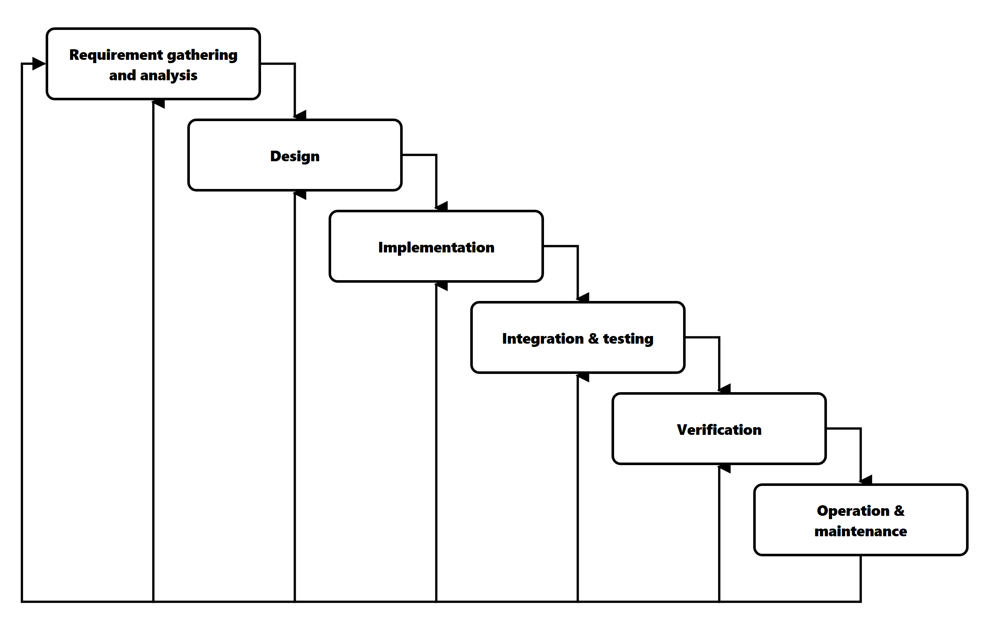

 

*Gambar 3.1 Tahapan Metode SDLC Waterfall [30]*  

 

Berdasarkan Gambar 3.1, pengembangan sistem dimulai dari tahap *requirement gathering and analysis* untuk menghimpun kebutuhan operasional indekos melalui wawancara mendalam. Tahap kedua adalah *design*, yakni menyusun rancangan tampilan antarmuka, alur kerja sistem, serta skema basis data. Rancangan tersebut selanjutnya diterjemahkan pada tahap *implementation* dengan menulis kode program menggunakan *framework* Laravel dan mengintegrasikan *payment gateway* Midtrans. Begitu seluruh modul selesai dibangun, proses masuk ke tahap *integration & testing* serta *verification* melalui pengujian *black box testing*. Pengujian ini memastikan setiap fitur dan transaksi pembayaran sewa berjalan bebas kendala. Tahap terakhir, *operation & maintenance*, meliputi pengunggahan aplikasi ke *server hosting*, pemantauan operasional harian, serta perbaikan berkala apabila ditemukan kendala teknis.

 

## 3.6 Kerangka Pemikiran
Kerangka pemikiran dalam penelitian ini disusun mengikuti alur pendekatan *Research and Development* (R&D) untuk menghasilkan produk sistem informasi yang teruji bagi Asri Boarding House. Melalui kerangka ini, berbagai kendala operasional di lapangan dihubungkan secara terukur dengan solusi perancangan aplikasi berbasis web, mulai dari identifikasi masalah hingga evaluasi akhir.

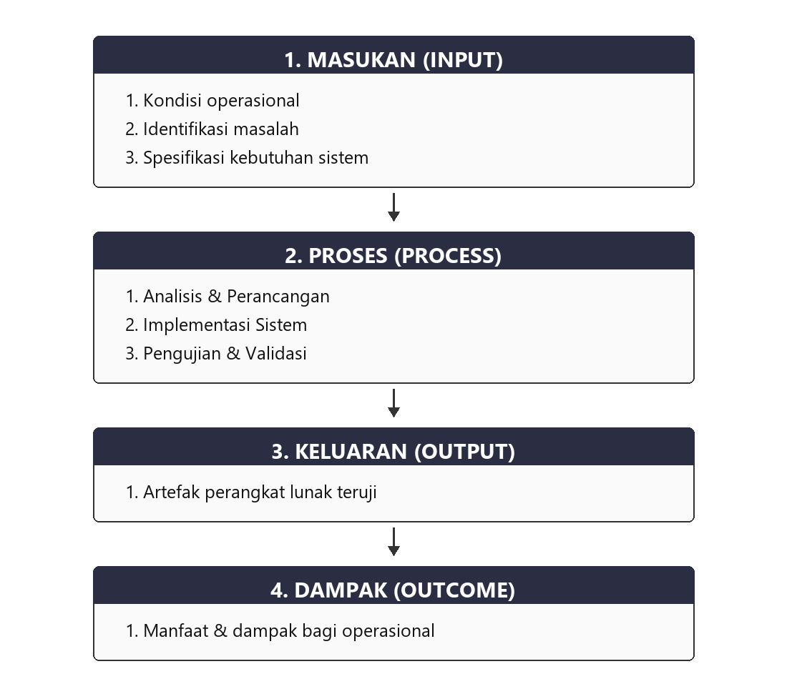

 

*Gambar 3.2 Kerangka Pemikiran Penelitian*  

 

Sebagaimana ditunjukkan pada Gambar 3.2, alur penelitian dimulai dari bagian masukan (*input*) yang merangkum kondisi operasional indekos, masalah pencatatan manual, serta rincian kebutuhan sistem. Bagian kedua adalah proses (*process*), yang mencakup tahapan analisis dan perancangan, penulisan kode program, hingga pengujian fitur aplikasi. Seluruh tahapan tersebut menghasilkan keluaran (*output*) berupa perangkat lunak manajemen kost yang telah teruji dan siap dioperasikan. Pada bagian akhir, dampak (*outcome*) penelitian ini terlihat dari tertatanya pembukuan kas serta makin praktisnya proses pembayaran sewa bagi penjaga maupun penghuni kost.

 

## BAB 4 HASIL DAN PEMBAHASAN

 

## 4.1 Perancangan Aplikasi

 

### 4.1.1 Use Case Diagram
*Use case diagram* memetakan fungsionalitas Sistem Informasi Manajemen Kost Asri Boarding House dengan memvisualisasikan batas operasional dan hubungan antarpengguna terhadap layanan web. Pembagian hak akses serta cakupan tindakan yang dapat dilakukan pengguna terangkum pada Gambar 4.1.

 

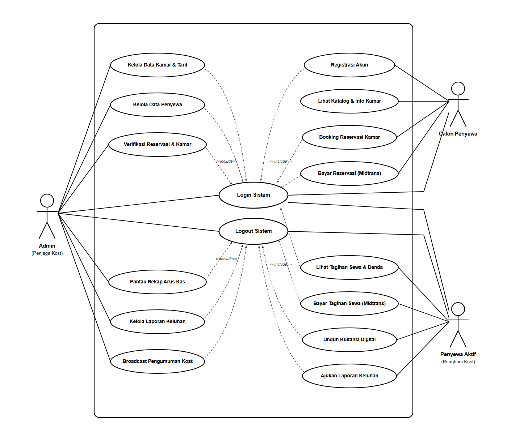

 

*Gambar 4.1 Use Case Diagram*  

 

Berdasarkan Gambar 4.1 tersebut, operasional sistem informasi ini melibatkan tiga aktor utama dengan peran serta hak akses yang berbeda. Ketiga pengguna yang saling terhubung di dalam ekosistem hunian ini mencakup calon penyewa, admin atau penjaga kost, serta penyewa aktif.

1. Calon Penyewa  
Calon penyewa bertindak selaku pengunjung publik yang menelusuri katalog kamar, ketersediaan unit kosong, dan rincian fasilitas Asri Boarding House melalui situs web. Setelah memilih tipe hunian yang diminati, pemesan mendaftarkan akun untuk melengkapi berkas reservasi tanpa wajib datang ke lokasi. Tahap pemesanan dituntaskan lewat penyetoran uang muka melalui gerbang Midtrans guna mengunci unit hunian dari benturan pesanan lain.

2. Admin (Penjaga Kost)  
Admin atau penjaga kost mengendalikan operasional harian guna mengawasi aktivitas hunian dan memastikan keterisian 32 unit kamar terdata akurat. Pengelola bertugas memperbarui tarif kamar, memvalidasi identitas penghuni baru, serta mengatur parameter penagihan sewa bulanan. Menu keuangan terpadu membantu penjaga kost memantau status pelunasan sewa tanpa perlu memeriksa mutasi rekening bank manual. Selain tugas administratif, pengelola menindaklanjuti tiket kerusakan fasilitas yang dilaporkan penghuni agar pemeliharaan sarana indekos lekas tertangani.

3. Penyewa Kost (Penyewa Aktif)  
Penyewa aktif menempati kamar sewa resmi dan memegang kredensial khusus untuk masuk ke portal layanan pribadi. Setiap awal periode penagihan, penghuni dapat memeriksa rincian invoice bulanan beserta jadwal jatuh tempo dengan transparan. Pelunasan tagihan sewa maupun denda dapat diselesaikan lewat kanal pembayaran digital yang menerbitkan tanda terima elektronik usai transaksi terverifikasi. Penghuni juga memperoleh fasilitas penyampaian kendala fasilitas kamar untuk diteruskan ke meja kerja penjaga kost.

 

### 4.1.2 Entity Relationship Diagram (ERD)
*Entity Relationship Diagram* (ERD) memodelkan struktur logis dan keterkaitan antartabel dalam basis data relasional Asri Boarding House. Hubungan antarentitas penyusun sistem beserta derajat relasinya diilustrasikan pada Gambar 4.2.

 

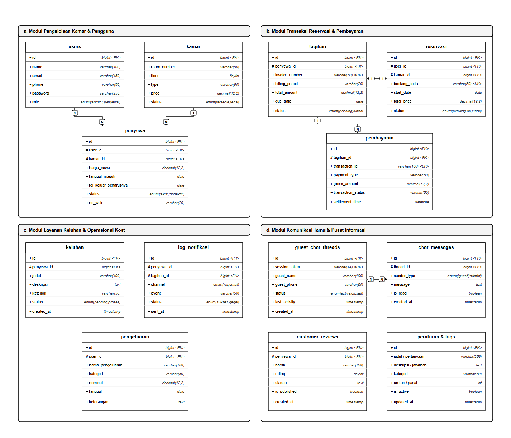

 

*Gambar 4.2 Entity Relationship Diagram (ERD)*  

 

Skema basis data pada Gambar 4.2 dirangkum ke dalam empat modul fungsional agar 22 tabel yang tersedia tetap mudah dipahami relasinya. Pengelompokan ini memisahkan tata kelola master hunian, siklus transaksi, penanganan kendala kamar, dan pusat komunikasi pengunjung.

1. Modul Pengelolaan Kamar dan Pengguna  
Tata kelola master hunian bertumpu pada relasi tabel *users*, *kamar*, serta tabel penghubung *penyewa*. Tabel *users* memuat kredensial akun pengelola dan penghuni, sementara tabel *kamar* mendata 32 unit kamar lengkap dengan tipe dan tarif sewanya. Keterikatan penghuni dengan unit yang ditempati dikunci lewat tabel *penyewa* guna menjamin keabsahan masa kontrak tinggal.

2. Modul Transaksi Reservasi dan Pembayaran  
Arus perputaran biaya sewa dikoordinasikan lewat tabel *reservasi*, *tagihan*, serta *pembayaran*. Pemesanan unit oleh calon penyewa masuk ke tabel *reservasi* sebelum sistem menerbitkan tagihan berkala pada tabel *tagihan*. Transaksi pelunasan via Midtrans tercatat langsung di tabel *pembayaran* tanpa perlu verifikasi mutasi bank manual.

3. Modul Layanan Keluhan dan Operasional Kost  
Layanan kenyamanan penghuni dan pembukuan kas dikelola melalui tabel *keluhan*, *log_notifikasi*, serta tabel *pengeluaran*. Tiket gangguan fasilitas kamar dicatat ke tabel *keluhan* agar penjaga kost segera mengambil tindakan perbaikan fisik. Riwayat pesan pengingat jatuh tempo dihimpun pada tabel *log_notifikasi* untuk mengontrol pengiriman notifikasi WhatsApp maupun surel.

4. Modul Komunikasi Tamu dan Pusat Informasi  
Interaksi pengunjung luar diakomodasi melalui tabel *guest_chat_threads*, *chat_messages*, *customer_reviews*, serta tabel *peraturan* dan *faqs*. Calon penyewa dapat menanyakan ketersediaan kamar lewat obrolan interaktif sebelum memutuskan untuk memesan kamar. Tabel tata tertib dan ulasan penghuni menyajikan pedoman sewa serta testimoni kepuasan pada beranda situs web indekos.

 

### 4.1.3 Activity Diagram
*Activity diagram* memodelkan dinamika proses bisnis dan aliran interaksi antaraktor dalam Sistem Informasi Manajemen Kost Asri Boarding House. Alur aktivitas ini disusun terpisah mengikuti peran pengguna agar pembagian hak akses serta pertukaran datanya tetap tertib. Rangkaian prosedur kerja sistem website bagi calon penyewa, admin atau penjaga kost, dan penyewa aktif diuraikan berturut-turut melalui Gambar 4.3, Gambar 4.4, serta Gambar 4.5.

 

1. Calon Penyewa  
Alur aktivitas calon penyewa berfokus pada kemudahan memesan unit kamar secara mandiri tanpa harus datang langsung ke lokasi. Proses ini memadukan pemilihan kamar dari katalog, verifikasi data sewa, hingga pelunasan uang muka lewat gerbang pembayaran digital. Rangkaian tahapan interaksi calon penyewa dengan sistem web dan layanan eksternal dapat dicermati pada Gambar 4.3.

 

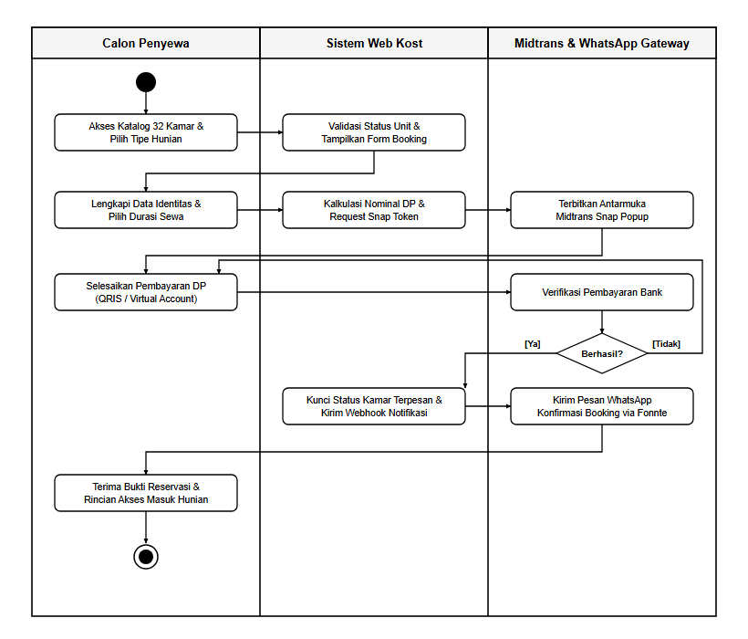

 

*Gambar 4.3 Activity Diagram Calon Penyewa*  

 

Diagram pada Gambar 4.3 memperlihatkan proses awal saat calon penyewa memilih salah satu dari 32 unit kamar yang diminati. Permintaan sewa tersebut diverifikasi oleh aplikasi sebelum meneruskan token pembayaran ke peladen Midtrans Snap. Transaksi diselesaikan melalui kanal transfer perbankan atau dompet digital hingga status pembayaran terkonfirmasi lunas. Keberhasilan setoran ini mengunci status unit kamar di basis data sekaligus memicu pengiriman bukti reservasi via WhatsApp Fonnte.

 

2. Admin (Penjaga Kost)  
Aktivitas admin atau penjaga kost mencakup kendali penuh atas tata kelola operasional indekos, mulai dari pengelolaan kamar hingga pembukuan keuangan. Sistem membantu pengelola memverifikasi data penghuni baru, memantau pembayaran sewa secara langsung, serta menindaklanjuti laporan keluhan fasilitas. Diagram alir aktivitas penjaga kost dalam menjalankan fungsi manajerial harian ditampilkan pada Gambar 4.4.

 

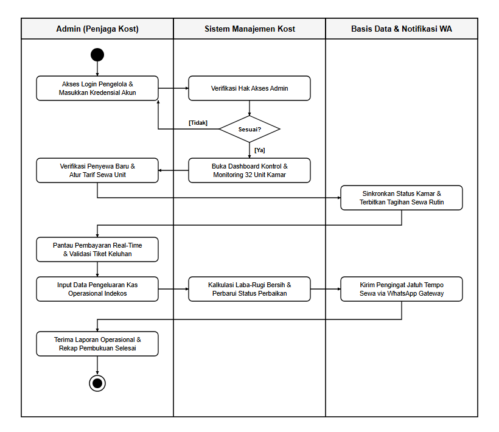

 

*Gambar 4.4 Activity Diagram Admin (Penjaga Kost)*  

 

Alur kerja pengelola pada Gambar 4.4 dimulai dari proses autentikasi akun ke antarmuka khusus penjaga kost. Melalui dasbor kontrol, admin memantau okupansi 32 unit kamar, memperbarui tarif sewa, dan memvalidasi calon penghuni baru. Aplikasi menyelaraskan status hunian ke basis data lalu menerbitkan tagihan bulanan yang diteruskan otomatis ke WhatsApp penyewa. Pengelola kemudian memverifikasi riwayat pembayaran masuk serta mencatat pengeluaran kas rutin untuk menutup pembukuan bulanan.

 

3. Penyewa Aktif  
Aktivitas penyewa aktif berpusat pada pemanfaatan portal layanan pribadi untuk mengelola masa sewa secara transparan. Penghuni dapat memeriksa rincian tagihan rutin, melakukan pelunasan instan melalui gerbang pembayaran digital, hingga mengajukan laporan kendala kamar. Aliran proses interaksi penghuni dengan portal sewa dan saluran pembayaran diperlihatkan pada Gambar 4.5.

 

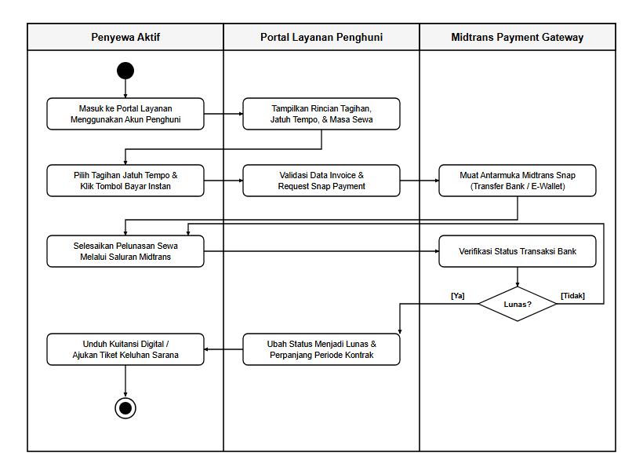

 

*Gambar 4.5 Activity Diagram Penyewa Aktif*  

 

Berdasarkan alur pada Gambar 4.5, penghuni membuka portal personal untuk meninjau tagihan sewa yang hendak jatuh tempo. Pemilihan menu bayar langsung memunculkan jendela pop-up transaksi Midtrans Snap tanpa perlu berpindah situs. Pelunasan tagihan melalui transfer perbankan maupun dompet digital seketika memperpanjang masa aktif kontrak sewa di sistem. Penghuni dapat langsung mengunduh kuitansi digital atau memanfaatkan menu bantuan jika mendapati kendala sarana kamar.

 

### 4.1.4 Flowchart Sistem
*Flowchart* sistem memetakan urutan logika kerja dan keterhubungan antarproses pada Sistem Informasi Manajemen Kost Asri Boarding House yang telah dibangun. Bagan alir ini merangkum transisi tahapan mulai dari interaksi awal calon penyewa, verifikasi transaksi pembayaran otomatis, hingga penanganan akhir oleh penjaga kost. Rangkaian aliran data dan prosedur operasional sistem website terpetakan secara runtut pada Gambar 4.6.

 

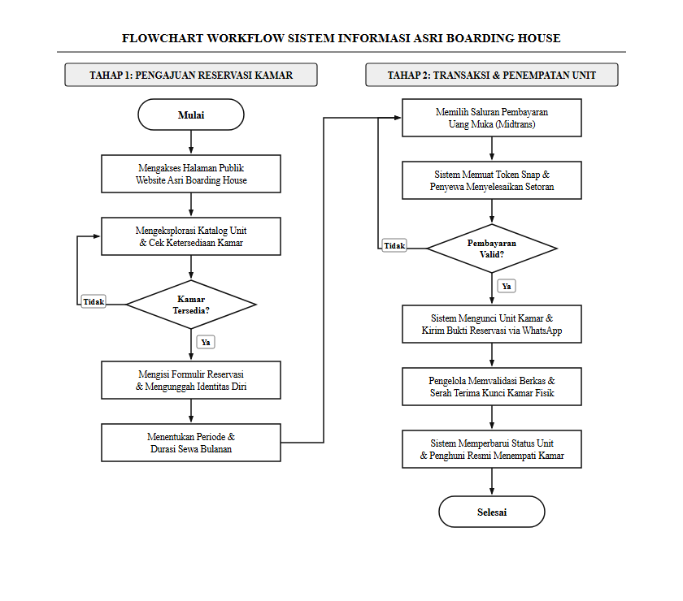

 

*Gambar 4.6 Flowchart Sistem*  

 

Merujuk pada Gambar 4.6, alur kerja diawali saat calon penyewa mengakses halaman publik website Asri Boarding House guna memeriksa ketersediaan 32 unit kamar. Apabila kamar yang diminati masih tersedia, pemesan melengkapi formulir reservasi, mengunggah data identitas diri, serta menentukan durasi sewa bulanan. Sistem kemudian memandu pemesan ke menu pembayaran Midtrans untuk memilih saluran transfer perbankan atau dompet digital tanpa kendala. Setelah setoran diproses, admin bersama sistem memvalidasi transaksi, di mana pembayaran yang belum berhasil akan diarahkan kembali ke pemilihan metode bayar. Transaksi yang terkonfirmasi valid memicu sistem mengunci unit kamar di basis data sekaligus menerbitkan bukti reservasi resmi melalui pesan WhatsApp Fonnte. Alur operasional berakhir ketika penjaga kost memvalidasi berkas fisik calon penghuni saat tiba di lokasi, menyerahkan kunci kamar, dan mengaktifkan status hunian.

 

## 4.2 Implementasi Sistem

 

### 4.2.1 Implementasi Umum

1. Implementasi Antarmuka Home Page  
Halaman beranda utama berfungsi sebagai pusat informasi awal bagi masyarakat yang mencari hunian sewa di kawasan Tembalang. Antarmuka ini menampilkan identitas Asri Boarding House beserta pilihan kamar dan fasilitas penunjang yang tersedia. Calon penghuni dapat langsung menelusuri gambaran operasional indekos secara mandiri sebelum memutuskan untuk mendaftar akun sewa.

Pengguna dapat mengakses halaman ini secara langsung melalui peramban web tanpa proses login terlebih dahulu. Desain tata letak dirancang responsif agar informasi tarif sewa dan ketersediaan unit tetap nyaman dibaca lewat layar komputer maupun ponsel. Halaman ini juga memuat menu navigasi cepat menuju aturan sewa, galeri foto, serta tombol obrolan tamu. Tampilan lengkap beranda publik indekos diperlihatkan pada Gambar 4.7.

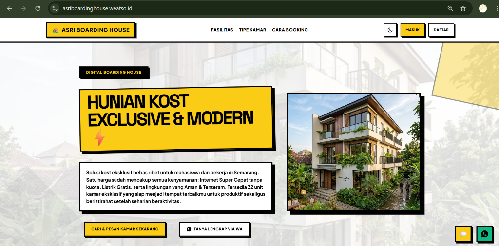

 

*Gambar 4.7 Antarmuka Halaman Beranda (Home Page)*  

Berdasarkan Gambar 4.7, bagian atas halaman memuat bilah navigasi utama yang berisi tautan menuju informasi kamar, fasilitas, cara booking, serta tombol akses akun. Sisi kiri layar menampilkan spanduk pengenalan indekos bertuliskan Hunian Kost Exclusive dan Modern yang diperkuat foto gedung fisik hunian pada sisi kanan. Kotak informasi di bawah tajuk menerangkan keunggulan sarana hunian mulai dari internet cepat hingga kepastian ketersediaan 32 unit kamar sewa. Bagian bawah spanduk menyediakan tombol aksi cepat untuk langsung mencari kamar maupun berkonsultasi lebih lanjut melalui pesan instan. Sudut kanan bawah antarmuka dilengkapi tombol obrolan tamu interaktif yang memudahkan calon penyewa berinteraksi langsung dengan pengelola kost.

 

2. Implementasi Antarmuka Fasilitas Kost  
Antarmuka fasilitas kost menyajikan sarana pendukung hunian yang dapat digunakan bersama oleh seluruh penghuni Asri Boarding House. Informasi sarana penunjang ini disajikan secara terbuka guna memberikan kejelasan mengenai kenyamanan fisik bangunan indekos. Calon penyewa dapat menimbang kelayakan tempat tinggal berdasarkan ketersediaan sarana yang ada.

Halaman ini memuat kategori fasilitas umum seperti dapur bersama, area parkir kendaraan, jaringan internet nirkabel, dan sistem keamanan kamera pengawas. Setiap fasilitas dilengkapi keterangan ringkas mengenai aturan pemakaian dan lokasi sarana di dalam area indekos. Pengunjung cukup menggulirkan layar untuk meninjau seluruh sarana yang disediakan oleh pengelola. Rincian tampilan halaman fasilitas indekos dapat dilihat pada Gambar 4.8.

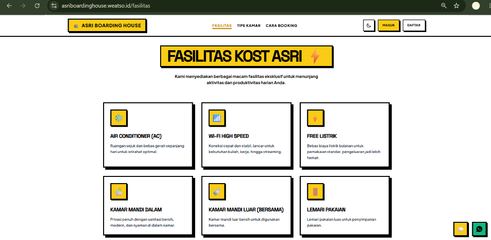

 

*Gambar 4.8 Antarmuka Daftar Fasilitas Kost*  

Berdasarkan Gambar 4.8, antarmuka fasilitas menampilkan tajuk utama Fasilitas Kost Asri berlatar kuning cerah yang dilengkapi kalimat pengantar penunjang produktivitas harian. Pada area konten, tersaji deretan kartu fasilitas eksklusif yang disusun ke dalam tiga kolom sejajar dengan bingkai garis tepi tegas. Setiap kartu memuat kotak ikon penjelas berwarna kuning, judul fasilitas seperti pendingin udara dan akses internet berkecepatan tinggi, serta deskripsi manfaat sarana. Tata letak kartu juga merinci ketersediaan pilihan kamar mandi dalam maupun kamar mandi bersama guna memberikan kepastian kenyamanan sanitasi penghuni. Pada sudut kanan bawah layar, disematkan tombol obrolan dan tautan pesan instan yang memudahkan pengunjung menanyakan sarana tertentu kepada pengelola.

 

3. Implementasi Antarmuka Tipe Kamar Kost  
Antarmuka tipe kamar kost menyajikan perbandingan spesifikasi dari 32 unit hunian yang terbagi ke dalam tipe VIP, Deluxe, dan Standar. Halaman ini memudahkan calon penyewa mengetahui perbedaan fasilitas dalam kamar, luas ruangan, dan besaran tarif sewa bulanan. Kejelasan klasifikasi ini mencegah kesalahpahaman spesifikasi hunian saat calon penyewa melakukan pemesanan jarak jauh.

Pada bagian atas katalog, tersedia bilah penyaring kategori tipe kamar serta kolom pencarian nomor unit untuk mempercepat penemuan kamar idaman. Setiap kartu kamar menampilkan foto ruangan, lantai unit, dimensi luas, rincian fasilitas penunjang, hingga label status keterisian secara dinamis. Calon penyewa dapat langsung menekan tombol pemesanan untuk unit yang kosong atau menghubungi narahubung untuk unit yang berstatus terisi. Visualisasi antarmuka perbandingan tipe dan katalog unit kamar sewa ini disajikan pada Gambar 4.9.

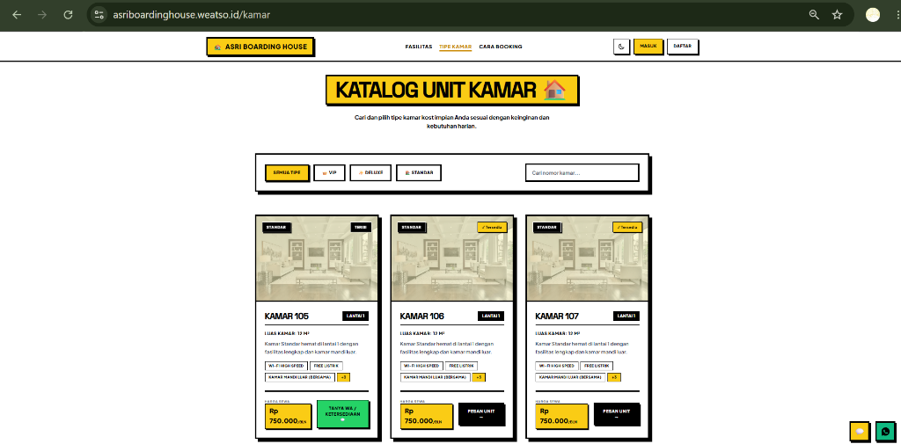

 

*Gambar 4.9 Antarmuka Tipe dan Spesifikasi Kamar Kost*  

Berdasarkan Gambar 4.9, antarmuka menampilkan tajuk Katalog Unit Kamar berlatar kuning cerah dengan ilustrasi ikon rumah serta deskripsi pemilih hunian. Tepat di bawah tajuk, tersedia panel kontrol interaktif yang memuat tombol penyaring kategori Semua Tipe, VIP, Deluxe, dan Standar, berdampingan dengan kolom pencarian nomor kamar. Bagian utama menyajikan deretan kartu unit kamar bergaris tepi hitam tegas yang memperlihatkan foto interior, label tipe Standar, penanda lantai, serta dimensi luas ruangan sebesar 12 meter persegi. Informasi fasilitas seperti koneksi internet cepat, listrik gratis, dan kamar mandi luar dirangkum dalam bentuk lencana persegi panjang kecil di atas label harga sewa bulanan. Setiap kartu juga memuat penanda status keterisian unit yang membedakan ketersediaan kamar, lengkap dengan tombol pesan unit berwarna hitam atau tombol hijau untuk bertanya melalui WhatsApp.

 

4. Implementasi Antarmuka Galeri Kost  
Antarmuka galeri kost mendokumentasikan kondisi fisik bangunan dan lingkungan Asri Boarding House melalui media foto nyata. Dokumentasi visual ini memberikan gambaran asli situasi indekos bagi calon mahasiswa maupun pekerja luar kota yang belum sempat berkunjung langsung. Kehadiran foto lapangan yang transparan dapat meningkatkan rasa percaya calon penyewa terhadap kredibilitas pengelola kost.

Pengunjung dapat memanfaatkan kolom pencarian kata kunci untuk menyaring dokumentasi fasilitas spesifik seperti kamar, dapur, internet, maupun tipe hunian. Setiap foto disajikan dalam kartu berbingkai tegas yang dilengkapi tombol pratinjau resolusi tinggi serta tombol konsultasi langsung via WhatsApp. Navigasi tombol di sudut kiri atas memudahkan calon penyewa kembali ke halaman beranda tanpa perlu menekan tombol mundur peramban. Tampilan susunan album foto lingkungan dan fasilitas indekos diperlihatkan pada Gambar 4.10.

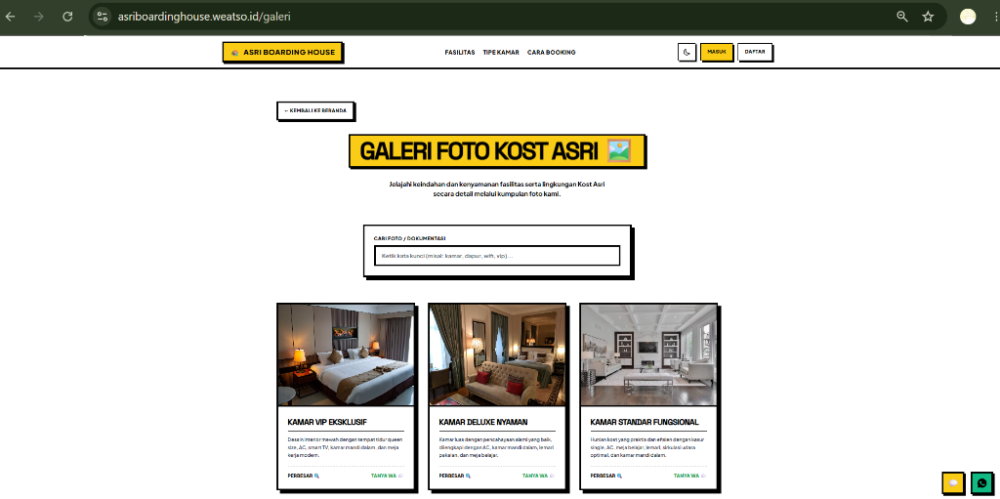

 

*Gambar 4.10 Antarmuka Galeri Foto Kost*  

Berdasarkan Gambar 4.10, halaman menampilkan tajuk Galeri Foto Kost Asri berlatar kuning cerah dengan ilustrasi bingkai lukisan serta keterangan ringkas jelajah fasilitas. Di atas tajuk utama, terpasang tombol navigasi berbingkai tebal untuk kembali ke halaman beranda secara cepat. Area pencarian dilengkapi panel berlabel Cari Foto atau Dokumentasi yang memuat formulir masukan kata kunci untuk memfilter gambar berdasarkan kategori tertentu. Bagian galeri tersusun ke dalam tiga kartu foto yang memperlihatkan visual nyata Kamar VIP Eksklusif, Kamar Deluxe Nyaman, dan Kamar Standar Fungsional dengan penataan interior masing-masing. Pada bagian bawah setiap kartu, tercantum deskripsi spesifikasi ruangan serta sepasang tombol aksi untuk memperbesar foto dan menanyakan ketersediaan melalui aplikasi perpesanan WhatsApp.

 

5. Implementasi Antarmuka Alur Cara Reservasi  
Antarmuka alur cara reservasi menyajikan pedoman praktis bagi calon penyewa baru mengenai tahapan memesan kamar secara mandiri melalui situs web. Halaman edukasi ini disusun secara berurutan agar pengguna tidak merasa bingung saat pertama kali menggunakan layanan pemesanan daring. Keterangan langkah kerja yang jelas mempermudah calon penghuni menyiapkan berkas dan menyelesaikan pembayaran tanpa kendala teknis.

Panduan pemesanan memandu calon penyewa melalui empat tahapan terstruktur mulai dari penelusuran unit kamar hingga perolehan bukti pembayaran resmi. Pengguna memperoleh kepastian mengenai keamanan transaksi perbankan digital serta mekanisme pengiriman kode akses kamar tanpa harus menunggu konfirmasi manual. Setiap kartu tahapan menyajikan ringkasan syarat praktis beserta kiat penting guna memperlancar proses administrasi sewa. Tata letak petunjuk langkah reservasi indekos dapat dicermati pada Gambar 4.11.

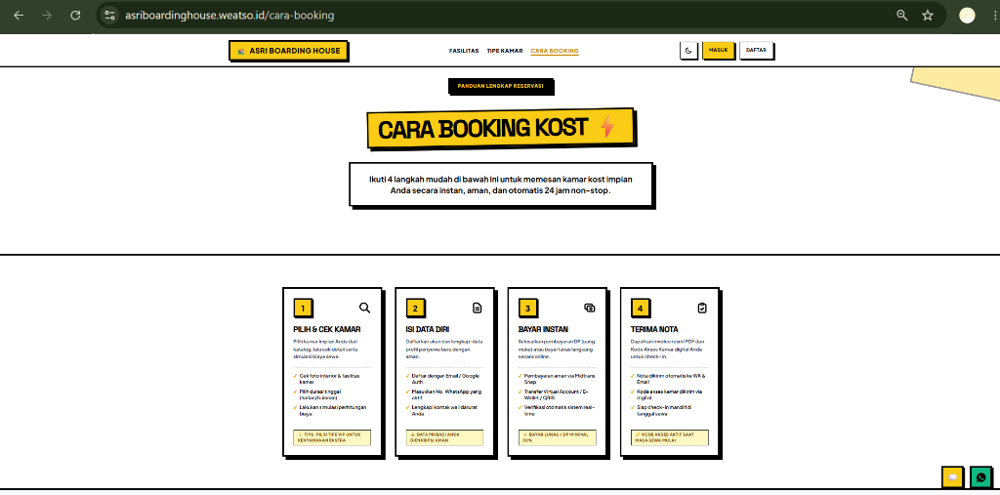

 

*Gambar 4.11 Antarmuka Panduan Alur Cara Reservasi*  

Berdasarkan Gambar 4.11, antarmuka menampilkan lencana Panduan Lengkap Reservasi di atas tajuk utama Cara Booking Kost berlatar kuning cerah dengan ikon petir. Di bawah tajuk, tertera kotak keterangan pemesanan instan yang merangkum empat tahapan alur sewa kamar selama 24 jam non-stop. Tata letak utama menyusun empat kartu vertikal bergaris tepi tebal yang memuat nomor urut, ikon representatif, judul langkah, serta deskripsi singkat proses. Rincian setiap kartu mencakup panduan penelusuran kamar, pengisian data diri dan kontak wali darurat, pembayaran instan melalui gerbang Midtrans Snap, hingga penerbitan nota digital. Bagian dasar setiap kartu dilengkapi kotak kiat khusus berwarna kuning yang menegaskan kebijakan enkripsi data, opsi pelunasan uang muka minimal 30 persen, serta aktivasi kode akses kamar saat tanggal masa sewa dimulai.

 

6. Implementasi Antarmuka Testimoni Penyewa Kost  
Antarmuka testimoni menyajikan ulasan dan tanggapan dari para penghuni yang sedang atau pernah tinggal di Asri Boarding House. Informasi pengalaman nyata ini menjadi bahan pertimbangan sosial yang berharga bagi masyarakat umum sebelum menentukan pilihan tempat tinggal. Kumpulan evaluasi penghuni juga menjadi cermin bagi pengelola untuk mempertahankan kualitas pelayanan harian.

Ulasan yang dimuat mencakup kepuasan terhadap kebersihan kamar, keramahan penjaga kost, kelancaran internet, serta rasa aman lingkungan indekos. Data ulasan dihimpun secara berkala dari penghuni aktif yang telah merasakan operasional hunian secara langsung. Pengunjung dapat membaca penilaian berupa rating bintang dan testimoni tertulis secara transparan pada halaman ini. Antarmuka daftar ulasan penghuni kost ditampilkan pada Gambar 4.12.

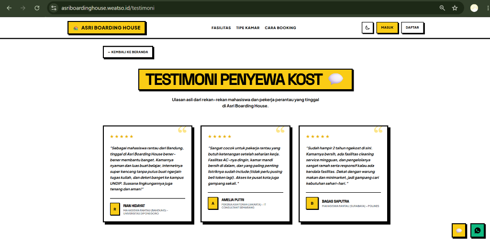

 

*Gambar 4.12 Antarmuka Testimoni dan Ulasan Penghuni*  

Berdasarkan Gambar 4.12, halaman testimoni menampilkan susunan kartu ulasan yang ditata dalam format kolom sejajar. Bagian atas kartu memuat deretan ikon bintang kuning yang menunjukkan nilai kepuasan penghuni terhadap layanan indekos. Di bawah ikon bintang, tercantum kutipan kalimat ulasan yang menceritakan pengalaman tinggal penghuni selama masa sewa berjalan. Sisi bawah kartu menampilkan inisial penghuni, tipe kamar yang ditempati, serta tanggal publikasi ulasan tersebut. Seluruh kartu didesain dengan latar belakang cerah dan pembatas bayangan tipis untuk memberikan keterbacaan teks yang optimal bagi pembaca.

 

7. Implementasi Antarmuka FAQ  
Antarmuka FAQ menyajikan daftar jawaban resmi atas pertanyaan yang paling sering diajukan oleh calon penyewa indekos. Halaman ini memangkas waktu pengelola dalam menjawab pertanyaan umum yang berulang seputar jam malam, biaya tambahan, dan aturan tamu. Calon penghuni memperoleh kepastian informasi secara instan tanpa perlu menunggu balasan pesan manual dari penjaga kost.

Daftar tanya jawab mencakup topik kebijakan membawa kendaraan, ketersediaan kasur tambahan, periode pembayaran sewa bulanan, dan prosedur pembatalan reservasi. Teks pertanyaan disusun menggunakan model akordeon interaktif yang dapat dibuka dan ditutup sesuai minat baca pengunjung. Penerapan model akordeon ini menjaga tampilan layar tetap rapi dan tidak terlalu panjang saat dibaca di ponsel. Tampilan antarmuka pusat pertanyaan umum tersebut diperlihatkan pada Gambar 4.13.

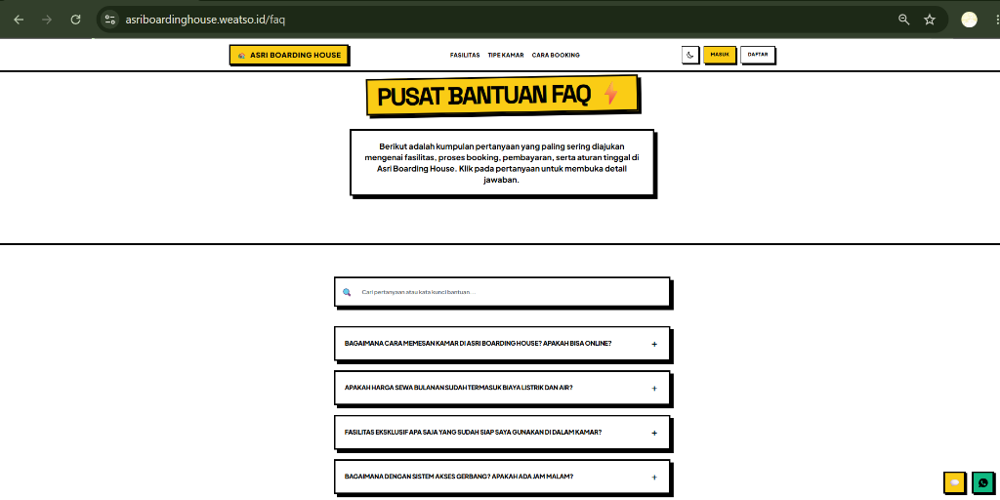

 

*Gambar 4.13 Antarmuka Pertanyaan Umum (FAQ)*  

Berdasarkan Gambar 4.13, daftar pertanyaan disusun secara vertikal dalam wadah bilah yang dapat ditekan untuk membuka rincian jawaban. Setiap bilah memuat kalimat pertanyaan dengan teks tebal serta tanda panah navigasi pada sudut kanan bilah. Ketika bilah ditekan, teks jawaban muncul dengan animasi pergeseran halus tepat di bawah pertanyaan yang bersangkutan. Pengelompokan topik pertanyaan diberi label penanda kategori seperti aturan tinggal, mekanisme pembayaran, dan sarana umum. Desain halaman dibuat bersih dengan jarak spasi yang lebar agar pengguna leluasa menemukan jawaban atas kendala yang ingin diketahui.

 

8. Implementasi Antarmuka Tentang Kami  
Antarmuka tentang kami memuat informasi profil usaha, visi pelayanan, dan letak geografis Asri Boarding House di kawasan Tembalang, Kota Semarang. Halaman ini menjelaskan latar belakang berdirinya indekos serta komitmen pengelola dalam menyediakan lingkungan belajar yang tenang bagi mahasiswa. Keterbukaan profil usaha ini memperkuat rasa aman bagi orang tua yang hendak menitipkan anaknya tinggal di indekos.

Selain narasi profil, halaman ini dilengkapi rincian alamat fisik yang terhubung langsung dengan peta digital interaktif Google Maps. Calon penyewa dapat meninjau jarak indekos menuju kampus terdekat, fasilitas kesehatan, swalayan, serta akses jalan raya utama. Pengunjung juga dapat menemukan nomor kontak resmi pengelola dan jam operasional pelayanan penerimaan tamu di lokasi. Antarmuka profil lengkap indekos ini diperlihatkan pada Gambar 4.14.

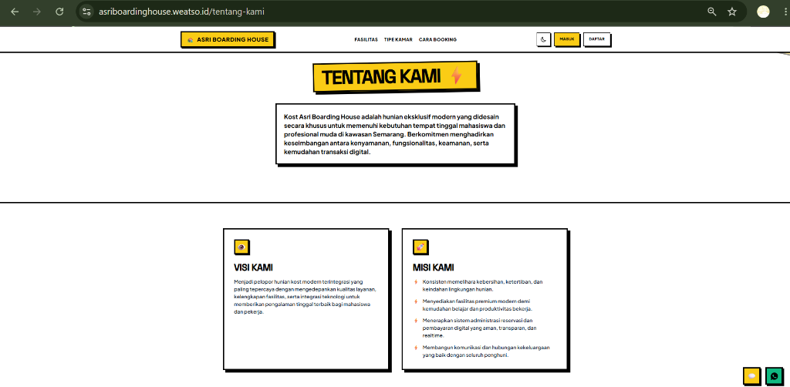

 

*Gambar 4.14 Antarmuka Halaman Tentang Kami*  

Berdasarkan Gambar 4.14, tata letak halaman terbagi ke dalam bagian narasi profil pada sisi atas dan sematan peta digital pada sisi bawah. Narasi profil memaparkan sejarah singkat bangunan kost dan jumlah 32 unit kamar yang dikelola secara profesional. Kotak informasi pada sisi samping memuat baris alamat jalan, kode pos, nomor telepon pengelola, serta tautan menuju media sosial indekos. Sematan peta interaktif memungkinkan pengguna memperbesar dan menggeser peta jalan guna melihat rute perjalanan menuju lokasi fisik indekos. Desain keseluruhan halaman memanfaatkan tipografi rapi dengan penataan teks terpusat yang mencerminkan profil usaha hunian yang terpercaya.

 

9. Implementasi Antarmuka Login User  
Antarmuka login user merupakan pintu masuk otentikasi bagi calon penyewa maupun penghuni terdaftar untuk mengakses portal layanan web indekos. Formulir ini melindungi data pribadi dan catatan transaksi sewa dari akses pihak yang tidak memiliki hak operasional. Verifikasi kredensial akun menjamin bahwa setiap interaksi sewa dijalankan oleh pemilik akun yang sah.

Pengguna diminta memasukkan alamat surel dan kata sandi yang telah didaftarkan pada basis data sistem. Formulir ini diproteksi oleh token CSRF dan pembatasan frekuensi percobaan masuk guna mencegah serangan peretasan kata sandi secara berulang. Apabila kata sandi cocok, sistem membaca hak akses pengguna dan mengarahkannya langsung ke dasbor layanan yang sesuai. Tampilan antarmuka masuk akun pengguna tersebut disajikan pada Gambar 4.15.

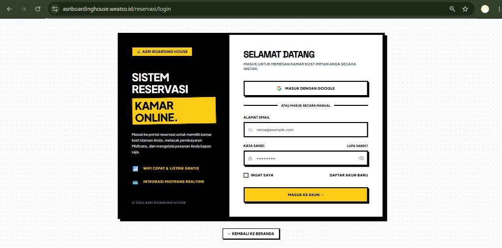

 

*Gambar 4.15 Antarmuka Halaman Login Pengguna*  

Berdasarkan Gambar 4.15, kotak formulir login ditempatkan tepat di tengah layar dengan latar belakang bersih berbingkai tegas. Bidang isian surel dan kata sandi dilengkapi label penunjuk yang jelas serta ikon mata untuk memeriksa ketepatan ketikan sandi. Di bawah bidang kata sandi, tersedia tautan lupa kata sandi yang dapat digunakan pengguna untuk memulihkan akses akun lewat surel. Tombol masuk akun didesain menggunakan warna kontras dengan teks tebal agar langsung terlihat oleh pengguna saat halaman terbuka. Sisi bawah kotak formulir menyediakan tautan alternatif yang mengarahkan calon pengguna baru ke halaman pendaftaran akun sewa.

 

10. Implementasi Antarmuka Register User  
Antarmuka register user berfungsi sebagai formulir pembuatan akun baru bagi masyarakat yang ingin menyewa kamar di Asri Boarding House. Pendaftaran akun ini menjadi langkah awal sebelum calon penyewa diizinkan memilih kamar dan mengajukan jadwal masa sewa. Data akun yang tersimpan menjadi dasar identifikasi pengguna di seluruh alur transaksi sistem web indekos.

Calon pengguna mengisi data awal berupa nama lengkap, alamat surel aktif, nomor telepon seluler, dan membuat kata sandi baru. Sistem secara otomatis memeriksa keunikan alamat surel di basis data untuk mencegah duplikasi akun oleh orang yang sama. Kata sandi yang dimasukkan langsung dienkripsi menggunakan algoritma Bcrypt sebelum disimpan pada tabel pengguna. Formulir pendaftaran akun calon penyewa ini ditampilkan pada Gambar 4.16.

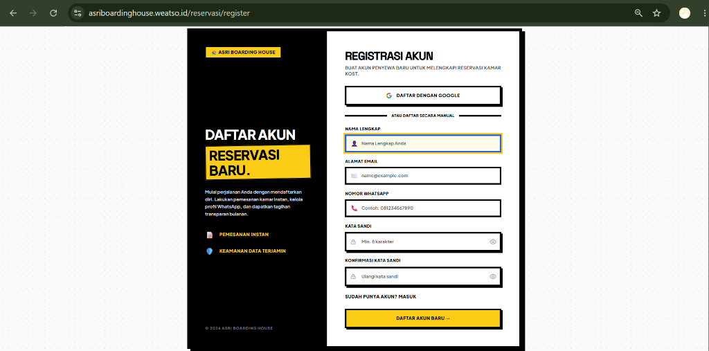

 

*Gambar 4.16 Antarmuka Halaman Pendaftaran Akun (Register)*  

Berdasarkan Gambar 4.16, formulir registrasi menampilkan kartu isian vertikal dengan urutan kolom yang sistematis dari atas ke bawah. Setiap kolom isian dilengkapi petunjuk format teks serta pesan kesalahan otomatis jika terdapat kolom wajib yang belum terisi. Di bawah kolom kata sandi, terdapat indikator kekuatan sandi guna mengingatkan pengguna untuk menyusun kombinasi karakter yang aman. Terdapat kotak centang persetujuan syarat dan ketentuan sewa yang wajib ditandai sebelum tombol daftar dapat ditekan. Tombol daftar akun menggunakan aksen warna hijau mencolok dengan label teks tegas yang menandakan kesiapan pemrosesan data akun baru.

 

11. Implementasi Antarmuka Chat Real Time Guest  
Antarmuka obrolan langsung tamu (*chat real time guest*) menyediakan media komunikasi interaktif dua arah antara pengunjung publik dengan pengelola indekos. Fitur ini membantu calon penyewa menanyakan ketersediaan kamar tertentu tanpa harus menyimpan nomor telepon pribadi pengelola. Obrolan daring yang responsif memangkas keraguan calon penyewa saat hendak memesan hunian jarak jauh.

Widget percakapan ini dapat dibuka dari sudut layar pada seluruh halaman publik situs web Asri Boarding House. Tamu cukup memasukkan nama dan nomor kontak singkat untuk memulai sesi percakapan baru pada sistem. Pesan yang dikirim tamu tersimpan pada tabel riwayat pesan basis data dan langsung memunculkan notifikasi di meja kerja admin. Antarmuka jendela obrolan langsung tamu publik ini diperlihatkan pada Gambar 4.17.

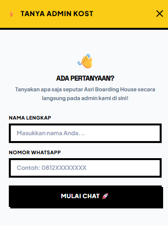

 

*Gambar 4.17 Antarmuka Fitur Chat Real Time Pengunjung*  

Berdasarkan Gambar 4.17, jendela obrolan tampil sebagai panel layang pada sudut kanan bawah layar peramban web. Bagian tajuk panel memuat status keaktifan pengelola kost dan tombol tanda silang untuk menutup jendela percakapan. Ruang obrolan di bagian tengah menampilkan gelembung pesan masuk dan keluar yang dibedakan dengan warna latar gelembung kontras. Pada bagian dasar jendela, terdapat kolom input pesan teks yang berdampingan dengan tombol kirim berikon panah kirim. Panel obrolan dirancang dengan proporsi ukuran kompak agar tidak menutupi konten informasi utama yang sedang dibaca pengunjung web.

 

### 4.2.2 Implementasi Calon Penyewa

1. Implementasi Antarmuka Lengkapi Profil  
Antarmuka lengkapi profil berfungsi menghimpun berkas identitas resmi calon penyewa sebelum sistem mengizinkan proses pemesanan kamar sewa. Verifikasi identitas ini menjadi prasyarat keamanan penting bagi pengelola guna memastikan seluruh calon penghuni indekos terdata secara sah. Langkah pendataan ini mencegah penggunaan akun anonim yang berisiko mengganggu ketertiban lingkungan hunian kost.

Calon penghuni diminta melengkapi nomor induk kependudukan, alamat asal, nomor kontak darurat keluarga, serta mengunggah foto kartu identitas fisik. Sistem memvalidasi kelengkapan berkas yang diunggah dan memastikan format berkas berupa gambar yang terbaca jelas. Pengisian data darurat keluarga diperlukan agar penjaga kost dapat segera menghubungi wali jika terjadi keadaan darurat di kamar sewa. Tampilan antarmuka pengisian kelengkapan profil pemesan disajikan pada Gambar 4.18.

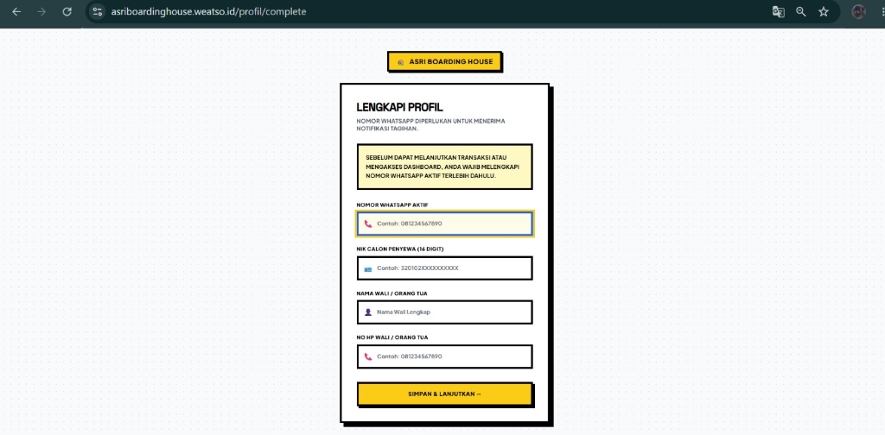

 

*Gambar 4.18 Antarmuka Pengisian Kelengkapan Profil Pemesan*  

Berdasarkan Gambar 4.18, antarmuka menampilkan formulir terstruktur yang terbagi ke dalam bagian identitas pribadi dan bagian data kontak keluarga. Kolom isian NIK dan nomor kontak dilengkapi batas panjang digit otomatis untuk mencegah kesalahan ketik pengguna. Kotak unggah foto KTP menyediakan area pratinjau langsung yang menampilkan gambar kartu identitas sesaat setelah berkas dipilih. Label bertanda bintang merah menandakan bahwa seluruh kolom isian bersifat wajib untuk diselesaikan sebelum formulir dapat disimpan. Tombol simpan data profil diletakkan pada sudut kanan bawah formulir dengan ukuran yang cukup besar untuk memudahkan penekanan tombol.

 

2. Implementasi Antarmuka Dashboard Reservasi  
Antarmuka dashboard reservasi menjadi portal utama bagi calon penyewa untuk memantau status pesanan kamar yang sedang diproses oleh sistem. Halaman ini memberikan kejelasan informasi mengenai tahapan reservasi yang telah diselesaikan maupun yang masih tertunda. Calon penghuni dapat melihat batas waktu penyelesaian pembayaran sewa tanpa perlu menanyakan status pemesanan secara manual.

Dasbor menampilkan kartu ringkasan unit kamar yang dipilih, tanggal pengajuan sewa, dan lencana status transaksi seperti menunggu bayar atau berhasil diverifikasi. Jika transaksi belum diselesaikan, dasbor menyajikan tombol langsung untuk membuka jendela pembayaran digital secara instan. Calon penyewa juga dapat membatalkan pesanan kamar jika terdapat perubahan rencana jadwal tinggal di indekos. Tampilan dasbor pemantauan reservasi calon penghuni dapat dilihat pada Gambar 4.19.

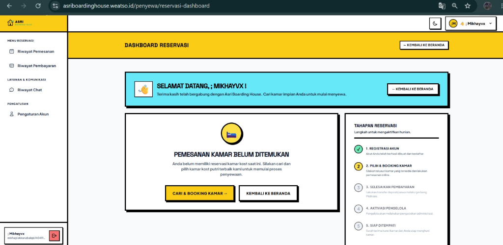

 

*Gambar 4.19 Antarmuka Dasbor Reservasi Calon Penyewa*  

Berdasarkan Gambar 4.19, bagian atas dasbor memuat salam pembuka ramah beserta nomor referensi unik pesanan kamar yang sedang aktif. Di bawah salam pembuka, terdapat kartu rincian kamar yang menampilkan foto tipe hunian, nomor unit kamar, dan durasi sewa bulanan. Lencana status transaksi ditampilkan menggunakan warna kuning mencolok untuk menandakan pesanan yang masih menunggu pelunasan uang sewa. Terdapat bilah waktu hitung mundur yang memperingatkan sisa waktu calon penyewa sebelum pesanan kamar kedaluwarsa secara otomatis. Pada bagian dasar kartu, tersedia tombol hijau untuk melanjutkan pelunasan pembayaran dan tombol merah untuk membatalkan pesanan sewa.

 

3. Implementasi Antarmuka Simulasi Biaya Kamar  
Antarmuka simulasi biaya kamar dirancang untuk menghitung estimasi pengeluaran sewa indekos secara transparan berdasarkan durasi tinggal yang diinginkan. Fitur kalkulasi otomatis ini mempermudah calon penghuni merencanakan anggaran tanpa khawatir menemui biaya tersembunyi di kemudian hari. Sistem langsung menghitung total biaya sewa dan uang jaminan secara akurat dari basis data tarif kamar.

Pengguna dapat memilih tipe kamar yang diminati, menentukan tanggal mulai tinggal, serta memilih durasi kontrak sewa bulanan. Sistem segera memproses perkalian tarif per bulan dan menambahkan biaya fasilitas tambahan jika calon penyewa memilih opsi sarana tambahan. Apabila kamar yang dipilih sedang terisi, sistem seketika memberikan peringatan visual bahwa kamar tersebut tidak dapat dipilih. Tampilan antarmuka simulasi perhitungan biaya kamar sewa diperlihatkan pada Gambar 4.20.

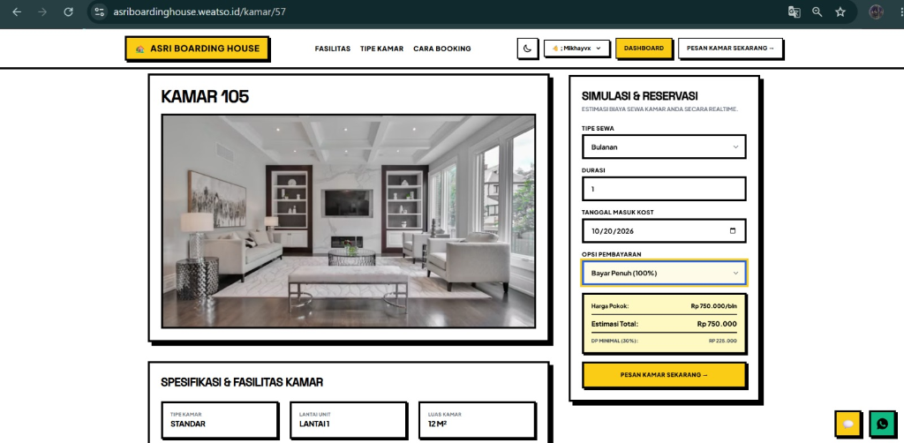

 

*Gambar 4.20 Antarmuka Simulasi Biaya dan Pemilihan Unit Kamar*  

Berdasarkan Gambar 4.20, halaman simulasi menyajikan panel interaktif yang memadukan menu pemilihan kamar dengan kalkulator biaya sewa. Kolom tanggal sewa dilengkapi kalender pemilihan tanggal yang memudahkan pengguna menentukan hari pertama mulai menempati hunian kost. Pada kotak ringkasan biaya di sisi kanan, tercantum rincian harga pokok sewa, biaya fasilitas tambahan, dan total nominal yang harus disetor. Jika pengguna mengubah pilihan durasi bulan sewa, angka total pembayaran seketika diperbarui secara otomatis tanpa memuat ulang halaman peramban. Tombol konfirmasi di bawah rincian harga mengarahkan calon penyewa langsung menuju tahapan pengisian formulir reservasi resmi.

 

4. Implementasi Antarmuka Pembayaran 5 Tahap Reservasi  
Antarmuka pembayaran 5 tahap reservasi menyusun alur pengajuan sewa kamar ke dalam formulir bertahap yang tertata runtut. Model alur bertahap ini memecah proses pendaftaran yang panjang menjadi langkah-langkah ringkas agar pengguna tidak merasa kewalahan mengisi data. Setiap langkah memandu pemesan menyelesaikan kewajiban administratif secara runtut sebelum transaksi diterbitkan.

Kelima tahap tersebut mencakup peninjauan kamar, pengisian data penghuni, konfirmasi aturan hunian, pemeriksaan ringkasan data, dan penerbitan kode pembayaran. Pengguna dapat berpindah kembali ke tahap sebelumnya untuk memeriksa ulang data sewa tanpa kehilangan ketikan yang sudah diisi. Sistem memvalidasi setiap tahap secara ketat agar tidak ada kolom penting yang terlewatkan sebelum beralih ke tahap selanjutnya. Tampilan alur 5 tahap formulir pemesanan kamar ini disajikan pada Gambar 4.21.

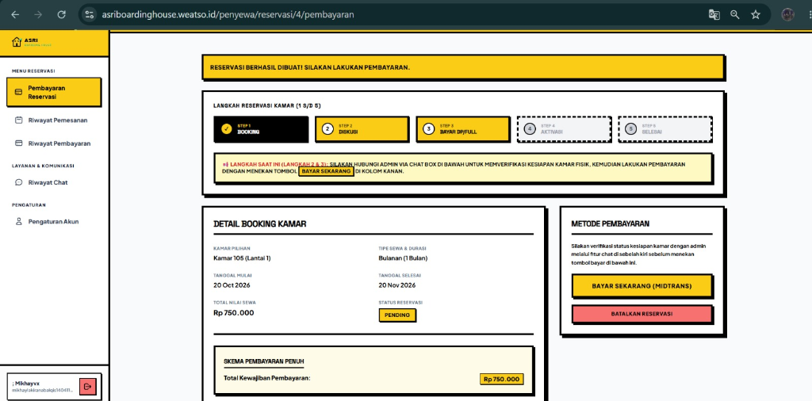

 

*Gambar 4.21 Antarmuka Alur 5 Tahap Pemesanan Kamar (Stepper Form)*  

Berdasarkan Gambar 4.21, bagian atas formulir memuat bilah kemajuan langkah yang menampilkan lingkaran nomor satu sampai lima secara berjajar. Lingkaran tahap yang sedang aktif ditandai dengan warna hijau menyala, sementara tahap yang telah selesai diberi tanda centang verifikasi. Area badan formulir menampilkan kolom data khusus sesuai tahapan yang sedang dikerjakan oleh calon penyewa. Tombol navigasi kembali dan tombol lanjut ditempatkan simetris pada sudut bawah formulir untuk memandu pergerakan pengguna. Seluruh kotak formulir dibungkus garis tepi tegas yang menjaga fokus pandangan pengguna pada proses pengisian berkas sewa.

 

5. Implementasi Payment Gateway Midtrans  
Integrasi payment gateway Midtrans memfasilitasi pelunasan uang sewa secara non-tunai melalui saluran pembayaran digital yang terverifikasi otomatis. Kehadiran gerbang pembayaran digital ini menghapus kebiasaan transfer manual ke rekening pribadi penjaga yang rawan memicu kesalahan pencatatan kas. Status keterisian kamar sewa langsung terkunci di sistem sesaat setelah dana terverifikasi oleh peladen pembayaran.

Sistem memanggil pustaka Midtrans Snap API untuk memunculkan jendela transaksi tanpa mengarahkan pengguna keluar dari situs web indekos. Calon penyewa dapat memilih metode pembayaran melalui nomor Virtual Account bank utama maupun kode pindai QRIS. Begitu pembayaran berhasil, peladen Midtrans mengirimkan notifikasi webhook ke peladen aplikasi untuk mengubah status reservasi menjadi terkonfirmasi lunas. Tampilan jendela pembayaran digital Midtrans Snap tersebut diperlihatkan pada Gambar 4.22.

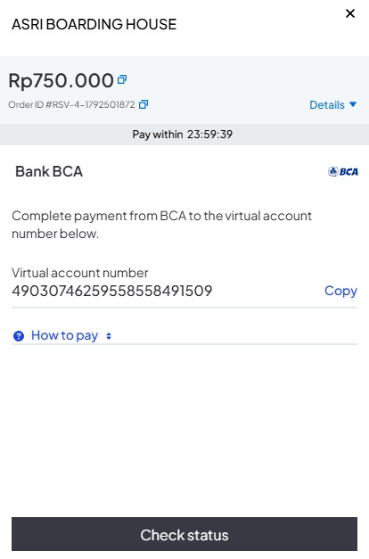

 

*Gambar 4.22 Antarmuka Jendela Pembayaran Digital Midtrans Snap*  

Berdasarkan Gambar 4.22, jendela transaksi Midtrans Snap muncul sebagai panel melayang tepat di bagian tengah layar peramban pengguna. Bagian atas panel menampilkan total nominal uang sewa yang wajib dibayar beserta batas waktu hitung mundur masa berlaku pembayaran. Di bawah nominal, tersedia daftar pilihan bank transfer seperti BCA, Mandiri, BNI, dan BRI beserta opsi pembayaran instan menggunakan QRIS. Pemilihan salah satu metode perbankan langsung memunculkan nomor rekening Virtual Account resmi yang dapat disalin dengan sekali tekan tombol. Desain jendela pembayaran mengadopsi standar tata letak resmi Midtrans yang menjamin keamanan data transaksi finansial calon penghuni.

 

6. Implementasi WhatsApp Gateway Fonnte  
Implementasi WhatsApp gateway melalui API Fonnte mengirimkan bukti konfirmasi reservasi secara otomatis langsung ke ponsel calon penyewa. Pengiriman pesan instan ini memberikan kepastian status sewa dalam hitungan detik setelah transaksi pelunasan diverifikasi oleh sistem. Calon penghuni tidak perlu menunggu konfirmasi telepon dari penjaga kost untuk memastikan unit kamar telah berhasil terkunci.

Peladen aplikasi mengirimkan perintah HTTP POST ke endpoint peladen Fonnte yang memuat token otentikasi serta pesan berformat rapi. Teks pesan mencantumkan nomor reservasi, nama pemesan, tipe kamar, tanggal mulai sewa, dan petunjuk kedatangan ke lokasi indekos. Pesan resmi ini juga menyertakan nomor telepon penjaga kost agar calon penyewa mudah berkoordinasi saat hari kedatangan tiba. Tampilan pesan notifikasi konfirmasi reservasi via WhatsApp Fonnte disajikan pada Gambar 4.23.

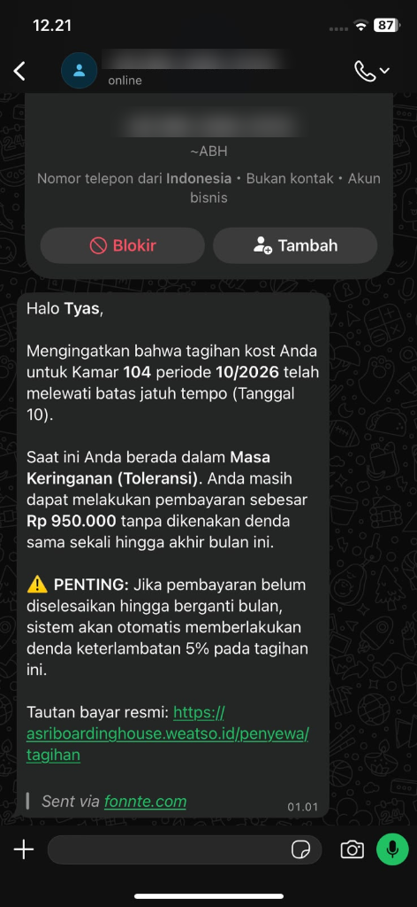

 

*Gambar 4.23 Implementasi Pesan Notifikasi Reservasi WhatsApp Fonnte*  

Berdasarkan Gambar 4.23, tangkapan layar memperlihatkan gelembung pesan masuk pada aplikasi WhatsApp di perangkat ponsel pintar calon penyewa. Bagian tajuk pesan memuat ucapan terima kasih resmi atas penyelesaian pembayaran reservasi kamar di Asri Boarding House. Badan pesan menyajikan daftar rincian transaksi yang disusun rapi menggunakan baris pemisah dan teks tebal pada poin penting. Terdapat instruksi kedatangan ke lokasi kost beserta tautan peta navigasi yang dapat ditekan langsung dari percakapan WhatsApp. Pesan dikirimkan dari akun WhatsApp resmi indekos dengan tanda waktu pengiriman yang bersamaan dengan momen pelunasan transaksi sewa.

 

7. Implementasi Email Gateway SMTP  
Implementasi email gateway berbasis protokol SMTP mendistribusikan tanda terima elektronik dan rincian kontrak sewa ke kotak masuk surel calon penyewa. Dokumen surel ini berfungsi sebagai arsip digital resmi yang dapat disimpan oleh penghuni maupun orang tua sebagai bukti transaksi yang sah. Pengiriman surel otomatis ini melengkapi pengingat pesan instan guna menjamin seluruh informasi administrasi tersampaikan tanpa kendala.

Sistem memanfaatkan layanan pengirim surel berbasis koneksi aman TLS untuk menerbitkan surat konfirmasi sesaat setelah pembayaran uang muka diterima. Surat elektronik disusun menggunakan templat HTML responsif yang memuat logo resmi indekos, rincian pembayaran, dan lembar lampiran tanda terima digital. Penerapan antrean surel (*queued mail*) pada kerangka kerja Laravel memastikan pengiriman pesan berlangsung cepat tanpa membebani kinerja peladen web. Bentuk surat elektronik konfirmasi reservasi sewa tersebut ditampilkan pada Gambar 4.24.

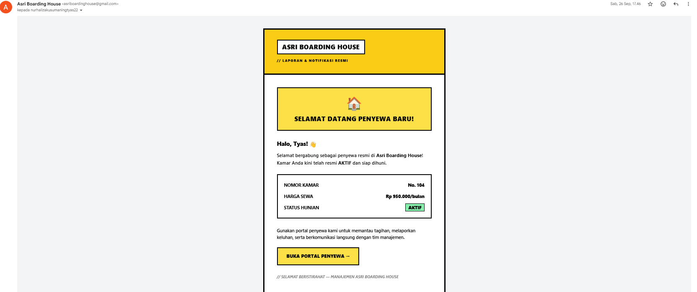

 

*Gambar 4.24 Implementasi Surat Elektronik Konfirmasi Reservasi via SMTP*  

Berdasarkan Gambar 4.24, tampilan surel menampilkan tajuk surat formal yang memuat identitas Asri Boarding House lengkap dengan logo hunian. Badan surel menyajikan tabel rincian transaksi yang menguraikan kode reservasi, nama penghuni, nomor kamar, serta status transaksi lunas. Pada sisi bawah tabel, disertakan instruksi pengambilan kunci kamar dan berkas fisik yang wajib dibawa saat tiba di lokasi indekos. Terdapat tombol tautan unduh dokumen tanda terima yang dapat disimpan pengguna dalam format dokumen siap cetak. Penataan teks surel menggunakan kombinasi warna netral dan pembagian spasi yang lapang agar rincian transaksi mudah dibaca pada berbagai aplikasi surel.

 

### 4.2.3 Implementasi Admin

1. Implementasi Antarmuka Admin Login  
Antarmuka admin login merupakan gerbang otentikasi khusus yang membatasi hak akses pengelolaan sistem hanya kepada penjaga dan pemilik kost yang sah. Pemisahan pintu masuk ini menjaga keamanan master data kamar, laporan keuangan, dan data pribadi seluruh penghuni dari manipulasi pihak luar. Hak akses administrator dikunci secara ketat oleh sistem melalui pemeriksaan peran (*role-based access control*).

Pengelola kost memasukkan nama pengguna dan kata sandi khusus yang tersimpan pada tabel otentikasi terenkripsi di basis data. Sistem menerapkan pembatasan waktu sesi login otomatis agar dasbor pengelola tertutup dengan aman saat komputer tidak digunakan dalam jangka waktu tertentu. Jika kredensial yang dimasukkan salah, sistem menolak akses secara tegas dan mencatat alamat IP percobaan masuk tersebut. Tampilan halaman masuk portal administrator ini diperlihatkan pada Gambar 4.25.

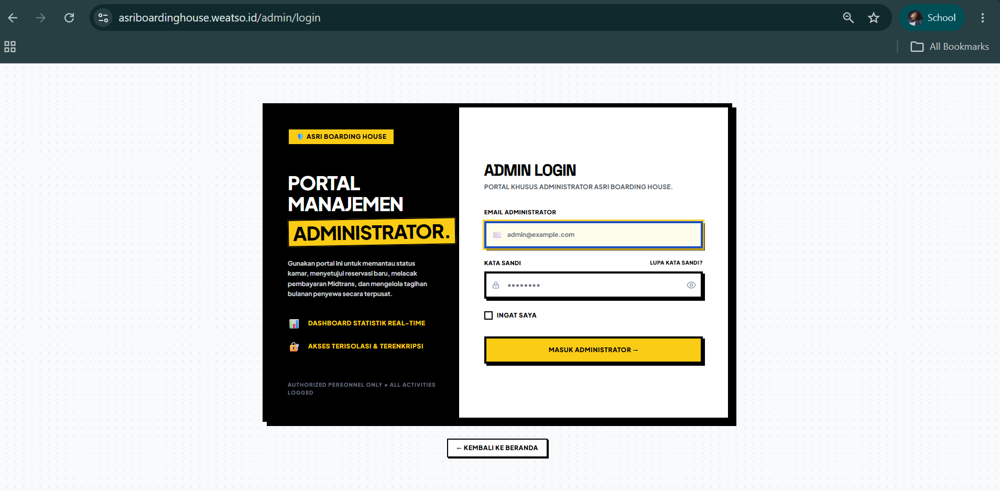

 

*Gambar 4.25 Antarmuka Halaman Login Administrator*  

Berdasarkan Gambar 4.25, formulir masuk pengelola dirancang dengan tata letak minimalis yang memusatkan kotak masuk akun di tengah layar. Bidang isian nama pengguna dan kata sandi diberi garis tepi tegas dengan indikator fokus warna hijau saat kolom sedang diketik. Pada bagian atas formulir, terpampang logo indekos berdampingan dengan label tegas yang menandakan portal khusus pengelolaan operasional kost. Tombol masuk akun menggunakan warna hijau gelap dengan label teks tebal yang memberi kesan ketegasan antarmuka manajerial. Latar belakang halaman memanfaatkan warna gelap lembut untuk mengurangi kelelahan mata pengelola yang bekerja memeriksa sistem setiap hari.

 

2. Implementasi Antarmuka Dashboard Admin  
Antarmuka dashboard admin menyajikan rangkuman analitik operasional harian mengenai keterisian 32 unit kamar dan kondisi perputaran kas di Asri Boarding House. Dasbor kontrol ini mempermudah penjaga kost mengawasi seluruh aktivitas hunian secara terpadu tanpa perlu memeriksa tumpukan buku besar manual. Penyajian metrik penting dalam satu layar mempercepat pengambilan keputusan manajerial dalam mengelola fasilitas indekos.

Halaman ini memuat kartu statistik jumlah kamar terisi, jumlah kamar kosong, total penyewa aktif, serta nominal kas masuk pada bulan berjalan. Terdapat agenda kalender jatuh tempo yang menandai kamar mana saja yang mendekati tanggal pembayaran sewa bulanan. Pengelola dapat langsung melompat ke modul menu lain melalui bilah navigasi samping yang selalu tersedia di sisi kiri layar. Visualisasi dasbor pengawasan operasional admin indekos ini disajikan pada Gambar 4.26.

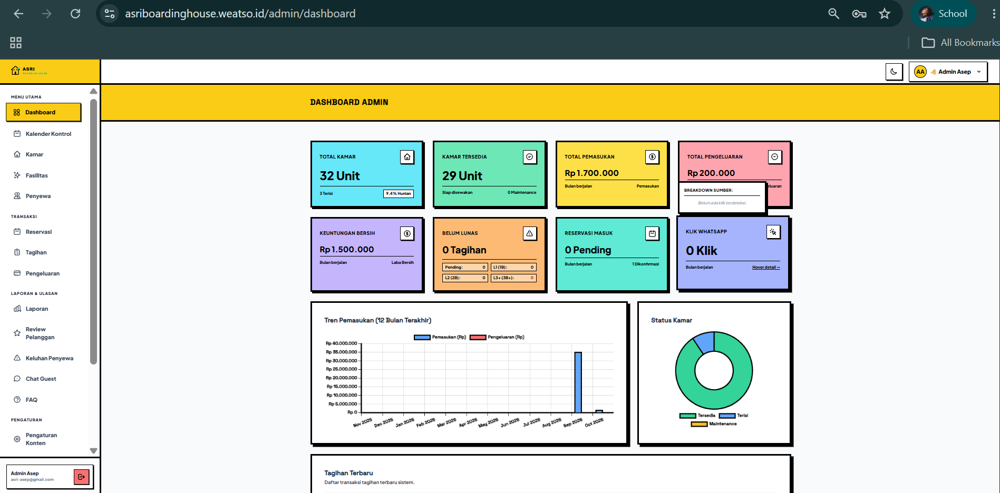

 

*Gambar 4.26 Antarmuka Dasbor Operasional dan Keuangan Administrator*  

Berdasarkan Gambar 4.26, bagian atas dasbor menampilkan empat kartu metrik utama dengan ikon penjelas dan angka statistik yang berukuran besar. Di bawah kartu metrik, terdapat bagan grafik lingkaran yang memperlihatkan rasio perbandingan keterisian 32 unit kamar secara proporsional. Sisi tengah dasbor memuat tabel ringkasan pesanan reservasi terbaru yang memerlukan tindakan verifikasi segera dari penjaga kost. Bilah navigasi vertikal di sisi kiri layar memuat ikon menu lengkap mulai dari master kamar, data penghuni, tagihan bulanan, hingga laporan pembukuan. Tata letak dasbor disusun padat dan terstruktur agar pengelola dapat memantau denyut operasional indekos hanya dalam sekali pandang.

 

3. Implementasi Antarmuka Manajemen Kamar  
Antarmuka manajemen kamar menyediakan fasilitas pengelolaan data induk untuk 32 unit hunian yang terbagi ke dalam tipe VIP, Deluxe, dan Standar. Modul ini menjadi pusat kendali inventaris kamar guna memastikan status fisik kamar di lapangan selalu selaras dengan data di situs web. Ketepatan pembaruan data kamar mencegah risiko pesanan ganda yang selama ini menjadi kendala utama pembukuan buku besar manual.

Pengelola dapat menambah nomor unit kamar baru, menyunting tarif sewa bulanan, serta mengubah status kamar menjadi kosong, terisi, atau karantina pembersihan. Sistem menyediakan tombol pengalihan status cepat agar penjaga kost leluasa mengunci kamar yang sedang dalam perbaikan fasilitas. Seluruh perubahan inventaris kamar seketika diselaraskan ke katalog publik yang diakses oleh calon penyewa luar. Tampilan antarmuka pengelolaan master data kamar ini disajikan pada Gambar 4.27.

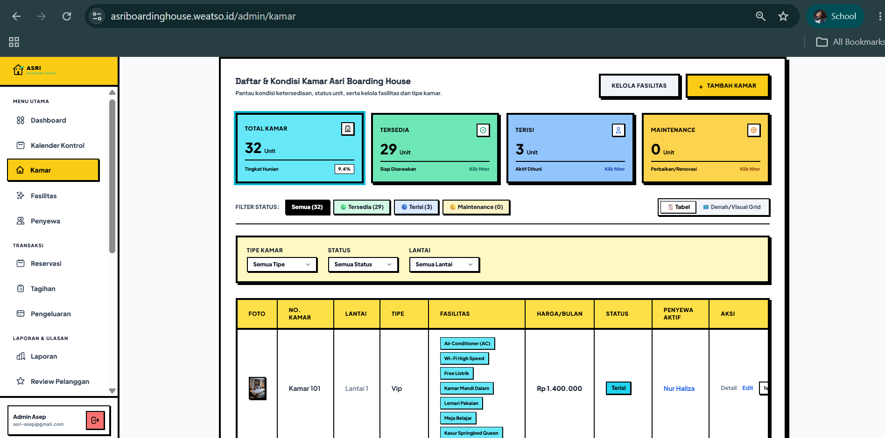

 

*Gambar 4.27 Antarmuka Pengelolaan Master Data Kamar*  

Berdasarkan Gambar 4.27, antarmuka menyajikan tabel master kamar yang memuat nomor kamar, tipe ruangan, besaran tarif sewa, dan lencana status unit. Lencana status menggunakan kode warna kontras, yaitu hijau untuk kamar kosong, merah untuk kamar terisi, dan kuning untuk kamar dalam pemeliharaan. Pada baris paling kanan tabel, tersedia tombol aksi untuk menyunting spesifikasi ruangan atau mengatur ketersediaan kamar secara instan. Sisi atas tabel dilengkapi kolom pencarian nomor kamar dan penyaring tipe kamar guna mempercepat penemuan data unit tertentu. Desain tabel menerapkan baris berselang-seling dengan garis batas tipis agar penjaga kost nyaman memeriksa deretan 32 unit kamar tanpa keliru baris.

 

4. Implementasi Antarmuka Manajemen Fasilitas  
Antarmuka manajemen fasilitas digunakan pengelola untuk mengatur daftar sarana bersama yang ditampilkan pada halaman informasi publik indekos. Pengaturan inventaris sarana ini menjamin bahwa informasi fasilitas yang dibaca calon penyewa selalu sesuai dengan ketersediaan fisik di bangunan kost. Pengelola dapat memperbarui deskripsi sarana seiring dengan adanya penambahan fasilitas baru di lingkungan indekos.

Modul ini menyediakan formulir penambahan nama fasilitas, pemilihan ikon grafis penjelas, penulisan deskripsi fungsi, serta tombol pengaktifan sarana. Pengelola dapat menyembunyikan sarana yang sedang mengalami kerusakan fisik agar tidak menimbulkan kekecewaan bagi calon penghuni baru. Setiap data sarana yang disimpan langsung diteruskan ke basis data untuk ditampilkan secara otomatis di beranda situs web. Tampilan halaman pengaturan fasilitas bersama indekos ini diperlihatkan pada Gambar 4.28.

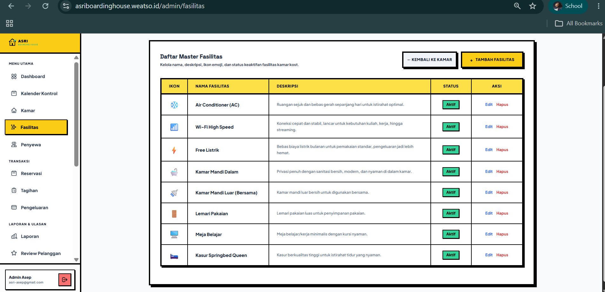

 

*Gambar 4.28 Antarmuka Pengelolaan Fasilitas Kost*  

Berdasarkan Gambar 4.28, antarmuka menampilkan daftar sarana kost dalam format tabel teratur yang berdampingan dengan tombol tambah fasilitas baru. Kolom tabel memuat pratinjau ikon sarana, nama fasilitas, deskripsi singkat, serta sakelar status aktif atau nonaktif. Di bagian atas layar, tersedia tombol hijau mencolok untuk membuka jendela formulir penambahan sarana hunian baru. Setiap baris fasilitas dilengkapi tombol ikon pensil untuk menyunting data sarana dan tombol tempat sampah untuk menghapus fasilitas yang sudah tidak berlaku. Tampilan antarmuka mengutamakan kemudahan navigasi agar penjaga kost dapat memperbarui inventaris sarana dengan cepat tanpa memerlukan keahlian teknis khusus.

 

5. Implementasi Antarmuka Manajemen Penyewa  
Antarmuka manajemen penyewa memuat direktori induk seluruh penghuni aktif yang menempati 32 unit kamar di Asri Boarding House. Pusat data penghuni ini membantu penjaga kost memantau masa kontrak sewa, data identitas KTP, serta nomor kontak darurat keluarga penghuni. Pendataan yang terpusat memastikan setiap unit kamar memiliki penanggung jawab resmi yang tercatat secara sah di sistem.

Pengelola dapat memeriksa riwayat kamar yang pernah ditempati penghuni, memperpanjang masa kontrak sewa bulanan, atau memproses prosedur keluar sewa (*check-out*). Sistem secara otomatis menghitung sisa masa aktif sewa setiap penghuni dan memberikan tanda peringatan jika kontrak sewa mendekati masa kedaluwarsa. Fitur ekspor data penyewa ke format dokumen digital juga disediakan guna mempermudah laporan ke rukun warga setempat. Antarmuka pengelolaan direktori penghuni kost diperlihatkan pada Gambar 4.29.

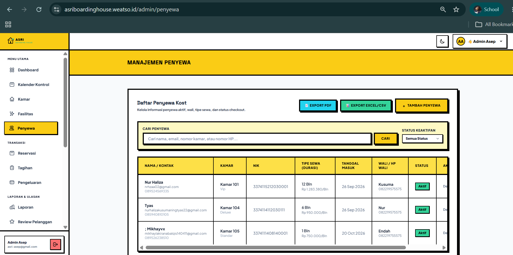

 

*Gambar 4.29 Antarmuka Pengelolaan Data Penghuni Kost*  

Berdasarkan Gambar 4.29, antarmuka menyajikan tabel direktori penghuni yang memuat kolom nama lengkap, nomor kamar, tanggal mulai sewa, dan batas akhir kontrak tinggal. Pada sisi nama penghuni, tercantum nomor telepon WhatsApp aktif yang dapat ditekan pengelola untuk langsung membuka jendela percakapan. Kolom masa sewa menampilkan sisa durasi bulan sewa yang dihitung secara dinamis oleh logika sistem aplikasi. Pada baris akhir tabel, tersedia tombol aksi perpanjangan masa sewa dan tombol penghentian hunian yang disertai formulir inspeksi kondisi fisik kamar. Tata letak direktori dirancang lapang dengan bilah pencarian nama penghuni di bagian atas guna mempermudah pemeriksaan data di lapangan.

 

6. Implementasi Antarmuka Manajemen Reservasi  
Antarmuka manajemen reservasi menjadi meja kerja bagi penjaga kost untuk memvalidasi seluruh pesanan kamar baru yang diajukan oleh calon penyewa. Halaman ini menyaring pemesanan yang masuk dan memastikan uang muka pembayaran digital telah terverifikasi secara sah oleh sistem. Penjaga kost memiliki kendali penuh untuk menyetujui atau menolak permohonan reservasi sebelum calon penghuni datang ke lokasi.

Tabel reservasi menampilkan kode pemesanan, identitas calon penyewa, tipe kamar yang dipilih, tanggal pengajuan sewa, dan bukti transaksi Midtrans. Pengelola dapat memeriksa berkas foto KTP yang diunggah calon penghuni guna memverifikasi keaslian data sebelum memberikan persetujuan kamar. Begitu pengelola menekan tombol konfirmasi sewa, status kamar seketika berganti menjadi terkunci dan sistem menerbitkan kode aktivasi kunci hunian. Tampilan antarmuka verifikasi reservasi kamar masuk disajikan pada Gambar 4.30.

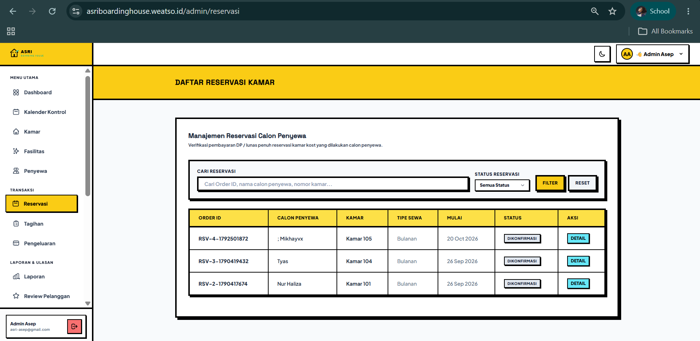

 

*Gambar 4.30 Antarmuka Pengelolaan Pesanan Reservasi Masuk*  

Berdasarkan Gambar 4.30, antarmuka menampilkan daftar antrean pesanan kamar yang diurutkan mulai dari waktu pengajuan sewa yang paling mutakhir. Setiap baris pesanan memuat kode transaksi unik, nama pemesan, tipe kamar sewa, nominal pembayaran, serta lencana status verifikasi berkas. Terdapat tombol ikon mata untuk membuka jendela pop-up peninjauan berkas foto identitas calon penyewa secara mendalam. Di samping tombol tinjau berkas, tersedia tombol centang hijau untuk menyetujui pemesanan dan tombol silang merah untuk membatalkan pesanan yang bermasalah. Tampilan tabel dilengkapi indikator status pembayaran otomatis dari gerbang Midtrans guna memudahkan penjaga kost memastikan keabsahan dana sewa.

 

7. Implementasi Antarmuka Manajemen Tagihan  
Antarmuka manajemen tagihan mengontrol siklus penerbitan tagihan sewa bulanan otomatis bagi seluruh penghuni aktif di Asri Boarding House. Fitur ini menyelesaikan masalah penagihan manual yang selama ini sering terlewat oleh penjaga kost sehingga memicu penumpukan tunggakan sewa. Transparansi status tagihan membantu pengelola memastikan arus penerimaan kas indekos berjalan tepat waktu setiap tanggal 10.

Sistem secara otomatis mengeksekusi proses pembuatan tagihan pada tanggal satu setiap awal bulan dan menyelaraskan jadwal jatuh tempo tagihan. Jika penghuni melewati batas tanggal pembayaran, sistem secara mandiri menghitung denda keterlambatan berdasarkan selisih hari kalender. Pengelola juga dapat mencatat pembayaran yang disetor secara tunai oleh penghuni tanpa mengacaukan pembukuan sistem digital. Antarmuka pengawasan tagihan sewa bulanan dan denda ini ditampilkan pada Gambar 4.31.

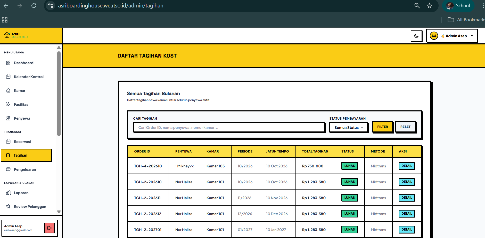

 

*Gambar 4.31 Antarmuka Pengelolaan Tagihan Sewa Bulanan dan Denda*  

Berdasarkan Gambar 4.31, tabel manajemen tagihan menyajikan kolom nomor faktur sewa, nama penghuni, nomor kamar, periode bulan tagihan, dan batas waktu jatuh tempo. Kolom nominal memuat rincian tarif pokok sewa yang disandingkan dengan kolom denda keterlambatan yang bertambah otomatis jika lewat tempo. Lencana status pembayaran dibedakan secara tegas antara status belum lunas dengan warna merah dan status lunas dengan warna hijau. Pada baris tagihan yang belum lunas, tersedia tombol pengingat manual untuk mengirimkan pesan WhatsApp kilat ke ponsel penghuni bersangkutan. Sisi atas tabel dilengkapi ringkasan total piutang sewa yang masih tertunggak pada bulan berjalan guna memudahkan evaluasi kas pengelola.

 

8. Implementasi Antarmuka Manajemen Pengeluaran  
Antarmuka manajemen pengeluaran berfungsi mencatat seluruh pos beban biaya operasional pemeliharaan Asri Boarding House secara terperinci. Pencatatan pengeluaran harian ini menutup celah selisih pembukuan kas fisik yang selama ini sering terjadi akibat nota kertas yang tercecer. Pengelola dapat memantau pergerakan kas keluar secara teratur guna menjaga keseimbangan laba bersih bisnis indekos.

Pengelola menginput pos beban operasional seperti pembayaran tagihan listrik PLN, retribusi air PDAM, pembelian perlengkapan kebersihan, dan upah perbaikan fasilitas. Setiap catatan pengeluaran diwajibkan menyertakan tanggal transaksi, kategori beban, nominal biaya, serta foto nota pembelian fisik sebagai bukti sah pembukuan. Seluruh data kas keluar ini langsung disinkronkan ke laporan laba-rugi bulanan tanpa perlu perhitungan ulang. Tampilan antarmuka pencatatan biaya pengeluaran operasional diperlihatkan pada Gambar 4.32.

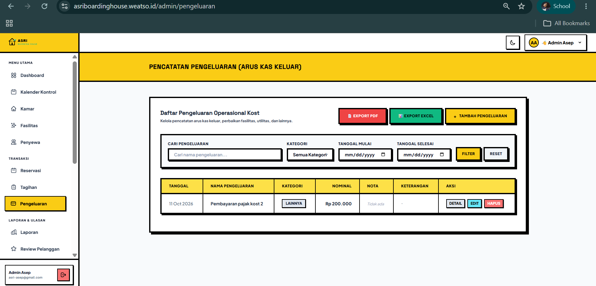

 

*Gambar 4.32 Antarmuka Pencatatan Pengeluaran Operasional Kost*  

Berdasarkan Gambar 4.32, antarmuka menyediakan formulir input cepat pengeluaran pada sisi atas dan tabel rekapitulasi pengeluaran pada sisi bawah layar. Formulir input menyediakan pilihan kategori beban operasional, kolom nominal rupiah, kolom keterangan nota, serta tombol unggah bukti kuitansi belanja. Tabel di bagian bawah mencatat urutan riwayat pengeluaran kas lengkap dengan tanggal pencatatan dan nama penanggung jawab belanja. Pada kolom bukti nota, tersedia tautan gambar yang dapat ditekan pengelola untuk melihat foto nota fisik yang tersimpan di peladen. Bagian dasar antarmuka menyajikan kotak rekapitulasi total dana keluar pada bulan berjalan yang dihitung otomatis oleh sistem.

 

9. Implementasi Antarmuka Manajemen Laporan Pemasukan  
Antarmuka manajemen laporan pemasukan menyajikan rekapitulasi menyeluruh arus kas indekos yang memadukan penerimaan sewa dengan pengeluaran operasional. Halaman laporan ini memangkas waktu tutup buku bulanan yang sebelumnya memakan waktu berhari-hari menjadi hitungan detik. Ketersediaan laporan kas yang akurat memberikan gambaran riil mengenai kesehatan finansial usaha indekos bagi pemilik modal.

Pengelola dapat memfilter laporan berdasarkan rentang tanggal tertentu, bulan kalender, maupun rekapitulasi tahunan secara fleksibel. Sistem menghitung selisih pendapatan kotor dikurangi total beban pengeluaran guna menyajikan angka laba bersih operasional yang pasti. Laporan yang tersaji dapat langsung diekspor ke dalam berkas dokumen PDF siap cetak maupun lembar kerja Excel untuk arsip kantor. Visualisasi antarmuka laporan pembukuan arus kas ini disajikan pada Gambar 4.33.

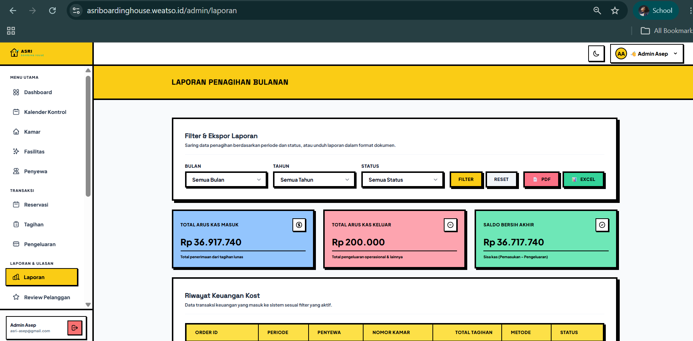

 

*Gambar 4.33 Antarmuka Laporan Rekapitulasi Kas dan Ekspor Dokumen*  

Berdasarkan Gambar 4.33, antarmuka laporan menampilkan kartu ringkasan keuangan utama yang memuat total pemasukan kotor, total pengeluaran, dan saldo kas bersih. Di bawah kartu ringkasan, tersaji grafik garis yang memvisualisasikan tren pendapatan harian selama satu bulan kalender berjalan. Bagian tengah halaman menyajikan tabel pembukuan arus kas yang merinci setiap transaksi masuk dari pembayaran sewa kamar maupun transaksi keluar operasional. Sudut kanan atas layar dilengkapi tombol hijau untuk mengunduh lembar kerja Excel dan tombol merah untuk mencetak dokumen laporan berformat PDF. Seluruh susunan angka disajikan dalam format mata uang rupiah yang terstandarisasi untuk memastikan keterbacaan data laporan keuangan.

 

10. Implementasi Antarmuka Manajemen Keluhan Penyewa  
Antarmuka manajemen keluhan penyewa menjadi pusat penanganan laporan kerusakan sarana dan gangguan kenyamanan kamar dari seluruh penghuni indekos. Sistem tiket pengaduan ini memastikan setiap kendala fasilitas lekas ditindaklanjuti oleh penjaga kost tanpa ada laporan yang terabaikan. Penanganan aduan yang tanggap menjaga kepuasan tinggal penghuni dan merawat kualitas fisik bangunan indekos.

Setiap tiket aduan menampilkan identitas pelapor, nomor kamar, jenis kendala fasilitas, rincian kronologi, serta foto bukti kerusakan fisik sarana. Penjaga kost dapat memperbarui status tiket dari tahap diterima, dalam proses perbaikan, hingga dinyatakan selesai ditangani. Sistem secara otomatis mengirimkan notifikasi pembaruan status pengerjaan kembali ke akun penghuni yang bersangkutan. Tampilan meja kerja penanganan tiket keluhan fasilitas kamar ini ditampilkan pada Gambar 4.34.

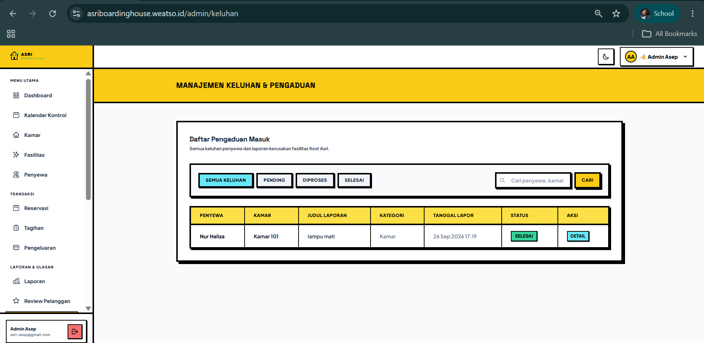

 

*Gambar 4.34 Antarmuka Pengelolaan Tiket Keluhan Fasilitas*  

Berdasarkan Gambar 4.34, antarmuka memuat daftar tiket keluhan penghuni yang disusun dalam format kartu kerja bertingkat. Setiap kartu memuat judul kerusakan kamar, nama penghuni, nomor unit kamar, tanggal pelaporan, serta lencana prioritas penanganan. Kotak pratinjau gambar menampilkan foto kerusakan sarana yang diunggah penghuni guna memudahkan penjaga kost mendiagnosis perbaikan yang dibutuhkan. Pada bagian bawah kartu, terdapat menu tarik-turun untuk mengubah status tiket menjadi sedang diperbaiki atau selesai dituntaskan. Tersedia pula kolom catatan internal bagi penjaga kost untuk menuliskan rincian tindakan teknis atau sparepart yang diganti pada kamar sewa.

 

11. Implementasi Antarmuka Manajemen Fitur Chat Guest  
Antarmuka manajemen fitur chat guest menjadi panel komunikasi bagi pengelola untuk membalas pertanyaan calon penyewa yang masuk dari beranda publik. Fitur obrolan terpusat ini memungkinkan penjaga kost menjawab calon penghuni secara langsung melalui peramban komputer kerja tanpa berganti perangkat ponsel. Kecepatan respon pengelola dalam percakapan daring meningkatkan rasio keberhasilan calon penyewa dalam memesan kamar indekos.

Panel obrolan menampilkan daftar sesi percakapan dari pengunjung luar yang diurutkan berdasarkan waktu pesan masuk terbaru. Pengelola dapat membuka sesi percakapan, membaca pertanyaan seputar ketersediaan kamar, dan mengetikkan balasan secara langsung. Riwayat percakapan tersimpan rapi pada basis data sehingga pengelola lain dapat melanjutkan komunikasi tanpa kehilangan konteks pembicaraan. Antarmuka panel pengelolaan obrolan langsung tamu luar ini diperlihatkan pada Gambar 4.35.

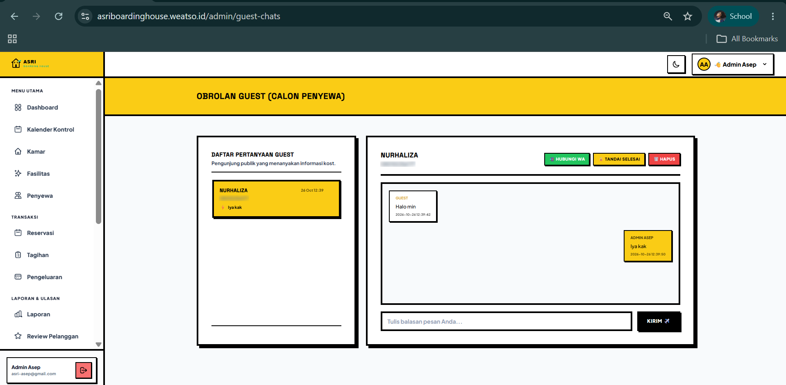

 

*Gambar 4.35 Antarmuka Pengelolaan Obrolan Tamu (Guest Chat Admin)*  

Berdasarkan Gambar 4.35, tampilan antarmuka terbagi menjadi kolom daftar kontak percakapan pada sisi kiri dan ruang obrolan aktif pada sisi kanan layar. Daftar kontak di sisi kiri menampilkan nama tamu, cuplikan pesan terakhir, tanda waktu pesan, dan lencana merah jika terdapat pesan belum terbaca. Ruang obrolan sisi kanan menyajikan gelembung percakapan runut lengkap dengan indikator waktu kirim pada setiap baris pesan. Bagian bawah ruang obrolan menyediakan area pengetikan pesan teks yang berdampingan dengan tombol kirim berikon panah warna hijau. Sisi atas panel obrolan dilengkapi tombol opsi untuk menutup sesi percakapan yang telah selesai atau menghapus riwayat obrolan yang tidak relevan.

 

### 4.2.4 Implementasi Penyewa Aktif

1. Implementasi Antarmuka Login Penyewa Aktif  
Antarmuka login penyewa aktif merupakan pintu masuk khusus bagi penghuni resmi untuk mengakses portal layanan mandiri kamar indekos. Akses masuk ini mengamankan informasi tagihan sewa berkala dan data administrasi kontrak hunian milik masing-masing penyewa. Otentikasi yang teratur mencegah risiko kebocoran data pribadi antarpenghuni di dalam sistem web indekos.

Penghuni cukup memasukkan alamat surel terdaftar dan kata sandi pribadi yang telah diverifikasi saat awal akad sewa kamar. Sistem segera mengenali status keaktifan kontrak hunian pengguna dan memblokir akses jika masa sewa dinyatakan telah berakhir atau ditangguhkan. Setelah kredensial terverifikasi sah, peramban seketika mengarahkan pengguna menuju beranda portal layanan personal kamar. Tampilan antarmuka masuk akun penghuni aktif indekos diperlihatkan pada Gambar 4.36.

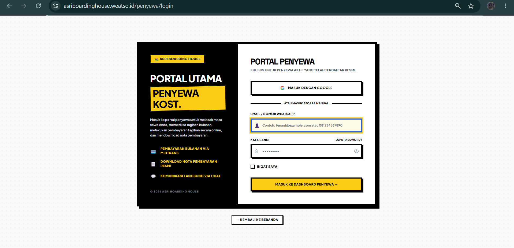

 

*Gambar 4.36 Antarmuka Login Portal Penyewa Aktif*  

Berdasarkan Gambar 4.36, formulir login penghuni ditempatkan di bagian tengah layar dengan bingkai kartu putih bergaris batas abu-abu gelap. Bagian atas kartu memuat lambang visual kunci kamar yang melambangkan portal khusus penghuni resmi Asri Boarding House. Kolom isian surel dan kata sandi dirancang lapang dengan teks placeholder yang memandu format pengetikan data pengguna. Terdapat tautan bantuan masuk di bawah kolom isian bagi penghuni yang mengalami kendala lupa sandi akun sewa. Tombol masuk menggunakan aksen warna hijau dengan ukuran teks tebal yang menegaskan fungsinya sebagai tombol eksekusi otentikasi akun.

 

2. Implementasi Antarmuka Dashboard Penyewa  
Antarmuka dashboard penyewa menjadi pusat kendali layanan mandiri bagi penghuni aktif selama menempati kamar di Asri Boarding House. Dasbor personal ini menyajikan ringkasan kamar hunian, sisa durasi masa sewa, serta status tagihan bulanan dalam satu tampilan terpadu. Kehadiran dasbor ini memberikan transparansi hak dan kewajiban tinggal bagi penghuni secara mandiri dari perangkat ponsel.

Halaman ini menampilkan kartu nomor kamar yang ditempati, tipe hunian, tanggal mulai kontrak, dan tanggal jatuh tempo pembayaran sewa berikutnya. Penghuni dapat langsung menekan tombol pembayaran jika terdapat tagihan bulanan yang telah terbit dari sistem pengelola. Dasbor juga memuat pintasan menu untuk melaporkan kerusakan fasilitas kamar dan melihat pengumuman resmi dari penjaga kost. Visualisasi antarmuka dasbor portal penghuni aktif ini disajikan pada Gambar 4.37.

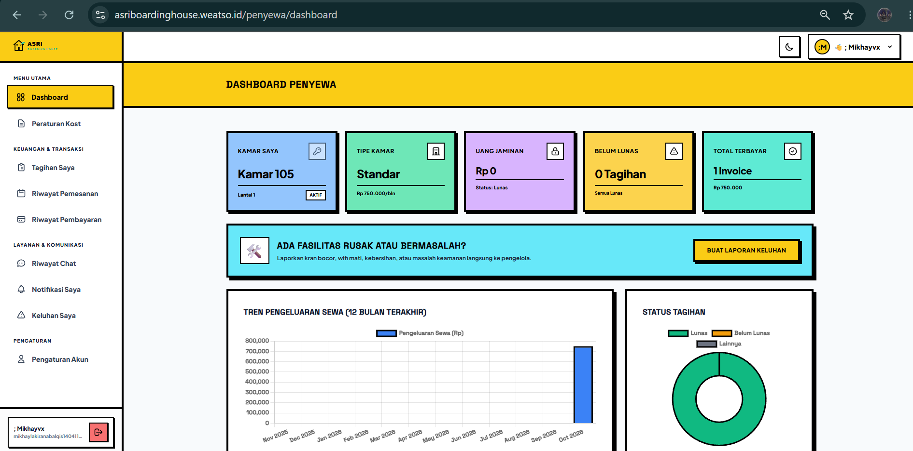

 

*Gambar 4.37 Antarmuka Dasbor Portal Penyewa Aktif*  

Berdasarkan Gambar 4.37, bagian atas halaman menyambut penghuni dengan kartu profil personal yang menampilkan nama lengkap dan nomor kamar hunian. Sisi tengah dasbor menampilkan kartu status kontrak sewa yang memuat sisa hari masa aktif tinggal dalam bentuk grafik batang kemajuan. Terdapat kotak peringatan tagihan berwarna kuning jika terdapat tagihan sewa bulanan yang mendekati tanggal jatuh tempo pembayaran. Di bawah informasi kontrak, tersedia empat tombol menu pintas menuju halaman pembayaran tagihan, riwayat transaksi, pelaporan keluhan, dan tata tertib kost. Tampilan antarmuka didominasi oleh palet warna bersih dengan penataan kartu modular yang sangat nyaman dibaca pada layar ponsel pintar.

 

3. Implementasi Antarmuka Tagihan Penyewa  
Antarmuka tagihan penyewa menyajikan rincian invoice pembayaran sewa bulanan yang wajib diselesaikan oleh penghuni aktif setiap tanggal 10. Halaman ini memberikan transparansi penuh mengenai komponen biaya sewa pokok, biaya fasilitas tambahan, serta denda keterlambatan jika ada. Penghuni dapat memeriksa rincian biaya secara jelas sebelum melanjutkan proses pelunasan melalui gerbang pembayaran digital.

Sistem secara otomatis menghitung akumulasi tagihan dan menampilkan status tagihan secara jelas, baik berstatus belum dibayar, menunggu verifikasi, maupun lunas. Penghuni cukup menekan tombol bayar sekarang untuk seketika memunculkan jendela transaksi Midtrans Snap tanpa harus menyalin nomor rekening secara manual. Pelunasan tagihan melalui gerbang digital langsung memperbarui status invoice menjadi lunas tanpa perlu menunggu konfirmasi penjaga kost. Antarmuka rincian invoice tagihan sewa penghuni ditampilkan pada Gambar 4.38.

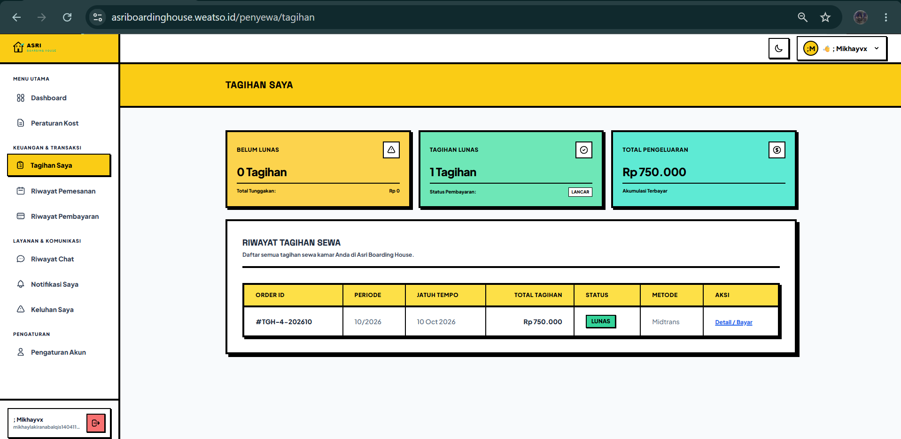

 

*Gambar 4.38 Antarmuka Rincian Tagihan Sewa Penyewa*  

Berdasarkan Gambar 4.38, antarmuka menampilkan kartu rincian tagihan resmi yang memuat nomor faktur sewa dan periode bulan tagihan yang ditagihkan. Pada tabel rincian biaya, tertulis rincian tarif dasar kamar sewa yang dipisahkan secara transparan dari kolom denda keterlambatan pembayaran. Total nominal pembayaran ditampilkan dengan ukuran teks besar dan tebal pada sudut kanan bawah kartu tagihan sewa. Tombol bayar digital ditempatkan di bawah total harga dengan warna hijau mencolok yang menarik perhatian penghuni untuk segera melunasi sewa. Lencana status di sudut atas kartu menunjukkan indikator belum lunas dengan warna merah tegas guna mengingatkan batas tanggal jatuh tempo sewa.

 

4. Implementasi Antarmuka Profil  
Antarmuka profil memfasilitasi penghuni kost untuk memperbarui data diri, kontak darurat keluarga, dan kredensial kata sandi akun secara mandiri. Pembaruan data kontak secara berkala memastikan pengelola kost selalu memiliki saluran komunikasi yang valid jika terjadi keadaan darurat di indekos. Penghuni juga memiliki kendali penuh untuk menjaga keamanan akses akun pribadinya dari waktu ke waktu.

Halaman ini membagi pengaturan akun ke dalam tab informasi identitas diri, tab kontak darurat keluarga, dan tab keamanan kata sandi. Pengguna dapat memperbarui nomor telepon WhatsApp aktif dan mengganti kata sandi lama dengan memasukkan verifikasi kata sandi saat ini. Sistem secara otomatis memvalidasi format data baru sebelum menyimpannya ke tabel pengguna di basis data. Tampilan antarmuka pengaturan profil penghuni aktif disajikan pada Gambar 4.39.

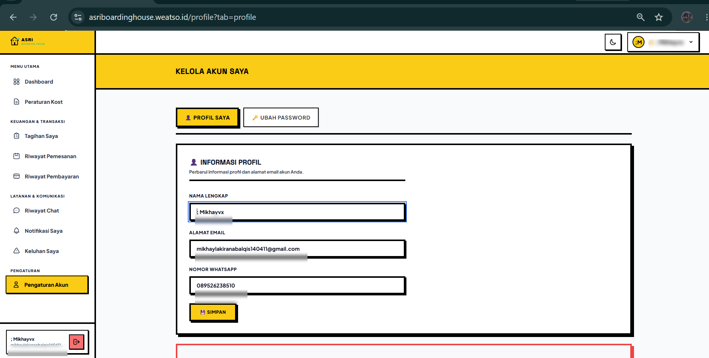

 

*Gambar 4.39 Antarmuka Pengaturan Profil Penghuni*  

Berdasarkan Gambar 4.39, antarmuka menyajikan formulir pengaturan yang terbagi ke dalam panel identitas akun dan panel keamanan sandi secara berdampingan. Sisi kiri memuat foto profil pengguna beserta kolom isian nama lengkap, alamat surel, nomor telepon seluler, dan alamat asal daerah. Sisi kanan menampilkan kolom nama kontak wali, hubungan keluarga, nomor telepon darurat, serta formulir pembaruan kata sandi akun. Setiap kolom isian dilengkapi garis batas abu-abu lembut yang berubah menjadi warna hijau saat kolom sedang aktif disunting pengguna. Tombol perbarui data diletakkan pada bagian bawah setiap panel dengan label jelas yang memastikan pengguna menyimpan perubahan data secara tepat.

 

5. Implementasi Antarmuka Riwayat Pembayaran  
Antarmuka riwayat pembayaran mendokumentasikan seluruh catatan transaksi pelunasan sewa yang pernah dilakukan oleh penghuni selama menempati indekos. Arsip transaksi digital ini memberikan rasa aman bagi penghuni karena setiap rupiah uang sewa yang disetor memiliki bukti catatan sistem yang sah. Penghuni dapat memeriksa kembali tanggal pembayaran masa lalu tanpa perlu mencari nota fisik yang rawan hilang.

Tabel riwayat menyajikan nomor faktur transaksi, tanggal pelunasan uang sewa, nominal pembayaran, metode pembayaran digital yang digunakan, dan tautan kuitansi. Data riwayat diurutkan berdasarkan waktu pembayaran terbaru guna mempermudah penghuni melacak transaksi terakhir yang berhasil diselesaikan. Penghuni dapat menekan tautan cetak tanda terima pada setiap baris transaksi untuk mengunduh bukti kuitansi resmi kapan saja. Antarmuka catatan riwayat pembayaran sewa penghuni diperlihatkan pada Gambar 4.40.

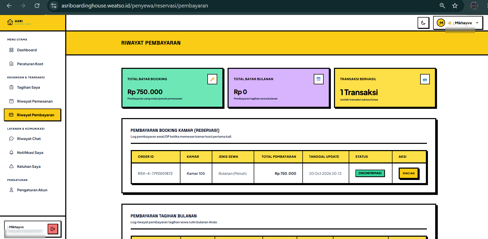

 

*Gambar 4.40 Antarmuka Riwayat Transaksi Pembayaran*  

Berdasarkan Gambar 4.40, antarmuka menyajikan tabel riwayat transaksi pembayaran dengan format baris data yang bersih dan rapi. Kolom tabel memuat kode pembayaran resmi, tanggal transaksi lunas, periode bulan sewa yang dibayar, serta nominal transaksi dalam satuan rupiah. Pada kolom metode pembayaran, tercantum kanal perbankan yang digunakan penghuni seperti transfer Virtual Account BCA maupun dompet digital QRIS. Kolom status menampilkan lencana hijau bertuliskan lunas yang menegaskan keabsahan transaksi pada catatan peladen Midtrans dan basis data sistem. Pada ujung kanan setiap baris, terdapat tombol ikon dokumen yang dapat ditekan penghuni untuk langsung mencetak lembar kuitansi digital.

 

6. Implementasi Antarmuka Keluhan  
Antarmuka keluhan memfasilitasi penghuni untuk menyampaikan laporan gangguan fasilitas kamar secara resmi kepada pengelola Asri Boarding House. Jalur pelaporan digital ini menggantikan pesan teks pribadi ke penjaga kost yang sering kali terlewat atau lambat ditangani. Pencatatan keluhan yang rapi membantu pengelola memprioritaskan perbaikan sarana berdasarkan tingkat urgensi kerusakan di lapangan.

Penghuni memilih kategori fasilitas yang bermasalah, menuliskan deskripsi kendala secara rinci, dan mengunggah foto bukti kerusakan dari kamera ponsel. Sistem langsung meneruskan tiket laporan tersebut ke meja kerja admin dan memberikan nomor pelacakan tiket kepada penghuni. Penghuni dapat memantau perkembangan penanganan perbaikan fasilitas secara langsung dari daftar riwayat aduan di halaman yang sama. Tampilan formulir pengajuan tiket keluhan kamar ini disajikan pada Gambar 4.41.

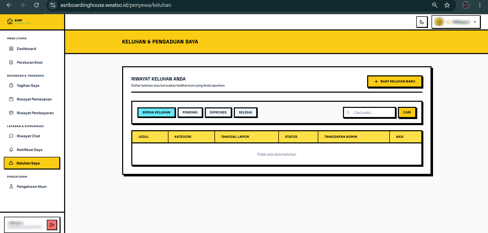

 

*Gambar 4.41 Antarmuka Formulir Pengajuan Keluhan Kamar*  

Berdasarkan Gambar 4.41, halaman pelaporan keluhan menampilkan formulir input di bagian atas dan tabel daftar tiket aduan di bagian bawah layar. Formulir menyediakan menu tarik-turun untuk memilih jenis fasilitas kamar yang rusak seperti pendingin udara, keran air, kasur, atau lampu ruangan. Kolom deskripsi masalah dirancang luas agar penghuni leluasa menceritakan kendala fisik kamar yang dialami secara mendalam. Di samping kolom deskripsi, tersedia kotak unggah berkas yang memuat pratinjau foto kerusakan sarana sesaat setelah berkas dipilih pengguna. Tombol kirim pengaduan menggunakan aksen warna kontras yang memproses pengiriman tiket laporan langsung ke basis data pengelola.

 

7. Implementasi Nota PDF  
Implementasi nota PDF menghasilkan lembar tanda terima pembayaran digital resmi berukuran A5 secara otomatis sesaat setelah transaksi dinyatakan lunas. Dokumen elektronik ini menggantikan kuitansi nota fisik rangkap dua yang selama ini ditulis tangan secara manual oleh penjaga kost. Penghuni memperoleh bukti pembayaran berkekuatan hukum yang rapi dan dapat diunduh langsung untuk arsip pertanggungjawaban kepada orang tua.

Sistem memanfaatkan pustaka html2pdf.js untuk mengompilasi tampilan data transaksi menjadi dokumen PDF siap cetak di sisi peramban pengguna. Dokumen kuitansi memuat kop surat resmi Asri Boarding House, nomor transaksi unik, identitas penghuni, nomor kamar, rincian biaya sewa, dan kode QR verifikasi transaksi. Pembuatan dokumen secara otomatis ini memangkas antrean pengambilan kuitansi di meja penjaga kost saat periode pembayaran sewa awal bulan tiba. Tampilan fisik lembar kuitansi digital berformat PDF tersebut diperlihatkan pada Gambar 4.42.

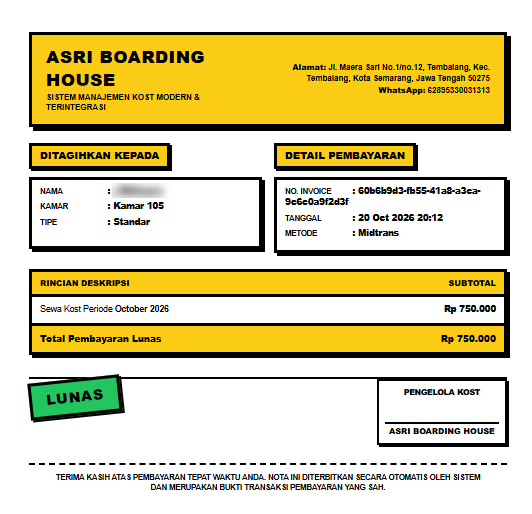

 

*Gambar 4.42 Antarmuka Tanda Terima Kuitansi Digital (Nota PDF)*  

Berdasarkan Gambar 4.42, lembar kuitansi digital dirancang menggunakan tata letak dokumen formal berukuran A5 dengan orientasi cetak horizontal. Bagian kop dokumen memuat identitas lengkap indekos, alamat jalan Maera Sari Tembalang, nomor kontak resmi pengelola, serta garis pemisah ganda tebal. Tabel rincian di bagian tengah memisahkan pos pembayaran sewa kamar bulanan, denda keterlambatan, dan jumlah total nominal yang telah dilunasi secara jelas. Sisi kiri bawah dokumen menyematkan kode QR validasi yang dapat dipindai untuk membuktikan keaslian kuitansi di sistem web indekos. Pada sudut kanan bawah, tertera stempel digital lunas resmi dan tanda tangan penanggung jawab operasional Asri Boarding House.

 

## DAFTAR PUSTAKA

 

[1] A. Cornellya and H. Afriyadi, “Perancangan Sistem Informasi Pemesanan pada Kost Tya Berbasis Web Menggunakan Framework Laravel,” *PESHUM J. Pendidikan, Sos. dan Hum.*, vol. 4, no. 6, pp. 10360-10369, 2025, doi: [10.56799/peshum.v4i6.11777](https://doi.org/10.56799/peshum.v4i6.11777).

[2] C. Nizar, “Rancang Bangun Sistem Informasi Sewa Rumah Kost (E-Kost) Berbasis Website,” *J. Sist. Inf. dan Sains Teknol.*, vol. 3, no. 1, pp. 1-10, 2021, doi: [10.31326/sistek.v3i1.852](https://doi.org/10.31326/sistek.v3i1.852).

[3] E. J. Malaikosa and P. Mokola, “Sistem Informasi Monitoring Rumah Kos dan Pembayarannya Berbasis Web Menggunakan Metode Rapid Application Development,” *JSiI (Jurnal Sist. Informasi)*, vol. 11, no. 1, pp. 21-26, 2024, doi: [10.30656/jsii.v11i1.8222](https://doi.org/10.30656/jsii.v11i1.8222).

[4] R. Sutisna and F. Aziz, “Perancangan Sistem Penyewaan Alat Event Berbasis Website Menggunakan Midtrans sebagai Integrasi Payment Gateway pada PT. Bangbewe Production,” *REMIK Ris. dan E-Jurnal Manaj. Inform. Komput.*, vol. 9, no. 1, pp. 317-325, 2025, doi: [10.33395/remik.v9i1.14498](https://doi.org/10.33395/remik.v9i1.14498).

[5] L. Hakim, S. P. Kristanto, M. N. Shodiq, and E. Amaliyah, “Aplikasi Penerimaan dan Pengeluaran Kas Berbasis Web dan WhatsApp Gateway,” *J. Tekno Kompak*, vol. 15, no. 1, pp. 13-24, 2021, doi: [10.33365/jtk.v15i1.900](https://doi.org/10.33365/jtk.v15i1.900).

[6] A. Syahputra, R. Wiranti, and W. Astita, “Peran Sistem Informasi Manajemen Organisasi Dalam Pengambilan Keputusan,” *J. Manaj. Sist. Inf.*, vol. 1, no. 1, pp. 26-31, 2022, doi: [10.35870/jmasif.v1i1.67](https://doi.org/10.35870/jmasif.v1i1.67).

[7] J. K. Aditya and A. T. Hidayat, “Sistem Informasi Manajemen Kos Berbasis Web Menggunakan Metode Blackbox: (Studi Kasus: Kos Putri Humba),” *JUSIM (Jurnal Sist. Inf. Musirawas)*, vol. 10, no. 2, pp. 229-241, 2025, doi: [10.32767/jusim.v10i2.2782](https://doi.org/10.32767/jusim.v10i2.2782).

[8] I. A. Nurhasanah, M. Brilliant, K. Reni, and A. Mulyanto, “Analisis Perancangan E-Business B2C (Business to Consumer) Upaya Digitalisasi Pengembangan UMKM (Studi Kasus : Kabupaten Pesawaran, Indonesia),” *J. Nas. Pendidik. Tek. Inform. JANAPATI*, vol. 11, no. 3, pp. 236–248, 2022, doi: [10.23887/janapati.v11i3.49787](https://doi.org/10.23887/janapati.v11i3.49787).

[9] E. Y. Sutrisno, A. C. Hidayat, and A. Sutanto, “Pemanfaatan E-Commerce dan Property Management System Dalam Kegiatan Bisnis Perhotelan di Era Revolusi Industri 4.0,” *J. Kepariwisataan Indones.*, vol. 17, no. 1, pp. 85–98, 2023, doi: [10.47608/jki.v17i12023.85-98](https://doi.org/10.47608/jki.v17i12023.85-98).

[10] W. Wahyudin and S. Bela, “Rancang Bangun Sistem Informasi Inventory Stock Barang Berbasis Web,” *J. Tek. Komput.*, vol. 7, no. 2, pp. 208–214, 2021, doi: [10.31294/jtk.v7i2.10683](https://doi.org/10.31294/jtk.v7i2.10683).

[11] Y. Anggraini, D. Pasha, D. Damayanti, and A. Setiawan, “Sistem Informasi Penjualan Sepeda Berbasis Web Menggunakan Framework CodeIgniter,” *J. Teknol. dan Sist. Inf.*, vol. 1, no. 2, pp. 64–70, 2020, doi: [10.33365/jtsi.v1i2.236](https://doi.org/10.33365/jtsi.v1i2.236).

[12] A. R. Setiawan, M. Asfi, A. Sevtiana, S. Pranata, and W. E. Septian, “Design System pada Perancangan Antarmuka Perangkat Lunak Sistem Akses Digital,” *J. Teknol. Terpadu*, vol. 9, no. 1, pp. 56–64, 2023, doi: [10.54914/jtt.v9i1.619](https://doi.org/10.54914/jtt.v9i1.619).

[13] O. N. Faizah, N. R. Oktadini, B. W. Putra, P. E. Sevtiyuni, P. Putra, and A. Meiriza, “UI/UX Design of Web-based Software License Management System using User-Centered Design and System Usability Scale,” *J. Nas. Teknol. dan Sist. Inf.*, vol. 9, no. 3, pp. 255–263, 2023, doi: [10.25077/TEKNOSI.v9i3.2023.255-263](https://doi.org/10.25077/TEKNOSI.v9i3.2023.255-263).

[14] L. Rahmawati and Sumarsono, “Desain Pengembangan Website dengan Arsitektur Model View Controller pada Framework Laravel,” *J. Teknol. dan Sist. Inf. Bisnis*, vol. 6, no. 4, pp. 785–790, 2024, doi: [10.47233/jteksis.v6i4.1497](https://doi.org/10.47233/jteksis.v6i4.1497).

[15] A. Prakarsya, L. Rahmadi, and M. S. Nurfatih, “Implementasi Konsep Model View Controller Pada Pengembangan Aplikasi Web Menggunakan Framework Laravel,” *SISKOMTI J. Sist. Inf. Komput. dan Teknol. Inf.*, vol. 5, no. 1, pp. 8–15, 2023, doi: [10.54342/agyr3903](https://doi.org/10.54342/agyr3903).

[16] Y. Adisa and M. I. P. Nasution, “Konsep Dan Peran Sistem Manajemen Basis Data Relasional Pada Sistem Informasi Manajemen,” *MASIP J. Manaj. Adm. Bisnis dan Publik Terapan*, vol. 1, no. 3, pp. 76–83, 2023, doi: [10.59061/masip.v1i3.314](https://doi.org/10.59061/masip.v1i3.314).

[17] D. F. M. Dina, “Normalisasi Database Rancangan Sistem Penyewaan Buku Berbayar,” *Computing Insight J. Comput. Sci.*, vol. 4, no. 1, pp. 56–61, 2024, doi: [10.30651/comp_insight.v4i1.15814](https://doi.org/10.30651/comp_insight.v4i1.15814).

[18] J. V. Dachi and J. Suhada, “Implementasi Basis Data Sederhana Menggunakan MySQL/PostgreSQL,” *Router J. Tek. Inform. dan Terap.*, vol. 3, no. 1, pp. 49–59, 2025, doi: [10.62951/router.v3i1.621](https://doi.org/10.62951/router.v3i1.621).

[19] I. Thoib, B. P. Candra, N. Sururi, and D. S. Nugraha, “Perbandingan Performa Pencarian Data Berbasis Teks dengan Dan Tanpa Full-text Index pada Basis Data MySQL,” *INSOLOGI J. Sains dan Teknol.*, vol. 3, no. 6, pp. 663–673, 2024, doi: [10.55123/insologi.v3i6.4596](https://doi.org/10.55123/insologi.v3i6.4596).

[20] M. Nurhayati and R. Setiawan, “Implementasi Payment Gateway Midtrans Pada Aplikasi Toko Mas Berbasis Web,” *J. Algoritma*, vol. 21, no. 2, pp. 366–377, 2024, doi: [10.33364/algoritma/v.21-2.1686](https://doi.org/10.33364/algoritma/v.21-2.1686).

[21] R. C. Buwono, R. Kartadie, and M. K. Ramadhan, “Perancangan dan Implementasi Sistem Payment Gateway MIDTRANS untuk UMKM Batik Lurik,” *INFOTECH J. Inform. dan Teknol.*, vol. 5, no. 2, pp. 228–238, 2024, doi: [10.37373/infotech.v5i2.1334](https://doi.org/10.37373/infotech.v5i2.1334).

[22] I. M. B. Waton, A. N. Weking, and B. Deta, “Penerapan Api Whatsapp Fonnte Untuk Sistem Pengingat Jadwal Bimbingan Tugas Akhir Mahasiswa Berbasis Web,” *J. Tek. Mesin, Elektro dan Ilmu Komput.*, vol. 5, no. 2, pp. 229–241, 2025, doi: [10.55606/teknik.v5i2.7614](https://doi.org/10.55606/teknik.v5i2.7614).

[23] A. R. Manik, D. Kiswanto, M. B. Akbar, and J. Purba, “Academic Portal with MFA (WhatsApp OTP via Fonnte), Role-Based Access Control, and Logging System for Network Monitoring,” *J. Ilm. Sist. Inf.*, vol. 4, no. 3, pp. 674–687, 2025, doi: [10.51903/qwz6pt87](https://doi.org/10.51903/qwz6pt87).

[24] A. Harbani and A. Sidiyantoro, “Implementasi Simple Mail Transfer Protocol Relay Pada Mail Gateway Untuk Menentukan Konten Email Spam,” *TeknoIS J. Ilm. Teknol. Inf. dan Sains*, vol. 12, no. 1, pp. 57–66, 2022, doi: [10.36350/jbs.v12i1.130](https://doi.org/10.36350/jbs.v12i1.130).

[25] M. A. Syahputra and R. A. Putri, “Sistem Informasi Monitoring Pembelajaran dengan Fitur Notifikasi Email Berbasis Web,” *Decode J. Pendidik. Teknol. Inf.*, vol. 5, no. 2, pp. 505–515, 2025, doi: [10.51454/decode.v5i2.1206](https://doi.org/10.51454/decode.v5i2.1206).

[26] A. Wibowo, A. Fathimah, D. Waskito, and R. A. Aprilianto, “Cron Job Implementation for Automated Data Processing and Transfer in Cloud Infrastructure,” *Sainteknol J. Sains dan Teknol.*, vol. 23, no. 1, pp. 11–20, 2025, doi: [10.15294/sainteknol.v23i1.22649](https://doi.org/10.15294/sainteknol.v23i1.22649).

[27] Iqbal, W. Nugraha, and R. Sa'adah, “Optimasi Notifikasi Agenda Kegiatan Pemerintahan Berbasis Web Menggunakan Firebase Cloud Messaging dan WhatsApp Gateway,” *JSITIK J. Sist. Inf. dan Teknol. Inf. Komput.*, vol. 5, no. 1, pp. 29–38, 2026, doi: [10.53624/jsitik.v5i1.951](https://doi.org/10.53624/jsitik.v5i1.951).

[28] M. W. Mauludy and Fathahillah, “Pengembangan Sistem Informasi Pengarsipan File Menggunakan Metode R&D,” *J. Informatics Manag. Inf. Technol.*, vol. 5, no. 2, pp. 118–125, 2025, doi: [10.47065/jimat.v5i2.484](https://doi.org/10.47065/jimat.v5i2.484).

[29] Sugiyono, *Metode Penelitian Kuantitatif, Kualitatif, dan R&D*, Bandung: Alfabeta, 2022.

[30] E. Rahmi, E. Yumami, and N. Hidayasari, “Analisis Metode Pengembangan Sistem Informasi Berbasis Website: Systematic Literature Review,” *REMIK Ris. dan E-Jurnal Manaj. Inform. Komput.*, vol. 7, no. 1, pp. 821–834, 2023, doi: [10.33395/remik.v7i1.12177](https://doi.org/10.33395/remik.v7i1.12177).
