

### LAPORAN SKRIPSI

 

## SISTEM INFORMASI MANAJEMEN KOST TERINTEGRASI PAYMENT GATEWAY PADA ASRI BOARDING HOUSE

  

   

**RAFIF ARSYA PRADIVA**

 

**22.N4.0014**

   

**PROGRAM STUDI SISTEM INFORMASI**  
**FAKULTAS ILMU KOMPUTER**  
**UNIVERSITAS KATOLIK SOEGIJAPRANATA**  
**SEMARANG**  
**2026**

### LAPORAN SKRIPSI

 

## SISTEM INFORMASI MANAJEMEN KOST TERINTEGRASI PAYMENT GATEWAY PADA ASRI BOARDING HOUSE

  

**Diajukan dalam Rangka Memenuhi**  
**Salah Satu Syarat Memperoleh Gelar**  
**Sarjana Komputer**

  

   

**RAFIF ARSYA PRADIVA**

 

**22.N4.0014**

   

**PROGRAM STUDI SISTEM INFORMASI**  
**FAKULTAS ILMU KOMPUTER**  
**UNIVERSITAS KATOLIK SOEGIJAPRANATA**  
**SEMARANG**  
**2026**

### HALAMAN PENGESAHAN

 

## SISTEM INFORMASI MANAJEMEN KOST TERINTEGRASI PAYMENT GATEWAY PADA ASRI BOARDING HOUSE

  

Diajukan oleh : 
**RAFIF ARSYA PRADIVA** 
**22.N4.0014**

  

Telah disetujui tanggal 10 April 2026 
Oleh

  

| Dosen Pembimbing 1, | Dosen Pembimbing 2, |
| :---: | :---: |
|      |      |
| **Ir. Andre Kurniawan Pamudji, S.Kom., M.Ling.** | **Erdhi Widyarto Nugroho, S.T., M.T.** |
| NPP. 058.1.1994.161 | NPP. .................... |

  

Mengetahui / menyetujui 
Kaprodi Sistem Informasi,

    

**Dr. Albertus Dwiyoga Widiantoro, S.Kom., M.Kom.** 
NPP. ....................

### HALAMAN PERNYATAAN KEASLIAN

 

Yang bertanda tangan di bawah ini :

 

Nama &nbsp;&nbsp;&nbsp;&nbsp;&nbsp;&nbsp;&nbsp;&nbsp;&nbsp;&nbsp;&nbsp;&nbsp;&nbsp;&nbsp;&nbsp;&nbsp;&nbsp;&nbsp;&nbsp;&nbsp;&nbsp;: Rafif Arsya Pradiva  
NIM &nbsp;&nbsp;&nbsp;&nbsp;&nbsp;&nbsp;&nbsp;&nbsp;&nbsp;&nbsp;&nbsp;&nbsp;&nbsp;&nbsp;&nbsp;&nbsp;&nbsp;&nbsp;&nbsp;&nbsp;&nbsp;&nbsp;&nbsp;: 22.N4.0014  
Progdi / Konsentrasi &nbsp;: Sistem Informasi / E-Commerce  
Fakultas &nbsp;&nbsp;&nbsp;&nbsp;&nbsp;&nbsp;&nbsp;&nbsp;&nbsp;&nbsp;&nbsp;&nbsp;&nbsp;&nbsp;&nbsp;&nbsp;&nbsp;: Ilmu Komputer

  

Dengan ini menyatakan bahwa laporan skripsi dengan judul **SISTEM INFORMASI MANAJEMEN KOST TERINTEGRASI PAYMENT GATEWAY PADA ASRI BOARDING HOUSE** benar-benar bebas dari plagiasi, dan apabila terbukti tidak benar bersedia menerima sanksi dengan ketentuan yang berlaku.

   

Semarang, 10 April 2026 
Yang menyatakan,

  

*Meterai Rp10.000* 
*(tanda tangan)*

  

**Rafif Arsya Pradiva**

### HALAMAN PERNYATAAN PERSETUJUAN PUBLIKASI

 

Sebagai sivitas akademik Universitas Katolik Soegijapranata, saya yang bertanda tangan di bawah ini:

 

Nama &nbsp;&nbsp;&nbsp;&nbsp;&nbsp;&nbsp;&nbsp;&nbsp;&nbsp;&nbsp;&nbsp;&nbsp;&nbsp;&nbsp;&nbsp;&nbsp;&nbsp;&nbsp;&nbsp;&nbsp;&nbsp;: Rafif Arsya Pradiva  
Program Studi &nbsp;&nbsp;&nbsp;&nbsp;&nbsp;&nbsp;&nbsp;&nbsp;: Sistem Informasi  
Fakultas &nbsp;&nbsp;&nbsp;&nbsp;&nbsp;&nbsp;&nbsp;&nbsp;&nbsp;&nbsp;&nbsp;&nbsp;&nbsp;&nbsp;&nbsp;&nbsp;&nbsp;: Ilmu Komputer  
Jenis Karya &nbsp;&nbsp;&nbsp;&nbsp;&nbsp;&nbsp;&nbsp;&nbsp;&nbsp;&nbsp;&nbsp;&nbsp;&nbsp;: Skripsi

  

Demi pengembangan ilmu pengetahuan, menyetujui untuk memberikan kepada Universitas Katolik Soegijapranata Hak Bebas Royalti Non-eksklusif atas karya ilmiah saya yang berjudul **SISTEM INFORMASI MANAJEMEN KOST TERINTEGRASI PAYMENT GATEWAY PADA ASRI BOARDING HOUSE**. Dengan Hak Bebas Royalti Non-eksklusif ini Universitas Katolik Soegijapranata berhak menyimpan, mengalih media/formatkan, mengelola dalam bentuk pangkalan data (database), merawat, dan memublikasikan skripsi saya selama tetap mencantumkan nama saya sebagai penulis/pencipta dan sebagai pemilik Hak Cipta.

 

Demikian pernyataan ini saya buat dengan sebenarnya.

   

Dibuat di &nbsp;&nbsp;&nbsp;&nbsp;&nbsp;&nbsp;&nbsp;&nbsp;: Semarang 
Pada tanggal &nbsp;&nbsp;: 10 April 2026  
Yang menyatakan,

   

*(tanda tangan)*

  

**Rafif Arsya Pradiva**

### KATA PENGANTAR

 

Laporan skripsi berjudul "Sistem Informasi Manajemen Kost Terintegrasi *Payment Gateway* pada Asri Boarding House" ini akhirnya rampung. Penulis mengucap syukur kepada Tuhan Yang Maha Esa atas kesehatan dan ketekunan selama merancang sistem hingga menyusun naskah akhir. Tugas akhir ini diajukan sebagai syarat memperoleh gelar Sarjana Komputer pada Program Studi Sistem Informasi, Fakultas Ilmu Komputer, Universitas Katolik Soegijapranata Semarang.

Merampungkan riset sekaligus membangun aplikasi web yang siap diuji di lapangan bukan kerja satu orang. Banyak pihak ikut menopang proses ini lewat bimbingan, data operasional, maupun dukungan moral. Atas peran tersebut, penulis menyampaikan terima kasih kepada:

1. Bapak Prof. Dr. Ridwan Sanjaya, S.E., S.Kom., MS.IEC selaku Dekan Fakultas Ilmu Komputer yang menyediakan lingkungan belajar dan fasilitas akademik selama penulis menempuh studi.
2. Bapak Dr. Albertus Dwiyoga Widiantoro, S.Kom., M.Kom., Ketua Program Studi Sistem Informasi, atas dukungan administrasi dan kelancaran penyelenggaraan tugas akhir.
3. Bapak Ir. Andre Kurniawan Pamudji, S.Kom., M.Ling. selaku Dosen Pembimbing 1 yang meluangkan waktu untuk mengarahkan alur riset, mengoreksi rancangan sistem, dan mempertajam penyusunan naskah.
4. Bapak Erdhi Widyarto Nugroho, S.T., M.T., Dosen Pembimbing 2, atas ketelitian evaluasi, masukan teknis, serta pendampingan hingga sistem siap diujikan.
5. Bapak dan Ibu dosen serta tenaga kependidikan Fakultas Ilmu Komputer, khususnya Program Studi Sistem Informasi, atas bekal keilmuan dan layanan akademik sepanjang masa kuliah penulis.
6. Pengelola, penjaga kost, dan para penghuni Asri Boarding House Tembalang yang bersedia membuka data operasional, meluangkan waktu wawancara, serta menguji coba aplikasi secara langsung.
7. Orang tua beserta keluarga di rumah atas doa, kepercayaan, dan kesabaran yang mengiringi setiap tahap perjuangan kuliah.
8. Rekan-rekan mahasiswa Universitas Katolik Soegijapranata serta berbagai pihak lain yang membantu penulis secara teknis maupun moral sampai skripsi ini selesai.

Penulis menyadari bahwa naskah dan sistem ini masih memiliki ruang penyempurnaan. Masukan dari pembaca maupun pengembang berikutnya tetap terbuka demi peningkatan kualitas aplikasi pada masa mendatang. Semoga karya ini bermanfaat langsung bagi operasional Asri Boarding House sekaligus menjadi rujukan bagi pengembangan sistem informasi sejenis.

   

Semarang, 10 April 2026

    

*(tanda tangan)*

  

**Rafif Arsya Pradiva**

### ABSTRAK

 

Administrasi harian 32 kamar sewa milik Asri Boarding House di Tembalang selama ini bertumpu pada buku tulis manual dan pesan WhatsApp pribadi. Pencatatan yang lambat membuat pemesanan ganda (*double booking*) sulit dihindari. Penagihan jatuh tempo tanggal 10 juga kerap terlewat, sementara pencocokan bukti transfer akhir bulan menyita waktu tiga sampai empat hari. Penelitian ini merancang sistem informasi manajemen kost berbasis web terintegrasi *payment gateway* untuk menertibkan reservasi kamar sekaligus pembukuan kas.

Dengan pendekatan *Research and Development* (R&D), pengumpulan data memakai wawancara lapangan sementara pembangunan aplikasi mengikuti model *Waterfall*. Aplikasi dibangun memakai kerangka kerja Laravel dan basis data MySQL yang menerapkan penguncian baris pesimis guna mencegah benturan pemesanan kamar. Layanan Midtrans Snap menangani pelunasan sewa nontunai melalui validasi *webhook* SHA-512 yang langsung menerbitkan kuitansi PDF. Penjadwal tugas (*cron job*) juga otomatis menerbitkan tagihan tanggal 1, menghitung denda keterlambatan lintas bulan, dan mengirimkan pengingat lewat WhatsApp maupun *email*.

Sebanyak 60 skenario uji *black box* berjalan tuntas dengan tingkat keberhasilan 100% tanpa kendala validasi maupun transaksi. Penjaga kost memberi skor kepuasan 9,5 dari 10 karena tutup buku bulanan menyusut dari tiga sampai empat hari menjadi hitungan detik tanpa selisih kas. Lima mahasiswa penghuni mencatat nilai rata-rata 8,0 dari 10 atas kepraktisan memesan kamar dari luar kota dan melunasi *Virtual Account* tanpa kirim resi. Hasil ini membuktikan sistem mampu menertibkan tata kelola harian Asri Boarding House.

 

**Kata Kunci:** Asri Boarding House, gerbang pembayaran Midtrans, Laravel, penguncian baris pesimis, sistem informasi manajemen kost.

### ABSTRACT

 

Day-to-day operations across Asri Boarding House's 32 rooms in Tembalang previously depended on handwritten ledgers and personal WhatsApp chats. Because room status updated slowly, overlapping bookings were hard to avoid. Rent due on the 10th often slipped past schedule, while matching transfer proofs at month end took three to four days. This research builds a web management information system integrated with a payment gateway for boarding house reservations and cash bookkeeping.

The study applies a Research and Development (R&D) approach supported by field interviews and the Waterfall development model. Built on Laravel and MySQL, the application uses pessimistic row locking to prevent conflicting room reservations. Midtrans Snap handles cashless payments through SHA-512 webhook verification and issues official PDF receipts immediately. For routine operations, a server cron scheduler generates bills on the 1st, computes cross-month late fees, and dispatches WhatsApp and email reminders.

All 60 functional black-box cases passed at 100% without validation or transaction failures. In field evaluations, the resident caretaker gave a satisfaction score of 9.5 out of 10 because monthly bookkeeping shrank from three to four days down to seconds with zero cash discrepancies. Five student tenants rated the platform 8.0 out of 10 on average, citing practical remote bookings and Virtual Account payments without manual receipt uploads. This platform brings reliable order to daily room management and financial tracking at Asri Boarding House.

 

**Keywords:** Asri Boarding House, boarding house management information system, Laravel, Midtrans payment gateway, pessimistic row locking.

## DAFTAR ISI

 

HALAMAN PENGESAHAN &emsp; iii  
HALAMAN PERNYATAAN KEASLIAN &emsp; iv  
HALAMAN PERNYATAAN PERSETUJUAN PUBLIKASI &emsp; v  
KATA PENGANTAR &emsp; vi  
ABSTRAK &emsp; viii  
ABSTRACT &emsp; ix  
DAFTAR ISI &emsp; x  
DAFTAR GAMBAR &emsp; xii  
DAFTAR TABEL &emsp; xiv  

 

**BAB 1 PENDAHULUAN** &emsp; **1**  
1.1 Latar Belakang &emsp; 1  
1.2 Rumusan Masalah &emsp; 2  
1.3 Tujuan Penelitian &emsp; 2  

 

**BAB 2 TINJAUAN PUSTAKA** &emsp; **4**  
2.1 Sistem Informasi Manajemen &emsp; 4  
2.2 E-Commerce B2C &emsp; 4  
2.3 Web Application &emsp; 5  
2.4 UI & UX &emsp; 5  
2.5 Laravel &emsp; 6  
2.6 RDBMS &emsp; 6  
2.7 MySQL Database &emsp; 7  
2.8 Payment Gateway &emsp; 7  
2.9 WhatsApp Gateway API &emsp; 8  
2.10 Email Gateway API &emsp; 9  
2.11 Cronjob &emsp; 9  
2.12 Metode Waterfall &emsp; 10  

 

**BAB 3 METODE PENELITIAN** &emsp; **11**  
3.1 Objek Penelitian &emsp; 11  
3.2 Jenis Penelitian &emsp; 11  
3.3 Sumber Data &emsp; 11  
3.4 Teknik Pengumpulan Data &emsp; 12  
3.5 Metode Pengembangan Sistem &emsp; 13  
3.6 Kerangka Pemikiran &emsp; 14  

 

**BAB 4 HASIL DAN PEMBAHASAN** &emsp; **17**  
4.1 Perancangan Aplikasi &emsp; 17  
&emsp; 4.1.1 Use Case Diagram &emsp; 17  
&emsp; 4.1.2 Entity Relationship Diagram (ERD) &emsp; 19  
&emsp; 4.1.3 Activity Diagram &emsp; 21  
&emsp; 4.1.4 Flowchart Sistem &emsp; 24  
4.2 Implementasi Antarmuka Sistem &emsp; 25  
&emsp; 4.2.1 Implementasi Umum &emsp; 25  
&emsp; 4.2.2 Implementasi Calon Penyewa &emsp; 36  
&emsp; 4.2.3 Implementasi Admin &emsp; 43  
&emsp; 4.2.4 Implementasi Penyewa Aktif &emsp; 54  
4.3 Implementasi Kode Program &emsp; 60  
&emsp; 4.3.1 Implementasi Autentikasi dan Hak Akses &emsp; 60  
&emsp; 4.3.2 Implementasi Pemesanan Kamar &emsp; 63  
&emsp; 4.3.3 Implementasi *Payment Gateway* &emsp; 65  
&emsp; 4.3.4 Implementasi Penjadwalan dan Notifikasi &emsp; 67  
4.4 Pengujian Sistem &emsp; 69  
4.5 Hasil Wawancara &emsp; 80  

 

**BAB 5 KESIMPULAN DAN SARAN** &emsp; **96**  
5.1 Kesimpulan &emsp; 96  
5.2 Saran &emsp; 96  

 

**DAFTAR PUSTAKA** &emsp; **98**  

## DAFTAR GAMBAR

 

Gambar 3.1 Tahapan Metode Waterfall &emsp; 13  
Gambar 3.2 Kerangka Pemikiran &emsp; 14  
Gambar 4.1 Use Case Diagram &emsp; 17  
Gambar 4.2(a) Entity Relationship Diagram (Modul Inti) &emsp; 19  
Gambar 4.2(b) Entity Relationship Diagram (Modul Pendukung) &emsp; 20  
Gambar 4.3 Activity Diagram Calon Penyewa &emsp; 21  
Gambar 4.4 Activity Diagram Admin (Penjaga Kost) &emsp; 22  
Gambar 4.5 Activity Diagram Penyewa Aktif &emsp; 23  
Gambar 4.6 Flowchart Sistem &emsp; 24  
Gambar 4.7 Halaman Beranda Utama &emsp; 26  
Gambar 4.8 Daftar Fasilitas Kost &emsp; 27  
Gambar 4.9 Katalog Tipe Kamar &emsp; 28  
Gambar 4.10 Galeri Foto Kost &emsp; 29  
Gambar 4.11 Panduan Alur Reservasi &emsp; 30  
Gambar 4.12 Halaman Testimoni Penghuni &emsp; 31  
Gambar 4.13 Halaman Pertanyaan Umum &emsp; 32  
Gambar 4.14 Halaman Tentang Kami &emsp; 32  
Gambar 4.15 Halaman Login Pengguna &emsp; 33  
Gambar 4.16 Halaman Pendaftaran Akun &emsp; 34  
Gambar 4.17 Chat Real Time Guest &emsp; 35  
Gambar 4.18 Kelengkapan Profil Pemesan &emsp; 36  
Gambar 4.19 Dasbor Reservasi Pemesan &emsp; 37  
Gambar 4.20 Simulasi Biaya Kamar &emsp; 38  
Gambar 4.21 Tahapan Pembayaran Reservasi &emsp; 39  
Gambar 4.22 Jendela Pembayaran Midtrans &emsp; 40  
Gambar 4.23 Pesan Aktivasi WhatsApp &emsp; 41  
Gambar 4.24 Email Konfirmasi Reservasi &emsp; 42  
Gambar 4.25 Halaman Login Administrator &emsp; 43  
Gambar 4.26 Dasbor Operasional Administrator &emsp; 44  
Gambar 4.27 Pengelolaan Data Kamar &emsp; 45  
Gambar 4.28 Pengelolaan Fasilitas Kost &emsp; 46  
Gambar 4.29 Pengelolaan Data Penghuni &emsp; 47  
Gambar 4.30 Pengelolaan Reservasi Masuk &emsp; 48  
Gambar 4.31 Pengelolaan Tagihan Bulanan &emsp; 49  
Gambar 4.32 Pencatatan Pengeluaran Operasional &emsp; 50  
Gambar 4.33 Laporan Rekapitulasi Kas &emsp; 51  
Gambar 4.34 Pengelolaan Keluhan Fasilitas &emsp; 52  
Gambar 4.35 Pengelolaan Obrolan Tamu &emsp; 53  
Gambar 4.36 Login Penyewa Aktif &emsp; 54  
Gambar 4.37 Dasbor Penyewa Aktif &emsp; 55  
Gambar 4.38 Tagihan Sewa Penyewa &emsp; 56  
Gambar 4.39 Pengaturan Profil Penghuni &emsp; 57  
Gambar 4.40 Riwayat Transaksi Pembayaran &emsp; 58  
Gambar 4.41 Pengajuan Keluhan Kamar &emsp; 59  
Gambar 4.42 Dokumen Kuitansi Digital &emsp; 60  
Gambar 4.43 Kode Pembatasan Akses &emsp; 61  
Gambar 4.44 Kode Pengalihan Portal &emsp; 62  
Gambar 4.45 Kode Penguncian Kamar &emsp; 63  
Gambar 4.46 Kode Pemeriksaan Jadwal &emsp; 64  
Gambar 4.47 Kode Token Midtrans &emsp; 65  
Gambar 4.48 Kode Validasi Webhook &emsp; 66  
Gambar 4.49 Kode Penjadwal Tugas &emsp; 67  
Gambar 4.50 Kode Integrasi WhatsApp &emsp; 68  
Gambar 4.51 Kode Pengiriman Email &emsp; 69  
Gambar 4.52 Dokumentasi Wawancara Bapak Asep &emsp; 81  

## DAFTAR TABEL

 

Tabel 4.1 Hasil Pengujian Fungsionalitas Sistem (Black Box Testing) &emsp; 70  
Tabel 4.2 Hasil Wawancara Penjaga Kost (Bapak Asep) &emsp; 81  
Tabel 4.3 Wawancara dengan Arjun &emsp; 85  
Tabel 4.4 Wawancara dengan Farrel &emsp; 87  
Tabel 4.5 Wawancara dengan Iman &emsp; 89  
Tabel 4.6 Wawancara dengan Ammar &emsp; 91  
Tabel 4.7 Wawancara dengan Sindhu &emsp; 93  

## BAB 1 PENDAHULUAN

 

## 1.1 Latar Belakang
Setiap tahun ajaran baru, kawasan pendidikan Tembalang di Kota Semarang dipadati mahasiswa perantau. Kebutuhan akan hunian sewa pun terus meningkat. Calon penghuni dari luar kota membutuhkan kepastian sisa kamar secara cepat, sementara promosi konvensional masih memaksa mereka datang ke lokasi atau menunggu balasan pesan. Sistem pemesanan berbasis web memangkas kendala jarak tersebut sekaligus menertibkan pencatatan reservasi sejak awal [1].

Asri Boarding House menghadapi persoalan serupa dalam mengelola 32 unit kamar bertipe VIP, Deluxe, dan Standar. Penjaga kost selama ini mencatat ketersediaan unit di buku tulis manual sembari melayani tanya jawab calon penghuni lewat WhatsApp pribadi. Pembaruan status kamar berjalan lambat. Ketika dua pemesan mengincar unit yang sama dalam waktu berdekatan, benturan pemesanan ganda (*double booking*) sulit dicegah [2].

Ketidakteraturan pencatatan itu ikut membebani siklus penagihan sewa bulanan. Penjaga kost masih mengirim pengingat tagihan jatuh tempo tanggal 10 serta menghitung denda tunggakan secara manual lewat pesan pribadi. Rutinitas manual itu membuat jadwal tagih kerap terlewat. Tunggakan pun menumpuk karena belum ada penjadwal otomatis yang menjaga ketertiban siklus tagihan setiap bulan [3].

Di sisi keuangan, pencatatan kas masih bertumpu pada setoran tunai dan kiriman tangkapan layar bukti transfer dari penghuni. Saat tutup buku akhir bulan, penjaga kost butuh waktu tiga sampai empat hari hanya untuk mencocokkan nota pengeluaran dan bukti kas masuk. Celah salah hitung dan selisih kas pun terbuka lebar. Integrasi gerbang pembayaran digital (*payment gateway*) mampu memverifikasi transaksi nontunai secara otomatis sehingga pembukuan lebih tertib tanpa pemeriksaan berulang [4].

Untuk membereskan ketiga persoalan tersebut, Asri Boarding House membutuhkan aplikasi web terpusat berbasis kerangka kerja Laravel dan basis data MySQL. Penguncian baris pesimis menjaga transaksi reservasi kamar dari benturan pesanan ganda. Gerbang pembayaran Midtrans Snap menangani pelunasan sewa lewat validasi *webhook* otomatis tanpa pemeriksaan bukti transfer. Di sisi penagihan, *cron job* menerbitkan faktur tanggal 1, menghitung denda lintas bulan, serta mengirim pengingat lewat WhatsApp dan *email* [5]. Penelitian ini merancang dan membangun sistem tersebut agar operasional harian berjalan tertib dan akuntabel.

 

## 1.2 Rumusan Masalah
Merujuk pada persoalan operasional yang telah dipetakan, penelitian ini menjawab tiga pertanyaan utama:
1. Bagaimana merancang arsitektur Sistem Informasi Manajemen Kost Terintegrasi *Payment Gateway* pada Asri Boarding House untuk menertibkan pemesanan 32 unit kamar, penagihan sewa bulanan, dan pencatatan kas?
2. Bagaimana mengimplementasikan aplikasi web tersebut menggunakan kerangka kerja Laravel, penguncian baris pesimis MySQL, gerbang pembayaran Midtrans Snap, *cron job* penagihan berkala, serta notifikasi WhatsApp dan *email*?
3. Bagaimana tingkat keandalan fungsi dan efektivitas penerapan sistem berdasarkan pengujian *black box* serta evaluasi wawancara bersama penjaga kost dan penghuni aktif Asri Boarding House?

 

## 1.3 Tujuan Penelitian
Sejalan dengan rumusan masalah di atas, penelitian ini bertujuan untuk:
1. Menghasilkan rancangan arsitektur sistem manajemen kost terpadu yang memisahkan peran pengguna, memodelkan basis data relasional, serta menyatukan alur reservasi hingga laporan kas Asri Boarding House.
2. Membangun aplikasi web berbasis Laravel dan MySQL yang menerapkan penguncian baris pesimis, integrasi Midtrans Snap, penjadwal tugas otomatis (*cron job*), serta pengiriman pengingat melalui WhatsApp dan *email*.
3. Memverifikasi kelayakan seluruh modul lewat pengujian *black box* dan menganalisis dampaknya terhadap ketertiban penagihan, kecepatan tutup buku, serta kepuasan penjaga dan penghuni kost.

 

## BAB 2 TINJAUAN PUSTAKA

 

## 2.1 Sistem Informasi Manajemen
Sistem Informasi Manajemen (SIM) memadukan perangkat keras, perangkat lunak, prosedur kerja, dan sumber daya manusia untuk mengolah data mentah transaksi menjadi laporan operasional yang siap ditindaklanjuti. Pencatatan tidak lagi tercecer di lembaran terpisah. Ketika seluruh arus data terhimpun dalam satu basis terstruktur, pengelola dapat mengawasi jalannya operasional, mengevaluasi kinerja, serta mengambil keputusan secara cepat [6].

Pada bisnis penyewaan indekos, SIM berfungsi sebagai sumber data tunggal (*single source of truth*) yang menyatukan stok kamar, identitas penghuni, riwayat pembayaran, dan pembukuan kas. Pembaruan status hunian berjalan terpusat sehingga kesalahan tulis buku besar dan benturan pemesanan ganda (*double booking*) dapat dicegah. Data masa aktif sewa tiap unit pun terpantau langsung, sementara kas masuk dan pengeluaran operasional terekonsiliasi menjadi laporan keuangan yang akuntabel [7].

 

## 2.2 E-Commerce B2C
Model perdagangan elektronik *Business-to-Consumer* (B2C) menghubungkan penyedia layanan langsung dengan konsumen akhir melalui jaringan internet. Perantara distribusi konvensional tidak lagi diperlukan. Calon penyewa bebas menelusuri katalog, membandingkan rincian tarif, dan bertransaksi kapan saja secara mandiri tanpa terikat jam layanan luring [8].

Bagi pengelola indekos, portal B2C memangkas ketergantungan pada agen perantara sehingga pendapatan sewa diterima utuh tanpa potongan komisi. Pemilik usaha pun leluasa menyesuaikan harga sewa maupun promo durasi hunian. Calon penghuni di luar kota juga terbantu karena sisa unit kosong dapat dicek dan dipesan langsung dari jarak jauh [9].

 

## 2.3 Web Application
Aplikasi web bekerja di atas arsitektur *client-server* yang mempertukarkan data melalui protokol HTTP atau HTTPS. Peramban pada komputer maupun ponsel pintar bertindak sebagai *thin client* penampil antarmuka, sedangkan *web server* mengeksekusi logika bisnis dan kueri basis data. Pengguna tidak perlu memasang aplikasi tambahan pada perangkat masing-masing [10].

Pemeliharaan sistem menjadi jauh lebih ringkas karena pembaruan fitur cukup dikerjakan satu kali di *server* pusat. Setiap penghuni dan pengelola langsung menerima versi terbaru begitu halaman dimuat ulang. Pemisahan lapisan tampilan, pengatur logika, dan penyimpanan data juga menjaga waktu respons tetap cepat ketika modul baru ditambahkan [11].

 

## 2.4 UI & UX
Antarmuka pengguna (*User Interface* atau UI) menjadi jembatan visual antara manusia dan logika perangkat lunak. Penerapan *design system* menjaga keseragaman komponen tombol, tipografi, dan hierarki warna agar pengguna cepat mengenali fungsi tiap elemen di layar [12]. Pendekatan visual *Neo-Brutalism* menerapkan prinsip tersebut melalui garis tepi tebal, bayangan tegas berkontras tinggi, serta bidang geometris lugas. Elemen aksi dan status transaksi pun langsung terbaca jelas.

Jika UI mengatur rupa tampilan, pengalaman pengguna (*User Experience* atau UX) mengukur kelancaran alur kerja dari awal hingga akhir. Navigasi yang terarah membantu calon penyewa menuntaskan reservasi dalam beberapa langkah terukur tanpa kebingungan [13]. Penyajian ringkasan angka operasional secara bertingkat pada halaman pengelola juga mempercepat pembacaan status hunian dan tagihan harian.

 

## 2.5 Laravel
Laravel merupakan kerangka kerja PHP berpola arsitektur *Model-View-Controller* (MVC) yang memisahkan pengelolaan data, tampilan antarmuka, dan alur kendali permintaan. Kerangka kerja ini membekali pengembang dengan *Eloquent Object-Relational Mapping* (ORM) untuk memodelkan relasi tabel serta mesin templat *Blade* guna merakit halaman dinamis [14]. Lapisan keamanannya pun sudah melindungi rute web dari serangan *Cross-Site Request Forgery* (CSRF) dan injeksi SQL lewat parameter kueri terikat.

Ketika aturan bisnis bertumbuh kompleks, *controller* MVC rawan menumpuk terlalu banyak logika dalam satu berkas [15]. Lapisan layanan khusus (*Service Layer*) memecah kebuntuan itu. Proses rumit seperti kalkulasi denda dan transaksi reservasi ditarik keluar menuju *Service Layer*, sementara *middleware* menyaring hak akses di setiap rute halaman. Struktur berlapis ini membuat setiap modul mudah diuji dan dirawat secara mandiri.

 

## 2.6 RDBMS
Sistem Manajemen Basis Data Relasional (*Relational Database Management System* atau RDBMS) menyusun data ke dalam tabel dua dimensi. Tiap tabel terhubung lewat kunci utama (*primary key*) dan kunci asing (*foreign key*). Relasi tersebut menjaga integritas referensial antartabel sekaligus mematuhi prinsip transaksi ACID (*Atomicity, Consistency, Isolation, Durability*) agar pencatatan tetap utuh bila proses gagal [16].

Skema tabel yang kompleks perlu dinormalisasi hingga Bentuk Normal Ketiga (3NF). Duplikasi data pun berhasil ditekan. Tahap ini membuang ketergantungan transitif sehingga anomali tambah, ubah, maupun hapus data dapat dihindari [17]. Pada skema penyewaan berkala, relasi 3NF tetap dipadukan dengan pencatatan nilai historis kontrak (*snapshot* tarif) agar pembaruan harga kamar tidak mengubah nominal tagihan penghuni aktif.

 

## 2.7 MySQL Database
MySQL adalah RDBMS sumber terbuka berbasis *Structured Query Language* (SQL) dengan arsitektur *client-server multithread* yang sanggup melayani baca dan tulis data secara paralel. Konsumsi memorinya efisien dan dukungannya pada ekosistem Laravel memudahkan eksekusi operasi CRUD (*Create, Read, Update, Delete*) secara stabil [18].

Mesin penyimpanan (*storage engine*) InnoDB pada MySQL mendukung transaksi ACID beserta penguncian baris pesimis (*pessimistic row-level locking*). Benturan reservasi kamar ganda pun dapat dicegah. Ketika dua pemesan mengklik kamar yang sama pada detik berdekatan, kunci baris menahan transaksi kedua hingga transaksi pertama selesai. Penerapan indeks (*indexing*) dan aturan kunci asing ikut menjaga kecepatan kueri serta keutuhan relasi ketika volume transaksi meningkat [19].

 

## 2.8 Payment Gateway
Gerbang pembayaran (*payment gateway*) bertindak sebagai perantara elektronik yang menyambungkan aplikasi web dengan jaringan perbankan dan dompet digital. Di Indonesia, Midtrans menyediakan jalur pelunasan lewat *Virtual Account* berbagai bank, QRIS, *e-wallet*, hingga kartu kredit dalam satu pintu integrasi. Pemilik indekos tidak lagi perlu membuka rekening penampung di tiap bank, sedangkan penghuni terbebas dari keharusan mengunggah tangkapan layar bukti transfer [20].

Pada tahap pengembangan, layanan ini memisahkan ruang uji *Sandbox* dari ruang transaksi nyata *Production*. Pengembang dapat mensimulasikan pembayaran sukses, gagal, maupun kedaluwarsa di *Sandbox* tanpa melibatkan uang asli. Peralihan menuju lingkungan *Production* cukup diatur lewat berkas konfigurasi (*environment variable*) tanpa mengubah baris logika kode.

Secara teknis, aplikasi meminta token transaksi lewat API terautentikasi lalu menunggu konfirmasi asinkron melalui *webhook callback* [21]. Status tagihan pun langsung berubah lunas. Sebelum mengubah status basis data, *server* memverifikasi *signature key* SHA-512 secara *constant-time* serta mengecek riwayat transaksi agar kiriman ulang *webhook* tidak mencatat pemasukan ganda.

 

## 2.9 WhatsApp Gateway API
Antarmuka pemrograman aplikasi (API) pada *gateway* WhatsApp memungkinkan *server* web mengirim notifikasi otomatis ke ponsel pengguna tanpa mengoperasikan perangkat fisik. Jalur pesan instan ini dipilih karena tingkat keterbacaannya (*open rate*) jauh melampaui SMS maupun *email* [22].

Layanan seperti Fonnte melayani pengiriman pesan terprogram melalui permintaan *HTTP POST* yang diamankan token otorisasi rahasia [23]. Pesan pengingat tidak lagi diketik manual. Sebelum dikirim, nomor kontak pengguna terlebih dahulu dinormalisasi ke format kode negara internasional agar terbaca akurat oleh *gateway*, sehingga tagihan dan konfirmasi reservasi sampai tepat waktu.

 

## 2.10 Email Gateway API
Pengiriman surat elektronik mengandalkan standar *Simple Mail Transfer Protocol* (SMTP) yang dilindungi enkripsi TLS (*Transport Layer Security*). Dalam transaksi daring, *email* berfungsi mengirimkan dokumen administrasi resmi yang mudah diarsipkan oleh pengguna [24].

Aplikasi web memanfaatkan *mail relay* terenkripsi dengan reputasi pengirim terjaga agar *invoice*, kuitansi PDF, dan tautan pemulihan akun tidak masuk ke folder *spam* [25]. Proses pengiriman dijalankan melalui antrean pesan asinkron (*message queue*) di latar belakang. Antarmuka web pun tetap responsif tanpa menunggu respons *server* surat elektronik.

 

## 2.11 Cronjob
*Cron job* adalah penjadwal tugas berbasis waktu pada sistem operasi keluarga Unix yang menjalankan perintah program di latar belakang pada menit, jam, tanggal, atau bulan tertentu. Berbagai tugas rutin seperti penerbitan tagihan dan pembersihan sesi kedaluwarsa berjalan mandiri tepat waktu tanpa intervensi operator [26].

Pada penagihan sewa bulanan, skrip terjadwal memeriksa tanggal jatuh tempo *invoice* di basis data lalu memicu pengiriman pengingat melalui gerbang WhatsApp dan *email* [27]. Cukup satu entri *daemon cron* yang diaktifkan di sistem operasi untuk menggerakkan seluruh jadwal *task scheduling* pada kerangka kerja web.

Agar siklus tagihan tetap aman, penjadwal tugas wajib menerapkan pengaman anti-tumpang-tindih (*overlap prevention*) dan prinsip idempoten. Satu tagihan hanya terbit sekali per periode. Kalaupun skrip berjalan ulang akibat gangguan teknis, denda dan faktur ganda tidak akan pernah tercipta.

 

## 2.12 Metode Waterfall
Metode *Waterfall* adalah model rekayasa perangkat lunak berurutan yang mewajibkan setiap tahap selesai tuntas sebelum melangkah ke tahap berikutnya. Urutannya bergerak linear dari pengumpulan dan analisis kebutuhan, perancangan sistem, implementasi kode, integrasi dan pengujian, hingga operasi serta pemeliharaan [28].

Alur sekuensial ini sesuai untuk sistem dengan aturan bisnis yang sudah jelas sejak awal. Risiko perubahan mendadak di tengah proyek ikut menyusut. Rancangan basis data dan antarmuka yang terdokumentasi utuh memudahkan pengembang menerjemahkannya menjadi kode program dan skenario uji.

 

## BAB 3 METODE PENELITIAN

 

## 3.1 Objek Penelitian
Penelitian ini bertempat di Asri Boarding House, Jalan Maera Sari Nomor 1, Tembalang, Kota Semarang. Bangunan indekos dua lantai itu mengoperasikan 32 unit kamar, mencakup 6 unit VIP, 3 unit Deluxe, dan 23 unit Standar untuk mahasiswa maupun pekerja. Kajian berpusat pada tiga proses harian: reservasi unit, penagihan sewa bulanan, serta pembukuan kas. Sebelumnya, transaksi penyewa dicatat di atas buku tulis manual sambil melayani calon penghuni lewat WhatsApp pribadi. Keterlambatan pembaruan status itu kerap memicu pesanan ganda (*double booking*). Untuk tutup buku bulanan saja, pencocokan nota dan setoran sewa bisa menghabiskan tiga hingga empat hari kerja.

 

## 3.2 Jenis Penelitian
Penelitian ini menerapkan metode Penelitian dan Pengembangan atau *Research and Development* (R&D) dalam kerangka rekayasa perangkat lunak [29]. Pendekatan tersebut dipilih karena sasaran penelitian bukan sekadar menguji teori, melainkan membangun perangkat lunak fungsional untuk menyelesaikan kendala operasional di lapangan. Sistem web dirancang agar pencatatan kamar hingga penagihan berjalan tertib.

Rancangan R&D itu dikombinasikan dengan studi kasus tunggal di Asri Boarding House. Analisis deskriptif kualitatif pada tahap awal memetakan praktik pembukuan buku besar, jatuh tempo tanggal 10, dan mekanisme pesan kamar. Setelah perangkat lunak rampung, kelayakan sistem diverifikasi lewat *black box testing* serta evaluasi pemakaian di lokasi. Kedua uji tersebut memastikan aplikasi siap menggantikan catatan manual.

 

## 3.3 Sumber Data
Data penelitian terbagi menjadi dua kategori, yakni data primer dan data sekunder. Keduanya mendasari perancangan aturan bisnis, struktur basis data, serta modul pembayaran pada aplikasi manajemen kost.

1. Data Primer  
Data primer dikumpulkan langsung dari dua kelompok narasumber di Asri Boarding House melalui wawancara tatap muka:
* **Penjaga kost**, satu pengelola harian berpengalaman sekitar 20 tahun yang menguasai prosedur penerimaan penghuni baru, struktur tarif 32 kamar, aturan denda, pemeriksaan unit pasca-*checkout*, serta kendala pembukuan kas fisik.
* **Penghuni kost aktif**, yang diwakili lima mahasiswa penyewa untuk menggali kendala pemesanan kamar dari luar kota, pelunasan sewa bulanan, hingga kebutuhan bukti bayar resmi.

2. Data Sekunder  
Data sekunder bersumber dari arsip internal dan dokumentasi teknis guna melengkapi spesifikasi rancangan sistem, meliputi:
* Arsip operasional indekos berupa buku besar manual, bukti transfer sewa, nota pengeluaran harian, tata tertib penghuni, serta daftar tarif beserta diskon durasi sewa 32 unit kamar.
* Dokumentasi teknis resmi kerangka kerja Laravel 12, basis data MySQL InnoDB, API Midtrans Snap, layanan *WhatsApp gateway* Fonnte, serta protokol surat elektronik SMTP.
* Artikel jurnal ilmiah dan buku metode penelitian yang mengkaji sistem informasi indekos, penguncian transaksi basis data, serta integrasi gerbang pembayaran digital.

 

## 3.4 Teknik Pengumpulan Data
Penelitian ini mengandalkan pendekatan kualitatif dengan wawancara mendalam sebagai teknik pengumpulan data utama [30], didukung oleh observasi langsung serta studi dokumentasi. Perpaduan ketiga cara tersebut memastikan kebutuhan sistem dan hasil evaluasi terverifikasi lintas sumber.

1. Wawancara Mendalam dan Uji Coba Pengguna  
Wawancara dijalankan tatap muka memakai perekam suara digital, lalu hasilnya disalin menjadi transkrip teks agar setiap keterangan tercatat utuh. Pengambilan data berlangsung pada fase analisis kebutuhan dan fase evaluasi akhir bersama dua kelompok narasumber (satu penjaga kost serta lima mahasiswa penghuni kost aktif):
* **Penjaga kost**: Sebelum pembangunan aplikasi, tanya jawab menelusuri tarif sewa, aturan jatuh tempo tanggal 10, masa keringanan bulan berjalan, denda *flat* 5% lintas bulan, pendaftaran tamu datang langsung (*walk-in*), dan penguncian kamar pasca-*checkout*. Pada tahap evaluasi (*side-by-side usability testing*), penilaian berfokus pada keterbacaan dasbor admin, kemudahan memantau 32 unit kamar, kepraktisan penagihan otomatis, serta kecepatan tutup buku kas.
* **Penghuni kost aktif**: Sebelum sistem dibangun, wawancara memetakan hambatan survei kamar jarak jauh, keterlambatan cek bukti transfer, dan risiko nota kertas hilang. Pada sesi evaluasi, kelima mahasiswa mencoba alur reservasi lima tahap, transparansi nominal tagihan, pembayaran *Virtual Account* Midtrans tanpa kirim resi, pengunduhan kuitansi PDF, serta ketepatan pengingat WhatsApp.

2. Observasi Langsung  
Pengamatan lapangan dikerjakan di kantor pengelola Asri Boarding House untuk melihat rutinitas kerja secara langsung. Fokus pengamatan mencakup pencatatan tamu baru, pengecekan kebersihan kamar sebelum dihuni ulang, dan penyimpanan nota pengeluaran rutin.

3. Studi Dokumentasi  
Penelaahan dokumen menghimpun data dari buku besar sewa, bukti transfer, bundel nota operasional, serta daftar tarif 32 kamar. Di sisi teknis, studi dokumen juga memeriksa panduan API Midtrans, Fonnte, SMTP, dan Laravel 12 guna mengunci spesifikasi integrasi sistem.

 

## 3.5 Metode Pengembangan Sistem
Pengembangan aplikasi pada Asri Boarding House mengikuti model *Waterfall* secara berurutan. Setiap tahapan wajib tuntas dan diperiksa keluarannya sebelum bergeser ke fase selanjutnya. Pendekatan linier ini menekan risiko salah rancang sejak awal.

Metode *Waterfall* dipilih karena seluruh aturan operasional kost sudah terbaca jelas dari hasil studi lapangan. Kapasitas 32 kamar, jatuh tempo tanggal 10, denda *flat* 5% lintas bulan, hingga karantina kamar pasca-*checkout* merupakan ketetapan baku yang jarang berubah. Kepastian aturan bisnis tersebut menjaga penulisan kode dan integrasi *payment gateway* tetap terarah tanpa perluasan fitur mendadak.

*Gambar 3.1 Tahapan Metode Waterfall*

 

Merujuk pada Gambar 3.1, pengerjaan perangkat lunak berlangsung dalam enam tahap berurutan yang dilengkapi jalur umpan balik (*feedback loop*):
1. ***Requirement gathering and analysis***: Merangkum kebutuhan fungsional maupun nonfungsional dari wawancara penjaga serta penghuni kost, observasi lapangan, dan telaah buku besar manual.
2. ***Design***: Menyusun cetak biru teknis berupa *use case diagram* (tiga aktor), *Entity Relationship Diagram* (ERD) ternormalisasi, *activity diagram*, *flowchart* sistem, serta rancangan antarmuka bergaya *Neo-Brutalism*.
3. ***Implementation***: Membangun logika program menggunakan Laravel 12 berarsitektur *Service Layer* dan basis data MySQL InnoDB dengan penguncian baris pesimis (*lockForUpdate()*). Lapisan ini juga mengintegrasikan Midtrans Snap beserta validasi *webhook* SHA-512, *WhatsApp gateway* Fonnte, antrean *email* SMTP, serta penjadwal *cron job*.
4. ***Integration & testing***: Menguji keterpaduan seluruh modul internal dan API eksternal lewat 60 skenario *black box testing* pada enam domain operasional. Uji ini memastikan validasi input, penguncian kamar, kalkulasi denda, dan pembaruan status pembayaran berjalan tanpa galat.
5. ***Verification***: Memvalidasi kelayakan sistem bersama pengguna akhir melalui *side-by-side usability testing* dan wawancara semiterstruktur bersama satu penjaga kost serta lima penghuni kost aktif.
6. ***Operation & maintenance***: Mengunggah aplikasi ke *server hosting*, mengaktifkan penjadwal tugas otomatis, memantau kinerja operasional harian, serta menjalankan perbaikan teknis berkala.

Apabila ditemukan ketidaksesuaian spesifikasi atau celah logika di tengah jalan, garis umpan balik pada Gambar 3.1 mengarahkan perbaikan ke tahap sebelumnya sebelum aplikasi beroperasi penuh.

 

## 3.6 Kerangka Pemikiran
Kerangka pemikiran dirancang mengikuti alur *Research and Development* (R&D) untuk memetakan hubungan antara masalah di Asri Boarding House dan aplikasi web yang dibangun. Bagan ini merangkai seluruh proses riset dari akar persoalan hingga dampak penerapannya.

*Gambar 3.2 Kerangka Pemikiran*

 

Sebagaimana tersaji pada Gambar 3.2, kerangka penelitian tersusun atas empat blok utama:
1. **Masukan (*Input*)**: Memetakan kondisi operasional 32 unit kamar, mengidentifikasi masalah pencatatan manual (*double booking*, tagihan tanggal 10 yang terlewat, dan tutup buku berhari-hari), serta mengunci spesifikasi kebutuhan sistem.
2. **Proses (*Process*)**: Menjalankan tiga kegiatan rekayasa inti, yakni analisis dan perancangan arsitektur, implementasi sistem web terintegrasi gerbang pembayaran dan penjadwal otomatis, serta pengujian dan validasi kelayakan bersama pengguna.
3. **Keluaran (*Output*)**: Menghasilkan artefak perangkat lunak teruji berupa Sistem Informasi Manajemen Kost Terintegrasi *Payment Gateway*, mencakup katalog publik, modul reservasi lima tahap, dasbor kas admin, dan portal mandiri penyewa aktif.
4. **Dampak (*Outcome*)**: Menghadirkan manfaat nyata bagi operasional kost, mulai dari nihilnya benturan pesanan ganda, ketertiban penagihan bulanan otomatis lewat WhatsApp dan *email*, hingga rekapitulasi kas instan bebas selisih.

 

## BAB 4 HASIL DAN PEMBAHASAN

 

## 4.1 Perancangan Aplikasi

Tahap perancangan menerjemahkan kebutuhan operasional Asri Boarding House ke dalam cetak biru teknis sebelum pengkodean dimulai. Pemodelan sistem pada bagian ini mencakup *use case diagram*, *Entity Relationship Diagram* (ERD), *activity diagram*, serta *flowchart* sistem.

 

### 4.1.1 Use Case Diagram
Batasan hak akses dan cakupan layanan aplikasi dipetakan lewat *use case diagram* pada Gambar 4.1. Diagram ini memisahkan fitur publik, portal transaksi pemesanan, serta panel pengelolaan operasional agar setiap pengguna bekerja sesuai wewenangnya.

 

*Gambar 4.1 Use Case Diagram*

 

Gambar 4.1 melibatkan tiga aktor utama: admin (penjaga kost), calon penyewa, dan penyewa aktif (penghuni kost). Relasi *include* menghubungkan fungsi inti masing-masing peran dengan proses *login* dan *logout* sistem.

1. Calon Penyewa  
Pengunjung yang belum memiliki akun dapat langsung mengakses katalog untuk meninjau ketersediaan, spesifikasi, serta tarif 32 unit kamar. Saat berminat memesan, calon penyewa mendaftarkan akun, *login*, mengajukan *booking* reservasi, dan menyelesaikan pembayaran awal melalui Midtrans. Begitu pembayaran awal terverifikasi, baik dengan skema uang muka (DP) 30% maupun pelunasan penuh 100%, unit kamar terkunci otomatis agar tidak dipesan pengguna lain.

2. Admin (Penjaga Kost)  
Kendali operasional harian berada di tangan penjaga kost. Melalui panel admin, pengelola mengatur data kamar dan penyewa, memverifikasi reservasi, memantau kas, serta menindaklanjuti keluhan. Status pembayaran diperbarui langsung oleh sistem. Penjaga kost pun tidak perlu mengecek mutasi bank satu per satu sehingga fokus kerjanya bergeser ke verifikasi fisik.

3. Penyewa Aktif (Penghuni Kost)  
Penghuni yang telah menempati kamar memperoleh akses ke portal layanan mandiri. Setiap bulan, penyewa aktif dapat mengecek tagihan sewa beserta potensi denda keterlambatan, melunasinya melalui Midtrans, dan mengunduh kuitansi digital. Jika menemukan kerusakan sarana di kamar, penghuni cukup mengirimkan tiket laporan keluhan langsung dari portal yang sama.

 

### 4.1.2 Entity Relationship Diagram (ERD)
Struktur penyimpanan aplikasi dibangun menggunakan model basis data relasional MySQL. Mengingat jumlah tabel dan atributnya cukup padat, rancangan ERD pada Gambar 4.2 dipisah menjadi modul inti dan modul pendukung.

 

*Gambar 4.2(a) Entity Relationship Diagram (Modul Inti)*

 

*Gambar 4.2(b) Entity Relationship Diagram (Modul Pendukung)*

 

Pemetaan antarentitas pada kedua diagram tersebut memisahkan alur hunian dan transaksi finansial utama dari fitur penunjang harian:

1. Modul Pengelolaan Kamar, Pengguna, Reservasi, dan Pembayaran (Gambar 4.2(a))  
Kluster pengelolaan kamar dan pengguna bertumpu pada relasi tabel *users*, *kamar*, dan *penyewa*. Tabel *users* menyimpan kredensial akun, tabel *kamar* menampung data fisik 32 unit kamar, lalu tabel *penyewa* menghubungkan keduanya dengan relasi satu-ke-banyak (1:N). Pencatatan kontrak pada tabel *penyewa* mengunci nilai *harga_sewa*, *tanggal_masuk*, *tgl_keluar_seharusnya*, dan kontak darurat wali (*no_wali*). Jadi, penyesuaian tarif kamar pada periode mendatang tidak mengubah tagihan penghuni yang sedang berjalan.

Kluster transaksi memetakan relasi tabel *reservasi*, *tagihan*, dan *pembayaran*. Pengajuan *booking* masuk ke tabel *reservasi*, sedangkan faktur sewa bulanan tercatat di tabel *tagihan*. Setiap pelunasan tervalidasi Midtrans disimpan ke tabel *pembayaran* dalam relasi satu-ke-banyak (1:N) terhadap *tagihan*. Sebagai catatan implementasi, atribut berbahasa Inggris pada diagram (seperti `room_number` atau `total_price`) dan garis konseptual 1:1 antara *tagihan* dan *reservasi* disederhanakan untuk kejelasan desain. Pada migrasi MySQL aktual, kolom memakai bahasa Indonesia seperti *nomor_kamar*, *order_id*, dan *nominal_total*. Selain itu, tabel *tagihan* terhubung langsung ke *penyewa*, sementara *reservasi* merujuk ke *users* dan *kamar*.

 

2. Modul Layanan Keluhan, Operasional Kost, Komunikasi, dan Informasi (Gambar 4.2(b))  
Kluster keluhan dan operasional menghimpun tabel *keluhan*, *pengeluaran*, dan *log_notifikasi*. Aduan kerusakan penghuni tersimpan di tabel *keluhan*, sementara belanja rutin dan perbaikan gedung masuk ke tabel *pengeluaran*. Riwayat pengingat WhatsApp maupun *email* direkam otomatis pada tabel *log_notifikasi*.

Kluster komunikasi tamu dan pusat informasi terdiri atas *guest_chat_threads*, *chat_messages*, *customer_reviews*, serta kotak gabungan *peraturan & faqs*. Pengunjung tanpa akun bisa bertanya lewat sesi *guest_chat_threads* yang berelasi satu-ke-banyak (1:N) dengan pesan obrolan. Ulasan penghuni ditampung pada tabel *customer_reviews*. Pada basis data fisik, aturan kost dan daftar pertanyaan umum dipisah ke tabel *peraturan* serta *faqs*, sedangkan pesan tamu menempati tabel *guest_chat_messages*.

 

### 4.1.3 Activity Diagram
Alur interaksi antara pengguna, aplikasi web, dan layanan pihak ketiga dimodelkan ke dalam tiga *activity diagram* yang dibedakan menurut peran aktornya.

 

1. Calon Penyewa  
Diagram pada Gambar 4.3 membagi alur menjadi tiga *swimlane*: Calon Penyewa, Sistem Web Kost, serta Midtrans & WhatsApp Gateway.

 

*Gambar 4.3 Activity Diagram Calon Penyewa*

 

Proses bermula ketika calon penyewa membuka katalog 32 kamar lalu memilih unit yang tersedia. Sistem memvalidasi status unit sebelum membuka formulir reservasi. Setelah identitas dan durasi sewa terisi, aplikasi meminta *Snap token* ke Midtrans agar pemesan bisa membayar lewat jendela *pop-up*. Bila pembayaran gagal, pemesan kembali ke tahap pelunasan. Jika sukses, sistem mengunci kamar, memproses *webhook*, dan mengirim bukti ke WhatsApp lewat Fonnte.

 

2. Admin (Penjaga Kost)  
Aktivitas pengelola digambarkan pada Gambar 4.4 melalui tiga *swimlane*, yakni Admin (Penjaga Kost), Sistem Manajemen Kost, serta Basis Data & Notifikasi WA.

 

*Gambar 4.4 Activity Diagram Admin (Penjaga Kost)*

 

Alur dimulai dengan autentikasi kredensial akun pengelola. Jika valid, sistem membuka dasbor kontrol untuk memantau status 32 kamar, memverifikasi data penghuni baru, serta menyetel tarif unit. Perubahan data langsung tersinkronisasi ke basis data sekaligus menggerakkan penerbitan tagihan sewa rutin. Pada siklus harian, penjaga kost memantau pembayaran masuk secara *real-time*, menindaklanjuti tiket keluhan, dan mencatat pengeluaran operasional. Kalkulasi laba-rugi bersih berjalan otomatis bersama pengiriman pengingat jatuh tempo via WhatsApp sehingga rekap pembukuan selesai tepat waktu.

 

3. Penyewa Aktif  
Interaksi penghuni tetap dirangkum pada Gambar 4.5 dengan *swimlane* Penyewa Aktif, Portal Layanan Penghuni, serta Midtrans Payment Gateway.

 

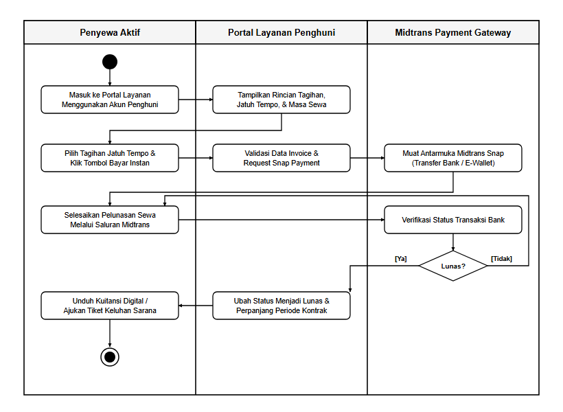

*Gambar 4.5 Activity Diagram Penyewa Aktif*

 

Begitu masuk ke portal, penyewa aktif langsung melihat daftar tagihan, tanggal jatuh tempo, dan masa aktif sewa. Memilih tagihan dan menekan tombol bayar memicu validasi *invoice* sekaligus memuat *pop-up* Midtrans Snap. Penghuni melunasi tagihan lewat kanal yang tersedia, lalu Midtrans memverifikasi status pembayaran bank. Jika sudah lunas, sistem mengubah status tagihan menjadi lunas, memperpanjang periode sewa, serta membuka akses pengunduhan kuitansi digital maupun pengajuan tiket keluhan sarana.

 

### 4.1.4 Flowchart Sistem
Logika proses menyeluruh dari penelusuran awal sampai penghuni resmi menempati unit digambarkan pada *flowchart* sistem di Gambar 4.6. Bagan alir ini memisahkan alur pengajuan reservasi dari alur pelunasan dan verifikasi lapangan.

 

*Gambar 4.6 Flowchart Sistem*

 

Alur pada Gambar 4.6 terbagi ke dalam fase pengajuan reservasi dan fase transaksi hingga penempatan kamar. Proses diawali saat calon penyewa mengecek kamar kosong di situs web. Bila unit tersedia, pemohon mengisi formulir sewa serta durasinya. Khusus label pengisian identitas pada bagan tersebut, aplikasi meminta input NIK 16 digit dan kontak wali di halaman kelengkapan profil, tanpa unggah foto KTP. Sistem lalu memuat token Midtrans untuk pelunasan setoran awal. Pembayaran yang gagal dikembalikan ke pemilihan kanal bayar. Transaksi sah mengunci kamar dan mengirim bukti ke WhatsApp pemesan, lalu ditutup dengan cek KTP fisik oleh penjaga kost saat kedatangan.

 

## 4.2 Implementasi Antarmuka Sistem
Tahap implementasi antarmuka menerjemahkan rancangan visual ke dalam halaman web yang siap digunakan. Seluruh tampilan mengusung gaya *Neo-Brutalism* dengan garis tepi hitam tegas, warna kontras tinggi, dan tata letak responsif. Pembahasan pada subbab ini dibagi ke dalam empat kelompok peran pengguna, yaitu halaman umum, calon penyewa, admin atau penjaga kost, dan penyewa aktif.

 

### 4.2.1 Implementasi Umum
Kelompok antarmuka umum berisi sebelas halaman publik yang dapat dibuka pengunjung tanpa harus masuk akun terlebih dahulu. Pengunjung bisa meninjau profil indekos, ketersediaan kamar, fasilitas, panduan pemesanan, hingga akses masuk akun dan obrolan tamu secara langsung.

1. Halaman Beranda (*Home Page*)  
Beranda utama menjadi titik temu pertama bagi mahasiswa maupun pekerja yang mencari hunian sewa di Tembalang. Melalui halaman ini, pengunjung langsung memperoleh gambaran singkat Asri Boarding House dan pintasan menuju pencarian kamar kosong. Tata letak halaman pada Gambar 4.7 juga menyesuaikan ukuran layar komputer maupun ponsel pintar.

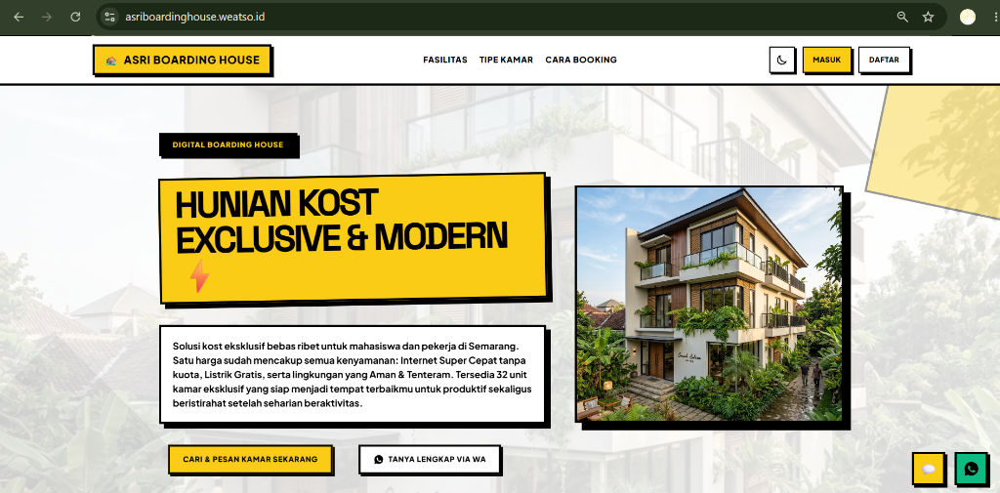

*Gambar 4.7 Halaman Beranda Utama*

Bilah navigasi teratas pada Gambar 4.7 menampilkan logo Asri Boarding House, menu utama, pengalih mode gelap, serta tombol Masuk dan Daftar. Area tengah memadukan panel pengenalan 32 unit kamar eksklusif di kiri dan foto gedung tiga lantai di kanan. Pengunjung dapat langsung menekan tombol **Cari & Pesan Kamar Sekarang**, **Tanya Lengkap via WA**, atau membuka obrolan tamu di pojok kanan bawah.

 

2. Halaman Fasilitas Kost  
Halaman fasilitas kost merinci sarana penunjang hunian yang tersedia bagi penghuni Asri Boarding House. Penyajian informasi secara terbuka membantu calon penyewa menimbang kenyamanan kamar sebelum memutuskan memesan unit. Daftar fasilitas tersebut ditampilkan pada Gambar 4.8.

*Gambar 4.8 Daftar Fasilitas Kost*

Gambar 4.8 menyajikan enam kartu fasilitas dalam kisi tiga kolom berbingkai tebal. Setiap kartu memuat kotak ikon kuning, judul tegas, serta keterangan fungsi untuk AC, *Wi-Fi High Speed*, *Free Listrik*, Kamar Mandi Dalam, Kamar Mandi Luar, dan Lemari Pakaian. Susunan kartu ringkas itu membantu pengunjung menilai kelengkapan kamar dalam satu layar.

 

3. Katalog Tipe Kamar Kost  
Katalog kamar menyajikan daftar unit beserta status ketersediaan dan tarif sewa bulanan di Asri Boarding House. Calon penghuni dapat menyaring kategori maupun mencari nomor kamar secara cepat sesuai anggaran mereka. Tampilan daftar unit tersebut diperlihatkan pada Gambar 4.9.

*Gambar 4.9 Katalog Tipe Kamar*

Bagian atas Gambar 4.9 menyediakan tombol filter Semua Tipe, VIP, Deluxe, Standar, serta kolom cari nomor kamar. Di bawahnya berjajar tiga unit lantai satu tipe Standar. Kamar 105 berstatus terisi dengan tombol **Tanya WA / Ketersediaan**, sedangkan Kamar 106 dan Kamar 107 tersedia di tarif Rp 750.000 per bulan beserta tombol **Pesan Unit**.

 

4. Halaman Galeri Kost  
Halaman galeri kost menghimpun dokumentasi visual kondisi fisik kamar di Asri Boarding House. Kehadiran foto interior ini memberi gambaran nyata bagi calon penyewa dari luar kota sebelum datang survei. Susunan galeri tersebut disajikan pada Gambar 4.10.

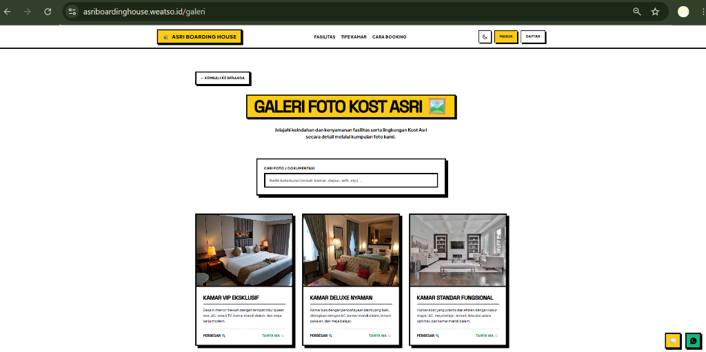

*Gambar 4.10 Galeri Foto Kost*

Gambar 4.10 menampilkan kolom pencarian dokumentasi di bagian atas beserta tiga kartu foto interior kamar bertajuk Kamar VIP Eksklusif, Kamar Deluxe Nyaman, dan Kamar Standar Fungsional. Setiap kartu dilengkapi tombol Perbesar untuk meninjau detail foto lebih jelas serta tombol Tanya WA guna menghubungi pengelola. Penyajian dokumentasi per tipe ini membantu calon penghuni membandingkan nuansa ruang sebelum memilih unit.

 

5. Halaman Alur Cara Reservasi  
Agar pengunjung baru memahami proses sewa daring secara utuh, sistem menyediakan halaman panduan alur reservasi. Halaman ini merangkum urutan pemesanan dari pemilihan kamar hingga penerimaan nota transaksi. Dengan petunjuk pada Gambar 4.11, calon penyewa dapat menyiapkan data diri seperti NIK dan nomor WhatsApp aktif sebelum mengajukan sewa.

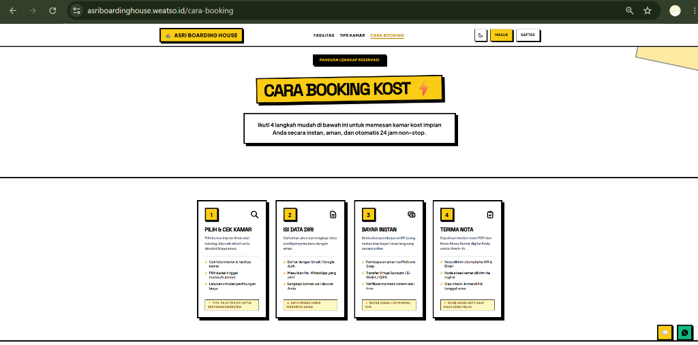

*Gambar 4.11 Panduan Alur Reservasi*

Gambar 4.11 merangkum empat langkah panduan umum, yaitu Pilih & Cek Kamar, Isi Data Diri, Bayar Instan, dan Terima Nota. Berbeda dari lima tahap transaksi interaktif di portal reservasi pada Subbab 4.2.2.4, halaman ini berfungsi sebagai ringkasan prosedural publik sesuai rancangan Bab 3. Penjelasan ringkas tiap kartu memudahkan calon penghuni memahami alur sewa sebelum bertanya ke penjaga kost.

 

6. Halaman Testimoni Penyewa Kost  
Halaman testimoni memuat ulasan penghuni yang pernah maupun sedang menetap di Asri Boarding House. Penilaian ini memberi sudut pandang tambahan mengenai kenyamanan lingkungan, kebersihan ruang, dan layanan pengelola sehari-hari. Tampilan ulasan tersebut diperlihatkan pada Gambar 4.12.

*Gambar 4.12 Halaman Testimoni Penghuni*

Antarmuka pada Gambar 4.12 menyusun testimoni ke dalam tiga kartu sejajar yang masing-masing dilengkapi lima ikon bintang kuning dan kutipan pengalaman tinggal. Pada bagian bawah tiap kartu, sistem menampilkan penanda inisial pada kotak kuning, identitas penyewa, beserta keterangan asal kampus atau pekerjaannya. Penggunaan format kartu ringkas tersebut membuat ulasan mudah dipindai calon penghuni tanpa memakan banyak ruang layar.

 

7. Halaman *Frequently Asked Questions* (FAQ)  
Halaman *Frequently Asked Questions* (FAQ) merangkum pertanyaan yang paling sering diajukan calon penyewa seputar aturan dan prosedur sewa di Asri Boarding House. Topik yang dibahas mencakup jadwal jam malam, aturan tamu, uang muka (*down payment*), hingga perpanjangan sewa bulanan. Daftar tanya jawab mandiri pada Gambar 4.13 ini membantu mengurangi pertanyaan berulang ke penjaga kost.

*Gambar 4.13 Halaman Pertanyaan Umum*

Pusat Bantuan FAQ pada Gambar 4.13 diawali kolom cari pertanyaan tepat di bawah judul halaman. Daftar pertanyaan tersusun memakai panel lipat (*accordion*) berikon tanda tambah (+) di sisi kanan. Pengunjung cukup menekan bilah pertanyaan untuk membaca jawabannya tanpa berpindah halaman.

 

8. Halaman Tentang Kami  
Halaman Tentang Kami memperkenalkan profil singkat, arah layanan, serta prinsip pengelolaan Asri Boarding House bagi mahasiswa dan pekerja di Tembalang. Kejelasan informasi pengelola membantu membangun kepercayaan calon penghuni sebelum mereka memutuskan datang atau memesan kamar secara daring. Susunan halaman profil tersebut ditampilkan pada Gambar 4.14.

*Gambar 4.14 Halaman Tentang Kami*

Bagian atas Gambar 4.14 menampilkan label miring Tentang Kami berwarna kuning diikuti pengenalan pengelola indekos. Di bawahnya berdiri kartu Visi Kami berikon mata di sebelah kiri. Kartu Misi Kami di sebelah kanan memuat empat poin misi layanan, sementara peta *Google Maps* disematkan di halaman beranda utama.

 

9. Halaman *Login User*  
Halaman *login user* menjadi gerbang autentikasi bagi calon penyewa terdaftar dan penghuni aktif sebelum mengakses dasbor masing-masing. Sistem memverifikasi kecocokan *email* dan kata sandi dengan data terenkripsi di MySQL, serta menyediakan tautan pemulihan bila pengguna lupa kata sandi. Tampilan halaman masuk akun tersebut ditunjukkan pada Gambar 4.15.

*Gambar 4.15 Halaman Login Pengguna*

Gambar 4.15 memakai desain kartu terbagi dengan panel hitam di kiri dan formulir putih di kanan. Formulirnya memuat opsi masuk dengan *Google*, kolom *email*, kata sandi, tautan lupa sandi, kotak centang *Ingat Saya*, serta tombol kuning **Masuk ke Akun**. Pengguna baru juga bisa beralih ke registrasi atau kembali ke beranda lewat tautan di bawah kartu.

 

10. Halaman *Register User*  
Calon penyewa baru perlu membuat akun lebih dahulu melalui halaman *register user* sebelum mengajukan pemesanan kamar. Formulir ini menghimpun data dasar pendaftar serta mendukung opsi pendaftaran instan menggunakan akun *Google*. Validasi kesesuaian konfirmasi kata sandi dan keunikan *email* langsung berjalan ketika formulir dikirim, seperti yang ditampilkan pada Gambar 4.16.

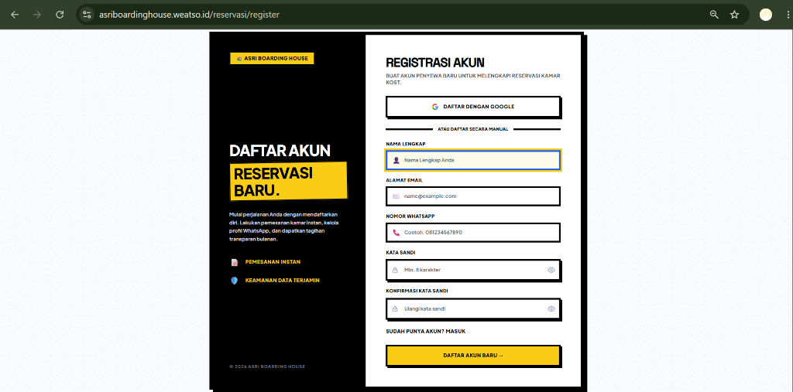

*Gambar 4.16 Halaman Pendaftaran Akun*

Kartu registrasi pada Gambar 4.16 membagi layar menjadi panel hitam di kiri dan formulir **Registrasi Akun** di kanan. Pemohon dapat memilih *Daftar dengan Google* atau mengisi nama, *email*, nomor WhatsApp, dan kata sandi. Penekanan tombol kuning **Daftar Akun Baru** mendaftarkan akun sekaligus mengarahkan pengguna ke pengisian profil.

 

11. Layanan *Chat Real-Time Guest*  
Fitur *chat real-time guest* memberi ruang bagi pengunjung untuk bertanya langsung kepada penjaga kost tanpa perlu masuk ke akun terlebih dahulu. Tamu cukup mengisikan identitas singkat guna menanyakan kamar kosong atau menjadwalkan survei lokasi. Wujud jendela prapercakapan tamu tersebut disajikan pada Gambar 4.17.

*Gambar 4.17 Chat Real Time Guest*

Jendela *widget* obrolan pada Gambar 4.17 terbuka di pojok kanan bawah dengan kepala kuning bertajuk **Tanya Admin Kost**. Formulir singkat **Ada Pertanyaan?** di dalamnya meminta masukan nama lengkap dan nomor WhatsApp aktif. Penekanan tombol hitam **Mulai Chat** langsung membuka sesi obrolan ke dasbor pengelola.

 

### 4.2.2 Implementasi Calon Penyewa
Bagian ini membahas tujuh antarmuka serta layanan integrasi bagi calon penyewa setelah mendaftarkan akun. Alurnya berjalan bertahap dari pengisian kelengkapan profil, pemantauan dasbor reservasi, simulasi biaya kamar, pelunasan lewat Midtrans, hingga pengiriman notifikasi aktivasi via WhatsApp dan *email*.

1. Halaman Lengkapi Profil  
Sebelum memesan unit kamar, calon penyewa wajib melengkapi data dasar pada halaman `/profil/complete`. Formulir ini meminta nomor WhatsApp aktif, Nomor Induk Kependudukan (NIK) sebanyak 16 digit, nama wali atau orang tua, dan nomor telepon wali. Pencatatan kontak darurat sejak awal penting agar pengelola memiliki data verifikasi awal tanpa membebani proses unggah dokumen sebelum calon penghuni tiba.

Pemeriksaan kesesuaian fisik Kartu Tanda Penduduk (KTP) tetap dilakukan langsung oleh penjaga kost ketika penghuni tiba di lokasi (*check-in*). Tampilan formulir kelengkapan profil tersebut disajikan pada Gambar 4.18.

*Gambar 4.18 Kelengkapan Profil Pemesan*

Gambar 4.18 menampilkan satu kartu putih berbingkai hitam tebal berisi kotak imbauan berwarna kuning muda dan empat kolom masukan utama. Pengembang merancang validasi teks 16 digit untuk NIK sehingga sistem tidak perlu menyimpan berkas foto KTP secara daring. Setelah keempat kolom diisi, calon penyewa cukup menekan tombol kuning **"Simpan & Lanjutkan"** untuk membuka akses ke katalog dan dasbor reservasi.

 

2. *Dashboard* Reservasi Calon Penyewa  
*Dashboard* reservasi menjadi pusat navigasi bagi pengguna akun baru yang belum aktif sebagai penghuni tetap. Halaman ini menampilkan kondisi terkini akun calon penyewa serta panduan tahapan menuju aktivasi hunian, seperti pada Gambar 4.19.

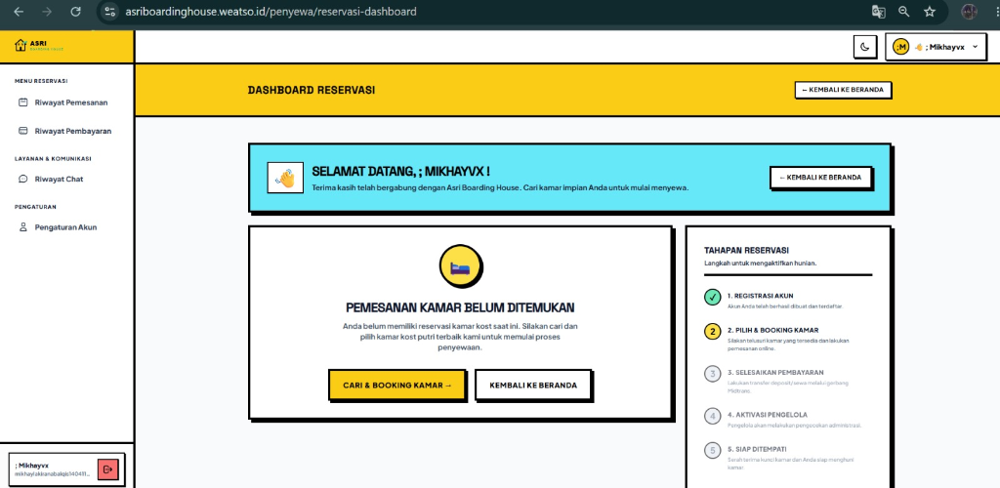

*Gambar 4.19 Dasbor Reservasi Pemesan*

Tampilan pada Gambar 4.19 memuat menu navigasi samping untuk riwayat pemesanan, pembayaran, obrolan, dan akun. Sebelum pengguna memesan unit, area utama menampilkan kotak **"Pemesanan Kamar Belum Ditemukan"**. Kotak itu dilengkapi tombol **"Cari & Booking Kamar"** serta panel **"Tahapan Reservasi"** di sisi kanan untuk memandu ke tahap pemilihan kamar.

 

3. Simulasi Biaya dan Pengajuan Kamar  
Agar calon penghuni dapat menghitung perkiraan biaya secara mandiri sebelum memesan, halaman detail unit dilengkapi kalkulator simulasi sewa. Pengguna bisa memilih skema sewa bulanan, tiga bulanan, maupun tahunan beserta opsi uang muka 30% atau pelunasan penuh 100%. Rincian estimasi langsung diperbarui secara otomatis setiap kali parameter formulir diubah, seperti diperlihatkan pada Gambar 4.20.

*Gambar 4.20 Simulasi Biaya Kamar*

Sisi kiri Gambar 4.20 memuat foto kamar beserta rincian tipe, lantai, dan luas unit. Di sisi kanan berdiri panel **"Simulasi & Reservasi"** berisi pilihan tipe sewa, durasi, tanggal masuk, dan skema bayar. Kotak kuning di bawahnya langsung menghitung estimasi total serta minimal uang muka 30% sebelum tombol **"Pesan Kamar Sekarang"** ditekan.

 

4. Portal Pembayaran Lima Tahap Reservasi  
Setelah pengajuan dibuat, transaksi diarahkan ke portal pembayaran lima tahap agar calon penyewa mudah memantau perkembangan pesanannya. Kelima tahapan tersebut mencakup tahap *booking*, diskusi dengan penjaga kost, pembayaran DP atau penuh, aktivasi akun penyewa oleh pengelola, hingga selesai. Alur bertahap pada Gambar 4.21 memastikan kesiapan kamar fisik sudah dikonfirmasi sebelum dana dikirimkan.

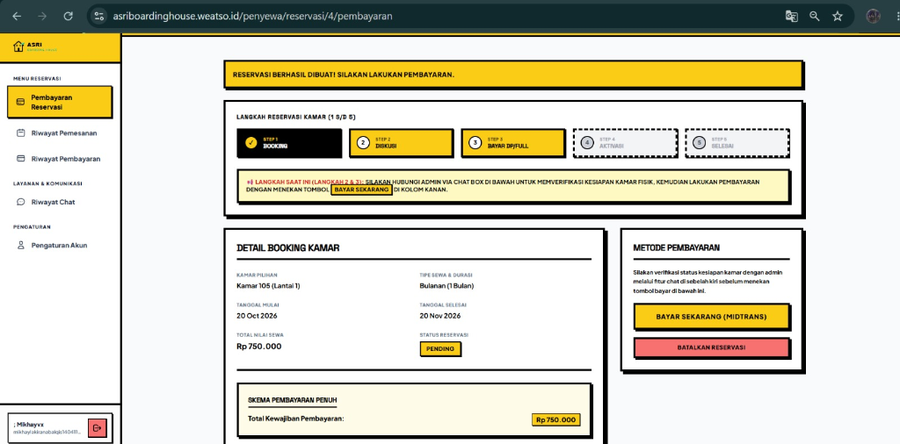

*Gambar 4.21 Tahapan Pembayaran Reservasi*

Gambar 4.21 menyorot lima kotak tahapan di atas layar beserta imbauan untuk menghubungi admin lebih dahulu. Panel **"Detail Booking Kamar"** di sisi kiri merangkum pilihan unit, durasi, jadwal, status *pending*, dan nilai pembayaran. Sementara itu, panel **"Metode Pembayaran"** di kanan menyediakan tombol kuning **"Bayar Sekarang (Midtrans)"** serta tombol merah **"Batalkan Reservasi"**.

 

5. Integrasi *Payment Gateway* Midtrans  
Transaksi pembayaran reservasi terhubung dengan layanan *payment gateway* Midtrans Snap. Secara arsitektural, integrasi Midtrans mendukung berbagai kanal pembayaran non-tunai sesuai kebutuhan sistem yang diuraikan pada Bab 2. Setelah pembayaran diselesaikan pengguna, server Midtrans mengirimkan notifikasi balik (*webhook callback*) sehingga status pesanan di basis data diperbarui secara otomatis.

Pada lingkungan uji sistem yang ditampilkan pada Gambar 4.22, kanal pembayaran yang aktif digunakan untuk memproses tagihan adalah *Virtual Account* Bank BCA. Tampilan antarmuka jendela pembayaran Midtrans tersebut dapat dilihat di bawah ini.

*Gambar 4.22 Jendela Pembayaran Midtrans*

Jendela *pop-up* pada Gambar 4.22 menampilkan nama usaha Asri Boarding House, nominal tagihan Rp 750.000, kode transaksi pemesanan, serta batas waktu pembayaran selama 24 jam. Di bawah bagian instruksi Bank BCA, sistem menyajikan nomor *Virtual Account* beserta tombol salin, panduan langkah transfer, dan tombol **"Check status"** di paling bawah. Seluruh data pembayaran tersebut ditukar secara aman melalui verifikasi tanda tangan kriptografi Midtrans.

 

6. Integrasi *WhatsApp Gateway* Fonnte  
Ketika penjaga kost mengaktifkan hunian setelah pembayaran terkonfirmasi, sistem otomatis mengirimkan pesan sambutan ke nomor WhatsApp penghuni melalui API *WhatsApp Gateway* Fonnte. Pemberitahuan instan ini memastikan penyewa segera mengetahui kamar pesanannya telah aktif dan siap digunakan tanpa harus menunggu kabar manual. Pesan aktivasi WhatsApp yang diterima pengguna diperlihatkan pada Gambar 4.23.

*Gambar 4.23 Pesan Aktivasi WhatsApp*

Tangkapan layar pada Gambar 4.23 memperlihatkan pesan otomatis dengan tajuk sambutan penyewa baru yang dikirim melalui layanan `fonnte.com`. Isi pesannya menyapa nama penyewa, mengonfirmasi bahwa unit yang dipesan seperti Kamar 101 telah berstatus aktif, serta mengarahkan penghuni mengakses portal penyewa guna mengurus administrasi sewa. Pesan penutup beridentitas manajemen Asri Boarding House ini menjadi pemberitahuan resmi paling cepat bagi pengguna.

 

7. Integrasi *Email Gateway* SMTP  
Selain pesan instan WhatsApp, sistem mengirimkan pemberitahuan aktivasi resmi ke surat elektronik pengguna menggunakan protokol SMTP. Arsip digital di dalam kotak masuk *email* ini berguna apabila penyewa memerlukan catatan formal tarif dan nomor kamar dari perangkat lain sewaktu-waktu. Tampilan *email* konfirmasi tersebut disajikan pada Gambar 4.24.

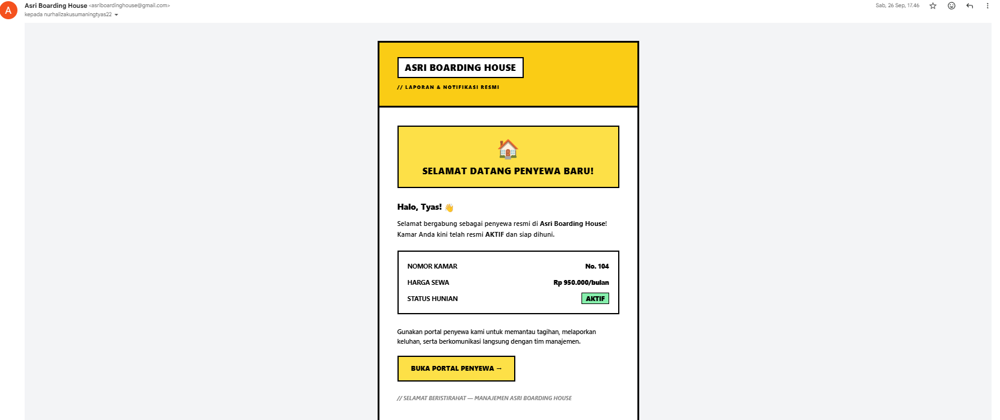

*Gambar 4.24 Email Konfirmasi Reservasi*

Gambar 4.24 menampilkan format surat elektronik bertema *Neo-Brutalism* berkop Asri Boarding House dengan kotak kuning berjudul **"Selamat Datang Penyewa Baru!"**. Area tengah memuat rincian ringkas berupa nomor kamar, tarif sewa bulanan, serta lencana hijau bertuliskan status hunian **AKTIF**. Di bagian bawah pesan tersedia tombol kuning **"Buka Portal Penyewa"** sehingga penghuni dapat langsung masuk ke akunnya dari kotak masuk *email*.

 

### 4.2.3 Implementasi Admin
Bagian ini merangkum sebelas antarmuka kendali bagi penjaga kost Asri Boarding House. Lewat panel administrator, pengelola memantau keterisian 32 kamar, memverifikasi reservasi, dan mengawasi tagihan bulanan. Aktivitas pencatatan kas keluar, unduhan laporan keuangan, hingga balasan keluhan dan obrolan tamu juga terpusat di sini.

1. Halaman *Admin Login*  
Halaman *admin login* memisahkan jalur masuk pengelola dari portal tamu maupun penghuni. Isolasi rute ini mencegah akses tidak sah ke data kamar, pembukuan kas, dan biodata penyewa, sekaligus membatasi percobaan masuk yang gagal secara beruntun seperti pada Gambar 4.25.

*Gambar 4.25 Halaman Login Administrator*

Kartu *split screen* pada Gambar 4.25 menampilkan panel informasi hitam di kiri dengan keterangan statistik dan akses terenkripsi. Formulir putih **"Admin Login"** di kanan meminta *email* admin dan kata sandi, disertai opsi lupa sandi serta *Ingat Saya*. Tombol kuning **"Masuk Administrator"** dan tombol kembali ke beranda melengkapi navigasi halaman.

 

2. Halaman *Dashboard Admin*  
Setelah berhasil masuk, penjaga kost diarahkan menuju halaman utama *dashboard admin* yang merangkum kondisi operasional Asri Boarding House secara menyeluruh. Pengelola dapat memantau okupansi 32 kamar, arus kas masuk dan keluar bulan berjalan, tagihan belum lunas, hingga reservasi terbaru dalam satu tampilan, seperti pada Gambar 4.26.

*Gambar 4.26 Dasbor Operasional Administrator*

Gambar 4.26 menyajikan delapan kartu ringkasan warna-warni untuk kamar, pemasukan, pengeluaran, keuntungan bersih, tagihan tertunda, reservasi masuk, dan klik WhatsApp. Tepat di bawahnya berdiri grafik batang **Tren Pemasukan (12 Bulan Terakhir)** berdampingan dengan diagram donat **Status Kamar**, lalu tabel **Tagihan Terbaru**. Menu navigasi vertikal tertata di sisi kiri, sedangkan pojok kanan atas menyediakan mode gelap serta menu admin.

 

3. Modul Manajemen Kamar  
Modul manajemen kamar memberi kendali penuh kepada admin atas seluruh 32 unit kamar sewa. Pengelola dapat menambah unit baru, memantau fasilitas tiap ruang, serta memperbarui status kamar guna mencegah *double booking* seperti pada Gambar 4.27.

*Gambar 4.27 Pengelolaan Data Kamar*

Kepala halaman Gambar 4.27 menyediakan tombol **"Kelola Fasilitas"** serta tombol kuning **"Tambah Kamar"**. Admin dapat menyaring unit melalui empat kartu status, bilah status cepat, pengalih tampilan **Tabel** atau **Denah/Visual Grid**, serta filter lantai dan tipe. Tabel di bagian bawah merinci foto, nomor kamar, lantai, tipe, fasilitas, tarif, status, penghuni aktif, dan aksi.

 

4. Modul Manajemen Fasilitas  
Halaman manajemen fasilitas mengelola data master sarana kamar kost yang terhubung ke halaman publik maupun katalog kamar admin. Pengelola bisa menambahkan item fasilitas baru, menyunting keterangan ruang, mengganti ikon emoji penanda, atau menghapus sarana yang tidak lagi tersedia, seperti pada Gambar 4.28.

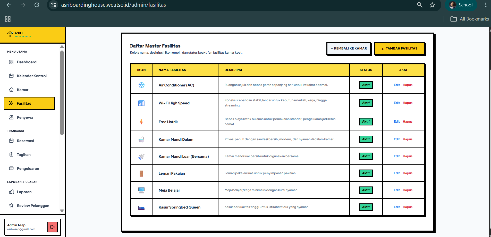

*Gambar 4.28 Pengelolaan Fasilitas Kost*

Gambar 4.28 menampilkan card **"Daftar Master Fasilitas"** dengan tombol navigasi **"Kembali ke Kamar"** dan tombol kuning **"Tambah Fasilitas"** di kanan atas. Tabel master di bawahnya terdiri atas kolom ikon emoji, nama fasilitas, deskripsi fungsi, lencana hijau status **Aktif**, serta tautan aksi **Edit** dan **Hapus**. Pengelolaan berbasis tabel master seperti ini menjaga konsistensi penamaan fasilitas di seluruh bagian aplikasi.

 

5. Modul Manajemen Penyewa  
Seluruh data penghuni aktif maupun penghuni yang melakukan pendaftaran langsung di lokasi (*walk-in*) dihimpun di dalam modul manajemen penyewa. Halaman ini mencatat nama, kontak WhatsApp, NIK 16 digit, nomor kamar, durasi sewa, tanggal masuk, serta data wali darurat penghuni. Saat penghuni mengakhiri masa tinggal, penjaga kost juga memproses penonaktifan serta prosedur *check-out* kamar melalui modul yang tampak pada Gambar 4.29.

*Gambar 4.29 Pengelolaan Data Penghuni*

Bagian atas Gambar 4.29 memuat tombol ekspor **PDF**, **Excel/CSV**, dan tombol kuning **"Tambah Penyewa"** untuk pendaftaran langsung. Kolom pencarian di tengah menyaring nama, *email*, kamar, maupun nomor ponsel, bersama pilihan **Status Keaktifan**. Tabel utama merinci kontak, kamar, NIK 16 digit, durasi sewa, wali, status aktif, serta tombol **"Detail"** untuk riwayat tagihan penghuni.

 

6. Modul Manajemen Reservasi  
Antarmuka manajemen reservasi memproses daftar pengajuan kamar dari calon penyewa daring. Penjaga kost mengecek status pelunasan DP atau bayar penuh Midtrans sebelum mengaktifkan kamar. Pencocokan KTP fisik tetap dilakukan saat pemohon tiba di lokasi kost sesuai Gambar 4.30.

*Gambar 4.30 Pengelolaan Reservasi Masuk*

Gambar 4.30 memuat bilah cari Order ID, nama, maupun kamar bersama filter **Status Reservasi** serta tombol **Filter** dan **Reset**. Tabel pesanan menampilkan Order ID, calon penyewa, kamar, tipe sewa, tanggal mulai, dan lencana status **Dikonfirmasi**. Penjaga kost menekan tombol biru **"Detail"** di kolom aksi untuk memeriksa pelunasan sekaligus mengaktifkan penyewa.

 

7. Modul Manajemen Tagihan  
Siklus penagihan sewa bulanan dan denda keterlambatan seluruh penghuni dipantau terpusat melalui modul manajemen tagihan. Tagihan rutin diterbitkan oleh penjadwal otomatis (*cron job*) sehingga penjaga kost cukup memeriksa status pelunasan tanpa membuat faktur manual satu per satu. Tampilan daftar penagihan bulanan tersebut disajikan pada Gambar 4.31.

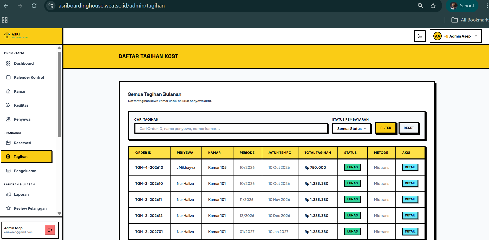

*Gambar 4.31 Pengelolaan Tagihan Bulanan*

Panel filter pada Gambar 4.31 memudahkan pencarian berdasarkan Order ID, nama penghuni, nomor kamar, atau **Status Pembayaran**. Tabel **"Semua Tagihan Bulanan"** merinci kode tagihan, penyewa, kamar, periode, jatuh tempo, total biaya, status **Lunas**, dan metode Midtrans. Tombol biru **"Detail"** di ujung baris berguna untuk membuka rincian nota atau mengirim pengingat ulang.

 

8. Modul Manajemen Pengeluaran  
Arus kas keluar untuk kebutuhan operasional harian indekos dicatat melalui modul manajemen pengeluaran. Penjaga kost membukukan pembayaran listrik, air PDAM, perawatan fasilitas, maupun pengeluaran lain-lain lengkap dengan lampiran nota agar laporan laba bersih tetap akurat. Tampilan antarmuka kas keluar tersebut diperlihatkan pada Gambar 4.32.

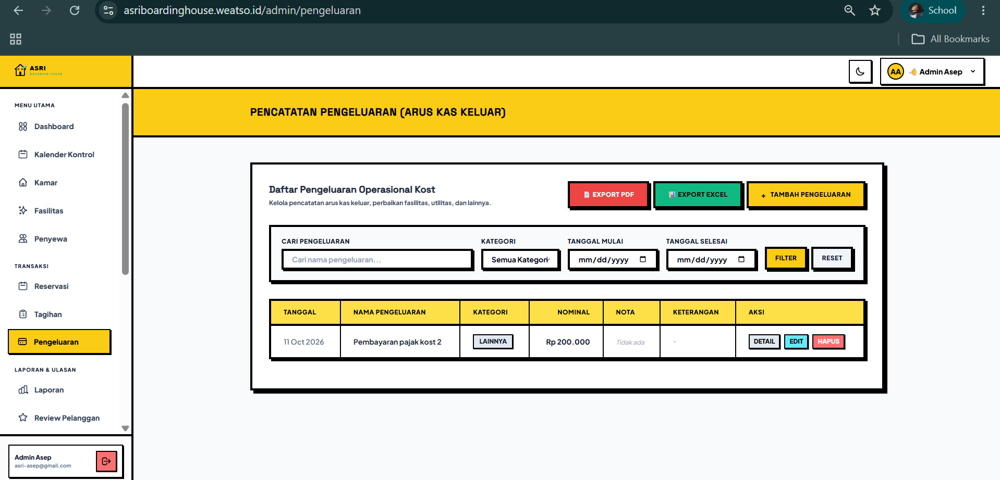

*Gambar 4.32 Pencatatan Pengeluaran Operasional*

Bagian kanan atas Gambar 4.32 memuat tombol **"Export PDF"**, **"Export Excel"**, dan tombol kuning **"Tambah Pengeluaran"**. Di tengah tersaji bilah pencarian nama pengeluaran, filter kategori, rentang tanggal mulai dan selesai, serta tombol **Filter** dan **Reset**. Tabel daftar pengeluaran merinci tanggal, nama transaksi, kategori, nominal, ketersediaan nota, keterangan, serta tiga tombol aksi **Detail**, **Edit**, dan **Hapus**.

 

9. Modul Laporan Keuangan  
Modul laporan keuangan mengonsolidasikan data tagihan masuk dan pengeluaran operasional ke dalam rekap kas otomatis. Pengelola dapat memantau arus kas dan mengunduh laporannya ke format PDF maupun Excel dalam hitungan detik, seperti pada Gambar 4.33.

*Gambar 4.33 Laporan Rekapitulasi Kas*

Kartu **"Filter & Ekspor Laporan"** pada Gambar 4.33 menyediakan filter bulan, tahun, dan status bersama tombol **PDF** dan **Excel**. Baris tengah menampilkan tiga kartu ringkasan berwarna untuk total arus kas masuk, arus kas keluar, dan saldo bersih akhir. Tabel **"Riwayat Keuangan Kost"** di bawahnya merinci Order ID, periode, nama penyewa, nomor kamar, total tagihan, metode, dan status.

 

10. Modul Manajemen Keluhan Penyewa  
Laporan kerusakan fasilitas maupun gangguan kenyamanan penghuni diterima terpusat pada halaman manajemen keluhan. Penjaga kost meninjau foto kendala lalu memperbarui status perbaikan agar pelapor mendapat kepastian progres, seperti pada Gambar 4.34.

*Gambar 4.34 Pengelolaan Keluhan Fasilitas*

Daftar keluhan pada Gambar 4.34 menyediakan tombol pil **Semua Keluhan**, **Pending**, **Diproses**, **Selesai**, serta kolom cari penyewa atau kamar. Setiap baris mencatat pelapor, nomor kamar, judul, kategori, tanggal lapor, status, dan tombol biru **"Detail"**. Tombol detail tersebut dipakai penjaga kost untuk merespons aduan maupun memperbarui status perbaikan.

 

11. Modul Pengelolaan *Chat Guest*  
Pertanyaan pengunjung publik dari *widget* obrolan beranda masuk langsung ke modul *chat guest* admin. Penjaga kost pun dapat membalas pertanyaan kamar kosong atau jadwal survei dari satu panel, seperti pada Gambar 4.35.

*Gambar 4.35 Pengelolaan Obrolan Tamu*

Layar obrolan pada Gambar 4.35 membagi antarmuka menjadi daftar pertanyaan tamu di kolom kiri dan jendela percakapan aktif di kolom kanan. Di kepala panel percakapan tersedia identitas tamu beserta tombol **Hubungi WA**, **Tandai Selesai**, dan **Hapus** untuk menindaklanjuti percakapan. Bagian tengah memuat riwayat gelembung pesan tamu dan balasan admin bertanda waktu, sedangkan sisi paling bawah berisi kolom ketik pesan dan tombol hitam **"Kirim"**.

 

### 4.2.4 Implementasi Penyewa Aktif
Bagian terakhir subbab ini memaparkan tujuh antarmuka khusus bagi penghuni tetap Asri Boarding House. Lewat portal layanan mandiri, penyewa dapat memantau tagihan, melunasi sewa via Midtrans, dan memperbarui akun. Fasilitas pelaporan keluhan, riwayat pembayaran, serta unduhan nota PDF juga tersedia di dalamnya.

1. Halaman *Login* Penyewa Aktif  
Penghuni aktif mengakses portal pengelolaan sewa secara langsung melalui halaman *login* penyewa. Jalur autentikasi terpisah ini membawa penghuni ke dasbor hunian tanpa melewati halaman penawaran reservasi lagi. Tampilan halaman masuk penghuni aktif disajikan pada Gambar 4.36.

*Gambar 4.36 Login Penyewa Aktif*

Gambar 4.36 membagi layar menjadi panel hitam **"Portal Utama Penyewa Kost"** dan formulir putih **"Portal Penyewa"**. Penghuni dapat masuk via akun *Google* ataupun memakai kombinasi *email* atau WhatsApp dengan kata sandi. Tombol kuning **"Masuk ke Dashboard Penyewa"**, opsi *Ingat Saya*, serta tautan beranda melengkapi halaman ini.

 

2. Halaman *Dashboard* Penyewa  
Setelah masuk, penghuni disambut halaman *dashboard* penyewa yang merangkum informasi kamar, tagihan sewa, dan pintasan laporan keluhan. Penyusunan ringkasan hunian pada Gambar 4.37 memudahkan penyewa memantau kewajibannya tiap bulan.

*Gambar 4.37 Dasbor Penyewa Aktif*

Baris atas Gambar 4.37 menampilkan lima kartu ringkas untuk kamar, kategori tipe, uang jaminan, tagihan tertunda, dan total terbayar. Di bawahnya berdiri spanduk biru muda **"Ada Fasilitas Rusak atau Bermasalah?"** lengkap dengan tombol **"Buat Laporan Keluhan"**. Area bawah layar menyajikan grafik batang **Tren Pengeluaran Sewa (12 Bulan Terakhir)** dan diagram donat **Status Tagihan**.

 

3. Halaman Tagihan Penyewa  
Kewajiban pembayaran bulanan beserta jatuh temponya tersaji terbuka pada halaman tagihan penyewa. Penghuni cukup meninjau faktur tertunda lalu melunasinya lewat Midtrans Snap seperti pada Gambar 4.38.

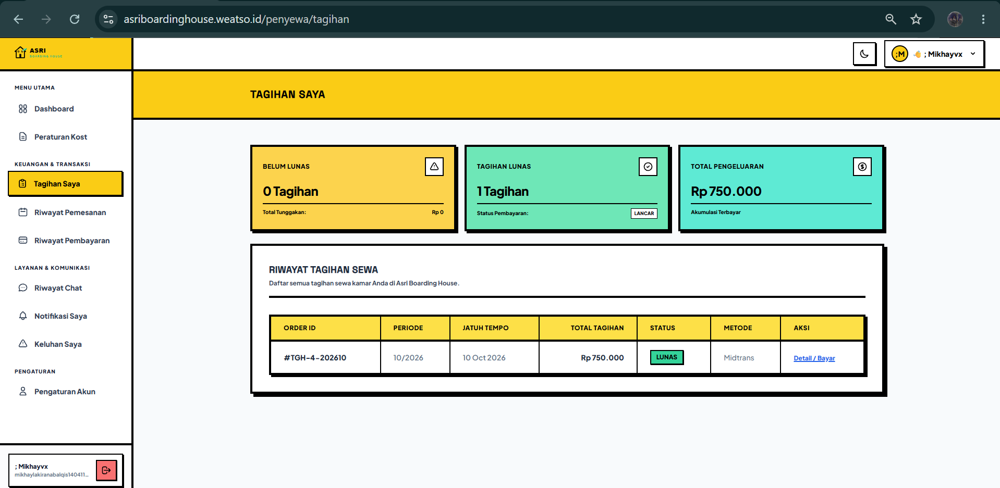

*Gambar 4.38 Tagihan Sewa Penyewa*

Gambar 4.38 diawali tiga kartu ringkasan tagihan belum lunas, lunas, dan total pengeluaran. Tabel **"Riwayat Tagihan Sewa"** di bawahnya merinci Order ID, periode, jatuh tempo, total biaya, status **Lunas**, dan metode Midtrans. Tautan **"Detail / Bayar"** di ujung baris dipakai untuk membayar tagihan atau mencetak kuitansi transaksi.

 

4. Halaman Kelola Akun dan Profil  
Halaman kelola akun memberi kebebasan kepada penyewa aktif untuk memperbarui data kontak serta kata sandi. Sementara itu, data NIK 16 digit tetap terkunci dari pendaftaran awal dan cek KTP fisik saat kedatangan. Pengaturan akun tersebut tampak pada Gambar 4.39.

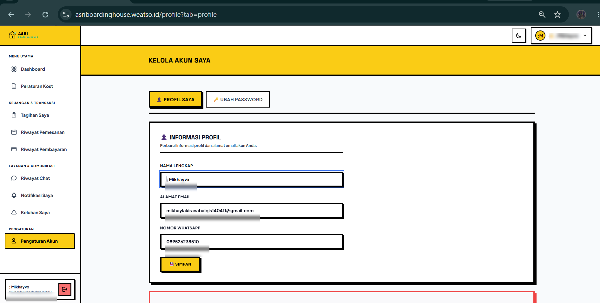

*Gambar 4.39 Pengaturan Profil Penghuni*

Tampilan pada Gambar 4.39 memakai navigasi dua *tab* di atas kartu utama, yakni **"Profil Saya"** dan **"Ubah Password"**. Pada *tab* pertama, formulir **"Informasi Profil"** memuat masukan nama, *email*, nomor WhatsApp, serta tombol kuning **"Simpan"**. Pemisahan menu ubah kata sandi dan hapus akun mencegah terjadinya perubahan data secara tidak sengaja.

 

5. Halaman Riwayat Pembayaran  
Seluruh catatan transaksi reservasi awal maupun pembayaran sewa rutin terhimpun secara berurutan di dalam halaman riwayat pembayaran. Penghuni dapat memisahkan riwayat uang muka pengajuan kamar dari pembayaran bulanan sehingga arsip keuangan pribadi tetap tertata rapi, seperti ditunjukkan pada Gambar 4.40.

*Gambar 4.40 Riwayat Transaksi Pembayaran*

Gambar 4.40 diawali tiga kartu metrik berisi total bayar *booking*, total bayar bulanan, dan jumlah transaksi berhasil. Di bawahnya tersaji tabel **"Pembayaran Booking Kamar (Reservasi)"** bersama tombol **"Rincian"** dan tabel **"Pembayaran Tagihan Bulanan"**. Pemisahan tabel itu memudahkan penghuni melacak setoran awal dan bayar rutin secara terpisah.

 

6. Halaman Pengaduan dan Keluhan  
Saat fasilitas kamar bermasalah, penghuni cukup melaporkannya melalui halaman keluhan dan pengaduan. Tombol pembuatan laporan baru membuka formulir keluhan berfoto, sedangkan daftar riwayat di Gambar 4.41 memantau progres pengerjaannya.

*Gambar 4.41 Pengajuan Keluhan Kamar*

Kartu **"Riwayat Keluhan Anda"** pada Gambar 4.41 dilengkapi tombol kuning **"Buat Keluhan Baru"** yang menuju ke halaman formulir aduan. Di tengah kartu tersedia filter status dan kolom cari judul keluhan. Daftar aduan di bawahnya mencatat judul, kategori, tanggal lapor, status pengerjaan, tanggapan admin, serta tombol aksi.

 

7. Dokumen Kuitansi Nota PDF  
Setiap tagihan sewa yang telah diverifikasi lunas dilengkapi halaman cetak nota yang dapat diunduh menjadi dokumen PDF berukuran A5 melalui pustaka *html2pdf.js*. Kuitansi elektronik ini memuat informasi tagihan, nomor faktur, serta tanda lunas digital sehingga sah disimpan sebagai bukti transaksi pribadi, seperti pada Gambar 4.42.

*Gambar 4.42 Dokumen Kuitansi Digital*

Gambar 4.42 memperlihatkan kepala nota kuning Asri Boarding House beserta alamat Tembalang dan kontak WhatsApp resmi. Di bagian tengah termuat kotak **"Ditagihkan Kepada"** dengan nama disamarkan pada gambar dokumentasi, kotak **"Detail Pembayaran"**, serta rincian sewa sebesar Rp 750.000. Stempel hijau **"LUNAS"**, blok tanda tangan Pengelola Kost, dan keterangan validasi otomatis menutup kaki dokumen.

 

## 4.3 Implementasi Kode Program
Tahap implementasi kode menerjemahkan seluruh rancangan arsitektur dan aturan bisnis ke dalam aplikasi Laravel 12 berbasis PHP. Logika bisnis penting dipisahkan ke dalam kelas layanan (*Service Layer*) agar validasi data, penguncian transaksi kamar, serta komunikasi API eksternal tetap rapi dan aman. Pembahasan kode dibagi ke dalam empat kelompok fungsi, yakni autentikasi dan hak akses, pemesanan kamar, *payment gateway*, serta penjadwalan dan notifikasi.

 

### 4.3.1 Implementasi Autentikasi dan Hak Akses
Lapisan autentikasi mengatur keamanan sesi masuk sekaligus memastikan setiap pengguna hanya bisa membuka portal sesuai perannya. Pemisahan hak akses ini menjaga batas wewenang antara pengunjung umum, calon penyewa, penjaga kost, dan penghuni aktif.

1. Pembatasan Hak Akses Peran (*Role Middleware*)  
Lapisan penengah `RoleMiddleware` memeriksa setiap permintaan rute privat sebelum diteruskan ke pengendali halaman. Apabila pengguna belum masuk atau memiliki peran yang tidak sesuai dengan daftar peran rute, sistem langsung menghentikan permintaan tersebut seperti pada Gambar 4.43.

*Gambar 4.43 Kode Pembatasan Akses*

Potongan kode pada Gambar 4.43 memperlihatkan dua pengecekan berurutan di dalam metode `handle()`. Pemeriksaan pertama menolak pengguna yang belum masuk dengan respons JSON 401 atau pengalihan ke halaman *login*. Pemeriksaan kedua menolak peran yang tidak berhak memakai kode status HTTP 403. Penjagaan berlapis di tingkat *middleware* ini melindungi seluruh rute privat secara konsisten.

 

2. Pengalihan Portal Pasca-autentikasi (*Auth Redirect*)  
Setelah pengguna berhasil masuk melalui portal penyewa maupun pendaftaran akun, kelas `AuthRedirectService` menentukan rute halaman tujuan secara dinamis. Layanan ini meninjau kelengkapan nomor WhatsApp, URL tujuan sebelumnya (*intended URL*), status aktif penghuni, hingga ada tidaknya transaksi reservasi berjalan seperti pada Gambar 4.44.

*Gambar 4.44 Kode Pengalihan Portal*

Gambar 4.44 menunjukkan urutan keputusan di dalam metode `resolvePostAuthDestination()`. Pengguna yang belum mengisi nomor WhatsApp langsung diarahkan menuju `/profil/complete`. Sementara itu, rute `/admin` dikecualikan dari pengalihan *intended URL* karena pengelola memiliki portal masuk tersendiri. Untuk jalur cadangan (*fallback*), penyewa aktif dibawa ke `penyewa.dashboard`. Calon penyewa yang masih memproses transaksi diarahkan ke `penyewa.reservasi.dashboard`, sedangkan akun lainnya kembali ke beranda.

 

### 4.3.2 Implementasi Pemesanan Kamar
Logika bisnis pada kelas `ReservasiService` mengendalikan pembuatan transaksi sekaligus menjaga konsistensi status 32 unit kamar. Mekanisme ini memastikan dua pemohon tidak pernah mendapatkan kamar yang sama pada tanggal sewa yang tumpang-tindih.

1. Transaksi ACID dan Penguncian Baris Unit Kamar  
Untuk mengatasi permintaan serentak (*race condition*) pada unit kamar yang sama, metode `buatReservasi()` membungkus seluruh langkah pemesanan di dalam transaksi basis data berprinsip ACID. Penguncian baris unit kamar mencegah proses lain mengubah data hingga validasi dan penyimpanan selesai, seperti ditampilkan pada Gambar 4.45.

*Gambar 4.45 Kode Penguncian Kamar*

Di dalam Gambar 4.45, blok `DB::transaction()` diawali pemanggilan `Kamar::lockForUpdate()` untuk mengunci baris unit pilihan secara eksklusif. Sistem lalu menghitung tanggal selesai dan mengecek benturan jadwal melalui `cekDoubleBooking()`. Rincian biaya dihitung lewat `hitungHarga()` sebelum entri berstatus *pending* disimpan dan *event* `ReservasiDibuat` dikirim. Jika jadwal kamar ternyata bentrok, pengecualian validasi langsung membatalkan seluruh transaksi agar basis data tetap bersih.

 

2. Algoritma Pengecekan Benturan (*Double Booking*) Kamar  
Ketepatan ketersediaan kamar dijaga oleh metode `cekDoubleBooking()` di dalam layanan yang sama. Fungsi itu mencocokkan rentang tanggal pengajuan baru terhadap reservasi aktif maupun kontrak penyewa berjalan pada kamar terkait, seperti pada Gambar 4.46.

*Gambar 4.46 Kode Pemeriksaan Jadwal*

Kode pada Gambar 4.46 menjalankan dua kueri pemeriksa secara berurutan. Kueri pertama mencari reservasi aktif berjadwal bentrok disertai `lockForUpdate()` saat berada di dalam transaksi. Kueri kedua memeriksa penghuni berstatus aktif yang masa tinggalnya beririsan dengan periode baru. Fungsi mengembalikan nilai `true` bila salah satu terpenuhi sehingga pemesanan ganda otomatis ditolak.

 

### 4.3.3 Implementasi *Payment Gateway*
Integrasi *payment gateway* Midtrans Snap dibangun pada kelas `MidtransService` dan pengendali `MidtransCallbackController`. Secara arsitektural, integrasi ini mendukung ragam kanal pembayaran non-tunai sesuai rancangan Bab 2, sementara pengujian lapangan berjalan lancar menggunakan kanal *Virtual Account* Bank BCA.

1. Pembuatan Transaksi dan *Snap Token* Midtrans  
Setiap tagihan sewa maupun uang muka memerlukan *Snap token* sebelum jendela pembayaran Midtrans muncul di layar pengguna. Layanan `MidtransService` menyusun rincian nominal sewa, denda, dan durasi kedaluwarsa transaksi secara terstruktur sebelum memanggil API Midtrans, seperti terlihat pada Gambar 4.47.

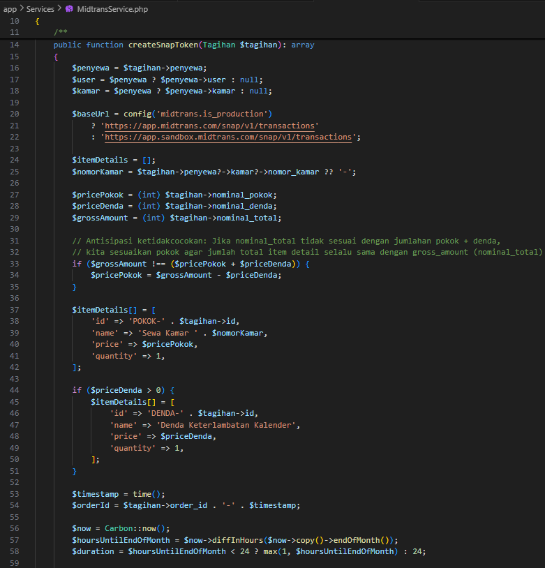

*Gambar 4.47 Kode Token Midtrans*

Metode `createSnapToken()` pada Gambar 4.47 memetakan komponen pokok dan denda ke dalam larik `$itemDetails`. Jika ada selisih nominal, nilai sewa pokok disesuaikan agar jumlah baris cocok dengan `gross_amount`. Kode lalu membentuk nomor pesanan unik beserta masa kedaluwarsa 24 jam, atau dibatasi sisa jam hingga akhir bulan bila kurang dari sehari. Parameter tersebut dikirim melalui permintaan HTTP berautentikasi *server key* untuk memperoleh *Snap token* resmi.

 

2. Validasi *Signature Key* dan *Webhook Callback* Midtrans  
Konfirmasi pelunasan dari server Midtrans diterima oleh pengendali `MidtransCallbackController` tanpa menunggu pengecekan manual penjaga kost. Setiap notifikasi masuk wajib melewati validasi tanda tangan kriptografi SHA-512 guna mencegah pemalsuan status pembayaran oleh pihak luar, seperti pada Gambar 4.48.

*Gambar 4.48 Kode Validasi Webhook*

Cuplikan kode pada Gambar 4.48 menampilkan perbandingan hash `signature_key` menggunakan fungsi *hash_equals()* agar terhindar dari serangan berbasis selisih waktu (*timing attack*). Setelah melewati saringan ping uji dari dasbor Midtrans, kode melakukan pengecekan idempoten berdasarkan `transaction_id` guna memastikan transaksi lunas tidak diproses dua kali. Bila seluruh pemeriksaan valid, tagihan atau reservasi langsung diperbarui statusnya secara otomatis.

 

### 4.3.4 Implementasi Penjadwalan dan Notifikasi
Otomasi operasional harian dijalankan melalui penjadwal tugas Laravel bersama layanan pengiriman pesan WhatsApp dan surat elektronik. Gabungan modul ini membebaskan penjaga kost dari pekerjaan berulang seperti pembuatan tagihan tanggal 1 dan pengiriman pengingat jatuh tempo.

1. Penjadwalan Tugas Otomatis (*Task Scheduler Cron Job*)  
Seluruh tugas berkala didefinisikan pada berkas `routes/console.php` dengan zona waktu `Asia/Jakarta`. Penjadwal otomatis ini mengurus penerbitan tagihan, denda tanggal 10, pengingat kontrak habis, dan pembatalan reservasi kedaluwarsa seperti pada Gambar 4.49.

*Gambar 4.49 Kode Penjadwal Tugas*

Gambar 4.49 memuat empat jadwal utama tugas latar belakang. Perintah `tagihan:generate-bulanan` berjalan setiap tanggal 1 pukul 00:05 WIB. Selanjutnya, `tagihan:proses-keterlambatan` dieksekusi pukul 01:00 WIB untuk menandai tagihan lewat tanggal 10 dan memicu denda *flat* 5% satu kali lintas bulan. Dua jadwal lainnya menjalankan `kontrak:reminder-habis` pukul 08:00 WIB dan `reservasi:cancel-expired` tiap jam, lengkap dengan `withoutOverlapping()` agar eksekusi tidak bertumpuk.

 

2. Integrasi Layanan Pesan *WhatsApp Gateway* Fonnte  
Notifikasi tagihan bulanan maupun kabar aktivasi kamar dikirim langsung ke ponsel penyewa melalui layanan `FonnteService`. Sebelum memanggil endpoint API Fonnte, nomor ponsel tujuan dinormalisasi ke format kode negara `62` agar pengiriman tidak gagal seperti pada Gambar 4.50.

*Gambar 4.50 Kode Integrasi WhatsApp*

Metode `kirimPesan()` pada Gambar 4.50 menyaring nomor kosong, memformat angka ponsel lewat `formatNomor()`, lalu mencatat log uji bila token API belum terisi. Pada mode aktif, aplikasi mengirim permintaan HTTP POST bertenggat koneksi 3 detik ke `https://api.fonnte.com/send`. Keberhasilan pengiriman dipastikan melalui pemeriksaan status kode HTTP serta balasan JSON dari server Fonnte.

 

3. Integrasi Pengiriman Dokumen Tagihan via *Email Gateway* SMTP  
Pengiriman pemberitahuan tagihan melalui surat elektronik ditangani oleh kelas *mailable* `TagihanBulanMail` melalui protokol SMTP. Pemakaian mekanisme antrean latar belakang (*ShouldQueue*) menjaga waktu respons antarmuka tetap cepat saat ratusan tagihan diterbitkan serentak pada awal bulan, seperti pada Gambar 4.51.

*Gambar 4.51 Kode Pengiriman Email*

Gambar 4.51 memperlihatkan metode `envelope()` yang menyusun judul surat berisi kode tagihan unik setiap penghuni. Di bawahnya, metode `content()` memuat relasi pengguna dan kamar via `loadMissing()`. Nilai sewa pokok, deposit, dan denda lalu diteruskan ke templat HTML `emails.tagihan-baru` beserta tautan portal penyewa.

 

## 4.4 Pengujian Sistem
Pengujian fungsionalitas aplikasi dijalankan menggunakan metode kotak hitam (*black box testing*) untuk memastikan setiap fitur bekerja sesuai kebutuhan pengguna. Evaluasi difokuskan pada kesesuaian masukan pengguna dan keluaran antarmuka tanpa memeriksa baris kode di baliknya. Skenario uji dibagi ke dalam enam ranah, yakni autentikasi akun, katalog publik, alur reservasi, portal penyewa, manajemen admin, dan penjadwal tugas otomatis. Rekapitulasi 60 skenario pengujian terangkum pada Tabel 4.1.

 

**Tabel 4.1** Hasil Pengujian Fungsionalitas Sistem (Black Box Testing)

| No | Modul / Skenario Uji | Prosedur Pengujian / Masukan Data | Hasil yang Diharapkan | Hasil Pengujian | Status |
| :---: | :--- | :--- | :--- | :--- | :---: |
| **Domain I: Autentikasi, Hak Akses & Profil Pengguna** | | | | | |
| 1 | *Login* Administrator kredensial valid | Masukkan *email* dan kata sandi admin yang benar pada halaman `/admin/login` | Akses diterima, pengguna diarahkan ke `/admin/dashboard` | Sesuai ekspektasi | Berhasil |
| 2 | *Login* Administrator kata sandi salah | Masukkan *email* admin yang valid dengan kata sandi yang keliru | Akses ditolak, muncul pesan kesalahan bahwa kredensial tidak cocok | Sesuai ekspektasi | Berhasil |
| 3 | *Login* Administrator *email* tidak terdaftar | Masukkan *email* acak yang belum terdaftar di dalam basis data | Akses ditolak, muncul peringatan bahwa akun tidak ditemukan | Sesuai ekspektasi | Berhasil |
| 4 | Kewajiban ganti kata sandi saat *login* pertama | Lakukan *login* memakai akun admin dengan status wajib ganti kata sandi aktif | Sistem mengalihkan navigasi otomatis ke formulir `/admin/force-change-password` | Sesuai ekspektasi | Berhasil |
| 5 | *Login* Penyewa Aktif kredensial valid | Masukkan *email* atau nomor WhatsApp dan kata sandi valid pada `/penyewa/login` | Akses diterima, pengguna diarahkan ke `/penyewa/dashboard` | Sesuai ekspektasi | Berhasil |
| 6 | *Login* Penyewa kata sandi salah | Masukkan *email* valid dengan kata sandi keliru pada portal penyewa | Akses ditolak, muncul peringatan kesalahan autentikasi pada formulir masuk | Sesuai ekspektasi | Berhasil |
| 7 | Permintaan lupa kata sandi *email* terdaftar | Masukkan *email* terdaftar pada formulir `/penyewa/forgot-password` | Tautan pemulihan kata sandi dikirim ke alamat *email* penyewa | Sesuai ekspektasi | Berhasil |
| 8 | Permintaan lupa kata sandi *email* tidak terdaftar | Masukkan alamat *email* yang belum tercatat di dalam sistem | Sistem menampilkan peringatan bahwa alamat *email* tidak ditemukan | Sesuai ekspektasi | Berhasil |
| 9 | Pembaruan kata sandi dengan token valid | Klik tautan token pada *email*, lalu isi kata sandi baru minimal 8 karakter | Kata sandi diperbarui dan akun dapat digunakan untuk masuk kembali | Sesuai ekspektasi | Berhasil |
| 10 | Pendaftaran akun baru Calon Penyewa | Isi nama lengkap, nomor WhatsApp, *email*, dan kata sandi pada `/reservasi/register` | Akun baru terdaftar dan pengguna diarahkan menuju halaman kelengkapan profil | Sesuai ekspektasi | Berhasil |
| 11 | Kelengkapan profil dengan data kontak dan NIK valid | Isi nomor WhatsApp aktif, NIK 16 digit, nama wali, dan nomor telepon wali di `/profil/complete` | Data profil tersimpan dan pengguna siap mengajukan pemesanan kamar | Sesuai ekspektasi | Berhasil |
| 12 | Validasi nomor telepon tidak sesuai format | Masukkan huruf atau karakter tidak sah pada kolom nomor WhatsApp profil | Validasi formulir menolak masukan dan menampilkan pesan kesalahan format | Sesuai ekspektasi | Berhasil |
| **Domain II: Portal Publik, Katalog & Guest Chat** | | | | | |
| 13 | Akses halaman beranda (*home page*) publik | Buka alamat situs web utama Asri Boarding House pada peramban | Informasi profil indekos, fasilitas, dan tautan katalog tampil lengkap | Sesuai ekspektasi | Berhasil |
| 14 | Pencarian kamar berdasarkan nomor unit | Ketik nomor kamar pada kolom pencarian halaman `/kamar` | Daftar katalog tersaring menampilkan unit kamar yang sesuai kata kunci | Sesuai ekspektasi | Berhasil |
| 15 | Penyaringan kamar berdasarkan tipe | Klik tombol penyaring tipe kamar "VIP" pada halaman `/kamar` | Katalog hanya menampilkan daftar unit kamar dengan kategori VIP | Sesuai ekspektasi | Berhasil |
| 16 | Akses halaman detail kamar berstatus tersedia | Klik tombol pesan pada kartu kamar yang berstatus "Tersedia" | Halaman detail `/kamar/{id}` terbuka bersama panel simulasi pemesanan | Sesuai ekspektasi | Berhasil |
| 17 | Akses kartu kamar berstatus terisi | Tinjau kartu unit kamar yang berstatus "Terisi" pada katalog `/kamar` | Tombol pemesanan disembunyikan dan digantikan dengan tombol tanya WhatsApp | Sesuai ekspektasi | Berhasil |
| 18 | Klik tombol pintasan WhatsApp pengelola | Klik tombol WhatsApp mengambang di pojok kanan bawah halaman publik | Peramban membuka tautan obrolan WhatsApp menuju nomor pengelola | Sesuai ekspektasi | Berhasil |
| 19 | Membuka *widget* *Guest Chat* tanpa *login* | Klik tombol obrolan kuning di pojok kanan bawah layar | Jendela prapercakapan tamu terbuka untuk pengisian nama dan nomor WhatsApp | Sesuai ekspektasi | Berhasil |
| 20 | Mengirim pesan pertanyaan melalui *Guest Chat* | Mulai obrolan lalu kirim pesan pertanyaan ketersediaan kamar | Pesan tersimpan di basis data dan langsung muncul pada dasbor admin | Sesuai ekspektasi | Berhasil |
| 21 | Uji ketahanan sesi obrolan tamu saat *refresh* | Muat ulang (*refresh*) halaman peramban selama sesi *Guest Chat* berlangsung | Riwayat percakapan sebelumnya tetap tampil utuh pada jendela obrolan | Sesuai ekspektasi | Berhasil |
| 22 | Penampilan galeri foto dan panel FAQ | Tekan tombol perbesar pada kartu `/galeri` dan ikon tambah di `/faq` | Gambar kamar tampil diperbesar dan panel jawaban FAQ terbuka rapi | Sesuai ekspektasi | Berhasil |
| **Domain III: Calon Penyewa, Simulasi & Reservasi** | | | | | |
| 23 | Pengisian formulir simulasi pada detail kamar | Pilih tipe sewa, durasi, tanggal mulai, dan opsi pembayaran di `/kamar/{id}` | Panel estimasi menampilkan rincian sewa dan tombol pesan unit siap dikirim | Sesuai ekspektasi | Berhasil |
| 24 | Validasi NIK 16 digit dan data wali | Masukkan NIK tepat 16 digit angka serta data kontak wali pada `/profil/complete` | Data berhasil divalidasi dan pengguna dapat meneruskan proses reservasi | Sesuai ekspektasi | Berhasil |
| 25 | Penolakan panjang NIK kurang dari 16 digit | Masukkan NIK hanya 14 digit angka pada formulir kelengkapan profil | Sistem menolak penyimpanan dan memunculkan pesan bahwa NIK harus 16 digit | Sesuai ekspektasi | Berhasil |
| 26 | Perhitungan tanggal selesai otomatis berdasarkan durasi | Pilih sewa bulanan berdurasi 12 bulan pada simulasi `/kamar/{id}` | Tanggal selesai kontrak dihitung otomatis oleh sistem saat reservasi disimpan | Sesuai ekspektasi | Berhasil |
| 27 | Penerapan potongan harga paket jangka panjang | Pilih durasi sewa 3 bulan atau 12 bulan pada kalkulator simulasi kamar | Potongan paket otomatis mengurangi total tagihan pada kotak estimasi biaya | Sesuai ekspektasi | Berhasil |
| 28 | Pemilihan skema uang muka (DP 30%) | Pilih opsi uang muka pada bagian pilihan skema pembayaran di `/kamar/{id}` | Kewajiban pembayaran awal dihitung sebesar 30% dari total nilai sewa | Sesuai ekspektasi | Berhasil |
| 29 | Pemilihan skema pembayaran penuh (100%) | Pilih opsi bayar penuh (100%) pada menu pilihan skema pembayaran | Kewajiban pembayaran awal ditetapkan penuh sesuai keseluruhan biaya sewa | Sesuai ekspektasi | Berhasil |
| 30 | Pemicuan jendela pembayaran Midtrans Snap | Klik tombol **"Bayar Sekarang (Midtrans)"** pada portal pembayaran reservasi | Jendela *pop-up* Midtrans Snap tampil memuat tagihan dan kanal pembayaran aktif | Sesuai ekspektasi | Berhasil |
| 31 | Penutupan jendela Snap sebelum transfer | Tutup jendela *pop-up* Midtrans sebelum menyelesaikan transfer | Pesanan berstatus *pending* dan penguncian jadwal mencegah benturan kamar ganda | Sesuai ekspektasi | Berhasil |
| 32 | Pelunasan reservasi hingga terverifikasi Midtrans | Selesaikan pembayaran transaksi melalui simulator Bank BCA *Virtual Account* | Status pesanan terverifikasi otomatis dan penguncian kamar tercatat di sistem | Sesuai ekspektasi | Berhasil |
| **Domain IV: Portal Penyewa Aktif, Tagihan & Keluhan** | | | | | |
| 33 | Menampilkan dasbor ringkasan hunian | Buka `/penyewa/dashboard` menggunakan akun penyewa yang telah aktif | Layar menampilkan informasi kamar, status jaminan, tagihan, serta grafik sewa | Sesuai ekspektasi | Berhasil |
| 34 | Menampilkan daftar riwayat tagihan sewa | Buka menu Tagihan Saya pada bilah samping portal penyewa | Sistem menampilkan kartu ringkasan serta tabel daftar tagihan tiap periode | Sesuai ekspektasi | Berhasil |
| 35 | Menampilkan rincian komponen *invoice* | Klik tautan **"Detail / Bayar"** pada baris tagihan di portal penyewa | Sistem menampilkan rincian pokok sewa, denda bila ada, dan jatuh tempo | Sesuai ekspektasi | Berhasil |
| 36 | Pelunasan tagihan sewa via Midtrans Snap | Buka detail tagihan lalu bayar melalui jendela Midtrans (*Virtual Account* BCA) | *Webhook* Midtrans memvalidasi transaksi sehingga status tagihan menjadi lunas | Sesuai ekspektasi | Berhasil |
| 37 | Pengunduhan kuitansi resmi berformat PDF | Buka halaman cetak nota tagihan lunas lalu klik tombol unduh PDF | Kuitansi digital berukuran A5 berstempel lunas berhasil diunduh via peramban | Sesuai ekspektasi | Berhasil |
| 38 | Pengajuan laporan keluhan fasilitas kamar | Tekan tombol buat keluhan, pilih kategori, lalu kirim uraian kerusakan | Tiket keluhan tersimpan di basis data dan tampil pada daftar aduan admin | Sesuai ekspektasi | Berhasil |
| 39 | Pengajuan keluhan disertai lampiran foto | Unggah berkas gambar bukti kerusakan saat mengisi formulir keluhan | Berkas gambar tersimpan aman dan terhubung ke tiket keluhan terkait | Sesuai ekspektasi | Berhasil |
| 40 | Validasi penolakan berkas bukan gambar | Coba unggah berkas `.pdf` atau `.docx` pada kolom unggah foto keluhan | Sistem menolak berkas dan memberi peringatan agar memilih berkas gambar | Sesuai ekspektasi | Berhasil |
| 41 | Pemantauan status penyelesaian keluhan | Buka halaman `/penyewa/keluhan` setelah admin memperbarui status tiket | Lencana status keluhan diperbarui menjadi "Selesai" beserta catatan admin | Sesuai ekspektasi | Berhasil |
| **Domain V: Administrator & Manajemen Operasional** | | | | | |
| 42 | Menampilkan kartu ringkasan operasional | Buka halaman utama `/admin/dashboard` setelah autentikasi admin berhasil | Delapan kartu indikator, grafik pemasukan, dan diagram status kamar tampil akurat | Sesuai ekspektasi | Berhasil |
| 43 | Penambahan data unit kamar baru | Isi nomor kamar, lantai, tipe, fasilitas, dan tarif melalui formulir `/admin/kamar` | Unit kamar baru tersimpan di basis data dan langsung muncul pada katalog | Sesuai ekspektasi | Berhasil |
| 44 | Pembaruan tarif dan spesifikasi kamar | Sunting nominal tarif dan fasilitas pada salah satu unit kamar | Perubahan tarif tersimpan dan tampilan harga pada katalog publik ikut berubah | Sesuai ekspektasi | Berhasil |
| 45 | Pencegahan hapus kamar yang sedang dihuni | Tekan tombol hapus pada kamar yang masih memiliki penyewa atau reservasi aktif | Sistem menolak penghapusan untuk menjaga keutuhan riwayat transaksi sewa | Sesuai ekspektasi | Berhasil |
| 46 | Pengelolaan data master fasilitas kost | Tambahkan data fasilitas baru berisi nama, ikon emoji, dan deskripsi di `/admin/fasilitas` | Fasilitas baru tersimpan ke tabel master dan muncul di daftar fasilitas publik | Sesuai ekspektasi | Berhasil |
| 47 | Konfirmasi aktivasi reservasi masuk | Buka detail reservasi terbayar, cocokkan KTP fisik saat kedatangan, lalu konfirmasi | Status akun berubah menjadi penyewa aktif dan notifikasi dikirim via Fonnte serta *email* | Sesuai ekspektasi | Berhasil |
| 48 | Pencatatan pelunasan tagihan secara tunai | Buka detail tagihan berjalan lalu klik konfirmasi pembayaran tunai di panel admin | Status tagihan langsung lunas, kas tercatat, dan nota digital siap dicetak | Sesuai ekspektasi | Berhasil |
| 49 | Prosedur *checkout* dan penonaktifan penyewa | Jalankan formulir *checkout* bagi penghuni dengan nol tunggakan pada `/admin/penyewa` | Status akun berubah nonaktif, deposit selesai diproses, dan kamar menunggu inspeksi | Sesuai ekspektasi | Berhasil |
| 50 | Pembaruan status kamar pasca-inspeksi | Ubah status unit kamar menjadi "Tersedia" setelah inspeksi fisik kebersihan selesai | Unit kamar terbuka kembali pada katalog publik untuk menerima pesanan baru | Sesuai ekspektasi | Berhasil |
| 51 | Pengelolaan tindak lanjut tiket keluhan | Buka detail pengaduan masuk di `/admin/keluhan` dan perbarui status menjadi "Diproses" | Status tiket diperbarui dan langsung terlihat pada portal keluhan penyewa | Sesuai ekspektasi | Berhasil |
| 52 | Membalas pesan pengunjung pada *Guest Chat* | Pilih utas tamu di `/admin/guest-chats`, tulis balasan, lalu tekan tombol kirim | Balasan pesan admin terkirim dan langsung muncul pada jendela obrolan tamu | Sesuai ekspektasi | Berhasil |
| 53 | Pencatatan pengeluaran operasional kost | Masukkan nama biaya, kategori, nominal, dan tanggal pada menu `/admin/pengeluaran` | Transaksi kas keluar tersimpan dan memperbarui saldo bersih pada laporan kas | Sesuai ekspektasi | Berhasil |
| 54 | Ekspor laporan keuangan ke PDF dan Excel | Pilih filter bulan, tahun, dan status di `/admin/laporan`, lalu klik Excel atau PDF | Berkas rekapitulasi arus kas bulanan berhasil terunduh dalam format CSV dan PDF | Sesuai ekspektasi | Berhasil |
| **Domain VI: Otomasi Task Scheduler, Denda & API Eksternal** | | | | | |
| 55 | Penerbitan tagihan sewa otomatis tanggal 1 | Jalankan perintah `tagihan:generate-bulanan` melalui penjadwal tugas Laravel | Tagihan sewa periode berjalan diterbitkan otomatis bagi seluruh penyewa aktif | Sesuai ekspektasi | Berhasil |
| 56 | Pencegahan penerbitan tagihan ganda | Jalankan ulang `tagihan:generate-bulanan` pada periode bulan yang sama | Sistem mendeteksi faktur yang sudah terbit dan mencegah pembuatan duplikat | Sesuai ekspektasi | Berhasil |
| 57 | Pemeriksaan tanggal 10 dan denda *flat* 5% lintas bulan | Jalankan `tagihan:proses-keterlambatan` pada tagihan lewat tanggal 10 hingga berganti bulan | Status terlambat ditandai setelah tanggal 10 dan denda *flat* 5% diterapkan lintas bulan | Sesuai ekspektasi | Berhasil |
| 58 | Penanganan sifat idempoten perhitungan denda | Jalankan ulang perintah `tagihan:proses-keterlambatan` berulang kali di hari sama | Nominal denda hanya diterapkan satu kali tanpa penggandaan nilai yang keliru | Sesuai ekspektasi | Berhasil |
| 59 | Pengiriman pengingat tagihan via WhatsApp Fonnte | Jalankan penerbitan tagihan otomatis yang memicu API `FonnteService` | Pesan WhatsApp berisi rincian nomor tagihan dan jatuh tempo terkirim ke penyewa | Sesuai ekspektasi | Berhasil |
| 60 | Pengiriman dokumen tagihan via Email SMTP | Jalankan pemrosesan antrean surat elektronik `TagihanBulanMail` di *server* | Surat elektronik berisi rincian tagihan sewa dan tautan masuk terkirim ke penyewa | Sesuai ekspektasi | Berhasil |

 

Seluruh 60 skenario uji pada Tabel 4.1 berjalan sesuai spesifikasi tanpa kendala fungsional yang menghambat operasi utama. Penguncian transaksi ACID, token dan *webhook* Midtrans, penjadwalan otomatis, serta notifikasi Fonnte dan SMTP bekerja selaras dalam satu alur. Tahap selanjutnya menguji aplikasi langsung kepada penjaga kost dan lima penghuni lewat wawancara lapangan.

 

## 4.5 Hasil Wawancara
Pengujian penerimaan pengguna (*User Acceptance Testing*) mengevaluasi kesiapan operasional aplikasi bersama penjaga kost senior serta lima mahasiswa penghuni aktif Asri Boarding House. Evaluasi dilakukan melalui uji coba langsung (*side-by-side usability testing*) disertai wawancara semiterstruktur yang direkam secara audio sebagai bukti lapangan. Aspek yang diuji mencakup kejelasan katalog publik, alur reservasi, pembayaran Midtrans, penerbitan kuitansi digital, hingga pembukuan kas harian.

 

1. Wawancara dengan Penjaga Kost  
Sesi bersama Bapak Asep menguji panel administrator dan efektivitas pengelolaan operasional harian setelah dua puluh tahun memakai buku besar manual. Wawancara berlangsung tatap muka di ruang kerja pengelola dengan rekaman suara guna menangkap setiap catatan evaluasi secara utuh.

 

*Gambar 4.52 Dokumentasi Wawancara Bapak Asep*

 

**Tabel 4.2** Hasil Wawancara Penjaga Kost (Bapak Asep)

| No | Aspek Pengujian | Pertanyaan | Tanggapan |
| :---: | :--- | :--- | :--- |
| 1 | Halaman Depan Publik: Tipografi, foto kamar, dan transparansi harga | Pak Asep, ini tampilan website depan kost kita yang bisa dibuka siapa saja lewat HP atau laptop. Di sini ada foto-foto 32 kamar, fasilitas, dan harga sewanya. Menurut pandangan Bapak, apakah tulisannya sudah cukup jelas dan fotonya pas menggambarkan kost kita? | Tampilannya jelas sekali Mas Rafif, tulisannya besar-besar dan kontrasnya tegas jadi mata saya yang sudah berumur tidak cepat capek bacanya. Fotonya terang, terus harga sewanya langsung kelihatan di depan. Ini bagus sekali supaya calon anak kost atau orang tuanya dari luar kota tidak perlu bolak-balik telepon tanya harga lagi. |
| 2 | Tombol WhatsApp Melayang: Sudut kanan bawah | Tombol hijau lambang WhatsApp di pojok kanan bawah ini selalu menempel saat layar digulirkan, dan kalau diklik langsung membuka obrolan ke nomor admin. Menurut Bapak tombol ini gampang dilihat atau mengganggu? | Sangat pas di situ Mas. Posisinya gampang dijangkau jempol kalau buka lewat HP, dan langsung nyambung ke nomor WhatsApp saya jadi kalau ada calon penyewa yang mau tanya-tanya ketersediaan kamar bisa langsung saya respon cepat. |
| 3 | Dasbor Admin & Kas Otomatis: Tata letak OLED Dark Mode | Sekarang kita masuk ke akun admin. Di dasbor ini langsung kelihatan kotak ringkasan: berapa kamar yang terisi, berapa yang kosong, dan berapa total uang kas yang masuk bulan ini. Menurut Bapak, melihat angka-angka ini langsung paham atau membingungkan? | Wah, ini sangat enak Mas. Warnanya gelap jadi adem di mata kalau berlama-lama di depan laptop. Angka kamar isi dan kamar kosong langsung kelihatan, tidak perlu lagi saya hitung manual pakai coret-coretan di buku besar seperti dulu. Total saldo kas masuk dan keluar juga langsung dihitung otomatis oleh sistem, jadi saya bisa langsung tahu laba bersih bulan ini tanpa takut salah jumlah. |
| 4 | Pendaftaran Penyewa Datang Langsung: Form Walk-In admin | Kalau ada calon anak kost atau orang tuanya yang datang langsung ke kantor pengelola tanpa reservasi lewat web, Bapak tinggal input di form ini: nama, nomor HP anak, nomor HP orang tuanya, dan pilih kamarnya. Formulir pendaftaran ini dirasa mudah diisi tidak Pak? | Gampang sekali, kolom isiannya ringkas dan jelas. Yang paling penting itu nomor HP orang tua atau wali anak kost langsung tersimpan di sistem, jadi kalau ada keadaan darurat atau anak kost menunggak, kita tidak kesulitan menghubungi keluarganya. |
| 5 | Konfirmasi Bayar Tunai & Kuitansi Instan: Menu Tagihan | Di menu Tagihan ini terlihat seluruh data kamar. Kalau ada anak kost yang membayar sewa secara tunai langsung ke meja Bapak, tinggal cari namanya lalu klik Konfirmasi Tunai, kuitansinya langsung terbit. Menurut Bapak cara ini praktis? | Sangat praktis. Tinggal satu klik langsung lunas dan kuitansinya keluar. Saya tidak perlu lagi cari buku blok kuitansi kertas, nulis tangan satu per satu, terus robek kertasnya. Semuanya langsung terekam rapi dan tidak takut nota hilang. |
| 6 | Aturan Denda Flat 5% Kalender | Di sistem ini ada aturan denda: jika anak kost terlambat membayar sewa melewati tanggal 10 di bulan berjalan belum dikenakan denda (bebas denda), baru jika menyeberang ke bulan berikutnya dikenakan denda flat 5% satu kali (tidak berbunga harian). Menurut pengalaman 20 tahun Bapak, aturan ini adil dan tepat? | Aturan denda ini sangat tepat dan bijaksana Mas Rafif! Mahasiswa di sini kiriman uang dari orang tuanya kadang suka mundur beberapa hari, jadi kalau belum lewat bulan jangan langsung didenda. Tapi kalau sudah menyeberang bulan baru didenda flat 5% supaya tertib dan ada ketegasan. Denda flat sekali ini tidak memberatkan mahasiswa tapi mendidik mereka disiplin. |
| 7 | Penguncian Kamar Pasca-Checkout: Karantina Fisik | Ketika ada anak kost yang selesai sewa atau checkout, status kamarnya di sistem tidak langsung berubah menjadi tersedia, melainkan tetap terkunci merah terisi sampai Bapak selesai memeriksa fisik kebersihan kamar baru diubah manual. Bagaimana pandangan Bapak tentang aturan ini? | Nah, ini hukumnya wajib Mas! Pengalaman saya 20 tahun, kalau kamar baru ditinggal keluar penghuni lama itu kasur, sprei, dan kamar mandinya harus dibersihkan dulu oleh petugas, lampu dan keran air dicek. Kalau kamar langsung otomatis jadi kosong di web padahal fisiknya masih kotor atau berantakan, nanti ada calon penyewa lain yang keburu pesan dan pas datang kamarnya belum siap, pengelola yang malu. Jadi kunci merah ini luar biasa penting mencegah komplain. |
| 8 | Pencatatan Biaya & Rekap Laporan Keuangan: Menu Laporan | Jika ada pengeluaran rutin seperti pembelian token listrik, air PAM, atau biaya teknisi, bisa dicatat di menu Pengeluaran. Saat pemilik kost meminta laporan bulanan, cukup klik satu tombol ekspor PDF atau Excel, seluruh laba bersih sudah terhitung otomatis. Fitur ini membantu pekerjaan Bapak? | Sangat membantu sekali Mas. Dulu setiap akhir bulan saya butuh waktu 3 sampai 4 hari untuk mengumpulkan nota-nota bon di laci meja, rekap pengeluaran satu per satu pakai kalkulator, baru diserahkan ke pemilik. Sekarang dalam hitungan detik laporannya sudah jadi rapi, bisa langsung dicetak atau dikirim lewat WhatsApp ke pemilik kost. |
| 9 | Portal Mandiri Anak Kost: Pembayaran BCA VA & Keluhan Berfoto | Anak kost memiliki portal mandiri di HP untuk membayar sewa via BCA Virtual Account (Midtrans) dan mengunduh kuitansi PDF sendiri. Selain itu, ada menu Keluhan di mana mereka bisa lapor kran bocor atau lampu mati disertai foto bukti fisik. Bagaimana respon Bapak? | Anak-anak mahasiswa zaman sekarang pasti senang sekali karena serba online dari HP tanpa perlu tarik tunai ke ATM. Terus fitur aduan keluhan berfoto ini sangat menolong kerjaan saya. Selama ini aduan anak kost sering disampaikan lisan pas papasan di lorong lalu saya lupa karena banyak kerjaan, atau lewat chat WA pribadi yang tertimbun. Dengan adanya foto kerusakan di sistem, saya bisa langsung teruskan fotonya ke tukang ledeng atau teknisi listrik agar cepat ditangani. |
| 10 | Refleksi 20 Tahun Manual vs Web & Penilaian Akhir | Pertanyaan terakhir Pak Asep, setelah mencoba langsung seluruh fitur: jika dibandingkan dengan pengalaman 20 tahun Bapak mengelola kos secara manual dengan buku besar, apakah sistem website ini membuat pekerjaan administrasi jauh lebih ringan dan bebas selisih uang kas? Berapa nilai kepuasan yang Bapak berikan dari skala 1 sampai 10? | Wah, kalau dibandingkan 20 tahun kemarin, perbedaannya seperti bumi dan langit Mas Rafif! Pakai website ini pekerjaan mengurus kost terasa jauh lebih enteng, hati jadi tenang karena tidak ada lagi selisih uang kas atau catatan nota yang tercecer. Semuanya transparan dan otomatis. Dari nilai 1 sampai 10, saya mantap memberikan nilai 9,5 atau bahkan 10! Sistem ini sangat siap dan sangat membantu operasional Asri Boarding House. |

 

Melalui evaluasi pada Tabel 4.2, Bapak Asep memberi skor 9,5 dari 10 karena antarmuka dan *OLED Dark Mode* nyaman dibaca. Perhitungan kas otomatis memangkas waktu tutup buku bulanan dari hitungan hari menjadi detik tanpa selisih uang fisik. Kebijakan denda *flat* 5% dinilai adil untuk menertibkan pembayaran, sementara penguncian kamar pasca-*checkout* membantu pengelola membersihkan unit sebelum dibuka kembali.

 

2. Hasil Wawancara dengan Arjun  
Wawancara bersama Arjun selaku mahasiswa UNDIP meninjau pengalaman penghuni lama saat menelusuri katalog dan menyelesaikan transaksi lewat *m-Banking*. Seluruh sesi uji direkam secara audio agar tanggapan terhadap setiap layar tercatat apa adanya.

 

**Tabel 4.3** Wawancara dengan Arjun

| No | Aspek Pengujian | Pertanyaan | Tanggapan |
| :---: | :--- | :--- | :--- |
| 1 | Katalog Kamar & Ketersediaan | Sebagai mahasiswa yang sudah 3 tahun mengekos di Tembalang, bagaimana penilaian Mas Arjun terhadap katalog kamar di website ini? Apakah sajian foto fasilitas dan informasi ketersediaan unitnya sudah cukup jelas? | Tampilannya tegas dan modern ala Neo-Brutalism. Foto fasilitas kayak kasur, AC, kamar mandi dalam, sampai foto sudut-sudut ruangannya kelihatan jelas banget. Paling ngebantu itu badge status Tersedia yang warna hijau, jadi aku langsung tahu kamar mana yang masih kosong tanpa perlu panas-panasan keliling Tembalang atau bolak-balik nanya ke penjaga kos. |
| 2 | Formulir Pemesanan Bertahap | Saat mencoba mengisi formulir pemesanan 5 tahap di sistem, bagaimana alurnya menurut Mas? Apakah ada bagian yang membingungkan? | Alurnya runtut karena dibagi bertahap pakai stepper, jadinya nggak berasa numpuk di satu halaman panjang yang bikin malas. Validasi otomatis di kolom NIK sama nomor kontak orang tua juga oke banget, langsung ngasih tanda kalau semisal ada salah ketik. |
| 3 | Transparansi Rincian Biaya | Bagaimana dengan ringkasan biaya sewa yang tampil di layar sebelum pembayaran? Apakah rincian angkanya sudah cukup jelas? | Jelas dan transparan banget. Tarif dasar sampai total yang wajib dibayar terpampang pasti, nggak ada biaya tambahan siluman atau iuran mendadak yang biasanya bikin kaget kalau di kos konvensional. |
| 4 | Prosedur Pembayaran Midtrans VA | Bagaimana pengalaman Mas saat mencoba transaksi pembayaran lewat BCA Virtual Account di pop-up Midtrans? | Praktis parah. Jendela pop-up-nya langsung muncul di layar tanpa harus mental ke halaman lain. Nomor BCA Virtual Account-nya langsung keluar dan tinggal disalin ke aplikasi m-Banking, jadi nggak perlu pusing mikirin kode unik transfer. |
| 5 | Konfirmasi Otomatis Tanpa Resi | Setelah transfer di m-Banking selesai, status pembayaran seketika berubah lunas otomatis di sistem tanpa perlu mengirim foto bukti transfer ke pengelola. Bagaimana tanggapan Mas mengenai fitur ini? | Fitur ini yang paling bikin tenang sih. Hitungan detik setelah transfer berhasil, status di web langsung berubah hijau jadi Lunas. Nggak perlu repot kirim screenshot resi, nggak usah nungguin chat WA dibalas bapak kos, dan nggak waswas uangnya salah masuk. |
| 6 | Penerbitan Kuitansi Digital A5 | Terkait kuitansi digital format A5 resmi berstempel lunas yang terbit otomatis, bagaimana kegunaannya buat Mas? | Format PDF A5-nya rapi dan kelihatan resmi, lengkap sama rincian transaksi dan cap stempelnya. Kuitansinya bisa langsung aku forward ke WhatsApp orang tua buat bukti laporan uang kos bulanan. Jauh lebih aman dibanding nota kertas yang gampang keselip atau rusak di dompet. |
| 7 | Navigasi Dasbor Portal Mandiri Penghuni | Saat masuk ke portal mandiri penghuni, bagaimana kesan Mas terhadap tata letak menu dasbor dan tampilan informasi masa sewanya? | Tampilannya simpel dan langsung memperlihatkan kartu status masa sewa aktif sama jadwal tagihannya. Navigasinya jelas, tombol buat bayar tagihannya juga gampang banget ditemuin. |
| 8 | Notifikasi Tagihan via WhatsApp | Sistem mengirimkan notifikasi rincian tagihan sewa ke nomor WhatsApp Anda setiap tanggal 1 awal bulan. Bagaimana respon Mas terhadap pesan otomatis tersebut? | Ngebantu banget buat jadi pengingat di awal bulan biar uang kiriman orang tua nggak kepakai buat kebutuhan lain duluan. Bahasanya juga sopan dan tertata, nggak terkesan nodong atau mendesak. |
| 9 | Pelunasan Rutin Tagihan Bulanan | Ketika menyimulasikan pembayaran rutin tagihan bulanan langsung dari tombol bayar di portal, bagaimana alurnya dibanding kebiasaan bayar tunai ke pos penjaga? | Jauh lebih praktis. Nggak perlu repot nyari keberadaan penjaga kos buat ngasih uang tunai atau nunggu beliau di pos. Cukup buka portal dari kamar, klik bayar, dan kelar cuma dalam hitungan menit. |
| 10 | Penilaian Keseluruhan & Masukan | Secara keseluruhan, bagaimana penilaian Mas terhadap sistem informasi Asri Boarding House ini? Berapa skor kepuasan Mas (skala 1-10) dan apa saran untuk pengembangannya? | Secara overall, sistem ini ngebantu banget rutinitas anak kos. Nilai dari aku 8,5 dari skala 10 karena alurnya dari cari kamar sampai bayar tagihan bulanan ringkas dan transparan banget. Masukan dariku, sistemnya sebaiknya ditambahin pesan pengingat otomatis di WhatsApp pas H-3 sebelum tanggal jatuh tempo tanggal 10, biar anak kos yang jadwal kuliahnya lagi padat nggak sampai kelewatan bayar. |

 

Pada Tabel 4.3, Arjun mencatat skor 8,5 dari 10 dan menilai katalog *Neo-Brutalism* mempermudah pengecekan kamar kosong tanpa survei fisik. Integrasi *Virtual Account* Bank BCA di Midtrans memangkas konfirmasi pembayaran tanpa kirim foto resi. Kehadiran nota A5 resmi juga praktis diteruskan ke orang tua. Sebagai pengembangan lanjutan, Arjun menyarankan pengingat WhatsApp otomatis pada H-3 sebelum jatuh tempo tanggal 10.

 

3. Hasil Wawancara dengan Farrel  
Pengujian bersama Farrel dari USM mengamati pengalaman mahasiswa perantau saat memesan kamar menggunakan peramban ponsel Android. Tanya jawab direkam secara langsung guna mencatat kendala navigasi pada layar ponsel berukuran ringkas.

 

**Tabel 4.4** Wawancara dengan Farrel

| No | Aspek Pengujian | Pertanyaan | Tanggapan |
| :---: | :--- | :--- | :--- |
| 1 | Katalog Kamar & Ketersediaan | Sebagai mahasiswa perantau luar kota yang mengakses web lewat ponsel Android, bagaimana kesan Mas Farrel melihat katalog kamar online ini? | Ngebantu banget buat anak rantau kayak aku. Jadi bisa langsung ngeliat sudut kamar, fasilitas kamar mandi, sampai tarifnya secara jelas tanpa harus jauh-jauh datang ke Semarang cuma buat ngecek kamar doang. |
| 2 | Formulir Pemesanan Bertahap | Saat mengisi formulir reservasi bertahap di layar ponsel, bagaimana alur pengisian datanya menurut Mas? | Formulirnya cukup simpel dan gampang diikutin. Tombol buat lanjut ke langkah berikutnya responsif di layar HP dan kolom isiannya juga nggak bikin pusing karena nggak terlalu padat. |
| 3 | Transparansi Rincian Biaya | Bagaimana dengan ringkasan nominal sewa yang tertera sebelum lanjut ke pembayaran? | Nominalnya pasti dan jelas. Di layar langsung kelihatan total yang wajib dibayar, jadi nggak ada rasa waswas bakal muncul biaya tambahan mendadak yang nggak dibilang di awal. |
| 4 | Prosedur Pembayaran Midtrans VA | Bagaimana pengalaman Mas saat masuk ke menu pembayaran Virtual Account di Midtrans? | Proses generate kode VA-nya cepat banget. Jendela pop-up pembayarannya juga pas di layar HP, tinggal salin nomornya ke aplikasi bank di ponsel dan langsung beres tanpa kendala. |
| 5 | Konfirmasi Otomatis Tanpa Resi | Setelah transfer selesai, sistem langsung mencatat status lunas otomatis tanpa perlu kirim resi manual ke WhatsApp pengelola. Bagaimana respon Mas? | Ini sangat menghemat waktu sih. Kalau cara manual dulu kan sering nunggu lama balasan penjaga kos yang kadang lagi sibuk. Verifikasi otomatis begini bikin transaksi langsung beres seketika tanpa drama. |
| 6 | Penerbitan Kuitansi Digital A5 | Terkait bukti bayar kuitansi digital format A5 yang langsung terunduh di ponsel, bagaimana kegunaannya bagi mahasiswa perantau? | Praktis banget karena berkas PDF-nya langsung tersimpan di memori HP. Jauh lebih aman dibanding kuitansi kertas biasa yang rawan banget keselip atau rusak pas ditaruh di kos. |
| 7 | Navigasi Dasbor Portal Penghuni | Saat menjelajahi portal penghuni melalui browser ponsel, bagaimana kenyamanan tata letak menunya menurut Mas? | Tampilannya lumayan clean. Cuma pas awal-awal login lewat browser HP, aku sempat butuh waktu sebentar buat nyari tombol riwayat pembayaran sama unduh kuitansi, soalnya layarnya harus digeser sedikit ke samping. |
| 8 | Notifikasi Tagihan via WhatsApp | Bagaimana respon Mas saat menerima pesan WhatsApp pengingat tagihan sewa di awal bulan? | Pengingatnya berguna banget, berasa jadi alarm pengeluaran bulanan anak rantau. Rinciannya jelas dan udah langsung nyediain informasi portal pembayarannya. |
| 9 | Pelunasan Rutin Tagihan Bulanan | Ketika menyimulasikan pelunasan sewa bulanan langsung via portal tanpa perlu tarik tunai malam-malam, bagaimana tanggapan Mas? | Bikin gampang banget, nggak perlu lagi repot ngantre tarik uang tunai di mesin ATM malam-malam. Bayar sewa bulanan bisa langsung diberesin dari kamar. |
| 10 | Penilaian Keseluruhan & Masukan | Secara keseluruhan, bagaimana penilaian Mas terhadap sistem website ini dan berapa skor kepuasan Mas (skala 1-10) serta apa saran perbaikannya? | Secara umum sistem ini ngebantu banget buat anak kos. Nilai dari aku 7,0 dari skala 10. Alurnya sebenarnya udah praktis, tapi aku kasih 7 karena aksesnya sekarang masih harus buka browser dulu di HP dan belum ada fitur kontrak sewa digital. Masukan dariku, coba ke depannya dibikin aplikasi mobile khusus Android sama ditambah fitur kontrak sewa digital di portal biar makin praktis. |

 

Tabel 4.4 menunjukkan Farrel memberikan nilai 7,0 dari 10 karena aplikasi sangat memudahkan pemesanan jarak jauh sekaligus menghapus ketergantungan pada antrean ATM malam hari. Tampilan responsif pada ponsel dinilai baik, meski tombol menu riwayat pembayaran masih perlu sedikit guliran layar samping saat pertama kali dicari. Ia mengusulkan pembuatan aplikasi *mobile* khusus serta penyediaan fitur kontrak sewa digital (*e-contract*) agar akses bulanan lebih cepat tanpa membuka peramban.

 

4. Hasil Wawancara dengan Iman  
Evaluasi bersama Iman selaku mahasiswa UDINUS berfokus pada transparansi pencatatan mutasi serta ketahanan arsip kuitansi pembayaran di portal penyewa. Pengujian dijalankan langsung melalui perangkat laptop dengan bukti rekaman suara selama diskusi berlangsung.

 

**Tabel 4.5** Wawancara dengan Iman

| No | Aspek Pengujian | Pertanyaan | Tanggapan |
| :---: | :--- | :--- | :--- |
| 1 | Katalog Kamar & Ketersediaan | Berdasarkan pengalaman Mas Iman selama kuliah, bagaimana penilaian Mas terhadap katalog kamar online dan status ketersediaannya di web ini? | Infonya benar-benar real-time. Jadi nggak perlu buang-buang pulsa buat telepon atau repot datang jauh-jauh cuma buat ngecek ada kamar kosong atau nggak. Indikator warnanya juga langsung bikin jelas dan pasti. |
| 2 | Formulir Pemesanan Bertahap | Saat mencoba formulir pemesanan 5 langkah di layar laptop, bagaimana alurnya menurut Mas? | Tampilan form di laptop rapi dan petunjuknya jelas. Cuma menurut saya alur 5 tahapannya agak kerasa kepanjangan pas klik tombol Lanjut-nya berkali-kali, walau validasi datanya memang rapi. |
| 3 | Transparansi Rincian Biaya | Bagaimana evaluasi Mas terhadap rincian nominal sewa yang ditampilkan sistem sebelum pembayaran? | Transparan banget. Rincian tarif dasar sampai total biayanya kelihatan jelas dan nggak ada biaya tersembunyi. Buat anak kos, kejelasan kayak gini penting banget biar anggarannya pasti. |
| 4 | Prosedur Pembayaran Midtrans VA | Bagaimana kemudahan transaksi melalui nomor BCA Virtual Account di Midtrans menurut Mas? | Cepat banget prosesnya. Begitu klik tombol bayar, nomor Virtual Account-nya langsung keluar dan tinggal disalin ke m-Banking tanpa nunggu lama. |
| 5 | Konfirmasi Otomatis Tanpa Resi | Mengingat Mas Iman pernah mengalami masalah kuitansi hilang di kos lama, bagaimana respon Mas saat sistem mendeteksi pembayaran lunas otomatis tanpa perlu kirim resi ke pengelola? | Fitur ini yang paling saya suka. Dulu di kos lama saya sempat dituduh belum bayar sewa gara-gara bapak kos lupa nyatet di buku, padahal saya udah transfer. Karena sistemnya otomatis begini, semuanya langsung tercatat rapi di database dan nggak bakal ada celah buat salah paham. |
| 6 | Penerbitan Kuitansi Digital A5 | Bagaimana penilaian Mas mengenai kuitansi digital format A5 resmi yang bisa diunduh dan disimpan secara digital? | Praktis banget. File PDF format A5-nya kelihatan resmi lengkap ada cap lunasnya, jadi bisa langsung saya simpan di Google Drive buat arsip pribadi. |
| 7 | Navigasi Dasbor Portal Penghuni | Saat membuka portal penghuni di laptop, bagaimana kenyamanan tata letak menu dan riwayat pembayarannya? | Tampilannya enteng dan responsif pas dibuka di laptop. Tabel riwayat pembayaran sebelumnya juga tersusun urut per bulan, jadi gampang banget kalau mau ngecek mutasi sewa yang lama. |
| 8 | Notifikasi Tagihan via WhatsApp | Bagaimana tanggapan Mas terhadap pengingat tagihan bulanan otomatis yang masuk via WhatsApp di awal bulan? | Pengingatnya tepat waktu dan rasanya nggak canggung dibanding kalau ditagih langsung secara tatap muka atau lisan sama pemilik kos. Pesan otomatis ini ngebantu banget biar bayarnya tetap tertib. |
| 9 | Pelunasan Rutin Tagihan Bulanan | Ketika menyimulasikan pembayaran rutin tagihan bulanan langsung dari portal, bagaimana efisiensinya bagi mahasiswa tingkat akhir? | Efisien banget. Tinggal buka web dari kamar, klik bayar, beresin lewat m-Banking, terus kuitansinya langsung keluar. Benar-benar hemat waktu. |
| 10 | Penilaian Keseluruhan & Masukan | Secara keseluruhan, bagaimana penilaian Mas terhadap sistem informasi kos ini dan berapa skor kepuasan Mas (skala 1-10) serta apa saran teknisnya? | Sistem ini sangat bisa diandalkan dan menjawab masalah pencatatan kos konvensional. Nilai dari saya 9,0 dari skala 10 karena sistemnya memang akuntabel. Saran teknis dari saya, pastikan performa server hosting-nya stabil, terutama di tanggal 1 awal bulan pas semua anak kos buka web barengan biar halamannya nggak lemot. |

 

Dari catatan Tabel 4.5, Iman menilai sistem sangat layak dengan skor 9,0 dari 10 karena catatan transaksi tersimpan otomatis dan mencegah sengketa nota hilang. Ketersediaan kuitansi PDF format A5 serta tabel riwayat pembayaran bulanan dinilai rapi untuk keperluan arsip pribadi. Ia menambahkan catatan agar performa server tetap terjaga stabil saat seluruh penghuni mengakses halaman penagihan secara bersamaan pada tanggal 1 awal bulan.

 

5. Hasil Wawancara dengan Ammar  
Sesi bersama Ammar dari PKN STAN menguji alur pemesanan serta pelunasan kamar melalui peramban Safari pada perangkat iPhone. Diskusi direkam dalam bentuk audio untuk menghimpun kesan pengguna baru terhadap kejelasan formulir dan tautan notifikasi.

 

**Tabel 4.6** Wawancara dengan Ammar

| No | Aspek Pengujian | Pertanyaan | Tanggapan |
| :---: | :--- | :--- | :--- |
| 1 | Katalog Kamar & Ketersediaan | Sebagai mahasiswa baru, bagaimana kesan Mas Ammar saat pertama kali membuka katalog kamar kos di Safari iPhone? | Tampilannya clean dan gampang banget dipahami. Foto-foto fasilitasnya juga jelas, jadi maba kayak aku bisa langsung ngebandingin tipe kamar mana yang paling pas. |
| 2 | Formulir Pemesanan Bertahap | Saat mengisi formulir reservasi bertahap di ponsel, bagaimana alurnya menurut Mas? | Alurnya udah cukup jelas. Terus adanya kolom kontak darurat wali itu ngebantu banget, bikin orang tua di kampung juga jadi lebih tenang. |
| 3 | Transparansi Rincian Biaya | Bagaimana dengan rincian total biaya yang muncul di layar ringkasan sebelum bayar? | Nominalnya pas sama yang ada di katalog, nggak ada biaya tambahan mendadak yang bikin bingung. |
| 4 | Prosedur Pembayaran Midtrans VA | Bagaimana kelancaran saat muncul pop-up pembayaran BCA Virtual Account di browser Safari iPhone Mas? | Lancar banget tanpa kendala di Safari. Buat salin nomor virtual account-nya juga praktis tinggal sekali sentuh aja. |
| 5 | Konfirmasi Otomatis Tanpa Resi | Begitu transfer selesai dan status pesanan langsung berubah lunas tanpa konfirmasi manual ke penjaga kos, bagaimana tanggapan Mas? | Sangat praktis sih, status lunasnya langsung keluar seketika. Jadi nggak perlu repot-repot screenshot bukti transfer terus dikirim ke WhatsApp penjaga kos. |
| 6 | Penerbitan Kuitansi Digital A5 | Terkait kuitansi digital format A5 yang terbit otomatis dan bisa diunduh di iPhone, bagaimana manfaatnya? | Tersimpan rapi di file dokumen HP dan bisa di-download kapan aja, jadi nggak perlu khawatir berkas kertasnya hilang atau keselip. |
| 7 | Navigasi Dasbor Portal Penghuni | Bagaimana kenyamanan navigasi dasbor portal penghuni pada layar ponsel pintar Mas? | Layout-nya pas di layar HP. Ukuran teks sama tombol-tombol menunya juga enak dijangkau walau cuma pakai satu tangan. |
| 8 | Notifikasi Tagihan via WhatsApp | Mengenai pesan pengingat tagihan bulanan otomatis via WhatsApp di awal bulan, bagaimana respon Mas? | Bahasanya sopan dan infonya jelas, ngebantu banget ngingetin jadwal bayar sebelum tanggal 10 biar uang saku bulanan nggak kepakai duluan. |
| 9 | Pelunasan Rutin Tagihan Bulanan | Jika sewaktu-waktu Mas sedang libur semester dan berada di rumah orang tua di luar kota, bagaimana kepraktisan bayar sewa lewat portal ini? | Ngebantu banget, soalnya pas lagi di luar kota pun tetap bisa bayar sewa kos sendiri tanpa harus repot nitip uang tunai ke teman. |
| 10 | Penilaian Keseluruhan & Masukan | Secara keseluruhan, bagaimana penilaian Mas terhadap sistem ini, berapa skor kepuasan Mas (skala 1-10) serta apa saran peningkatannya? | Sistem ini berguna banget buat anak kos, nilai dari aku 7,5 dari skala 10 karena secara fungsi udah jalan dengan baik. Saran dari aku, di pesan WhatsApp pengingat tagihan sebaiknya ditempel direct link, biar pas diklik bisa langsung lari ke halaman pembayaran di portal dan alurnya makin cepat. |

 

Hasil pada Tabel 4.6 menunjukkan skor 7,5 dari 10 dengan pujian atas kelancaran peramban Safari iPhone. Kehadiran kontak darurat wali turut memberi ketenangan bagi keluarga di luar kota. Fitur pembayaran daring juga mempermudah penyewa melunasi tagihan saat sedang pulang kampung selama libur semester. Agar lebih cepat, Ammar mengusulkan penyisipan tautan langsung ke portal tagihan di dalam pesan WhatsApp.

 

6. Hasil Wawancara dengan Sindhu  
Wawancara bersama Sindhu selaku mahasiswa UI meneliti kejelasan navigasi awal bagi pengguna baru serta kecepatan verifikasi transaksi di portal penghuni. Sesi evaluasi didokumentasikan lewat rekaman suara guna merangkum kesan antarmuka dan saran panduan pengguna.

 

**Tabel 4.7** Wawancara dengan Sindhu

| No | Aspek Pengujian | Pertanyaan | Tanggapan |
| :---: | :--- | :--- | :--- |
| 1 | Katalog Kamar & Ketersediaan | Bagaimana penilaian Mas Sindhu mengenai tampilan foto katalog kamar di website? Apakah representasinya sudah sesuai untuk melihat kondisi kamar? | Foto fasilitas kamarnya sesuai sama kondisi aslinya di lapangan, jadi calon anak kos bisa langsung tahu kondisinya dan nggak ragu buat milih. |
| 2 | Formulir Pemesanan Bertahap | Saat mencoba mengisi formulir pemesanan kamar, bagaimana alur pengisian identitas dan validasinya menurut Mas? | Formulirnya simpel dan nggak ribet diisi. Adanya deteksi otomatis buat nomor HP sama NIK ngebantu banget biar nggak ada data yang salah ketik. |
| 3 | Transparansi Rincian Biaya | Apakah rincian nominal tarif yang disajikan pada konfirmasi pemesanan sudah cukup jelas untuk merencanakan bujet sewa? | Rincian harganya jelas dan terbuka, jadi gampang buat ngatur anggaran bulanan karena nggak ada biaya tersembunyi. |
| 4 | Prosedur Pembayaran Midtrans VA | Bagaimana pengalaman Mas saat mencoba transaksi pembayaran lewat Virtual Account BCA di Midtrans? | Praktis banget, nggak perlu pusing cari uang tunai pas. Nomor kode bayarnya langsung muncul di layar dan tinggal disalin buat diselesaikan lewat m-Banking dalam hitungan detik. |
| 5 | Konfirmasi Otomatis Tanpa Resi | Ketika pembayaran selesai dan status langsung berubah lunas secara real-time di sistem tanpa perlu kirim resi manual, bagaimana tanggapan Mas? | Puas banget sih. Pembayarannya langsung terverifikasi seketika tanpa jeda, jadi nggak bikin waswas atau ragu apakah transaksinya sudah tercatat atau belum. |
| 6 | Penerbitan Kuitansi Digital A5 | Mengenai dokumen kuitansi digital format A5 resmi berstempel lunas yang terbit otomatis, bagaimana manfaatnya dibanding nota kertas? | Kuitansi digital berstempel ini jauh lebih rapi dan gampang disimpan di HP, beda sama kuitansi kertas biasa yang gampang keselip atau hilang. |
| 7 | Navigasi Dasbor Portal Penghuni | Sebagai pengguna yang baru pertama kali masuk ke portal penghuni, bagaimana kemudahan navigasi dasbornya menurut Mas? | Tampilannya bersih dan cukup mudah dipahami. Cuma pas awal pakai, saya sempat butuh waktu beberapa menit buat membiasakan diri nyari menu kuitansi sama menu pelaporan keluhan fasilitas. |
| 8 | Notifikasi Tagihan via WhatsApp | Bagaimana respon Mas terhadap pengingat tagihan sewa otomatis via WhatsApp yang masuk setiap awal bulan? | Pengingat lewat WhatsApp tiap awal bulan sangat ngebantu, jadi nggak bakal kelewat bayar sewa sebelum jatuh tempo. |
| 9 | Pelunasan Rutin Tagihan Bulanan | Ketika menyimulasikan pelunasan tagihan bulanan langsung dari tombol bayar di portal web, bagaimana kepraktisannya? | Nggak ribet lagi karena nggak perlu repot ketemu langsung sama bapak atau ibu kos cuma buat bayar bulanan. Semuanya bisa diberesin sendiri lewat web. |
| 10 | Penilaian Keseluruhan & Masukan | Secara keseluruhan, bagaimana penilaian Mas terhadap sistem informasi Asri Boarding House ini? Berapa skor kepuasan Mas (skala 1-10) dan apa saran perbaikannya? | Sistem ini bikin pengelolaan kos terasa jauh lebih modern dan tertata. Nilai dari saya 8,0 dari skala 10. Masukan saya, mungkin bisa ditambah panduan visual singkat atau tur panduan pas pertama kali login, supaya pengguna baru langsung paham letak menu-menunya. |

 

Evaluasi pada Tabel 4.7 mencatat skor 8,0 dari 10 atas kesesuaian foto katalog dengan kondisi kamar di Asri Boarding House. Rincian tarif yang terbuka serta pembayaran daring menghilangkan rasa canggung saat membayar sewa bulanan. Sebagai perbaikan awal, Sindhu menyarankan tur panduan visual singkat bagi pengguna yang baru masuk ke portal penyewa.

 

Penilaian lapangan mencatat skor kepuasan 9,5 dari penjaga kost senior dan rata-rata 8,0 dari lima penghuni aktif. Pekerjaan tutup buku bulanan kini tuntas dalam hitungan detik tanpa selisih uang tunai. Di sisi penyewa, pemesanan jarak jauh dan bayar lewat *Virtual Account* Midtrans berlangsung instan lengkap dengan nota digital PDF. Sejumlah saran pengguna, mulai dari pengingat WhatsApp H-3 bertautan langsung, tur panduan visual portal, optimasi *server* awal bulan, hingga kontrak sewa digital dan aplikasi *mobile*, dirangkum pada Bab 5.

 

## BAB 5 KESIMPULAN DAN SARAN

 

## 5.1 Kesimpulan
Perancangan sistem informasi Asri Boarding House memadukan *use case diagram*, ERD, *activity diagram*, serta *flowchart* untuk menyatukan pengelolaan 32 unit kamar, penagihan sewa bulanan, dan pencatatan kas. Pemodelan tersebut membagi hak akses ke dalam tiga aktor utama: calon penyewa, admin (penjaga kost), dan penyewa aktif. Pada skema basis data MySQL, struktur tabel dipisah menjadi modul inti dan modul pendukung, disertai penyimpanan *snapshot* tarif kontrak tiap penghuni. Alur kerja terpadu ini menyingkirkan pembukuan kertas yang sebelumnya tercecer. Di sisi antarmuka, gaya *Neo-Brutalism* menyusun empat kelompok halaman agar setiap peran hanya berhadapan dengan fitur yang relevan.

Aplikasi web dibangun memakai Laravel 12 berpola *Service Layer* yang dikawal `RoleMiddleware`. Pada basis data MySQL InnoDB, `lockForUpdate()` dipadukan dengan pemeriksa benturan jadwal dan kunci kamar pasca-*checkout* guna mencegah *double booking*. Pelunasan sewa memanfaatkan Midtrans Snap yang memverifikasi *webhook* SHA-512 secara idempoten sebelum menerbitkan kuitansi PDF berukuran A5. Untuk penagihan berkala, *cron job* menerbitkan faktur serentak tiap tanggal 1 lalu memantau masa tenggang tanggal 10. Tunggakan yang melewati pergantian bulan dikenai denda *flat* 5% satu kali. Pesan tagihan dan aktivasi hunian tersebut langsung dikirim lewat WhatsApp Fonnte serta antrean *email* SMTP.

Pengujian *black box* terhadap 60 skenario di enam domain operasional tuntas dengan tingkat keberhasilan 100% tanpa galat validasi ataupun transaksi. Pada evaluasi lapangan, penjaga kost memberi skor kepuasan 9,5 dari 10. Rekapitulasi kas dan laporan PDF atau Excel memangkas waktu tutup buku dari tiga sampai empat hari menjadi hitungan detik tanpa selisih uang. Sementara itu, lima mahasiswa penghuni aktif memberi rata-rata skor 8,0 dari 10. Mereka menilai pemesanan kamar jarak jauh, pelunasan *Virtual Account* tanpa unggah resi, serta pengunduhan nota PDF berjalan praktis. Temuan uji fungsional dan wawancara ini menunjukkan sistem berhasil menata proses reservasi, penagihan sewa, serta pembukuan harian Asri Boarding House.

 

## 5.2 Saran
Berdasarkan kendala teknis selama implementasi serta masukan pengguna pada Bab 4, pengembangan sistem berikutnya diarahkan pada lima langkah berikut:
1. **Pengingat WhatsApp H-3 dan Tautan Bayar Langsung**: Notifikasi tagihan tanggal 1 perlu dilengkapi pengingat otomatis pada H-3 sebelum jatuh tempo tanggal 10. Pesan tersebut sebaiknya menyertakan *direct link* menuju detail tagihan di portal agar penghuni langsung melunasi sewa dalam sekali ketuk.
2. **Panduan Visual Awal dan Perapian Tampilan Seluler**: Portal penyewa sebaiknya menampilkan panduan visual singkat (*onboarding tour*) pada *login* pertama agar penghuni baru langsung paham letak menu kuitansi dan pengaduan. Selain itu, tata letak tombol riwayat transaksi di layar ponsel serta alur reservasi lima tahap perlu diringkas agar bebas gulir samping.
3. **Optimasi Performa *Server* dan *Caching* Awal Bulan**: Penerapan *in-memory caching* serta pengujian beban (*load testing*) pada *server hosting* perlu disiapkan untuk menjaga respons halaman penagihan tetap stabil ketika puluhan penghuni mengakses portal bersamaan tiap tanggal 1.
4. **Kontrak Sewa Digital dan Aplikasi *Mobile***: Portal dapat dilengkapi dokumen perjanjian sewa digital (*e-contract*) guna mengarsipkan durasi hunian serta tata tertib secara resmi, lalu dikembangkan ke bentuk aplikasi *mobile* Android atau *Progressive Web App* bagi penyewa yang menginginkan akses cepat dari ponsel.
5. **Dukungan Multi-Cabang dan Kunci Pintu Pintar**: Apabila usaha indekos berkembang ke lokasi baru, basis data dapat diperluas untuk mengelola beberapa properti dalam satu panel sekaligus diintegrasikan dengan *smart lock* yang otomatis mengikuti masa sewa aktif penghuni.

 

## DAFTAR PUSTAKA

 

[1] A. Cornellya and H. Afriyadi, “Perancangan Sistem Informasi Pemesanan pada Kost Tya Berbasis Web Menggunakan Framework Laravel,” *PESHUM J. Pendidikan, Sos. dan Hum.*, vol. 4, no. 6, pp. 10360-10369, 2025, doi: [10.56799/peshum.v4i6.11777](https://doi.org/10.56799/peshum.v4i6.11777).

[2] C. Nizar, “Rancang Bangun Sistem Informasi Sewa Rumah Kost (E-Kost) Berbasis Website,” *J. Sist. Inf. dan Sains Teknol.*, vol. 3, no. 1, pp. 1-10, 2021, doi: [10.31326/sistek.v3i1.852](https://doi.org/10.31326/sistek.v3i1.852).

[3] E. J. Malaikosa and P. Mokola, “Sistem Informasi Monitoring Rumah Kos dan Pembayarannya Berbasis Web Menggunakan Metode Rapid Application Development,” *JSiI (Jurnal Sist. Informasi)*, vol. 11, no. 1, pp. 21-26, 2024, doi: [10.30656/jsii.v11i1.8222](https://doi.org/10.30656/jsii.v11i1.8222).

[4] R. Sutisna and F. Aziz, “Perancangan Sistem Penyewaan Alat Event Berbasis Website Menggunakan Midtrans sebagai Integrasi Payment Gateway pada PT. Bangbewe Production,” *REMIK Ris. dan E-Jurnal Manaj. Inform. Komput.*, vol. 9, no. 1, pp. 317-325, 2025, doi: [10.33395/remik.v9i1.14498](https://doi.org/10.33395/remik.v9i1.14498).

[5] L. Hakim, S. P. Kristanto, M. N. Shodiq, and E. Amaliyah, “Aplikasi Penerimaan dan Pengeluaran Kas Berbasis Web dan WhatsApp Gateway,” *J. Tekno Kompak*, vol. 15, no. 1, pp. 13-24, 2021, doi: [10.33365/jtk.v15i1.900](https://doi.org/10.33365/jtk.v15i1.900).

[6] A. Syahputra, R. Wiranti, and W. Astita, “Peran Sistem Informasi Manajemen Organisasi Dalam Pengambilan Keputusan,” *J. Manaj. Sist. Inf.*, vol. 1, no. 1, pp. 26-31, 2022, doi: [10.35870/jmasif.v1i1.67](https://doi.org/10.35870/jmasif.v1i1.67).

[7] J. K. Aditya and A. T. Hidayat, “Sistem Informasi Manajemen Kos Berbasis Web Menggunakan Metode Blackbox: (Studi Kasus: Kos Putri Humba),” *JUSIM (Jurnal Sist. Inf. Musirawas)*, vol. 10, no. 2, pp. 229-241, 2025, doi: [10.32767/jusim.v10i2.2782](https://doi.org/10.32767/jusim.v10i2.2782).

[8] I. A. Nurhasanah, M. Brilliant, K. Reni, and A. Mulyanto, “Analisis Perancangan E-Business B2C (Business to Consumer) Upaya Digitalisasi Pengembangan UMKM (Studi Kasus : Kabupaten Pesawaran, Indonesia),” *J. Nas. Pendidik. Tek. Inform. JANAPATI*, vol. 11, no. 3, pp. 236–248, 2022, doi: [10.23887/janapati.v11i3.49787](https://doi.org/10.23887/janapati.v11i3.49787).

[9] E. Y. Sutrisno, A. C. Hidayat, and A. Sutanto, “Pemanfaatan E-Commerce dan Property Management System Dalam Kegiatan Bisnis Perhotelan di Era Revolusi Industri 4.0,” *J. Kepariwisataan Indones.*, vol. 17, no. 1, pp. 85–98, 2023, doi: [10.47608/jki.v17i12023.85-98](https://doi.org/10.47608/jki.v17i12023.85-98).

[10] W. Wahyudin and S. Bela, “Rancang Bangun Sistem Informasi Inventory Stock Barang Berbasis Web,” *J. Tek. Komput.*, vol. 7, no. 2, pp. 208–214, 2021, doi: [10.31294/jtk.v7i2.10683](https://doi.org/10.31294/jtk.v7i2.10683).

[11] Y. Anggraini, D. Pasha, D. Damayanti, and A. Setiawan, “Sistem Informasi Penjualan Sepeda Berbasis Web Menggunakan Framework CodeIgniter,” *J. Teknol. dan Sist. Inf.*, vol. 1, no. 2, pp. 64–70, 2020, doi: [10.33365/jtsi.v1i2.236](https://doi.org/10.33365/jtsi.v1i2.236).

[12] A. R. Setiawan, M. Asfi, A. Sevtiana, S. Pranata, and W. E. Septian, “Design System pada Perancangan Antarmuka Perangkat Lunak Sistem Akses Digital,” *J. Teknol. Terpadu*, vol. 9, no. 1, pp. 56–64, 2023, doi: [10.54914/jtt.v9i1.619](https://doi.org/10.54914/jtt.v9i1.619).

[13] O. N. Faizah, N. R. Oktadini, B. W. Putra, P. E. Sevtiyuni, P. Putra, and A. Meiriza, “UI/UX Design of Web-based Software License Management System using User-Centered Design and System Usability Scale,” *J. Nas. Teknol. dan Sist. Inf.*, vol. 9, no. 3, pp. 255–263, 2023, doi: [10.25077/TEKNOSI.v9i3.2023.255-263](https://doi.org/10.25077/TEKNOSI.v9i3.2023.255-263).

[14] L. Rahmawati and Sumarsono, “Desain Pengembangan Website dengan Arsitektur Model View Controller pada Framework Laravel,” *J. Teknol. dan Sist. Inf. Bisnis*, vol. 6, no. 4, pp. 785–790, 2024, doi: [10.47233/jteksis.v6i4.1497](https://doi.org/10.47233/jteksis.v6i4.1497).

[15] A. Prakarsya, L. Rahmadi, and M. S. Nurfatih, “Implementasi Konsep Model View Controller Pada Pengembangan Aplikasi Web Menggunakan Framework Laravel,” *SISKOMTI J. Sist. Inf. Komput. dan Teknol. Inf.*, vol. 5, no. 1, pp. 8–15, 2023, doi: [10.54342/agyr3903](https://doi.org/10.54342/agyr3903).

[16] Y. Adisa and M. I. P. Nasution, “Konsep Dan Peran Sistem Manajemen Basis Data Relasional Pada Sistem Informasi Manajemen,” *MASIP J. Manaj. Adm. Bisnis dan Publik Terapan*, vol. 1, no. 3, pp. 76–83, 2023, doi: [10.59061/masip.v1i3.314](https://doi.org/10.59061/masip.v1i3.314).

[17] D. F. M. Dina, “Normalisasi Database Rancangan Sistem Penyewaan Buku Berbayar,” *Computing Insight J. Comput. Sci.*, vol. 4, no. 1, pp. 56–61, 2024, doi: [10.30651/comp_insight.v4i1.15814](https://doi.org/10.30651/comp_insight.v4i1.15814).

[18] J. V. Dachi and J. Suhada, “Implementasi Basis Data Sederhana Menggunakan MySQL/PostgreSQL,” *Router J. Tek. Inform. dan Terap.*, vol. 3, no. 1, pp. 49–59, 2025, doi: [10.62951/router.v3i1.621](https://doi.org/10.62951/router.v3i1.621).

[19] I. Thoib, B. P. Candra, N. Sururi, and D. S. Nugraha, “Perbandingan Performa Pencarian Data Berbasis Teks dengan Dan Tanpa Full-text Index pada Basis Data MySQL,” *INSOLOGI J. Sains dan Teknol.*, vol. 3, no. 6, pp. 663–673, 2024, doi: [10.55123/insologi.v3i6.4596](https://doi.org/10.55123/insologi.v3i6.4596).

[20] M. Nurhayati and R. Setiawan, “Implementasi Payment Gateway Midtrans Pada Aplikasi Toko Mas Berbasis Web,” *J. Algoritma*, vol. 21, no. 2, pp. 366–377, 2024, doi: [10.33364/algoritma/v.21-2.1686](https://doi.org/10.33364/algoritma/v.21-2.1686).

[21] R. C. Buwono, R. Kartadie, and M. K. Ramadhan, “Perancangan dan Implementasi Sistem Payment Gateway MIDTRANS untuk UMKM Batik Lurik,” *INFOTECH J. Inform. dan Teknol.*, vol. 5, no. 2, pp. 228–238, 2024, doi: [10.37373/infotech.v5i2.1334](https://doi.org/10.37373/infotech.v5i2.1334).

[22] I. M. B. Waton, A. N. Weking, and B. Deta, “Penerapan Api Whatsapp Fonnte Untuk Sistem Pengingat Jadwal Bimbingan Tugas Akhir Mahasiswa Berbasis Web,” *J. Tek. Mesin, Elektro dan Ilmu Komput.*, vol. 5, no. 2, pp. 229–241, 2025, doi: [10.55606/teknik.v5i2.7614](https://doi.org/10.55606/teknik.v5i2.7614).

[23] A. R. Manik, D. Kiswanto, M. B. Akbar, and J. Purba, “Academic Portal with MFA (WhatsApp OTP via Fonnte), Role-Based Access Control, and Logging System for Network Monitoring,” *J. Ilm. Sist. Inf.*, vol. 4, no. 3, pp. 674–687, 2025, doi: [10.51903/qwz6pt87](https://doi.org/10.51903/qwz6pt87).

[24] A. Harbani and A. Sidiyantoro, “Implementasi Simple Mail Transfer Protocol Relay Pada Mail Gateway Untuk Menentukan Konten Email Spam,” *TeknoIS J. Ilm. Teknol. Inf. dan Sains*, vol. 12, no. 1, pp. 57–66, 2022, doi: [10.36350/jbs.v12i1.130](https://doi.org/10.36350/jbs.v12i1.130).

[25] M. A. Syahputra and R. A. Putri, “Sistem Informasi Monitoring Pembelajaran dengan Fitur Notifikasi Email Berbasis Web,” *Decode J. Pendidik. Teknol. Inf.*, vol. 5, no. 2, pp. 505–515, 2025, doi: [10.51454/decode.v5i2.1206](https://doi.org/10.51454/decode.v5i2.1206).

[26] A. Wibowo, A. Fathimah, D. Waskito, and R. A. Aprilianto, “Cron Job Implementation for Automated Data Processing and Transfer in Cloud Infrastructure,” *Sainteknol J. Sains dan Teknol.*, vol. 23, no. 1, pp. 11–20, 2025, doi: [10.15294/sainteknol.v23i1.22649](https://doi.org/10.15294/sainteknol.v23i1.22649).

[27] Iqbal, W. Nugraha, and R. Sa'adah, “Optimasi Notifikasi Agenda Kegiatan Pemerintahan Berbasis Web Menggunakan Firebase Cloud Messaging dan WhatsApp Gateway,” *JSITIK J. Sist. Inf. dan Teknol. Inf. Komput.*, vol. 5, no. 1, pp. 29–38, 2026, doi: [10.53624/jsitik.v5i1.951](https://doi.org/10.53624/jsitik.v5i1.951).

[28] E. Rahmi, E. Yumami, and N. Hidayasari, “Analisis Metode Pengembangan Sistem Informasi Berbasis Website: Systematic Literature Review,” *REMIK Ris. dan E-Jurnal Manaj. Inform. Komput.*, vol. 7, no. 1, pp. 821–834, 2023, doi: [10.33395/remik.v7i1.12177](https://doi.org/10.33395/remik.v7i1.12177).

[29] M. W. Mauludy and Fathahillah, “Pengembangan Sistem Informasi Pengarsipan File Menggunakan Metode R&D,” *J. Informatics Manag. Inf. Technol.*, vol. 5, no. 2, pp. 118–125, 2025, doi: [10.47065/jimat.v5i2.484](https://doi.org/10.47065/jimat.v5i2.484).

[30] Sugiyono, *Metode Penelitian Kuantitatif, Kualitatif, dan R&D*. Bandung: Alfabeta, 2022.
