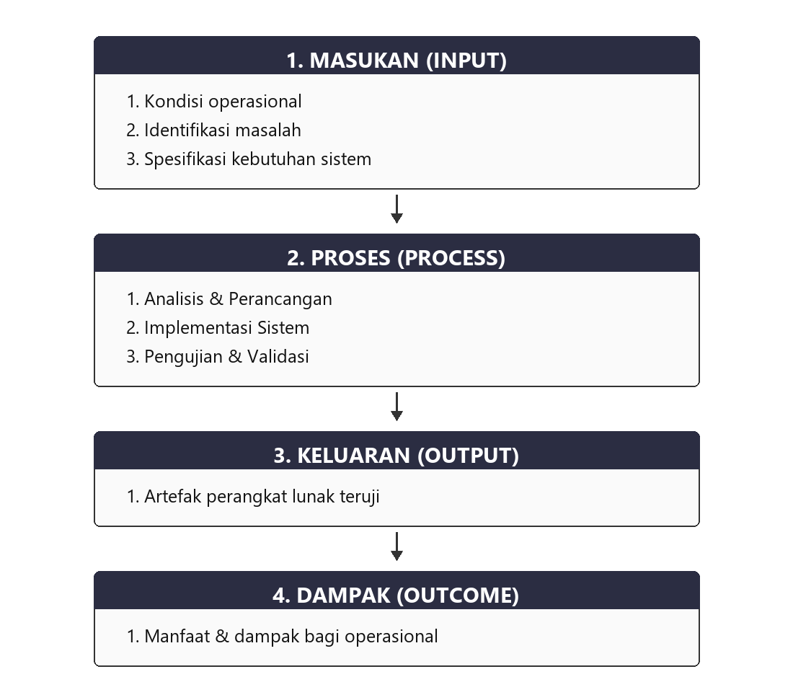
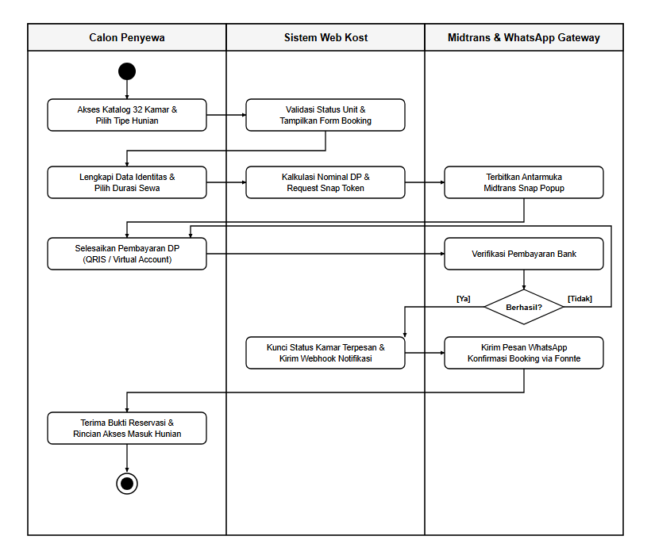
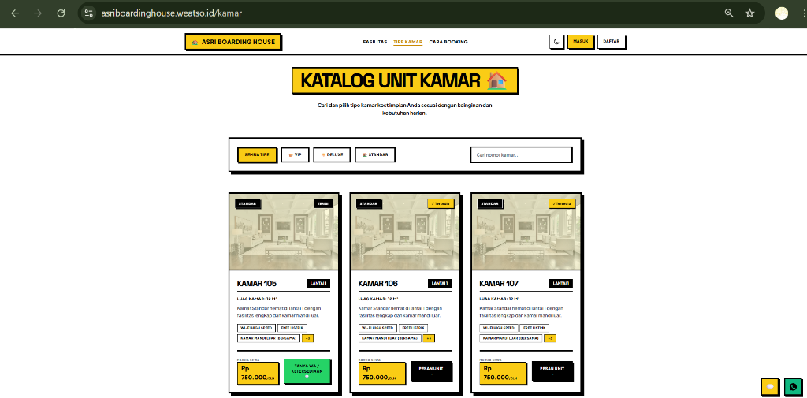
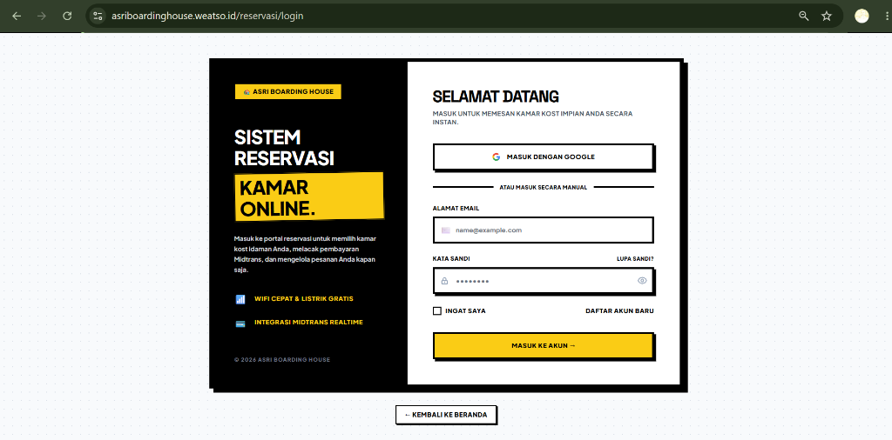
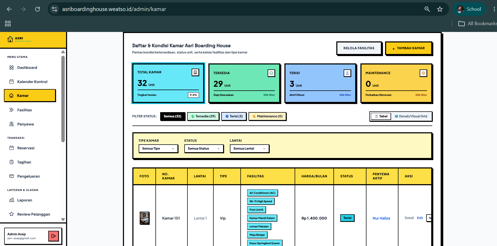
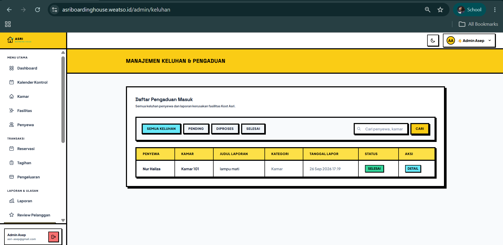
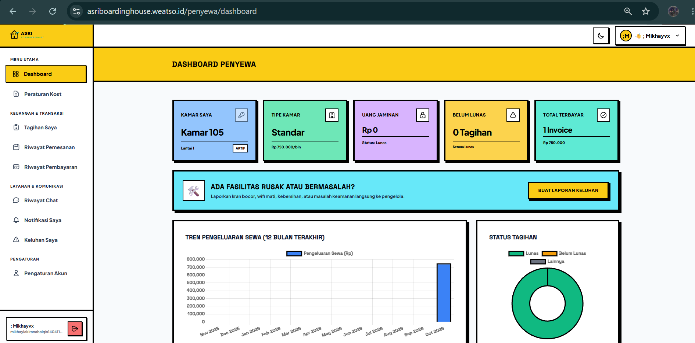
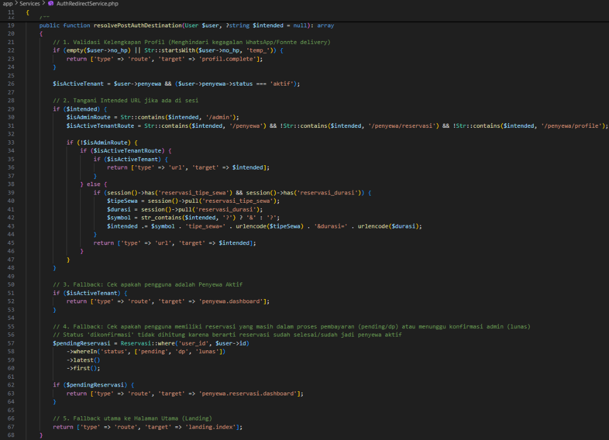
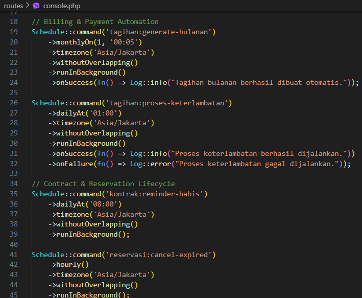
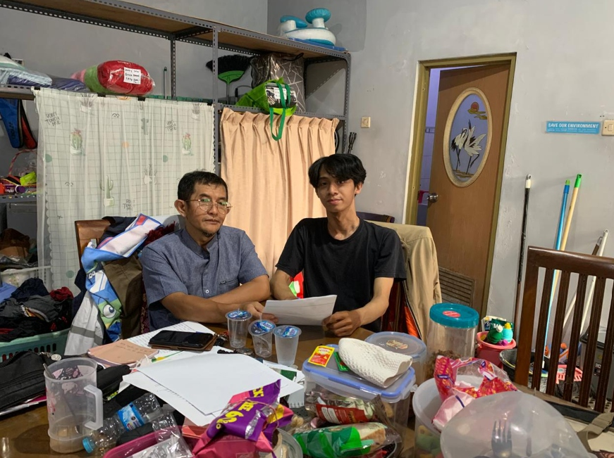

### LAPORAN SKRIPSI

 

## SISTEM INFORMASI MANAJEMEN KOST TERINTEGRASI PAYMENT GATEWAY PADA ASRI BOARDING HOUSE

  

   

**RAFIF ARSYA PRADIVA**

 

**22.N4.0014**

   

**PROGRAM STUDI SISTEM INFORMASI**  
**FAKULTAS ILMU KOMPUTER**  
**UNIVERSITAS KATOLIK SOEGIJAPRANATA**  
**SEMARANG**  
**2026**

### LAPORAN SKRIPSI

 

## SISTEM INFORMASI MANAJEMEN KOST TERINTEGRASI PAYMENT GATEWAY PADA ASRI BOARDING HOUSE

  

**Diajukan dalam Rangka Memenuhi**  
**Salah Satu Syarat Memperoleh Gelar**  
**Sarjana Komputer**

  

   

**RAFIF ARSYA PRADIVA**

 

**22.N4.0014**

   

**PROGRAM STUDI SISTEM INFORMASI**  
**FAKULTAS ILMU KOMPUTER**  
**UNIVERSITAS KATOLIK SOEGIJAPRANATA**  
**SEMARANG**  
**2026**

### HALAMAN PENGESAHAN

 

## SISTEM INFORMASI MANAJEMEN KOST TERINTEGRASI PAYMENT GATEWAY PADA ASRI BOARDING HOUSE

  

Diajukan oleh : 
**RAFIF ARSYA PRADIVA** 
**22.N4.0014**

  

Telah disetujui tanggal 10 April 2026 
Oleh

  

| Dosen Pembimbing 1, | Dosen Pembimbing 2, |
| :---: | :---: |
|      |      |
| **Ir. Andre Kurniawan Pamudji, S.Kom., M.Ling.** | **Erdhi Widyarto Nugroho, S.T., M.T.** |
| NPP. 058.1.1994.161 | NPP. .................... |

  

Mengetahui / menyetujui 
Kaprodi Sistem Informasi,

    

**Dr. Albertus Dwiyoga Widiantoro, S.Kom., M.Kom.** 
NPP. ....................

### HALAMAN PERNYATAAN KEASLIAN

 

Yang bertanda tangan di bawah ini :

 

Nama &nbsp;&nbsp;&nbsp;&nbsp;&nbsp;&nbsp;&nbsp;&nbsp;&nbsp;&nbsp;&nbsp;&nbsp;&nbsp;&nbsp;&nbsp;&nbsp;&nbsp;&nbsp;&nbsp;&nbsp;&nbsp;: Rafif Arsya Pradiva  
NIM &nbsp;&nbsp;&nbsp;&nbsp;&nbsp;&nbsp;&nbsp;&nbsp;&nbsp;&nbsp;&nbsp;&nbsp;&nbsp;&nbsp;&nbsp;&nbsp;&nbsp;&nbsp;&nbsp;&nbsp;&nbsp;&nbsp;&nbsp;: 22.N4.0014  
Progdi / Konsentrasi &nbsp;: Sistem Informasi / E-Commerce  
Fakultas &nbsp;&nbsp;&nbsp;&nbsp;&nbsp;&nbsp;&nbsp;&nbsp;&nbsp;&nbsp;&nbsp;&nbsp;&nbsp;&nbsp;&nbsp;&nbsp;&nbsp;: Ilmu Komputer

  

Dengan ini menyatakan bahwa laporan skripsi dengan judul **SISTEM INFORMASI MANAJEMEN KOST TERINTEGRASI PAYMENT GATEWAY PADA ASRI BOARDING HOUSE** benar-benar bebas dari plagiasi, dan apabila terbukti tidak benar bersedia menerima sanksi dengan ketentuan yang berlaku.

   

Semarang, 10 April 2026 
Yang menyatakan,

  

*Meterai Rp10.000* 
*(tanda tangan)*

  

**Rafif Arsya Pradiva**

### HALAMAN PERNYATAAN PERSETUJUAN PUBLIKASI

 

Sebagai sivitas akademik Universitas Katolik Soegijapranata, saya yang bertanda tangan di bawah ini:

 

Nama &nbsp;&nbsp;&nbsp;&nbsp;&nbsp;&nbsp;&nbsp;&nbsp;&nbsp;&nbsp;&nbsp;&nbsp;&nbsp;&nbsp;&nbsp;&nbsp;&nbsp;&nbsp;&nbsp;&nbsp;&nbsp;: Rafif Arsya Pradiva  
Program Studi &nbsp;&nbsp;&nbsp;&nbsp;&nbsp;&nbsp;&nbsp;&nbsp;: Sistem Informasi  
Fakultas &nbsp;&nbsp;&nbsp;&nbsp;&nbsp;&nbsp;&nbsp;&nbsp;&nbsp;&nbsp;&nbsp;&nbsp;&nbsp;&nbsp;&nbsp;&nbsp;&nbsp;: Ilmu Komputer  
Jenis Karya &nbsp;&nbsp;&nbsp;&nbsp;&nbsp;&nbsp;&nbsp;&nbsp;&nbsp;&nbsp;&nbsp;&nbsp;&nbsp;: Skripsi

  

Demi pengembangan ilmu pengetahuan, menyetujui untuk memberikan kepada Universitas Katolik Soegijapranata Hak Bebas Royalti Non-eksklusif atas karya ilmiah saya yang berjudul **SISTEM INFORMASI MANAJEMEN KOST TERINTEGRASI PAYMENT GATEWAY PADA ASRI BOARDING HOUSE**. Dengan Hak Bebas Royalti Non-eksklusif ini Universitas Katolik Soegijapranata berhak menyimpan, mengalih media/formatkan, mengelola dalam bentuk pangkalan data (database), merawat, dan memublikasikan skripsi saya selama tetap mencantumkan nama saya sebagai penulis/pencipta dan sebagai pemilik Hak Cipta.

 

Demikian pernyataan ini saya buat dengan sebenarnya.

   

Dibuat di &nbsp;&nbsp;&nbsp;&nbsp;&nbsp;&nbsp;&nbsp;&nbsp;: Semarang 
Pada tanggal &nbsp;&nbsp;: 10 April 2026  
Yang menyatakan,

   

*(tanda tangan)*

  

**Rafif Arsya Pradiva**

### KATA PENGANTAR

 

Berkat rahmat dan tuntunan Tuhan Yang Maha Esa, laporan skripsi berjudul "Sistem Informasi Manajemen Kost Terintegrasi Payment Gateway Pada Asri Boarding House" akhirnya selesai disusun. Penyusunan naskah ini ditempuh sebagai syarat akhir guna memperoleh gelar Sarjana Komputer pada Program Studi Sistem Informasi, Fakultas Ilmu Komputer, Universitas Katolik Soegijapranata.

Pengerjaan aplikasi hingga penulisan laporan ini melewati berbagai kendala di lapangan. Seluruh hambatan tersebut dapat teratasi berkat bantuan tulus dari banyak pihak; oleh sebab itu, penulis menghaturkan terima kasih kepada:

1. Bapak Prof. Dr. Ridwan Sanjaya S.E., S.Kom., MS.IEC selaku Dekan Fakultas Ilmu Komputer, atas penyediaan sarana akademik yang menunjang kelancaran perkuliahan penulis.
2. Bapak Dr. Albertus Dwiyoga Widiantoro S.Kom., M.Kom selaku Ketua Program Studi Sistem Informasi, yang telah memfasilitasi jalannya administrasi akademik hingga tahap tugas akhir.
3. Bapak Ir. Andre Kurniawan Pamudji, S.Kom., M.Ling. selaku Dosen Pembimbing 1, yang dengan sabar memeriksa rancangan sistem, mengoreksi alur pembahasan teknis, serta mengarahkan ketajaman penulisan skripsi ini sejak awal bimbingan hingga tuntas.
4. Bapak Erdhi Widyarto Nugroho S.T., M.T. selaku Dosen Pembimbing 2, atas ketelitian evaluasi dan diskusi perbaikan naskah.
5. Bapak/Ibu dosen serta staf kependidikan Fakultas Ilmu Komputer, khususnya pada Program Studi Sistem Informasi, atas bekal keilmuan sepanjang masa studi penulis.
6. Kedua orang tua beserta keluarga tercinta yang senantiasa mendoakan penulis.

7. Rekan-rekan seperjuangan di kampus yang turut bertukar pikiran selama pengembangan aplikasi.
8. Segenap pihak, termasuk penjaga serta penghuni Asri Boarding House, yang bersedia meluangkan waktunya selama pengumpulan data dan pengujian sistem di lokasi penelitian.

Isi laporan ini tentu masih menyisakan celah kekurangan. Penulis sangat menghargai setiap kritik maupun masukan konstruktif demi penyempurnaan sistem pada pengembangan mendatang, seraya berharap karya sederhana ini memberi manfaat nyata bagi pengelolaan Asri Boarding House dan pembaca sekalian.

   

Semarang, 10 April 2026

    

*(tanda tangan)*

  

**Rafif Arsya Pradiva**

### ABSTRAK

 

Administrasi 32 unit kamar di Asri Boarding House selama ini dicatat manual pada buku besar fisik dan obrolan singkat. Ketiadaan basis data terpusat menghambat operasional. Jadwal pesan kamar rawan bertabrakan dan pengingat sewa bulanan kerap terlewat, sementara pencocokan bukti transfer bank memakan waktu berhari-hari hingga memicu selisih kas. Penelitian ini menyelesaikan masalah tersebut melalui pembangunan sistem informasi manajemen kost berbasis web dengan metode *Waterfall* menggunakan kerangka kerja Laravel dan basis data MySQL yang terhubung ke gerbang pembayaran Midtrans Snap serta pengingat otomatis WhatsApp dan surel. Mekanisme penguncian baris pesimis turut diterapkan demi mencegah alokasi kamar ganda secara *real-time*.

Pengujian 60 skenario *black box* membuktikan seluruh modul transaksi dan validasi berjalan stabil. Dampak perbaikannya langsung terlihat saat evaluasi lapangan. Bagi pengelola indekos, penutupan buku bulanan yang semula menguras waktu berhari-hari kini tuntas seketika tanpa selisih uang fisik maupun benturan jadwal sewa. Pada sisi mahasiswa penghuni, hasil wawancara mengonfirmasi kemudahan memesan unit dari luar kota serta kepraktisan melunasi tagihan lewat *virtual account* yang langsung menerbitkan kuitansi digital resmi.

 

**Kata Kunci:** Asri Boarding House, gerbang pembayaran Midtrans, Laravel, penguncian pesimis, sistem informasi manajemen kost.

### ABSTRACT

 

Daily administration for the 32 rental rooms at Asri Boarding House previously depended on handwritten ledgers and scattered chat messages. Operating without a central database created recurring friction. Room reservations often collided and monthly rent reminders slipped past due dates, while manual bank-receipt checks delayed book-closing for several days and caused cash discrepancies. This study resolves those bottlenecks by building a web-based boarding house management information system under the Waterfall model using the Laravel framework and MySQL database, connected to the Midtrans Snap payment gateway alongside automated WhatsApp and email reminders. Pessimistic row-level locking guards real-time room availability against duplicate allocations.

Testing across 60 black-box scenarios confirmed stable execution across all transaction and validation modules. Field evaluations reflected those technical gains. For the property manager, monthly book-closing shrank from several days to seconds without cash mismatches or booking conflicts. Evaluative interviews with resident students also confirmed convenient remote room reservations and practical monthly rent payments through virtual accounts that immediately generate official digital receipts.

 

**Keywords:** Asri Boarding House, boarding house management system, Laravel, Midtrans payment gateway, pessimistic locking.

## DAFTAR ISI

 

HALAMAN PENGESAHAN &emsp; iii  
HALAMAN PERNYATAAN KEASLIAN &emsp; iv  
HALAMAN PERNYATAAN PERSETUJUAN PUBLIKASI &emsp; v  
KATA PENGANTAR &emsp; vi  
ABSTRAK &emsp; viii  
ABSTRACT &emsp; ix  
DAFTAR ISI &emsp; x  
DAFTAR GAMBAR &emsp; xii  
DAFTAR TABEL &emsp; xiv  

 

**BAB 1 PENDAHULUAN** &emsp; **1**  
1.1 Latar Belakang &emsp; 1  
1.2 Rumusan Masalah &emsp; 2  
1.3 Tujuan Penelitian &emsp; 2  

 

**BAB 2 TINJAUAN PUSTAKA** &emsp; **4**  
2.1 Sistem Informasi Manajemen &emsp; 4  
2.2 E-Commerce B2C &emsp; 4  
2.3 Web Application &emsp; 5  
2.4 UI & UX &emsp; 5  
2.5 Laravel &emsp; 6  
2.6 RDBMS &emsp; 6  
2.7 MySQL Database &emsp; 7  
2.8 Payment Gateway &emsp; 7  
2.9 WhatsApp Gateway API &emsp; 8  
2.10 Email Gateway API &emsp; 9  
2.11 Cronjob &emsp; 9  
2.12 Metode Waterfall &emsp; 10  

 

**BAB 3 METODE PENELITIAN** &emsp; **11**  
3.1 Objek Penelitian &emsp; 11  
3.2 Jenis Penelitian &emsp; 11  
3.3 Sumber Data &emsp; 11  
3.4 Teknik Pengumpulan Data &emsp; 12  
3.5 Metode Pengembangan Sistem &emsp; 13  
3.6 Kerangka Pemikiran &emsp; 14  

 

**BAB 4 HASIL DAN PEMBAHASAN** &emsp; **17**  
4.1 Perancangan Aplikasi &emsp; 17  
&emsp; 4.1.1 Use Case Diagram &emsp; 17  
&emsp; 4.1.2 Entity Relationship Diagram (ERD) &emsp; 19  
&emsp; 4.1.3 Activity Diagram &emsp; 21  
&emsp; 4.1.4 Flowchart Sistem &emsp; 24  
4.2 Implementasi Antarmuka Sistem &emsp; 25  
&emsp; 4.2.1 Implementasi Umum &emsp; 25  
&emsp; 4.2.2 Implementasi Calon Penyewa &emsp; 36  
&emsp; 4.2.3 Implementasi Admin &emsp; 43  
&emsp; 4.2.4 Implementasi Penyewa Aktif &emsp; 54  
4.3 Implementasi Kode Program &emsp; 60  
&emsp; 4.3.1 Implementasi Autentikasi dan Hak Akses &emsp; 60  
&emsp; 4.3.2 Implementasi Pemesanan Kamar &emsp; 63  
&emsp; 4.3.3 Implementasi *Payment Gateway* &emsp; 65  
&emsp; 4.3.4 Implementasi Penjadwalan dan Notifikasi &emsp; 67  
4.4 Pengujian Sistem &emsp; 69  
4.5 Hasil Wawancara &emsp; 80  

 

**BAB 5 KESIMPULAN DAN SARAN** &emsp; **96**  
5.1 Kesimpulan &emsp; 96  
5.2 Saran &emsp; 96  

 

**DAFTAR PUSTAKA** &emsp; **98**  

## DAFTAR GAMBAR

 

Gambar 3.1 Tahapan Metode Waterfall &emsp; 13  
Gambar 3.2 Kerangka Pemikiran &emsp; 14  
Gambar 4.1 Use Case Diagram &emsp; 17  
Gambar 4.2 Entity Relationship Diagram &emsp; 19  
Gambar 4.3 Activity Diagram Calon Penyewa &emsp; 21  
Gambar 4.4 Activity Diagram Admin (Penjaga Kost) &emsp; 22  
Gambar 4.5 Activity Diagram Penyewa Aktif &emsp; 23  
Gambar 4.6 Flowchart Sistem &emsp; 24  
Gambar 4.7 Halaman Beranda Utama &emsp; 26  
Gambar 4.8 Daftar Fasilitas Kost &emsp; 27  
Gambar 4.9 Katalog Tipe Kamar &emsp; 28  
Gambar 4.10 Galeri Foto Kost &emsp; 29  
Gambar 4.11 Panduan Alur Reservasi &emsp; 30  
Gambar 4.12 Halaman Testimoni Penghuni &emsp; 31  
Gambar 4.13 Halaman Pertanyaan Umum &emsp; 32  
Gambar 4.14 Halaman Tentang Kami &emsp; 32  
Gambar 4.15 Halaman Login Pengguna &emsp; 33  
Gambar 4.16 Halaman Pendaftaran Akun &emsp; 34  
Gambar 4.17 Chat Real Time Guest &emsp; 35  
Gambar 4.18 Kelengkapan Profil Pemesan &emsp; 36  
Gambar 4.19 Dasbor Reservasi Pemesan &emsp; 37  
Gambar 4.20 Simulasi Biaya Kamar &emsp; 38  
Gambar 4.21 Tahapan Pembayaran Reservasi &emsp; 39  
Gambar 4.22 Jendela Pembayaran Midtrans &emsp; 40  
Gambar 4.23 Pesan Aktivasi WhatsApp &emsp; 41  
Gambar 4.24 Email Konfirmasi Reservasi &emsp; 42  
Gambar 4.25 Halaman Login Administrator &emsp; 43  
Gambar 4.26 Dasbor Operasional Administrator &emsp; 44  
Gambar 4.27 Pengelolaan Data Kamar &emsp; 45  
Gambar 4.28 Pengelolaan Fasilitas Kost &emsp; 46  
Gambar 4.29 Pengelolaan Data Penghuni &emsp; 47  
Gambar 4.30 Pengelolaan Reservasi Masuk &emsp; 48  
Gambar 4.31 Pengelolaan Tagihan Bulanan &emsp; 49  
Gambar 4.32 Pencatatan Pengeluaran Operasional &emsp; 50  
Gambar 4.33 Laporan Rekapitulasi Kas &emsp; 51  
Gambar 4.34 Pengelolaan Keluhan Fasilitas &emsp; 52  
Gambar 4.35 Pengelolaan Obrolan Tamu &emsp; 53  
Gambar 4.36 Login Penyewa Aktif &emsp; 54  
Gambar 4.37 Dasbor Penyewa Aktif &emsp; 55  
Gambar 4.38 Tagihan Sewa Penyewa &emsp; 56  
Gambar 4.39 Pengaturan Profil Penghuni &emsp; 57  
Gambar 4.40 Riwayat Transaksi Pembayaran &emsp; 58  
Gambar 4.41 Pengajuan Keluhan Kamar &emsp; 59  
Gambar 4.42 Dokumen Kuitansi Digital &emsp; 60  
Gambar 4.43 Kode Pembatasan Akses &emsp; 61  
Gambar 4.44 Kode Pengalihan Portal &emsp; 62  
Gambar 4.45 Kode Penguncian Kamar &emsp; 63  
Gambar 4.46 Kode Pemeriksaan Jadwal &emsp; 64  
Gambar 4.47 Kode Token Midtrans &emsp; 65  
Gambar 4.48 Kode Validasi Webhook &emsp; 66  
Gambar 4.49 Kode Penjadwal Tugas &emsp; 67  
Gambar 4.50 Kode Integrasi WhatsApp &emsp; 68  
Gambar 4.51 Kode Pengiriman Email &emsp; 69  
Gambar 4.52 Dokumentasi Wawancara Bapak Asep &emsp; 81  

## DAFTAR TABEL

 

Tabel 4.1 Hasil Pengujian Fungsionalitas Sistem (Black Box Testing) &emsp; 70  
Tabel 4.2 Hasil Wawancara Penjaga Kost (Bapak Asep) &emsp; 81  
Tabel 4.3 Wawancara dengan Arjun &emsp; 85  
Tabel 4.4 Wawancara dengan Farrel &emsp; 87  
Tabel 4.5 Wawancara dengan Iman &emsp; 89  
Tabel 4.6 Wawancara dengan Ammar &emsp; 91  
Tabel 4.7 Wawancara dengan Sindhu &emsp; 93  

## BAB 1 PENDAHULUAN

 

## 1.1 Latar Belakang
Kawasan pendidikan Tembalang di Kota Semarang terus menerima gelombang mahasiswa perantau setiap tahunnya. Sayangnya, promosi kost konvensional masih memaksa calon penyewa datang langsung ke lokasi hanya untuk memastikan ketersediaan kamar dan kejelasan tarif sewa. Jarak geografis jelas menghambat pencarian hunian. Portal reservasi berbasis web mampu mengatasi kendala jarak tersebut sekaligus menertibkan pendataan pesanan kamar sejak awal [1].

Situasi serupa dialami Asri Boarding House Tembalang. Usaha indekos ini mengelola 32 unit kamar sewa yang terbagi dalam kategori VIP, Deluxe, dan Standar, namun seluruh pencatatan huniannya masih mengandalkan buku besar tulis tangan. Penjaga kost pun kerepotan memperbarui status unit kosong secara cepat sehingga benturan pesanan ganda (*double booking*) kerap terjadi saat lebih dari satu calon penyewa mengincar kamar yang sama dalam waktu berdekatan [2].

Penagihan sewa bulanan setiap tanggal 10 juga masih dikerjakan secara manual. Penjaga kost harus mengirim pesan pengingat satu per satu beserta hitungan dendanya kepada penghuni kost; akibatnya, jadwal tagih sering terlewat dan piutang sewa menumpuk. Otomasi pengawasan jatuh tempo pada sistem informasi mampu mendisiplinkan siklus tagihan bulanan tersebut [3].

Beban administrasi kian berat pada tahap pembukuan kas. Setiap akhir bulan, penjaga kost menghabiskan waktu berhari-hari demi mencocokkan kuitansi belanja operasional dengan setoran tunai maupun tangkapan layar bukti transfer bank dari penghuni kost. Integrasi gerbang pembayaran digital (*payment gateway*) memangkas proses rekonsiliasi manual tersebut karena setiap pelunasan non-tunai langsung terverifikasi otomatis tanpa menyisakan selisih uang fisik [4].

Rangkaian kendala operasional itu menuntut penyediaan platform terpusat bagi Asri Boarding House. Aplikasi web yang memadukan reservasi daring, penjadwalan tagihan berkala, serta gerbang pembayaran Midtrans perlu dilengkapi pengingat otomatis via WhatsApp dan *email* supaya rincian tagihan diterima penghuni kost secara *real-time* dengan catatan kas yang terbuka [5]. Atas dasar kebutuhan tersebut, penelitian ini membangun Sistem Informasi Manajemen Kost Terintegrasi *Payment Gateway* pada Asri Boarding House guna menata administrasi hunian dan meniadakan selisih pembukuan.

 

## 1.2 Rumusan Masalah
Bertolak dari uraian kendala operasional di atas, pokok permasalahan yang dikaji dalam penelitian ini mencakup tiga pertanyaan utama:
1. Bagaimana merancang arsitektur Sistem Informasi Manajemen Kost Terintegrasi *Payment Gateway* pada Asri Boarding House guna mengatasi benturan reservasi kamar, kerumitan pembukuan buku besar fisik, serta keterlambatan penagihan sewa?
2. Bagaimana membangun aplikasi web tersebut menggunakan kerangka kerja Laravel yang terhubung dengan gerbang pembayaran Midtrans, penjadwal tagihan otomatis berkala, serta layanan notifikasi WhatsApp dan *email*?
3. Sejauh mana efektivitas penerapan sistem dalam menunjang operasional harian Asri Boarding House berdasarkan evaluasi wawancara bersama penjaga kost dan penghuni kost?

 

## 1.3 Tujuan Penelitian
Sejalan dengan ketiga rumusan masalah tersebut, penelitian ini dilaksanakan untuk mencapai sasaran berikut:
1. Menghasilkan rancangan arsitektur Sistem Informasi Manajemen Kost Terintegrasi *Payment Gateway* pada Asri Boarding House guna mengatasi benturan reservasi kamar, kerumitan pembukuan buku besar fisik, serta keterlambatan penagihan sewa.
2. Membangun aplikasi web tersebut di atas kerangka kerja Laravel dengan mengintegrasikan gerbang pembayaran Midtrans, penjadwal tagihan otomatis berkala, serta pengiriman notifikasi WhatsApp dan *email*.
3. Mengukur efektivitas operasional sistem pada keseharian kerja Asri Boarding House melalui evaluasi wawancara bersama penjaga kost dan penghuni kost.

 

## BAB 2 TINJAUAN PUSTAKA

 

## 2.1 Sistem Informasi Manajemen
Pengolahan data transaksi mentah menjadi laporan siap pakai di dalam organisasi membutuhkan kerja terpadu antara perangkat keras, perangkat lunak, prosedur kerja, dan personel pengelola yang terhimpun dalam Sistem Informasi Manajemen (SIM). Pencatatan operasional tidak lagi tersebar di banyak berkas terpisah. Pengelola dapat langsung meninjau kinerja unit usaha berdasarkan sajian data yang terukur saat menyusun keputusan manajerial [6].

Pada operasional indekos, SIM menyatukan daftar inventaris kamar, biodata penghuni kost, rekam bayar sewa, dan catatan kas harian ke dalam satu pusat data. Risiko salah catat maupun pesanan kamar ganda (*double booking*) pun dapat ditekan. Melalui antarmuka web, pengelola dapat memeriksa sisa masa sewa tiap kamar sekaligus menarik laporan keuangan bulanan tanpa perlu membongkar tumpukan kuitansi kertas [7].

 

## 2.2 E-Commerce B2C
Skema niaga elektronik *Business-to-Consumer* (B2C) menghubungkan pemilik layanan langsung dengan pelanggan akhir lewat jaringan internet tanpa perantara distribusi berlapis. Konsumen leluasa menelusuri katalog produk setiap saat. Kejelasan rincian tarif dan ringkasnya alur pemesanan mandiri mendorong calon pembeli menuntaskan transaksi pembayaran digital dengan cepat, sehingga model B2C banyak diadopsi pelaku usaha lokal untuk memperluas jangkauan pemasaran mereka [8].

Situs web indekos bermodel B2C mempertemukan pengelola langsung dengan calon penyewa. Tanpa perantara agen luar, pemasukan sewa diterima utuh oleh pemilik properti dan tarif kamar bebas diatur sesuai kebijakan internal. Calon penyewa pun dapat memeriksa ketersediaan unit dari luar kota, mengajukan reservasi daring, serta menerima tagihan sewa rutin yang merapikan pencatatan hunian [9].

 

## 2.3 Web Application
Aplikasi web berjalan di atas arsitektur *client-server* dengan protokol HTTP atau HTTPS sebagai jalur pertukaran datanya. Peramban pada laptop maupun ponsel bertindak sebagai *thin client* penampil antarmuka, sedangkan *web server* mengeksekusi logika bisnis sekaligus melayani permintaan kueri basis data. Instalasi program tambahan di perangkat pengguna tidak lagi diperlukan [10].

Pembaruan data yang tayang seketika (*real-time*) memperlancar koordinasi operasional harian. Pemeliharaan sistem pun cukup dikerjakan terpusat di *server* utama setiap kali ada perbaikan celah atau penambahan modul baru, tanpa perlu memperbarui perangkat pengguna satu per satu. Selain itu, pemisahan kode tampilan dari pengolah logika bisnis menjaga kecepatan respons saat beban transaksi meningkat [11].

 

## 2.4 UI & UX
Interaksi antara manusia dan perangkat lunak dijembatani oleh rancangan antarmuka pengguna (*User Interface* atau UI). Salah satu langgam visual modern di ranah web adalah *Neo-Brutalism*, yang menonjolkan garis bingkai hitam tegas, bayangan padat berkontras tajam, serta susunan bidang geometris tanpa efek gradasi berlapis. Karakter tegas tersebut membuat letak tombol aksi, label status transaksi, dan kolom formulir langsung tertangkap mata begitu halaman dimuat [12].

Di balik tampilan visual, aspek pengalaman pengguna (*User Experience* atau UX) mengatur seberapa ringkas seseorang menuntaskan keperluannya di dalam sistem. Navigasi yang baik memangkas langkah berbelit. Ketika hierarki menu disusun mengikuti urutan kerja nyata dan ringkasan angka disajikan bertingkat, pengguna dapat menyelesaikan transaksi maupun memantau operasional harian dalam hitungan klik [13].

 

## 2.5 Laravel
Laravel memisahkan pengolahan data, tampilan halaman, dan aturan bisnis pada aplikasi PHP melalui pola *Model-View-Controller* (MVC). Kerangka kerja (*framework*) ini membekali pengembang dengan *Eloquent Object-Relational Mapping* (ORM) untuk memodelkan tabel basis data sebagai objek serta mesin templat *Blade* perakit antarmuka dinamis. Penangkal serangan *Cross-Site Request Forgery* (CSRF) dan injeksi SQL sudah aktif secara bawaan [14].

Penumpukan logika bisnis di dalam *controller* menyulitkan perawatan kode. Oleh karena itu, pengembangan aplikasi web berskala menengah hingga besar lazim memisahkan aturan transaksi rumit ke dalam *Service Layer* terpisah agar tiap komponen memegang satu tanggung jawab spesifik. Pengujian modul maupun penambahan fitur baru pun menjadi jauh lebih terkendali [15].

 

## 2.6 RDBMS
Sistem Manajemen Basis Data Relasional (*Relational Database Management System* atau RDBMS) menata data terstruktur ke dalam tabel-tabel dua dimensi yang saling terikat lewat kunci utama (*primary key*) dan kunci asing (*foreign key*). Keterhubungan tersebut menjaga keutuhan referensial antar-tabel. Selain itu, dukungan prinsip transaksi ACID (*Atomicity, Consistency, Isolation, Durability*) menjamin setiap pencatatan keuangan maupun perubahan status operasional tersimpan utuh tanpa risiko kerusakan data saat memproses kueri berjumlah besar [16].

Penyusunan skema tabel yang melibatkan banyak entitas memerlukan tahapan normalisasi hingga Bentuk Normal Ketiga (3NF). Langkah perancangan ini mengurai atribut berulang ke dalam tabel-tabel terpisah guna menghilangkan redundansi penyimpanan serta mencegah anomali ketika data ditambah, diperbarui, atau dihapus. Konsistensi riwayat transaksi harian pun tetap terjaga [17].

 

## 2.7 MySQL Database
MySQL mengelola basis data relasional sumber terbuka (*open-source*) berbasis bahasa *Structured Query Language* (SQL). Arsitektur *client-server multithread* di dalamnya sanggup menangani proses baca dan tulis serentak oleh banyak sesi pengguna dengan konsumsi memori *server* yang tetap irit. Eksekusi operasi CRUD (*Create, Read, Update, Delete*) pada ekosistem Laravel pun berjalan stabil [18].

Keamanan transaksi konkuren pada MySQL ditopang oleh mesin penyimpanan (*storage engine*) InnoDB. Mesin ini menjalankan kaidah ACID sekaligus menyediakan penguncian tingkat baris (*row-level locking*) agar dua transaksi yang menyentuh baris kamar atau tagihan yang sama secara bersamaan tidak saling menimpa. Penambahan indeks pencarian (*indexing*) beserta batasan kunci asing (*foreign key constraints*) turut mempercepat pembacaan kueri tanpa mengorbankan keutuhan relasi antar-tabel [19].

 

## 2.8 Payment Gateway
Layanan gerbang pembayaran (*payment gateway*) menjembatani aplikasi niaga daring dengan jaringan perbankan serta penyelenggara dompet elektronik. Melalui penyedia domestik seperti Midtrans, satu integrasi sistem sudah membuka kanal pembayaran *Virtual Account* lintas bank, kode QRIS, *e-wallet*, hingga kartu kredit tanpa mengharuskan pemilik usaha membuka rekening penampung di tiap bank. Penyewa pun bebas melunasi tagihan secara praktis tanpa perlu mengirim foto resi transfer yang rawan dipalsukan [20].

Layanan *payment gateway* memisahkan ruang kerja *Sandbox* dari ruang transaksi *Production*. Pengujian dilakukan sepenuhnya tanpa uang asli. Di lingkungan simulasi tersebut, pengembang leluasa memeriksa alur pelunasan, penolakan perbankan, hingga penanganan tagihan kedaluwarsa, lalu beralih ke mode produksi cukup dengan memperbarui kunci akses pada berkas *environment variable* tanpa mengubah kode aplikasi.

Sinkronisasi status bayar bekerja otomatis lewat API dan *webhook callback*. Setiap sinyal konfirmasi perbankan wajib melewati pemeriksaan *signature key* berstandar kriptografi SHA-512 sebelum memperbarui status faktur di basis data lokal. Mekanisme ini meniadakan pengecekan mutasi rekening manual dan menjaga akurasi rekapitulasi kas [21].

 

## 2.9 WhatsApp Gateway API
Integrasi *WhatsApp Gateway* API memampukan aplikasi web mengirimkan pesan pemberitahuan langsung ke nomor pengguna tanpa mengoperasikan ponsel secara manual. Kanal pesan instan ini dipilih banyak pengembang sistem layanan karena rasio keterbacaan pesannya (*open rate*) maupun kecepatan tanggapan penerima melampaui pengiriman SMS dan surat elektronik [22].

Komunikasi antar-*server* pada gerbang pesan ini dijalankan lewat permintaan *HTTP POST request* berbekal token autentikasi khusus. Pengiriman pesan pun berjalan terjadwal secara terprogram. Pengelola terbebas dari pekerjaan mengetik pengingat satu per satu, sementara pengguna menerima rincian informasi tepat pada waktunya [23].

 

## 2.10 Email Gateway API
Pertukaran surat elektronik (*email*) di jaringan internet berjalan mengikuti aturan *Simple Mail Transfer Protocol* (SMTP) yang diamankan enkripsi TLS (*Transport Layer Security*). Saluran ini lazim dipakai aplikasi web untuk mendistribusikan dokumen administrasi resmi. Pesan yang masuk tersimpan permanen di kotak surat pengguna sehingga mudah dicari kembali sebagai bukti sah transaksi [24].

Di tingkat kerangka kerja web, pendistribusian kuitansi pembayaran, faktur tagihan digital, hingga tautan pemulihan kata sandi disalurkan melewati layanan *mail relay* terenkripsi. Reputasi pengirim yang terverifikasi menjaga surat resmi tersebut tetap mendarat di kotak masuk utama dan terhindar dari penyaringan folder *spam*, sekaligus melengkapi peran notifikasi cepat WhatsApp [25].

 

## 2.11 Cronjob
Sistem operasi keluarga Unix menyediakan penjadwal tugas berbasis waktu (*time-based job scheduler*) bernama *cron job* untuk mengeksekusi perintah program secara mandiri pada menit, jam, tanggal, atau bulan tertentu. Seluruh eksekusi berlangsung di latar belakang *server*. Tanpa campur tangan operator di depan layar, rutinitas pemeliharaan data maupun perhitungan denda keterlambatan tetap berjalan presisi mengikuti kalender kerja yang ditetapkan [26].

Pada alur pengingat tagihan, *cron job* memanggil perintah konsol aplikasi secara berkala untuk menyisir daftar tanggal jatuh tempo *invoice* di basis data. Data faktur yang mendekati tenggat langsung diteruskan otomatis menuju gerbang WhatsApp dan *email* [27].

Kerangka kerja web modern menyederhanakan pengelolaan jadwal ini lewat fitur *task scheduling*, di mana satu *daemon cron* sistem operasi sudah cukup menggerakkan seluruh antrean skrip di latar belakang. Penerbitan faktur bulanan maupun kalkulasi denda pun tereksekusi tepat jadwal. Selain itu, perancangan logika yang bersifat idempoten menjamin skrip penjadwal tidak akan mencetak tagihan kembar meskipun perintah konsol tidak sengaja terpanggil lebih dari sekali.

 

## 2.12 Metode Waterfall
Rekayasa perangkat lunak bermodel *Waterfall* menata siklus pembangunan sistem secara berurutan layaknya aliran bertingkat. Satu fase kerja wajib dituntaskan penuh sebelum pengembang melangkah ke fase berikutnya, dimulai dari analisis kebutuhan, perancangan arsitektur, penulisan kode program, pengujian fungsional, hingga pemeliharaan pascarilis [28].

Pendekatan sekuensial semacam ini tepat diterapkan ketika aturan bisnis sistem sudah terdefinisi terang sejak awal. Dokumentasi teknis yang terkunci di tiap peralihan tahap memandu penerjemahan skema basis data dan rancangan layar menjadi baris kode secara terarah, sekaligus membendung perubahan spesifikasi mendadak di tengah pengerjaan.

 

## BAB 3 METODE PENELITIAN

 

## 3.1 Objek Penelitian
Penelitian ini mengambil objek pada Asri Boarding House di Jalan Maera Sari Nomor 1, Tembalang, Kota Semarang. Indekos ini menyewakan 32 unit kamar bertipe VIP, Deluxe, dan Standar bagi mahasiswa maupun pekerja di sekitar lingkungan kampus, namun pencatatan pemesanan kamar, tagihan bulanan, dan arus kas hariannya masih mengandalkan buku besar fisik. Kondisi lapangan itulah yang melatarbelakangi pembangunan aplikasi web manajemen kost berintegrasi *payment gateway* pada penelitian ini.

 

## 3.2 Jenis Penelitian
Kajian ini menggunakan metode Penelitian dan Pengembangan (*Research and Development* atau R&D) berbasis rekayasa perangkat lunak. Pendekatan tersebut dipilih untuk menghasilkan sekaligus menguji produk aplikasi fungsional yang langsung membenahi kendala administrasi sewa di lapangan [29]. Setiap tahap rekayasa diarahkan menjawab kebutuhan nyata pengelola.

Pendekatan R&D tersebut dijalankan melalui studi kasus tunggal pada alur operasional sewa kamar Asri Boarding House. Penggalian masalah awal dilakukan secara deskriptif kualitatif guna memetakan titik rawan pembukuan kas tulis tangan, keterlambatan penagihan bulanan, serta benturan reservasi unit; sesudahnya, aplikasi diuji secara fungsional dan dievaluasi langsung bersama pengguna di lokasi.

 

## 3.3 Sumber Data
Bahan analisis dalam penelitian ini bersumber dari data primer dan data sekunder. Keduanya dipadukan untuk memetakan aturan bisnis indekos sekaligus menentukan spesifikasi modul pada Sistem Informasi Manajemen Kost Terintegrasi *Payment Gateway* di Asri Boarding House.

1. Data Primer  
Informasi lapangan utama digali langsung dari para pelaku operasional di Asri Boarding House melalui sesi wawancara tatap muka bersama:
* **Penjaga kost**, guna menelusuri alur kerja harian, mekanisme pencatatan kontrak kamar, serta letak selisih pembukuan pada buku besar manual.
* **Penghuni kost**, guna menghimpun pengalaman saat memesan unit kamar, kendala pelunasan tagihan bulanan, dan kebutuhan tanda bukti bayar resmi.

2. Data Sekunder  
Landasan teknis dan pembanding operasional dilengkapi melalui penelusuran dokumen internal maupun pustaka ilmiah berikut:
* Berkas pembukuan internal Asri Boarding House berupa buku kas tulis tangan, arsip bukti transfer sewa, kuitansi belanja perawatan gedung, serta tabel tarif 32 unit kamar.
* Dokumentasi teknis pengembang untuk API Midtrans, layanan pesan WhatsApp Fonnte, dan kerangka kerja resmi Laravel.
* Publikasi jurnal ilmiah serta buku rujukan rekayasa perangkat lunak yang mengulas sistem manajemen hunian dan integrasi gerbang pembayaran digital.

 

## 3.4 Teknik Pengumpulan Data
Penjaringan informasi lapangan dilakukan secara kualitatif menggunakan teknik wawancara mendalam di lingkungan Asri Boarding House [30]. Pendekatan lisan memudahkan penggalian masalah nyata. Peneliti dapat menelusuri langsung hambatan pembukuan lama di pos pengelola sekaligus menangkap tanggapan jujur pengguna seusai mengoperasikan aplikasi web yang dibangun.

Setiap sesi tanya jawab dilangsungkan secara tatap muka dengan bantuan perekam suara. Rekaman audio tersebut selanjutnya disalin menjadi naskah transkripsi tertulis supaya rincian keterangan narasumber tidak tercecer sewaktu dianalisis pada tahap perancangan kebutuhan maupun evaluasi akhir sistem bersama:
* **Penjaga kost**, yang menyoroti perbandingan beban rekapitulasi kas, pemantauan keterisian 32 unit kamar, kepraktisan pengingat tagihan terjadwal, hingga penghematan waktu kerja pasca-beralih dari buku besar fisik.
* **Penghuni kost**, yang mengulas kemudahan reservasi kamar daring, keterbacaan komponen tagihan sewa, kelancaran pelunasan via *payment gateway*, serta manfaat kuitansi digital resmi.

 

## 3.5 Metode Pengembangan Sistem
Pembangunan perangkat lunak Asri Boarding House mengikuti siklus sekuensial metode *Waterfall*. Setiap fase kerja wajib diperiksa ketuntasannya terlebih dahulu sebelum berlanjut ke fase berikutnya agar tidak ada spesifikasi fungsional yang tertinggal.

Model sekuensial ini sesuai dengan karakter bisnis Asri Boarding House karena aturan sewa kamar hingga denda bulanan di lapangan sudah baku sejak awal observasi. Kepastian alur tersebut mempercepat penulisan kode program dan penyambungan *payment gateway*.

*Gambar 3.1 Tahapan Metode Waterfall*

 

Alur kerja pada Gambar 3.1 dibuka oleh fase *requirement gathering and analysis* untuk memetakan kebutuhan operasional indekos lewat wawancara lapangan. Pada tahap *design* dan *implementation*, hasil analisis tersebut dituangkan ke dalam skema basis data serta rancangan layar, lalu dikodekan menggunakan *framework* Laravel yang terhubung langsung dengan gerbang pembayaran Midtrans. Seluruh modul kemudian melewati pengujian *black box testing* pada fase *integration & testing* serta *verification*. Tidak boleh ada alur transaksi yang gagal. Siklus rekayasa ini ditutup oleh tahap *operation & maintenance* melalui pengunggahan aplikasi ke *server hosting* disertai pemantauan dan perawatan rutin.

 

## 3.6 Kerangka Pemikiran
Kerangka pemikiran penelitian ini disusun mengikuti logika kerja *Research and Development* (R&D) guna melahirkan sistem informasi yang teruji bagi Asri Boarding House. Masalah administrasi lapangan dipetakan langsung menuju solusi teknis hingga tahap evaluasi.

*Gambar 3.2 Kerangka Pemikiran*

 

Bagan pada Gambar 3.2 membagi alur kajian ke dalam empat komponen berantai. Komponen masukan (*input*) menghimpun potret kendala buku besar manual beserta daftar kebutuhan fungsional indekos, lalu diteruskan ke komponen proses (*process*) yang mencakup perancangan skema sistem, pengkodean aplikasi, dan pengujian modul. Rangkaian rekayasa tersebut melahirkan keluaran (*output*) berupa sistem informasi manajemen kost berbasis web yang siap pakai. Adapun dampak akhirnya (*outcome*) tercermin dari rapinya pembukuan kas bulanan serta ringkasnya pelunasan sewa bagi penjaga kost maupun penghuni kost.

 

## BAB 4 HASIL DAN PEMBAHASAN

 

## 4.1 Perancangan Aplikasi

Tahap perancangan menerjemahkan kebutuhan operasional Asri Boarding House ke dalam cetak biru teknis sebelum penulisan kode program dimulai. Pemodelan sistem diwujudkan melalui *use case diagram* untuk batas wewenang pengguna, *Entity Relationship Diagram* (ERD) bagi relasi tabel, serta *activity diagram* dan *flowchart* guna memetakan urutan logika transaksi.

 

### 4.1.1 Use Case Diagram
Pembagian wewenang pengguna pada Sistem Informasi Manajemen Kost Asri Boarding House digambarkan melalui *use case diagram* pada Gambar 4.1. Tiap peran hanya dapat membuka menu sesuai porsi hak aksesnya.

 

*Gambar 4.1 Use Case Diagram*

 

Gambar 4.1 memisahkan interaksi sistem ke dalam tiga aktor: calon penyewa, admin (penjaga kost), dan penyewa aktif. Batas akses ketiganya dikunci ketat sejak gerbang autentikasi.

1. Calon Penyewa  
Calon penyewa mewakili pengunjung publik pencari hunian di situs web. Begitu menemukan tipe unit yang diminati dari katalog fasilitas dan harga Asri Boarding House, pemohon wajib membuat akun agar dapat mengajukan reservasi daring dari luar kota tanpa perlu datang lebih dulu ke lokasi kost. Pesanan kamar baru terkunci resmi di basis data setelah uang muka dilunasi melalui gerbang pembayaran Midtrans, sehingga peluang benturan pesanan ganda tertutup rapat.

2. Admin (Penjaga Kost)  
Pengawasan operasional harian indekos berada di tangan admin atau penjaga kost. Lewat dasbor khusus pengelola, aktor ini mengatur inventaris 32 unit kamar, menyesuaikan tarif sewa, serta memeriksa keabsahan kartu identitas penghuni baru. Pengecekan mutasi rekening bank secara manual tidak lagi diperlukan karena status tagihan berubah otomatis saat pembayaran masuk; dengan demikian, penjaga kost leluasa mencurahkan waktunya untuk menangani laporan perbaikan fasilitas kamar.

3. Penyewa Kost (Penyewa Aktif)  
Penghuni resmi yang sudah menempati kamar mengakses portal penyewa aktif. Setiap awal bulan, rincian nominal *invoice* beserta batas tanggal jatuh tempo tersaji jelas di layar akun masing-masing. Penghuni cukup melunasi tagihan sewa maupun denda keterlambatan lewat kanal pembayaran digital untuk langsung mengunduh kuitansi elektronik resmi, atau membuka menu pengaduan tatkala fasilitas di dalam kamarnya mengalami kerusakan.

 

### 4.1.2 Entity Relationship Diagram (ERD)
Penyimpanan data aplikasi ini dibangun di atas model pangkalan data relasional. Karena jumlah tabel dan atribut relasinya cukup padat, penyajian ERD pada Gambar 4.2 dipecah menjadi dua bagian: sub-diagram (a) yang memuat tabel transaksi hunian inti, serta sub-diagram (b) yang menangani pencatatan operasional dan layanan komunikasi publik.

 

*(a) Modul Pengelolaan Kamar, Pengguna, Reservasi, Pembayaran*

 

*(b) Modul Layanan Keluhan, Operasional Kost, Komunikasi, Informasi*

 

*Gambar 4.2 Entity Relationship Diagram*

 

Rancangan skema pada Gambar 4.2 memisahkan kelompok tabel transaksi sewa dari tabel pendukung layanan harian ke dalam dua gugus modul berikut:

1. Modul Pengelolaan Kamar, Pengguna, Reservasi, dan Pembayaran (Gambar 4.2 (a))  
Inti pendataan hunian bertumpu pada relasi antara tabel *users*, *kamar*, dan tabel penghubung *penyewa*. Akun kredensial pengelola maupun penghuni disimpan di tabel *users*, sedangkan spesifikasi fisik, tarif, dan status keterisian 32 unit kamar dikelola pada tabel *kamar*. Keduanya dipertemukan oleh tabel *penyewa* berelasi satu-ke-banyak (1:N) yang merekam penempatan unit spesifik beserta penguncian tarif kontrak (*snapshot* harga), tanggal masuk, masa berakhir sewa, dan kontak darurat wali; berkat cara ini, perubahan harga kamar di kemudian hari tidak merusak nilai kontrak penghuni lama.

Pencatatan siklus uang sewa mengalir melewati tabel *reservasi*, *tagihan*, dan *pembayaran*. Setiap pengajuan kamar daring mula-mula direkam ke tabel *reservasi* menggunakan kode pesanan unik sebelum diteruskan menjadi kewajiban uang muka atau tagihan bulanan di tabel *tagihan*. Sinyal *webhook* Midtrans kemudian langsung merekam nomor referensi bank dan waktu lunas ke tabel *pembayaran*.

 

2. Modul Layanan Keluhan, Operasional Kost, Komunikasi, dan Informasi (Gambar 4.2 (b))  
Urusan perawatan gedung dan arus kas keluar ditangani oleh tabel *keluhan*, *pengeluaran*, serta *log_notifikasi*. Tiket kerusakan kamar kiriman penghuni masuk ke tabel *keluhan* lengkap dengan kategori sarana dan lampiran foto fisiknya untuk ditindaklanjuti penjaga kost. Di sisi keuangan, pembelanjaan rutin seperti token listrik area umum, tagihan air, dan ongkos teknisi dihimpun pada tabel *pengeluaran* sebagai pengurang pendapatan kotor, sementara rekam jejak pengiriman pengingat WhatsApp Fonnte maupun *email* SMTP disimpan di tabel *log_notifikasi*.

Komunikasi tamu dan konten halaman publik ditopang tabel *guest_chat_threads*, *chat_messages*, *customer_reviews*, *peraturan*, serta *faqs*. Tanpa perlu mendaftar akun, pengunjung dapat berkonsultasi lewat sesi *guest_chat_threads* yang menampung riwayat balasan di tabel *chat_messages* melalui relasi satu-ke-banyak (1:N). Ulasan penghuni selanjutnya disimpan di tabel *customer_reviews*, sedangkan tata tertib dan tanya-jawab dikelola lewat tabel *peraturan* serta *faqs*.

 

### 4.1.3 Activity Diagram
Urutan interaksi antara tindakan pengguna, pemrosesan aplikasi web, dan layanan eksternal dipetakan menggunakan *activity diagram*. Pemodelan dibagi ke dalam Gambar 4.3, Gambar 4.4, serta Gambar 4.5 sesuai peran calon penyewa, admin, dan penyewa aktif guna memperjelas alur kerja tiap aktor.

 

1. Calon Penyewa  
Rangkaian aktivitas calon penyewa disusun agar pemesanan kamar dari luar kota berjalan mandiri sejak memilih unit di katalog hingga membayar uang muka. Urutan langkah tersebut dipetakan pada Gambar 4.3.

 

*Gambar 4.3 Activity Diagram Calon Penyewa*

 

Alur Gambar 4.3 dimulai ketika calon penyewa memilih satu unit kosong dari 32 kamar. Sistem memvalidasi isian biodata pemohon lebih dulu sebelum meminta token transaksi ke *server* Midtrans Snap guna menampilkan opsi bayar *Virtual Account* atau dompet elektronik. Pelunasan yang berhasil seketika mengunci status unit di basis data sekaligus memicu pengiriman bukti reservasi via WhatsApp Fonnte.

 

2. Admin (Penjaga Kost)  
Di sisi pengelola, diagram aktivitas menitikberatkan pada pengelolaan ketersediaan unit, pemeriksaan dokumen penyewa baru, serta penyusunan rekapitulasi kas. Urutan kerja penjaga kost tersebut diperlihatkan pada Gambar 4.4.

 

*Gambar 4.4 Activity Diagram Admin (Penjaga Kost)*

 

Proses kerja dalam Gambar 4.4 diawali dengan masuknya penjaga kost ke dasbor admin melalui halaman autentikasi khusus. Dari ruang kendali tersebut, pengelola mengatur status 32 unit kamar, memperbarui harga sewa, dan memeriksa kecocokan identitas calon penghuni sebelum mengaktifkan masa tinggalnya. Penerbitan faktur bulanan beserta pengiriman pengingat ke WhatsApp penghuni berjalan otomatis di sisi sistem; pada penghujung bulan, admin tinggal mencatat nota belanja operasional lalu mengunduh laporan kas bersih.

 

3. Penyewa Aktif  
Sepanjang masa sewa berlangsung, aktivitas penghuni terpusat pada portal layanan mandiri. Gambar 4.5 menjabarkan alur pemeriksaan faktur bulanan, pembayaran non-tunai lewat gerbang digital, hingga pelaporan kerusakan fasilitas kamar.

 

*Gambar 4.5 Activity Diagram Penyewa Aktif*

 

Di dalam alur Gambar 4.5, penghuni yang sudah masuk ke portal penyewa langsung disuguhi rincian tagihan sewa yang mendekati tanggal jatuh tempo. Penekanan tombol bayar seketika membuka jendela *pop-up* Midtrans Snap di halaman yang sama. Setelah transfer bank atau saldo dompet digital terkonfirmasi lunas dan memperpanjang masa aktif sewa, penghuni bebas mengunduh kuitansi PDF resmi maupun mengajukan tiket perbaikan apabila sarana kamarnya bermasalah.

 

### 4.1.4 Flowchart Sistem
Logika pemrosesan sistem sejak pengajuan reservasi awal sampai pengaktifan status penghuni resmi di Asri Boarding House dirangkum melalui *flowchart* pada Gambar 4.6. Simpul percabangannya (*decision*) memperlihatkan penyaringan status kamar dan validasi transaksi.

 

*Gambar 4.6 Flowchart Sistem*

 

Rangkaian logika Gambar 4.6 bergerak saat calon penyewa membuka situs Asri Boarding House untuk mengecek ketersediaan 32 unit kamar. Jika unit incaran masih kosong, pemohon mengisi formulir biodata, mengunggah foto kartu identitas, memilih durasi sewa, lalu diarahkan menuju gerbang pembayaran Midtrans guna memilih kanal transfer bank atau dompet digital. Transaksi yang gagal atau kedaluwarsa akan dikembalikan ke tahap pemilihan metode bayar. Sebaliknya, pelunasan yang sah langsung mengunci unit kamar di basis data serta mengirimkan bukti reservasi via WhatsApp Fonnte; alur pun tuntas ketika pemohon datang menyerahkan berkas fisik kepada penjaga kost untuk diverifikasi, menerima kunci kamar, dan resmi berstatus penyewa aktif.

 

## 4.2 Implementasi Antarmuka Sistem
Rancangan layar yang telah disusun sebelumnya diwujudkan menjadi halaman-halaman web fungsional dengan langgam visual *Neo-Brutalism* bergaris tepi tebal, kontras warna tajam, serta tata letak responsif. Uraian antarmuka pada sub-bab ini dipisahkan menurut empat kelompok hak akses: pengunjung umum, calon penyewa, admin atau penjaga kost, dan penyewa aktif.

 

### 4.2.1 Implementasi Umum
Kelompok antarmuka umum menghimpun sebelas halaman publik yang langsung terbuka tanpa perlu masuk akun. Pengunjung bebas menelusuri profil indekos, sisa unit kosong, kelengkapan fasilitas, alur reservasi, halaman autentikasi, hingga jendela obrolan tamu.

1. Implementasi Antarmuka *Home Page*  
Beranda utama (*home page*) menyambut mahasiswa maupun pekerja perantau yang sedang mencari kamar sewa di kawasan Tembalang. Tanpa harus datang ke lokasi, calon penghuni sudah dapat meninjau profil singkat Asri Boarding House beserta kategori kamar dan fasilitas utamanya dalam tata letak yang tetap terbaca jelas di layar laptop maupun ponsel pintar (Gambar 4.7).

*Gambar 4.7 Halaman Beranda Utama*

Bilah navigasi utama di sisi teratas Gambar 4.7 memuat pintasan menuju katalog kamar, daftar fasilitas, panduan *booking*, serta gerbang masuk akun. Bidang tengahnya terbelah menjadi spanduk pengenalan indekos lengkap dengan tombol cari kamar di sebelah kiri dan potret fisik gedung di sebelah kanan, sedangkan sudut kanan bawah menyematkan tombol obrolan langsung ke penjaga kost.

 

2. Implementasi Antarmuka Fasilitas Kost  
Daftar sarana bersama yang dapat dipakai seluruh penghuni Asri Boarding House dijabarkan terbuka pada halaman fasilitas kost. Calon penyewa pun memiliki gambaran objektif mengenai kelayakan hunian sebelum memutuskan memesan unit.

Tiap fasilitas dilengkapi ringkasan fungsi dan ketentuan pemakaiannya sehari-hari. Wujud halaman tersebut diperlihatkan pada Gambar 4.8.

*Gambar 4.8 Daftar Fasilitas Kost*

Susunan kartu berkisi (*grid*) digunakan pada Gambar 4.8 untuk menata sarana komunal seperti dapur bersama, lahan parkir kendaraan, jaringan internet nirkabel (*Wi-Fi*), serta kamera pengawas (CCTV). Masing-masing kartu menampilkan foto asli di lokasi beserta judul tebal dan keterangan peruntukannya secara ringkas.

 

3. Implementasi Antarmuka Tipe Kamar Kost  
Spesifikasi ruang beserta daftar perabot tiap kategori unit di Asri Boarding House dipaparkan melalui katalog tipe kamar kost. Ukuran ruangan, ketersediaan kamar mandi dalam, sampai tarif sewa bulanan terpampang terang sehingga calon penghuni tinggal mencocokkannya dengan anggaran bulanan, lalu menekan tombol pesan pada kartu unit incaran sebagaimana tampak dalam Gambar 4.9.

*Gambar 4.9 Katalog Tipe Kamar*

Kartu katalog tipe Deluxe pada Gambar 4.9 memajang potret area tidur dan kamar mandi dalamnya. Di bawah bingkai foto tertera tarif sewa per bulan, lencana sisa kamar kosong, serta rincian perabot berupa kasur, meja belajar, lemari pakaian, AC, dan pemanas air (*water heater*), diikuti tombol biru **"Pemesanan Kamar"** sebagai pintu masuk formulir reservasi.

 

4. Implementasi Antarmuka Galeri Kost  
Dokumentasi fisik bangunan dan suasana lingkungan harian Asri Boarding House dikumpulkan di dalam halaman galeri kost. Potret tampak depan gedung, koridor kamar, area parkir, hingga ruang bersama sengaja disajikan utuh bagi calon penyewa asal luar kota.

Seluruh foto disusun proporsional dalam tata letak kisi yang dapat diperbesar lewat satu klik. Tampilan galeri tersebut tersaji pada Gambar 4.10.

*Gambar 4.10 Galeri Foto Kost*

Deretan foto dokumentasi di dalam Gambar 4.10 memperlihatkan fasad bangunan, lahan parkir motor dan mobil, lorong kamar lantai satu maupun lantai dua, serta ruang dapur bersama. Efek transisi halus muncul saat kursor menyentuh tiap bingkai foto guna memperjelas kondisi kebersihan gedung.

 

5. Implementasi Antarmuka Alur Cara Reservasi  
Pengunjung baru yang belum terbiasa menyewa kamar secara daring dipandu lewat halaman alur cara reservasi. Urutan langkah sejak registrasi akun, pemilihan unit kosong, pengisian biodata, hingga pembayaran uang muka dijabarkan runtut pada Gambar 4.11 supaya pemohon dapat menyiapkan kartu identitas lebih dulu sebelum membuka formulir sewa.

*Gambar 4.11 Panduan Alur Reservasi*

Lima tahapan sewa kamar divisualisasikan berurutan dalam Gambar 4.11: pembuatan akun, seleksi unit kamar, pelengkapan profil diri, pelunasan uang muka via Midtrans, dan penerimaan tanda bukti reservasi. Setiap langkah diberi nomor urut berbingkai tebal disertai penjelasan ringkas agar prosedur pemesanan langsung dipahami tanpa harus bertanya berulang kali kepada penjaga kost.

 

6. Implementasi Antarmuka Testimoni Penyewa Kost  
Kesan para penghuni yang sedang maupun pernah tinggal di Asri Boarding House ditampilkan apa adanya pada bagian testimoni. Ulasan seputar kebersihan koridor, keamanan lingkungan, dan ketanggapan pengelola memberi rujukan nyata bagi calon penyewa sebelum mengunci kamar pilihan (Gambar 4.12).

*Gambar 4.12 Halaman Testimoni Penghuni*

Ulasan penghuni pada Gambar 4.12 dirangkai dalam kartu geser (*carousel*) dua arah yang memuat kutipan pengalaman tinggal, foto profil, inisial nama, kategori kamar yang dihuni, serta lima ikon bintang penanda tingkat kepuasan.

 

7. Implementasi Antarmuka FAQ  
Pertanyaan yang berulang kali diajukan calon penghuni mengenai tata tertib dan aturan sewa Asri Boarding House dihimpun di halaman *Frequently Asked Questions* (FAQ). Pokok bahasannya mencakup jam akses malam, izin tamu menginap, besaran uang muka (*down payment*), sampai mekanisme perpanjangan sewa bulanan.

Penjaga kost tidak perlu lagi mengetik jawaban dasar yang sama setiap hari. Tampilan halaman tanya-jawab mandiri ini ditunjukkan pada Gambar 4.13.

*Gambar 4.13 Halaman Pertanyaan Umum*

Komponen panel lipat (*accordion*) menjadi kerangka daftar pertanyaan pada Gambar 4.13. Pengunjung tinggal mengeklik ikon panah di sisi kanan baris pertanyaan untuk membentangkan uraian jawaban atau melipatnya kembali di halaman yang sama.

 

8. Implementasi Antarmuka Tentang Kami  
Identitas pengelola beserta titik lokasi Asri Boarding House di kawasan kampus Tembalang diperkenalkan lewat halaman Tentang Kami. Kejelasan alamat fisik yang tertaut langsung ke peta digital memberi kepastian bagi mahasiswa baru dari luar daerah, dilengkapi kontak resmi administrasi sebagaimana tampak pada Gambar 4.14.

*Gambar 4.14 Halaman Tentang Kami*

Kartu profil di sisi utama Gambar 4.14 mengulas sejarah singkat pendirian Asri Boarding House dan standar pengelolaannya, bersanding dengan peta interaktif *Google Maps* penunjuk posisi bangunan terhadap kampus sekitar. Nomor telepon pengelola, alamat *email* resmi, serta jam layanan kantor dicantumkan tepat di bilah bawah halaman.

 

9. Implementasi Antarmuka *Login User*  
Calon penyewa terdaftar maupun penghuni aktif masuk ke ruang akun masing-masing melalui halaman *login user*. Sistem mencocokkan masukan alamat *email* dan kata sandi terhadap rekaman terenkripsi di basis data MySQL.

Tautan atur ulang kata sandi via surat elektronik turut disediakan bila pengguna lupa kredensialnya. Antarmuka autentikasi tersebut disajikan pada Gambar 4.15.

*Gambar 4.15 Halaman Login Pengguna*

Kotak formulir *login* bergaya *Neo-Brutalism* dengan bingkai hitam tebal tampil di atas latar kuning cerah pada Gambar 4.15. Di dalamnya berjejer kolom *email*, kolom kata sandi berikon penampil karakter, kotak centang **"Ingat Saya"**, tombol biru **"Masuk ke Akun"**, serta tautan pindah ke halaman pendaftaran bagi pengunjung baru.

 

10. Implementasi Antarmuka *Register User*  
Pemohon baru yang hendak memesan unit kamar wajib membuat akun terlebih dahulu pada halaman *register user*. Isian awalnya meliputi nama lengkap, nomor WhatsApp aktif, alamat *email*, dan kata sandi yang langsung diuji keunikan serta kesesuaian konfirmasinya sebelum disimpan ke basis data (Gambar 4.16).

*Gambar 4.16 Halaman Pendaftaran Akun*

Kartu formulir **"Buat Akun Baru"** pada Gambar 4.16 memuat lima bidang masukan untuk nama lengkap, nomor WhatsApp, alamat *email*, kata sandi, serta pengulangan kata sandi lengkap dengan penanda validasi format. Saat tombol biru **"Daftar Akun"** ditekan, akun langsung terekam dan pengguna diarahkan melengkapi biodata kependudukan.

 

11. Implementasi Antarmuka *Chat Real Time Guest*  
Pengunjung yang sekadar ingin menanyakan sisa kamar atau menjadwalkan survei lokasi dapat menghubungi penjaga kost lewat fitur *chat real-time guest*. Pembuatan akun tidak diwajibkan; tamu cukup menuliskan nama panggilan beserta nomor kontak aktif.

Pesan yang terkirim seketika muncul di dasbor admin untuk segera ditanggapi. Wujud *widget* obrolan tersebut tampak pada Gambar 4.17.

*Gambar 4.17 Chat Real Time Guest*

Jendela obrolan mengambang di pojok kanan bawah Gambar 4.17 hadir dengan kepala panel kuning cerah dan tombol lipat layar (*minimize*). Ruang tengahnya memuat percakapan dua arah berpenanda waktu antara tamu dan penjaga kost, diikuti kolom ketik pesan serta tombol kirim pada bilah dasar jendela.

 

### 4.2.2 Implementasi Calon Penyewa
Ketujuh antarmuka dan integrasi layanan pada bagian ini memfasilitasi calon penyewa seusai mendaftarkan akun baru. Cakupannya membentang dari pengisian biodata kependudukan, pemantauan dasbor reservasi, simulasi tarif sewa, pembayaran uang muka lewat Midtrans, hingga pengiriman bukti lunas melalui WhatsApp serta *email*.

1. Implementasi Antarmuka Lengkapi Profil  
Calon penyewa belum diizinkan mengunci unit kamar sebelum melengkapi biodata kependudukan pada halaman profil. Isian wajibnya mencakup Nomor Induk Kependudukan (NIK), nama beserta nomor telepon kontak darurat keluarga, asal perguruan tinggi atau tempat kerja, dan unggahan foto Kartu Tanda Penduduk (KTP) asli demi menjaga ketertiban penghuni di Asri Boarding House.

Berkas foto KTP tersebut disimpan ke dalam folder privat yang hanya dapat dibuka oleh administrator sewaktu verifikasi berlangsung (Gambar 4.18).

*Gambar 4.18 Kelengkapan Profil Pemesan*

Formulir kelengkapan profil dalam Gambar 4.18 menyediakan kolom nomor KTP, nama wali darurat, nomor telepon penjamin, serta bidang unggah identitas diri berfitur pratinjau gambar agar keterbacaan foto dapat dipastikan sebelum menekan tombol hijau **"Simpan Profil"**.

 

2. Implementasi Antarmuka *Dashboard* Reservasi  
Perkembangan pengajuan sewa kamar dipantau terpusat oleh pemohon melalui *dashboard* reservasi. Kode tagihan uang muka, status verifikasi dokumen, serta daftar pengajuan terdahulu terangkum dalam satu layar sebagaimana ditunjukkan pada Gambar 4.19.

*Gambar 4.19 Dasbor Reservasi Pemesan*

Sisi atas Gambar 4.19 memuat sapaan akun bersama kartu ringkasan kode reservasi dan nomor kamar pilihan, diikuti bilah tahapan proses di area tengah layar. Panel sebelah kanan menempatkan tombol **"Bayar Uang Muka"** yang akan berganti menjadi tautan unduh tanda terima begitu pelunasan selesai.

 

3. Implementasi Antarmuka Simulasi Biaya Kamar  
Perhitungan estimasi anggaran sewa difasilitasi lewat kalkulator simulasi biaya kamar. Modul ini menjumlahkan tarif sewa pokok, uang jaminan (*deposit*), hingga potongan sewa jangka panjang secara terbuka di awal sehingga tidak timbul selisih hitungan antara pemohon dan pengelola kost.

Pilihan durasi sewa satu bulan, tiga bulan, maupun satu tahun bebas diganti sesuai rencana tinggal. Rincian tampilan kalkulator tersebut tampak pada Gambar 4.20.

*Gambar 4.20 Simulasi Biaya Kamar*

Kartu kalkulator di sebelah kiri Gambar 4.20 memuat menu *dropdown* durasi tinggal beserta opsi fasilitas tambahan. Setiap perubahan pilihan langsung memperbarui angka sewa pokok, *deposit*, dan total tagihan bersih pada tabel kanan tanpa memuat ulang halaman; selanjutnya, tombol biru **"Lanjutkan Pemesanan"** membawa pemohon masuk ke tahapan bayar.

 

4. Implementasi Antarmuka Pembayaran 5 Tahap Reservasi  
Penyelesaian pesanan kamar dipecah ke dalam layar pemantauan lima tahap: peninjauan rincian sewa, pemilihan skema bayar, pemeriksaan faktur, pelunasan via gerbang pembayaran, dan penerbitan tanda jadi. Selama hitung mundur pembayaran pada Gambar 4.21 masih berjalan, kamar pilihan dikunci sementara agar tidak diserobot pemohon lain.

*Gambar 4.21 Tahapan Pembayaran Reservasi*

Indikator langkah di puncak layar Gambar 4.21 memberi warna hijau pada tahap yang sedang dikerjakan. Bidang utamanya menjabarkan tipe kamar pesanan, besaran uang muka, waktu tersisa untuk melunasi tagihan, tombol pemicu pembayaran digital, serta peringatan di kaki layar agar jendela peramban tidak ditutup sebelum verifikasi rampung.

 

5. Implementasi *Payment Gateway* Midtrans  
Transaksi uang muka maupun pelunasan penuh reservasi diproses menggunakan jendela *payment gateway* Midtrans Snap. Pemohon leluasa memilih jalur pembayaran non-tunai lewat *Virtual Account* berbagai bank, dompet elektronik (*e-wallet*), kode QRIS, atau gerai ritel terdekat.

Sinyal *webhook callback* dari *server* Midtrans seketika melunasi status pesanan di basis data begitu transfer berhasil, tanpa menunggu pengecekan mutasi manual penjaga kost (Gambar 4.22).

*Gambar 4.22 Jendela Pembayaran Midtrans*

Jendela *pop-up* Midtrans Snap di tengah layar Gambar 4.22 menampilkan nominal tagihan beserta batas waktu kedaluwarsanya. Daftar kanal bayar seperti GoPay, QRIS, serta *Virtual Account* BCA, BNI, dan Mandiri tersaji lengkap dengan petunjuk langkah pelunasan yang terenkripsi langsung ke *server* Midtrans.

 

6. Implementasi *WhatsApp Gateway* Fonnte  
Begitu Midtrans mengonfirmasi pelunasan uang muka, aplikasi menembakkan pesan bukti pemesanan ke nomor ponsel pemohon lewat API *WhatsApp Gateway* Fonnte. Rincian kode transaksi, nomor unit yang dikunci, nilai setoran, serta jadwal masuk (*check-in*) langsung diterima di ponsel pengguna seperti pada Gambar 4.23.

*Gambar 4.23 Pesan Aktivasi WhatsApp*

Tangkapan layar ruang obrolan Gambar 4.23 memperlihatkan pesan otomatis kiriman nomor resmi Asri Boarding House. Di dalamnya tercantum kode pesanan, nomor kamar, status lunas, dan tautan unduh kuitansi digital yang dibawa pemohon saat mengambil kunci kamar di lokasi indekos.

 

7. Implementasi *Email Gateway* SMTP  
Pendistribusian dokumen bukti reservasi juga ditembuskan ke kotak surat elektronik pemohon menggunakan jalur protokol SMTP. Saluran *email* memberi pegangan arsip formal yang tidak mudah hilang dan praktis dicetak ulang kapan saja.

Surat dikirim dalam balutan templat HTML beridentitas Asri Boarding House lengkap dengan lampiran berkas kuitansi. Wujud pesan konfirmasi tersebut tersaji pada Gambar 4.24.

*Gambar 4.24 Email Konfirmasi Reservasi*

Kotak masuk penyewa pada Gambar 4.24 menampilkan surat resmi bertajuk **"Bukti Pembayaran Reservasi Kamar Kost"**. Tabel rincian pembayaran, tanggal *check-in*, pokok tata tertib hunian, serta berkas lampiran PDF terlampir utuh sebagai arsip sah di sisi penghuni maupun pengelola.

 

### 4.2.3 Implementasi Admin
Sebelas halaman kendali pada sub-bab ini dirancang khusus untuk mendukung rutinitas kerja penjaga kost Asri Boarding House. Dari satu ruang kerja terpusat, pengelola mengawasi okupansi 32 unit kamar, memvalidasi reservasi masuk, mengatur tagihan bulanan, membukukan belanja operasional, mengunduh laporan kas, hingga membalas laporan keluhan serta pesan tamu.

1. Implementasi Antarmuka *Admin Login*  
Akses menuju panel pengelola dipisahkan secara ketat melalui halaman *admin login* agar data inventaris kamar, arus kas, dan foto identitas penghuni tertutup bagi publik. Percobaan masuk yang keliru berulang kali juga langsung dibatasi otomatis demi menangkal percobaan pembobolan akun sebagaimana tampak pada Gambar 4.25.

*Gambar 4.25 Halaman Login Administrator*

Bingkai kartu *Neo-Brutalism* bergaris hitam pekat bertajuk **"Masuk Portal Admin"** menjadi pusat tampilan Gambar 4.25. Penjaga kost tinggal mengetikkan *email* administrator dan kata sandi tersembunyi, kemudian mengeklik tombol hitam **"Masuk Dasbor"** untuk membuka panel kendali utama.

 

2. Implementasi Antarmuka *Dashboard Admin*  
Sesaat setelah kredensial pengelola tervalidasi, layar beralih ke *dashboard admin* yang memadukan indikator hunian dan posisi kas Asri Boarding House. Tingkat keterisian dari 32 unit kamar, akumulasi uang masuk bulan berjalan, cacah penyewa aktif, hingga antrean keluhan fasilitas langsung terbaca dalam sekali pandang.

Grafik tren bulanan turut disematkan untuk memudahkan evaluasi pendapatan harian. Wujud halaman ringkasan pengelola tersebut diperlihatkan pada Gambar 4.26.

*Gambar 4.26 Dasbor Operasional Administrator*

Deretan kartu metrik kuning dan biru di baris teratas Gambar 4.26 merangkum persentase keterisian unit, jumlah penghuni aktif, pemasukan berjalan, serta aduan yang belum rampung. Bidang tengahnya menyandingkan grafik batang pemasukan bulanan dengan tabel reservasi terbaru, diapit bilah menu vertikal di sisi kiri serta sakelar mode gelap (*OLED Dark Mode*) di pojok kanan atas agar mata pengelola tidak lekas lelah.

 

3. Implementasi Antarmuka Manajemen Kamar  
Inventaris seluruh 32 unit kamar sewa Asri Boarding House dikendalikan lewat halaman manajemen kamar. Penjaga kost berwenang menambah unit baru, mengubah status ketersediaan ruang, maupun memperbarui harga sewa beserta kelengkapan perabot per kategori kamar; pencatatan terpusat pada Gambar 4.27 ini sekaligus meniadakan celah pesanan ganda (*double booking*).

*Gambar 4.27 Pengelolaan Data Kamar*

Tabel inventaris dalam Gambar 4.27 memuat nomor pintu kamar, kategori tipe (VIP, Deluxe, atau Standar), letak lantai, harga sewa bulanan, dan lencana ketersediaan unit. Sisi atas tabel menyediakan tombol kuning **"Tambah Kamar Baru"** bersama kolom cari dan penyaring kamar kosong, sementara ujung kanan tiap baris menyertakan tombol **"Edit"** serta **"Hapus"**.

 

4. Implementasi Antarmuka Manajemen Fasilitas  
Daftar sarana bersama yang tayang di katalog halaman depan diatur sepenuhnya dari antarmuka manajemen fasilitas. Setiap kali ada penambahan sarana baru atau penyesuaian tata tertib ruang komunal, admin tinggal mengganti foto dokumentasi beserta keterangannya di modul ini.

Urutan tampil kartu fasilitas pun bebas digeser sesuai prioritas. Tampilan halaman kelola sarana tersebut tersaji pada Gambar 4.28.

*Gambar 4.28 Pengelolaan Fasilitas Kost*

Tabel pengelolaan pada Gambar 4.28 menjabarkan nama sarana umum, keterangan fungsi, ikon kategori, serta pratinjau foto dokumentasinya. Tombol **"Tambah Fasilitas"** dan bilah penyaring ditempatkan di kepala tabel; apabila suatu sarana sedang diperbaiki di lapangan, admin tinggal menonaktifkan status tampilnya lewat kolom aksi sebelah kanan.

 

5. Implementasi Antarmuka Manajemen Penyewa  
Biodata seluruh penghuni yang sedang aktif menyewa kamar di Asri Boarding House terhimpun pada halaman manajemen penyewa. Rekaman datanya meliputi identitas resmi penghuni, kontak darurat keluarga, nomor unit yang ditempati, dan tanggal berakhir kontrak, lengkap dengan fungsi penonaktifan hunian tatkala masa tinggal penyewa usai (*check-out*) seperti pada Gambar 4.29.

*Gambar 4.29 Pengelolaan Data Penghuni*

Baris tabel penghuni pada Gambar 4.29 menampilkan nama lengkap penyewa, nomor WhatsApp, kamar yang dihuni, tanggal mulai masuk, serta lencana **"Aktif"**. Pencarian penghuni tertentu dipermudah lewat kolom kata kunci dan penyaring lantai di atas tabel, sedangkan tombol **"Detail"** di sisi kanan membuka arsip foto KTP beserta riwayat pelunasan sewanya.

 

6. Implementasi Antarmuka Manajemen Reservasi  
Pengajuan sewa kamar yang masuk dari pemohon baru diverifikasi melalui halaman manajemen reservasi. Penjaga kost memeriksa kejelasan unggahan KTP dan status pelunasan uang muka dari Midtrans sebelum mengesahkan penempatan kamar.

Pesanan yang melewati tenggat bayar dapat dibatalkan agar kamar kembali terbuka bagi peminat lain. Susunan antarmuka verifikasi reservasi ini tampak pada Gambar 4.30.

*Gambar 4.30 Pengelolaan Reservasi Masuk*

Daftar pesanan masuk di Gambar 4.30 mencantumkan kode unik reservasi, nama pemohon, tipe kamar pilihan, jadwal rencana masuk, dan status pembayaran uang muka. Deretan penyaring di atas tabel mengelompokkan data ke dalam status **"Menunggu Pembayaran"**, **"Terverifikasi"**, atau **"Dibatalkan"**, diikuti tombol **"Konfirmasi"** di kolom kanan untuk mengaktifkan akun penghuni begitu pemeriksaan fisik selesai.

 

7. Implementasi Antarmuka Manajemen Tagihan  
Penerbitan faktur sewa bulanan beserta pengenaan denda keterlambatan dikendalikan terpusat dari halaman manajemen tagihan. Modul ini tersambung langsung dengan penjadwal tugas (*cron job*) yang memantau batas jatuh tempo setiap tanggal 10 supaya tunggakan sewa tidak menumpuk (Gambar 4.31).

*Gambar 4.31 Pengelolaan Tagihan Bulanan*

Kartu **"Daftar Tagihan Bulanan Penyewa"** pada Gambar 4.31 menyajikan nomor *invoice*, nama penyewa, nomor kamar, nilai tagihan berikut dendanya, tenggat jatuh tempo, serta lencana status pelunasan. Kepala tabelnya menyediakan tombol sinkronisasi tagihan dan kotak pencarian cepat, sementara tombol **"Detail"** di tiap baris dipakai memeriksa rincian biaya atau mengirim ulang pengingat tagihan.

 

8. Implementasi Antarmuka Manajemen Pengeluaran  
Perhitungan laba bersih bulanan yang akurat menuntut pencatatan rutin atas seluruh kas keluar di halaman manajemen pengeluaran. Tagihan listrik gedung, air PDAM, belanja perlengkapan kebersihan, hingga ongkos panggil teknisi langsung dibukukan penjaga kost ke dalam modul ini.

Nama petugas pencatat dan keterangan penggunaan dana ikut direkam di setiap transaksi. Wujud halaman kas keluar tersebut disajikan pada Gambar 4.32.

*Gambar 4.32 Pencatatan Pengeluaran Operasional*

Kartu akumulasi belanja bulan berjalan di puncak Gambar 4.32 dipasangkan dengan tabel riwayat kas keluar di bawahnya yang memuat tanggal nota, pos biaya, uraian belanja, nominal uang, serta nama staf pencatat. Penambahan nota baru cukup dilakukan lewat tombol **"Tambah Biaya Operasional"**.

 

9. Implementasi Antarmuka Manajemen Laporan Pemasukan  
Seluruh aliran dana sewa dari Midtrans maupun setoran tunai dipadukan dengan catatan belanja operasional pada modul laporan pemasukan. Penjaga kost tidak perlu lagi menyandingkan lembar mutasi bank dan buku kas tulis tangan saat tutup buku akhir bulan, sebab rekapitulasi siap diunduh langsung ke format Excel atau PDF seperti diperlihatkan pada Gambar 4.33.

*Gambar 4.33 Laporan Rekapitulasi Kas*

Tiga kartu ringkasan di baris atas Gambar 4.33 menyandingkan pendapatan kotor, total biaya operasional, dan laba bersih usaha. Di bawahnya membentang grafik garis tren bulanan bersama tabel mutasi kas masuk berpenyaring tanggal, dilengkapi tombol hijau **"Ekspor Excel"** serta tombol merah **"Unduh PDF"** pada sudut kanan atas untuk pencetakan arsip pemilik kost.

 

10. Implementasi Antarmuka Manajemen Keluhan Penyewa  
Aduan kerusakan fasilitas kamar maupun sarana bersama kiriman penghuni ditampung terpusat pada halaman manajemen keluhan penyewa. Dari daftar ini, penjaga kost memilah tingkat mendesaknya kendala seperti keran air bocor, lampu padam, atau perabot rusak agar jadwal panggil teknisi dapat segera diatur.

Perubahan status pengerjaan di sisi admin langsung terlihat pada akun penghuni pelapor. Tampilan halaman kelola aduan tersebut ditunjukkan pada Gambar 4.34.

*Gambar 4.34 Pengelolaan Keluhan Fasilitas*

Baris tiket aduan dalam Gambar 4.34 merangkum nama penghuni pelapor, nomor pintu kamar, jenis kerusakan, tanggal kirim, dan lencana progres perbaikan. Panel penyaring di atas tabel memudahkan pemilahan tiket baru, sedangkan tombol aksi sebelah kanan membuka foto bukti kerusakan sekaligus memperbarui statusnya ke **"Diproses"** atau **"Selesai"**.

 

11. Implementasi Antarmuka Manajemen Fitur *Chat Guest*  
Pertanyaan calon penyewa yang dikirim lewat *widget* obrolan halaman publik bermuara pada antarmuka manajemen *chat guest* di dasbor pengelola. Penjaga kost dapat langsung membalas pertanyaan ketersediaan unit maupun janji survei lokasi dari layar yang sama tanpa berpindah gawai (Gambar 4.35).

*Gambar 4.35 Pengelolaan Obrolan Tamu*

Ruang pesan pada Gambar 4.35 terbelah menjadi daftar antrean tamu di sisi kiri dan jendela percakapan aktif berpenanda waktu di sisi kanan. Bilah bawah ruang obrolan turut menyediakan tombol balasan cepat (*quick reply*) guna mempercepat penjawaban pertanyaan dasar yang berulang.

 

### 4.2.4 Implementasi Penyewa Aktif
Tujuh antarmuka layanan mandiri pada sub-bab penutup ini diperuntukkan bagi penghuni resmi Asri Boarding House sepanjang masa kontraknya. Penghuni dapat mengecek sisa masa tinggal, membayar sewa bulanan lewat Midtrans, memperbarui kontak akun, menelusuri mutasi pembayaran, mengirim keluhan fasilitas berfoto, serta mengunduh kuitansi PDF resmi.

1. Implementasi Antarmuka *Login* Penyewa Aktif  
Penghuni yang sudah menempati unit kamar masuk ke portal mandiri melalui halaman *login* penyewa aktif. Jalur autentikasi terpisah ini membawa penghuni langsung menuju ruang kelola tagihan bulanan tanpa melewati tahapan reservasi awal lagi.

Enkripsi sesi menjaga kerahasiaan arsip tagihan dan biodata pribadi tiap penghuni. Wujud halaman masuk penyewa tersebut diperlihatkan pada Gambar 4.36.

*Gambar 4.36 Login Penyewa Aktif*

Kartu *Neo-Brutalism* berlatar kuning cerah dengan kepala tajuk **"Masuk Portal Penghuni Aktif"** tampil pada Gambar 4.36. Penghuni tinggal menuliskan alamat *email* beserta kata sandinya, memberi tanda centang pengingat sesi bila diinginkan, lalu mengeklik tombol biru **"Masuk ke Portal"**.

 

2. Implementasi Antarmuka *Dashboard* Penyewa  
Ringkasan status hunian dan tagihan berjalan bagi masing-masing penghuni terpusat di halaman *dashboard* penyewa. Nomor kamar yang ditempati, sisa masa kontrak, nominal tagihan bulan aktif, hingga papan pengumuman pengelola ditata ke dalam pintasan kartu sebagaimana tampak pada Gambar 4.37.

*Gambar 4.37 Dasbor Penyewa Aktif*

Baris teratas Gambar 4.37 menampilkan sapaan nama penghuni bersanding dengan kartu nomor unit, tipe kamar, dan jadwal jatuh tempo berikutnya. Kartu kuning pemberitahuan tagihan di area tengah dilengkapi tombol **"Bayar Tagihan Sekarang"**, sedangkan bagian bawahnya memuat pintasan pelaporan kerusakan sarana, arsip nota PDF, serta pengumuman kost.

 

3. Implementasi Antarmuka Tagihan Penyewa  
Kewajiban sewa kamar setiap bulan dijabarkan rinci melalui antarmuka tagihan penyewa. Nominal sewa pokok, tambahan denda apabila melampaui masa tenggang tanggal 10, serta batas waktu bayar terpampang jelas di layar akun.

Tombol bayar pada halaman ini langsung terhubung ke jendela Midtrans Snap. Tampilan rincian faktur bulanan tersebut tersaji pada Gambar 4.38.

*Gambar 4.38 Tagihan Sewa Penyewa*

Kartu faktur dalam Gambar 4.38 memuat nomor *invoice*, periode bulan sewa, total kewajiban bayar, tanggal jatuh tempo, serta lencana kuning **"Belum Dibayar"** bagi tagihan aktif. Sekali menekan tombol hijau **"Bayar Tagihan"**, jendela *pop-up* Midtrans Snap langsung terbuka untuk penyelesaian transfer bank atau dompet digital.

 

4. Implementasi Antarmuka Profil  
Pembaruan nomor kontak pribadi maupun kata sandi akun dilakukan mandiri oleh penghuni lewat antarmuka profil tanpa perlu melapor ke meja penjaga kost. Keakuratan nomor WhatsApp penghuni dan telepon kerabat darurat pada Gambar 4.39 dibutuhkan pengelola apabila sewaktu-waktu muncul kondisi darurat di lingkungan hunian.

*Gambar 4.39 Pengaturan Profil Penghuni*

Halaman pada Gambar 4.39 terbelah menjadi kartu biodata di sebelah kiri dan panel keamanan kata sandi di sebelah kanan. Kartu kiri memuat foto profil, nama penghuni, NIK, nomor WhatsApp, serta kontak wali darurat yang sebagian angkanya disamarkan demi privasi, sementara panel kanan menyediakan kolom ganti kata sandi bertombol kuning **"Simpan Perubahan"**.

 

5. Implementasi Antarmuka Riwayat Pembayaran  
Rekam jejak seluruh pelunasan sewa selama penghuni tinggal di Asri Boarding House tersusun urut menurut waktu pada halaman riwayat pembayaran. Kode referensi bank, tanggal lunas, metode bayar, dan jumlah uang yang disetorkan tersimpan permanen di basis data.

Salinan kuitansi lama pun dapat diunduh kembali kapan saja. Tampilan arsip mutasi sewa tersebut ditunjukkan pada Gambar 4.40.

*Gambar 4.40 Riwayat Transaksi Pembayaran*

Setiap baris tabel dalam Gambar 4.40 mencantumkan tanggal pelunasan, kode pesanan, kanal *Virtual Account* atau dompet digital yang dipakai, nominal transaksi, serta lencana hijau **"Berhasil"**, ditutup tombol biru **"Cetak Nota"** di ujung kanan untuk mengunduh berkas kuitansi PDF.

 

6. Implementasi Antarmuka Keluhan  
Gangguan fasilitas di dalam kamar maupun area bersama dilaporkan langsung oleh penghuni melalui antarmuka keluhan tanpa perlu mencari keberadaan penjaga kost. Penghuni tinggal memilih kategori kerusakan, menuliskan uraian kendala, dan mengunggah foto bukti fisik sekaligus memantau tahapan perbaikannya seperti pada Gambar 4.41.

*Gambar 4.41 Pengajuan Keluhan Kamar*

Kotak formulir **"Tambah Laporan Keluhan"** di paruh atas Gambar 4.41 menyediakan menu kategori sarana, kolom deskripsi kerusakan, dan bidang unggah foto bukti. Tepat di bawahnya terbentang tabel riwayat aduan milik penghuni lengkap dengan lencana progres penanganan dari pengelola.

 

7. Implementasi Nota PDF  
Begitu uang muka reservasi atau tagihan bulanan terkonfirmasi lunas, sistem menerbitkan tanda bukti sah berformat nota PDF. Dokumen digital ini memuat nomor faktur, nama penyewa, unit kamar, rincian biaya, dan stempel lunas otomatis.

Tata letak kertasnya telah disesuaikan agar rapi saat dicetak tanpa teks terpotong. Wujud dokumen kuitansi tersebut tampak pada Gambar 4.42.

*Gambar 4.42 Dokumen Kuitansi Digital*

Bingkai kuitansi digital dalam Gambar 4.42 memuat kop resmi Asri Boarding House beserta alamat lengkapnya di Tembalang. Isi dokumen mencantumkan nomor referensi nota, tanggal bayar, nomor kamar, nama penyewa yang disamarkan sebagian, dan nominal Rp1.700.000 bertempel cap **"LUNAS"** di tengah, disertai catatan verifikasi otomatis beserta kode unik transaksi pada kaki halaman.

 

## 4.3 Implementasi Kode Program
Cetak biru sistem dan aturan bisnis indekos diwujudkan ke dalam kode PHP di atas kerangka kerja Laravel 11. Setiap logika transaksi diisolasi di dalam *Service Layer* tersendiri supaya validasi masukan, penguncian baris kamar, dan komunikasi API eksternal tetap rapi tanpa menumpuk di pengontrol tampilan; uraiannya terbagi atas ranah autentikasi, pemesanan kamar, *payment gateway*, serta penjadwalan notifikasi.

 

### 4.3.1 Implementasi Autentikasi dan Hak Akses
Gerbang autentikasi menyaring sesi masuk pengguna sebelum mengarahkan tiap akun ke ruang kerja masing-masing di Asri Boarding House. Wewenang calon penyewa, penjaga kost, dan penyewa aktif dikunci terpisah.

1. Implementasi Pembatasan Hak Akses Peran Pengguna (*Role Middleware*)  
Setiap permintaan menuju rute internal dicegat lebih dulu oleh lapisan penengah (*middleware*). Potongan program pada Gambar 4.43 memeriksa keaktifan sesi *login* sekaligus mencocokkan label peran akun terhadap daftar izin rute yang diminta sebelum mengizinkan pengontrol utama bekerja.

*Gambar 4.43 Kode Pembatasan Akses*

Pemeriksaan sesi aktif mengawali kode Gambar 4.43. Pengunjung tanpa sesi langsung dikembalikan ke formulir *login*, sementara akun yang nekat membuka rute milik peran lain seketika dihentikan eksekusinya oleh blok validasi di bawahnya.

 

2. Implementasi Pengalihan Portal Pasca-autentikasi (*Auth Redirect*)  
Sesaat sesudah kredensial dinyatakan sah, sistem menentukan halaman tujuan pengguna. Kelengkapan nomor kontak, status kontrak hunian, hingga keberadaan pesanan tertunda diperiksa beruntun sebagaimana tampak pada Gambar 4.44.

*Gambar 4.44 Kode Pengalihan Portal*

Akun admin langsung diarahkan ke dasbor pengelola pada Gambar 4.44. Sebaliknya, penghuni resmi diantar masuk ke portal tagihan sewa kamar, sedangkan calon penyewa yang masih memiliki reservasi menunggu pembayaran langsung dibawa menuju rincian pesanannya.

 

### 4.3.2 Implementasi Pemesanan Kamar
Ketepatan alokasi ke-32 unit kamar sewa Asri Boarding House dikawal ketat oleh modul pemesanan kamar. Kode inilah yang mencegah dua pemohon berhasil mengunci unit yang sama (*double booking*) pada jam sibuk.

1. Implementasi Transaksi ACID dan Penguncian Baris Unit Kamar  
Benturan tulis data sewaktu dua pemohon menekan tombol pesan pada detik bersamaan diredam lewat transaksi berprinsip ACID. Baris kamar sasaran pada Gambar 4.45 dikunci eksklusif sampai seluruh tahapan pemeriksaan ketersediaan selesai dijalankan di basis data.

*Gambar 4.45 Kode Penguncian Kamar*

Pembuatan pesanan baru dibungkus utuh dalam satu transaksi basis data pada Gambar 4.45. Metode *lockForUpdate()* menahan baris kamar terpilih dari akses tulis sesi lain hingga validasi jadwal rampung; apabila kamar tersebut terbukti sudah terisi lebih dulu, seluruh transaksi dibatalkan otomatis disertai pesan peringatan.

 

2. Implementasi Algoritma Pengecekan Benturan (*Double Booking*) Kamar  
Ketersediaan fisik ke-32 unit kamar diuji ulang lewat algoritma pendeteksi irisan kalender sewa. Rentang tanggal masuk hingga selesai kontrak usulan pemohon disandingkan langsung terhadap antrean reservasi aktif beserta jadwal kontrak penghuni lama seperti pada Gambar 4.46.

*Gambar 4.46 Kode Pemeriksaan Jadwal*

Dua kueri penyaring bekerja berurutan di dalam Gambar 4.46. Begitu ditemukan satu saja tumpang-tindih tanggal pada tabel reservasi aktif ataupun tabel kontrak penghuni untuk kamar yang sama, fungsi langsung mengembalikan nilai *true* guna menolak pengajuan baru.

 

### 4.3.3 Implementasi *Payment Gateway*
Sambungan gerbang pembayaran Midtrans membuka kanal pelunasan *Virtual Account*, QRIS, dan dompet digital langsung dari peramban. Perubahan status lunas di basis data dikerjakan otomatis oleh sinyal *webhook*.

1. Implementasi Pembuatan Transaksi dan *Snap Token* Midtrans  
Penekanan tombol bayar memicu perakitan parameter transaksi menuju layanan Midtrans Snap. Nominal sewa pokok beserta denda dirangkum dalam muatan terverifikasi sebelum dikirim ke *server* pembayaran agar pengguna menerima instruksi bayar bermasa aktif 24 jam (Gambar 4.47).

*Gambar 4.47 Kode Token Midtrans*

Pemisahan tarif pokok dari denda keterlambatan tampak pada susunan larik Gambar 4.47. Sesudah kode pesanan unik berbasis *timestamp* dan batas waktu 24 jam ditetapkan, baris penutup menembakkan permintaan *HTTP POST* berautentikasi *server key* guna memperoleh *Snap token* resmi.

 

2. Implementasi Validasi *Signature Key* dan *Webhook Callback* Midtrans  
Status tagihan bulanan maupun uang muka diperbarui otomatis lewat pengendali *webhook callback* Midtrans. Setiap paket notifikasi dari luar wajib melewati uji tanda tangan kriptografi SHA-512 demi menangkal pemalsuan pembayaran, seperti ditunjukkan pada Gambar 4.48.

*Gambar 4.48 Kode Validasi Webhook*

Pencocokan tanda tangan pada Gambar 4.48 memakai fungsi *hash_equals()* untuk menutup celah *timing attack*. Sistem turut memeriksa status faktur terdahulu supaya sifat idempoten terjaga dari pencatatan kas ganda, lalu langsung melunasi tagihan di basis data lokal begitu seluruh validasi terpenuhi.

 

### 4.3.4 Implementasi Penjadwalan dan Notifikasi
Rutinitas penagihan dijalankan mandiri oleh penjadwal tugas *server* yang tersambung ke API WhatsApp dan surat elektronik. Pengingat manual setiap tanggal 10 tidak lagi diperlukan.

1. Implementasi Penjadwalan Tugas Otomatis (*Task Scheduler Cron Job*)  
Penerbitan tagihan rutin tanggal 10 serta pembersihan pesanan kedaluwarsa dikendalikan lewat penjadwal tugas bawaan Laravel. Satu proses *cron* sistem operasi sudah cukup menggerakkan seluruh perintah konsol aplikasi di latar belakang *server* sebagaimana diperlihatkan pada Gambar 4.49.

*Gambar 4.49 Kode Penjadwal Tugas*

Jadwal penerbitan faktur bulanan dieksekusi setiap tanggal 1 pukul 00:05 WIB pada Gambar 4.49. Pengecekan tunggakan menyusul setiap pukul 01:00 WIB dini hari untuk menandai masa tenggang pascatanggal 10 serta menjatuhkan denda *flat* 5% satu kali saat melintasi pergantian bulan, dikawal metode *withoutOverlapping()* agar proses tidak tumpang-tindih.

 

2. Implementasi Integrasi Layanan Pesan *WhatsApp Gateway* Fonnte  
Pesan tagihan awal bulan dan bukti kunci kamar ditembakkan ke ponsel penyewa lewat API Fonnte. Sebelum dikirim melalui protokol HTTP, nomor tujuan diseragamkan lebih dulu ke format kode negara internasional seperti pada Gambar 4.50.

*Gambar 4.50 Kode Integrasi WhatsApp*

Standarisasi awalan kode panggil Indonesia mengawali fungsi pada Gambar 4.50. Aplikasi kemudian mengirimkan *HTTP POST* ber-*header* token otorisasi rahasia ke *server* Fonnte dan membaca kode koneksi beserta balasan JSON untuk memastikan pesan terkirim.

 

3. Implementasi Integrasi Pengiriman Dokumen Tagihan via *Email Gateway* SMTP  
Faktur sewa resmi beserta kuitansi digital dikirimkan menuju surat elektronik penghuni menggunakan protokol SMTP berenkripsi TLS. Proses kirimnya dialihkan ke antrean latar belakang (*message queue*) supaya interaksi pengguna di layar peramban tidak tersendat, seperti tampak pada Gambar 4.51.

*Gambar 4.51 Kode Pengiriman Email*

Kontrak *ShouldQueue* diterapkan pada kelas surat Gambar 4.51 agar pengiriman ditangani pekerja antrean *server*. Metode *envelope()* merakit subjek surat bernomor faktur penghuni, sedangkan metode *content()* menyatukan rincian sewa pokok, biaya denda, dan tautan masuk portal ke dalam templat tampilan *email*.

 

## 4.4 Pengujian Sistem
Kelayakan seluruh modul aplikasi web Asri Boarding House diuji menggunakan pendekatan kotak hitam (*black box testing*). Pengujian dijalankan langsung dari antarmuka pengguna dengan memberikan variasi masukan valid maupun tidak valid guna mengamati ketepatan respons sistem. Rangkaian skenarionya terbagi atas enam kelompok fungsi: autentikasi peran, katalog publik dan obrolan tamu, pemesanan kamar lima tahap, portal penyewa aktif, ruang kendali administrator, serta eksekusi penjadwal otomatis beserta API pihak ketiga pada Tabel 4.1.

 

**Tabel 4.1** Hasil Pengujian Fungsionalitas Sistem (Black Box Testing)

| No | Modul / Skenario Uji | Prosedur Pengujian / Masukan Data | Hasil yang Diharapkan | Hasil Pengujian | Status |
| :---: | :--- | :--- | :--- | :--- | :---: |
| **Domain I: Autentikasi, Hak Akses & Profil Pengguna** | | | | | |
| 1 | *Login* Administrator kredensial valid | Masukkan *email* dan *password* admin yang benar pada halaman `/admin/login` | Akses diterima, pengguna diarahkan ke `/admin/dashboard` | Sesuai ekspektasi | Berhasil |
| 2 | *Login* Administrator *password* salah | Masukkan *email* admin yang valid dengan *password* yang salah | Akses ditolak, muncul pesan kesalahan "Kredensial tidak cocok" | Sesuai ekspektasi | Berhasil |
| 3 | *Login* Administrator *email* tidak terdaftar | Masukkan *email* acak yang belum terdaftar di dalam sistem | Akses ditolak, muncul peringatan bahwa akun tidak ditemukan | Sesuai ekspektasi | Berhasil |
| 4 | Kewajiban ganti *password* saat *login* pertama | Lakukan *login* menggunakan akun admin baru dengan status wajib ganti kata sandi aktif | Sistem mengalihkan navigasi secara otomatis ke formulir `/admin/password/change` | Sesuai ekspektasi | Berhasil |
| 5 | *Login* Penyewa Aktif kredensial valid | Masukkan *email* dan kata sandi yang valid pada halaman `/penyewa/login` | Akses diterima, pengguna diarahkan ke `/penyewa/dashboard` | Sesuai ekspektasi | Berhasil |
| 6 | *Login* Penyewa kata sandi salah | Masukkan *email* valid dengan kata sandi yang keliru pada portal penyewa | Akses ditolak, muncul jendela peringatan bahwa kata sandi salah | Sesuai ekspektasi | Berhasil |
| 7 | Permintaan lupa kata sandi *email* terdaftar | Masukkan *email* terdaftar pada formulir `/penyewa/password/reset` | Tautan pemulihan kata sandi berhasil dikirimkan ke alamat *email* penyewa | Sesuai ekspektasi | Berhasil |
| 8 | Permintaan lupa kata sandi *email* tidak terdaftar | Masukkan alamat *email* yang tidak tercatat di dalam basis data | Sistem menampilkan pesan kesalahan bahwa alamat *email* tidak ditemukan | Sesuai ekspektasi | Berhasil |
| 9 | Pembaruan kata sandi dengan token valid | Klik tautan token pada *email*, lalu masukkan kata sandi baru minimal 8 karakter | Kata sandi berhasil diperbarui dan pengguna dapat *login* kembali | Sesuai ekspektasi | Berhasil |
| 10 | Pendaftaran akun baru Calon Penyewa | Isi nama lengkap, nomor WhatsApp, *email*, dan kata sandi pada halaman registrasi | Akun baru berhasil dibuat dan pengguna diarahkan ke halaman pelengkapan profil | Sesuai ekspektasi | Berhasil |
| 11 | Lengkapi profil dengan nomor WhatsApp valid | Masukkan nomor WhatsApp format Indonesia (`081234567890`) dan unggah foto KTP pada formulir profil | Data profil tersimpan dan pengguna diarahkan kembali ke alur pemesanan kamar | Sesuai ekspektasi | Berhasil |
| 12 | Lengkapi profil dengan nomor telepon tidak valid | Masukkan karakter huruf atau simbol pada kolom nomor telepon | Validasi formulir gagal dan muncul pesan peringatan format nomor tidak valid | Sesuai ekspektasi | Berhasil |
| **Domain II: Portal Publik, Katalog & Guest Chat** | | | | | |
| 13 | Akses halaman beranda (*home page*) publik | Buka alamat situs web utama Asri Boarding House pada peramban web | Informasi 32 unit kamar, daftar fasilitas, dan panduan reservasi tampil dengan rapi | Sesuai ekspektasi | Berhasil |
| 14 | Penyaringan kamar berdasarkan lantai | Klik tombol *filter* "Lantai 1" pada katalog kamar | Katalog hanya menampilkan daftar unit kamar yang berada di lantai 1 | Sesuai ekspektasi | Berhasil |
| 15 | Penyaringan kamar berdasarkan tipe | Klik tombol *filter* tipe kamar "VIP" pada katalog | Katalog hanya menampilkan daftar unit kamar dengan kategori tipe VIP | Sesuai ekspektasi | Berhasil |
| 16 | Akses halaman detail kamar berstatus kosong | Klik salah satu kartu unit kamar yang berstatus "Tersedia" | Halaman detail terbuka, lencana hijau tampil aktif, dan tombol pemesanan muncul | Sesuai ekspektasi | Berhasil |
| 17 | Akses halaman detail kamar berstatus terisi | Klik salah satu kartu unit kamar yang berstatus "Terisi" | Tombol pemesanan disembunyikan dan digantikan dengan tombol tanya admin | Sesuai ekspektasi | Berhasil |
| 18 | Klik tombol pintasan WhatsApp pengelola | Klik tombol pintasan kontak di bagian bawah halaman publik | Peramban membuka halaman WhatsApp menuju nomor resmi pengelola kost | Sesuai ekspektasi | Berhasil |
| 19 | Membuka *widget* *Guest Chat* tanpa *login* | Klik *widget* obrolan tamu di pojok kanan bawah layar | Jendela obrolan terbuka dan sistem membuat sesi percakapan tamu secara otomatis | Sesuai ekspektasi | Berhasil |
| 20 | Mengirim pesan pertanyaan melalui *Guest Chat* | Ketik pesan pertanyaan ketersediaan kamar lalu tekan tombol kirim | Pesan terkirim tanpa memuat ulang halaman, tersimpan di basis data, dan masuk ke dasbor admin | Sesuai ekspektasi | Berhasil |
| 21 | Uji ketahanan sesi obrolan tamu saat *refresh* | Muat ulang (*refresh*) halaman peramban saat sedang menggunakan *Guest Chat* | Riwayat percakapan sebelumnya tetap tampil utuh pada jendela obrolan | Sesuai ekspektasi | Berhasil |
| 22 | Penampilan galeri foto dan detail fasilitas | Klik salah satu foto pada halaman galeri kost dan panel lipat FAQ | Pratinjau foto tampil jelas dan panel jawaban FAQ terbuka sesuai kategori yang dipilih | Sesuai ekspektasi | Berhasil |
| **Domain III: Calon Penyewa & Alur Pemesanan 5 Tahap** | | | | | |
| 23 | Pemilihan unit kamar pada Tahap 1 | Pilih salah satu unit kamar kosong pada langkah pertama pemesanan | Unit kamar terpilih ditandai garis tepi tebal dan tombol lanjut menjadi aktif | Sesuai ekspektasi | Berhasil |
| 24 | Pengisian biodata dan NIK 16 digit valid | Masukkan biodata diri dan 16 digit angka NIK pada formulir Tahap 2 | Data berhasil divalidasi dan antarmuka beralih menuju langkah pemilihan durasi sewa | Sesuai ekspektasi | Berhasil |
| 25 | Validasi NIK kurang dari 16 digit | Masukkan nomor NIK hanya 14 digit angka pada formulir Tahap 2 | Sistem menolak masukan dan menampilkan peringatan bahwa NIK wajib 16 digit | Sesuai ekspektasi | Berhasil |
| 26 | Pemilihan durasi sewa pada simulasi biaya | Pilih opsi sewa bulanan dengan durasi 12 bulan pada langkah simulasi biaya | Tanggal selesai sewa dan total periode masa tinggal dihitung otomatis oleh sistem | Sesuai ekspektasi | Berhasil |
| 27 | Perhitungan potongan harga sewa tahunan | Pilih durasi sewa 12 bulan pada kalkulator simulasi biaya kamar | Sistem menghitung potongan harga sewa jangka panjang secara otomatis pada tabel rincian | Sesuai ekspektasi | Berhasil |
| 28 | Pemilihan skema pembayaran uang muka (DP) | Pilih opsi pembayaran uang muka (*down payment*) pada langkah skema bayar | Nominal tagihan awal disesuaikan secara proporsional dari total biaya sewa pokok | Sesuai ekspektasi | Berhasil |
| 29 | Pemilihan skema pembayaran lunas penuh | Pilih opsi pelunasan penuh (100%) pada langkah skema bayar | Nominal tagihan awal ditetapkan penuh sesuai total nilai kontrak sewa | Sesuai ekspektasi | Berhasil |
| 30 | Pemicuan jendela pembayaran Midtrans Snap | Klik tombol bayar pada langkah akhir reservasi kamar | Jendela *pop-up* Midtrans Snap tampil memuat pilihan *Virtual Account*, QRIS, dan *e-wallet* | Sesuai ekspektasi | Berhasil |
| 31 | Penutupan jendela Snap sebelum transfer | Tutup jendela *pop-up* Midtrans tanpa menyelesaikan pembayaran | Pesanan tercatat berstatus *pending* dan unit kamar dikunci sementara selama masa tunggu | Sesuai ekspektasi | Berhasil |
| 32 | Pembayaran uang muka hingga lunas | Selesaikan pembayaran uang muka melalui simulator pembayaran Midtrans | Status reservasi berubah terverifikasi, unit kamar terkunci, serta bukti kirim masuk ke WhatsApp dan *email* | Sesuai ekspektasi | Berhasil |
| **Domain IV: Portal Penyewa Aktif, Tagihan & Keluhan** | | | | | |
| 33 | Menampilkan dasbor ringkasan hunian | Buka halaman `/penyewa/dashboard` setelah status penghuni diaktifkan | Layar menampilkan nomor kamar, sisa masa sewa, dan ringkasan tagihan berjalan | Sesuai ekspektasi | Berhasil |
| 34 | Menampilkan daftar riwayat tagihan sewa | Klik menu tagihan penyewa pada bilah navigasi portal penghuni | Sistem menampilkan daftar seluruh tagihan sewa bulanan beserta lencana statusnya | Sesuai ekspektasi | Berhasil |
| 35 | Menampilkan rincian komponen *invoice* | Klik salah satu kartu tagihan yang berstatus belum dibayar | Sistem menampilkan rincian nominal sewa pokok, biaya denda, dan tanggal jatuh tempo | Sesuai ekspektasi | Berhasil |
| 36 | Pelunasan tagihan sewa via Midtrans Snap | Klik tombol "Bayar Tagihan" lalu selesaikan pembayaran melalui *Virtual Account* | *Webhook* Midtrans memvalidasi transaksi dan status tagihan langsung berubah menjadi lunas | Sesuai ekspektasi | Berhasil |
| 37 | Pengunduhan kuitansi resmi berformat PDF | Klik tombol cetak nota pada baris transaksi yang telah berstatus lunas | Sistem menghasilkan dan mengunduh dokumen kuitansi digital resmi berformat PDF | Sesuai ekspektasi | Berhasil |
| 38 | Pengajuan laporan keluhan fasilitas kamar | Pilih kategori kerusakan dan tulis deskripsi kendala pada formulir keluhan | Tiket keluhan tersimpan di basis data dan langsung tampil pada daftar keluhan di dasbor admin | Sesuai ekspektasi | Berhasil |
| 39 | Pengajuan keluhan disertai lampiran foto | Unggah berkas foto bukti kerusakan berformat `.jpg` dengan ukuran 1 MB | Foto berhasil disimpan ke direktori penyimpanan dan tertaut pada tiket keluhan terkait | Sesuai ekspektasi | Berhasil |
| 40 | Validasi penolakan berkas bukan gambar | Unggah berkas dokumen berformat `.pdf` atau `.docx` pada kolom foto keluhan | Sistem menolak berkas dan menampilkan peringatan bahwa format lampiran harus berupa gambar | Sesuai ekspektasi | Berhasil |
| 41 | Pemantauan status penyelesaian keluhan | Buka halaman keluhan setelah status tiketnya diperbarui oleh admin menjadi "Selesai" | Penghuni dapat melihat lencana hijau berstatus "Selesai" beserta catatan tindak lanjut perbaikan | Sesuai ekspektasi | Berhasil |
| **Domain V: Administrator & Manajemen Operasional** | | | | | |
| 42 | Menampilkan kartu ringkasan operasional | Buka halaman utama `/admin/dashboard` menggunakan akun penjaga kost | Kartu indikator okupansi kamar, total pemasukan, pengeluaran, dan keluhan tampil akurat | Sesuai ekspektasi | Berhasil |
| 43 | Penambahan data unit kamar baru | Masukkan nomor kamar, lantai, kategori tipe, dan tarif pada formulir tambah kamar | Data kamar baru tersimpan di basis data dan langsung tampil pada katalog halaman depan | Sesuai ekspektasi | Berhasil |
| 44 | Pembaruan tarif dan spesifikasi kamar | Ubah nominal harga sewa dan deskripsi inventaris pada salah satu unit kamar | Perubahan data berhasil disimpan dan informasi tarif di halaman katalog ikut diperbarui | Sesuai ekspektasi | Berhasil |
| 45 | Pencegahan hapus kamar yang sedang dihuni | Tekan tombol hapus pada unit kamar yang masih memiliki penghuni aktif | Sistem menolak penghapusan data demi menjaga keutuhan relasi riwayat transaksi sewa | Sesuai ekspektasi | Berhasil |
| 46 | Pengelolaan data master fasilitas kost | Tambahkan data fasilitas umum baru beserta foto dokumentasinya pada menu fasilitas | Data sarana baru berhasil disimpan dan tampil pada halaman daftar fasilitas publik | Sesuai ekspektasi | Berhasil |
| 47 | Konfirmasi aktivasi reservasi masuk | Klik tombol konfirmasi pada pesanan kamar yang telah melunasi uang muka dan verifikasi KTP | Status pemohon berubah menjadi penyewa aktif dan pemberitahuan aktivasi dikirim via WhatsApp Fonnte | Sesuai ekspektasi | Berhasil |
| 48 | Pencatatan pelunasan tagihan secara tunai | Klik tombol konfirmasi pembayaran pada daftar tagihan penghuni yang membayar tunai | Status tagihan berubah menjadi lunas, kas masuk tercatat di pembukuan, dan nota digital diterbitkan | Sesuai ekspektasi | Berhasil |
| 49 | Penonaktifan status hunian (*check-out*) | Klik tombol nonaktifkan pada data penghuni yang masa kontrak sewanya telah berakhir | Status akun penyewa berubah menjadi nonaktif dan riwayat sewanya tersimpan di arsip | Sesuai ekspektasi | Berhasil |
| 50 | Pembaruan status kamar pasca-inspeksi | Ubah status unit kamar menjadi "Tersedia" setelah pemeriksaan kebersihan kamar selesai | Status kamar kembali menjadi kosong di katalog publik dan siap dipesan oleh calon penyewa baru | Sesuai ekspektasi | Berhasil |
| 51 | Pengelolaan tindak lanjut tiket keluhan | Buka tiket aduan masuk, periksa foto kerusakan, lalu ubah statusnya menjadi "Diproses" | Perubahan status tiket tersimpan dan dapat langsung dipantau oleh penghuni yang melapor | Sesuai ekspektasi | Berhasil |
| 52 | Membalas pesan pengunjung pada *Guest Chat* | Pilih antrean obrolan tamu pada panel admin, ketik jawaban, lalu tekan tombol kirim | Balasan pesan terkirim secara langsung ke jendela obrolan pengunjung di halaman publik | Sesuai ekspektasi | Berhasil |
| 53 | Pencatatan pengeluaran operasional kost | Masukkan rincian biaya perawatan gedung dan nominal pengeluaran pada menu pengeluaran | Catatan kas keluar tersimpan dan otomatis memperbarui perhitungan laba bersih bulanan | Sesuai ekspektasi | Berhasil |
| 54 | Ekspor laporan keuangan ke PDF dan Excel | Pilih rentang periode bulan laporan, lalu tekan tombol "Ekspor Excel" dan "Unduh PDF" | Dokumen rekapitulasi arus kas bulanan berhasil terunduh dalam format Excel maupun PDF dengan rapi | Sesuai ekspektasi | Berhasil |
| **Domain VI: Otomasi Task Scheduler, Denda & API Eksternal** | | | | | |
| 55 | Penerbitan tagihan sewa otomatis tanggal 1 | Jalankan perintah konsol `tagihan:generate-bulanan` melalui penjadwal tugas Laravel | Tagihan sewa periode bulan berjalan otomatis diterbitkan untuk seluruh penghuni aktif | Sesuai ekspektasi | Berhasil |
| 56 | Pencegahan penerbitan tagihan ganda | Jalankan kembali perintah `tagihan:generate-bulanan` pada periode bulan yang sama | Sistem memeriksa tagihan yang sudah terbit dan tidak membuat duplikasi *invoice* pada bulan tersebut | Sesuai ekspektasi | Berhasil |
| 57 | Pemeriksaan masa tenggang tanggal 10 dan denda *flat* 5% lintas bulan | Jalankan perintah *scheduler* pada tagihan belum lunas yang melewati tanggal 10 dan melintasi pergantian bulan | Sistem menetapkan status terlambat setelah tanggal 10 dan menambahkan denda *flat* 5% satu kali saat melewati pergantian bulan | Sesuai ekspektasi | Berhasil |
| 58 | Penanganan sifat idempoten perhitungan denda | Jalankan kembali perintah *scheduler* denda secara berulang pada hari yang sama | Nilai denda tetap konsisten sesuai aturan tanpa terjadi penggandaan nominal yang keliru | Sesuai ekspektasi | Berhasil |
| 59 | Pengiriman pengingat tagihan via WhatsApp Fonnte | Jalankan proses penerbitan tagihan bulanan yang terhubung dengan layanan API Fonnte | Pesan WhatsApp berisi rincian *invoice* dan tanggal jatuh tempo berhasil diterima di nomor ponsel penyewa | Sesuai ekspektasi | Berhasil |
| 60 | Pengiriman dokumen tagihan via Email SMTP | Jalankan proses pengiriman surat tagihan melalui antrean *server* (*message queue*) | Surat elektronik resmi berisi rincian biaya sewa dan tautan pembayaran berhasil masuk ke kotak masuk *email* penyewa | Sesuai ekspektasi | Berhasil |

 

Rekapitulasi pada Tabel 4.1 memperlihatkan seluruh 60 skenario uji fungsional tuntas dijalankan sesuai rancangan. Tidak ditemukan satu pun galat transaksi. Validasi isian formulir, penguncian baris kamar berkaidah ACID, hingga pertukaran data dengan Midtrans, Fonnte, serta SMTP bekerja presisi di sisi *server*, yang selanjutnya dikonfirmasi langsung melalui pengujian lapangan bersama penjaga dan penghuni kost.

 

## 4.5 Hasil Wawancara
Kelayakan pakai aplikasi di lapangan diukur lewat pengujian penerimaan pengguna (*User Acceptance Testing*) bersama penjaga kost senior serta lima mahasiswa penghuni aktif Asri Boarding House. Pengujian ditempuh melalui pendampingan penggunaan langsung (*side-by-side usability testing*) yang dilanjutkan sesi wawancara semiterstruktur berekam suara sebagai bukti otentik. Fokus penjaringan masukannya mencakup keterbacaan katalog publik, alur pemesanan bertahap, kemudahan bayar via Midtrans, manfaat kuitansi PDF, hingga kecepatan tutup buku bulanan.

 

1. Wawancara dengan Penjaga Kost  
Pengujian pertama bersama Bapak Asep menelaah sejauh mana ruang kendali admin mampu meringankan administrasi kost sesudah 20 tahun bertumpu pada buku besar tulis tangan. Tanya jawab dilangsungkan tatap muka di meja pengelola disertai perekaman audio penuh.

 

*Gambar 4.52 Dokumentasi Wawancara Bapak Asep*

 

**Tabel 4.2** Hasil Wawancara Penjaga Kost (Bapak Asep)

| No | Aspek Pengujian | Pertanyaan | Tanggapan |
| :---: | :--- | :--- | :--- |
| 1 | Halaman Depan Publik: Tipografi, foto kamar, dan transparansi harga | Pak Asep, ini tampilan website depan kost kita yang bisa dibuka siapa saja lewat HP atau laptop. Di sini ada foto-foto 32 kamar, fasilitas, dan harga sewanya. Menurut pandangan Bapak, apakah tulisannya sudah cukup jelas dan fotonya pas menggambarkan kost kita? | Tampilannya jelas sekali Mas Rafif, tulisannya besar-besar dan kontrasnya tegas jadi mata saya yang sudah berumur tidak cepat capek bacanya. Fotonya terang, terus harga sewanya langsung kelihatan di depan. Ini bagus sekali supaya calon anak kost atau orang tuanya dari luar kota tidak perlu bolak-balik telepon tanya harga lagi. |
| 2 | Tombol WhatsApp Melayang: Sudut kanan bawah | Tombol hijau lambang WhatsApp di pojok kanan bawah ini selalu menempel saat layar digulirkan, dan kalau diklik langsung membuka obrolan ke nomor admin. Menurut Bapak tombol ini gampang dilihat atau mengganggu? | Sangat pas di situ Mas. Posisinya gampang dijangkau jempol kalau buka lewat HP, dan langsung nyambung ke nomor WhatsApp saya jadi kalau ada calon penyewa yang mau tanya-tanya ketersediaan kamar bisa langsung saya respon cepat. |
| 3 | Dasbor Admin & Kas Otomatis: Tata letak OLED Dark Mode | Sekarang kita masuk ke akun admin. Di dasbor ini langsung kelihatan kotak ringkasan: berapa kamar yang terisi, berapa yang kosong, dan berapa total uang kas yang masuk bulan ini. Menurut Bapak, melihat angka-angka ini langsung paham atau membingungkan? | Wah, ini sangat enak Mas. Warnanya gelap jadi adem di mata kalau berlama-lama di depan laptop. Angka kamar isi dan kamar kosong langsung kelihatan, tidak perlu lagi saya hitung manual pakai coret-coretan di buku besar seperti dulu. Total saldo kas masuk dan keluar juga langsung dihitung otomatis oleh sistem, jadi saya bisa langsung tahu laba bersih bulan ini tanpa takut salah jumlah. |
| 4 | Pendaftaran Penyewa Datang Langsung: Form Walk-In admin | Kalau ada calon anak kost atau orang tuanya yang datang langsung ke kantor pengelola tanpa reservasi lewat web, Bapak tinggal input di form ini: nama, nomor HP anak, nomor HP orang tuanya, dan pilih kamarnya. Formulir pendaftaran ini dirasa mudah diisi tidak Pak? | Gampang sekali, kolom isiannya ringkas dan jelas. Yang paling penting itu nomor HP orang tua atau wali anak kost langsung tersimpan di sistem, jadi kalau ada keadaan darurat atau anak kost menunggak, kita tidak kesulitan menghubungi keluarganya. |
| 5 | Konfirmasi Bayar Tunai & Kuitansi Instan: Menu Tagihan | Di menu Tagihan ini terlihat seluruh data kamar. Kalau ada anak kost yang membayar sewa secara tunai langsung ke meja Bapak, tinggal cari namanya lalu klik Konfirmasi Tunai, kuitansinya langsung terbit. Menurut Bapak cara ini praktis? | Sangat praktis. Tinggal satu klik langsung lunas dan kuitansinya keluar. Saya tidak perlu lagi cari buku blok kuitansi kertas, nulis tangan satu per satu, terus robek kertasnya. Semuanya langsung terekam rapi dan tidak takut nota hilang. |
| 6 | Aturan Denda Flat 5% Kalender | Di sistem ini ada aturan denda: jika anak kost terlambat membayar sewa melewati tanggal 10 di bulan berjalan belum dikenakan denda (bebas denda), baru jika menyeberang ke bulan berikutnya dikenakan denda flat 5% satu kali (tidak berbunga harian). Menurut pengalaman 20 tahun Bapak, aturan ini adil dan tepat? | Aturan denda ini sangat tepat dan bijaksana Mas Rafif! Mahasiswa di sini kiriman uang dari orang tuanya kadang suka mundur beberapa hari, jadi kalau belum lewat bulan jangan langsung didenda. Tapi kalau sudah menyeberang bulan baru didenda flat 5% supaya tertib dan ada ketegasan. Denda flat sekali ini tidak memberatkan mahasiswa tapi mendidik mereka disiplin. |
| 7 | Penguncian Kamar Pasca-Checkout: Karantina Fisik | Ketika ada anak kost yang selesai sewa atau checkout, status kamarnya di sistem tidak langsung berubah menjadi tersedia, melainkan tetap terkunci merah terisi sampai Bapak selesai memeriksa fisik kebersihan kamar baru diubah manual. Bagaimana pandangan Bapak tentang aturan ini? | Nah, ini hukumnya wajib Mas! Pengalaman saya 20 tahun, kalau kamar baru ditinggal keluar penghuni lama itu kasur, sprei, dan kamar mandinya harus dibersihkan dulu oleh petugas, lampu dan keran air dicek. Kalau kamar langsung otomatis jadi kosong di web padahal fisiknya masih kotor atau berantakan, nanti ada calon penyewa lain yang keburu pesan dan pas datang kamarnya belum siap, pengelola yang malu. Jadi kunci merah ini luar biasa penting mencegah komplain. |
| 8 | Pencatatan Biaya & Rekap Laporan Keuangan: Menu Laporan | Jika ada pengeluaran rutin seperti pembelian token listrik, air PAM, atau biaya teknisi, bisa dicatat di menu Pengeluaran. Saat pemilik kost meminta laporan bulanan, cukup klik satu tombol ekspor PDF atau Excel, seluruh laba bersih sudah terhitung otomatis. Fitur ini membantu pekerjaan Bapak? | Sangat membantu sekali Mas. Dulu setiap akhir bulan saya butuh waktu 3 sampai 4 hari untuk mengumpulkan nota-nota bon di laci meja, rekap pengeluaran satu per satu pakai kalkulator, baru diserahkan ke pemilik. Sekarang dalam hitungan detik laporannya sudah jadi rapi, bisa langsung dicetak atau dikirim lewat WhatsApp ke pemilik kost. |
| 9 | Portal Mandiri Anak Kost: Pembayaran BCA VA & Keluhan Berfoto | Anak kost memiliki portal mandiri di HP untuk membayar sewa via BCA Virtual Account (Midtrans) dan mengunduh kuitansi PDF sendiri. Selain itu, ada menu Keluhan di mana mereka bisa lapor kran bocor atau lampu mati disertai foto bukti fisik. Bagaimana respon Bapak? | Anak-anak mahasiswa zaman sekarang pasti senang sekali karena serba online dari HP tanpa perlu tarik tunai ke ATM. Terus fitur aduan keluhan berfoto ini sangat menolong kerjaan saya. Selama ini aduan anak kost sering disampaikan lisan pas papasan di lorong lalu saya lupa karena banyak kerjaan, atau lewat chat WA pribadi yang tertimbun. Dengan adanya foto kerusakan di sistem, saya bisa langsung teruskan fotonya ke tukang ledeng atau teknisi listrik agar cepat ditangani. |
| 10 | Refleksi 20 Tahun Manual vs Web & Penilaian Akhir | Pertanyaan terakhir Pak Asep, setelah mencoba langsung seluruh fitur: jika dibandingkan dengan pengalaman 20 tahun Bapak mengelola kos secara manual dengan buku besar, apakah sistem website ini membuat pekerjaan administrasi jauh lebih ringan dan bebas selisih uang kas? Berapa nilai kepuasan yang Bapak berikan dari skala 1 sampai 10? | Wah, kalau dibandingkan 20 tahun kemarin, perbedaannya seperti bumi dan langit Mas Rafif! Pakai website ini pekerjaan mengurus kost terasa jauh lebih enteng, hati jadi tenang karena tidak ada lagi selisih uang kas atau catatan nota yang tercecer. Semuanya transparan dan otomatis. Dari nilai 1 sampai 10, saya mantap memberikan nilai 9,5 atau bahkan 10! Sistem ini sangat siap dan sangat membantu operasional Asri Boarding House. |

 

Bapak Asep memberikan skor kepuasan 9,5 dari skala 10 seusai mencoba seluruh modul pengelola pada Tabel 4.2. Ukuran huruf yang tegas beserta mode gelap OLED Black Dark Mode membuat mata pengelola senior tidak cepat lelah, sedangkan rekapitulasi kas otomatisnya memangkas pekerjaan tutup buku dari tiga sampai empat hari menjadi hitungan detik tanpa selisih uang fisik. Beliau juga menilai aturan denda flat 5% lintas bulan mendidik kedisiplinan mahasiswa secara wajar, dilengkapi kunci karantina kamar pasca-checkout yang mencegah kamar kotor terpesan sebelum dibersihkan petugas.

 

2. Hasil Wawancara dengan Arjun  
Pengalaman penghuni lama dalam menelusuri katalog unit dan membayar tagihan lewat aplikasi m-Banking digali melalui sesi uji mandiri bersama Arjun, mahasiswa UNDIP. Seluruh jalannya percobaan dan wawancara direkam secara audio.

 

**Tabel 4.3** Wawancara dengan Arjun

| No | Aspek Pengujian | Pertanyaan | Tanggapan |
| :---: | :--- | :--- | :--- |
| 1 | Katalog Kamar & Ketersediaan | Sebagai mahasiswa yang sudah 3 tahun mengekos di Tembalang, bagaimana penilaian Mas Arjun terhadap katalog kamar di website ini? Apakah sajian foto fasilitas dan informasi ketersediaan unitnya sudah cukup jelas? | Tampilannya tegas dan modern ala Neo-Brutalism. Foto fasilitas kayak kasur, AC, kamar mandi dalam, sampai foto sudut-sudut ruangannya kelihatan jelas banget. Paling ngebantu itu badge status Tersedia yang warna hijau, jadi aku langsung tahu kamar mana yang masih kosong tanpa perlu panas-panasan keliling Tembalang atau bolak-balik nanya ke penjaga kos. |
| 2 | Formulir Pemesanan Bertahap | Saat mencoba mengisi formulir pemesanan 5 tahap di sistem, bagaimana alurnya menurut Mas? Apakah ada bagian yang membingungkan? | Alurnya runtut karena dibagi bertahap pakai stepper, jadinya nggak berasa numpuk di satu halaman panjang yang bikin malas. Validasi otomatis di kolom NIK sama nomor kontak orang tua juga oke banget, langsung ngasih tanda kalau semisal ada salah ketik. |
| 3 | Transparansi Rincian Biaya | Bagaimana dengan ringkasan biaya sewa yang tampil di layar sebelum pembayaran? Apakah rincian angkanya sudah cukup jelas? | Jelas dan transparan banget. Tarif dasar sampai total yang wajib dibayar terpampang pasti, nggak ada biaya tambahan siluman atau iuran mendadak yang biasanya bikin kaget kalau di kos konvensional. |
| 4 | Prosedur Pembayaran Midtrans VA | Bagaimana pengalaman Mas saat mencoba transaksi pembayaran lewat BCA Virtual Account di pop-up Midtrans? | Praktis parah. Jendela pop-up-nya langsung muncul di layar tanpa harus mental ke halaman lain. Nomor BCA Virtual Account-nya langsung keluar dan tinggal disalin ke aplikasi m-Banking, jadi nggak perlu pusing mikirin kode unik transfer. |
| 5 | Konfirmasi Otomatis Tanpa Resi | Setelah transfer di m-Banking selesai, status pembayaran seketika berubah lunas otomatis di sistem tanpa perlu mengirim foto bukti transfer ke pengelola. Bagaimana tanggapan Mas mengenai fitur ini? | Fitur ini yang paling bikin tenang sih. Hitungan detik setelah transfer berhasil, status di web langsung berubah hijau jadi Lunas. Nggak perlu repot kirim screenshot resi, nggak usah nungguin chat WA dibalas bapak kos, dan nggak waswas uangnya salah masuk. |
| 6 | Penerbitan Kuitansi Digital A5 | Terkait kuitansi digital format A5 resmi berstempel lunas yang terbit otomatis, bagaimana kegunaannya buat Mas? | Format PDF A5-nya rapi dan kelihatan resmi, lengkap sama rincian transaksi dan cap stempelnya. Kuitansinya bisa langsung aku forward ke WhatsApp orang tua buat bukti laporan uang kos bulanan. Jauh lebih aman dibanding nota kertas yang gampang keselip atau rusak di dompet. |
| 7 | Navigasi Dasbor Portal Mandiri Penghuni | Saat masuk ke portal mandiri penghuni, bagaimana kesan Mas terhadap tata letak menu dasbor dan tampilan informasi masa sewanya? | Tampilannya simpel dan langsung memperlihatkan kartu status masa sewa aktif sama jadwal tagihannya. Navigasinya jelas, tombol buat bayar tagihannya juga gampang banget ditemuin. |
| 8 | Notifikasi Tagihan via WhatsApp | Sistem mengirimkan notifikasi rincian tagihan sewa ke nomor WhatsApp Anda setiap tanggal 1 awal bulan. Bagaimana respon Mas terhadap pesan otomatis tersebut? | Ngebantu banget buat jadi pengingat di awal bulan biar uang kiriman orang tua nggak kepakai buat kebutuhan lain duluan. Bahasanya juga sopan dan tertata, nggak terkesan nodong atau mendesak. |
| 9 | Pelunasan Rutin Tagihan Bulanan | Ketika menyimulasikan pembayaran rutin tagihan bulanan langsung dari tombol bayar di portal, bagaimana alurnya dibanding kebiasaan bayar tunai ke pos penjaga? | Jauh lebih praktis. Nggak perlu repot nyari keberadaan penjaga kos buat ngasih uang tunai atau nunggu beliau di pos. Cukup buka portal dari kamar, klik bayar, dan kelar cuma dalam hitungan menit. |
| 10 | Penilaian Keseluruhan & Masukan | Secara keseluruhan, bagaimana penilaian Mas terhadap sistem informasi Asri Boarding House ini? Berapa skor kepuasan Mas (skala 1-10) dan apa saran untuk pengembangannya? | Secara overall, sistem ini ngebantu banget rutinitas anak kos. Nilai dari aku 8,5 dari skala 10 karena alurnya dari cari kamar sampai bayar tagihan bulanan ringkas dan transparan banget. Masukan dariku, sistemnya sebaiknya ditambahin pesan pengingat otomatis di WhatsApp pas H-3 sebelum tanggal jatuh tempo tanggal 10, biar anak kos yang jadwal kuliahnya lagi padat nggak sampai kelewatan bayar. |

 

Penilaian Arjun pada Tabel 4.3 berhenti di angka 8,5 dari skala 10. Katalog bergaya Neo-Brutalism berpenanda ketersediaan hijau dinilai menghapus kerepotan survei keliling Tembalang, sementara pembayaran BCA Virtual Account Midtrans yang langsung menerbitkan kuitansi resmi ukuran A5 memudahkannya mengirim bukti bayar bulanan ke orang tua tanpa perlu memotret resi transfer. Sebagai masukan tambahan, ia mengusulkan pengiriman pengingat WhatsApp otomatis pada H-3 sebelum jatuh tempo tanggal 10 agar mahasiswa yang sedang padat jadwal kuliah tidak terlewat melunasi sewa.

 

3. Hasil Wawancara dengan Farrel  
Sudut pandang mahasiswa perantau luar daerah yang mengoperasikan sistem dari layar ponsel Android ditelusuri bersama Farrel, mahasiswa USM. Tanya jawab direkam penuh guna mencatat kenyamanan navigasi selulernya.

 

**Tabel 4.4** Wawancara dengan Farrel

| No | Aspek Pengujian | Pertanyaan | Tanggapan |
| :---: | :--- | :--- | :--- |
| 1 | Katalog Kamar & Ketersediaan | Sebagai mahasiswa perantau luar kota yang mengakses web lewat ponsel Android, bagaimana kesan Mas Farrel melihat katalog kamar online ini? | Ngebantu banget buat anak rantau kayak aku. Jadi bisa langsung ngeliat sudut kamar, fasilitas kamar mandi, sampai tarifnya secara jelas tanpa harus jauh-jauh datang ke Semarang cuma buat ngecek kamar doang. |
| 2 | Formulir Pemesanan Bertahap | Saat mengisi formulir reservasi bertahap di layar ponsel, bagaimana alur pengisian datanya menurut Mas? | Formulirnya cukup simpel dan gampang diikutin. Tombol buat lanjut ke langkah berikutnya responsif di layar HP dan kolom isiannya juga nggak bikin pusing karena nggak terlalu padat. |
| 3 | Transparansi Rincian Biaya | Bagaimana dengan ringkasan nominal sewa yang tertera sebelum lanjut ke pembayaran? | Nominalnya pasti dan jelas. Di layar langsung kelihatan total yang wajib dibayar, jadi nggak ada rasa waswas bakal muncul biaya tambahan mendadak yang nggak dibilang di awal. |
| 4 | Prosedur Pembayaran Midtrans VA | Bagaimana pengalaman Mas saat masuk ke menu pembayaran Virtual Account di Midtrans? | Proses generate kode VA-nya cepat banget. Jendela pop-up pembayarannya juga pas di layar HP, tinggal salin nomornya ke aplikasi bank di ponsel dan langsung beres tanpa kendala. |
| 5 | Konfirmasi Otomatis Tanpa Resi | Setelah transfer selesai, sistem langsung mencatat status lunas otomatis tanpa perlu kirim resi manual ke WhatsApp pengelola. Bagaimana respon Mas? | Ini sangat menghemat waktu sih. Kalau cara manual dulu kan sering nunggu lama balasan penjaga kos yang kadang lagi sibuk. Verifikasi otomatis begini bikin transaksi langsung beres seketika tanpa drama. |
| 6 | Penerbitan Kuitansi Digital A5 | Terkait bukti bayar kuitansi digital format A5 yang langsung terunduh di ponsel, bagaimana kegunaannya bagi mahasiswa perantau? | Praktis banget karena berkas PDF-nya langsung tersimpan di memori HP. Jauh lebih aman dibanding kuitansi kertas biasa yang rawan banget keselip atau rusak pas ditaruh di kos. |
| 7 | Navigasi Dasbor Portal Penghuni | Saat menjelajahi portal penghuni melalui browser ponsel, bagaimana kenyamanan tata letak menunya menurut Mas? | Tampilannya lumayan clean. Cuma pas awal-awal login lewat browser HP, aku sempat butuh waktu sebentar buat nyari tombol riwayat pembayaran sama unduh kuitansi, soalnya layarnya harus digeser sedikit ke samping. |
| 8 | Notifikasi Tagihan via WhatsApp | Bagaimana respon Mas saat menerima pesan WhatsApp pengingat tagihan sewa di awal bulan? | Pengingatnya berguna banget, berasa jadi alarm pengeluaran bulanan anak rantau. Rinciannya jelas dan udah langsung nyediain informasi portal pembayarannya. |
| 9 | Pelunasan Rutin Tagihan Bulanan | Ketika menyimulasikan pelunasan sewa bulanan langsung via portal tanpa perlu tarik tunai malam-malam, bagaimana tanggapan Mas? | Bikin gampang banget, nggak perlu lagi repot ngantre tarik uang tunai di mesin ATM malam-malam. Bayar sewa bulanan bisa langsung diberesin dari kamar. |
| 10 | Penilaian Keseluruhan & Masukan | Secara keseluruhan, bagaimana penilaian Mas terhadap sistem website ini dan berapa skor kepuasan Mas (skala 1-10) serta apa saran perbaikannya? | Secara umum sistem ini ngebantu banget buat anak kos. Nilai dari aku 7,0 dari skala 10. Alurnya sebenarnya udah praktis, tapi aku kasih 7 karena aksesnya sekarang masih harus buka browser dulu di HP dan belum ada fitur kontrak sewa digital. Masukan dariku, coba ke depannya dibikin aplikasi mobile khusus Android sama ditambah fitur kontrak sewa digital di portal biar makin praktis. |

 

Skor kepuasan 7,0 dari skala 10 tercatat dari pengujian Farrel dalam Tabel 4.4. Kemudahan mengecek sudut kamar dari luar kota lewat ponsel Android serta pelunasan sewa mandiri dari kamar membebaskannya dari keharusan mengantre tarik tunai di mesin ATM pada malam hari. Meski alur transaksinya dinilai ringkas, responden berharap pengembangan berikutnya menghadirkan aplikasi *mobile* Android tersendiri berikut fitur kontrak sewa digital (*e-contract*) supaya penghuni tidak perlu lagi membuka peramban ponsel dan menggeser tabel riwayat ke samping.

 

4. Hasil Wawancara dengan Iman  
Ketelitian pencatatan mutasi sewa digital dan kerapian arsip pembayaran bulanan diuji langsung pada layar laptop bersama Iman, mahasiswa tingkat akhir UDINUS. Bukti rekaman suara turut disimpan sepanjang sesi evaluasi.

 

**Tabel 4.5** Wawancara dengan Iman

| No | Aspek Pengujian | Pertanyaan | Tanggapan |
| :---: | :--- | :--- | :--- |
| 1 | Katalog Kamar & Ketersediaan | Berdasarkan pengalaman Mas Iman selama kuliah, bagaimana penilaian Mas terhadap katalog kamar online dan status ketersediaannya di web ini? | Infonya benar-benar real-time. Jadi nggak perlu buang-buang pulsa buat telepon atau repot datang jauh-jauh cuma buat ngecek ada kamar kosong atau nggak. Indikator warnanya juga langsung bikin jelas dan pasti. |
| 2 | Formulir Pemesanan Bertahap | Saat mencoba formulir pemesanan 5 langkah di layar laptop, bagaimana alurnya menurut Mas? | Tampilan form di laptop rapi dan petunjuknya jelas. Cuma menurut saya alur 5 tahapannya agak kerasa kepanjangan pas klik tombol Lanjut-nya berkali-kali, walau validasi datanya memang rapi. |
| 3 | Transparansi Rincian Biaya | Bagaimana evaluasi Mas terhadap rincian nominal sewa yang ditampilkan sistem sebelum pembayaran? | Transparan banget. Rincian tarif dasar sampai total biayanya kelihatan jelas dan nggak ada biaya tersembunyi. Buat anak kos, kejelasan kayak gini penting banget biar anggarannya pasti. |
| 4 | Prosedur Pembayaran Midtrans VA | Bagaimana kemudahan transaksi melalui nomor BCA Virtual Account di Midtrans menurut Mas? | Cepat banget prosesnya. Begitu klik tombol bayar, nomor Virtual Account-nya langsung keluar dan tinggal disalin ke m-Banking tanpa nunggu lama. |
| 5 | Konfirmasi Otomatis Tanpa Resi | Mengingat Mas Iman pernah mengalami masalah kuitansi hilang di kos lama, bagaimana respon Mas saat sistem mendeteksi pembayaran lunas otomatis tanpa perlu kirim resi ke pengelola? | Fitur ini yang paling saya suka. Dulu di kos lama saya sempat dituduh belum bayar sewa gara-gara bapak kos lupa nyatet di buku, padahal saya udah transfer. Karena sistemnya otomatis begini, semuanya langsung tercatat rapi di database dan nggak bakal ada celah buat salah paham. |
| 6 | Penerbitan Kuitansi Digital A5 | Bagaimana penilaian Mas mengenai kuitansi digital format A5 resmi yang bisa diunduh dan disimpan secara digital? | Praktis banget. File PDF format A5-nya kelihatan resmi lengkap ada cap lunasnya, jadi bisa langsung saya simpan di Google Drive buat arsip pribadi. |
| 7 | Navigasi Dasbor Portal Penghuni | Saat membuka portal penghuni di laptop, bagaimana kenyamanan tata letak menu dan riwayat pembayarannya? | Tampilannya enteng dan responsif pas dibuka di laptop. Tabel riwayat pembayaran sebelumnya juga tersusun urut per bulan, jadi gampang banget kalau mau ngecek mutasi sewa yang lama. |
| 8 | Notifikasi Tagihan via WhatsApp | Bagaimana tanggapan Mas terhadap pengingat tagihan bulanan otomatis yang masuk via WhatsApp di awal bulan? | Pengingatnya tepat waktu dan rasanya nggak canggung dibanding kalau ditagih langsung secara tatap muka atau lisan sama pemilik kos. Pesan otomatis ini ngebantu banget biar bayarnya tetap tertib. |
| 9 | Pelunasan Rutin Tagihan Bulanan | Ketika menyimulasikan pembayaran rutin tagihan bulanan langsung dari portal, bagaimana efisiensinya bagi mahasiswa tingkat akhir? | Efisien banget. Tinggal buka web dari kamar, klik bayar, beresin lewat m-Banking, terus kuitansinya langsung keluar. Benar-benar hemat waktu. |
| 10 | Penilaian Keseluruhan & Masukan | Secara keseluruhan, bagaimana penilaian Mas terhadap sistem informasi kos ini dan berapa skor kepuasan Mas (skala 1-10) serta apa saran teknisnya? | Sistem ini sangat bisa diandalkan dan menjawab masalah pencatatan kos konvensional. Nilai dari saya 9,0 dari skala 10 karena sistemnya memang akuntabel. Saran teknis dari saya, pastikan performa server hosting-nya stabil, terutama di tanggal 1 awal bulan pas semua anak kos buka web barengan biar halamannya nggak lemot. |

 

Pengalaman pernah mengalami sengketa nota terselip di kost lama membuat Iman memberi nilai tinggi 9,0 dari skala 10 pada Tabel 4.5. Deteksi lunas otomatis ke basis data begitu transfer m-Banking selesai, ditambah kuitansi PDF format A5 berstempel resmi yang mudah disimpan ke Google Drive, menutup celah salah paham dengan pengelola kost. Dari sisi teknis, ia mengingatkan perlunya menjaga kestabilan *server hosting* setiap tanggal 1 awal bulan ketika seluruh penghuni mengakses portal tagihan secara bersamaan.

 

5. Hasil Wawancara dengan Ammar  
Kenyamanan mahasiswa baru saat memesan kamar dan menyalin kode bayar lewat peramban Safari di iPhone diamati melalui pengujian bersama Ammar dari PKN STAN. Percakapan evaluasi direkam utuh guna menampung masukannya terkait alur notifikasi WhatsApp.

 

**Tabel 4.6** Wawancara dengan Ammar

| No | Aspek Pengujian | Pertanyaan | Tanggapan |
| :---: | :--- | :--- | :--- |
| 1 | Katalog Kamar & Ketersediaan | Sebagai mahasiswa baru, bagaimana kesan Mas Ammar saat pertama kali membuka katalog kamar kos di Safari iPhone? | Tampilannya clean dan gampang banget dipahami. Foto-foto fasilitasnya juga jelas, jadi maba kayak aku bisa langsung ngebandingin tipe kamar mana yang paling pas. |
| 2 | Formulir Pemesanan Bertahap | Saat mengisi formulir reservasi bertahap di ponsel, bagaimana alurnya menurut Mas? | Alurnya udah cukup jelas. Terus adanya kolom kontak darurat wali itu ngebantu banget, bikin orang tua di kampung juga jadi lebih tenang. |
| 3 | Transparansi Rincian Biaya | Bagaimana dengan rincian total biaya yang muncul di layar ringkasan sebelum bayar? | Nominalnya pas sama yang ada di katalog, nggak ada biaya tambahan mendadak yang bikin bingung. |
| 4 | Prosedur Pembayaran Midtrans VA | Bagaimana kelancaran saat muncul pop-up pembayaran BCA Virtual Account di browser Safari iPhone Mas? | Lancar banget tanpa kendala di Safari. Buat salin nomor virtual account-nya juga praktis tinggal sekali sentuh aja. |
| 5 | Konfirmasi Otomatis Tanpa Resi | Begitu transfer selesai dan status pesanan langsung berubah lunas tanpa konfirmasi manual ke penjaga kos, bagaimana tanggapan Mas? | Sangat praktis sih, status lunasnya langsung keluar seketika. Jadi nggak perlu repot-repot screenshot bukti transfer terus dikirim ke WhatsApp penjaga kos. |
| 6 | Penerbitan Kuitansi Digital A5 | Terkait kuitansi digital format A5 yang terbit otomatis dan bisa diunduh di iPhone, bagaimana manfaatnya? | Tersimpan rapi di file dokumen HP dan bisa di-download kapan aja, jadi nggak perlu khawatir berkas kertasnya hilang atau keselip. |
| 7 | Navigasi Dasbor Portal Penghuni | Bagaimana kenyamanan navigasi dasbor portal penghuni pada layar ponsel pintar Mas? | Layout-nya pas di layar HP. Ukuran teks sama tombol-tombol menunya juga enak dijangkau walau cuma pakai satu tangan. |
| 8 | Notifikasi Tagihan via WhatsApp | Mengenai pesan pengingat tagihan bulanan otomatis via WhatsApp di awal bulan, bagaimana respon Mas? | Bahasanya sopan dan infonya jelas, ngebantu banget ngingetin jadwal bayar sebelum tanggal 10 biar uang saku bulanan nggak kepakai duluan. |
| 9 | Pelunasan Rutin Tagihan Bulanan | Jika sewaktu-waktu Mas sedang libur semester dan berada di rumah orang tua di luar kota, bagaimana kepraktisan bayar sewa lewat portal ini? | Ngebantu banget, soalnya pas lagi di luar kota pun tetap bisa bayar sewa kos sendiri tanpa harus repot nitip uang tunai ke teman. |
| 10 | Penilaian Keseluruhan & Masukan | Secara keseluruhan, bagaimana penilaian Mas terhadap sistem ini, berapa skor kepuasan Mas (skala 1-10) serta apa saran peningkatannya? | Sistem ini berguna banget buat anak kos, nilai dari aku 7,5 dari skala 10 karena secara fungsi udah jalan dengan baik. Saran dari aku, di pesan WhatsApp pengingat tagihan sebaiknya ditempel direct link, biar pas diklik bisa langsung lari ke halaman pembayaran di portal dan alurnya makin cepat. |

 

Tanggapan Ammar pada Tabel 4.6 menghasilkan nilai kepuasan 7,5 dari skala 10. Tampilan halaman web di Safari iPhone terasa pas dioperasikan satu tangan, pengisian kontak darurat wali menenangkan orang tua di daerah asal, dan portal tagihan memungkinkannya tetap melunasi sewa sendiri sewaktu pulang libur semester tanpa menitip uang tunai ke teman. Agar langkah pelunasan kian singkat, ia menyarankan penyisipan tautan langsung (*direct link*) di dalam pesan pengingat WhatsApp menuju halaman bayar portal.

 

6. Hasil Wawancara dengan Sindhu  
Sesi evaluasi terakhir bersama Sindhu, penghuni kost berstatus mahasiswa UI, menyoroti adaptasi pengguna baru saat pertama kali membuka dasbor portal hunian serta kecepatan verifikasi transaksi. Rekaman suara digunakan untuk mendokumentasikan seluruh tanggapan dan usulan perbaikannya.

 

**Tabel 4.7** Wawancara dengan Sindhu

| No | Aspek Pengujian | Pertanyaan | Tanggapan |
| :---: | :--- | :--- | :--- |
| 1 | Katalog Kamar & Ketersediaan | Bagaimana penilaian Mas Sindhu mengenai tampilan foto katalog kamar di website? Apakah representasinya sudah sesuai untuk melihat kondisi kamar? | Foto fasilitas kamarnya sesuai sama kondisi aslinya di lapangan, jadi calon anak kos bisa langsung tahu kondisinya dan nggak ragu buat milih. |
| 2 | Formulir Pemesanan Bertahap | Saat mencoba mengisi formulir pemesanan kamar, bagaimana alur pengisian identitas dan validasinya menurut Mas? | Formulirnya simpel dan nggak ribet diisi. Adanya deteksi otomatis buat nomor HP sama NIK ngebantu banget biar nggak ada data yang salah ketik. |
| 3 | Transparansi Rincian Biaya | Apakah rincian nominal tarif yang disajikan pada konfirmasi pemesanan sudah cukup jelas untuk merencanakan bujet sewa? | Rincian harganya jelas dan terbuka, jadi gampang buat ngatur anggaran bulanan karena nggak ada biaya tersembunyi. |
| 4 | Prosedur Pembayaran Midtrans VA | Bagaimana pengalaman Mas saat mencoba transaksi pembayaran lewat Virtual Account BCA di Midtrans? | Praktis banget, nggak perlu pusing cari uang tunai pas. Nomor kode bayarnya langsung muncul di layar dan tinggal disalin buat diselesaikan lewat m-Banking dalam hitungan detik. |
| 5 | Konfirmasi Otomatis Tanpa Resi | Ketika pembayaran selesai dan status langsung berubah lunas secara real-time di sistem tanpa perlu kirim resi manual, bagaimana tanggapan Mas? | Puas banget sih. Pembayarannya langsung terverifikasi seketika tanpa jeda, jadi nggak bikin waswas atau ragu apakah transaksinya sudah tercatat atau belum. |
| 6 | Penerbitan Kuitansi Digital A5 | Mengenai dokumen kuitansi digital format A5 resmi berstempel lunas yang terbit otomatis, bagaimana manfaatnya dibanding nota kertas? | Kuitansi digital berstempel ini jauh lebih rapi dan gampang disimpan di HP, beda sama kuitansi kertas biasa yang gampang keselip atau hilang. |
| 7 | Navigasi Dasbor Portal Penghuni | Sebagai pengguna yang baru pertama kali masuk ke portal penghuni, bagaimana kemudahan navigasi dasbornya menurut Mas? | Tampilannya bersih dan cukup mudah dipahami. Cuma pas awal pakai, saya sempat butuh waktu beberapa menit buat membiasakan diri nyari menu kuitansi sama menu pelaporan keluhan fasilitas. |
| 8 | Notifikasi Tagihan via WhatsApp | Bagaimana respon Mas terhadap pengingat tagihan sewa otomatis via WhatsApp yang masuk setiap awal bulan? | Pengingat lewat WhatsApp tiap awal bulan sangat ngebantu, jadi nggak bakal kelewat bayar sewa sebelum jatuh tempo. |
| 9 | Pelunasan Rutin Tagihan Bulanan | Ketika menyimulasikan pelunasan tagihan bulanan langsung dari tombol bayar di portal web, bagaimana kepraktisannya? | Nggak ribet lagi karena nggak perlu repot ketemu langsung sama bapak atau ibu kos cuma buat bayar bulanan. Semuanya bisa diberesin sendiri lewat web. |
| 10 | Penilaian Keseluruhan & Masukan | Secara keseluruhan, bagaimana penilaian Mas terhadap sistem informasi Asri Boarding House ini? Berapa skor kepuasan Mas (skala 1-10) dan apa saran perbaikannya? | Sistem ini bikin pengelolaan kos terasa jauh lebih modern dan tertata. Nilai dari saya 8,0 dari skala 10. Masukan saya, mungkin bisa ditambah panduan visual singkat atau tur panduan pas pertama kali login, supaya pengguna baru langsung paham letak menu-menunya. |

 

Uji pakai bersama Sindhu pada Tabel 4.7 mencatatkan skor kepuasan 8,0 dari skala 10. Kesesuaian foto katalog dengan kondisi ruang asli serta ketiadaan biaya tambahan tersembunyi membantunya menyusun anggaran bulanan secara pasti, ditambah praktisnya pelunasan mandiri tanpa harus mencari penjaga kost. Mengingat pengguna baru sempat memerlukan beberapa menit untuk mengenali letak menu kuitansi dan menu keluhan, ia mengusulkan penambahan tur panduan visual singkat ketika penghuni masuk ke portal untuk pertama kalinya.

 

Rekapitulasi penilaian dari keenam narasumber menghasilkan skor kepuasan 9,5 pada penjaga kost dan rata-rata 8,0 pada kelima penghuni dari skala maksimal 10. Beban tutup buku bulanan di meja pengelola kini terpangkas menjadi hitungan detik tanpa selisih uang fisik. Di sisi mahasiswa penghuni, pemesanan kamar jarak jauh beserta pembayaran *Virtual Account* Midtrans yang langsung menerbitkan kuitansi PDF terbukti menggantikan cara lama yang rawan nota terselip, disertai sejumlah usulan pengembangan berupa pengingat WhatsApp H-3 bertautan bayar langsung, aplikasi *mobile* berfitur tur panduan awal, dan kontrak sewa digital.

 

## BAB 5 KESIMPULAN DAN SARAN

 

## 5.1 Kesimpulan
Rancangan arsitektur sistem informasi manajemen kost Asri Boarding House disusun melalui pemodelan *use case diagram*, ERD, *activity diagram*, serta *flowchart* transaksi. Basis data MySQL berstruktur tiga peran pengguna menyatukan pendataan 32 unit kamar dan arus kas harian ke dalam satu pusat penyimpanan sehingga meniadakan pencatatan buku besar manual maupun benturan reservasi ganda. Seluruh hak akses terkunci sesuai wewenang.

Pembangunan aplikasi di atas kerangka kerja Laravel memadukan penguncian baris basis data (`lockForUpdate`) dengan gerbang pembayaran Midtrans Snap. Penerbitan tagihan sewa, perhitungan denda keterlambatan, hingga pengiriman pengingat via WhatsApp dan *email* berjalan mandiri lewat penjadwal tugas (*cron job*) di *server*. Pengujian 60 skenario *black box* membuktikan ketangguhan seluruh fitur tanpa kegagalan.

Evaluasi lapangan menghasilkan skor kepuasan 9,5 dari 10 pada sisi penjaga kost. Rekapitulasi kas bulanan kini rampung seketika tanpa selisih uang fisik, sementara lima mahasiswa penghuni kost memberikan rata-rata nilai 8,0 dari 10 berkat praktisnya pemesanan jarak jauh, pembayaran *Virtual Account*, dan kuitansi PDF resmi. Operasional harian Asri Boarding House pun berjalan jauh lebih tertib.

 

## 5.2 Saran
Berdasarkan temuan pengujian dan masukan pengguna di lapangan, pengembangan sistem pada penelitian selanjutnya dapat diarahkan pada lima poin berikut:
1. Integrasi perangkat IoT seperti kunci pintu pintar (*smart lock*) dan meteran listrik digital di tiap kamar layak diterapkan pada tahap pengembangan berikutnya.
2. Arsitektur basis data dapat diperluas menjadi platform multi-cabang supaya pemilik mudah memantau inventaris kamar sekaligus arus kas ketika membuka lokasi indekos baru.
3. Pesan WhatsApp perlu ditambah pengingat otomatis pada H-3 sebelum jatuh tempo yang menyertakan tautan bayar langsung (*direct link*) ke halaman tagihan penyewa.
4. Penyediaan aplikasi *mobile* khusus Android serta iOS lengkap dengan tur panduan awal (*onboarding tour*) akan mempercepat adaptasi penghuni baru yang bertransaksi lewat ponsel.
5. Portal hunian juga dapat dilengkapi fitur kontrak sewa digital (*e-contract*) serta *chatbot* penjawab otomatis 24 jam.

 

## DAFTAR PUSTAKA

 

[1] A. Cornellya and H. Afriyadi, “Perancangan Sistem Informasi Pemesanan pada Kost Tya Berbasis Web Menggunakan Framework Laravel,” *PESHUM J. Pendidikan, Sos. dan Hum.*, vol. 4, no. 6, pp. 10360-10369, 2025, doi: [10.56799/peshum.v4i6.11777](https://doi.org/10.56799/peshum.v4i6.11777).

[2] C. Nizar, “Rancang Bangun Sistem Informasi Sewa Rumah Kost (E-Kost) Berbasis Website,” *J. Sist. Inf. dan Sains Teknol.*, vol. 3, no. 1, pp. 1-10, 2021, doi: [10.31326/sistek.v3i1.852](https://doi.org/10.31326/sistek.v3i1.852).

[3] E. J. Malaikosa and P. Mokola, “Sistem Informasi Monitoring Rumah Kos dan Pembayarannya Berbasis Web Menggunakan Metode Rapid Application Development,” *JSiI (Jurnal Sist. Informasi)*, vol. 11, no. 1, pp. 21-26, 2024, doi: [10.30656/jsii.v11i1.8222](https://doi.org/10.30656/jsii.v11i1.8222).

[4] R. Sutisna and F. Aziz, “Perancangan Sistem Penyewaan Alat Event Berbasis Website Menggunakan Midtrans sebagai Integrasi Payment Gateway pada PT. Bangbewe Production,” *REMIK Ris. dan E-Jurnal Manaj. Inform. Komput.*, vol. 9, no. 1, pp. 317-325, 2025, doi: [10.33395/remik.v9i1.14498](https://doi.org/10.33395/remik.v9i1.14498).

[5] L. Hakim, S. P. Kristanto, M. N. Shodiq, and E. Amaliyah, “Aplikasi Penerimaan dan Pengeluaran Kas Berbasis Web dan WhatsApp Gateway,” *J. Tekno Kompak*, vol. 15, no. 1, pp. 13-24, 2021, doi: [10.33365/jtk.v15i1.900](https://doi.org/10.33365/jtk.v15i1.900).

[6] A. Syahputra, R. Wiranti, and W. Astita, “Peran Sistem Informasi Manajemen Organisasi Dalam Pengambilan Keputusan,” *J. Manaj. Sist. Inf.*, vol. 1, no. 1, pp. 26-31, 2022, doi: [10.35870/jmasif.v1i1.67](https://doi.org/10.35870/jmasif.v1i1.67).

[7] J. K. Aditya and A. T. Hidayat, “Sistem Informasi Manajemen Kos Berbasis Web Menggunakan Metode Blackbox: (Studi Kasus: Kos Putri Humba),” *JUSIM (Jurnal Sist. Inf. Musirawas)*, vol. 10, no. 2, pp. 229-241, 2025, doi: [10.32767/jusim.v10i2.2782](https://doi.org/10.32767/jusim.v10i2.2782).

[8] I. A. Nurhasanah, M. Brilliant, K. Reni, and A. Mulyanto, “Analisis Perancangan E-Business B2C (Business to Consumer) Upaya Digitalisasi Pengembangan UMKM (Studi Kasus : Kabupaten Pesawaran, Indonesia),” *J. Nas. Pendidik. Tek. Inform. JANAPATI*, vol. 11, no. 3, pp. 236–248, 2022, doi: [10.23887/janapati.v11i3.49787](https://doi.org/10.23887/janapati.v11i3.49787).

[9] E. Y. Sutrisno, A. C. Hidayat, and A. Sutanto, “Pemanfaatan E-Commerce dan Property Management System Dalam Kegiatan Bisnis Perhotelan di Era Revolusi Industri 4.0,” *J. Kepariwisataan Indones.*, vol. 17, no. 1, pp. 85–98, 2023, doi: [10.47608/jki.v17i12023.85-98](https://doi.org/10.47608/jki.v17i12023.85-98).

[10] W. Wahyudin and S. Bela, “Rancang Bangun Sistem Informasi Inventory Stock Barang Berbasis Web,” *J. Tek. Komput.*, vol. 7, no. 2, pp. 208–214, 2021, doi: [10.31294/jtk.v7i2.10683](https://doi.org/10.31294/jtk.v7i2.10683).

[11] Y. Anggraini, D. Pasha, D. Damayanti, and A. Setiawan, “Sistem Informasi Penjualan Sepeda Berbasis Web Menggunakan Framework CodeIgniter,” *J. Teknol. dan Sist. Inf.*, vol. 1, no. 2, pp. 64–70, 2020, doi: [10.33365/jtsi.v1i2.236](https://doi.org/10.33365/jtsi.v1i2.236).

[12] A. R. Setiawan, M. Asfi, A. Sevtiana, S. Pranata, and W. E. Septian, “Design System pada Perancangan Antarmuka Perangkat Lunak Sistem Akses Digital,” *J. Teknol. Terpadu*, vol. 9, no. 1, pp. 56–64, 2023, doi: [10.54914/jtt.v9i1.619](https://doi.org/10.54914/jtt.v9i1.619).

[13] O. N. Faizah, N. R. Oktadini, B. W. Putra, P. E. Sevtiyuni, P. Putra, and A. Meiriza, “UI/UX Design of Web-based Software License Management System using User-Centered Design and System Usability Scale,” *J. Nas. Teknol. dan Sist. Inf.*, vol. 9, no. 3, pp. 255–263, 2023, doi: [10.25077/TEKNOSI.v9i3.2023.255-263](https://doi.org/10.25077/TEKNOSI.v9i3.2023.255-263).

[14] L. Rahmawati and Sumarsono, “Desain Pengembangan Website dengan Arsitektur Model View Controller pada Framework Laravel,” *J. Teknol. dan Sist. Inf. Bisnis*, vol. 6, no. 4, pp. 785–790, 2024, doi: [10.47233/jteksis.v6i4.1497](https://doi.org/10.47233/jteksis.v6i4.1497).

[15] A. Prakarsya, L. Rahmadi, and M. S. Nurfatih, “Implementasi Konsep Model View Controller Pada Pengembangan Aplikasi Web Menggunakan Framework Laravel,” *SISKOMTI J. Sist. Inf. Komput. dan Teknol. Inf.*, vol. 5, no. 1, pp. 8–15, 2023, doi: [10.54342/agyr3903](https://doi.org/10.54342/agyr3903).

[16] Y. Adisa and M. I. P. Nasution, “Konsep Dan Peran Sistem Manajemen Basis Data Relasional Pada Sistem Informasi Manajemen,” *MASIP J. Manaj. Adm. Bisnis dan Publik Terapan*, vol. 1, no. 3, pp. 76–83, 2023, doi: [10.59061/masip.v1i3.314](https://doi.org/10.59061/masip.v1i3.314).

[17] D. F. M. Dina, “Normalisasi Database Rancangan Sistem Penyewaan Buku Berbayar,” *Computing Insight J. Comput. Sci.*, vol. 4, no. 1, pp. 56–61, 2024, doi: [10.30651/comp_insight.v4i1.15814](https://doi.org/10.30651/comp_insight.v4i1.15814).

[18] J. V. Dachi and J. Suhada, “Implementasi Basis Data Sederhana Menggunakan MySQL/PostgreSQL,” *Router J. Tek. Inform. dan Terap.*, vol. 3, no. 1, pp. 49–59, 2025, doi: [10.62951/router.v3i1.621](https://doi.org/10.62951/router.v3i1.621).

[19] I. Thoib, B. P. Candra, N. Sururi, and D. S. Nugraha, “Perbandingan Performa Pencarian Data Berbasis Teks dengan Dan Tanpa Full-text Index pada Basis Data MySQL,” *INSOLOGI J. Sains dan Teknol.*, vol. 3, no. 6, pp. 663–673, 2024, doi: [10.55123/insologi.v3i6.4596](https://doi.org/10.55123/insologi.v3i6.4596).

[20] M. Nurhayati and R. Setiawan, “Implementasi Payment Gateway Midtrans Pada Aplikasi Toko Mas Berbasis Web,” *J. Algoritma*, vol. 21, no. 2, pp. 366–377, 2024, doi: [10.33364/algoritma/v.21-2.1686](https://doi.org/10.33364/algoritma/v.21-2.1686).

[21] R. C. Buwono, R. Kartadie, and M. K. Ramadhan, “Perancangan dan Implementasi Sistem Payment Gateway MIDTRANS untuk UMKM Batik Lurik,” *INFOTECH J. Inform. dan Teknol.*, vol. 5, no. 2, pp. 228–238, 2024, doi: [10.37373/infotech.v5i2.1334](https://doi.org/10.37373/infotech.v5i2.1334).

[22] I. M. B. Waton, A. N. Weking, and B. Deta, “Penerapan Api Whatsapp Fonnte Untuk Sistem Pengingat Jadwal Bimbingan Tugas Akhir Mahasiswa Berbasis Web,” *J. Tek. Mesin, Elektro dan Ilmu Komput.*, vol. 5, no. 2, pp. 229–241, 2025, doi: [10.55606/teknik.v5i2.7614](https://doi.org/10.55606/teknik.v5i2.7614).

[23] A. R. Manik, D. Kiswanto, M. B. Akbar, and J. Purba, “Academic Portal with MFA (WhatsApp OTP via Fonnte), Role-Based Access Control, and Logging System for Network Monitoring,” *J. Ilm. Sist. Inf.*, vol. 4, no. 3, pp. 674–687, 2025, doi: [10.51903/qwz6pt87](https://doi.org/10.51903/qwz6pt87).

[24] A. Harbani and A. Sidiyantoro, “Implementasi Simple Mail Transfer Protocol Relay Pada Mail Gateway Untuk Menentukan Konten Email Spam,” *TeknoIS J. Ilm. Teknol. Inf. dan Sains*, vol. 12, no. 1, pp. 57–66, 2022, doi: [10.36350/jbs.v12i1.130](https://doi.org/10.36350/jbs.v12i1.130).

[25] M. A. Syahputra and R. A. Putri, “Sistem Informasi Monitoring Pembelajaran dengan Fitur Notifikasi Email Berbasis Web,” *Decode J. Pendidik. Teknol. Inf.*, vol. 5, no. 2, pp. 505–515, 2025, doi: [10.51454/decode.v5i2.1206](https://doi.org/10.51454/decode.v5i2.1206).

[26] A. Wibowo, A. Fathimah, D. Waskito, and R. A. Aprilianto, “Cron Job Implementation for Automated Data Processing and Transfer in Cloud Infrastructure,” *Sainteknol J. Sains dan Teknol.*, vol. 23, no. 1, pp. 11–20, 2025, doi: [10.15294/sainteknol.v23i1.22649](https://doi.org/10.15294/sainteknol.v23i1.22649).

[27] Iqbal, W. Nugraha, and R. Sa'adah, “Optimasi Notifikasi Agenda Kegiatan Pemerintahan Berbasis Web Menggunakan Firebase Cloud Messaging dan WhatsApp Gateway,” *JSITIK J. Sist. Inf. dan Teknol. Inf. Komput.*, vol. 5, no. 1, pp. 29–38, 2026, doi: [10.53624/jsitik.v5i1.951](https://doi.org/10.53624/jsitik.v5i1.951).

[28] E. Rahmi, E. Yumami, and N. Hidayasari, “Analisis Metode Pengembangan Sistem Informasi Berbasis Website: Systematic Literature Review,” *REMIK Ris. dan E-Jurnal Manaj. Inform. Komput.*, vol. 7, no. 1, pp. 821–834, 2023, doi: [10.33395/remik.v7i1.12177](https://doi.org/10.33395/remik.v7i1.12177).

[29] M. W. Mauludy and Fathahillah, “Pengembangan Sistem Informasi Pengarsipan File Menggunakan Metode R&D,” *J. Informatics Manag. Inf. Technol.*, vol. 5, no. 2, pp. 118–125, 2025, doi: [10.47065/jimat.v5i2.484](https://doi.org/10.47065/jimat.v5i2.484).

[30] Sugiyono, *Metode Penelitian Kuantitatif, Kualitatif, dan R&D*. Bandung: Alfabeta, 2022.
