

### LAPORAN SKRIPSI

 

## SISTEM INFORMASI MANAJEMEN KOST TERINTEGRASI PAYMENT GATEWAY PADA ASRI BOARDING HOUSE

  

   

**RAFIF ARSYA PRADIVA**

 

**22.N4.0014**

   

**PROGRAM STUDI SISTEM INFORMASI**  
**FAKULTAS ILMU KOMPUTER**  
**UNIVERSITAS KATOLIK SOEGIJAPRANATA**  
**SEMARANG**  
**2026**

### LAPORAN SKRIPSI

 

## SISTEM INFORMASI MANAJEMEN KOST TERINTEGRASI PAYMENT GATEWAY PADA ASRI BOARDING HOUSE

  

**Diajukan dalam Rangka Memenuhi**  
**Salah Satu Syarat Memperoleh Gelar**  
**Sarjana Komputer**

  

   

**RAFIF ARSYA PRADIVA**

 

**22.N4.0014**

   

**PROGRAM STUDI SISTEM INFORMASI**  
**FAKULTAS ILMU KOMPUTER**  
**UNIVERSITAS KATOLIK SOEGIJAPRANATA**  
**SEMARANG**  
**2026**

### HALAMAN PENGESAHAN

 

## SISTEM INFORMASI MANAJEMEN KOST TERINTEGRASI PAYMENT GATEWAY PADA ASRI BOARDING HOUSE

  

Diajukan oleh : 
**RAFIF ARSYA PRADIVA** 
**22.N4.0014**

  

Telah disetujui tanggal 10 April 2026 
Oleh

  

| Dosen Pembimbing 1, | Dosen Pembimbing 2, |
| :---: | :---: |
|      |      |
| **Ir. Andre Kurniawan Pamudji, S.Kom., M.Ling.** | **Erdhi Widyarto Nugroho, S.T., M.T.** |
| NPP. 058.1.1994.161 | NPP. .................... |

  

Mengetahui / menyetujui 
Kaprodi Sistem Informasi,

    

**Dr. Albertus Dwiyoga Widiantoro, S.Kom., M.Kom.** 
NPP. ....................

### HALAMAN PERNYATAAN KEASLIAN

 

Yang bertanda tangan di bawah ini :

 

Nama &nbsp;&nbsp;&nbsp;&nbsp;&nbsp;&nbsp;&nbsp;&nbsp;&nbsp;&nbsp;&nbsp;&nbsp;&nbsp;&nbsp;&nbsp;&nbsp;&nbsp;&nbsp;&nbsp;&nbsp;&nbsp;: Rafif Arsya Pradiva  
NIM &nbsp;&nbsp;&nbsp;&nbsp;&nbsp;&nbsp;&nbsp;&nbsp;&nbsp;&nbsp;&nbsp;&nbsp;&nbsp;&nbsp;&nbsp;&nbsp;&nbsp;&nbsp;&nbsp;&nbsp;&nbsp;&nbsp;&nbsp;: 22.N4.0014  
Progdi / Konsentrasi &nbsp;: Sistem Informasi / E-Commerce  
Fakultas &nbsp;&nbsp;&nbsp;&nbsp;&nbsp;&nbsp;&nbsp;&nbsp;&nbsp;&nbsp;&nbsp;&nbsp;&nbsp;&nbsp;&nbsp;&nbsp;&nbsp;: Ilmu Komputer

  

Dengan ini menyatakan bahwa laporan skripsi dengan judul **SISTEM INFORMASI MANAJEMEN KOST TERINTEGRASI PAYMENT GATEWAY PADA ASRI BOARDING HOUSE** benar-benar bebas dari plagiasi, dan apabila terbukti tidak benar bersedia menerima sanksi dengan ketentuan yang berlaku.

   

Semarang, 10 April 2026 
Yang menyatakan,

  

*Meterai Rp10.000* 
*(tanda tangan)*

  

**Rafif Arsya Pradiva**

### HALAMAN PERNYATAAN PERSETUJUAN PUBLIKASI

 

Sebagai sivitas akademik Universitas Katolik Soegijapranata, saya yang bertanda tangan di bawah ini:

 

Nama &nbsp;&nbsp;&nbsp;&nbsp;&nbsp;&nbsp;&nbsp;&nbsp;&nbsp;&nbsp;&nbsp;&nbsp;&nbsp;&nbsp;&nbsp;&nbsp;&nbsp;&nbsp;&nbsp;&nbsp;&nbsp;: Rafif Arsya Pradiva  
Program Studi &nbsp;&nbsp;&nbsp;&nbsp;&nbsp;&nbsp;&nbsp;&nbsp;: Sistem Informasi  
Fakultas &nbsp;&nbsp;&nbsp;&nbsp;&nbsp;&nbsp;&nbsp;&nbsp;&nbsp;&nbsp;&nbsp;&nbsp;&nbsp;&nbsp;&nbsp;&nbsp;&nbsp;: Ilmu Komputer  
Jenis Karya &nbsp;&nbsp;&nbsp;&nbsp;&nbsp;&nbsp;&nbsp;&nbsp;&nbsp;&nbsp;&nbsp;&nbsp;&nbsp;: Skripsi

  

Demi pengembangan ilmu pengetahuan, menyetujui untuk memberikan kepada Universitas Katolik Soegijapranata Hak Bebas Royalti Non-eksklusif atas karya ilmiah saya yang berjudul **SISTEM INFORMASI MANAJEMEN KOST TERINTEGRASI PAYMENT GATEWAY PADA ASRI BOARDING HOUSE**. Dengan Hak Bebas Royalti Non-eksklusif ini Universitas Katolik Soegijapranata berhak menyimpan, mengalih media/formatkan, mengelola dalam bentuk pangkalan data (database), merawat, dan memublikasikan skripsi saya selama tetap mencantumkan nama saya sebagai penulis/pencipta dan sebagai pemilik Hak Cipta.

 

Demikian pernyataan ini saya buat dengan sebenarnya.

   

Dibuat di &nbsp;&nbsp;&nbsp;&nbsp;&nbsp;&nbsp;&nbsp;&nbsp;: Semarang 
Pada tanggal &nbsp;&nbsp;: 10 April 2026  
Yang menyatakan,

   

*(tanda tangan)*

  

**Rafif Arsya Pradiva**

### KATA PENGANTAR

 

Laporan skripsi berjudul "Sistem Informasi Manajemen Kost Terintegrasi *Payment Gateway* pada Asri Boarding House" ini akhirnya rampung. Penulis mengucap syukur kepada Tuhan Yang Maha Esa atas kesehatan dan ketekunan selama merancang sistem hingga menyusun naskah akhir. Tugas akhir ini diajukan sebagai syarat memperoleh gelar Sarjana Komputer pada Program Studi Sistem Informasi, Fakultas Ilmu Komputer, Universitas Katolik Soegijapranata Semarang.

Merampungkan riset sekaligus membangun aplikasi web yang siap diuji di lapangan bukan kerja satu orang. Banyak pihak ikut menopang proses ini lewat bimbingan, data operasional, maupun dukungan moral. Atas peran tersebut, penulis menyampaikan terima kasih kepada:

1. Bapak Prof. Dr. Ridwan Sanjaya, S.E., S.Kom., MS.IEC selaku Dekan Fakultas Ilmu Komputer yang menyediakan lingkungan belajar dan fasilitas akademik selama penulis menempuh studi.
2. Bapak Dr. Albertus Dwiyoga Widiantoro, S.Kom., M.Kom., Ketua Program Studi Sistem Informasi, atas dukungan administrasi dan kelancaran penyelenggaraan tugas akhir.
3. Bapak Ir. Andre Kurniawan Pamudji, S.Kom., M.Ling. selaku Dosen Pembimbing 1 yang meluangkan waktu untuk mengarahkan alur riset, mengoreksi rancangan sistem, dan mempertajam penyusunan naskah.
4. Bapak Erdhi Widyarto Nugroho, S.T., M.T., Dosen Pembimbing 2, atas ketelitian evaluasi, masukan teknis, serta pendampingan hingga sistem siap diujikan.
5. Bapak dan Ibu dosen serta tenaga kependidikan Fakultas Ilmu Komputer, khususnya Program Studi Sistem Informasi, atas bekal keilmuan dan layanan akademik sepanjang masa kuliah penulis.
6. Pengelola, penjaga kost, dan para penghuni Asri Boarding House Tembalang yang bersedia membuka data operasional, meluangkan waktu wawancara, serta menguji coba aplikasi secara langsung.
7. Orang tua beserta keluarga di rumah atas doa, kepercayaan, dan kesabaran yang mengiringi setiap tahap perjuangan kuliah.
8. Rekan-rekan mahasiswa Universitas Katolik Soegijapranata serta berbagai pihak lain yang membantu penulis secara teknis maupun moral sampai skripsi ini selesai.

Penulis menyadari bahwa naskah dan sistem ini masih memiliki ruang penyempurnaan. Masukan dari pembaca maupun pengembang berikutnya tetap terbuka demi peningkatan kualitas aplikasi pada masa mendatang. Semoga karya ini bermanfaat langsung bagi operasional Asri Boarding House sekaligus menjadi rujukan bagi pengembangan sistem informasi sejenis.

   

Semarang, 10 April 2026

    

*(tanda tangan)*

  

**Rafif Arsya Pradiva**

### ABSTRAK

 

Asri Boarding House di Tembalang, Semarang mengelola 32 kamar sewa menggunakan buku tulis dan pesan WhatsApp pribadi. Lambatnya pembaruan status kamar kosong kerap berujung pada pemesanan ganda (*double booking*). Pantauan jatuh tempo tiap tanggal 10 pun sering luput, sementara pencocokan bukti transfer dan nota belanja bulanan menyita tiga sampai empat hari. Penelitian ini merancang serta membangun sistem informasi manajemen kost berbasis web terintegrasi *payment gateway* untuk menata reservasi, tagihan rutin, dan pencatatan kas.

Pengembangan sistem menerapkan metode *Research and Development* (R&D). Kebutuhan pengguna dihimpun lewat wawancara, observasi lapangan, dan telaah dokumen, sedangkan pembangunan perangkat lunak mengikuti alur model *Waterfall*. Aplikasi berbasis Laravel 12 dan MySQL ini menerapkan penguncian baris pesimis (*pessimistic row locking*) agar dua pemesan tidak mengklaim unit yang sama. Validasi *webhook* SHA-512 pada Midtrans Snap memperbarui status lunas seketika sehingga kuitansi PDF A5 siap diunduh. Penjadwal (*cron job*) di *server* menerbitkan tagihan tiap tanggal 1, mengenakan denda *flat* 5% bagi tunggakan lintas bulan, serta mengirim pengingat WhatsApp dan *email*.

Seluruh 60 skenario pengujian *black box* lulus 100% tanpa kesalahan validasi ataupun kegagalan transaksi. Saat uji coba lapangan, penjaga kost memberi skor 9,5 dari 10 sebab tutup buku bulanan menyusut dari berhari-hari ke hitungan detik tanpa selisih kas. Lima mahasiswa penghuni aktif menilai sistem dengan rata-rata 8,0 dari 10 berkat kemudahan reservasi jarak jauh, pembayaran *Virtual Account* tanpa kirim bukti transfer, dan kuitansi PDF A5.

 

**Kata Kunci:** Asri Boarding House, gerbang pembayaran Midtrans, Laravel, penguncian baris pesimis, sistem informasi manajemen kost.

### ABSTRACT

 

Asri Boarding House in Tembalang, Semarang manages 32 rental rooms using handwritten books and personal WhatsApp chats. Delayed occupancy updates often trigger double bookings. Tracking rent due on the 10th of each month is easily missed, while matching transfer slips against expense notes requires three to four days. This research builds a web-based boarding house management platform connected to a payment gateway to organize reservations, monthly billing, and cash records.

Development followed a Research and Development (R&D) approach. Operational needs were gathered through interviews, field observation, and document review, whereas software engineering applied the Waterfall model. Running on Laravel 12 and MySQL, the application uses pessimistic row locking so two applicants cannot claim the same unit simultaneously. Midtrans Snap handles cashless payments via SHA-512 webhook validation and updates settlement status automatically so tenants can download A5 PDF receipts right away. A server cron scheduler creates rent bills every 1st, adds a 5% flat fee for cross-month arrears, and sends WhatsApp and email reminders.

Black-box testing across 60 scenarios reached a 100% pass rate with no validation or transaction errors. In usability trials, the resident caretaker rated satisfaction at 9.5 out of 10 as monthly bookkeeping shrank from several days to seconds without cash discrepancies. Five active student residents scored the system an average of 8.0 out of 10 for remote room booking, Virtual Account payments without manual receipt uploads, and downloadable A5 PDF receipts.

 

**Keywords:** Asri Boarding House, boarding house management information system, Laravel, Midtrans payment gateway, pessimistic row locking.

## DAFTAR ISI

 

HALAMAN PENGESAHAN &emsp; iii  
HALAMAN PERNYATAAN KEASLIAN &emsp; iv  
HALAMAN PERNYATAAN PERSETUJUAN PUBLIKASI &emsp; v  
KATA PENGANTAR &emsp; vi  
ABSTRAK &emsp; viii  
ABSTRACT &emsp; ix  
DAFTAR ISI &emsp; x  
DAFTAR GAMBAR &emsp; xii  
DAFTAR TABEL &emsp; xiv  

 

**BAB 1 PENDAHULUAN** &emsp; **1**  
1.1 Latar Belakang &emsp; 1  
1.2 Rumusan Masalah &emsp; 2  
1.3 Tujuan Penelitian &emsp; 2  

 

**BAB 2 TINJAUAN PUSTAKA** &emsp; **4**  
2.1 Sistem Informasi Manajemen &emsp; 4  
2.2 E-Commerce B2C &emsp; 4  
2.3 Web Application &emsp; 5  
2.4 UI & UX &emsp; 5  
2.5 Laravel &emsp; 6  
2.6 RDBMS &emsp; 6  
2.7 MySQL Database &emsp; 7  
2.8 Payment Gateway &emsp; 7  
2.9 WhatsApp Gateway API &emsp; 8  
2.10 Email Gateway API &emsp; 9  
2.11 Cronjob &emsp; 9  
2.12 Metode Waterfall &emsp; 10  

 

**BAB 3 METODE PENELITIAN** &emsp; **11**  
3.1 Objek Penelitian &emsp; 11  
3.2 Jenis Penelitian &emsp; 11  
3.3 Sumber Data &emsp; 11  
3.4 Teknik Pengumpulan Data &emsp; 12  
3.5 Metode Pengembangan Sistem &emsp; 13  
3.6 Kerangka Pemikiran &emsp; 14  

 

**BAB 4 HASIL DAN PEMBAHASAN** &emsp; **17**  
4.1 Perancangan Aplikasi &emsp; 17  
&emsp; 4.1.1 Use Case Diagram &emsp; 17  
&emsp; 4.1.2 Entity Relationship Diagram (ERD) &emsp; 19  
&emsp; 4.1.3 Activity Diagram &emsp; 21  
&emsp; 4.1.4 Flowchart Sistem &emsp; 24  
4.2 Implementasi Antarmuka Sistem &emsp; 25  
&emsp; 4.2.1 Implementasi Umum &emsp; 25  
&emsp; 4.2.2 Implementasi Calon Penyewa &emsp; 36  
&emsp; 4.2.3 Implementasi Admin &emsp; 43  
&emsp; 4.2.4 Implementasi Penyewa Aktif &emsp; 54  
4.3 Implementasi Kode Program &emsp; 60  
&emsp; 4.3.1 Implementasi Autentikasi dan Hak Akses &emsp; 60  
&emsp; 4.3.2 Implementasi Pemesanan Kamar &emsp; 63  
&emsp; 4.3.3 Implementasi *Payment Gateway* &emsp; 65  
&emsp; 4.3.4 Implementasi Penjadwalan dan Notifikasi &emsp; 67  
4.4 Pengujian Sistem &emsp; 69  
4.5 Hasil Wawancara &emsp; 80  

 

**BAB 5 KESIMPULAN DAN SARAN** &emsp; **96**  
5.1 Kesimpulan &emsp; 96  
5.2 Saran &emsp; 96  

 

**DAFTAR PUSTAKA** &emsp; **98**  

## DAFTAR GAMBAR

 

Gambar 3.1 Tahapan Metode Waterfall &emsp; 13  
Gambar 3.2 Kerangka Pemikiran &emsp; 14  
Gambar 4.1 Use Case Diagram &emsp; 17  
Gambar 4.2(a) Entity Relationship Diagram (Modul Inti) &emsp; 19  
Gambar 4.2(b) Entity Relationship Diagram (Modul Pendukung) &emsp; 20  
Gambar 4.3 Activity Diagram Calon Penyewa &emsp; 21  
Gambar 4.4 Activity Diagram Admin (Penjaga Kost) &emsp; 22  
Gambar 4.5 Activity Diagram Penyewa Aktif &emsp; 23  
Gambar 4.6 Flowchart Sistem &emsp; 24  
Gambar 4.7 Halaman Beranda Utama &emsp; 26  
Gambar 4.8 Daftar Fasilitas Kost &emsp; 27  
Gambar 4.9 Katalog Tipe Kamar &emsp; 28  
Gambar 4.10 Galeri Foto Kost &emsp; 29  
Gambar 4.11 Panduan Alur Reservasi &emsp; 30  
Gambar 4.12 Halaman Testimoni Penghuni &emsp; 31  
Gambar 4.13 Halaman Pertanyaan Umum &emsp; 32  
Gambar 4.14 Halaman Tentang Kami &emsp; 32  
Gambar 4.15 Halaman Login Pengguna &emsp; 33  
Gambar 4.16 Halaman Pendaftaran Akun &emsp; 34  
Gambar 4.17 Chat Real Time Guest &emsp; 35  
Gambar 4.18 Kelengkapan Profil Pemesan &emsp; 36  
Gambar 4.19 Dasbor Reservasi Pemesan &emsp; 37  
Gambar 4.20 Simulasi Biaya Kamar &emsp; 38  
Gambar 4.21 Tahapan Pembayaran Reservasi &emsp; 39  
Gambar 4.22 Jendela Pembayaran Midtrans &emsp; 40  
Gambar 4.23 Pesan Aktivasi WhatsApp &emsp; 41  
Gambar 4.24 Email Konfirmasi Reservasi &emsp; 42  
Gambar 4.25 Halaman Login Administrator &emsp; 43  
Gambar 4.26 Dasbor Operasional Administrator &emsp; 44  
Gambar 4.27 Pengelolaan Data Kamar &emsp; 45  
Gambar 4.28 Pengelolaan Fasilitas Kost &emsp; 46  
Gambar 4.29 Pengelolaan Data Penghuni &emsp; 47  
Gambar 4.30 Pengelolaan Reservasi Masuk &emsp; 48  
Gambar 4.31 Pengelolaan Tagihan Bulanan &emsp; 49  
Gambar 4.32 Pencatatan Pengeluaran Operasional &emsp; 50  
Gambar 4.33 Laporan Rekapitulasi Kas &emsp; 51  
Gambar 4.34 Pengelolaan Keluhan Fasilitas &emsp; 52  
Gambar 4.35 Pengelolaan Obrolan Tamu &emsp; 53  
Gambar 4.36 Login Penyewa Aktif &emsp; 54  
Gambar 4.37 Dasbor Penyewa Aktif &emsp; 55  
Gambar 4.38 Tagihan Sewa Penyewa &emsp; 56  
Gambar 4.39 Pengaturan Profil Penghuni &emsp; 57  
Gambar 4.40 Riwayat Transaksi Pembayaran &emsp; 58  
Gambar 4.41 Pengajuan Keluhan Kamar &emsp; 59  
Gambar 4.42 Dokumen Kuitansi Digital &emsp; 60  
Gambar 4.43 Kode Pembatasan Akses &emsp; 61  
Gambar 4.44 Kode Pengalihan Portal &emsp; 62  
Gambar 4.45 Kode Penguncian Kamar &emsp; 63  
Gambar 4.46 Kode Pemeriksaan Jadwal &emsp; 64  
Gambar 4.47 Kode Token Midtrans &emsp; 65  
Gambar 4.48 Kode Validasi Webhook &emsp; 66  
Gambar 4.49 Kode Penjadwal Tugas &emsp; 67  
Gambar 4.50 Kode Integrasi WhatsApp &emsp; 68  
Gambar 4.51 Kode Pengiriman Email &emsp; 69  
Gambar 4.52 Dokumentasi Wawancara Bapak Asep &emsp; 81  

## DAFTAR TABEL

 

Tabel 4.1 Hasil Pengujian Fungsionalitas Sistem (Black Box Testing) &emsp; 70  
Tabel 4.2 Hasil Wawancara Penjaga Kost (Bapak Asep) &emsp; 81  
Tabel 4.3 Wawancara dengan Arjun &emsp; 85  
Tabel 4.4 Wawancara dengan Farrel &emsp; 87  
Tabel 4.5 Wawancara dengan Iman &emsp; 89  
Tabel 4.6 Wawancara dengan Ammar &emsp; 91  
Tabel 4.7 Wawancara dengan Sindhu &emsp; 93  

## BAB 1 PENDAHULUAN

 

## 1.1 Latar Belakang
Setiap awal tahun ajaran baru, kawasan pendidikan Tembalang di Kota Semarang selalu ramai oleh mahasiswa perantau. Calon penghuni dari luar kota memerlukan kepastian kamar kosong dengan cepat. Namun, pemasaran dari mulut ke mulut masih memaksa mereka datang langsung ke lokasi atau menunggu balasan pesan untuk mengecek sisa unit. Sistem pemesanan kost berbasis web mampu memangkas hambatan jarak tersebut dan menata data penyewa sejak tahap awal [1].

Persoalan serupa dialami Asri Boarding House di Tembalang yang mengelola 32 unit kamar, terdiri atas 6 VIP, 3 Deluxe, dan 23 Standar. Penjaga kost selama ini mencatat keterisian kamar di buku catatan fisik sambil melayani pertanyaan calon penyewa lewat WhatsApp pribadi. Jeda pencatatan itu membuat informasi kamar kosong kerap tertinggal. Jika dua pemohon memesan unit yang sama pada waktu berdekatan, benturan pemesanan ganda (*double booking*) sangat mudah terjadi. Pengelolaan sewa kost melalui aplikasi web terpusat dapat menertibkan pembaruan status hunian [2], namun pencegahan klaim kamar secara bersamaan tetap memerlukan penguncian transaksi di tingkat basis data.

Pencatatan manual juga menghambat ketertiban penagihan sewa bulanan. Setiap bulan, tagihan sewa jatuh tempo pada tanggal 10 dan masih bebas denda selama bulan berjalan. Denda tetap (*flat*) sebesar 5% baru dikenakan satu kali apabila pembayaran melewati pergantian bulan. Karena pemeriksaan daftar jatuh tempo, perhitungan denda, dan pengiriman pesan pengingat masih dilakukan satu per satu, jadwal penagihan sering terlewat hingga tunggakan menumpuk. Sistem pemantauan rumah kost dan pembayaran berbasis web dapat menertibkan pengawasan sewa [3], terutama jika ditopang penjadwal otomatis di *server* yang mengurus siklus tagihan di latar belakang.

Masalah berlanjut ke tahap verifikasi pembayaran dan pembukuan kas. Penghuni yang membayar lewat transfer bank harus mengirim tangkapan layar bukti bayar dan menunggu konfirmasi manual, sementara kuitansi kertas yang diterima mudah terselip. Di sisi pengelola, tutup buku akhir bulan menyita tiga sampai empat hari untuk mencocokkan setoran tunai, bukti transfer, dan nota belanja operasional. Pola rekapitulasi semacam ini rawan salah hitung dan memicu selisih kas. Integrasi gerbang pembayaran digital (*payment gateway*) seperti Midtrans mampu mengonfirmasi pelunasan nontunai secara otomatis tanpa pemeriksaan bukti transfer [4]. Pencatatan arus kas berbasis web yang terhubung ke *WhatsApp gateway* turut mempercepat penyusunan laporan sekaligus menyampaikan notifikasi pembayaran secara langsung [5]. Dukungan surat elektronik (*email*) kemudian melengkapi pengiriman arsip tagihan dan kuitansi digital agar mudah disimpan penghuni.

Berbagai aplikasi kost berbasis web sebelumnya memang sudah membantu pendataan dasar [1], [2], [3], tetapi umumnya masih mengandalkan unggah bukti transfer manual. Asri Boarding House membutuhkan sistem terpusat yang menyatukan reservasi, penagihan otomatis, dan pencatatan kas. Kebutuhan tersebut diwujudkan lewat aplikasi web berbasis Laravel 12 dan MySQL dengan penguncian baris pesimis (*pessimistic row locking*) agar dua pemesan tidak mengklaim kamar yang sama. Verifikasi pembayaran nontunai ditangani otomatis oleh Midtrans Snap, sementara penjadwal tugas (*cron job*) menerbitkan tagihan setiap tanggal 1, menghitung denda lintas bulan, serta mengirim pengingat ke WhatsApp dan *email*.

 

## 1.2 Rumusan Masalah
Berdasarkan permasalahan di lapangan, penelitian ini merumuskan tiga pertanyaan utama:
1. Bagaimana merancang arsitektur Sistem Informasi Manajemen Kost Terintegrasi *Payment Gateway* pada Asri Boarding House untuk menata reservasi 32 unit kamar, penagihan sewa bulanan, dan pembukuan kas?
2. Bagaimana membangun aplikasi web tersebut menggunakan Laravel 12 dan MySQL dengan integrasi penguncian transaksi reservasi, pembayaran otomatis Midtrans Snap, penjadwalan tagihan berkala (*cron job*), serta notifikasi WhatsApp dan *email*?
3. Bagaimana kelayakan fungsional sistem berdasarkan pengujian kotak hitam (*black box*) serta penerimaan pengguna berdasarkan uji coba dan wawancara bersama penjaga maupun penghuni kost?

 

## 1.3 Tujuan Penelitian
Berdasarkan rumusan masalah tersebut, penelitian ini bertujuan:
1. Merancang arsitektur sistem informasi manajemen kost yang memetakan hak akses pengguna, skema basis data relasional, dan alur kerja terpadu mulai dari pemesanan kamar hingga laporan kas Asri Boarding House.
2. Mengimplementasikan aplikasi web berbasis Laravel 12 dan MySQL yang menyatukan penguncian baris pesimis pencegah pemesanan ganda, verifikasi pembayaran Midtrans Snap, penjadwalan tagihan serta denda otomatis, dan pengingat melalui WhatsApp maupun *email*.
3. Menguji keandalan seluruh fitur melalui pengujian *black box* serta mengevaluasi penerimaan pengguna atas ketepatan siklus penagihan, kecepatan tutup buku bulanan, dan kemudahan transaksi bagi penjaga maupun penghuni kost.

 

## BAB 2 TINJAUAN PUSTAKA

 

## 2.1 Sistem Informasi Manajemen
Pengelolaan data harian yang terpisah di banyak dokumen menyulitkan pemantauan usaha. Sistem Informasi Manajemen (SIM) mengatasi kendala itu dengan menyatukan perangkat keras, perangkat lunak, prosedur kerja, dan pengguna ke satu alur terpadu. Data transaksi mentah diolah menjadi informasi operasional yang terukur. Berbekal pusat data ini, pengelola dapat menilai mutu layanan dan mengambil keputusan manajerial tepat waktu [6].

Di lingkungan rumah kost, SIM menghimpun catatan ketersediaan kamar, identitas penghuni, riwayat tagihan sewa, dan arus kas dalam satu pangkalan data. Setiap perubahan status hunian langsung tercatat di layar. Kesalahan tulis pada buku besar maupun benturan pemesanan ganda (*double booking*) dapat dicegah sejak awal. Selain mengawasi masa sewa aktif tiap unit, pencatatan terpusat menyusun seluruh penerimaan sewa dan belanja operasional menjadi laporan keuangan yang rapi serta mudah diaudit [7].

 

## 2.2 E-Commerce B2C
Model perdagangan elektronik *Business-to-Consumer* (B2C) menghubungkan penyedia layanan langsung dengan konsumen akhir melalui jaringan internet. Calon pelanggan tidak lagi bergantung pada perantara konvensional. Mereka bebas menelusuri katalog, membandingkan rincian tarif, dan menuntaskan transaksi mandiri kapan saja tanpa terikat jam operasional pengelola [8].

Bagi usaha hunian sewa, kanal B2C yang tersambung ke sistem manajemen properti membuka jalur pemasaran langsung tanpa potongan komisi pihak ketiga. Pengelola leluasa menyesuaikan tarif dasar maupun memberi potongan harga untuk durasi sewa tertentu mengikuti kondisi pasar. Calon penghuni dari luar kota pun ikut diuntungkan karena mereka bisa memeriksa sisa unit yang benar-benar kosong lalu mengamankan kamar pilihan dari jarak jauh [9].

 

## 2.3 Web Application
Aplikasi web bekerja di atas arsitektur *client-server* yang bertukar data memakai protokol HTTP atau HTTPS. Pengguna cukup membuka peramban (*browser*) di komputer atau ponsel untuk mengakses layanan. Sementara itu, *web server* di pusat data bertugas mengolah logika bisnis dan menjalankan kueri basis data. Pola akses ini membebaskan pengguna dari keharusan mengunduh dan memasang perangkat lunak tambahan pada tiap perangkat [10].

Keunggulan lainnya tampak jelas pada tahap pemeliharaan teknis. Pembaruan fitur maupun perbaikan celah sistem cukup dikerjakan satu kali di *server* pusat. Begitu halaman dimuat ulang, pengelola dan penghuni langsung memakai versi aplikasi terbaru. Pemisahan antara lapisan tampilan, pengolah logika bisnis, dan penyimpanan data juga menjaga kinerja sistem tetap stabil ketika modul baru ditambahkan [11].

 

## 2.4 UI & UX
Antarmuka pengguna (*User Interface* atau UI) menjadi ruang temu visual antara manusia dan fungsi perangkat lunak. Penerapan *design system* menyeragamkan bentuk tombol, hierarki huruf, dan palet warna agar fungsi tiap komponen langsung dikenali di layar [12]. Prinsip keterbacaan ini diwujudkan lewat gaya *Neo-Brutalism* yang memadukan garis tepi hitam tegas, bayangan padat tanpa gradasi, dan bidang warna berkontras tinggi. Batas antarelemen transaksi menjadi jelas. Tata letak responsif menjaga kenyamanan tampilan di layar komputer maupun ponsel, sedangkan opsi mode gelap (*dark mode*) meredam silau saat pengelola memantau data dalam durasi lama.

Kualitas tampilan visual tersebut diuji melalui pengalaman pengguna (*User Experience* atau UX) saat menuntaskan pekerjaan. Alur navigasi yang runtut menuntun calon penyewa mengajukan kamar langkah demi langkah tanpa kebingungan [13]. Efisiensi serupa terasa pada dasbor pengelola dan portal penghuni aktif. Pengelompokan kartu ringkasan metrik dan status bayar secara bertingkat memangkas waktu pencarian informasi harian.

 

## 2.5 Laravel
Dalam membangun aplikasi web berbasis PHP yang tertata, Laravel 12 mengandalkan pola arsitektur *Model-View-Controller* (MVC). Pola ini memisahkan pengelolaan struktur data, penyajian tampilan, dan pengendalian permintaan pengguna. Kerangka kerja ini menyediakan *Eloquent Object-Relational Mapping* (ORM) untuk memodelkan relasi tabel basis data serta mesin templat *Blade* guna merakit komponen halaman modular [14]. Perlindungan dasar juga sudah tertanam sejak awal. Laravel membawa pengaman bawaan terhadap serangan *Cross-Site Request Forgery* (CSRF) dan *parameter binding* pada kueri untuk menangkal injeksi SQL.

Saat aturan operasional tumbuh makin rumit, menumpuk seluruh logika transaksi di dalam *controller* akan menyulitkan perawatan kode [15]. Solusinya, proses bisnis penting dipindahkan ke lapisan layanan khusus (*Service Layer*). Validasi kamar kosong, perhitungan denda keterlambatan, hingga komunikasi API eksternal ditangani rapi di lapisan ini. Adapun penyaringan hak akses antarpengguna dikawal oleh *middleware* di tingkat rute, sehingga tiap modul tetap terisolasi dan mudah diuji.

 

## 2.6 RDBMS
Aplikasi transaksi membutuhkan penyimpanan yang tertib agar catatan tidak mudah rusak. Sistem Manajemen Basis Data Relasional (*Relational Database Management System* atau RDBMS) menata data ke dalam tabel dua dimensi yang saling tertaut lewat *primary key* dan *foreign key*. Tautan antartabel ini menjaga integritas referensial sekaligus menegakkan prinsip transaksi ACID (*Atomicity, Consistency, Isolation, Durability*) [16]. Artinya, satu rangkaian operasi basis data harus selesai utuh atau batal seluruhnya jika terjadi kegagalan di tengah proses.

Untuk menghindari duplikasi serta anomali saat data ditambah, diubah, atau dihapus, skema tabel dinormalisasi hingga Bentuk Normal Ketiga (3NF) [17]. Setiap kolom hanya bergantung langsung pada kunci utamanya. Namun, pada bisnis sewa berkala, kaidah 3NF tetap dipadukan dengan penyimpanan *snapshot* tarif kontrak di tabel transaksi. Langkah praktis ini memastikan perubahan harga dasar kamar di masa mendatang tidak ikut mengubah catatan tagihan historis milik penghuni aktif.

 

## 2.7 MySQL Database
Sebagai perangkat lunak RDBMS sumber terbuka berbasis *Structured Query Language* (SQL), MySQL bekerja memakai arsitektur *client-server multithread*. Desain ini memungkinkannya melayani baca dan tulis data serentak tanpa membebani mesin. Kebutuhan sumber dayanya yang ringan serta dukungan bawaannya yang matang pada PHP dan Laravel menjadikan MySQL andal untuk operasi CRUD (*Create, Read, Update, Delete*) pada aplikasi transaksi web [18].

Di tingkat penyimpanan tabel, mesin *storage engine* InnoDB mendukung penuh transaksi ACID dan penguncian baris pesimis (*pessimistic row-level locking*). Mekanisme kunci ini diperlukan saat dua calon penyewa mengincar kamar yang sama pada detik berdekatan. Transaksi kedua otomatis tertahan sementara hingga transaksi pertama selesai memvalidasi dan menyimpan status unit. Benturan pesanan pun tertutup rapat. Selain penguncian konkurensi, pemasangan indeks pencarian (*indexing*) pada kolom kunci dan tanggal sewa menjaga kueri tetap gegas ketika riwayat transaksi makin menumpuk [19].

 

## 2.8 Payment Gateway
Gerbang pembayaran (*payment gateway*) menghubungkan aplikasi web dengan jaringan perbankan dan penerbit uang elektronik. Lewat penyedia seperti Midtrans, satu integrasi sistem langsung membuka kanal *Virtual Account* lintas bank, kode QRIS, dompet digital, hingga kartu kredit. Pengelola kost tidak perlu lagi menyediakan rekening di banyak bank. Penghuni bebas dari kebiasaan mengunggah dan menunggu konfirmasi bukti transfer manual [20].

Selama pengembangan, Midtrans memisahkan ruang uji coba (*Sandbox*) dari lingkungan transaksi nyata (*Production*). Pengembang dapat menyimulasikan pembayaran sukses, tertunda, hingga kedaluwarsa di *Sandbox* tanpa melibatkan perpindahan dana asli. Ketika aplikasi siap dipakai, peralihan ke *Production* cukup dilakukan dengan mengganti kredensial kunci akses pada konfigurasi *server*.

Di balik layar, proses bayar dimulai saat *server* aplikasi mengirim rincian tagihan lewat API terautentikasi untuk meminta *Snap token* [21]. Token inilah yang memunculkan jendela pembayaran di peramban pengguna. Begitu transfer rampung, *server* Midtrans mengirim notifikasi asinkron melalui *webhook callback*. Sebelum menandai tagihan sebagai lunas, aplikasi memverifikasi keaslian *signature key* berbasis fungsi *hash* SHA-512 dengan perbandingan *constant-time* agar kebal dari pemalsuan sinyal. Pemeriksaan sifat idempoten memakai identitas transaksi lalu dijalankan supaya notifikasi ulang tidak memicu pencatatan lunas ganda di basis data.

 

## 2.9 WhatsApp Gateway API
Menghubungi puluhan penghuni satu per satu setiap bulan tentu menguras waktu pengelola. Antarmuka pemrograman aplikasi (API) *WhatsApp gateway* mengambil alih tugas itu dengan mengirim pesan teks otomatis langsung dari *server* ke ponsel pengguna. Saluran pesan instan ini unggul untuk pengingat operasional karena tingkat keterbacaannya (*open rate*) jauh melampaui *email* maupun SMS biasa [22].

Layanan seperti Fonnte menangani pengiriman pesan terprogram lewat permintaan *HTTP POST* yang diamankan token otorisasi pada *header* [23]. Sebelum paket pesan meluncur ke *endpoint* API, nomor tujuan dinormalisasi ke format kode negara internasional (`62`). Koneksi juga dibatasi waktu tunggunya (*timeout*) dan diberi jeda antarpesan (*delay*). Pengaturan ini menjaga pengingat jatuh tempo dan konfirmasi aktivasi kamar terkirim lancar tanpa menghambat proses utama di *server*.

 

## 2.10 Email Gateway API
Pengiriman surat elektronik terprogram dari aplikasi web bertumpu pada *Simple Mail Transfer Protocol* (SMTP) berenkripsi *Transport Layer Security* (TLS). Namun, surat otomatis rentan tersaring sebagai *spam*. Layanan *mail relay* terautentikasi dengan reputasi domain terjaga membantu pesan tiba utuh di kotak masuk utama [24].

Di sistem informasi web, *email* melengkapi pesan instan sebagai media dokumen resmi yang rapi dan mudah diarsipkan [25]. Rincian tagihan bulanan, kuitansi digital, serta tautan pemulihan kata sandi tersimpan aman di kotak surat pengguna. Pengirimannya tidak membebani waktu muat layar. Pekerjaan *email* dialihkan ke antrean asinkron (*asynchronous job queue*) di latar belakang sehingga pengguna tidak perlu menunggu koneksi jaringan SMTP selesai.

 

## 2.11 Cronjob
Pekerjaan administratif yang berulang setiap hari rawan terlewat bila mengandalkan ingatan operator. *Cron job* adalah utilitas penjadwal berbasis waktu pada sistem operasi keluarga Unix untuk mengeksekusi perintah atau skrip di latar belakang. Jadwalnya dapat diatur persis hingga hitungan menit, jam, tanggal, atau bulan. Dengan begitu, proses rutin di *server* berjalan konsisten tanpa campur tangan manual [26].

Pada aplikasi kost berbasis Laravel, cukup satu entri *daemon cron* di *server* untuk menggerakkan *task scheduler* internal. Penjadwal ini membatalkan reservasi kedaluwarsa setiap jam dan menerbitkan tagihan sewa baru tiap tanggal 1. Selepas tanggal 10, tugas harian memantau keterlambatan bayar hingga menerapkan denda saat tunggakan melewati pergantian bulan. Hasil pemeriksaan tersebut langsung terhubung ke layanan pengingat WhatsApp dan *email* [27]. Agar eksekusi otomatis tetap aman, setiap tugas dilengkapi pencegah tumpang tindih (*overlap prevention*) serta pemeriksaan idempoten di basis data. Kalaupun skrip terpanggil ulang, satu periode sewa tetap hanya menghasilkan satu tagihan dan satu kali perhitungan denda.

 

## 2.12 Metode Waterfall
Pengembangan perangkat lunak dengan kebutuhan yang sudah jelas memerlukan alur kerja yang tertib. Metode *Waterfall* menyusun proses rekayasa secara berurutan dalam enam fase: analisis kebutuhan, perancangan sistem, pengodean, integrasi dan pengujian, verifikasi kelayakan, hingga pengoperasian dan pemeliharaan [28]. Tiap fase wajib tuntas dan terdokumentasi sebelum tim melangkah ke tahap berikutnya. Meski berjalan linier, model ini tetap menyediakan jalur umpan balik (*feedback loop*) ketika pengujian menemukan koreksi spesifikasi.

Pola bertahap ini selaras dengan karakter operasional rumah kost yang aturannya sudah mapan sejak awal riset. Skema tarif kamar, jatuh tempo bulanan, denda keterlambatan, dan alur laporan kas telah pasti dari hasil observasi lapangan. Kepastian ini menekan risiko perubahan fitur mendadak di tengah pengerjaan. Perancangan basis data hingga penulisan modul kode dapat diselesaikan lebih terukur.

 

## BAB 3 METODE PENELITIAN

 

## 3.1 Objek Penelitian
Penelitian ini berlangsung di Asri Boarding House, Jalan Maera Sari Nomor 1, kawasan pendidikan Tembalang, Kota Semarang. Bangunan dua lantai ini memiliki 32 unit kamar yang terbagi rata, masing-masing 16 unit di tiap lantai. Komposisinya mencakup 6 kamar VIP, 3 kamar Deluxe, dan 23 kamar Standar bagi mahasiswa maupun pekerja.

Kajian berfokus pada tiga alur kerja utama: reservasi kamar, penagihan sewa bulanan, dan pembukuan kas. Sebelum digitalisasi, penjaga kost mencatat keterisian kamar di buku tulis sambil membalas pesan calon penyewa lewat WhatsApp pribadi. Jeda pencatatan itu kerap memicu pemesanan ganda (*double booking*). Pantauan jatuh tempo tiap tanggal 10 dan denda *flat* 5% lintas bulan juga sering luput karena masih dicek manual. Akibatnya, tutup buku akhir bulan memakan waktu tiga sampai empat hari untuk mencocokkan uang tunai, bukti transfer, dan tumpukan nota belanja.

 

## 3.2 Jenis Penelitian
Penelitian ini menerapkan metode Penelitian dan Pengembangan atau *Research and Development* (R&D) di ranah rekayasa perangkat lunak [29]. Pendekatan ini sesuai dengan sasaran utama kajian, yaitu merancang, membangun, dan menguji aplikasi siap pakai untuk menyelesaikan kendala nyata di lapangan. Luaran utamanya berupa sistem manajemen kost berbasis web yang terhubung dengan gerbang pembayaran digital dan penjadwal tugas otomatis.

Metode R&D tersebut dipadukan dengan studi kasus tunggal berpendekatan kualitatif-deskriptif pada Asri Boarding House. Di awal riset, analisis deskriptif membantu memetakan alur kerja konvensional, mulai dari pencatatan buku besar hingga rekapitulasi kas akhir bulan. Setelah aplikasi rampung, kelayakannya diuji lewat pengujian fungsional *black box* dan uji coba langsung bersama pengelola maupun penghuni. Langkah ini memastikan aplikasi benar-benar siap menggantikan pencatatan manual.

 

## 3.3 Sumber Data
Perumusan kebutuhan sistem, perancangan basis data, hingga evaluasi kelayakan aplikasi bertumpu pada data primer dan data sekunder.

1. Data Primer  
Data primer dikumpulkan langsung dari lokasi Asri Boarding House melalui wawancara tatap muka, pengamatan harian, dan uji coba aplikasi. Proses ini melibatkan dua kelompok narasumber:
* **Penjaga kost**: Satu pengelola harian dengan pengalaman sekitar 20 tahun. Pengelola ini menangani penerimaan penghuni baru, pengaturan tarif 32 kamar, aturan denda, pemeriksaan kamar pasca-*checkout*, hingga pembukuan kas bulanan.
* **Penghuni kost aktif**: Lima mahasiswa dari berbagai perguruan tinggi. Keterangan mereka memetakan pengalaman mencari kamar dari luar kota, membayar sewa bulanan, menyimpan bukti bayar, dan melaporkan kerusakan fasilitas.

2. Data Sekunder  
Data sekunder bersumber dari arsip internal rumah kost dan literatur teknis sebagai landasan perancangan sistem:
* **Arsip operasional kost**: Buku besar catatan sewa, bukti transfer penghuni, nota belanja rutin, lembar tata tertib, dan daftar tarif 32 kamar berikut skema potongan sewa tiga bulanan maupun tahunan.
* **Dokumentasi teknis resmi**: Panduan pengembang Laravel 12, mesin penyimpanan MySQL InnoDB, spesifikasi API Midtrans Snap, dokumentasi *endpoint* *WhatsApp gateway* Fonnte, dan konfigurasi protokol *email* SMTP.
* **Kepustakaan ilmiah**: Artikel jurnal terindeks dan buku metodologi penelitian yang mengulas sistem informasi manajemen kost, pengendalian konkurensi basis data, dan gerbang pembayaran nontunai.

 

## 3.4 Teknik Pengumpulan Data
Pengumpulan data memakai pendekatan kualitatif dengan wawancara mendalam sebagai instrumen utama [30]. Teknik ini didampingi observasi lapangan dan studi dokumentasi. Triangulasi ketiganya menjaga agar kebutuhan sistem maupun hasil evaluasi akhir tetap akurat dan saling terverifikasi.

1. Wawancara Mendalam dan Uji Coba Pengguna  
Wawancara digelar tatap muka dengan panduan semiterstruktur. Seluruh percakapan direkam memakai perekam suara digital, lalu disalin ke transkrip tertulis agar tidak ada keterangan yang terlewat. Penggalian data berjalan dalam dua gelombang: analisis kebutuhan sebelum sistem dibangun dan uji penerimaan pengguna (*side-by-side usability testing*) setelah aplikasi selesai.
* **Bersama penjaga kost**: Sesi awal memetakan aturan bisnis harian. Pembahasan mencakup struktur tarif, jatuh tempo tanggal 10, bebas denda di bulan berjalan, denda *flat* 5% lintas bulan, pendaftaran tamu datang langsung (*walk-in*), dan karantina kamar pasca-*checkout*. Pada evaluasi akhir, penjaga kost mencoba langsung katalog publik, tombol WhatsApp, dasbor admin bertema *OLED Dark Mode*, formulir *walk-in*, dan konfirmasi bayar tunai. Pengelola juga menilai aturan denda lintas bulan, karantina kamar, ekspor laporan kas PDF maupun Excel, dan fitur aduan keluhan berfoto. Sesi ditutup dengan pemberian skor kepuasan pada skala 1 sampai 10.
* **Bersama lima mahasiswa penghuni kost aktif**: Sesi awal menggali kendala survei kamar dari luar kota, jeda verifikasi transfer lewat WhatsApp, dan risiko hilangnya kuitansi kertas. Pada evaluasi akhir, kelima penghuni menjajal langsung katalog kamar bergaya *Neo-Brutalism*, alur reservasi lima tahap, dan transparansi rincian biaya. Mereka juga menguji pelunasan via *Virtual Account* Bank BCA di Midtrans Snap tanpa unggah bukti bayar, unduh kuitansi PDF A5, navigasi dasbor portal penghuni, dan pengingat WhatsApp. Di akhir sesi, tiap responden memberi skor kepuasan pada skala 1 sampai 10 beserta saran pengembangan.

2. Observasi Langsung  
Pengamatan dilakukan langsung di area rumah kost dan ruang kerja pengelola. Fokusnya melihat alur kerja harian apa adanya. Aktivitas yang diamati meliputi cara penjaga menjawab pertanyaan kamar kosong sambil mengecek buku besar, pemeriksaan KTP fisik saat *check-in*, dan pengecekan kamar selepas *checkout*. Pengamatan juga mencakup kebiasaan pengumpulan nota belanja rutin, seperti token listrik, air PDAM, dan biaya perbaikan sarana.

3. Studi Dokumentasi  
Dokumen fisik kost yang ditelaah meliputi buku besar sewa, format kuitansi kertas, dan rekap nota bulanan. Struktur catatan itu menjadi acuan penyusunan atribut tabel basis data relasional sekaligus tata letak kuitansi digital A5. Di sisi teknis, telaah dokumentasi mencakup spesifikasi *payload* permintaan dan *webhook callback* pada API Midtrans Snap, Fonnte, dan penjadwal tugas Laravel 12 demi kesesuaian standar keamanan.

 

## 3.5 Metode Pengembangan Sistem
Pembangunan perangkat lunak dalam penelitian ini mengadopsi model siklus hidup *Waterfall* yang berjalan berurutan [28]. Setiap fase harus tuntas dan terverifikasi keluarannya sebelum melangkah ke tahap berikutnya.

Model bertahap ini tepat bagi Asri Boarding House karena aturan operasionalnya sudah baku sejak awal kajian. Kapasitas 32 kamar, skema uang muka 30% atau lunas penuh 100%, jatuh tempo tanggal 10, denda *flat* 5% lintas bulan, dan karantina kamar pasca-*checkout* berlaku tetap dalam operasional harian. Kepastian aturan bisnis ini menekan risiko perombakan fitur di tengah jalan sehingga perancangan basis data dan pengodean modul berjalan terarah.

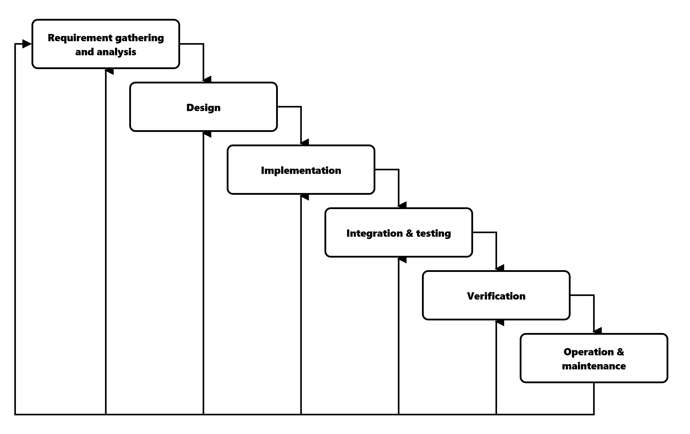

*Gambar 3.1 Tahapan Metode Waterfall*

 

Mengacu pada Gambar 3.1, rekayasa perangkat lunak ditempuh melalui enam fase berurutan yang dilengkapi jalur umpan balik (*feedback loop*):
1. ***Requirement gathering and analysis***: Fase pertama memetakan kebutuhan fungsional dan nonfungsional dari hasil wawancara, observasi lapangan, dan telaah buku besar. Keluarannya berupa rumusan aturan bisnis serta pembagian hak akses tiga aktor: calon penyewa, admin (penjaga kost), dan penyewa aktif.
2. ***Design***: Spesifikasi kebutuhan yang sudah terkunci diterjemahkan menjadi cetak biru arsitektur sistem. Perancangan meliputi *use case diagram*, *Entity Relationship Diagram* (ERD) yang memisahkan modul inti dan pendukung, *activity diagram* untuk ketiga peran, *flowchart* sistem, serta antarmuka web responsif bergaya *Neo-Brutalism*.
3. ***Implementation***: Cetak biru tersebut diwujudkan menjadi kode program memakai Laravel 12. Logika bisnis dipisahkan ke dalam *Service Layer*, sementara pembatasan akses rute dikawal oleh *middleware* peran pengguna. Penyimpanan data mengandalkan MySQL InnoDB berprinsip transaksi ACID dengan penguncian baris pesimis untuk mencegah benturan reservasi. Integrasi eksternal ikut dibangun, meliputi Midtrans Snap bervalidasi *signature key* SHA-512, *WhatsApp gateway* Fonnte, antrean *email* asinkron SMTP, kuitansi PDF A5, dan penjadwal tugas (*cron job*).
4. ***Integration & testing***: Seluruh modul internal dan sambungan API pihak ketiga digabungkan, lalu diuji lewat 60 skenario *black box testing* dalam enam domain fungsional. Pengujian ini memeriksa validasi formulir, pencegahan *double booking*, perhitungan denda lintas bulan, hingga pembaruan status bayar tanpa celah kegagalan.
5. ***Verification***: Aplikasi yang lulus uji fungsional divalidasi langsung bersama pengguna nyata di lokasi kost. Verifikasi dijalankan lewat *side-by-side usability testing* dan wawancara semiterstruktur bersama satu penjaga kost serta lima mahasiswa penghuni aktif. Tahap ini menilai kemudahan pakai dan kesesuaian fitur terhadap rutinitas harian.
6. ***Operation & maintenance***: Setelah dinyatakan layak, aplikasi disiapkan pada *server hosting* untuk operasional harian bersama penjadwal otomatis di latar belakang. Pemeliharaan berkala mencakup pengawasan keutuhan basis data, pemantauan log pengiriman notifikasi, dan penyempurnaan sistem mengikuti umpan balik pengguna.

Garis umpan balik di bagian bawah Gambar 3.1 memberi ruang koreksi terarah. Bila pengujian atau verifikasi menemukan logika yang meleset, tahapan sebelumnya dapat langsung ditinjau ulang sebelum aplikasi dipakai penuh.

 

## 3.6 Kerangka Pemikiran
Kerangka pemikiran disusun mengikuti alur *Research and Development* (R&D) agar benang merah antara persoalan lapangan, proses rekayasa perangkat lunak, dan manfaat akhirnya terlihat jelas. Alur konseptual penelitian ini digambarkan pada Gambar 3.2.

*Gambar 3.2 Kerangka Pemikiran*

 

Mengikuti susunan bagan pada Gambar 3.2, penelitian bergerak melalui empat tahap utama:
1. **Masukan (*Input*)**: Tahap awal memetakan **kondisi operasional** pengelolaan 32 kamar yang masih mengandalkan buku tulis dan WhatsApp pribadi. Pemetaan itu menghasilkan **identifikasi masalah** utama, mulai dari risiko *double booking*, luputnya pantauan jatuh tempo dan denda, hingga lamanya tutup buku kas. Seluruh temuan tersebut lalu dirumuskan menjadi **spesifikasi kebutuhan sistem**.
2. **Proses (*Process*)**: Spesifikasi kebutuhan diolah lewat tiga langkah berurutan. Rekayasa dibuka dengan **analisis dan perancangan** arsitektur sistem beserta tampilan *Neo-Brutalism*, dilanjutkan **implementasi sistem** berbasis Laravel 12, MySQL, dan layanan pembayaran maupun notifikasi eksternal. Rangkaian proses ditutup dengan **pengujian dan validasi** melalui 60 skenario *black box* dan evaluasi langsung bersama pengguna.
3. **Keluaran (*Output*)**: Proses rekayasa dan pengujian melahirkan **artefak perangkat lunak teruji**, yakni Sistem Informasi Manajemen Kost Terintegrasi *Payment Gateway* pada Asri Boarding House. Aplikasi web ini menyatukan katalog publik, portal reservasi calon penyewa, dasbor kendali pengelola, dan portal mandiri penghuni aktif.
4. **Dampak (*Outcome*)**: Penerapan sistem memberi **manfaat dan dampak bagi operasional** rumah kost sehari-hari. Benturan pemesanan kamar tertutup sejak tingkat basis data, sementara tagihan tanggal 1 dan denda lintas bulan berjalan tertib lewat pengingat otomatis. Di akhir bulan, laporan kas dapat disusun seketika tanpa selisih hitung.

 

## BAB 4 HASIL DAN PEMBAHASAN

 

## 4.1 Perancangan Aplikasi

Sebelum menulis baris kode, seluruh aturan kerja Asri Boarding House dipetakan lebih dulu ke dalam cetak biru arsitektur. Pemodelan ini memakai empat diagram utama: *use case diagram*, *Entity Relationship Diagram* (ERD), *activity diagram*, dan *flowchart* sistem. Keempat diagram tersebut menyelaraskan kebutuhan operasional lapangan dengan rancangan teknis aplikasi.

 

### 4.1.1 Use Case Diagram
Pembagian hak akses pengguna digambarkan lewat *use case diagram* pada Gambar 4.1. Pemisahan antara katalog publik, portal pemesanan, dan panel pengelola menjaga tiap peran bekerja di jalurnya sendiri.

 

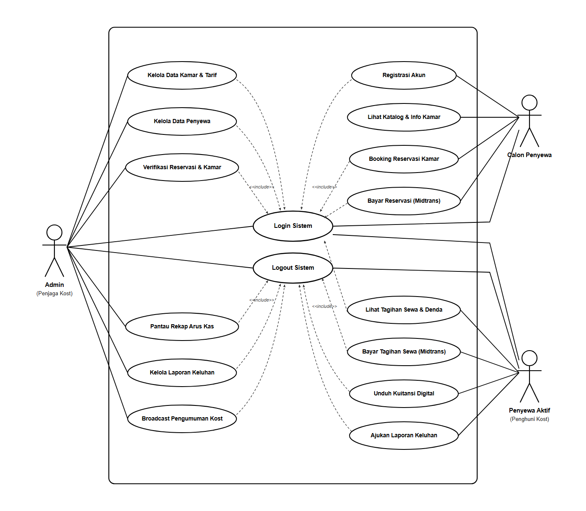

*Gambar 4.1 Use Case Diagram*

 

Gambar 4.1 melibatkan tiga aktor utama: calon penyewa, admin (penjaga kost), dan penyewa aktif (penghuni kost). Pengunjung bebas menelusuri katalog 32 kamar tanpa akun. Namun, begitu masuk ke transaksi pemesanan atau menu internal, sistem mewajibkan autentikasi lewat *Login Sistem* dan mengakhiri sesi melalui *Logout Sistem* melalui relasi `<<include>>`.

1. Calon Penyewa  
Pengunjung dapat langsung membuka katalog publik untuk memeriksa sisa kamar, fasilitas, dan tarif sewa. Bila sudah menemukan unit yang cocok, calon penyewa mendaftar akun lalu masuk ke portal. Dari sana, pemohon mengajukan *booking* dan membayar tagihan awal lewat Midtrans, baik uang muka (DP) 30% maupun bayar penuh 100%. Begitu terbayar, unit pilihan terkunci dari pemesan lain.

2. Admin (Penjaga Kost)  
Kendali harian rumah kost berpusat pada akun ini. Penjaga kost memegang enam tugas utama: mengatur data dan tarif kamar, mengelola data penghuni, memverifikasi reservasi dan kesiapan fisik unit, memantau arus kas, menangani laporan keluhan, serta menyiarkan pengumuman atau pengingat tagihan (*broadcast*). Karena pembayaran nontunai diverifikasi otomatis oleh sistem, admin tidak perlu lagi mengecek mutasi bank satu per satu.

3. Penyewa Aktif (Penghuni Kost)  
Penghuni yang sudah menempati kamar memperoleh ruang layanan mandiri. Mereka dapat memantau tagihan bulanan dan status denda, melunasi sewa via Midtrans, lalu mengunduh kuitansi PDF kapan saja. Bila ada lampu mati atau keran bocor, tiket keluhan juga bisa dikirim langsung dari portal yang sama.

 

### 4.1.2 Entity Relationship Diagram (ERD)
Seluruh data transaksi disimpan di basis data relasional MySQL. Karena jumlah tabelnya cukup banyak, rancangan ERD pada Gambar 4.2 dipecah menjadi dua bagan: modul inti dan modul pendukung.

 

*Gambar 4.2(a) Entity Relationship Diagram (Modul Inti)*

 

*Gambar 4.2(b) Entity Relationship Diagram (Modul Pendukung)*

 

Pemecahan tersebut membagi penyimpanan ke dalam empat kluster fungsional agar data transaksi utama tidak bercampur dengan catatan operasional pendukung:

1. Modul Inti: Pengelolaan Kamar, Pengguna, Reservasi, dan Pembayaran (Gambar 4.2(a))  
Sisi kiri bagan (**a. Modul Pengelolaan Kamar & Pengguna**) menautkan tabel *users*, *kamar*, dan *penyewa*. Tabel *users* menyimpan akun pengguna, sedangkan tabel *kamar* mencatat rincian 32 unit yang terhubung ke master fasilitas. Di antara keduanya, tabel *penyewa* terikat relasi satu-ke-banyak (1:N) sambil merekam *snapshot* kontrak: `harga_sewa`, `tanggal_masuk`, perkiraan tanggal keluar (`tgl_keluar_seharusnya`), dan nomor darurat (`no_wali`). Penyimpanan tarif di tabel kontrak ini punya manfaat praktis. Jika harga dasar kamar naik tahun depan, tagihan penghuni lama tetap mengacu pada harga kesepakatan awalnya.

Sisi kanan bagan (**b. Modul Transaksi Reservasi & Pembayaran**) mengatur alur uang melalui tabel *reservasi*, *tagihan*, dan *pembayaran*. Pengajuan kamar baru tercatat di *reservasi*, kewajiban sewa bulanan masuk ke *tagihan*, lalu riwayat transaksi Midtrans disimpan di *pembayaran* dengan relasi satu-ke-banyak (1:N). Pada diagram konseptual, sebagian nama atribut memakai bahasa Inggris (`room_number`, `total_price`) atau singkatan (`tgl_keluar_seharusnya`), dan garis 1:1 antara *tagihan* dengan *reservasi* disederhanakan demi kerapian visual. Pada skema migrasi MySQL aktual, seluruh kolom memakai bahasa Indonesia (`nomor_kamar`, `order_id`, `nominal_total`, `tanggal_keluar_seharusnya`, dan `tanggal_keluar`). Tabel *tagihan* merujuk langsung ke `penyewa_id`, sedangkan *reservasi* mengacu ke `user_id` dan `kamar_id`.

 

2. Modul Pendukung: Layanan Keluhan, Operasional, Komunikasi, dan Informasi (Gambar 4.2(b))  
Kluster kiri (**c. Modul Layanan Keluhan & Operasional Kost**) menampung tabel *keluhan*, *pengeluaran*, dan *log_notifikasi*. Laporan kerusakan dari penghuni masuk ke *keluhan*, sementara nota listrik, air, dan perbaikan dicatat pada *pengeluaran*. Setiap pengiriman pesan WhatsApp maupun *email* juga tercatat di *log_notifikasi* sebagai jejak audit.

Kluster kanan (**d. Modul Komunikasi Tamu & Pusat Informasi**) memuat *guest_chat_threads*, *chat_messages*, *customer_reviews*, dan entitas gabungan *peraturan & faqs*. Pengunjung tanpa akun dapat bertanya lewat sesi *guest_chat_threads* yang berelasi satu-ke-banyak (1:N) dengan pesan obrolan, sementara ulasan penghuni tersimpan di *customer_reviews*. Pada implementasi fisik MySQL, pesan obrolan tamu disimpan di `guest_chat_messages`, sedangkan tata tertib dan tanya jawab umum dipisah ke tabel `peraturan` dan `faqs`. Adapun status pada tabel `keluhan` aktual mencakup tiga tahap penuh (`pending`, `diproses`, dan `selesai`), melengkapi ringkasan dua status di bagan konseptual.

 

### 4.1.3 Activity Diagram
Interaksi antara pengguna, aplikasi web, dan layanan API eksternal dipetakan lewat tiga *activity diagram* terpisah sesuai peran masing-masing.

 

1. Calon Penyewa  
Alur pemesanan unit bagi penghuni baru tersusun pada Gambar 4.3 dalam tiga lajur (*swimlane*): Calon Penyewa, Sistem Web Kost, serta Midtrans & WhatsApp Gateway.

 

*Gambar 4.3 Activity Diagram Calon Penyewa*

 

Proses bermula ketika calon penyewa membuka katalog 32 kamar lalu memilih unit kosong. Sistem memeriksa ketersediaan kamar, kemudian membuka formulir pemesanan setelah pengguna melengkapi identitas dan durasi sewa. Aplikasi menghitung nominal uang muka atau bayar penuh, lalu meminta *Snap token* ke Midtrans untuk menampilkan layar pembayaran. Jika pembayaran gagal, pemesan kembali ke tahap bayar. Sebaliknya, transaksi yang sah langsung mengunci kamar, memicu *webhook* pembaruan status, dan mengirim bukti reservasi ke WhatsApp pemesan lewat Fonnte.

 

2. Admin (Penjaga Kost)  
Aktivitas harian pengelola tergambar pada Gambar 4.4 yang dibagi menjadi lajur Admin (Penjaga Kost), Sistem Manajemen Kost, serta Basis Data & Notifikasi WA.

 

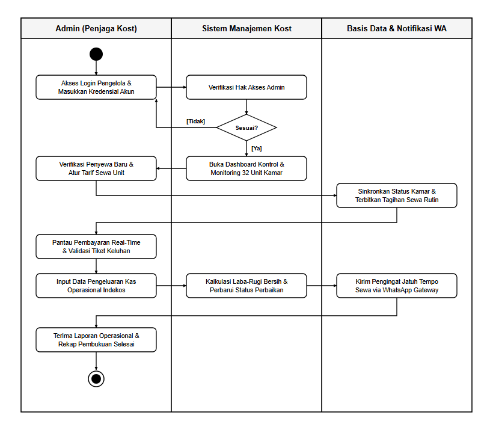

*Gambar 4.4 Activity Diagram Admin (Penjaga Kost)*

 

Alur dimulai dari verifikasi akun di halaman masuk pengelola. Begitu lolos, dasbor kontrol terbuka untuk menampilkan status 32 kamar, antrean verifikasi penghuni baru, dan pengaturan tarif. Setiap pembaruan data langsung tersimpan ke basis data dan menjadi dasar tagihan bulanan. Dalam rutinitas harian, penjaga kost memantau pembayaran masuk *real-time*, menindaklanjuti tiket keluhan, dan mencatat nota belanja operasional. Sistem kemudian menghitung laba-rugi bersih sekaligus mengirim pengingat jatuh tempo via *WhatsApp gateway* hingga rekap kas selesai.

 

3. Penyewa Aktif  
Siklus bayar sewa bulanan dan layanan mandiri penghuni tetap tampak pada Gambar 4.5 melalui lajur Penyewa Aktif, Portal Layanan Penghuni, dan Midtrans Payment Gateway.

 

*Gambar 4.5 Activity Diagram Penyewa Aktif*

 

Setelah masuk ke portal, penghuni langsung melihat tagihan berjalan, tanggal jatuh tempo, dan sisa masa sewa. Saat tombol bayar instan ditekan, sistem memeriksa keabsahan *invoice* lalu memunculkan jendela Midtrans Snap. Penghuni cukup menuntaskan transfer lewat kanal yang tersedia. Begitu bank dan Midtrans mengonfirmasi dana masuk, status tagihan otomatis berubah menjadi lunas. Masa sewa pun diperbarui, sementara tombol unduh kuitansi digital dan menu laporan keluhan langsung siap dipakai.

 

### 4.1.4 Flowchart Sistem
Alur menyeluruh dari pencarian kamar hingga serah terima kunci dirangkum lewat *flowchart* pada Gambar 4.6. Bagan alir ini memisahkan proses ke dalam dua tahap berurutan.

 

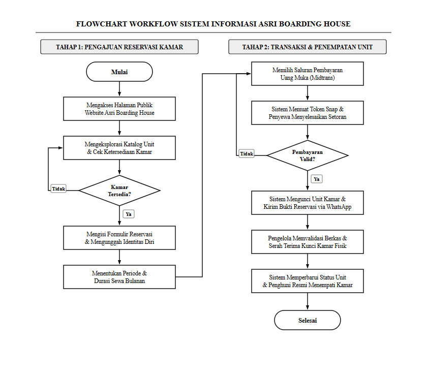

*Gambar 4.6 Flowchart Sistem*

 

**Tahap 1 (Pengajuan Reservasi Kamar)** pada Gambar 4.6 dimulai saat pengunjung membuka situs publik dan mengecek status kamar di katalog. Jika unit pilihan sedang terisi, pengunjung diarahkan memilih unit lain. Jika kosong, calon penyewa mengisi data reservasi dan durasi huni. Khusus kotak unggah identitas di bagan konseptual, implementasi aplikasi memilih pendekatan yang lebih aman bagi privasi pengguna. Sistem cukup memvalidasi angka NIK 16 digit dan nomor wali di formulir profil tanpa mewajibkan unggah foto KTP di peramban.

Alur berlanjut ke **Tahap 2 (Transaksi & Penempatan Unit)**. Pemohon memilih saluran bayar Midtrans lalu menyelesaikan setoran melalui jendela *Snap token*. Transaksi yang gagal atau belum valid akan berputar kembali ke pemilihan metode bayar. Bila pembayaran sah, sistem langsung mengunci kamar dan mengirim bukti reservasi ke WhatsApp. Rangkaian proses ditutup saat penghuni datang (*check-in*): penjaga kost mencocokkan KTP fisik dengan data NIK di sistem, menyerahkan kunci, lalu mengaktifkan status hunian sepenuhnya.

 

## 4.2 Implementasi Antarmuka Sistem
Cetak biru sistem diterjemahkan ke halaman web interaktif bergaya *Neo-Brutalism*. Gaya ini mengandalkan bingkai hitam tegas, bayangan padat, dan kontras kuning-hitam yang tajam. Hasilnya, batas tiap tombol dan kartu informasi langsung terlihat jelas di layar laptop maupun ponsel. Pembahasan berikut dibagi menjadi empat kelompok: halaman publik umum, calon penyewa, admin (penjaga kost), dan penyewa aktif.

 

### 4.2.1 Implementasi Umum
Sebelas halaman publik ini terbuka untuk siapa saja tanpa perlu *login*. Calon penyewa maupun orang tua dapat mengenal lingkungan Asri Boarding House, memeriksa sisa kamar, membaca aturan main, hingga menyapa pengelola dari jarak jauh.

1. Halaman Beranda (*Home Page*)  
Beranda utama (Gambar 4.7) menjadi etalase pertama bagi mahasiswa dan pekerja yang mencari hunian di Tembalang. Begitu situs dibuka, keunggulan kost dan akses cari kamar langsung muncul di layar pertama.

*Gambar 4.7 Halaman Beranda Utama*

Bilah atas memuat merek Asri Boarding House, tautan menu Fasilitas, Tipe Kamar, dan Cara Booking, tombol mode gelap (*dark mode*), serta tombol **Masuk** dan **Daftar**. Panel sambutan bertajuk **"Hunian Kost Exclusive & Modern"** merangkum kapasitas 32 kamar berinternet cepat dan gratis listrik, bersanding dengan ilustrasi fasad bangunan. Pengunjung tinggal memilih langkah berikutnya: klik tombol kuning **Cari & Pesan Kamar Sekarang**, tekan **Tanya Lengkap via WA**, atau buka jendela obrolan mengambang di pojok kanan bawah.

 

2. Halaman Fasilitas Kost  
Sebelum memesan, perantau biasanya memeriksa dulu kelengkapan kamar. Halaman `/fasilitas` pada Gambar 4.8 merinci seluruh sarana penunjang yang diterima penghuni selama menyewa.

*Gambar 4.8 Daftar Fasilitas Kost*

Enam kartu fasilitas tertata dalam kisi tiga kolom berbingkai tebal: *Air Conditioner* (AC), *Wi-Fi High Speed*, *Free Listrik*, Kamar Mandi Dalam, Kamar Mandi Luar (Bersama), dan Lemari Pakaian. Tiap kartu membawa ikon kuning dan uraian manfaat singkat. Calon penghuni pun cepat menimbang kecocokan sarana dengan kebutuhan harian mereka.

 

3. Katalog Tipe Kamar Kost  
Pengunjung tidak perlu lagi menunggu balasan chat hanya untuk menanyakan kamar kosong. Halaman `/kamar` (Gambar 4.9) memperlihatkan daftar unit, harga, dan status keterisian secara *real-time*.

*Gambar 4.9 Katalog Tipe Kamar*

Cukup pilih tombol filter **Semua Tipe**, **VIP**, **Deluxe**, atau **Standar**, atau ketik nomor unit di kolom pencarian. Status kamar dibedakan dengan warna kontras yang langsung terbaca. Kamar 105 berlabel hitam **Terisi** mengganti tombol pesan menjadi tombol hijau **Tanya WA / Ketersediaan**. Sebaliknya, Kamar 106 dan 107 yang berlabel kuning **Tersedia** langsung mencantumkan tarif Rp750.000/bulan bersama tombol hitam **Pesan Unit**.

 

4. Halaman Galeri Kost  
Memesan kamar dari luar kota butuh bukti visual yang meyakinkan. Halaman `/galeri` pada Gambar 4.10 menghimpun foto interior dari setiap kelas kamar di Asri Boarding House.

*Gambar 4.10 Galeri Foto Kost*

Kolom pencarian kata kunci memudahkan pengunjung menyaring foto sesuai kebutuhan. Tiga kartu utama menampilkan **Kamar VIP Eksklusif**, **Kamar Deluxe Nyaman**, dan **Kamar Standar Fungsional** lengkap dengan daftar perabotnya. Tautan **Perbesar** membuka gambar dalam resolusi penuh, sedangkan tautan **Tanya WA** menghubungkan pengunjung langsung ke admin bila ada detail ruangan yang ingin ditanyakan.

 

5. Halaman Alur Cara Reservasi  
Pengguna yang baru pertama kali memesan kost daring bisa mempelajari urutannya di halaman `/cara-booking` (Gambar 4.11). Panduan singkat ini membantu calon penghuni menyiapkan data diri dan metode bayar sebelum mengisi formulir.

*Gambar 4.11 Panduan Alur Reservasi*

Empat kartu berurutan meringkas proses sewa: **1. Pilih & Cek Kamar**, **2. Isi Data Diri**, **3. Bayar Instan**, dan **4. Terima Nota**. Di portal pemesan nanti (Subbab 4.2.2 butir 4), pelacakan transaksi memang dipecah menjadi lima tahap interaktif agar progres diskusi dan aktivasi lebih rinci. Versi publik ini sengaja diringkas menjadi empat langkah supaya langsung dipahami dalam sekali pandang.

 

6. Halaman Testimoni Penyewa Kost  
Calon penghuni sering merasa lebih yakin setelah mendengar cerita orang yang sudah tinggal di sana. Halaman `/testimoni` pada Gambar 4.12 memuat ulasan nyata dari penghuni aktif maupun penyewa terdahulu.

*Gambar 4.12 Halaman Testimoni Penghuni*

Tiga kartu ulasan menampilkan lima bintang kuning, komentar tentang kebersihan kamar hingga kestabilan internet, dan kotak inisial pengulas. Asal kota serta latar belakang kampus atau pekerjaan ikut tertera. Referensi semacam ini terasa dekat bagi mahasiswa maupun pekerja perantau yang sedang membandingkan pilihan kost.

 

7. Halaman *Frequently Asked Questions* (FAQ)  
Pertanyaan soal jam malam, aturan uang muka, dan biaya listrik dulu berulang kali masuk ke WhatsApp penjaga kost. Halaman `/faq` (Gambar 4.13) merangkum jawaban atas pertanyaan umum tersebut di satu pusat bantuan.

*Gambar 4.13 Halaman Pertanyaan Umum*

Bilah pencarian instan menyaring topik bantuan begitu pengguna mengetik kata kunci. Daftar pertanyaan memakai komponen lipat (*accordion*) bertanda tambah (`+`). Saat satu baris diklik, penjelasannya langsung membentang tanpa memuat ulang halaman, sehingga beban tanya jawab berulang di pihak admin ikut berkurang.

 

8. Halaman Tentang Kami  
Transaksi daring menuntut kejelasan profil pengelola, apalagi bagi orang tua mahasiswa. Halaman `/tentang-kami` pada Gambar 4.14 memperkenalkan latar belakang pengelolaan dan standar layanan Asri Boarding House.

*Gambar 4.14 Halaman Tentang Kami*

Kotak pembuka menjelaskan konsep hunian modern yang mengutamakan keamanan dan ketertiban administrasi digital di Semarang. Panel **Visi Kami** dan **Misi Kami** berdiri berdampingan di bawahnya, merinci empat komitmen layanan bagi para penghuni.

 

9. Halaman *Login User*  
Begitu siap memesan unit, calon penyewa masuk melewati gerbang autentikasi pada rute `/reservasi/login` (Gambar 4.15). Halaman ini memeriksa kredensial akun terhadap basis data MySQL sekaligus menyediakan pintasan masuk satu klik memakai Google OAuth.

*Gambar 4.15 Halaman Login Pengguna*

Kartu *split screen* memadukan panel pengantar hitam di kiri dengan formulir **Selamat Datang** di kanan. Pengguna boleh masuk memakai **Masuk dengan Google** atau mengisi *email* dan kata sandi manual. Opsi **Ingat Saya**, tautan **Lupa Sandi?**, serta pintasan **Daftar Akun Baru** ikut melengkapi tombol kuning **Masuk ke Akun**.

 

10. Halaman *Register User*  
Pengunjung yang belum punya akun dapat mendaftar lewat `/reservasi/register` (Gambar 4.16). Validasi langsung mengecek keunikan alamat *email* dan memastikan kata sandi minimal delapan karakter.

*Gambar 4.16 Halaman Pendaftaran Akun*

Tampilannya seragam dengan halaman masuk lewat kartu dua sisi. Pendaftar tinggal memilih **Daftar dengan Google** atau melengkapi nama lengkap, *email*, nomor WhatsApp, kata sandi, dan konfirmasi sandi. Begitu tombol kuning **Daftar Akun Baru** ditekan, akun tercatat dan pengguna berlanjut ke pengisian profil darurat.

 

11. Layanan *Chat Real-Time Guest*  
Tidak semua pengunjung ingin mendaftar akun hanya untuk mengajukan satu pertanyaan singkat. Untuk itu, *widget* obrolan tamu (*guest chat*) pada Gambar 4.17 selalu siaga di pojok kanan bawah halaman publik.

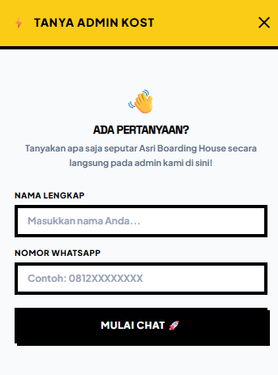

*Gambar 4.17 Chat Real Time Guest*

Menekan ikon kuning akan membuka jendela **Tanya Admin Kost** dengan sapaan **Ada Pertanyaan?**. Tamu cukup memasukkan nama dan nomor WhatsApp aktif lalu klik **Mulai Chat**. Pesan langsung tersambung ke panel penjaga kost secara *real-time*.

 

### 4.2.2 Implementasi Calon Penyewa
Selepas mendaftar akun, calon penyewa menjalani rangkaian tujuh antarmuka dan layanan transaksi. Alurnya berjalan runtut, mulai dari melengkapi kontak darurat, menyimulasikan tarif, membayar lewat Midtrans, sampai menerima kabar aktivasi di WhatsApp dan *email*.

1. Halaman Lengkapi Profil  
Akun baru yang belum menyimpan kontak darurat otomatis dialihkan ke `/profil/complete` (Gambar 4.18) sebelum bisa memesan kamar. Empat kolom wajib diisi di sini: nomor WhatsApp aktif, Nomor Induk Kependudukan (NIK) 16 digit, nama lengkap wali atau orang tua, dan nomor telepon wali.

*Gambar 4.18 Kelengkapan Profil Pemesan*

Kotak peringatan kuning menegaskan pentingnya nomor WhatsApp agar notifikasi tagihan terkirim tepat sasaran. Sistem sengaja memvalidasi NIK tepat 16 digit angka tanpa meminta unggah foto KTP daring. Langkah ini menjaga keamanan berkas identitas pengguna, sementara pencocokan KTP fisik tetap dikerjakan penjaga kost saat *check-in*. Klik tombol kuning **Simpan & Lanjutkan** akan menyimpan data dan membuka akses reservasi.

 

2. Dasbor Reservasi Calon Penyewa  
Calon penyewa yang belum berstatus penghuni aktif dipisahkan ke ruang pantau khusus di `/penyewa/reservasi-dashboard` (Gambar 4.19). Dari bilah kiri, pemohon juga bisa membuka riwayat pemesanan, pembayaran, maupun percakapan dengan pengelola.

*Gambar 4.19 Dasbor Reservasi Pemesan*

Jika pengguna belum memilih unit, area tengah menampilkan status **Pemesanan Kamar Belum Ditemukan** lengkap dengan pintasan **Cari & Booking Kamar** dan **Kembali ke Beranda**. Di sisi kanan, panel **Tahapan Reservasi** memetakan lima langkah penempatan kamar: (1) *Registrasi Akun*, (2) *Pilih & Booking Kamar*, (3) *Selesaikan Pembayaran*, (4) *Aktivasi Pengelola*, dan (5) *Siap Ditempati*.

 

3. Simulasi Biaya dan Pengajuan Kamar  
Memilih kamar kosong di katalog akan membuka halaman detail `/kamar/{id}` beserta kalkulator sewa *real-time* (Gambar 4.20). Pemohon bebas menghitung sendiri perkiraan biaya sesuai tipe sewa (harian, mingguan, maupun bulanan dengan pilihan durasi seperti 1, 3, hingga 12 bulan) serta opsi DP 30% atau bayar penuh 100%.

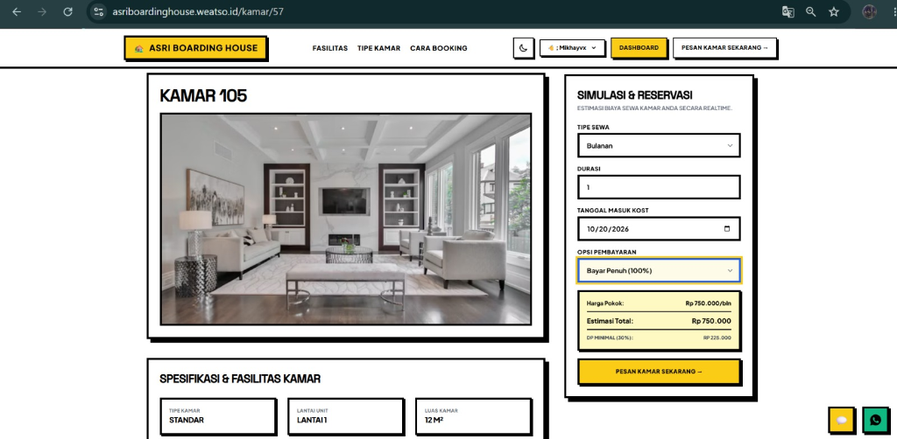

*Gambar 4.20 Simulasi Biaya Kamar*

Sisi kiri memperlihatkan foto interior **Kamar 105** beserta spesifikasi tipe Standar, Lantai 1, dan luas 12 m². Di sisi kanan, panel **Simulasi & Reservasi** memuat pilihan tipe sewa, durasi, tanggal rencana masuk, dan opsi pembayaran. Kotak kuning langsung merinci harga pokok Rp750.000/bulan, estimasi total Rp750.000, dan batas minimal DP 30% sebesar Rp225.000 sebelum pengguna menekan **Pesan Kamar Sekarang**.

 

4. Portal Pembayaran Lima Tahap Reservasi  
Begitu pesanan tercipta, sistem mengarahkan pemohon ke halaman pelacakan dan pembayaran `/penyewa/reservasi/{id}/pembayaran` (Gambar 4.21). Penunjuk progres lima tahap berdiri berdampingan dengan rincian tagihan agar pemohon memastikan kondisi fisik kamar dulu sebelum mengirim uang.

*Gambar 4.21 Tahapan Pembayaran Reservasi*

Lima indikator di atas layar menyorot langkah *Booking*, *Diskusi*, *Bayar DP/Full*, *Aktivasi*, dan *Selesai*. Kotak imbauan mengingatkan pemesan untuk menyapa admin lewat kolom obrolan sebelum transfer. Kartu **Detail Booking Kamar** mencatat Kamar 105 (Lantai 1), durasi satu bulan, total Rp750.000, dan lencana **Pending**. Di sampingnya, kartu **Metode Pembayaran** menyediakan tombol kuning **Bayar Sekarang (Midtrans)** untuk memulai pembayaran serta tombol merah **Batalkan Reservasi** bila rencana berubah.

 

5. Integrasi *Payment Gateway* Midtrans  
Pembayaran reservasi ditangani Midtrans Snap. Secara arsitektur, layanan ini mendukung banyak kanal nontunai sesuai ulasan Bab 2. Namun, pada konfigurasi pengujian lapangan (Gambar 4.22), transaksi dijalankan lewat kanal utama *Virtual Account* Bank BCA. Begitu dana masuk, *webhook callback* Midtrans memperbarui status di basis data otomatis tanpa perlu kirim foto bukti bayar.

*Gambar 4.22 Jendela Pembayaran Midtrans*

Jendela *pop-up* Midtrans mencantumkan nama Asri Boarding House, tagihan Rp750.000, kode pesanan `#RSV-4-1792501872`, dan batas waktu bayar 24 jam. Di bawah logo Bank BCA, nomor *Virtual Account* siap disalin lewat tombol *Copy* ke aplikasi *m-Banking*. Panduan (*How to pay*) dan tombol **Check status** juga tersedia langsung di layar yang sama.

 

6. Integrasi *WhatsApp Gateway* Fonnte  
Setelah pembayaran terverifikasi dan penjaga kost mengonfirmasi kesiapan kamar, aplikasi memicu pesan sambutan otomatis lewat API *WhatsApp gateway* Fonnte (Gambar 4.23). Pemberitahuan instan ini memberi kepastian cepat bahwa kamar sudah resmi aktif.

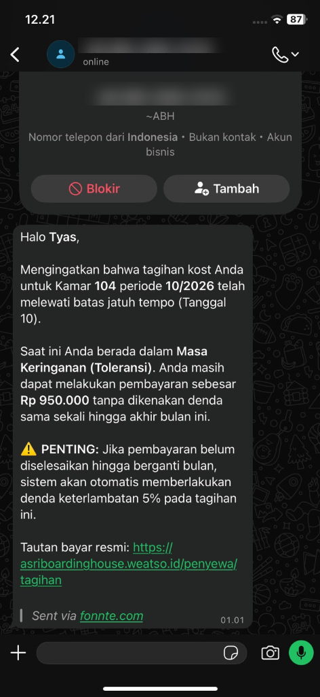

*Gambar 4.23 Pesan Aktivasi WhatsApp*

Pesan bertajuk **Selamat Datang Penyewa Baru** menyapa nama penghuni, mengabarkan status **AKTIF** untuk unit pilihan (contohnya Kamar 101), lalu mengarahkan pengguna membuka portal mandiri. Label *Sent via fonnte.com* di bagian kaki pesan membuktikan kiriman dipicu langsung oleh *server* aplikasi.

 

7. Integrasi *Email Gateway* SMTP  
Komunikasi WhatsApp dilengkapi kiriman *email* resmi berbasis SMTP (Gambar 4.24). Arsip tertulis di kotak masuk ini memudahkan penghuni mengecek ulang nomor kamar dan tarif kontrak kapan saja dari perangkat lain.

*Gambar 4.24 Email Konfirmasi Reservasi*

Templat *email* tetap mempertahankan ciri *Neo-Brutalism* lewat tajuk kuning dan kotak **Selamat Datang Penyewa Baru!**. Tabel ringkas di tengah memuat Nomor Kamar (`No. 104`), Harga Sewa (`Rp950.000/bulan`), dan lencana hijau **AKTIF**. Di bagian bawah, tombol kuning **Buka Portal Penyewa** langsung menuntun penghuni menuju halaman *login*.

 

### 4.2.3 Implementasi Admin
Operasional 32 kamar Asri Boarding House dikendalikan lewat sebelas halaman administrator. Penjaga kost memantau kamar kosong, memproses penghuni baru, mengawasi tagihan, mencatat belanja harian, mencetak laporan kas, hingga membalas aduan dan obrolan tamu dari satu tempat.

1. Halaman *Admin Login*  
Pintu masuk pengelola pada rute `/admin/login` (Gambar 4.25) sengaja dipisah dari halaman *login* penyewa. Isolasi ini melindungi data kamar, biodata penghuni, dan pembukuan kas dari akses yang tidak berhak.

*Gambar 4.25 Halaman Login Administrator*

Panel kiri berlatar hitam menandai **Portal Manajemen Administrator** dengan jaminan pantauan *real-time* dan akses terbatas. Di sebelahnya, formulir **Admin Login** hanya menerima *email* dan kata sandi administrator yang terdaftar, dilengkapi tautan lupa sandi, centang **Ingat Saya**, dan tombol **Masuk Administrator**.

 

2. Halaman Dasbor Administrator  
Begitu berhasil masuk, penjaga kost langsung disambut halaman `/admin/dashboard` (Gambar 4.26). Pengelola tidak perlu lagi membalik lembaran buku besar hanya untuk mengetahui kondisi kost hari itu.

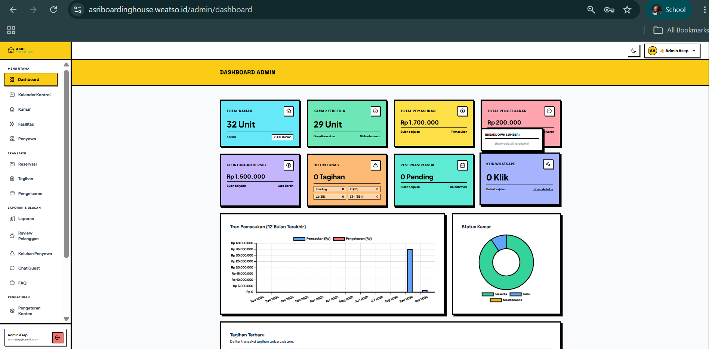

*Gambar 4.26 Dasbor Operasional Administrator*

Delapan kartu warna di baris atas merangkum kondisi operasional bulan berjalan. Dari sisi hunian, tercatat 32 unit dengan 3 kamar terisi (okupansi 9,4%) dan 29 unit siap sewa. Posisi kas bulan berjalan pun langsung terbaca: pemasukan Rp1.700.000, pengeluaran Rp200.000, dan keuntungan bersih Rp1.500.000, lengkap dengan hitungan tagihan belum lunas (`0 Tagihan`), reservasi masuk (`0 Pending`, 1 dikonfirmasi), dan klik WhatsApp. Grafik **Tren Pemasukan (12 Bulan Terakhir)**, diagram donat **Status Kamar**, dan tabel **Tagihan Terbaru** melengkapi pemantauan di tengah layar. Bilah samping memuat seluruh menu modul (termasuk Kalender Kontrol, Review Pelanggan, dan Pengaturan Konten), sementara pojok kanan atas menyediakan pengalih mode gelap (*OLED Dark Mode*) agar layar tetap adem saat dipakai lama.

 

3. Modul Manajemen Kamar  
Data seluruh 32 kamar dikelola terpusat di `/admin/kamar` (Gambar 4.27). Penjaga kost dapat menambah unit, memperbarui harga sewa, atau menahan status kamar yang baru ditinggal penghuni agar aman dari *double booking*.

*Gambar 4.27 Pengelolaan Data Kamar*

Empat kartu ringkasan langsung memetakan kondisi unit: Total 32, Tersedia 29, Terisi 3, dan *Maintenance* 0. Tombol **Kelola Fasilitas** dan **Tambah Kamar** berdiri di pojok kanan atas kartu. Untuk mencari unit tertentu, pengelola bebas memakai filter status cepat, mengganti mode tampilan **Tabel** ke **Denah/Visual Grid**, atau menyaring lewat menu *dropdown* tipe, status, dan lantai. Tiap baris tabel, contohnya Kamar 101 (VIP, Lantai 1, tarif Rp1.400.000, status **Terisi**), sudah memuat label fasilitas, nama penghuni aktif, dan tautan **Detail** maupun **Edit**.

 

4. Modul Manajemen Fasilitas  
Sarana yang muncul di katalog publik dan halaman kamar bersumber dari data master pada `/admin/fasilitas` (Gambar 4.28). Pola master ini membuat nama dan ikon fasilitas selalu seragam saat disematkan ke puluhan kamar.

*Gambar 4.28 Pengelolaan Fasilitas Kost*

Panel **Daftar Master Fasilitas** dilengkapi tombol **Kembali ke Kamar** dan **Tambah Fasilitas**. Tabelnya menampung delapan sarana aktif: AC, *Wi-Fi High Speed*, *Free Listrik*, Kamar Mandi Dalam, Kamar Mandi Luar, Lemari Pakaian, Meja Belajar, dan Kasur *Springbed Queen*. Setiap baris menyertakan ikon, deskripsi singkat, lencana **Aktif**, serta tombol **Edit** dan **Hapus**.

 

5. Modul Manajemen Penyewa  
Buku induk penghuni digital tersimpan pada `/admin/penyewa` (Gambar 4.29). Selain menghimpun data penyewa aktif, halaman ini melayani pendaftaran tamu datang langsung (*walk-in*) dan prosedur *checkout* di akhir masa sewa.

*Gambar 4.29 Pengelolaan Data Penghuni*

Penjaga kost bisa langsung mengunduh arsip lewat tombol **Export PDF** dan **Export Excel/CSV**, atau mendaftarkan tamu langsung memakai tombol kuning **Tambah Penyewa**. Kotak cari dan penyaring **Status Keaktifan** mempermudah pencarian data. Baris tabel menampilkan profil tiap penghuni: nama, kontak, kelas kamar, NIK 16 digit, tanggal masuk, dan nomor wali darurat. Di kolom kontrak, tampak pula durasi beserta tarif sewa aktif, misalnya paket 12 bulan Rp1.283.380/bulan sesudah potongan, hingga lencana **Aktif**.

 

6. Modul Manajemen Reservasi  
Setiap pengajuan kamar dari situs publik bermuara di `/admin/reservasi` (Gambar 4.30). Dari sini, penjaga kost mengecek status bayar Midtrans lalu mengesahkan akun calon penghuni menjadi penghuni tetap.

*Gambar 4.30 Pengelolaan Reservasi Masuk*

Kolom pencarian menyaring pesanan berdasarkan *Order ID*, nama pemohon, nomor kamar, atau **Status Reservasi**. Daftar pesanan merinci kode transaksi (contohnya `RSV-4-1792501872`), nama pemesan, unit kamar, tipe sewa, tanggal mulai huni, dan status **Dikonfirmasi**. Cukup tekan tombol biru **Detail** untuk memeriksa rincian pembayaran sekaligus mengaktifkan hunian setelah mengecek KTP fisik pemohon.

 

7. Modul Manajemen Tagihan  
Kewajiban sewa rutin seluruh penghuni dipantau lewat `/admin/tagihan` (Gambar 4.31). Karena penjadwal tugas (*cron job*) sudah menerbitkan faktur otomatis tiap tanggal 1, pengelola tidak lagi repot membuat tagihan manual.

*Gambar 4.31 Pengelolaan Tagihan Bulanan*

Pencarian dan filter **Status Pembayaran** mempercepat pelacakan tagihan tertunda maupun lunas. Tabel **Semua Tagihan Bulanan** mencatat *Order ID* (seperti `TGH-4-202610`), nama penyewa, nomor kamar, periode, jatuh tempo tanggal 10, total bayar, lencana **Lunas**, dan metode Midtrans. Bagi penghuni yang membayar tunai di meja pengelola, penjaga kost tinggal membuka tombol **Detail**, menekan konfirmasi tunai, lalu kuitansi digital langsung terbit.

 

8. Modul Manajemen Pengeluaran  
Agar hitung laba bersih di akhir bulan tepat, setiap belanja operasional dicatat pada `/admin/pengeluaran` (Gambar 4.32). Pengeluaran token listrik, air PDAM, upah kebersihan, perbaikan fasilitas, sampai pajak kost dapat diinput lengkap dengan foto notanya.

*Gambar 4.32 Pencatatan Pengeluaran Operasional*

Tombol **Export PDF**, **Export Excel**, dan **Tambah Pengeluaran** tertata rapi di kanan atas. Untuk menelusuri riwayat belanja, tersedia kolom pencarian nama pengeluaran, filter kategori, dan pilihan rentang tanggal. Setiap baris mencatat tanggal, uraian, kategori, nominal (misalnya Rp200.000), status lampiran nota, keterangan, serta tombol **Detail**, **Edit**, dan **Hapus**.

 

9. Modul Laporan Keuangan  
Tutup buku bulanan yang dulunya menyita tiga sampai empat hari kini ringkas lewat `/admin/laporan` (Gambar 4.33). Halaman **Laporan Penagihan Bulanan** menghitung selisih pemasukan dan belanja seketika agar siap dilaporkan ke pemilik kost.

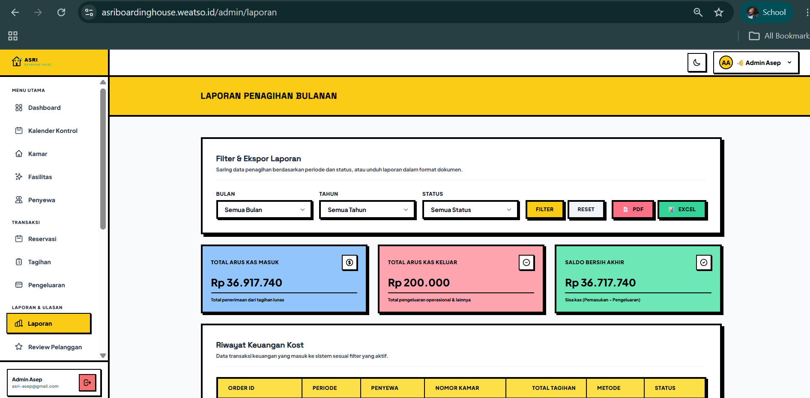

*Gambar 4.33 Laporan Rekapitulasi Kas*

Panel **Filter & Ekspor Laporan** memungkinkan pengelola menyaring bulan, tahun, dan status tagihan lalu langsung mengekspor berkas **PDF** atau **Excel**. Tiga kartu metrik besar merangkum **Total Arus Kas Masuk** (`Rp36.917.740`), **Total Arus Kas Keluar** (`Rp200.000`), dan **Saldo Bersih Akhir** (`Rp36.717.740`). Nominal tersebut mencerminkan akumulasi seluruh periode karena penyaring sedang disetel pada opsi *Semua Bulan* dan *Semua Tahun*, berbeda dari kartu dasbor pada Gambar 4.26 yang hanya menghitung bulan berjalan. Tepat di bawah kartu, tabel **Riwayat Keuangan Kost** merinci setiap transaksi yang membentuk saldo tersebut.

 

10. Modul Manajemen Keluhan Penyewa  
Laporan kerusakan kamar yang dikirim penghuni terkumpul rapi di `/admin/keluhan` (Gambar 4.34). Cara ini menggantikan laporan lisan di lorong atau chat pribadi yang mudah tertimbun pesan lain.

*Gambar 4.34 Pengelolaan Keluhan Fasilitas*

Empat tombol filter (**Semua Keluhan**, **Pending**, **Diproses**, dan **Selesai**) beserta kotak cari membantu pengelola memilah antrean perbaikan. Pada contoh di layar, aduan *lampu mati* berkategori Kamar dari penghuni Kamar 101 telah berstatus **Selesai**. Lewat tombol **Detail**, penjaga kost melihat foto bukti kerusakan, meneruskannya ke teknisi, dan mengirim tanggapan tindak lanjut.

 

11. Modul Pengelolaan *Chat Guest*  
Pertanyaan pengunjung dari *widget* obrolan publik masuk langsung ke `/admin/guest-chats` (Gambar 4.35). Penjaga kost bisa langsung membalas calon penyewa tanpa berpindah perangkat.

*Gambar 4.35 Pengelolaan Obrolan Tamu*

Layar terbagi menjadi dua kolom: **Daftar Pertanyaan Guest** di kiri dan ruang percakapan aktif di kanan. Di tajuk jendela obrolan tersedia tombol hijau **Hubungi WA** untuk melanjutkan ke WhatsApp, tombol **Tandai Selesai**, dan tombol **Hapus**. Bagian bawah ruang percakapan menyediakan kolom ketik balasan beserta tombol **Kirim**.

 

### 4.2.4 Implementasi Penyewa Aktif
Begitu penjaga kost mengaktifkan hunian, peran akun berubah menjadi penyewa aktif. Tujuh antarmuka pada portal ini memudahkan penghuni mengurus pembayaran bulanan, mengunduh kuitansi, memperbarui profil, hingga melaporkan kerusakan langsung dari ponsel maupun laptop.

1. Halaman *Login* Penyewa Aktif  
Penghuni tetap masuk lewat jalur khusus `/penyewa/login` (Gambar 4.36). Pemisahan rute ini membawa penyewa aktif langsung ke dasbor kamar tanpa melewati halaman penawaran reservasi lagi.

*Gambar 4.36 Login Penyewa Aktif*

Kartu dua sisi menyandingkan panel **Portal Utama Penyewa Kost** dengan formulir **Portal Penyewa**. Berbeda dari gerbang publik yang hanya meminta *email*, formulir ini menerima *email* maupun nomor WhatsApp bersama kata sandi. Opsi cepat **Masuk dengan Google** tetap tersedia tepat di atas tombol **Masuk ke Dashboard Penyewa**.

 

2. Halaman Dasbor Penyewa  
Setelah masuk, penghuni langsung bertemu halaman `/penyewa/dashboard` (Gambar 4.37). Seluruh data penting tentang kamar, kewajiban sewa, dan pintasan keluhan diringkas dalam satu layar.

*Gambar 4.37 Dasbor Penyewa Aktif*

Lima kartu di baris atas merangkum kondisi sewa berjalan. Di dalamnya tertera **Kamar 105** lantai 1 berstatus aktif, **Tipe Kamar** Standar (Rp750.000/bulan), **Uang Jaminan** Rp0, tagihan **Belum Lunas** (`0 Tagihan`), serta **Total Terbayar** (`1 Invoice` senilai Rp750.000). Jika ada kendala sarana, spanduk **Ada Fasilitas Rusak atau Bermasalah?** menyediakan tombol cepat **Buat Laporan Keluhan**. Di bawahnya, grafik batang **Tren Pengeluaran Sewa (12 Bulan Terakhir)** dan diagram donat **Status Tagihan** memudahkan penghuni memantau riwayat bayarnya.

 

3. Halaman Tagihan Penyewa  
Rincian sewa tiap bulan disajikan terbuka pada `/penyewa/tagihan` (Gambar 4.38). Lewat menu **Tagihan Saya**, penghuni memeriksa jatuh tempo tanggal 10, membayar lewat Midtrans Snap, atau membuka nota lunas.

*Gambar 4.38 Tagihan Sewa Penyewa*

Tiga kartu ringkasan mengelompokkan jumlah tagihan belum lunas, tagihan lunas, dan total pengeluaran sewa. Pada tabel **Riwayat Tagihan Sewa**, tampak faktur `#TGH-4-202610` periode `10/2026` berjatuh tempo `10 Oct 2026` senilai Rp750.000 yang sudah berstatus **Lunas** via Midtrans. Tautan **Detail / Bayar** dipakai untuk melunasi tagihan tertunda atau mencetak kuitansi resmi.

 

4. Halaman Kelola Akun dan Profil  
Bila nomor WhatsApp berganti atau kata sandi perlu diperbarui, penghuni cukup membuka `/profile?tab=profile` (Gambar 4.39). Data sensitif seperti NIK 16 digit dan rincian kontrak kamar tetap terkunci sesuai catatan pengelola agar tidak berubah sembarangan.

*Gambar 4.39 Pengaturan Profil Penghuni*

Halaman ini memisahkan pengaturan ke dua *tab*: **Profil Saya** dan **Ubah Password**. Di panel **Informasi Profil**, penghuni menyunting Nama Lengkap, Alamat Email, dan Nomor WhatsApp lalu menyimpannya lewat tombol **Simpan**. Panel berbingkai merah di bagian bawah disediakan terpisah khusus untuk penghapusan akun.

 

5. Halaman Riwayat Pembayaran  
Catatan mutasi sewa penghuni dipilah rapi pada `/penyewa/reservasi/pembayaran` (Gambar 4.40). Pemisahan antara setoran *booking* awal dan tagihan rutin bulanan memudahkan penyewa melacak pengeluarannya kapan saja.

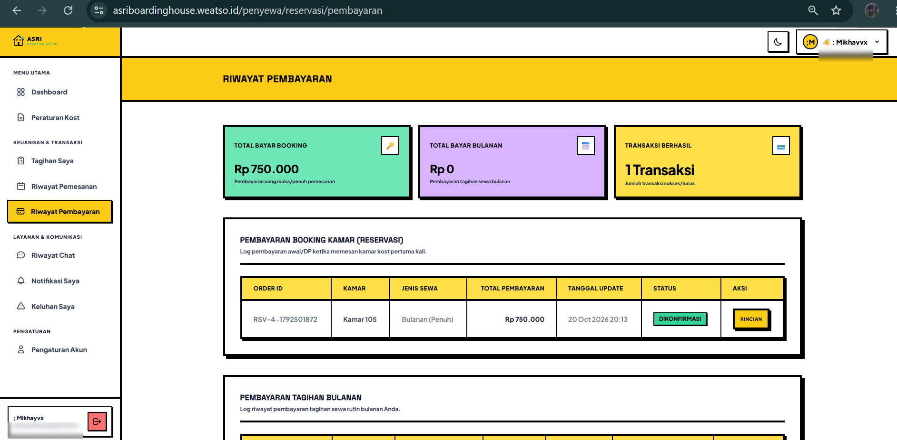

*Gambar 4.40 Riwayat Transaksi Pembayaran*

Tiga kartu di atas mencatat **Total Bayar Booking** Rp750.000, **Total Bayar Bulanan** Rp0, dan **Transaksi Berhasil** (`1 Transaksi`). Nilai bayar bulanan masih Rp0 karena pelunasan penuh 100% saat pemesanan awal sudah menutup tagihan bulan pertama (`#TGH-4-202610` pada Gambar 4.38), sedangkan siklus tagihan rutin bulan berikutnya belum berjalan. Di bawahnya berdiri dua tabel terpisah: **Pembayaran Booking Kamar (Reservasi)** yang memuat pesanan `RSV-4-1792501872` untuk Kamar 105 berstatus **Dikonfirmasi** dengan tombol **Rincian**, serta tabel **Pembayaran Tagihan Bulanan** untuk mutasi sewa rutin mendatang.

 

6. Halaman Pengaduan dan Keluhan  
Saat menemukan keran bocor, lampu padam, atau internet terganggu, penghuni dapat melapor lewat `/penyewa/keluhan` (Gambar 4.41). Setiap aduan tercatat resmi lengkap dengan foto bukti dan progres penanganannya.

*Gambar 4.41 Pengajuan Keluhan Kamar*

Tombol **Buat Keluhan Baru** di kanan atas panel **Riwayat Keluhan Anda** membuka formulir laporan beserta unggah foto kerusakan. Filter **Semua Keluhan**, **Pending**, **Diproses**, dan **Selesai** bersanding dengan kolom cari judul laporan. Tabel pemantauan merinci Judul, Kategori, Tanggal Lapor, Status, Tanggapan Admin, dan Aksi, atau tampil kosong bila penghuni belum pernah melapor.

 

7. Dokumen Kuitansi Nota PDF  
Begitu tagihan berstatus lunas, tombol unduh bukti bayar resmi berukuran A5 langsung terbuka (Gambar 4.42). Konversi PDF dijalankan di sisi peramban memakai pustaka `html2pdf.js` sehingga tidak membebani memori *server*.

*Gambar 4.42 Dokumen Kuitansi Digital*

Kop kuning **Asri Boarding House** memuat alamat Jalan Maera Sari di Tembalang dan nomor WhatsApp pengelola. Kotak **Ditagihkan Kepada** (nama penyewa, Kamar 105, tipe Standar) bersanding dengan **Detail Pembayaran** berisi nomor *invoice* unik, waktu pelunasan, dan metode Midtrans. Di tengah dokumen, rincian *Sewa Kost Periode October 2026* sebesar Rp750.000 diperkuat stempel hijau **LUNAS** serta kolom pengesahan Pengelola Kost.

 

## 4.3 Implementasi Kode Program
Seluruh rancangan antarmuka di atas ditopang oleh kode PHP berbasis Laravel 12. Agar *controller* tetap ringkas dan mudah dirawat, aturan bisnis yang sensitif dipisahkan ke lapisan layanan khusus (*Service Layer*). Bagian ini menguraikan empat modul kode utama aplikasi: hak akses, pengendalian reservasi anti-bentrok, integrasi *payment gateway*, serta otomasi penjadwalan dan notifikasi.

 

### 4.3.1 Implementasi Autentikasi dan Hak Akses
Tanpa pengaman di tingkat *server*, pengguna biasa bisa saja mengetik langsung alamat `/admin/dashboard` untuk mengintip data kost. Lapisan autentikasi dan pengalihan rute menutup celah ini sejak permintaan HTTP pertama masuk.

1. Pembatasan Hak Akses Peran (*Role Middleware*)  
Setiap rute privat dijaga kelas penengah `RoleMiddleware`. Sebelum permintaan menyentuh *controller*, metode `handle()` memeriksa status sesi dan kecocokan peran akun (Gambar 4.43).

*Gambar 4.43 Kode Pembatasan Akses*

Kode pada Gambar 4.43 menerapkan dua lapis saringan (*guard clause*). Pertama, jika pengguna belum masuk (`!$user`), akses API langsung menerima status JSON `401 Unauthenticated`, sedangkan pengunjung peramban diarahkan ke rute `login`. Kedua, peran pengguna dicocokkan ketat terhadap daftar `$roles` lewat `in_array($user->role, $roles, true)`. Percobaan menerobos halaman di luar wewenang langsung dihentikan dengan kode HTTP `403` (*Akses ditolak*).

 

2. Pengalihan Portal Pasca-autentikasi (*Auth Redirect*)  
Satu tabel `users` melayani akun calon pemesan sekaligus penghuni tetap. Agar pengguna tidak tersesat sesudah *login*, kelas `AuthRedirectService` menentukan tujuan halaman lewat metode `resolvePostAuthDestination()` (Gambar 4.44).

*Gambar 4.44 Kode Pengalihan Portal*

Lima aturan prioritas bekerja berurutan pada Gambar 4.44. Aturan pertama mengecek kolom `no_hp`: jika kosong atau masih memakai awalan sementara `temp_` dari pendaftaran Google OAuth, pengguna wajib melengkapi profil di `profil.complete` supaya pengiriman WhatsApp Fonnte tidak gagal. Aturan kedua mengembalikan pengguna ke alamat tujuan sebelumnya (*intended URL*) selama bukan rute `/admin`, sekaligus memulihkan pilihan simulasi `reservasi_tipe_sewa` dan `reservasi_durasi` dari sesi. Bila tidak ada *intended URL*, tiga jalur cadangan (*fallback*) mengambil alih. Penghuni aktif masuk ke `penyewa.dashboard`, pemesan berstatus `pending`, `dp`, atau `lunas` menuju `penyewa.reservasi.dashboard`, dan akun lainnya kembali ke beranda publik (`landing.index`).

 

### 4.3.2 Implementasi Pemesanan Kamar
Risiko terbesar dalam pemesanan daring 32 kamar adalah dua orang mengklik pesan untuk kamar yang sama pada detik berdekatan. Kelas `ReservasiService` menangani seluruh proses ini secara atomik agar benturan (*double booking*) mustahil lolos.

1. Transaksi ACID dan Penguncian Baris Unit Kamar  
Metode `buatReservasi()` membungkus pengecekan ketersediaan hingga penyimpanan pesanan dalam satu transaksi ACID (Gambar 4.45). Bila satu langkah gagal, seluruh perubahan otomatis dibatalkan (*rollback*).

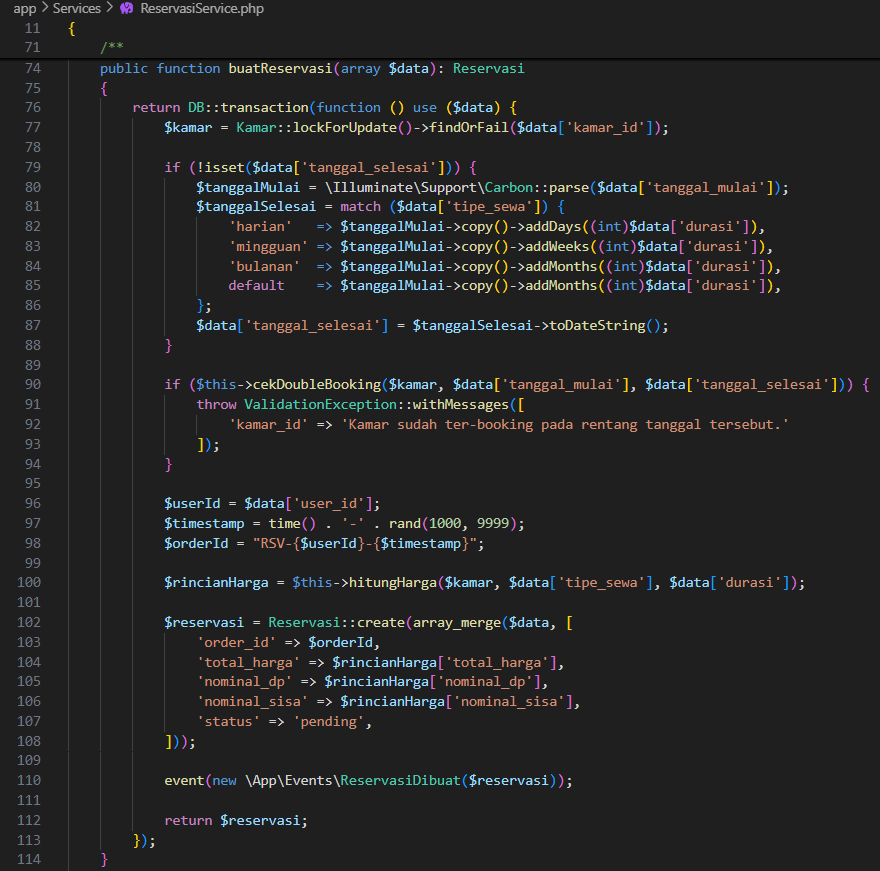

*Gambar 4.45 Kode Penguncian Kamar*

Begitu masuk blok `DB::transaction()`, kode mengeksekusi `Kamar::lockForUpdate()->findOrFail($data['kamar_id'])`. Baris unit tersebut langsung dikunci memakai mekanisme *pessimistic row locking* di MySQL InnoDB, sehingga transaksi pesaing harus mengantre sampai proses pertama rampung. Selanjutnya, `Carbon` menghitung `tanggal_selesai` mengikuti tipe sewa harian, mingguan, atau bulanan, lalu memanggil `cekDoubleBooking()`. Jika jadwal bertabrakan, `ValidationException` dilempar untuk membatalkan transaksi. Bila kosong, sistem memanggil `hitungHarga()`, menyimpan pesanan berstatus `pending` dengan kode `RSV-{$userId}-{$timestamp}`, lalu memicu *event* `ReservasiDibuat`.

 

2. Algoritma Pengecekan Benturan (*Double Booking*) Kamar  
Penguncian baris saja tidak cukup tanpa pemeriksaan irisan tanggal yang akurat. Metode `cekDoubleBooking()` pada Gambar 4.46 membandingkan jadwal pengajuan baru terhadap antrean reservasi daring dan kontrak penghuni aktif.

*Gambar 4.46 Kode Pemeriksaan Jadwal*

Dua kueri dijalankan berurutan. Kueri pertama mengecek tabel `reservasi` memakai *scope* `overlapDengan()` dan `aktif()`, lengkap dengan `lockForUpdate()` saat berjalan dalam transaksi (`DB::transactionLevel() > 0`). Kueri kedua memeriksa tabel `penyewa` berstatus `aktif` yang rentang `tanggal_masuk` dan `tanggal_keluar`-nya bersinggungan dengan tanggal pesanan baru. Begitu salah satunya terbukti beririsan, metode mengembalikan nilai `true` dan pengajuan langsung ditolak.

 

### 4.3.3 Implementasi *Payment Gateway*
Pembayaran digital tanpa kirim tangkapan layar transfer bergantung pada komunikasi aman dua arah antara aplikasi dan *server* Midtrans. Tugas ini dibagi rapi antara `MidtransService` (pembuat token bayar) dan `MidtransCallbackController` (penerima sinyal lunas).

1. Pembuatan Transaksi dan *Snap Token* Midtrans  
Sebelum layar bayar Midtrans muncul di ponsel penghuni, *server* harus mendaftarkan rincian tagihan untuk memperoleh *Snap token*. Gambar 4.47 memperlihatkan penyusunan parameter tagihan sewa bulanan di `createSnapToken()`, sementara reservasi awal memakai metode pendamping `createSnapTokenReservasi()` dengan pola serupa.

*Gambar 4.47 Kode Token Midtrans*

Kode pada Gambar 4.47 membaca `nominal_pokok`, `nominal_denda`, dan `nominal_total` dari model `Tagihan`. Jika total tidak sama persis dengan penjumlahan pokok dan denda, `$pricePokok` langsung disesuaikan agar Midtrans tidak menolak *payload* karena selisih hitung. Rincian biaya disusun ke larik `$itemDetails` (`POKOK-{id}` dan `DENDA-{id}` bila ada denda), lalu dibentuk `order_id` berimbuhan *timestamp* Unix. Masa berlaku token (`$duration`) default 24 jam juga dipangkas mengikuti sisa jam menuju akhir bulan (`$hoursUntilEndOfMonth < 24`) agar tagihan tidak lolos dari aturan denda kalender. Pada lanjutan metode tersebut, paket parameter dikirim via *HTTP Basic Auth* memakai `server_key` dan *header* `X-Override-Notification` untuk mengambil token transaksi dari Midtrans.

 

2. Validasi *Signature Key* dan *Webhook Callback* Midtrans  
Ketika penghuni selesai mentransfer dana, Midtrans mengirim notifikasi asinkron ke metode `handle()` pada `MidtransCallbackController` (Gambar 4.48). Tanpa verifikasi kriptografi, pihak luar bisa memalsukan sinyal "lunas" ke *endpoint* ini.

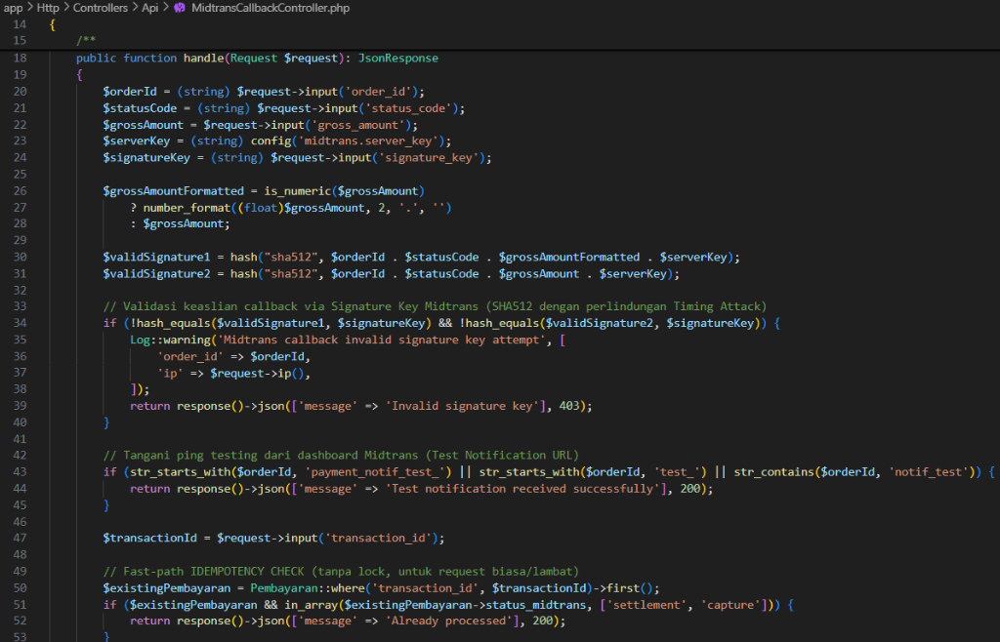

*Gambar 4.48 Kode Validasi Webhook*

Pada Gambar 4.48, empat nilai (`order_id`, `status_code`, `gross_amount`, dan `server_key`) dirangkai menjadi dua kandidat *hash* SHA-512: `$validSignature1` (format dua desimal `.00`) dan `$validSignature2` (nominal mentah). Keduanya dicocokkan terhadap `signature_key` memakai fungsi `hash_equals()` yang bekerja *constant-time* agar kebal dari serangan ukur waktu (*timing attack*). Sinyal uji dari dasbor Midtrans (`notif_test`) langsung ditanggapi sukses agar tidak memicu galat. Selanjutnya, pengecekan idempoten cepat (*fast-path*) memeriksa `transaction_id` di tabel `pembayaran` supaya sinyal ganda tidak diproses ulang. Pada lanjutan metode ini, transaksi sah yang belum berstatus `settlement` atau `capture` masuk ke blok transaksi berpengunci `lockForUpdate()`, memvalidasi nominal bayar, lalu mengubah status tagihan menjadi lunas.

 

### 4.3.4 Implementasi Penjadwalan dan Notifikasi
Pekerjaan rutin seperti menerbitkan tagihan tanggal 1 dan mengingatkan penghuni sering luput bila bergantung pada ingatan manusia. Tugas berulang itu kini diambil alih *task scheduler* Laravel yang terhubung ke WhatsApp Fonnte dan *email* SMTP.

1. Penjadwalan Tugas Otomatis (*Task Scheduler Cron Job*)  
Seluruh jadwal eksekusi otomatis ditulis terpusat di berkas `routes/console.php` dengan zona waktu `Asia/Jakarta` (Gambar 4.49).

*Gambar 4.49 Kode Penjadwal Tugas*

Empat perintah operasional berjalan di latar belakang (`runInBackground()`) dengan pengaman `withoutOverlapping()` supaya tidak menumpuk. Pertama, `tagihan:generate-bulanan` terpicu tiap tanggal 1 pukul `00:05` WIB untuk membuat tagihan seluruh penyewa aktif. Kedua, `tagihan:proses-keterlambatan` berjalan tiap hari pukul `01:00` WIB: tagihan belum lunas selepas tanggal 10 ditandai terlambat dalam masa keringanan bulan berjalan, lalu dikenai denda *flat* 5% satu kali begitu melewati pergantian bulan. Ketiga, `kontrak:reminder-habis` berjalan pukul `08:00` WIB untuk mengingatkan masa sewa yang hampir berakhir. Keempat, `reservasi:cancel-expired` dieksekusi tiap jam untuk membatalkan pesanan kedaluwarsa agar kamar kembali terbuka di katalog.

 

2. Integrasi Layanan Pesan *WhatsApp Gateway* Fonnte  
Pengiriman pengingat tagihan dan kabar aktivasi kamar ke ponsel penghuni dikelola oleh `FonnteService::kirimPesan()` (Gambar 4.50).

*Gambar 4.50 Kode Integrasi WhatsApp*

Metode pada Gambar 4.50 lebih dulu menyaring nomor kosong, lalu mengubah nomor lokal menjadi format internasional `62` lewat `formatNomor()`. Pada lingkungan lokal tanpa token API aktif, pesan dialihkan ke catatan log (*dry run*) agar pengujian tetap lancar. Di mode produksi, aplikasi mengirim permintaan *HTTP POST* ke `https://api.fonnte.com/send` berbekal token otorisasi di *header*, batas koneksi 3 detik (`connectTimeout(3)`), batas respons 5 detik (`timeout(5)`), dan jeda 2 detik (`delay`). Keberhasilan kiriman dipastikan dari kode HTTP sukses sekaligus nilai `status` pada balasan JSON Fonnte.

 

3. Integrasi Pengiriman Dokumen Tagihan via *Email Gateway* SMTP  
Mengirim puluhan *email* tagihan sekaligus di awal bulan bisa memperlambat *server* bila dilakukan secara sinkron. Kelas `TagihanBulanMail` mengatasi kendala itu dengan mengimplementasikan antarmuka `ShouldQueue` agar kiriman diproses lewat antrean latar belakang (Gambar 4.51).

*Gambar 4.51 Kode Pengiriman Email*

Metode `envelope()` menyusun subjek *email* yang langsung mencantumkan `order_id` tagihan. Saat *queue worker* memproses antrean, metode `content()` memuat relasi `penyewa.user` dan `penyewa.kamar` melalui `loadMissing()`. Apabila tagihan pertama mencakup uang jaminan, nilainya diisolasi aman dengan rumus `max(0.0, $nominalTotal - $nominalPokok - $nominalDenda)`. Seluruh nominal kemudian diformat ke Rupiah dan diteruskan bersama tautan `penyewa.login` ke templat Blade `emails.tagihan-baru`.

 

## 4.4 Pengujian Sistem
Setelah kode dan antarmuka selesai dibangun, seluruh fitur diuji melalui pengujian kotak hitam (*black box testing*). Metode ini mengecek apakah setiap masukan data, aturan validasi, dan respons layar sudah bekerja sesuai kebutuhan pengguna akhir. Pengujian mencakup 60 skenario di enam domain utama, mulai dari autentikasi, katalog publik, reservasi, portal penyewa, panel admin, sampai otomasi *cron job* dan API eksternal. Skenario uji mencakup pemeriksaan jalur normal (*positive testing*) sekaligus penolakan masukan keliru dan pengamanan transaksi (*negative testing*). Hasil lengkap pengujian dirangkum pada Tabel 4.1.

 

**Tabel 4.1** Hasil Pengujian Fungsionalitas Sistem (Black Box Testing)

| No | Modul / Skenario Uji | Prosedur Pengujian / Masukan Data | Hasil yang Diharapkan | Hasil Pengujian | Status |
| :---: | :--- | :--- | :--- | :--- | :---: |
| **Domain I: Autentikasi, Hak Akses & Profil Pengguna** | | | | | |
| 1 | *Login* Administrator dengan kredensial sah | Masukkan *email* dan kata sandi admin terdaftar pada `/admin/login` | Autentikasi diterima dan layar beralih ke `/admin/dashboard` | Sesuai ekspektasi | Berhasil |
| 2 | *Login* Administrator dengan kata sandi salah | Masukkan *email* admin benar disertai kata sandi keliru | Akses ditolak dan muncul pesan kesalahan kredensial | Sesuai ekspektasi | Berhasil |
| 3 | *Login* Administrator memakai *email* tidak terdaftar | Masukkan *email* acak yang belum tercatat di basis data | Akses ditolak dengan peringatan akun tidak ditemukan | Sesuai ekspektasi | Berhasil |
| 4 | Pengalihan wajib ganti sandi saat *login* perdana | Masuk memakai akun admin berstatus wajib perbarui kata sandi | Navigasi dialihkan otomatis ke `/admin/force-change-password` | Sesuai ekspektasi | Berhasil |
| 5 | *Login* Penyewa Aktif dengan kredensial sah | Masukkan *email* atau nomor WhatsApp dan kata sandi benar di `/penyewa/login` | Akses diterima dan penghuni diarahkan ke `/penyewa/dashboard` | Sesuai ekspektasi | Berhasil |
| 6 | *Login* Penyewa dengan kata sandi keliru | Masukkan *email* penyewa sah tetapi kata sandi salah | Proses masuk ditolak dengan pesan gagal autentikasi | Sesuai ekspektasi | Berhasil |
| 7 | Permintaan pemulihan sandi untuk *email* terdaftar | Ketikkan *email* penyewa sah pada formulir `/penyewa/forgot-password` | Tautan penyetelan ulang kata sandi terkirim ke kotak masuk *email* | Sesuai ekspektasi | Berhasil |
| 8 | Permintaan pemulihan sandi untuk *email* asing | Masukkan *email* yang belum pernah terdaftar di sistem | Permintaan ditolak disertai pemberitahuan *email* tidak ditemukan | Sesuai ekspektasi | Berhasil |
| 9 | Penyetelan sandi baru memakai token sah | Buka tautan pemulihan dari *email*, lalu simpan sandi baru minimal 8 karakter | Kata sandi diperbarui di basis data dan dapat dipakai masuk kembali | Sesuai ekspektasi | Berhasil |
| 10 | Pendaftaran akun baru Calon Penyewa | Lengkapi nama, nomor WhatsApp, *email*, dan kata sandi di `/reservasi/register` | Akun baru tersimpan dan pengguna diarahkan ke kelengkapan profil | Sesuai ekspektasi | Berhasil |
| 11 | Pengisian kelengkapan profil dengan NIK dan kontak sah | Isi nomor WhatsApp aktif, NIK 16 digit, nama wali, dan nomor HP wali di `/profil/complete` | Biodata tersimpan dan akses pengajuan reservasi kamar terbuka | Sesuai ekspektasi | Berhasil |
| 12 | Penolakan format nomor telepon tidak valid | Ketikkan huruf atau simbol pada kolom nomor WhatsApp di halaman profil | Validasi menahan penyimpanan dan memunculkan peringatan salah format | Sesuai ekspektasi | Berhasil |
| **Domain II: Portal Publik, Katalog & Guest Chat** | | | | | |
| 13 | Pemuatan halaman beranda (*home page*) publik | Buka alamat utama situs web Asri Boarding House di peramban | Informasi beranda, navigasi menu, dan pintasan katalog tampil utuh | Sesuai ekspektasi | Berhasil |
| 14 | Pencarian unit berdasarkan nomor kamar | Ketikkan nomor kamar tertentu pada kolom cari di `/kamar` | Katalog menyaring daftar dan hanya memuat kartu kamar yang dicari | Sesuai ekspektasi | Berhasil |
| 15 | Penyaringan katalog berdasarkan kategori tipe | Klik tombol penyaring "VIP" pada halaman katalog `/kamar` | Layar hanya menampilkan deretan kartu kamar bertipe VIP | Sesuai ekspektasi | Berhasil |
| 16 | Pembukaan detail unit kamar berstatus tersedia | Klik tombol **Pesan Unit** pada kartu kamar berlabel kuning "Tersedia" | Halaman `/kamar/{id}` terbuka memuat spesifikasi dan kalkulator simulasi | Sesuai ekspektasi | Berhasil |
| 17 | Pembatasan tombol pesan pada kamar berstatus terisi | Amati kartu unit berlabel hitam "Terisi" di halaman `/kamar` | Tombol pesan disembunyikan dan diganti tombol hijau **Tanya WA / Ketersediaan** | Sesuai ekspektasi | Berhasil |
| 18 | Pintasan obrolan WhatsApp pengelola | Klik tombol hijau berikon WhatsApp di pojok kanan bawah halaman publik | Peramban membuka percakapan WhatsApp menuju nomor resmi pengelola | Sesuai ekspektasi | Berhasil |
| 19 | Pembukaan jendela *widget Guest Chat* tanpa *login* | Klik tombol obrolan kuning di pojok kanan bawah layar | Jendela **Tanya Admin Kost** terbuka memuat kolom nama dan nomor WhatsApp | Sesuai ekspektasi | Berhasil |
| 20 | Pengiriman pertanyaan melalui *Guest Chat* | Mulai sesi obrolan tamu lalu kirim pertanyaan ketersediaan kamar | Pesan tersimpan di basis data dan langsung tampil di panel obrolan admin | Sesuai ekspektasi | Berhasil |
| 21 | Ketahanan sesi *Guest Chat* saat halaman dimuat ulang | Muat ulang (*refresh*) peramban ketika percakapan tamu sedang berjalan | Riwayat pesan tetap terjaga utuh berdasarkan token sesi tamu | Sesuai ekspektasi | Berhasil |
| 22 | Interaksi perbesar foto galeri dan panel lipat FAQ | Klik tautan **Perbesar** di `/galeri` serta baris pertanyaan bertanda `+` di `/faq` | Foto kamar terbuka penuh dan jawaban FAQ membentang rapi | Sesuai ekspektasi | Berhasil |
| **Domain III: Calon Penyewa, Simulasi & Reservasi** | | | | | |
| 23 | Simulasi biaya sewa pada halaman detail kamar | Ubah tipe sewa, durasi, tanggal masuk, dan skema bayar di `/kamar/{id}` | Kotak estimasi memperbarui harga pokok dan total tagihan seketika | Sesuai ekspektasi | Berhasil |
| 24 | Validasi masukan NIK 16 digit dan kontak wali | Masukkan 16 digit angka NIK beserta nama dan nomor HP wali di `/profil/complete` | Masukan diterima dan pengguna diizinkan melanjutkan reservasi | Sesuai ekspektasi | Berhasil |
| 25 | Penolakan masukan NIK kurang dari 16 digit | Masukkan 14 digit angka pada kolom NIK di formulir kelengkapan profil | Formulir menolak pengiriman dan meminta panjang NIK tepat 16 digit | Sesuai ekspektasi | Berhasil |
| 26 | Kalkulasi otomatis tanggal berakhirnya masa sewa | Pilih sewa bulanan berdurasi 12 bulan saat mengajukan reservasi kamar | Tanggal selesai kontrak ditetapkan tepat 12 bulan sejak tanggal masuk | Sesuai ekspektasi | Berhasil |
| 27 | Penerapan diskon otomatis untuk sewa jangka panjang | Pilih durasi sewa 3 bulan atau 12 bulan pada panel simulasi kamar | Potongan paket otomatis mengurangi estimasi total tagihan sewa | Sesuai ekspektasi | Berhasil |
| 28 | Perhitungan tagihan awal dengan skema uang muka 30% | Pilih opsi pembayaran DP (30%) di panel simulasi sebelum memesan unit | Kewajiban bayar awal ditetapkan sebesar 30% dari total harga kontrak | Sesuai ekspektasi | Berhasil |
| 29 | Perhitungan tagihan awal dengan skema bayar penuh 100% | Pilih opsi **Bayar Penuh (100%)** pada skema pembayaran reservasi | Nominal tagihan ditetapkan 100% sesuai total biaya sewa | Sesuai ekspektasi | Berhasil |
| 30 | Pemuatan jendela pembayaran Midtrans Snap | Tekan tombol kuning **Bayar Sekarang (Midtrans)** di halaman pembayaran reservasi | *Pop-up* Midtrans Snap terbuka memuat nominal tagihan dan kanal bayar | Sesuai ekspektasi | Berhasil |
| 31 | Penahanan status kamar saat *pop-up* Snap ditutup | Tutup jendela Midtrans Snap sebelum menyelesaikan transfer | Reservasi tetap berstatus *pending* dan unit terkunci dari pesanan ganda | Sesuai ekspektasi | Berhasil |
| 32 | Pelunasan reservasi melalui *Virtual Account* BCA | Selesaikan transfer sesuai nomor *Virtual Account* Bank BCA di simulator Midtrans | *Webhook* memperbarui status bayar otomatis tanpa unggah foto resi | Sesuai ekspektasi | Berhasil |
| **Domain IV: Portal Penyewa Aktif, Tagihan & Keluhan** | | | | | |
| 33 | Pemuatan dasbor ringkasan hunian penyewa aktif | Buka `/penyewa/dashboard` memakai akun penghuni yang sudah aktif | Layar memuat 5 kartu indikator hunian, pintasan keluhan, dan grafik pengeluaran | Sesuai ekspektasi | Berhasil |
| 34 | Penampilan daftar riwayat tagihan sewa bulanan | Buka menu **Tagihan Saya** (`/penyewa/tagihan`) dari bilah navigasi kiri | Kartu ringkasan tagihan beserta tabel riwayat faktur per periode tampil lengkap | Sesuai ekspektasi | Berhasil |
| 35 | Pemeriksaan rincian komponen faktur sewa | Klik tautan **Detail / Bayar** pada salah satu baris tagihan bulanan | Rincian menampilkan sewa pokok, denda bila ada, dan batas jatuh tempo | Sesuai ekspektasi | Berhasil |
| 36 | Pelunasan tagihan sewa bulanan via Midtrans Snap | Tekan tombol bayar di detail tagihan lalu lunasi lewat *Virtual Account* BCA | Status faktur berubah menjadi **Lunas** otomatis begitu *webhook* masuk | Sesuai ekspektasi | Berhasil |
| 37 | Pencetakan dan pengunduhan kuitansi PDF format A5 | Buka halaman nota pada tagihan lunas lalu tekan tombol unduh PDF | Kuitansi A5 berstempel **LUNAS** berhasil terunduh ke perangkat pengguna | Sesuai ekspektasi | Berhasil |
| 38 | Pengiriman tiket laporan keluhan fasilitas kamar | Klik **Buat Keluhan Baru**, pilih kategori kerusakan, dan kirim deskripsi masalah | Tiket aduan tersimpan di basis data dan masuk ke antrean keluhan admin | Sesuai ekspektasi | Berhasil |
| 39 | Pengajuan keluhan dengan lampiran foto bukti fisik | Sertakan berkas foto gambar saat mengirim formulir keluhan kamar | Foto kerusakan tersimpan dan tertaut pada detail tiket aduan | Sesuai ekspektasi | Berhasil |
| 40 | Penolakan berkas lampiran keluhan selain gambar | Unggah berkas `.pdf` atau `.docx` pada kolom foto bukti keluhan | Validasi menolak berkas dan meminta pengguna memilih format gambar | Sesuai ekspektasi | Berhasil |
| 41 | Pelacakan perubahan status tindak lanjut keluhan | Buka tabel `/penyewa/keluhan` setelah penjaga kost menuntaskan perbaikan | Lencana status berubah menjadi **Selesai** disertai tanggapan admin | Sesuai ekspektasi | Berhasil |
| **Domain V: Administrator & Manajemen Operasional** | | | | | |
| 42 | Pemuatan metrik operasional pada dasbor administrator | Buka `/admin/dashboard` sesudah masuk sebagai administrator | Delapan kartu statistik, grafik tren kas 12 bulan, dan diagram status kamar tampil tepat | Sesuai ekspektasi | Berhasil |
| 43 | Penambahan unit kamar baru ke dalam sistem | Isi nomor unit, lantai, tipe, fasilitas, dan tarif lewat formulir `/admin/kamar` | Kamar baru tersimpan di MySQL dan langsung muncul di katalog publik | Sesuai ekspektasi | Berhasil |
| 44 | Pembaruan harga sewa dan spesifikasi kamar | Ubah tarif bulanan dan daftar fasilitas pada salah satu unit kamar | Perubahan tersimpan dan langsung memperbarui informasi di katalog publik | Sesuai ekspektasi | Berhasil |
| 45 | Perlindungan penghapusan kamar yang sedang dihuni | Coba hapus kamar yang masih memiliki kontrak penghuni atau reservasi aktif | Penghapusan diblokir demi menjaga keutuhan riwayat transaksi | Sesuai ekspektasi | Berhasil |
| 46 | Penambahan item pada master fasilitas kost | Input nama sarana, ikon visual, dan uraian fungsi di `/admin/fasilitas` | Sarana baru tercatat di tabel master dan siap dipasang ke unit kamar | Sesuai ekspektasi | Berhasil |
| 47 | Pengesahan reservasi masuk dan aktivasi penghuni | Cocokkan KTP fisik saat pemohon tiba, lalu klik konfirmasi di `/admin/reservasi` | Akun beralih jadi penyewa aktif dan kabar terkirim lewat Fonnte serta *email* | Sesuai ekspektasi | Berhasil |
| 48 | Konfirmasi pelunasan sewa tunai oleh admin | Buka detail tagihan penghuni yang membayar tunai, lalu klik konfirmasi tunai | Status berubah menjadi **Lunas**, kas masuk bertambah, dan nota A5 terbit | Sesuai ekspektasi | Berhasil |
| 49 | Pemrosesan *checkout* penghuni di akhir masa sewa | Jalankan prosedur *checkout* pada penghuni bebas tunggakan lewat `/admin/penyewa` | Kontrak dinonaktifkan, deposit diselesaikan, dan kamar dikunci untuk inspeksi | Sesuai ekspektasi | Berhasil |
| 50 | Pembukaan kembali status kamar pasca-inspeksi fisik | Ubah status unit menjadi "Tersedia" sesudah kamar selesai dibersihkan | Unit kembali tampil sebagai kamar kosong siap pesan di katalog | Sesuai ekspektasi | Berhasil |
| 51 | Pembaruan progres perbaikan pada modul keluhan | Buka detail aduan di `/admin/keluhan`, isi tanggapan, lalu ubah status ke "Diproses" | Status perbaikan tersimpan dan langsung terlihat di portal penghuni | Sesuai ekspektasi | Berhasil |
| 52 | Pengiriman balasan pesan tamu pada *Guest Chat* | Pilih utas percakapan di `/admin/guest-chats`, ketik balasan, lalu klik **Kirim** | Balasan admin langsung muncul *real-time* di jendela obrolan pengunjung | Sesuai ekspektasi | Berhasil |
| 53 | Pencatatan transaksi pengeluaran operasional kost | Input tanggal, uraian pengeluaran, kategori, dan nominal di `/admin/pengeluaran` | Kas keluar tersimpan dan otomatis mengurangi saldo laba bersih bulanan | Sesuai ekspektasi | Berhasil |
| 54 | Pengunduhan rekap laporan keuangan PDF dan Excel | Pilih filter periode pada `/admin/laporan`, lalu klik tombol **PDF** dan **Excel** | Berkas rekap arus kas masuk, keluar, dan saldo bersih berhasil terunduh | Sesuai ekspektasi | Berhasil |
| **Domain VI: Otomasi Task Scheduler, Denda & API Eksternal** | | | | | |
| 55 | Penerbitan otomatis tagihan bulanan tiap tanggal 1 | Jalankan perintah terjadwal `tagihan:generate-bulanan` pada *task scheduler* | Faktur sewa bulan berjalan terbit serentak bagi seluruh penghuni aktif | Sesuai ekspektasi | Berhasil |
| 56 | Pencegahan duplikasi faktur pada periode sama | Jalankan ulang `tagihan:generate-bulanan` pada bulan dan tahun yang sama | Pemeriksaan idempoten mendeteksi faktur lama dan menolak pembuatan ganda | Sesuai ekspektasi | Berhasil |
| 57 | Evaluasi jatuh tempo tanggal 10 dan denda *flat* 5% lintas bulan | Jalankan `tagihan:proses-keterlambatan` pada faktur belum lunas yang melintasi bulan | Tagihan ditandai terlambat selepas tanggal 10 dan kena denda *flat* 5% saat lintas bulan | Sesuai ekspektasi | Berhasil |
| 58 | Ketahanan sifat idempoten pada kalkulasi denda | Jalankan berulang `tagihan:proses-keterlambatan` pada tunggakan periode sama | Denda *flat* 5% tetap dihitung satu kali tanpa penggandaan | Sesuai ekspektasi | Berhasil |
| 59 | Pengiriman notifikasi tagihan otomatis via WhatsApp Fonnte | Picu penerbitan tagihan yang memanggil `FonnteService::kirimPesan()` | Pesan WhatsApp berisi nomor *invoice*, nominal, dan jatuh tempo masuk ke ponsel | Sesuai ekspektasi | Berhasil |
| 60 | Pengiriman *email* tagihan lewat antrean SMTP | Jalankan *queue worker* untuk memproses antrean `TagihanBulanMail` | *Email* bertema *Neo-Brutalism* berisi rincian tagihan masuk ke kotak surat penyewa | Sesuai ekspektasi | Berhasil |

 

Hasil pada Tabel 4.1 menunjukkan seluruh 60 skenario lulus 100% tanpa galat validasi maupun kegagalan transaksi. Seluruh pengaman inti bekerja sesuai rancangan: pembatasan rute oleh `RoleMiddleware`, kunci baris `lockForUpdate()` pada MySQL InnoDB, verifikasi *signature key* SHA-512 Midtrans, hingga sifat idempoten pada *cron job*. Pengujian skenario negatif seperti NIK 14 digit, unggahan non-gambar, dan percobaan hapus kamar berpenghuni juga terbukti ditolak tepat sasaran. Setelah ketahanan teknis teruji, evaluasi dilanjutkan langsung bersama pengguna nyata di Asri Boarding House.

 

## 4.5 Hasil Wawancara
Pengujian penerimaan pengguna (*User Acceptance Testing*) dilakukan langsung di lokasi bersama satu penjaga kost senior dan lima mahasiswa penghuni aktif dari berbagai kampus. Evaluasi memakai metode *side-by-side usability testing*: tiap narasumber menjajal fitur di perangkatnya sendiri, lalu diwawancarai secara semiterstruktur dengan rekaman suara. Sesi ini mengukur keterbacaan katalog, kepraktisan reservasi dan bayar *Virtual Account* Midtrans, manfaat kuitansi PDF A5, hingga kecepatan rekap kas bulanan.

 

1. Wawancara dengan Penjaga Kost  
Narasumber pertama adalah Bapak Asep, pengelola harian yang selama dua puluh tahun mencatat urusan kost di buku besar. Pengujian berfokus pada kenyamanan *OLED Dark Mode*, kontrol 32 kamar, formulir tamu *walk-in*, karantina kamar selepas *checkout*, dan ekspor laporan kas di panel admin.

 

*Gambar 4.52 Dokumentasi Wawancara Bapak Asep*

 

**Tabel 4.2** Hasil Wawancara Penjaga Kost (Bapak Asep)

| No | Aspek Pengujian | Pertanyaan | Tanggapan |
| :---: | :--- | :--- | :--- |
| 1 | Halaman Depan Publik: Tipografi, foto kamar, dan transparansi harga | Pak Asep, ini tampilan website depan kost kita yang bisa dibuka siapa saja lewat HP atau laptop. Di sini ada foto-foto 32 kamar, fasilitas, dan harga sewanya. Menurut pandangan Bapak, apakah tulisannya sudah cukup jelas dan fotonya pas menggambarkan kost kita? | Tampilannya jelas sekali Mas Rafif, tulisannya besar-besar dan kontrasnya tegas jadi mata saya yang sudah berumur tidak cepat capek bacanya. Fotonya terang, terus harga sewanya langsung kelihatan di depan. Ini bagus sekali supaya calon anak kost atau orang tuanya dari luar kota tidak perlu bolak-balik telepon tanya harga lagi. |
| 2 | Tombol WhatsApp Melayang: Sudut kanan bawah | Tombol hijau lambang WhatsApp di pojok kanan bawah ini selalu menempel saat layar digulirkan, dan kalau diklik langsung membuka obrolan ke nomor admin. Menurut Bapak tombol ini gampang dilihat atau mengganggu? | Sangat pas di situ Mas. Posisinya gampang dijangkau jempol kalau buka lewat HP, dan langsung nyambung ke nomor WhatsApp saya jadi kalau ada calon penyewa yang mau tanya-tanya ketersediaan kamar bisa langsung saya respon cepat. |
| 3 | Dasbor Admin & Kas Otomatis: Tata letak OLED Dark Mode | Sekarang kita masuk ke akun admin. Di dasbor ini langsung kelihatan kotak ringkasan: berapa kamar yang terisi, berapa yang kosong, dan berapa total uang kas yang masuk bulan ini. Menurut Bapak, melihat angka-angka ini langsung paham atau membingungkan? | Wah, ini sangat enak Mas. Warnanya gelap jadi adem di mata kalau berlama-lama di depan laptop. Angka kamar isi dan kamar kosong langsung kelihatan, tidak perlu lagi saya hitung manual pakai coret-coretan di buku besar seperti dulu. Total saldo kas masuk dan keluar juga langsung dihitung otomatis oleh sistem, jadi saya bisa langsung tahu laba bersih bulan ini tanpa takut salah jumlah. |
| 4 | Pendaftaran Penyewa Datang Langsung: Form Walk-In admin | Kalau ada calon anak kost atau orang tuanya yang datang langsung ke kantor pengelola tanpa reservasi lewat web, Bapak tinggal input di form ini: nama, nomor HP anak, nomor HP orang tuanya, dan pilih kamarnya. Formulir pendaftaran ini dirasa mudah diisi tidak Pak? | Gampang sekali, kolom isiannya ringkas dan jelas. Yang paling penting itu nomor HP orang tua atau wali anak kost langsung tersimpan di sistem, jadi kalau ada keadaan darurat atau anak kost menunggak, kita tidak kesulitan menghubungi keluarganya. |
| 5 | Konfirmasi Bayar Tunai & Kuitansi Instan: Menu Tagihan | Di menu Tagihan ini terlihat seluruh data kamar. Kalau ada anak kost yang membayar sewa secara tunai langsung ke meja Bapak, tinggal cari namanya lalu klik Konfirmasi Tunai, kuitansinya langsung terbit. Menurut Bapak cara ini praktis? | Sangat praktis. Tinggal satu klik langsung lunas dan kuitansinya keluar. Saya tidak perlu lagi cari buku blok kuitansi kertas, nulis tangan satu per satu, terus robek kertasnya. Semuanya langsung terekam rapi dan tidak takut nota hilang. |
| 6 | Aturan Denda Flat 5% Kalender | Di sistem ini ada aturan denda: jika anak kost terlambat membayar sewa melewati tanggal 10 di bulan berjalan belum dikenakan denda (bebas denda), baru jika menyeberang ke bulan berikutnya dikenakan denda flat 5% satu kali (tidak berbunga harian). Menurut pengalaman 20 tahun Bapak, aturan ini adil dan tepat? | Aturan denda ini sangat tepat dan bijaksana Mas Rafif! Mahasiswa di sini kiriman uang dari orang tuanya kadang suka mundur beberapa hari, jadi kalau belum lewat bulan jangan langsung didenda. Tapi kalau sudah menyeberang bulan baru didenda flat 5% supaya tertib dan ada ketegasan. Denda flat sekali ini tidak memberatkan mahasiswa tapi mendidik mereka disiplin. |
| 7 | Penguncian Kamar Pasca-Checkout: Karantina Fisik | Ketika ada anak kost yang selesai sewa atau checkout, status kamarnya di sistem tidak langsung berubah menjadi tersedia, melainkan tetap terkunci merah terisi sampai Bapak selesai memeriksa fisik kebersihan kamar baru diubah manual. Bagaimana pandangan Bapak tentang aturan ini? | Nah, ini hukumnya wajib Mas! Pengalaman saya 20 tahun, kalau kamar baru ditinggal keluar penghuni lama itu kasur, sprei, dan kamar mandinya harus dibersihkan dulu oleh petugas, lampu dan keran air dicek. Kalau kamar langsung otomatis jadi kosong di web padahal fisiknya masih kotor atau berantakan, nanti ada calon penyewa lain yang keburu pesan dan pas datang kamarnya belum siap, pengelola yang malu. Jadi kunci merah ini luar biasa penting mencegah komplain. |
| 8 | Pencatatan Biaya & Rekap Laporan Keuangan: Menu Laporan | Jika ada pengeluaran rutin seperti pembelian token listrik, air PAM, atau biaya teknisi, bisa dicatat di menu Pengeluaran. Saat pemilik kost meminta laporan bulanan, cukup klik satu tombol ekspor PDF atau Excel, seluruh laba bersih sudah terhitung otomatis. Fitur ini membantu pekerjaan Bapak? | Sangat membantu sekali Mas. Dulu setiap akhir bulan saya butuh waktu 3 sampai 4 hari untuk mengumpulkan nota-nota bon di laci meja, rekap pengeluaran satu per satu pakai kalkulator, baru diserahkan ke pemilik. Sekarang dalam hitungan detik laporannya sudah jadi rapi, bisa langsung dicetak atau dikirim lewat WhatsApp ke pemilik kost. |
| 9 | Portal Mandiri Anak Kost: Pembayaran BCA VA & Keluhan Berfoto | Anak kost memiliki portal mandiri di HP untuk membayar sewa via BCA Virtual Account (Midtrans) dan mengunduh kuitansi PDF sendiri. Selain itu, ada menu Keluhan di mana mereka bisa lapor kran bocor atau lampu mati disertai foto bukti fisik. Bagaimana respon Bapak? | Anak-anak mahasiswa zaman sekarang pasti senang sekali karena serba online dari HP tanpa perlu tarik tunai ke ATM. Terus fitur aduan keluhan berfoto ini sangat menolong kerjaan saya. Selama ini aduan anak kost sering disampaikan lisan pas papasan di lorong lalu saya lupa karena banyak kerjaan, atau lewat chat WA pribadi yang tertimbun. Dengan adanya foto kerusakan di sistem, saya bisa langsung teruskan fotonya ke tukang ledeng atau teknisi listrik agar cepat ditangani. |
| 10 | Refleksi 20 Tahun Manual vs Web & Penilaian Akhir | Pertanyaan terakhir Pak Asep, setelah mencoba langsung seluruh fitur: jika dibandingkan dengan pengalaman 20 tahun Bapak mengelola kos secara manual dengan buku besar, apakah sistem website ini membuat pekerjaan administrasi jauh lebih ringan dan bebas selisih uang kas? Berapa nilai kepuasan yang Bapak berikan dari skala 1 sampai 10? | Wah, kalau dibandingkan 20 tahun kemarin, perbedaannya seperti bumi dan langit Mas Rafif! Pakai website ini pekerjaan mengurus kost terasa jauh lebih enteng, hati jadi tenang karena tidak ada lagi selisih uang kas atau catatan nota yang tercecer. Semuanya transparan dan otomatis. Dari nilai 1 sampai 10, saya mantap memberikan nilai 9,5 atau bahkan 10! Sistem ini sangat siap dan sangat membantu operasional Asri Boarding House. |

 

Dari Tabel 4.2, Bapak Asep memberi nilai kepuasan **9,5 dari 10**. Manfaat terbesarnya langsung terasa di tutup buku akhir bulan: waktu rekap menyusut dari tiga sampai empat hari menjadi hitungan detik tanpa selisih kas. Mode gelap *OLED Dark Mode* juga dinilai ramah di mata saat dipakai lama. Aturan denda *flat* 5% lintas bulan pun pas dengan ritme kiriman uang mahasiswa, sementara karantina kamar pasca-*checkout* memberi jeda bersih-bersih sebelum unit kembali dibuka ke katalog publik.

 

2. Hasil Wawancara dengan Arjun  
Evaluasi dari sisi penghuni dibuka bersama Arjun, mahasiswa Universitas Diponegoro (UNDIP) yang sudah tiga tahun tinggal di Tembalang. Sesi ini membandingkan kebiasaan bayar sewa di pos penjaga dengan pelunasan nontunai memakai *m-Banking* dan Midtrans Snap.

 

**Tabel 4.3** Wawancara dengan Arjun

| No | Aspek Pengujian | Pertanyaan | Tanggapan |
| :---: | :--- | :--- | :--- |
| 1 | Katalog Kamar & Ketersediaan | Sebagai mahasiswa yang sudah 3 tahun mengekos di Tembalang, bagaimana penilaian Mas Arjun terhadap katalog kamar di website ini? Apakah sajian foto fasilitas dan informasi ketersediaan unitnya sudah cukup jelas? | Tampilannya tegas dan modern ala Neo-Brutalism. Foto fasilitas kayak kasur, AC, kamar mandi dalam, sampai sudut-sudut ruangannya kelihatan jelas. Paling berguna itu penanda status Tersedia yang kontras, jadi aku langsung tahu kamar mana yang masih kosong tanpa perlu panas-panasan keliling Tembalang atau bolak-balik tanya ke penjaga kos. |
| 2 | Formulir Pemesanan Bertahap | Saat mencoba mengisi formulir pemesanan 5 tahap di sistem, bagaimana alurnya menurut Mas? Apakah ada bagian yang membingungkan? | Alurnya runtut karena dibagi bertahap pakai stepper, jadinya nggak berasa numpuk di satu halaman panjang yang bikin malas. Validasi otomatis di kolom NIK sama nomor kontak orang tua juga responsif, langsung ngasih tanda kalau semisal ada salah ketik. |
| 3 | Transparansi Rincian Biaya | Bagaimana dengan ringkasan biaya sewa yang tampil di layar sebelum pembayaran? Apakah rincian angkanya sudah cukup jelas? | Rinciannya terbuka sejak awal. Tarif dasar sampai total yang wajib dibayar terpampang pasti di layar, nggak ada biaya tambahan siluman atau iuran mendadak yang biasanya bikin kaget kalau di kos konvensional. |
| 4 | Prosedur Pembayaran Midtrans VA | Bagaimana pengalaman Mas saat mencoba transaksi pembayaran lewat BCA Virtual Account di pop-up Midtrans? | Prosesnya ringkas sekali. Jendela pop-up-nya langsung muncul di layar tanpa harus berpindah ke tab lain. Nomor BCA Virtual Account-nya langsung keluar dan tinggal disalin ke aplikasi m-Banking, jadi nggak perlu pusing mikirin kode unik transfer. |
| 5 | Konfirmasi Otomatis Tanpa Resi | Setelah transfer di m-Banking selesai, status pembayaran seketika berubah lunas otomatis di sistem tanpa perlu mengirim foto bukti transfer ke pengelola. Bagaimana tanggapan Mas mengenai fitur ini? | Fitur ini yang paling bikin tenang sih. Hitungan detik setelah transfer berhasil, status di web langsung berubah hijau jadi Lunas. Nggak perlu repot kirim screenshot resi, nggak usah nungguin chat WA dibalas bapak kos, dan nggak waswas uangnya salah masuk. |
| 6 | Penerbitan Kuitansi Digital A5 | Terkait kuitansi digital format A5 resmi berstempel lunas yang terbit otomatis, bagaimana kegunaannya buat Mas? | Format PDF A5-nya rapi dan kelihatan resmi, lengkap sama rincian transaksi dan cap stempelnya. Kuitansinya bisa langsung aku teruskan ke WhatsApp orang tua buat bukti laporan uang kos bulanan. Jauh lebih aman dibanding nota kertas yang gampang keselip atau rusak di dompet. |
| 7 | Navigasi Dasbor Portal Mandiri Penghuni | Saat masuk ke portal mandiri penghuni, bagaimana kesan Mas terhadap tata letak menu dasbor dan tampilan informasi masa sewanya? | Tata letaknya simpel dan langsung memperlihatkan kartu status masa sewa aktif sama jadwal tagihannya. Navigasinya jelas, tombol buat bayar tagihannya juga mudah ditemuin. |
| 8 | Notifikasi Tagihan via WhatsApp | Sistem mengirimkan notifikasi rincian tagihan sewa ke nomor WhatsApp Anda setiap tanggal 1 awal bulan. Bagaimana respon Mas terhadap pesan otomatis tersebut? | Sangat berguna buat jadi pengingat di awal bulan biar uang kiriman orang tua nggak kepakai buat kebutuhan lain duluan. Bahasanya juga sopan dan tertata, nggak terkesan nodong atau mendesak. |
| 9 | Pelunasan Rutin Tagihan Bulanan | Ketika menyimulasikan pembayaran rutin tagihan bulanan langsung dari tombol bayar di portal, bagaimana alurnya dibanding kebiasaan bayar tunai ke pos penjaga? | Jauh lebih hemat tenaga. Nggak perlu repot nyari keberadaan penjaga kos buat ngasih uang tunai atau nunggu beliau di pos. Cukup buka portal dari kamar, klik bayar, dan kelar cuma dalam hitungan menit. |
| 10 | Penilaian Keseluruhan & Masukan | Setelah mencoba keseluruhan alurnya, berapa skor kepuasan Mas Arjun (skala 1-10) dan apa saran pengembangan untuk sistem Asri Boarding House ini? | Sistem ini benar-benar memudahkan rutinitas anak kos. Nilai dari aku 8,5 dari skala 10 karena alurnya dari cari kamar sampai bayar tagihan bulanan ringkas dan transparan. Masukan dariku, sebaiknya ditambahin pesan pengingat otomatis di WhatsApp pas H-3 sebelum jatuh tempo tanggal 10, biar anak kos yang jadwal kuliahnya lagi padat nggak sampai kelewatan bayar. |

 

Arjun memberi skor **8,5 dari 10** (Tabel 4.3). Tanda kamar kosong pada katalog *Neo-Brutalism* menghemat waktu survei di awal semester, sedangkan verifikasi otomatis *Virtual Account* BCA membebaskannya dari kewajiban mengirim tangkapan layar transfer. Kuitansi PDF A5 juga praktis diteruskan ke orang tua sebagai laporan uang kost bulanan. Untuk pengembangan lanjutan, ia mengusulkan tambahan pengingat WhatsApp otomatis pada H-3 sebelum jatuh tempo tanggal 10.

 

3. Hasil Wawancara dengan Farrel  
Responden ketiga adalah Farrel, mahasiswa perantau asal luar kota dari Universitas Semarang (USM). Ia menguji aplikasi lewat peramban ponsel Android untuk menilai kenyamanan memesan kamar dari jarak jauh dan tata letak responsif di layar kecil.

 

**Tabel 4.4** Wawancara dengan Farrel

| No | Aspek Pengujian | Pertanyaan | Tanggapan |
| :---: | :--- | :--- | :--- |
| 1 | Katalog Kamar & Ketersediaan | Sebagai mahasiswa perantau luar kota yang mengakses web lewat ponsel Android, bagaimana kesan Mas Farrel melihat katalog kamar online ini? | Sangat menolong buat anak rantau kayak aku. Jadi bisa langsung ngeliat sudut kamar, fasilitas kamar mandi, sampai tarifnya secara jelas dari rumah tanpa harus jauh-jauh datang ke Semarang cuma buat survei kamar. |
| 2 | Formulir Pemesanan Bertahap | Saat mengisi formulir reservasi bertahap di layar ponsel, bagaimana alur pengisian datanya menurut Mas? | Formulirnya cukup simpel dan mudah diikutin. Tombol buat lanjut ke langkah berikutnya responsif di layar HP dan kolom isiannya juga nggak bikin pusing karena nggak terlalu padat. |
| 3 | Transparansi Rincian Biaya | Bagaimana dengan ringkasan nominal sewa yang tertera sebelum lanjut ke pembayaran? | Nominalnya pasti dan jelas. Di layar langsung kelihatan total yang wajib dibayar, jadi nggak ada rasa waswas bakal muncul biaya tambahan mendadak yang nggak disebut di awal. |
| 4 | Prosedur Pembayaran Midtrans VA | Bagaimana pengalaman Mas saat masuk ke menu pembayaran Virtual Account di Midtrans? | Proses pembuatan kode VA-nya cepat. Jendela pop-up pembayarannya juga pas di layar HP, tinggal salin nomornya ke aplikasi bank di ponsel dan langsung beres tanpa kendala. |
| 5 | Konfirmasi Otomatis Tanpa Resi | Setelah transfer selesai, sistem langsung mencatat status lunas otomatis tanpa perlu kirim resi manual ke WhatsApp pengelola. Bagaimana respon Mas? | Ini menghemat waktu sekali sih. Kalau cara manual dulu kan sering nunggu lama balasan penjaga kos yang kadang lagi sibuk. Verifikasi otomatis begini bikin transaksi langsung tuntas seketika. |
| 6 | Penerbitan Kuitansi Digital A5 | Terkait bukti bayar kuitansi digital format A5 yang langsung terunduh di ponsel, bagaimana kegunaannya bagi mahasiswa perantau? | Enak karena berkas PDF-nya langsung tersimpan di memori HP. Jauh lebih aman dibanding kuitansi kertas biasa yang rawan keselip atau rusak pas ditaruh di meja kamar. |
| 7 | Navigasi Dasbor Portal Penghuni | Saat menjelajahi portal penghuni melalui browser ponsel, bagaimana kenyamanan tata letak menunya menurut Mas? | Tampilannya lumayan bersih. Cuma pas awal-awal login lewat browser HP, aku sempat butuh waktu sebentar buat nyari tombol riwayat pembayaran sama unduh kuitansi, soalnya tabelnya harus digeser sedikit ke samping. |
| 8 | Notifikasi Tagihan via WhatsApp | Bagaimana respon Mas saat menerima pesan WhatsApp pengingat tagihan sewa di awal bulan? | Pengingatnya berguna, berasa jadi alarm pengeluaran bulanan anak rantau. Rinciannya jelas dan udah langsung nyediain informasi portal pembayarannya. |
| 9 | Pelunasan Rutin Tagihan Bulanan | Ketika menyimulasikan pelunasan sewa bulanan langsung via portal tanpa perlu tarik tunai malam-malam, bagaimana tanggapan Mas? | Memudahkan sekali, nggak perlu lagi repot ngantre tarik uang tunai di mesin ATM malam-malam. Bayar sewa bulanan bisa langsung diberesin sambil istirahat di kamar. |
| 10 | Penilaian Keseluruhan & Masukan | Bagaimana penilaian akhir Mas Farrel terhadap sistem website ini, berapa skor kepuasannya (skala 1-10), dan apa masukan ke depannya? | Buat anak rantau sistem ini sudah sangat fungsional. Nilai dari aku 7,0 dari skala 10. Alurnya sebenarnya udah enak, tapi aku kasih 7 karena aksesnya sekarang masih harus buka browser dulu di HP dan belum ada dokumen kontrak sewa digital. Masukan dariku, coba ke depannya dibikin aplikasi mobile khusus Android sama ditambah fitur kontrak sewa digital di portal. |

 

Pada Tabel 4.4, Farrel memberi skor **7,0 dari 10**. Baginya, katalog daring dan *Virtual Account* sangat menolong mahasiswa luar kota agar tidak perlu datang survei atau antre di ATM malam hari. Namun, ia mencatat tabel riwayat pembayaran di layar ponsel masih perlu sedikit guliran ke samping (*horizontal scroll*). Ia juga menyarankan pembuatan aplikasi *mobile* Android dan penambahan kontrak sewa digital (*e-contract*).

 

4. Hasil Wawancara dengan Iman  
Uji coba keempat melibatkan Iman, mahasiswa tingkat akhir Universitas Dian Nuswantoro (UDINUS) yang membuka aplikasi di laptop. Pengujian menyoroti kejelasan bukti transaksi dan arsip kuitansi digital dibanding pencatatan manual.

 

**Tabel 4.5** Wawancara dengan Iman

| No | Aspek Pengujian | Pertanyaan | Tanggapan |
| :---: | :--- | :--- | :--- |
| 1 | Katalog Kamar & Ketersediaan | Berdasarkan pengalaman Mas Iman selama kuliah, bagaimana penilaian Mas terhadap katalog kamar online dan status ketersediaannya di web ini? | Infonya benar-benar real-time. Jadi nggak perlu buang-buang pulsa buat telepon atau repot datang jauh-jauh cuma buat ngecek ada kamar kosong atau nggak. Indikator warnanya langsung bikin status kamar jelas dan pasti. |
| 2 | Formulir Pemesanan Bertahap | Saat mencoba formulir pemesanan 5 langkah di layar laptop, bagaimana alurnya menurut Mas? | Tampilan form di laptop rapi dan petunjuknya jelas. Cuma menurut saya alur 5 tahapannya agak kerasa panjang pas harus klik tombol Lanjut beberapa kali, walau validasi datanya memang tertata rapi. |
| 3 | Transparansi Rincian Biaya | Bagaimana evaluasi Mas terhadap rincian nominal sewa yang ditampilkan sistem sebelum pembayaran? | Sangat transparan. Rincian tarif dasar sampai total biayanya kelihatan jelas dan nggak ada biaya tersembunyi. Buat anak kos, kejelasan kayak gini penting biar anggaran bulanannya pasti. |
| 4 | Prosedur Pembayaran Midtrans VA | Bagaimana kemudahan transaksi melalui nomor BCA Virtual Account di Midtrans menurut Mas? | Eksekusinya cepat. Begitu klik tombol bayar, nomor Virtual Account-nya langsung keluar di layar dan tinggal disalin ke m-Banking tanpa nunggu lama. |
| 5 | Konfirmasi Otomatis Tanpa Resi | Mengingat Mas Iman pernah mengalami masalah kuitansi hilang di kos lama, bagaimana respon Mas saat sistem mendeteksi pembayaran lunas otomatis tanpa perlu kirim resi ke pengelola? | Fitur ini yang paling saya suka. Dulu di kos lama saya sempat dituduh belum bayar sewa gara-gara bapak kos lupa nyatet di buku, padahal saya udah transfer. Karena sistemnya otomatis begini, semuanya langsung tercatat rapi di database dan nggak bakal ada celah buat salah paham. |
| 6 | Penerbitan Kuitansi Digital A5 | Bagaimana penilaian Mas mengenai kuitansi digital format A5 resmi yang bisa diunduh dan disimpan secara digital? | Sangat fungsional. File PDF format A5-nya kelihatan resmi lengkap ada cap lunasnya, jadi bisa langsung saya simpan di Google Drive buat arsip pribadi. |
| 7 | Navigasi Dasbor Portal Penghuni | Saat membuka portal penghuni di laptop, bagaimana kenyamanan tata letak menu dan riwayat pembayarannya? | Tampilannya enteng dan responsif pas dibuka di laptop. Tabel riwayat pembayaran sebelumnya juga tersusun urut per bulan, jadi mudah kalau mau melacak mutasi sewa yang lama. |
| 8 | Notifikasi Tagihan via WhatsApp | Bagaimana tanggapan Mas terhadap pengingat tagihan bulanan otomatis yang masuk via WhatsApp di awal bulan? | Pengingatnya tepat waktu dan rasanya nggak canggung dibanding kalau ditagih langsung secara tatap muka atau lisan sama pemilik kos. Pesan otomatis ini menjaga pembayaran tetap tertib. |
| 9 | Pelunasan Rutin Tagihan Bulanan | Ketika menyimulasikan pembayaran rutin tagihan bulanan langsung dari portal, bagaimana efisiensinya bagi mahasiswa tingkat akhir? | Efisien sekali buat yang lagi sibuk skripsi. Tinggal buka web dari kamar, klik bayar, beresin lewat m-Banking, terus kuitansinya langsung keluar. Benar-benar hemat waktu. |
| 10 | Penilaian Keseluruhan & Masukan | Melihat keseluruhan fitur yang sudah dicoba, berapa skor kepuasan Mas Iman (skala 1-10) dan apa saran teknis untuk pengelolaannya? | Sistem ini sangat bisa diandalkan dan menjawab masalah pencatatan kos konvensional. Nilai dari saya 9,0 dari skala 10 karena pencatatannya memang akuntabel. Saran teknis dari saya, pastikan performa server hosting-nya stabil, terutama di tanggal 1 awal bulan pas semua anak kos buka web barengan biar halamannya nggak lemot. |

 

Iman memberi nilai tinggi, **9,0 dari 10** (Tabel 4.5). Pernah mengalami salah paham pencatatan di tempat kost lama membuatnya sangat menghargai verifikasi otomatis Midtrans dan arsip kuitansi PDF berstempel lunas. Ia juga menyukai kerapian tabel riwayat mutasi di laptop. Catatannya tertuju pada alur reservasi lima langkah yang dinilai masih bisa diringkas, serta saran menjaga performa *server hosting* saat lonjakan akses tiap tanggal 1.

 

5. Hasil Wawancara dengan Ammar  
Pengujian kelima dilakukan bersama Ammar, mahasiswa baru Politeknik Keuangan Negara (PKN) STAN yang memakai peramban Safari di iPhone (iOS). Fokusnya mengecek kesesuaian tampilan di iOS dan kemudahan membayar sewa saat pulang kampung di masa libur kuliah.

 

**Tabel 4.6** Wawancara dengan Ammar

| No | Aspek Pengujian | Pertanyaan | Tanggapan |
| :---: | :--- | :--- | :--- |
| 1 | Katalog Kamar & Ketersediaan | Sebagai mahasiswa baru, bagaimana kesan Mas Ammar saat pertama kali membuka katalog kamar kos di Safari iPhone? | Tampilannya bersih dan mudah dipahami. Foto-foto fasilitasnya juga jelas, jadi mahasiswa baru kayak aku bisa langsung ngebandingin tipe kamar mana yang paling cocok. |
| 2 | Formulir Pemesanan Bertahap | Saat mengisi formulir reservasi bertahap di ponsel, bagaimana alurnya menurut Mas? | Urutan pengisiannya sudah cukup jelas. Terus adanya kolom kontak darurat wali itu penting, bikin orang tua di kampung juga jadi lebih tenang. |
| 3 | Transparansi Rincian Biaya | Bagaimana dengan rincian total biaya yang muncul di layar ringkasan sebelum bayar? | Nominalnya pas sama yang tertera di katalog depan, nggak ada biaya tambahan mendadak yang bikin bingung. |
| 4 | Prosedur Pembayaran Midtrans VA | Bagaimana kelancaran saat muncul pop-up pembayaran BCA Virtual Account di browser Safari iPhone Mas? | Berjalan mulus tanpa kendala di Safari. Buat salin nomor virtual account-nya juga gampang tinggal sekali sentuh aja. |
| 5 | Konfirmasi Otomatis Tanpa Resi | Begitu transfer selesai dan status pesanan langsung berubah lunas tanpa konfirmasi manual ke penjaga kos, bagaimana tanggapan Mas? | Cepat sekali, status lunasnya langsung keluar seketika. Jadi nggak perlu repot-repot screenshot bukti transfer terus dikirim ke WhatsApp penjaga kos. |
| 6 | Penerbitan Kuitansi Digital A5 | Terkait kuitansi digital format A5 yang terbit otomatis dan bisa diunduh di iPhone, bagaimana manfaatnya? | Tersimpan rapi di aplikasi Files HP dan bisa diunduh kapan aja, jadi nggak perlu khawatir berkas kertasnya hilang atau keselip. |
| 7 | Navigasi Dasbor Portal Penghuni | Bagaimana kenyamanan navigasi dasbor portal penghuni pada layar ponsel pintar Mas? | Layout-nya pas di layar iPhone. Ukuran teks sama tombol-tombol menunya juga enak dijangkau walau cuma pakai satu tangan. |
| 8 | Notifikasi Tagihan via WhatsApp | Mengenai pesan pengingat tagihan bulanan otomatis via WhatsApp di awal bulan, bagaimana respon Mas? | Bahasanya sopan dan infonya jelas, membantu mengingatkan jadwal bayar sebelum tanggal 10 biar uang saku bulanan nggak kepakai duluan. |
| 9 | Pelunasan Rutin Tagihan Bulanan | Jika sewaktu-waktu Mas sedang libur semester dan berada di rumah orang tua di luar kota, bagaimana kepraktisan bayar sewa lewat portal ini? | Sangat meringankan, soalnya pas lagi liburan di luar kota pun tetap bisa bayar sewa kos sendiri tanpa harus repot nitip uang tunai ke teman. |
| 10 | Penilaian Keseluruhan & Masukan | Dari hasil uji coba di iPhone tadi, berapa skor kepuasan Mas Ammar (skala 1-10) dan fitur apa yang sebaiknya ditambahkan? | Sistem ini berguna sekali buat anak kos, nilai dari aku 7,5 dari skala 10 karena secara fungsi udah jalan dengan baik. Saran dari aku, di pesan WhatsApp pengingat tagihan sebaiknya ditempel direct link, biar pas diklik bisa langsung mengarah ke halaman pembayaran di portal dan alurnya makin cepat. |

 

Dari uji coba pada Tabel 4.6, Ammar memberi skor **7,5 dari 10**. Antarmuka portal hingga *pop-up* Midtrans Snap berjalan mulus di Safari iOS dan nyaman disentuh satu tangan. Ia menilai fitur kontak wali darurat memberi rasa tenang bagi orang tua, sementara pembayaran daring praktis dipakai saat mudik libur semester. Sebagai masukan, ia meminta tambahan tautan langsung (*direct link*) menuju halaman tagihan di dalam pesan pengingat WhatsApp.

 

6. Hasil Wawancara dengan Sindhu  
Narasumber terakhir adalah Sindhu, mahasiswa Universitas Indonesia (UI). Sesi ini menguji kecocokan foto katalog dengan ruangan asli, validasi formulir, dan kecepatan adaptasi saat pertama kali masuk ke dasbor penyewa.

 

**Tabel 4.7** Wawancara dengan Sindhu

| No | Aspek Pengujian | Pertanyaan | Tanggapan |
| :---: | :--- | :--- | :--- |
| 1 | Katalog Kamar & Ketersediaan | Bagaimana penilaian Mas Sindhu mengenai tampilan foto katalog kamar di website? Apakah representasinya sudah sesuai untuk melihat kondisi kamar? | Foto fasilitas kamarnya sesuai sama kondisi aslinya di lapangan, jadi calon anak kos bisa langsung tahu gambaran ruangannya dan nggak ragu buat milih. |
| 2 | Formulir Pemesanan Bertahap | Saat mencoba mengisi formulir pemesanan kamar, bagaimana alur pengisian identitas dan validasinya menurut Mas? | Formulirnya ringkas dan nggak ribet diisi. Adanya deteksi otomatis buat nomor HP sama NIK 16 digit menjaga banget biar nggak ada data yang salah ketik. |
| 3 | Transparansi Rincian Biaya | Apakah rincian nominal tarif yang disajikan pada konfirmasi pemesanan sudah cukup jelas untuk merencanakan bujet sewa? | Rincian harganya jelas dan terbuka, jadi mudah buat mengatur anggaran bulanan karena nggak ada biaya tersembunyi. |
| 4 | Prosedur Pembayaran Midtrans VA | Bagaimana pengalaman Mas saat mencoba transaksi pembayaran lewat Virtual Account BCA di Midtrans? | Sangat praktis, nggak perlu pusing cari uang tunai pas. Nomor kode bayarnya langsung muncul di layar dan tinggal disalin buat diselesaikan lewat m-Banking dalam hitungan detik. |
| 5 | Konfirmasi Otomatis Tanpa Resi | Ketika pembayaran selesai dan status langsung berubah lunas secara real-time di sistem tanpa perlu kirim resi manual, bagaimana tanggapan Mas? | Puas sih. Pembayarannya langsung terverifikasi seketika tanpa jeda, jadi nggak bikin waswas atau ragu apakah transaksinya sudah tercatat atau belum. |
| 6 | Penerbitan Kuitansi Digital A5 | Mengenai dokumen kuitansi digital format A5 resmi berstempel lunas yang terbit otomatis, bagaimana manfaatnya dibanding nota kertas? | Kuitansi digital berstempel ini jauh lebih rapi dan gampang disimpan di perangkat, beda sama kuitansi kertas biasa yang gampang keselip atau hilang. |
| 7 | Navigasi Dasbor Portal Penghuni | Sebagai pengguna yang baru pertama kali masuk ke portal penghuni, bagaimana kemudahan navigasi dasbornya menurut Mas? | Tampilannya bersih dan cukup mudah dipahami. Cuma pas awal pakai, saya sempat butuh waktu beberapa menit buat membiasakan diri nyari letak menu kuitansi sama menu pelaporan keluhan fasilitas. |
| 8 | Notifikasi Tagihan via WhatsApp | Bagaimana respon Mas terhadap pengingat tagihan sewa otomatis via WhatsApp yang masuk setiap awal bulan? | Pengingat lewat WhatsApp tiap awal bulan sangat berguna, jadi nggak bakal kelewat bayar sewa sebelum jatuh tempo. |
| 9 | Pelunasan Rutin Tagihan Bulanan | Ketika menyimulasikan pelunasan tagihan bulanan langsung dari tombol bayar di portal web, bagaimana kepraktisannya? | Nggak ribet lagi karena nggak perlu repot ketemu langsung sama bapak atau ibu kos cuma buat bayar bulanan. Semuanya bisa diberesin sendiri lewat web. |
| 10 | Penilaian Keseluruhan & Masukan | Sebagai penutup, berapa skor kepuasan Mas Sindhu (skala 1-10) terhadap sistem Asri Boarding House ini dan apa saran penyempurnaannya? | Sistem ini bikin pengelolaan kos terasa jauh lebih modern dan tertata. Nilai dari saya 8,0 dari skala 10. Masukan saya, mungkin bisa ditambah panduan visual singkat atau tur panduan pas pertama kali login, supaya pengguna baru langsung paham letak menu-menunya. |

 

Sindhu menutup sesi evaluasi dengan skor **8,0 dari 10** (Tabel 4.7). Kecocokan foto dengan kondisi kamar, validasi format NIK dan nomor telepon, serta pembayaran mandiri Midtrans membuat urusan kost terasa jauh lebih rapi. Karena pengguna baru masih butuh waktu singkat mencari letak menu unduh kuitansi dan aduan keluhan, ia menyarankan penambahan tur panduan awal (*onboarding tour*) saat pertama kali *login*.

 

Secara keseluruhan, uji lapangan menghasilkan skor kepuasan **9,5 dari 10** dari penjaga kost dan rata-rata **8,0 dari 10** dari lima penghuni aktif ($\frac{8,5 + 7,0 + 9,0 + 7,5 + 8,0}{5} = 8,0$). Bagi pengelola, digitalisasi kas memangkas waktu tutup buku dari tiga sampai empat hari menjadi hitungan detik tanpa selisih uang. Di sisi penghuni, keterbukaan katalog, pelunasan *Virtual Account* tanpa kirim bukti bayar, serta kuitansi PDF A5 terbukti meringankan transaksi rutin bulanan.

Selain penilaian positif itu, kelima penghuni juga memberi sejumlah masukan praktis untuk tahap pengembangan berikutnya. Usulan yang terkumpul mencakup pengingat WhatsApp H-3 bertautan langsung, perapian tabel seluler, tur panduan awal, penjagaan stabilitas *server* tiap tanggal 1, hingga kontrak sewa digital dan aplikasi *mobile*. Seluruh masukan lapangan ini menjadi pijakan penyusunan saran pada Bab 5.

 

## BAB 5 KESIMPULAN DAN SARAN

 

## 5.1 Kesimpulan
Berdasarkan perancangan, pembangunan, dan pengujian Sistem Informasi Manajemen Kost Terintegrasi *Payment Gateway* pada Asri Boarding House, penelitian ini menyimpulkan tiga hal utama:

1. Arsitektur sistem menyatukan pengelolaan 32 unit kamar, penagihan rutin, dan pencatatan kas dalam satu pusat data. Rancangannya dimodelkan lewat *use case diagram*, *Entity Relationship Diagram* (ERD), *activity diagram*, dan *flowchart*. Pembagian hak akses memisahkan calon penyewa, admin (penjaga kost), dan penyewa aktif agar tiap akun bekerja di ruangnya sendiri. Di basis data MySQL, skema tabel terbagi ke modul inti dan modul pendukung dengan *snapshot* tarif kontrak pada data penyewa. Kenaikan harga kamar kelak tidak akan mengubah tagihan penghuni lama. Seluruh alur tersebut hadir dalam empat kelompok antarmuka web bergaya *Neo-Brutalism*. Rangkaian halamannya memandu reservasi uang muka 30% atau bayar penuh 100%, verifikasi KTP fisik saat *check-in*, hingga karantina kamar selepas *checkout*.
2. Aplikasi web dibangun memakai Laravel 12 dengan logika transaksi terpisah di *Service Layer*. Keamanan akses dijaga *middleware* peran pengguna bersama layanan pengalihan portal otomatis. Pada MySQL InnoDB, transaksi ACID yang dipadukan dengan penguncian baris pesimis (`lockForUpdate()`) serta cek irisan jadwal menutup celah pemesanan ganda (*double booking*). Untuk pembayaran nontunai, integrasi Midtrans Snap memverifikasi *signature key* berbasis *hash* SHA-512 secara *constant-time* dan idempoten. Begitu dana sah, status berubah lunas seketika dan kuitansi PDF A5 siap diunduh. Di latar belakang, penjadwal tugas (*cron job*) dengan mekanisme pencegah tumpang tindih membatalkan reservasi kedaluwarsa tiap jam, menerbitkan tagihan tanggal 1, serta mengingatkan masa kontrak yang hampir habis. Penjadwal yang sama mengawasi jatuh tempo tanggal 10 dan mengenakan denda *flat* 5% satu kali saat tunggakan melintasi bulan. Seluruh kabar tagihan lalu dikirim otomatis ke penghuni lewat *WhatsApp gateway* Fonnte dan antrean *email* SMTP.
3. Pengujian *black box* pada 60 skenario di enam domain fungsional lulus 100%. Seluruh alur utama maupun penolakan masukan keliru berjalan sesuai aturan tanpa kendala transaksi. Uji lapangan bersama pengguna nyata pun mendapat sambutan positif. Penjaga kost memberi skor 9,5 dari 10 karena tutup buku yang biasanya menyita tiga sampai empat hari kini rampung dalam hitungan detik tanpa selisih kas. Kemudahan itu ditopang dasbor *OLED Dark Mode*, konfirmasi tunai satu klik, tiket keluhan berfoto, serta ekspor laporan PDF dan Excel. Sementara itu, lima mahasiswa penghuni aktif mencatat nilai rata-rata 8,0 dari 10 dengan rentang skor 7,0 hingga 9,0. Katalog kamar yang terbuka, pelunasan mandiri via *Virtual Account* tanpa kirim bukti transfer, dan kuitansi digital A5 membuat urusan sewa bulanan jauh lebih ringan.

 

## 5.2 Saran
Mengacu pada temuan uji lapangan dan masukan pengguna di Bab 4, pengembangan sistem berikutnya dapat diarahkan pada lima perbaikan berikut:

1. Penjadwal notifikasi perlu ditambah kiriman pesan WhatsApp otomatis pada H-3 sebelum jatuh tempo tanggal 10. Pesan tersebut sebaiknya memuat tautan langsung (*direct link*) menuju rincian tagihan. Penghuni yang sibuk kuliah pun bisa melunasi sewa dalam satu ketukan tanpa mengetik ulang alamat portal.
2. Alur reservasi lima tahap dapat diringkas agar calon penyewa tidak berulang kali menekan tombol lanjut, misalnya dengan menyatukan tahap diskusi dan pemilihan pembayaran di satu layar. Untuk tampilan ponsel, tabel riwayat transaksi di portal penghuni perlu memakai susunan kartu bertumpuk (*stacked cards*) sehingga penghuni dapat mengunduh kuitansi tanpa menggeser layar ke samping.
3. Portal penghuni aktif sebaiknya menyediakan tur panduan singkat (*onboarding tour*) saat akun baru masuk pertama kali. Sorotan visual sederhana akan membantu pengguna langsung mengenali letak menu unduh kuitansi A5, riwayat bayar, dan formulir keluhan kamar.
4. Menjaga stabilitas *server* pada awal bulan perlu menjadi prioritas perawatan rutin. Setiap tanggal 1 hingga 10, penerbitan tagihan otomatis, antrean notifikasi, dan akses serentak para penghuni berjalan bersamaan. Pemasangan *caching* pada kueri ringkasan dasbor serta uji beban (*load testing*) berkala dapat menjaga respons halaman tetap ringan, termasuk jika kelak jumlah kamar bertambah.
5. Modul administrasi layak dilengkapi kontrak sewa digital (*e-contract*) berformat PDF sejak *check-in* untuk mengarsipkan durasi huni serta tata tertib secara resmi. Untuk akses harian dari ponsel, portal ini dapat dikemas menjadi *Progressive Web App* (PWA) atau aplikasi Android. Cara ini memudahkan penghuni mengecek tagihan tanpa membuka peramban lebih dulu.

 

## DAFTAR PUSTAKA

 

[1] A. Cornellya and H. Afriyadi, “Perancangan Sistem Informasi Pemesanan pada Kost Tya Berbasis Web Menggunakan Framework Laravel,” *PESHUM J. Pendidikan, Sos. dan Hum.*, vol. 4, no. 6, pp. 10360-10369, 2025, doi: [10.56799/peshum.v4i6.11777](https://doi.org/10.56799/peshum.v4i6.11777).

[2] C. Nizar, “Rancang Bangun Sistem Informasi Sewa Rumah Kost (E-Kost) Berbasis Website,” *J. Sist. Inf. dan Sains Teknol.*, vol. 3, no. 1, pp. 1-10, 2021, doi: [10.31326/sistek.v3i1.852](https://doi.org/10.31326/sistek.v3i1.852).

[3] E. J. Malaikosa and P. Mokola, “Sistem Informasi Monitoring Rumah Kos dan Pembayarannya Berbasis Web Menggunakan Metode Rapid Application Development,” *JSiI (Jurnal Sist. Informasi)*, vol. 11, no. 1, pp. 21-26, 2024, doi: [10.30656/jsii.v11i1.8222](https://doi.org/10.30656/jsii.v11i1.8222).

[4] R. Sutisna and F. Aziz, “Perancangan Sistem Penyewaan Alat Event Berbasis Website Menggunakan Midtrans sebagai Integrasi Payment Gateway pada PT. Bangbewe Production,” *REMIK Ris. dan E-Jurnal Manaj. Inform. Komput.*, vol. 9, no. 1, pp. 317-325, 2025, doi: [10.33395/remik.v9i1.14498](https://doi.org/10.33395/remik.v9i1.14498).

[5] L. Hakim, S. P. Kristanto, M. N. Shodiq, and E. Amaliyah, “Aplikasi Penerimaan dan Pengeluaran Kas Berbasis Web dan WhatsApp Gateway,” *J. Tekno Kompak*, vol. 15, no. 1, pp. 13-24, 2021, doi: [10.33365/jtk.v15i1.900](https://doi.org/10.33365/jtk.v15i1.900).

[6] A. Syahputra, R. Wiranti, and W. Astita, “Peran Sistem Informasi Manajemen Organisasi Dalam Pengambilan Keputusan,” *J. Manaj. Sist. Inf.*, vol. 1, no. 1, pp. 26-31, 2022, doi: [10.35870/jmasif.v1i1.67](https://doi.org/10.35870/jmasif.v1i1.67).

[7] J. K. Aditya and A. T. Hidayat, “Sistem Informasi Manajemen Kos Berbasis Web Menggunakan Metode Blackbox: (Studi Kasus: Kos Putri Humba),” *JUSIM (Jurnal Sist. Inf. Musirawas)*, vol. 10, no. 2, pp. 229-241, 2025, doi: [10.32767/jusim.v10i2.2782](https://doi.org/10.32767/jusim.v10i2.2782).

[8] I. A. Nurhasanah, M. Brilliant, K. Reni, and A. Mulyanto, “Analisis Perancangan E-Business B2C (Business to Consumer) Upaya Digitalisasi Pengembangan UMKM (Studi Kasus : Kabupaten Pesawaran, Indonesia),” *J. Nas. Pendidik. Tek. Inform. JANAPATI*, vol. 11, no. 3, pp. 236–248, 2022, doi: [10.23887/janapati.v11i3.49787](https://doi.org/10.23887/janapati.v11i3.49787).

[9] E. Y. Sutrisno, A. C. Hidayat, and A. Sutanto, “Pemanfaatan E-Commerce dan Property Management System Dalam Kegiatan Bisnis Perhotelan di Era Revolusi Industri 4.0,” *J. Kepariwisataan Indones.*, vol. 17, no. 1, pp. 85–98, 2023, doi: [10.47608/jki.v17i12023.85-98](https://doi.org/10.47608/jki.v17i12023.85-98).

[10] W. Wahyudin and S. Bela, “Rancang Bangun Sistem Informasi Inventory Stock Barang Berbasis Web,” *J. Tek. Komput.*, vol. 7, no. 2, pp. 208–214, 2021, doi: [10.31294/jtk.v7i2.10683](https://doi.org/10.31294/jtk.v7i2.10683).

[11] Y. Anggraini, D. Pasha, D. Damayanti, and A. Setiawan, “Sistem Informasi Penjualan Sepeda Berbasis Web Menggunakan Framework CodeIgniter,” *J. Teknol. dan Sist. Inf.*, vol. 1, no. 2, pp. 64–70, 2020, doi: [10.33365/jtsi.v1i2.236](https://doi.org/10.33365/jtsi.v1i2.236).

[12] A. R. Setiawan, M. Asfi, A. Sevtiana, S. Pranata, and W. E. Septian, “Design System pada Perancangan Antarmuka Perangkat Lunak Sistem Akses Digital,” *J. Teknol. Terpadu*, vol. 9, no. 1, pp. 56–64, 2023, doi: [10.54914/jtt.v9i1.619](https://doi.org/10.54914/jtt.v9i1.619).

[13] O. N. Faizah, N. R. Oktadini, B. W. Putra, P. E. Sevtiyuni, P. Putra, and A. Meiriza, “UI/UX Design of Web-based Software License Management System using User-Centered Design and System Usability Scale,” *J. Nas. Teknol. dan Sist. Inf.*, vol. 9, no. 3, pp. 255–263, 2023, doi: [10.25077/TEKNOSI.v9i3.2023.255-263](https://doi.org/10.25077/TEKNOSI.v9i3.2023.255-263).

[14] L. Rahmawati and Sumarsono, “Desain Pengembangan Website dengan Arsitektur Model View Controller pada Framework Laravel,” *J. Teknol. dan Sist. Inf. Bisnis*, vol. 6, no. 4, pp. 785–790, 2024, doi: [10.47233/jteksis.v6i4.1497](https://doi.org/10.47233/jteksis.v6i4.1497).

[15] A. Prakarsya, L. Rahmadi, and M. S. Nurfatih, “Implementasi Konsep Model View Controller Pada Pengembangan Aplikasi Web Menggunakan Framework Laravel,” *SISKOMTI J. Sist. Inf. Komput. dan Teknol. Inf.*, vol. 5, no. 1, pp. 8–15, 2023, doi: [10.54342/agyr3903](https://doi.org/10.54342/agyr3903).

[16] Y. Adisa and M. I. P. Nasution, “Konsep Dan Peran Sistem Manajemen Basis Data Relasional Pada Sistem Informasi Manajemen,” *MASIP J. Manaj. Adm. Bisnis dan Publik Terapan*, vol. 1, no. 3, pp. 76–83, 2023, doi: [10.59061/masip.v1i3.314](https://doi.org/10.59061/masip.v1i3.314).

[17] D. F. M. Dina, “Normalisasi Database Rancangan Sistem Penyewaan Buku Berbayar,” *Computing Insight J. Comput. Sci.*, vol. 4, no. 1, pp. 56–61, 2024, doi: [10.30651/comp_insight.v4i1.15814](https://doi.org/10.30651/comp_insight.v4i1.15814).

[18] J. V. Dachi and J. Suhada, “Implementasi Basis Data Sederhana Menggunakan MySQL/PostgreSQL,” *Router J. Tek. Inform. dan Terap.*, vol. 3, no. 1, pp. 49–59, 2025, doi: [10.62951/router.v3i1.621](https://doi.org/10.62951/router.v3i1.621).

[19] I. Thoib, B. P. Candra, N. Sururi, and D. S. Nugraha, “Perbandingan Performa Pencarian Data Berbasis Teks dengan Dan Tanpa Full-text Index pada Basis Data MySQL,” *INSOLOGI J. Sains dan Teknol.*, vol. 3, no. 6, pp. 663–673, 2024, doi: [10.55123/insologi.v3i6.4596](https://doi.org/10.55123/insologi.v3i6.4596).

[20] M. Nurhayati and R. Setiawan, “Implementasi Payment Gateway Midtrans Pada Aplikasi Toko Mas Berbasis Web,” *J. Algoritma*, vol. 21, no. 2, pp. 366–377, 2024, doi: [10.33364/algoritma/v.21-2.1686](https://doi.org/10.33364/algoritma/v.21-2.1686).

[21] R. C. Buwono, R. Kartadie, and M. K. Ramadhan, “Perancangan dan Implementasi Sistem Payment Gateway MIDTRANS untuk UMKM Batik Lurik,” *INFOTECH J. Inform. dan Teknol.*, vol. 5, no. 2, pp. 228–238, 2024, doi: [10.37373/infotech.v5i2.1334](https://doi.org/10.37373/infotech.v5i2.1334).

[22] I. M. B. Waton, A. N. Weking, and B. Deta, “Penerapan Api Whatsapp Fonnte Untuk Sistem Pengingat Jadwal Bimbingan Tugas Akhir Mahasiswa Berbasis Web,” *J. Tek. Mesin, Elektro dan Ilmu Komput.*, vol. 5, no. 2, pp. 229–241, 2025, doi: [10.55606/teknik.v5i2.7614](https://doi.org/10.55606/teknik.v5i2.7614).

[23] A. R. Manik, D. Kiswanto, M. B. Akbar, and J. Purba, “Academic Portal with MFA (WhatsApp OTP via Fonnte), Role-Based Access Control, and Logging System for Network Monitoring,” *J. Ilm. Sist. Inf.*, vol. 4, no. 3, pp. 674–687, 2025, doi: [10.51903/qwz6pt87](https://doi.org/10.51903/qwz6pt87).

[24] A. Harbani and A. Sidiyantoro, “Implementasi Simple Mail Transfer Protocol Relay Pada Mail Gateway Untuk Menentukan Konten Email Spam,” *TeknoIS J. Ilm. Teknol. Inf. dan Sains*, vol. 12, no. 1, pp. 57–66, 2022, doi: [10.36350/jbs.v12i1.130](https://doi.org/10.36350/jbs.v12i1.130).

[25] M. A. Syahputra and R. A. Putri, “Sistem Informasi Monitoring Pembelajaran dengan Fitur Notifikasi Email Berbasis Web,” *Decode J. Pendidik. Teknol. Inf.*, vol. 5, no. 2, pp. 505–515, 2025, doi: [10.51454/decode.v5i2.1206](https://doi.org/10.51454/decode.v5i2.1206).

[26] A. Wibowo, A. Fathimah, D. Waskito, and R. A. Aprilianto, “Cron Job Implementation for Automated Data Processing and Transfer in Cloud Infrastructure,” *Sainteknol J. Sains dan Teknol.*, vol. 23, no. 1, pp. 11–20, 2025, doi: [10.15294/sainteknol.v23i1.22649](https://doi.org/10.15294/sainteknol.v23i1.22649).

[27] Iqbal, W. Nugraha, and R. Sa'adah, “Optimasi Notifikasi Agenda Kegiatan Pemerintahan Berbasis Web Menggunakan Firebase Cloud Messaging dan WhatsApp Gateway,” *JSITIK J. Sist. Inf. dan Teknol. Inf. Komput.*, vol. 5, no. 1, pp. 29–38, 2026, doi: [10.53624/jsitik.v5i1.951](https://doi.org/10.53624/jsitik.v5i1.951).

[28] E. Rahmi, E. Yumami, and N. Hidayasari, “Analisis Metode Pengembangan Sistem Informasi Berbasis Website: Systematic Literature Review,” *REMIK Ris. dan E-Jurnal Manaj. Inform. Komput.*, vol. 7, no. 1, pp. 821–834, 2023, doi: [10.33395/remik.v7i1.12177](https://doi.org/10.33395/remik.v7i1.12177).

[29] M. W. Mauludy and Fathahillah, “Pengembangan Sistem Informasi Pengarsipan File Menggunakan Metode R&D,” *J. Informatics Manag. Inf. Technol.*, vol. 5, no. 2, pp. 118–125, 2025, doi: [10.47065/jimat.v5i2.484](https://doi.org/10.47065/jimat.v5i2.484).

[30] Sugiyono, *Metode Penelitian Kuantitatif, Kualitatif, dan R&D*. Bandung: Alfabeta, 2022.
