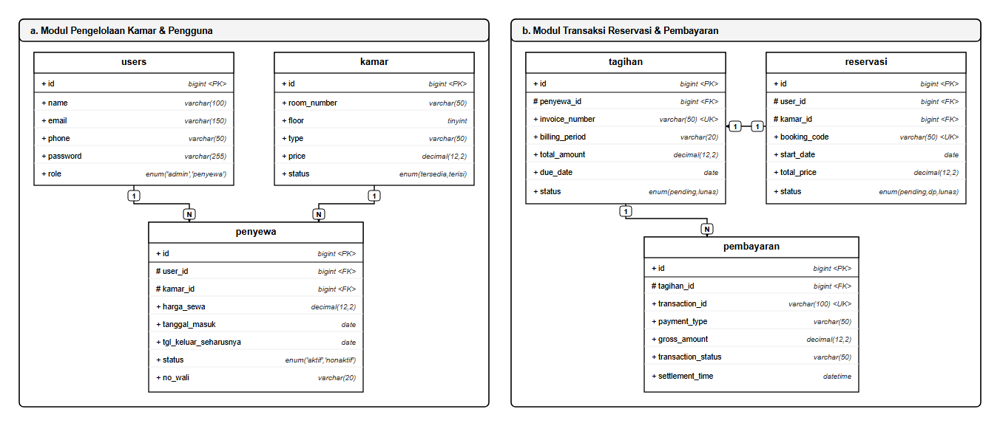
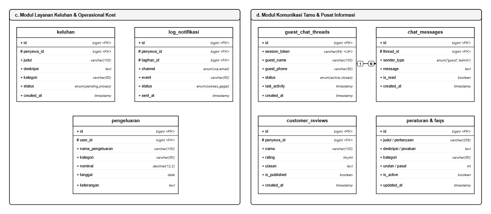
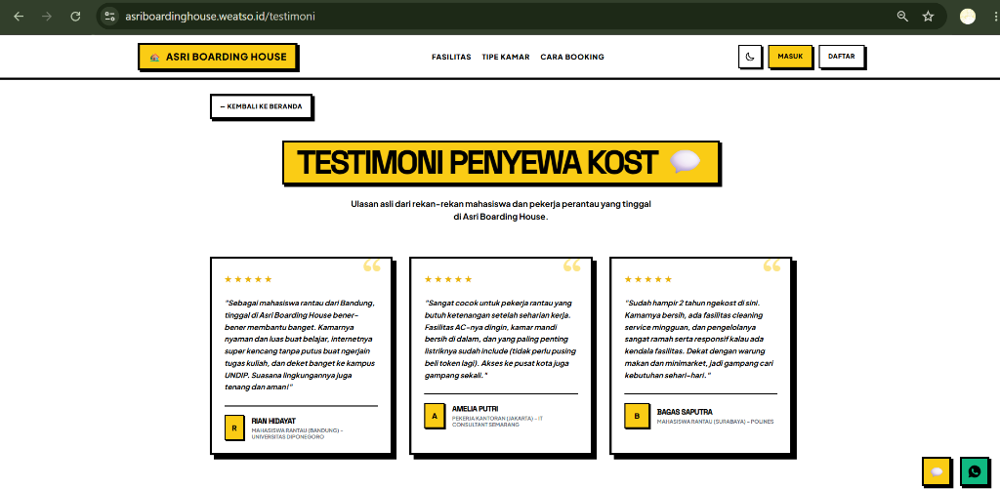
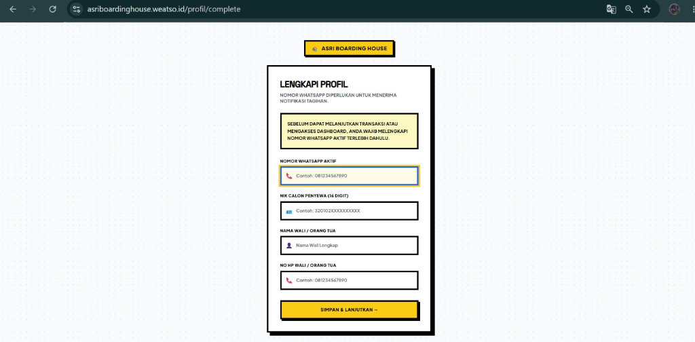
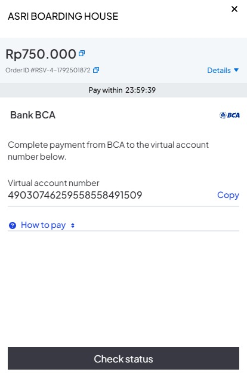
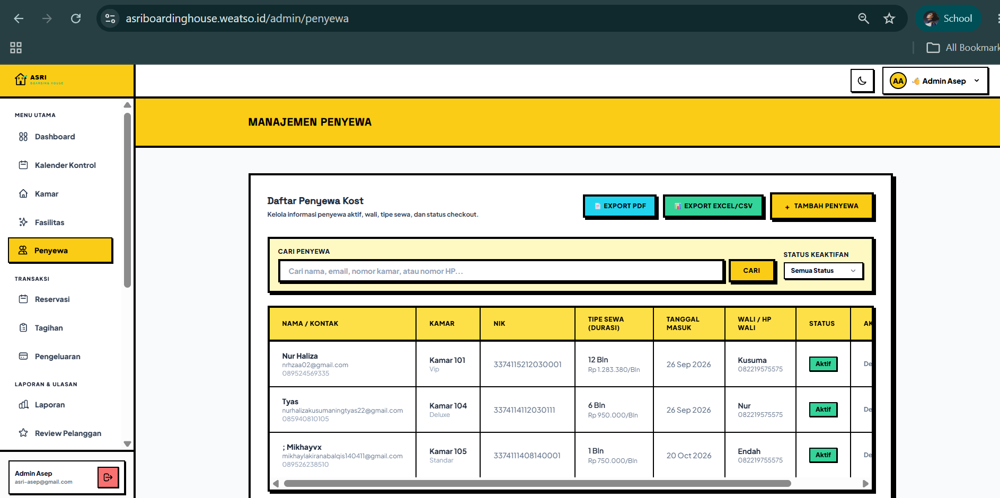
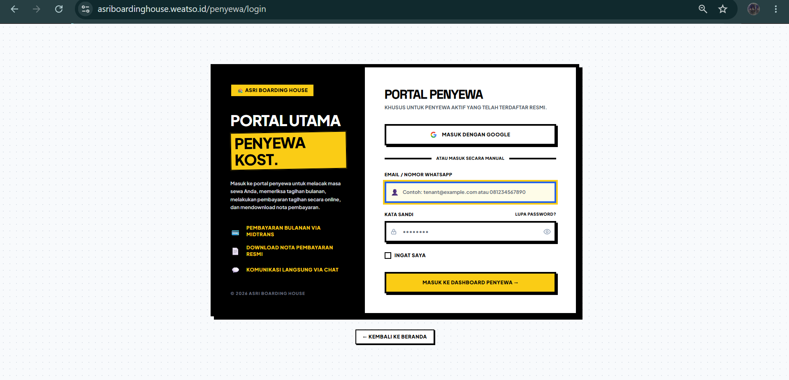
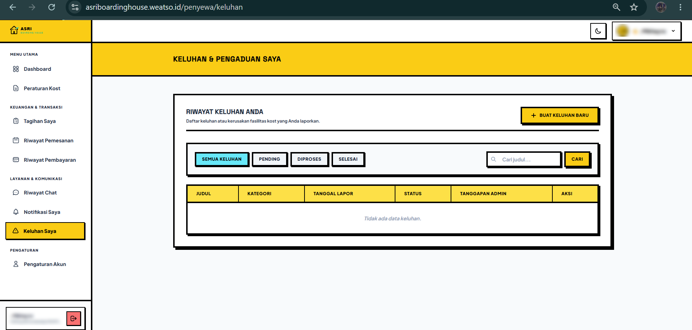
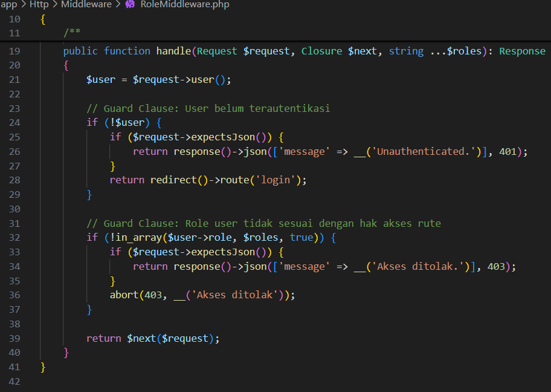

### LAPORAN SKRIPSI

 

## SISTEM INFORMASI MANAJEMEN KOST TERINTEGRASI PAYMENT GATEWAY PADA ASRI BOARDING HOUSE

  

   

**RAFIF ARSYA PRADIVA**

 

**22.N4.0014**

   

**PROGRAM STUDI SISTEM INFORMASI**  
**FAKULTAS ILMU KOMPUTER**  
**UNIVERSITAS KATOLIK SOEGIJAPRANATA**  
**SEMARANG**  
**2026**

### LAPORAN SKRIPSI

 

## SISTEM INFORMASI MANAJEMEN KOST TERINTEGRASI PAYMENT GATEWAY PADA ASRI BOARDING HOUSE

  

**Diajukan dalam Rangka Memenuhi**  
**Salah Satu Syarat Memperoleh Gelar**  
**Sarjana Komputer**

  

   

**RAFIF ARSYA PRADIVA**

 

**22.N4.0014**

   

**PROGRAM STUDI SISTEM INFORMASI**  
**FAKULTAS ILMU KOMPUTER**  
**UNIVERSITAS KATOLIK SOEGIJAPRANATA**  
**SEMARANG**  
**2026**

### HALAMAN PENGESAHAN

 

## SISTEM INFORMASI MANAJEMEN KOST TERINTEGRASI PAYMENT GATEWAY PADA ASRI BOARDING HOUSE

  

Diajukan oleh : 
**RAFIF ARSYA PRADIVA** 
**22.N4.0014**

  

Telah disetujui tanggal 10 April 2026 
Oleh

  

| Dosen Pembimbing 1, | Dosen Pembimbing 2, |
| :---: | :---: |
|      |      |
| **Ir. Andre Kurniawan Pamudji, S.Kom., M.Ling.** | **Erdhi Widyarto Nugroho, S.T., M.T.** |
| NPP. 058.1.1994.161 | NPP. .................... |

  

Mengetahui / menyetujui 
Kaprodi Sistem Informasi,

    

**Dr. Albertus Dwiyoga Widiantoro, S.Kom., M.Kom.** 
NPP. ....................

### HALAMAN PERNYATAAN KEASLIAN

 

Yang bertanda tangan di bawah ini :

 

Nama &nbsp;&nbsp;&nbsp;&nbsp;&nbsp;&nbsp;&nbsp;&nbsp;&nbsp;&nbsp;&nbsp;&nbsp;&nbsp;&nbsp;&nbsp;&nbsp;&nbsp;&nbsp;&nbsp;&nbsp;&nbsp;: Rafif Arsya Pradiva  
NIM &nbsp;&nbsp;&nbsp;&nbsp;&nbsp;&nbsp;&nbsp;&nbsp;&nbsp;&nbsp;&nbsp;&nbsp;&nbsp;&nbsp;&nbsp;&nbsp;&nbsp;&nbsp;&nbsp;&nbsp;&nbsp;&nbsp;&nbsp;: 22.N4.0014  
Progdi / Konsentrasi &nbsp;: Sistem Informasi / E-Commerce  
Fakultas &nbsp;&nbsp;&nbsp;&nbsp;&nbsp;&nbsp;&nbsp;&nbsp;&nbsp;&nbsp;&nbsp;&nbsp;&nbsp;&nbsp;&nbsp;&nbsp;&nbsp;: Ilmu Komputer

  

Dengan ini menyatakan bahwa laporan skripsi dengan judul **SISTEM INFORMASI MANAJEMEN KOST TERINTEGRASI PAYMENT GATEWAY PADA ASRI BOARDING HOUSE** benar-benar bebas dari plagiasi, dan apabila terbukti tidak benar bersedia menerima sanksi dengan ketentuan yang berlaku.

   

Semarang, 10 April 2026 
Yang menyatakan,

  

*Meterai Rp10.000* 
*(tanda tangan)*

  

**Rafif Arsya Pradiva**

### HALAMAN PERNYATAAN PERSETUJUAN PUBLIKASI

 

Sebagai sivitas akademik Universitas Katolik Soegijapranata, saya yang bertanda tangan di bawah ini:

 

Nama &nbsp;&nbsp;&nbsp;&nbsp;&nbsp;&nbsp;&nbsp;&nbsp;&nbsp;&nbsp;&nbsp;&nbsp;&nbsp;&nbsp;&nbsp;&nbsp;&nbsp;&nbsp;&nbsp;&nbsp;&nbsp;: Rafif Arsya Pradiva  
Program Studi &nbsp;&nbsp;&nbsp;&nbsp;&nbsp;&nbsp;&nbsp;&nbsp;: Sistem Informasi  
Fakultas &nbsp;&nbsp;&nbsp;&nbsp;&nbsp;&nbsp;&nbsp;&nbsp;&nbsp;&nbsp;&nbsp;&nbsp;&nbsp;&nbsp;&nbsp;&nbsp;&nbsp;: Ilmu Komputer  
Jenis Karya &nbsp;&nbsp;&nbsp;&nbsp;&nbsp;&nbsp;&nbsp;&nbsp;&nbsp;&nbsp;&nbsp;&nbsp;&nbsp;: Skripsi

  

Demi pengembangan ilmu pengetahuan, menyetujui untuk memberikan kepada Universitas Katolik Soegijapranata Hak Bebas Royalti Non-eksklusif atas karya ilmiah saya yang berjudul **SISTEM INFORMASI MANAJEMEN KOST TERINTEGRASI PAYMENT GATEWAY PADA ASRI BOARDING HOUSE**. Dengan Hak Bebas Royalti Non-eksklusif ini Universitas Katolik Soegijapranata berhak menyimpan, mengalih media/formatkan, mengelola dalam bentuk pangkalan data (database), merawat, dan memublikasikan skripsi saya selama tetap mencantumkan nama saya sebagai penulis/pencipta dan sebagai pemilik Hak Cipta.

 

Demikian pernyataan ini saya buat dengan sebenarnya.

   

Dibuat di &nbsp;&nbsp;&nbsp;&nbsp;&nbsp;&nbsp;&nbsp;&nbsp;: Semarang 
Pada tanggal &nbsp;&nbsp;: 10 April 2026  
Yang menyatakan,

   

*(tanda tangan)*

  

**Rafif Arsya Pradiva**

### KATA PENGANTAR

 

Laporan skripsi berjudul "Sistem Informasi Manajemen Kost Terintegrasi *Payment Gateway* pada Asri Boarding House" akhirnya selesai disusun. Penulis bersyukur kepada Tuhan Yang Maha Esa atas kesehatan selama merancang aplikasi hingga menuntaskan penulisan laporan ini. Karya ilmiah tersebut diajukan untuk memenuhi syarat perolehan gelar Sarjana Komputer di Program Studi Sistem Informasi, Fakultas Ilmu Komputer, Universitas Katolik Soegijapranata Semarang.

Pekerjaan ini tidak tuntas oleh penulis seorang diri. Sejak pengumpulan catatan lapangan sampai pengujian fungsional di lokasi kost, banyak pihak telah berbagi waktu serta pemikiran; oleh sebab itu penulis mengucapkan terima kasih kepada:

1. Bapak Prof. Dr. Ridwan Sanjaya, S.E., S.Kom., MS.IEC selaku Dekan Fakultas Ilmu Komputer yang mendukung penyediaan fasilitas belajar sepanjang masa studi penulis di kampus.
2. Bapak Dr. Albertus Dwiyoga Widiantoro, S.Kom., M.Kom., Ketua Program Studi Sistem Informasi, atas ketertiban layanan administrasi tugas akhir.
3. Bapak Ir. Andre Kurniawan Pamudji, S.Kom., M.Ling. selaku Dosen Pembimbing 1 yang tekun mengarahkan kerangka penelitian serta memeriksa ketepatan argumen di tiap bab naskah ini.
4. Bapak Erdhi Widyarto Nugroho, S.T., M.T., Dosen Pembimbing 2, atas evaluasi teknis hingga aplikasi siap diujikan.
5. Para dosen dan tenaga kependidikan Fakultas Ilmu Komputer atas bekal keilmuan selama kuliah.
6. Pengelola harian dan penghuni Asri Boarding House Tembalang yang bersedia membuka arsip pembukuan serta meluangkan waktu untuk sesi wawancara maupun uji pakai sistem.
7. Kedua orang tua dan keluarga atas doa yang tidak terputus.
8. Teman-teman mahasiswa di Universitas Katolik Soegijapranata yang kerap bertukar pikiran kala penulis menemui kendala teknis.

Aplikasi dan laporan ini tentu belum sempurna. Kritik maupun saran perbaikan sangat penulis harapkan agar pengembangan berikutnya sanggup menjawab kebutuhan operasional yang lebih luas. Semoga hasil kerja ini meringankan pembukuan harian Asri Boarding House dan berguna bagi peneliti selanjutnya.

   

Semarang, 10 April 2026

    

*(tanda tangan)*

  

**Rafif Arsya Pradiva**

### ABSTRAK

 

Pengelolaan 32 kamar sewa di Asri Boarding House Tembalang, Semarang masih mengandalkan buku besar dan percakapan WhatsApp pribadi. Keterlambatan catat kerap memicu benturan pemesanan ganda (*double booking*). Pengawasan jatuh tempo sewa tiap tanggal 10 sering terlewat, sedangkan pencocokan bukti transfer dengan nota belanja akhir bulan menyita tiga sampai empat hari. Penelitian ini membangun sistem informasi manajemen kost berbasis web yang terhubung ke *payment gateway* untuk menertibkan reservasi, penagihan bulanan, dan pencatatan kas.

Kajian ini menerapkan metode *Research and Development* (R&D). Peneliti memetakan aturan bisnis dari wawancara, observasi lapangan, serta arsip pembukuan, kemudian mengembangkan perangkat lunak mengikuti tahapan model *Waterfall*. Di atas kerangka Laravel 12 dan MySQL, penguncian baris pesimis (*pessimistic row locking*) menahan dua calon penyewa agar tidak mengklaim unit yang sama. Verifikasi *webhook* SHA-512 pada Midtrans Snap melunasi transaksi otomatis dan menerbitkan kuitansi PDF A5. Pada sisi *server*, *cron job* menerbitkan tagihan setiap tanggal 1, menjatuhkan denda *flat* 5% bagi tunggakan lintas bulan, serta mengirim pengingat WhatsApp dan *email*.

Pengujian *black box* meluluskan seluruh 60 skenario (100%). Tidak ditemukan galat validasi maupun kegagalan transaksi. Dalam uji pakai lapangan, penjaga kost memberi nilai 9,5 dari 10 karena tutup buku bulanan terpangkas dari berhari-hari menjadi hitungan detik tanpa selisih kas. Lima mahasiswa penghuni aktif menilai aplikasi ini rata-rata 8,0 dari 10 berkat kemudahan reservasi jarak jauh, pelunasan *Virtual Account* tanpa kirim bukti transfer, dan unduhan kuitansi PDF A5.

 

**Kata Kunci:** Asri Boarding House, gerbang pembayaran Midtrans, Laravel, penguncian baris pesimis, sistem informasi manajemen kost.

### ABSTRACT

 

Asri Boarding House in Tembalang, Semarang records its 32 rental rooms in paper ledgers and personal WhatsApp chats. Slow status updates frequently cause double bookings. Rent due on the 10th of each month often slips past notice, while reconciling bank transfer photos with expense receipts takes three to four days. This study builds a web-based boarding house management information system integrated with a payment gateway to handle reservations, monthly billing, and cashflows.

The project follows a Research and Development (R&D) methodology. Field interviews, direct observation, and ledger reviews established the business rules before software construction proceeded through the Waterfall model. Built with Laravel 12 and MySQL, the application applies pessimistic row locking so two prospective tenants cannot book one room simultaneously. Midtrans Snap verifies cashless payments through SHA-512 webhook signatures. Verified settlements immediately unlock A5 PDF receipts. On the server, a cron scheduler generates invoices every 1st, charges a one-time 5% flat fee on cross-month arrears, and sends WhatsApp and email alerts.

Black-box testing passed all 60 scenarios at 100%. Zero validation faults or transaction failures occurred. During on-site trials, the resident caretaker gave a 9.5 out of 10 rating after monthly closing dropped from several days to seconds without cash variances. Five active student tenants awarded an average score of 8.0 out of 10, citing remote booking, Virtual Account transfers without receipt uploads, and instant A5 PDF receipts.

 

**Keywords:** Asri Boarding House, boarding house management information system, Laravel, Midtrans payment gateway, pessimistic row locking.

## DAFTAR ISI

 

HALAMAN PENGESAHAN &emsp; iii  
HALAMAN PERNYATAAN KEASLIAN &emsp; iv  
HALAMAN PERNYATAAN PERSETUJUAN PUBLIKASI &emsp; v  
KATA PENGANTAR &emsp; vi  
ABSTRAK &emsp; viii  
ABSTRACT &emsp; ix  
DAFTAR ISI &emsp; x  
DAFTAR GAMBAR &emsp; xii  
DAFTAR TABEL &emsp; xiv  

 

**BAB 1 PENDAHULUAN** &emsp; **1**  
1.1 Latar Belakang &emsp; 1  
1.2 Rumusan Masalah &emsp; 2  
1.3 Tujuan Penelitian &emsp; 2  

 

**BAB 2 TINJAUAN PUSTAKA** &emsp; **4**  
2.1 Sistem Informasi Manajemen &emsp; 4  
2.2 E-Commerce B2C &emsp; 4  
2.3 Web Application &emsp; 5  
2.4 UI & UX &emsp; 5  
2.5 Laravel &emsp; 6  
2.6 RDBMS &emsp; 6  
2.7 MySQL Database &emsp; 7  
2.8 Payment Gateway &emsp; 7  
2.9 WhatsApp Gateway API &emsp; 8  
2.10 Email Gateway API &emsp; 9  
2.11 Cronjob &emsp; 9  
2.12 Metode Waterfall &emsp; 10  

 

**BAB 3 METODE PENELITIAN** &emsp; **11**  
3.1 Objek Penelitian &emsp; 11  
3.2 Jenis Penelitian &emsp; 11  
3.3 Sumber Data &emsp; 11  
3.4 Teknik Pengumpulan Data &emsp; 12  
3.5 Metode Pengembangan Sistem &emsp; 13  
3.6 Kerangka Pemikiran &emsp; 14  

 

**BAB 4 HASIL DAN PEMBAHASAN** &emsp; **17**  
4.1 Perancangan Aplikasi &emsp; 17  
&emsp; 4.1.1 Use Case Diagram &emsp; 17  
&emsp; 4.1.2 Entity Relationship Diagram (ERD) &emsp; 19  
&emsp; 4.1.3 Activity Diagram &emsp; 21  
&emsp; 4.1.4 Flowchart Sistem &emsp; 24  
4.2 Implementasi Antarmuka Sistem &emsp; 25  
&emsp; 4.2.1 Implementasi Umum &emsp; 25  
&emsp; 4.2.2 Implementasi Calon Penyewa &emsp; 36  
&emsp; 4.2.3 Implementasi Admin &emsp; 43  
&emsp; 4.2.4 Implementasi Penyewa Aktif &emsp; 54  
4.3 Implementasi Kode Program &emsp; 60  
&emsp; 4.3.1 Implementasi Autentikasi dan Hak Akses &emsp; 60  
&emsp; 4.3.2 Implementasi Pemesanan Kamar &emsp; 63  
&emsp; 4.3.3 Implementasi *Payment Gateway* &emsp; 65  
&emsp; 4.3.4 Implementasi Penjadwalan dan Notifikasi &emsp; 67  
4.4 Pengujian Sistem &emsp; 69  
4.5 Hasil Wawancara &emsp; 80  

 

**BAB 5 KESIMPULAN DAN SARAN** &emsp; **96**  
5.1 Kesimpulan &emsp; 96  
5.2 Saran &emsp; 96  

 

**DAFTAR PUSTAKA** &emsp; **98**  

## DAFTAR GAMBAR

 

Gambar 3.1 Tahapan Metode Waterfall &emsp; 13  
Gambar 3.2 Kerangka Pemikiran &emsp; 14  
Gambar 4.1 Use Case Diagram &emsp; 17  
Gambar 4.2(a) Entity Relationship Diagram (Modul Inti) &emsp; 19  
Gambar 4.2(b) Entity Relationship Diagram (Modul Pendukung) &emsp; 20  
Gambar 4.3 Activity Diagram Calon Penyewa &emsp; 21  
Gambar 4.4 Activity Diagram Admin (Penjaga Kost) &emsp; 22  
Gambar 4.5 Activity Diagram Penyewa Aktif &emsp; 23  
Gambar 4.6 Flowchart Sistem &emsp; 24  
Gambar 4.7 Halaman Beranda Utama &emsp; 26  
Gambar 4.8 Daftar Fasilitas Kost &emsp; 27  
Gambar 4.9 Katalog Tipe Kamar &emsp; 28  
Gambar 4.10 Galeri Foto Kost &emsp; 29  
Gambar 4.11 Panduan Alur Reservasi &emsp; 30  
Gambar 4.12 Halaman Testimoni Penghuni &emsp; 31  
Gambar 4.13 Halaman Pertanyaan Umum &emsp; 32  
Gambar 4.14 Halaman Tentang Kami &emsp; 32  
Gambar 4.15 Halaman Login Pengguna &emsp; 33  
Gambar 4.16 Halaman Pendaftaran Akun &emsp; 34  
Gambar 4.17 Chat Real Time Guest &emsp; 35  
Gambar 4.18 Kelengkapan Profil Pemesan &emsp; 36  
Gambar 4.19 Dasbor Reservasi Pemesan &emsp; 37  
Gambar 4.20 Simulasi Biaya Kamar &emsp; 38  
Gambar 4.21 Tahapan Pembayaran Reservasi &emsp; 39  
Gambar 4.22 Jendela Pembayaran Midtrans &emsp; 40  
Gambar 4.23 Pesan Aktivasi WhatsApp &emsp; 41  
Gambar 4.24 Email Konfirmasi Reservasi &emsp; 42  
Gambar 4.25 Halaman Login Administrator &emsp; 43  
Gambar 4.26 Dasbor Operasional Administrator &emsp; 44  
Gambar 4.27 Pengelolaan Data Kamar &emsp; 45  
Gambar 4.28 Pengelolaan Fasilitas Kost &emsp; 46  
Gambar 4.29 Pengelolaan Data Penghuni &emsp; 47  
Gambar 4.30 Pengelolaan Reservasi Masuk &emsp; 48  
Gambar 4.31 Pengelolaan Tagihan Bulanan &emsp; 49  
Gambar 4.32 Pencatatan Pengeluaran Operasional &emsp; 50  
Gambar 4.33 Laporan Rekapitulasi Kas &emsp; 51  
Gambar 4.34 Pengelolaan Keluhan Fasilitas &emsp; 52  
Gambar 4.35 Pengelolaan Obrolan Tamu &emsp; 53  
Gambar 4.36 Login Penyewa Aktif &emsp; 54  
Gambar 4.37 Dasbor Penyewa Aktif &emsp; 55  
Gambar 4.38 Tagihan Sewa Penyewa &emsp; 56  
Gambar 4.39 Pengaturan Profil Penghuni &emsp; 57  
Gambar 4.40 Riwayat Transaksi Pembayaran &emsp; 58  
Gambar 4.41 Pengajuan Keluhan Kamar &emsp; 59  
Gambar 4.42 Dokumen Kuitansi Digital &emsp; 60  
Gambar 4.43 Kode Pembatasan Akses &emsp; 61  
Gambar 4.44 Kode Pengalihan Portal &emsp; 62  
Gambar 4.45 Kode Penguncian Kamar &emsp; 63  
Gambar 4.46 Kode Pemeriksaan Jadwal &emsp; 64  
Gambar 4.47 Kode Token Midtrans &emsp; 65  
Gambar 4.48 Kode Validasi Webhook &emsp; 66  
Gambar 4.49 Kode Penjadwal Tugas &emsp; 67  
Gambar 4.50 Kode Integrasi WhatsApp &emsp; 68  
Gambar 4.51 Kode Pengiriman Email &emsp; 69  
Gambar 4.52 Dokumentasi Wawancara Bapak Asep &emsp; 81  

## DAFTAR TABEL

 

Tabel 4.1 Hasil Pengujian Fungsionalitas Sistem (Black Box Testing) &emsp; 70  
Tabel 4.2 Hasil Wawancara Penjaga Kost (Bapak Asep) &emsp; 81  
Tabel 4.3 Wawancara dengan Arjun &emsp; 85  
Tabel 4.4 Wawancara dengan Farrel &emsp; 87  
Tabel 4.5 Wawancara dengan Iman &emsp; 89  
Tabel 4.6 Wawancara dengan Ammar &emsp; 91  
Tabel 4.7 Wawancara dengan Sindhu &emsp; 93  

## BAB 1 PENDAHULUAN

 

## 1.1 Latar Belakang
Mahasiswa perantau selalu memadati kawasan pendidikan Tembalang, Kota Semarang setiap awal tahun akademik. Mereka butuh kepastian kamar kosong secara cepat. Sayangnya, pemasaran dari mulut ke mulut masih mengharuskan calon penghuni luar kota mendatangi lokasi atau menanti balasan pesan singkat sekadar menanyakan sisa unit. Pemesanan kost berbasis web memangkas hambatan jarak tersebut dan menertibkan pendataan penyewa sejak pengajuan awal [1].

Kondisi serupa terjadi pada Asri Boarding House di Tembalang. Rumah kost ini memiliki 32 unit kamar yang terbagi atas 6 kamar VIP, 3 Deluxe, dan 23 Standar. Selama ini penjaga kost menulis status hunian di buku besar sembari membalas pertanyaan calon penyewa di WhatsApp pribadi, sehingga informasi sisa unit kerap terlambat diperbarui. Pemesanan ganda (*double booking*) pun rawan muncul saat dua peminat mengincar kamar yang sama. Aplikasi web terpusat memang sanggup menyatukan pemantauan ketersediaan kamar [2], tetapi penolakan klaim serentak tetap menuntut penguncian transaksi di lapis basis data.

Pembukuan manual turut menyulitkan penagihan sewa bulanan. Tagihan jatuh tempo tiap tanggal 10 dan masih bebas denda hingga akhir bulan berjalan, sedangkan keterlambatan yang menyeberang bulan dikenai denda tetap (*flat*) 5% satu kali. Pengecekan daftar jatuh tempo serta pengiriman pesan tagihan satu per satu membuat jadwal penagihan kerap luput. Akibatnya, tunggakan sewa penghuni kian menumpuk. Sistem pemantauan pembayaran kost berbasis web membantu pengelola mengawasi kewajiban sewa secara berkala [3], terlebih bila penjadwal di *server* menerbitkan faktur tanpa intervensi manual.

Kendala berlanjut pada verifikasi bayar dan pembukuan kas. Penyewa yang melunasi tagihan melalui transfer bank harus mengirim tangkapan layar resi lalu menunggu pemeriksaan manual, sementara kuitansi kertas rawan terselip. Pada akhir bulan, penjaga kost menghabiskan tiga sampai empat hari untuk mencocokkan uang tunai, bukti transfer, serta nota belanja operasional. Rekapitulasi manual ini rawan memicu selisih kas. Gerbang pembayaran (*payment gateway*) Midtrans menghapus antrean periksa resi dengan mengesahkan transaksi nontunai dari sisi *server* [4]. Pencatatan kas web yang tertaut ke *WhatsApp gateway* mempercepat penyusunan laporan dan pengiriman kabar bayar [5], lalu dukungan *email* menyediakan arsip tagihan beserta kuitansi digital bagi penghuni.

Sejumlah penelitian terdahulu telah merancang aplikasi pengelolaan kost berbasis web [1], [2], [3], namun sebagian besar masih bergantung pada unggahan bukti transfer manual. Asri Boarding House memerlukan satu platform yang menyatukan reservasi, penagihan terjadwal, dan rekapitulasi kas. Solusi ini dibangun memakai Laravel 12 dan MySQL. Penguncian baris pesimis (*pessimistic row locking*) mencegah dua pemohon mengklaim satu unit secara bersamaan, sedangkan Midtrans Snap memvalidasi pelunasan nontunai tanpa pemeriksaan resi. Di latar belakang, penjadwal *cron job* menerbitkan tagihan tiap tanggal 1, menghitung denda lintas bulan, serta mengirim pengingat WhatsApp dan *email*.

 

## 1.2 Rumusan Masalah
Permasalahan operasional tersebut dirumuskan ke dalam tiga pertanyaan penelitian:
1. Bagaimana merancang arsitektur Sistem Informasi Manajemen Kost Terintegrasi *Payment Gateway* pada Asri Boarding House untuk mengelola reservasi 32 unit kamar, tagihan bulanan, dan pembukuan kas?
2. Bagaimana membangun aplikasi web berbasis Laravel 12 dan MySQL yang menggabungkan penguncian transaksi reservasi, pembayaran otomatis Midtrans Snap, penjadwalan *cron job*, serta notifikasi WhatsApp dan *email*?
3. Bagaimana kelayakan fungsional aplikasi menurut pengujian kotak hitam (*black box*) dan tingkat penerimaan penjaga maupun penghuni kost setelah uji coba lapangan?

 

## 1.3 Tujuan Penelitian
Penelitian ini memiliki tiga sasaran utama:
1. Menyusun rancangan arsitektur sistem informasi manajemen kost yang mengatur pembagian peran pengguna, relasi basis data, serta alur kerja dari pemesanan kamar hingga pelaporan kas Asri Boarding House.
2. Membangun aplikasi web menggunakan Laravel 12 dan MySQL berfitur penguncian baris pesimis pencegah pemesanan ganda, verifikasi Midtrans Snap, penjadwalan tagihan beserta denda, dan pengingat melalui WhatsApp maupun *email*.
3. Mengukur keandalan fitur melalui pengujian *black box* serta mengevaluasi penerimaan penjaga dan penghuni kost atas ketepatan penagihan, kecepatan tutup buku bulanan, dan kepraktisan transaksi.

 

## BAB 2 TINJAUAN PUSTAKA

 

## 2.1 Sistem Informasi Manajemen
Sistem Informasi Manajemen (SIM) merangkai perangkat keras, perangkat lunak, prosedur operasional, dan pengguna dalam satu alur kerja guna mengolah data transaksi harian menjadi informasi yang terukur. Catatan tidak lagi tercecer di banyak berkas. Pengelola usaha pun memiliki pijakan akurat ketika mengevaluasi mutu layanan serta menetapkan keputusan manajerial secara tepat waktu [6].

Dalam operasional rumah kost, SIM menyatukan status ketersediaan unit, biodata penghuni, jadwal tagihan, dan mutasi kas ke satu pangkalan data terpusat. Perubahan hunian terekam saat itu juga. Salah tulis pada buku besar maupun benturan pemesanan ganda (*double booking*) tertutup sejak tahap pengajuan, sedangkan rekapitulasi uang masuk beserta belanja rutin tersusun tertib sehingga mudah diaudit kapan saja [7].

 

## 2.2 E-Commerce B2C
Perdagangan elektronik *Business-to-Consumer* (B2C) mempertemukan pemilik jasa dengan pelanggan akhir melalui jaringan internet tanpa perantara konvensional. Jam kerja kantor tidak lagi membatasi transaksi. Konsumen leluasa memeriksa katalog produk, membandingkan skema harga, lalu menuntaskan pemesanan mandiri dari perangkat masing-masing kapan pun dibutuhkan [8].

Penerapan kanal B2C pada bisnis hunian sewa membuka jalur pemasaran mandiri yang bebas dari potongan komisi aplikasi pihak ketiga. Pemilik properti leluasa mengatur tarif pokok ataupun potongan paket sewa mengikuti dinamika permintaan pasar, sementara calon penghuni luar kota dapat mengecek sisa kamar kosong dan mengamankan unit pilihan sebelum tiba di lokasi [9].

 

## 2.3 Web Application
Arsitektur *client-server* pada aplikasi web mempertukarkan permintaan dan tanggapan data melalui protokol HTTP atau HTTPS. Pemasangan perangkat lunak tambahan tidak diperlukan. Pengguna cukup mengetik alamat situs pada peramban (*browser*) ponsel ataupun komputer karena pemrosesan aturan bisnis serta kueri pangkalan data dikerjakan sepenuhnya oleh *web server* pusat [10].

Pemeliharaan teknis pun jauh lebih terkendali. Pengembang cukup memperbarui kode atau menutup celah keamanan satu kali di sisi *server*, lalu pengelola maupun penyewa otomatis memakai versi terbaru saat memuat ulang halaman. Pemisahan tegas antara antarmuka visual, logika pemrosesan, dan penyimpanan data turut menjaga kestabilan kinerja ketika fitur baru ditambahkan [11].

 

## 2.4 UI & UX
Antarmuka pengguna (*User Interface* atau UI) menjembatani interaksi visual manusia dengan fungsi perangkat lunak melalui penyeragaman bentuk tombol, skala tipografi, dan kontras warna di dalam *design system* [12]. Pada aplikasi ini, pendekatan *Neo-Brutalism* dipilih lewat garis tepi hitam tebal, bayangan pekat tanpa efek kabur, serta perpaduan warna berdaya kontras tinggi. Sekat antarkartu informasi terlihat tegas. Tata letak responsif menyesuaikan ukuran layar komputer hingga ponsel, dilengkapi mode gelap (*dark mode*) yang nyaman bagi mata saat pengelola bekerja lama.

Pengalaman pengguna (*User Experience* atau UX) menguji efektivitas tampilan visual tersebut saat pengguna menuntaskan pekerjaan nyata di layar. Alur bertahap mencegah kebingungan pemohon kamar [13]. Penempatan kartu ringkasan metrik serta lencana status bayar di paruh atas dasbor pengelola maupun portal penyewa turut memangkas waktu pencarian data harian.

 

## 2.5 Laravel
Laravel 12 menata kode aplikasi PHP menggunakan pola *Model-View-Controller* (MVC) yang memisahkan pemodelan data, perakitan tampilan, dan pengaturan alur permintaan HTTP. Relasi antartabel dipetakan memakai *Eloquent Object-Relational Mapping* (ORM), sedangkan antarmuka halaman disusun secara modular melalui mesin templat *Blade* [14]. Pengaman dasar telah tertanam sejak awal. Kerangka kerja ini menyertakan token penangkal *Cross-Site Request Forgery* (CSRF) dan *parameter binding* kueri pencegah injeksi SQL.

Seiring bertambahnya aturan bisnis, penumpukan kode transaksi di dalam *controller* berisiko menyulitkan pelacakan kutu (*bug*) maupun perawatan jangka panjang [15]. Pemisahan menuju *Service Layer* menjawab masalah itu. Pengecekan kamar kosong, kalkulasi denda keterlambatan, dan pemanggilan API pihak ketiga dikelola terpisah di lapisan layanan, sedangkan *middleware* menyaring hak akses pengguna sejak rute pertama diakses.

 

## 2.6 RDBMS
Basis data relasional (*Relational Database Management System* atau RDBMS) mengorganisasikan catatan ke dalam tabel dua dimensi yang saling mengikat melalui *primary key* dan *foreign key*. Ikatan referensial tersebut mencegah data yatim serta menegakkan prinsip transaksi ACID (*Atomicity, Consistency, Isolation, Durability*) [16]. Satu rangkaian operasi wajib tuntas utuh. Apabila muncul kegagalan di tengah eksekusi, mesin penyimpan membatalkan seluruh perubahan agar saldo dan status transaksi tidak timpang.

Penyusunan skema tabel menerapkan normalisasi hingga Bentuk Normal Ketiga (3NF) untuk menekan duplikasi kolom maupun anomali pembaruan data [17]. Setiap atribut nonkunci bergantung penuh pada kunci utamanya. Kendati demikian, sistem sewa hunian tetap membutuhkan rekam *snapshot* harga kontrak di tabel transaksi supaya penyesuaian tarif kamar pada periode mendatang tidak mengubah riwayat tagihan penghuni lama.

 

## 2.7 MySQL Database
MySQL mengelola basis data relasional sumber terbuka berbasis *Structured Query Language* (SQL) dengan arsitektur *client-server multithread* yang melayani banyak permintaan baca-tulis serentak. Beban memori *server* tetap terjaga ringan. Dukungan pustaka bawaannya yang matang di ekosistem PHP dan Laravel membuat MySQL andal menangani operasi CRUD (*Create, Read, Update, Delete*) pada aplikasi transaksi web [18].

Mesin penyimpanan (*storage engine*) InnoDB di dalam MySQL menyediakan transaksi ACID penuh beserta penguncian baris pesimis (*pessimistic row-level locking*) ketika dua pemohon menekan tombol pesan pada detik berdekatan: transaksi kedua ditahan mengantre sampai transaksi pertama tuntas memperbarui status unit. Celah pesanan ganda tertutup rapat. Penempatan indeks (*indexing*) pada kolom kunci tamu dan tanggal sewa pun menjaga kecepatan kueri meski ribuan mutasi telah menumpuk [19].

 

## 2.8 Payment Gateway
Gerbang pembayaran (*payment gateway*) menjembatani sistem aplikasi web dengan jaringan perbankan serta penyelenggara uang elektronik sehingga satu integrasi Midtrans membuka kanal *Virtual Account* lintas bank, QRIS, dompet digital, dan kartu kredit sekaligus [20]. Pengelola tidak perlu membuka banyak rekening penampung. Penghuni pun bebas dari kewajiban memotret resi transfer manual.

Midtrans memisahkan ruang pengujian (*Sandbox*) dari lingkungan transaksi sesungguhnya (*Production*) agar simulasi bayar lunas, tertunda, maupun kedaluwarsa berjalan aman tanpa perpindahan dana asli. Peralihan ke *Production* cukup menukar kunci kredensial *server*.

Alur teknisnya berawal ketika *server* aplikasi mengirimkan rincian faktur ke API Midtrans untuk mengambil *Snap token* pembuka jendela pembayaran di peramban [21]. Selepas penyewa menyelesaikan transfer, Midtrans menembakkan sinyal asinkron melalui *webhook callback*. Aplikasi wajib memvalidasi tanda tangan digital (*signature key*) berbasis *hash* SHA-512 memakai pencocokan *constant-time* sebelum melunasi tagihan agar kebal dari pemalsuan *payload*, lalu menjalankan cek idempoten supaya notifikasi ulang tidak mencatat lunas ganda.

 

## 2.9 WhatsApp Gateway API
Pesan instan memiliki tingkat keterbacaan (*open rate*) yang jauh melampaui SMS maupun surat elektronik untuk pengingat tagihan bulanan [22]. Antarmuka pemrograman aplikasi (API) *WhatsApp gateway* mengotomasi pengiriman pesan teks tersebut dari *server* aplikasi ke ponsel penghuni. Pengelola bebas dari ketik pesan manual.

Penyedia layanan seperti Fonnte memproses antrean pesan melalui permintaan *HTTP POST* berbekal token otorisasi pada *header* [23]. Nomor telepon penerima diubah lebih dulu ke awalan negara internasional (`62`) sebelum paket dikirim ke *endpoint*, disertai pembatasan waktu tunggu koneksi (*timeout*) serta jeda antarpesan (*delay*) agar pengiriman notifikasi massal tidak menyumbat kinerja aplikasi utama.

 

## 2.10 Email Gateway API
Pengiriman surat elektronik otomatis dari aplikasi web berjalan di atas protokol *Simple Mail Transfer Protocol* (SMTP) berenkripsi *Transport Layer Security* (TLS) melalui *mail relay* terautentikasi yang menjaga reputasi domain agar surat tidak masuk ke folder *spam* [24].

Berbeda dari pesan singkat, *email* cocok menyimpan dokumen transaksi resmi seperti faktur bulanan, kuitansi digital, dan tautan pemulihan sandi yang membutuhkan jejak arsip panjang [25]. Waktu muat layar tetap terasa gegas. Seluruh pekerjaan kirim SMTP dilepas ke antrean asinkron (*asynchronous job queue*) di latar belakang sehingga peramban pengguna tidak tertahan menunggu sambungan jaringan.

 

## 2.11 Cronjob
Utilitas *cron job* pada keluarga sistem operasi Unix menjalankan skrip latar belakang secara terjadwal mengikuti parameter menit, jam, tanggal, atau bulan [26]. Ketergantungan pada ingatan operator dapat dihapuskan.

Cukup satu baris *daemon cron* aktif untuk menggerakkan seluruh *task scheduler* internal Laravel, baik guna membersihkan reservasi kedaluwarsa tiap jam maupun menerbitkan faktur sewa baru setiap tanggal 1. Memasuki tanggal 11 ke atas, skrip harian memantau keterlambatan bayar, membebankan denda ketika tunggakan melintasi pergantian bulan, lalu memicu pengiriman pengingat ke WhatsApp serta *email* [27]. Pencegah tumpang tindih (*overlap prevention*) dan cek idempoten menjaga satu periode sewa tidak pernah ditagih dua kali.

 

## 2.12 Metode Waterfall
Model *Waterfall* menata rekayasa perangkat lunak secara sekuensial ke dalam enam tahapan: analisis kebutuhan, perancangan arsitektur, penulisan kode, integrasi serta pengujian, verifikasi lapangan, dan pemeliharaan operasional [28]. Dokumentasi tiap tahap dikunci sebelum fase berikutnya dimulai. Jalur umpan balik (*feedback loop*) tetap disiapkan apabila pengujian menyingkap koreksi spesifikasi.

Pendekatan berurutan tersebut cocok diterapkan pada rumah kost yang aturan tarif 32 kamar, jatuh tempo tanggal 10, denda lintas bulan, serta alur kasnya sudah baku sejak awal observasi. Risiko bongkar pasang fitur dapat ditekan. Penyusunan skema basis data hingga modul program pun berjalan terukur sampai pengujian akhir.

 

## BAB 3 METODE PENELITIAN

 

## 3.1 Objek Penelitian
Lokasi kajian berada di Asri Boarding House, Jalan Maera Sari Nomor 1, kawasan kampus Tembalang, Kota Semarang. Gedung dua lantai ini memiliki 32 kamar. Masing-masing lantai menampung 16 unit secara merata dengan rincian 6 kamar VIP, 3 Deluxe, dan 23 Standar bagi mahasiswa maupun pekerja.

Pengamatan membedah alur pemesanan unit, penagihan sewa rutin, dan rekapitulasi kas yang sebelumnya dicatat penjaga kost di buku besar sembari membalas pesan WhatsApp pribadi. Jeda catat ini rawan memicu *double booking*. Pemeriksaan jatuh tempo tiap tanggal 10 beserta denda *flat* 5% lintas bulan sering terlewat akibat pengecekan manual, sehingga pengelola harus menyisihkan tiga sampai empat hari tiap akhir bulan guna mencocokkan uang tunai, foto transfer, dan nota belanja.

 

## 3.2 Jenis Penelitian
Rekayasa sistem ini menerapkan pendekatan Penelitian dan Pengembangan atau *Research and Development* (R&D) di ranah perangkat lunak [29]. Sasaran utamanya ialah produk siap pakai. Kajian ini merancang, membangun, dan menguji aplikasi web yang menuntaskan hambatan pembayaran serta penjadwalan tagihan sewa di lokasi riset.

Kerangka R&D tersebut dijalankan melalui studi kasus tunggal kualitatif-deskriptif di Asri Boarding House. Tahap awal membedah alur pembukuan manual. Seusai penulisan kode dari pencatatan sewa hingga rekapitulasi saldo tuntas, kelayakan sistem diukur menggunakan pengujian *black box* dan uji pakai lapangan bersama penjaga maupun penghuni kost.

 

## 3.3 Sumber Data
Dua sumber data menopang perancangan aplikasi ini.

1. Data Primer  
Peneliti menghimpun data primer secara tatap muka di lokasi Asri Boarding House melalui wawancara, pengamatan harian, serta uji pakai aplikasi bersama dua kelompok responden:
* **Penjaga kost**: Seorang pengelola harian berpengalaman sekitar 20 tahun. Narasumber ini menangani penerimaan penyewa baru, penetapan tarif 32 kamar beserta sanksi denda, pemeriksaan kamar sehabis *checkout*, sampai penyusunan laporan kas bulanan.
* **Penghuni kost aktif**: Lima mahasiswa dari berbagai kampus menjadi narasumber. Keterangan mereka memetakan pengalaman mencari kamar dari luar kota, melunasi tagihan bulanan, menyimpan kuitansi bayar, hingga mengadukan kerusakan fasilitas kamar.

2. Data Sekunder  
Bahan penunjang dikumpulkan dari arsip internal kost dan rujukan teknis rekayasa perangkat lunak:
* **Arsip operasional kost**: Buku besar penyewaan, tangkapan layar transfer bank, bon belanja pemeliharaan, lembaran peraturan huni, serta tabel harga 32 unit lengkap dengan diskon paket tiga bulanan ataupun tahunan.
* **Dokumentasi teknis resmi**: Rujukan pengembang Laravel 12, mesin MySQL InnoDB, spesifikasi API Midtrans Snap, *endpoint* Fonnte, serta protokol SMTP.
* **Kepustakaan ilmiah**: Jurnal penelitian terindeks dan literatur metodologi riset yang membahas sistem informasi hunian sewa, penguncian konkurensi transaksi basis data, maupun gerbang pembayaran digital.

 

## 3.4 Teknik Pengumpulan Data
Penggalian data kualitatif menempatkan wawancara mendalam sebagai instrumen pokok [30], didampingi observasi lapangan serta telaah arsip agar spesifikasi kebutuhan maupun hasil evaluasi akhir saling teruji.

1. Wawancara Mendalam dan Uji Coba Pengguna  
Seluruh sesi tanya jawab direkam utuh. Percakapan tatap muka berpedoman semiterstruktur tersebut kemudian disalin menjadi transkrip tertulis dalam dua gelombang pengambilan data, yakni analisis kebutuhan pra-perancangan dan uji pakai berdampingan (*side-by-side usability testing*) seusai aplikasi rampung.
* **Bersama penjaga kost**: Pertemuan pertama menggali ketetapan tarif kamar, batas bayar tanggal 10, keringanan bebas denda sepanjang bulan berjalan, denda *flat* 5% lintas bulan, pendaftaran tamu *walk-in*, hingga penahanan status kamar pasca-*checkout*. Saat evaluasi akhir, pengelola menjajal katalog depan, tombol WhatsApp, dasbor *OLED Dark Mode*, formulir *walk-in*, konfirmasi tunai, denda kalender, karantina kamar, unduhan laporan PDF maupun Excel, serta aduan berfoto. Penilaian ditutup dengan skor berskala 1 sampai 10.
* **Bersama lima mahasiswa penghuni kost aktif**: Sesi awal menelusuri kendala survei luar kota, jeda verifikasi resi WhatsApp, dan risiko kuitansi kertas hilang. Pada evaluasi produk, kelima penghuni menguji katalog *Neo-Brutalism*, reservasi lima tahap, kalkulator harga, pelunasan *Virtual Account* Bank BCA di Midtrans Snap tanpa unggah bukti bayar, unduhan kuitansi PDF A5, navigasi portal penghuni, serta pesan pengingat WhatsApp. Tiap mahasiswa lalu memberi skor 1 sampai 10 beserta saran.

2. Observasi Langsung  
Pengamatan berlangsung wajar tanpa rekayasa suasana. Peneliti memperhatikan kesibukan penjaga kost memeriksa buku catatan sembari membalas pesan calon pemesan, mencocokkan KTP asli sewaktu *check-in*, mengecek kebersihan unit seusai *checkout*, serta mengumpulkan bon token listrik, PDAM, dan jasa teknisi di meja kerja.

3. Studi Dokumentasi  
Arsip fisik kost menjadi acuan tabel. Buku induk sewa, blangko kuitansi kertas, dan rekap belanja bulanan ditelaah untuk merumuskan struktur basis data relasional serta tata letak kuitansi digital A5, berdampingan dengan bedah *payload* dan *webhook callback* Midtrans Snap, Fonnte, maupun penjadwal Laravel 12.

 

## 3.5 Metode Pengembangan Sistem
Siklus pembangunan perangkat lunak mengikuti model *Waterfall* secara berurutan [28] dengan kewajiban menyelesaikan verifikasi tiap fase sebelum berlanjut ke tahap berikutnya.

Aturan kerja kost sudah baku sejak awal. Kapasitas 32 kamar, skema uang muka 30% atau pelunasan 100%, tenggat tanggal 10, denda *flat* 5% lintas bulan, dan karantina unit pasca-*checkout* berlaku tetap dalam keseharian pengelola sehingga perancangan basis data hingga pengodean modul terhindar dari perombakan mendadak.

*Gambar 3.1 Tahapan Metode Waterfall*

 

Sebagaimana tergambar pada Gambar 3.1, pengerjaan perangkat lunak mencakup enam fase berkesinambungan dengan dukungan umpan balik (*feedback loop*):
1. ***Requirement gathering and analysis***: Peneliti merumuskan daftar kebutuhan fungsional maupun nonfungsional berdasarkan transkrip wawancara, catatan observasi, dan buku kas fisik. Fase ini menetapkan aturan bisnis beserta batas akses calon penyewa, admin (penjaga kost), dan penyewa aktif.
2. ***Design***: Rumusan spesifikasi dituangkan menjadi cetak biru *use case diagram*, *Entity Relationship Diagram* (ERD) modul inti dan pendukung, tiga *activity diagram* peran, *flowchart* alur sewa, serta antarmuka *Neo-Brutalism*.
3. ***Implementation***: Pengembang menulis kode aplikasi pada Laravel 12 dengan pemisahan *Service Layer* dan penyaringan rute *middleware*. Penyimpanan MySQL InnoDB berprinsip transaksi ACID dilengkapi penguncian baris pesimis penangkal benturan reservasi, terhubung ke Midtrans Snap bervalidasi *signature key* SHA-512, API Fonnte, antrean SMTP, kuitansi PDF A5, dan *cron job*.
4. ***Integration & testing***: Modul internal digabungkan bersama API eksternal lalu diuji lewat 60 skenario *black box testing* pada enam domain fitur. Fokusnya memastikan ketepatan validasi, ketahanan anti-*double booking*, denda lintas bulan, dan pelunasan otomatis.
5. ***Verification***: Aplikasi diuji langsung di lokasi kost melalui *side-by-side usability testing* dan wawancara semiterstruktur bersama seorang penjaga kost serta lima mahasiswa penghuni aktif.
6. ***Operation & maintenance***: Sistem yang lolos verifikasi disiapkan pada *server hosting* dengan penjadwal latar belakang aktif disertai pencadangan basis data, pantauan log notifikasi, dan perawatan berkala.

Ruang koreksi tetap terbuka di tiap fase. Apabila pengujian atau evaluasi pengguna menyingkap celah logika, pengembang dapat meninjau ulang rancangan maupun kode sebelum sistem dioperasikan penuh.

 

## 3.6 Kerangka Pemikiran
Alur konseptual penelitian ini tersaji pada Gambar 3.2. Penyusunannya mengikuti pola *Research and Development* (R&D) guna memperlihatkan kaitan logis antara persoalan lapangan, rekayasa sistem, dan dampak akhirnya.

*Gambar 3.2 Kerangka Pemikiran*

 

Merujuk pada alur Gambar 3.2, rangkaian penelitian bergerak melintasi empat komponen berurutan:
1. **Masukan (*Input*)**: Peneliti memotret **kondisi operasional** 32 unit kamar yang masih bergantung pada buku tulis serta obrolan WhatsApp pribadi. Dari pengamatan itu terpetakan **identifikasi masalah** pokok berupa kerawanan *double booking*, terlewatnya tenggat tagihan maupun denda lintas bulan, serta lambatnya rekap kas bulanan, yang kemudian dirangkum menjadi **spesifikasi kebutuhan sistem**.
2. **Proses (*Process*)**: Spesifikasi diproses melalui **analisis dan perancangan** skema data beserta tampilan *Neo-Brutalism*, dilanjutkan **implementasi sistem** berbasis Laravel 12, MySQL, Midtrans Snap, Fonnte, dan SMTP, lalu ditutup **pengujian dan validasi** 60 skenario *black box* bersama pengguna.
3. **Keluaran (*Output*)**: Tahap rekayasa melahirkan **artefak perangkat lunak teruji**, yakni Sistem Informasi Manajemen Kost Terintegrasi *Payment Gateway* pada Asri Boarding House yang merangkul katalog publik, portal pemohon, dasbor pengelola, dan portal penghuni aktif.
4. **Dampak (*Outcome*)**: Sistem menghadirkan **manfaat dan dampak bagi operasional** rumah kost. Benturan pesanan tertahan di tingkat basis data, tagihan tanggal 1 beserta denda kalender berjalan otomatis, dan tutup buku bulanan tuntas dalam hitungan detik tanpa selisih kas.

 

## BAB 4 HASIL DAN PEMBAHASAN

 

## 4.1 Perancangan Aplikasi

Pengembang memetakan aturan operasional Asri Boarding House ke rancangan arsitektur sebelum menulis baris kode. Empat pemodelan visual menjadi acuan utama. Rangkaian *use case diagram*, *Entity Relationship Diagram* (ERD), *activity diagram*, dan *flowchart* menyelaraskan prosedur kerja harian di pos pengelola dengan struktur teknis aplikasi.

 

### 4.1.1 Use Case Diagram
Batas wewenang setiap kelompok pengguna dipetakan melalui *use case diagram* pada Gambar 4.1. Pemisahan tegas antara halaman publik, ruang reservasi, dan panel kendali mencegah tumpang tindih hak akses.

 

*Gambar 4.1 Use Case Diagram*

 

Tiga aktor berinteraksi pada Gambar 4.1, yakni calon penyewa, admin (penjaga kost), dan penyewa aktif (penghuni kost). Siapa pun bebas melihat etalase 32 kamar tanpa mendaftar. Namun, pengajuan sewa maupun pembukaan fitur internal mewajibkan verifikasi sesi pada *Login Sistem* serta penutupan sesi melalui *Logout Sistem* lewat relasi `<<include>>`.

1. Calon Penyewa  
Tamu umum dapat mengecek sisa kamar kosong, daftar fasilitas, dan harga sewa di halaman depan. Peminat yang sudah cocok dengan satu unit membuat akun baru untuk masuk ke ruang pemesanan. Di dalam portal tersebut, pemohon mengisi rencana huni lalu melunasi uang muka (DP) 30% atau bayar penuh 100% memakai Midtrans. Kamar pilihan otomatis terkunci seusai transaksi sah.

2. Admin (Penjaga Kost)  
Seluruh urusan harian kost dikendalikan dari akun pengelola. Enam wewenang pokok berada di tangannya: memperbarui spesifikasi serta harga unit, menata biodata penghuni, mengesahkan reservasi seusai cek kesiapan kamar, merekap arus kas, menanggapi tiket kerusakan, dan mengirim pengumuman tagihan (*broadcast*). Verifikasi nontunai dari sisi *server* membebaskan penjaga kost dari pemeriksaan mutasi rekening manual.

3. Penyewa Aktif (Penghuni Kost)  
Penghuni tetap mendapatkan portal mandiri khusus selama masa kontrak berjalan. Dari layar ponsel atau laptop, mereka memeriksa faktur bulanan beserta status denda, membayar sewa melalui Midtrans, serta menyimpan kuitansi PDF. Pengaduan lampu padam maupun keran bocor pun diajukan dari menu yang sama.

 

### 4.1.2 Entity Relationship Diagram (ERD)
Penyimpanan data relasional menggunakan MySQL. Mengingat cakupan tabelnya cukup luas, pemodelan ERD pada Gambar 4.2 dipilah menjadi dua bagian: modul inti dan modul pendukung.

 

*Gambar 4.2(a) Entity Relationship Diagram (Modul Inti)*

 

*Gambar 4.2(b) Entity Relationship Diagram (Modul Pendukung)*

 

Pembagian ini mengelompokkan skema ke empat kluster fungsional supaya tabel transaksi finansial terpisah bersih dari log pendukung operasional:

1. Modul Inti: Pengelolaan Kamar, Pengguna, Reservasi, dan Pembayaran (Gambar 4.2(a))  
Bagian kiri (**a. Modul Pengelolaan Kamar & Pengguna**) menghubungkan entitas *users*, *kamar*, dan *penyewa*. Data kredensial berada di *users*, sementara spesifikasi 32 unit beserta relasi fasilitasnya dicatat pada *kamar*. Tabel *penyewa* menjembatani keduanya lewat relasi satu-ke-banyak (1:N) sekaligus mengunci *snapshot* kesepakatan sewa berupa `harga_sewa`, `tanggal_masuk`, estimasi selesai huni (`tgl_keluar_seharusnya`), serta kontak darurat (`no_wali`). Rekam tarif kontrak ini menjaga ketertiban kas. Kenaikan tarif dasar kamar pada tahun berikutnya tidak akan mengutak-atik nilai tagihan penyewa lama.

Bagian kanan (**b. Modul Transaksi Reservasi & Pembayaran**) menangani perputaran dana pada tabel *reservasi*, *tagihan*, dan *pembayaran*. Tabel *reservasi* menampung pesanan perdana dan *tagihan* mencatat kewajiban bulanan, sedangkan *pembayaran* menyimpan mutasi Midtrans dalam ikatan satu-ke-banyak (1:N). Diagram konseptual masih memakai atribut bahasa Inggris (`room_number`, `total_price`), singkatan (`tgl_keluar_seharusnya`), serta penyederhanaan garis 1:1 antara *tagihan* dan *reservasi*. Skema migrasi MySQL aktual menggunakan bahasa Indonesia penuh (`nomor_kamar`, `order_id`, `nominal_total`, `tanggal_keluar_seharusnya`, dan `tanggal_keluar`). Tabel *tagihan* mengacu ke `penyewa_id`, sementara *reservasi* mengikat `user_id` serta `kamar_id`.

 

2. Modul Pendukung: Layanan Keluhan, Operasional, Komunikasi, dan Informasi (Gambar 4.2(b))  
Sisi kiri (**c. Modul Layanan Keluhan & Operasional Kost**) merangkum tabel *keluhan*, *pengeluaran*, dan *log_notifikasi*. Tiket kerusakan kamar disimpan oleh *keluhan*, sedangkan belanja token listrik, air, maupun jasa teknisi masuk ke *pengeluaran*. Adapun *log_notifikasi* merekam jejak keluarnya pesan WhatsApp serta *email* untuk keperluan audit.

Sisi kanan (**d. Modul Komunikasi Tamu & Pusat Informasi**) menyajikan *guest_chat_threads*, *chat_messages*, *customer_reviews*, dan blok gabungan *peraturan & faqs*. Calon peminat tanpa akun membuka utas percakapan di *guest_chat_threads* yang berelasi satu-ke-banyak (1:N) dengan isi pesan, berdampingan dengan testimoni pada *customer_reviews*. Implementasi MySQL aktual menyimpan percakapan tamu di tabel `guest_chat_messages` serta memisahkan tabel `peraturan` dari `faqs`. Status pada tabel `keluhan` pun memuat tiga tahap lengkap (`pending`, `diproses`, dan `selesai`).

 

### 4.1.3 Activity Diagram
Rangkaian kerja antara aktor manusia, aplikasi Laravel, dan layanan pihak ketiga diuraikan ke dalam tiga *activity diagram* sesuai wewenang pengguna.

 

1. Calon Penyewa  
Tahapan pengajuan kamar baru diperlihatkan oleh Gambar 4.3 melalui tiga lajur (*swimlane*): Calon Penyewa, Sistem Web Kost, serta Midtrans & WhatsApp Gateway.

 

*Gambar 4.3 Activity Diagram Calon Penyewa*

 

Alur terbuka saat pengunjung menelusuri katalog 32 kamar dan menunjuk satu unit kosong. Aplikasi mengecek ketersediaan jadwal, meminta kelengkapan biodata beserta masa huni, lalu menghitung kewajiban uang muka ataupun pelunasan penuh sebelum mengambil *Snap token* Midtrans. Kegagalan transfer mengembalikan pemohon ke layar pemilihan metode bayar. Sebaliknya, pelunasan yang valid mengunci status kamar, memicu pembaruan data via *webhook*, dan mengirimkan pesan bukti sewa ke WhatsApp melalui Fonnte.

 

2. Admin (Penjaga Kost)  
Rutinitas pengelolaan harian dipetakan pada Gambar 4.4 dalam lajur Admin (Penjaga Kost), Sistem Manajemen Kost, serta Basis Data & Notifikasi WA.

 

*Gambar 4.4 Activity Diagram Admin (Penjaga Kost)*

 

Penjaga kost memulai aktivitasnya dari validasi kredensial di gerbang masuk admin. Layar kendali kemudian memuat keterisian 32 kamar, antrean reservasi baru, serta pengaturan harga sewa yang tersimpan ke MySQL sebagai patokan faktur bulanan. Sepanjang hari, pengelola mengawasi dana masuk *real-time*, menanggapi aduan kerusakan, dan mencatat bon pengeluaran. Aplikasi lantas menghitung laba bersih sembari mengirim pengingat jatuh tempo via *WhatsApp gateway*.

 

3. Penyewa Aktif  
Alur pelunasan sewa rutin dan pemakaian fitur mandiri penghuni digambarkan pada Gambar 4.5 lewat lajur Penyewa Aktif, Portal Layanan Penghuni, serta Midtrans Payment Gateway.

 

*Gambar 4.5 Activity Diagram Penyewa Aktif*

 

Penghuni yang masuk ke portal mandiri dapat memeriksa tagihan bulan berjalan, batas tanggal bayar, serta sisa kontrak huni. Penekanan tombol bayar memicu validasi *invoice* sebelum jendela Midtrans Snap terbuka di layar. Penyewa cukup menyelesaikan transfer sesuai kanal perbankan pilihannya. Konfirmasi dana dari bank dan Midtrans mengubah status tagihan menjadi lunas, memperpanjang periode aktif, serta membuka akses unduh kuitansi PDF maupun pelaporan keluhan fasilitas.

 

### 4.1.4 Flowchart Sistem
Urutan logika dari penelusuran unit kosong sampai penyerahan kunci kamar dipadatkan ke dalam *flowchart* pada Gambar 4.6. Bagan alir tersebut membagi siklus transaksi menjadi dua fase berkesinambungan.

 

*Gambar 4.6 Flowchart Sistem*

 

Pada **Tahap 1 (Pengajuan Reservasi Kamar)** di Gambar 4.6, calon penghuni membuka katalog depan untuk memeriksa ketersediaan unit. Kamar yang penuh mengarahkan pengunjung mencari nomor unit lain, sedangkan kamar kosong membuka pengisian formulir durasi sewa. Terdapat penyesuaian keamanan privasi pada langkah identitas dibanding kotak bagan konseptual. Aplikasi tidak meminta unggahan foto KTP di peramban, melainkan memvalidasi ketepatan 16 digit angka NIK beserta nomor telepon wali pada profil pemesan.

Proses bergeser menuju **Tahap 2 (Transaksi & Penempatan Unit)** ketika pemohon menentukan kanal bayar Midtrans pada jendela *Snap token*. Pembayaran yang kandas dikembalikan ke tahap pilih kanal, sementara setoran sah mengunci unit pilihan dan meneruskan notifikasi reservasi ke WhatsApp. Siklus berakhir sewaktu penghuni tiba di lokasi (*check-in*): penjaga kost memverifikasi KTP asli terhadap catatan NIK di layar, menyerahkan kunci kamar, kemudian mengubah status akun menjadi penyewa aktif.

 

## 4.2 Implementasi Antarmuka Sistem
Pengembang menerjemahkan cetak biru arsitektur menjadi antarmuka web responsif bercorak *Neo-Brutalism*. Sekat antarelemen tampak sangat kontras. Garis tepi hitam tebal, bayangan pekat tanpa gradasi, dan warna kuning-hitam memperjelas fungsi tiap tombol di laptop maupun ponsel pada empat kelompok layar: publik umum, calon penyewa, admin (penjaga kost), serta penyewa aktif.

 

### 4.2.1 Implementasi Umum
Sebelas halaman depan dapat dibuka bebas tanpa akun. Mahasiswa perantau beserta orang tua leluasa meninjau suasana Asri Boarding House, mengecek unit kosong, mempelajari ketentuan sewa, hingga menghubungi admin dari luar kota.

1. Halaman Beranda (*Home Page*)  
Layar pembuka situs (Gambar 4.7) menyambut pencari kost di kawasan Tembalang dengan ringkasan keunggulan hunian dan tombol pintas pencarian kamar pada paruh atas halaman.

*Gambar 4.7 Halaman Beranda Utama*

Navigasi puncak memuat identitas Asri Boarding House, menu Fasilitas, Tipe Kamar, dan Cara Booking, sakelar mode gelap (*dark mode*), serta tombol **Masuk** dan **Daftar**. Di bawahnya, spanduk **"Hunian Kost Exclusive & Modern"** menonjolkan kapasitas 32 kamar berfasilitas internet cepat dan bebas biaya listrik di samping ilustrasi gedung kost. Tiga jalur interaksi tersedia bagi pengunjung: menekan tombol kuning **Cari & Pesan Kamar Sekarang**, memilih **Tanya Lengkap via WA**, atau mengetuk ikon obrolan melayang di sudut kanan bawah.

 

2. Halaman Fasilitas Kost  
Kelengkapan perabot sering menjadi pertimbangan utama sebelum merantau. Rute `/fasilitas` pada Gambar 4.8 menjabarkan daftar sarana standar yang diperoleh penyewa.

*Gambar 4.8 Daftar Fasilitas Kost*

Susunan kisi tiga kolom berbingkai tegas menampilkan enam sarana: *Air Conditioner* (AC), *Wi-Fi High Speed*, *Free Listrik*, Kamar Mandi Dalam, Kamar Mandi Luar (Bersama), serta Lemari Pakaian. Masing-masing kotak memadukan ikon berlatar kuning dengan penjelasan ringkas agar calon penghuni mudah mencocokkannya dengan kebutuhan harian.

 

3. Katalog Tipe Kamar Kost  
Survei fisik sekadar menanyakan sisa unit tidak diperlukan. Rute `/kamar` (Gambar 4.9) menyajikan daftar 32 kamar berikut tarif bulanan dan status hunian *real-time*.

*Gambar 4.9 Katalog Tipe Kamar*

Pengunjung menyaring unit menggunakan tombol **Semua Tipe**, **VIP**, **Deluxe**, dan **Standar** atau kotak cari nomor kamar. Lencana warna membedakan status ruangan secara tegas. Kartu Kamar 105 berlabel hitam **Terisi** menyembunyikan aksi pesan dan menampilkan tombol hijau **Tanya WA / Ketersediaan**; sebaliknya Kamar 106 serta 107 berlabel kuning **Tersedia** memajang tarif Rp750.000/bulan bersama tombol hitam **Pesan Unit**.

 

4. Halaman Galeri Kost  
Calon pemesan luar kota membutuhkan gambaran fisik ruangan yang jujur sebelum mentransfer uang muka. Halaman `/galeri` pada Gambar 4.10 memamerkan dokumentasi foto tiap tipe kamar Asri Boarding House.

*Gambar 4.10 Galeri Foto Kost*

Pengunjung dapat mengetikkan kata kunci di bilah cari untuk memilah dokumentasi ruang. Tiga kartu visual menyoroti **Kamar VIP Eksklusif**, **Kamar Deluxe Nyaman**, dan **Kamar Standar Fungsional** beserta rincian kelengkapan di dalamnya. Tersedia tautan **Perbesar** untuk mengamati foto ukuran penuh maupun pintasan **Tanya WA** ke nomor pengelola.

 

5. Halaman Alur Cara Reservasi  
Bagi mahasiswa baru yang belum terbiasa memesan kamar secara daring, rute `/cara-booking` (Gambar 4.11) menguraikan tahapan sewa dari awal hingga terbit bukti bayar.

*Gambar 4.11 Panduan Alur Reservasi*

Empat kartu berurutan meringkas tahapan sewa: **1. Pilih & Cek Kamar**, **2. Isi Data Diri**, **3. Bayar Instan**, dan **4. Terima Nota**. Alur utamanya terbaca sekali pandang. Pada portal pemesan (Subbab 4.2.2 butir 4), sistem memang memecah indikator transaksi menjadi lima langkah guna memuat diskusi pra-transfer dan konfirmasi pengelola.

 

6. Halaman Testimoni Penyewa Kost  
Pengalaman penghuni terdahulu kerap membantu perantau memantapkan pilihan. Rute `/testimoni` pada Gambar 4.12 merangkum kesan para penyewa yang tinggal di Asri Boarding House.

*Gambar 4.12 Halaman Testimoni Penghuni*

Setiap kartu ulasan memuat deretan lima bintang kuning, kutipan penilaian soal kebersihan maupun kecepatan internet, serta lencana inisial nama. Keterangan kota asal beserta kampus atau tempat kerja pengulas turut dicantumkan untuk menjaga keterbukaan informasi.

 

7. Halaman *Frequently Asked Questions* (FAQ)  
Pertanyaan berulang mengenai batas jam bertamu, skema DP, atau tagihan listrik disatukan pada pusat bantuan `/faq` (Gambar 4.13) supaya tidak menumpuk di WhatsApp admin.

*Gambar 4.13 Halaman Pertanyaan Umum*

Ketikan kata kunci di kolom atas menyaring daftar topik tanpa jeda muat ulang. Butir tanya jawab dikemas memakai panel lipat (*accordion*) berikon tambah (`+`) yang membentangkan uraian jawaban saat baris judul diklik.

 

8. Halaman Tentang Kami  
Orang tua mahasiswa umumnya memastikan kejelasan pengelola sebelum mengizinkan anaknya memesan kost secara daring. Halaman `/tentang-kami` (Gambar 4.14) memaparkan profil manajemen Asri Boarding House.

*Gambar 4.14 Halaman Tentang Kami*

Panel pengantar menguraikan fokus pengelolaan kost pada keamanan lingkungan dan ketertiban administrasi berbasis web di Semarang. Dua kotak sejajar di bawahnya memisahkan **Visi Kami** serta empat butir komitmen layanan pada **Misi Kami**.

 

9. Halaman *Login User*  
Pengajuan kamar mewajibkan calon penyewa melewati autentikasi pada rute `/reservasi/login` (Gambar 4.15). Sistem mencocokkan kredensial ke tabel pengguna MySQL atau menerima autentikasi satu ketuk melalui Google OAuth.

*Gambar 4.15 Halaman Login Pengguna*

Tata letak *split screen* menempatkan bidang hitam pengantar di sisi kiri dan kartu **Selamat Datang** di sisi kanan. Pemohon bebas menekan tombol **Masuk dengan Google** ataupun mengetikkan alamat *email* beserta kata sandi. Kotak centang **Ingat Saya**, tautan **Lupa Sandi?**, dan tombol kuning **Masuk ke Akun** berdiri di atas pintasan **Daftar Akun Baru**.

 

10. Halaman *Register User*  
Calon pemesan yang belum terdaftar membuat akun baru melalui `/reservasi/register` (Gambar 4.16). Pemeriksaan *server* menolak duplikasi *email* dan mewajibkan kata sandi sekurangnya delapan karakter.

*Gambar 4.16 Halaman Pendaftaran Akun*

Desain kartu dua kolomnya senada dengan layar masuk. Pendaftar dapat memakai **Daftar dengan Google** atau mengisi nama lengkap, *email*, nomor WhatsApp, serta kata sandi berulang sebelum menekan **Daftar Akun Baru** untuk beralih ke tahap pengisian kontak wali.

 

11. Layanan *Chat Real-Time Guest*  
Sebagian pengunjung hanya ingin menanyakan satu detail singkat tanpa repot membuat akun. Komponen obrolan tamu (*guest chat*) pada Gambar 4.17 disiagakan menempel di pojok kanan bawah seluruh halaman publik.

*Gambar 4.17 Chat Real Time Guest*

Ketukan pada tombol bundar kuning memunculkan kotak **Tanya Admin Kost** bertuliskan **Ada Pertanyaan?**. Pengunjung cukup mengetik nama panggilan beserta nomor WhatsApp aktif lalu menekan **Mulai Chat** agar pesannya masuk ke layar penjaga kost secara *real-time*.

 

### 4.2.2 Implementasi Calon Penyewa
Pendaftar baru yang telah memiliki akun diarahkan melewati tujuh tahapan layar dan notifikasi transaksi, mencakup kelengkapan kontak wali, kalkulator harga sewa, pelunasan Midtrans, hingga pengiriman bukti aktif di WhatsApp serta *email*.

1. Halaman Lengkapi Profil  
Sistem mengarahkan akun baru yang belum menyimpan kontak darurat menuju `/profil/complete` (Gambar 4.18) sebelum membuka pemesanan kamar. Empat isian wajib melengkapi halaman ini: nomor WhatsApp aktif, Nomor Induk Kependudukan (NIK) 16 digit, nama wali atau orang tua, dan nomor telepon wali.

*Gambar 4.18 Kelengkapan Profil Pemesan*

Peringatan kuning di bagian atas menegaskan peran nomor WhatsApp bagi pengiriman tagihan. Privasi berkas KTP tetap aman. Formulir ini hanya memvalidasi 16 digit angka NIK tanpa meminta unggahan foto KTP daring karena penjaga kost tetap memeriksa KTP asli sewaktu *check-in*, lalu tombol **Simpan & Lanjutkan** membuka akses reservasi.

 

2. Dasbor Reservasi Calon Penyewa  
Akun pemohon yang belum resmi menghuni kamar ditempatkan pada ruang tunggu `/penyewa/reservasi-dashboard` (Gambar 4.19). Bilah navigasi kirinya menyediakan akses ke daftar reservasi, riwayat bayar, dan ruang diskusi bersama admin.

*Gambar 4.19 Dasbor Reservasi Pemesan*

Apabila belum ada kamar yang diajukan, bidang tengah menampilkan pemberitahuan **Pemesanan Kamar Belum Ditemukan** disertai tombol **Cari & Booking Kamar** serta **Kembali ke Beranda**. Kolom kanan memuat kartu **Tahapan Reservasi** berisi lima langkah berurutan: (1) *Registrasi Akun*, (2) *Pilih & Booking Kamar*, (3) *Selesaikan Pembayaran*, (4) *Aktivasi Pengelola*, dan (5) *Siap Ditempati*.

 

3. Simulasi Biaya dan Pengajuan Kamar  
Pemilihan salah satu unit kosong di katalog mengarahkan pemohon ke halaman `/kamar/{id}` yang dilengkapi kalkulator biaya interaktif (Gambar 4.20). Calon penghuni dapat mencoba kombinasi skema sewa harian, mingguan, atau bulanan (termasuk paket 1, 3, sampai 12 bulan) beserta pilihan uang muka 30% maupun pelunasan 100%.

*Gambar 4.20 Simulasi Biaya Kamar*

Kolom kiri memajang foto ruangan **Kamar 105** lengkap dengan label kelas Standar, Lantai 1, dan ukuran 12 m². Di sebelahnya, kartu **Simulasi & Reservasi** menampung pilihan durasi, tanggal rencana masuk, serta metode pelunasan. Panel ringkasan kuning memperlihatkan tarif dasar Rp750.000/bulan, total estimasi Rp750.000, dan nominal minimal DP 30% senilai Rp225.000 tepat di atas tombol **Pesan Kamar Sekarang**.

 

4. Portal Pembayaran Lima Tahap Reservasi  
Penyimpanan pesanan kamar meneruskan pemohon ke rute `/penyewa/reservasi/{id}/pembayaran` (Gambar 4.21). Layar ini menyandingkan progres lima langkah dengan rincian faktur agar pemesan berkesempatan menanyakan kesiapan fisik ruangan kepada admin sebelum mentransfer uang.

*Gambar 4.21 Tahapan Pembayaran Reservasi*

Indikator bagian atas menandai posisi *Booking*, *Diskusi*, *Bayar DP/Full*, *Aktivasi*, dan *Selesai*, diikuti kotak saran untuk menyapa pengelola di ruang *chat* lebih dulu. Panel **Detail Booking Kamar** merinci Kamar 105 (Lantai 1), masa huni satu bulan, tagihan Rp750.000, serta status **Pending**. Di sisi kanan, kotak **Metode Pembayaran** menempatkan tombol kuning **Bayar Sekarang (Midtrans)** berdampingan dengan tombol merah **Batalkan Reservasi**.

 

5. Integrasi *Payment Gateway* Midtrans  
Midtrans Snap menangani pembayaran reservasi secara nontunai. Meski arsitektur Midtrans mendukung banyak kanal pembayaran sebagaimana ulasan Bab 2, pengujian lapangan (Gambar 4.22) memusatkan transaksi pada *Virtual Account* Bank BCA. Sinyal *webhook callback* memperbarui status lunas di MySQL otomatis. Pemohon bebas dari kirim foto resi.

*Gambar 4.22 Jendela Pembayaran Midtrans*

Layar *pop-up* Snap memuat tajuk Asri Boarding House, nominal Rp750.000, nomor pesanan `#RSV-4-1792501872`, dan hitung mundur kedaluwarsa 24 jam. Nomor *Virtual Account* BCA tertera bersama tombol *Copy* agar praktis ditempelkan ke aplikasi *m-Banking*, didampingi petunjuk bayar (*How to pay*) serta tombol **Check status**.

 

6. Integrasi *WhatsApp Gateway* Fonnte  
Verifikasi pelunasan yang disusul pengesahan kesiapan unit oleh penjaga kost memicu pengiriman pesan sambutan melalui API *WhatsApp gateway* Fonnte (Gambar 4.23). Kabar instan di ponsel ini memastikan pemesan bahwa kamarnya telah siap ditempati.

*Gambar 4.23 Pesan Aktivasi WhatsApp*

Teks bertajuk **Selamat Datang Penyewa Baru** mencantumkan nama penghuni, status **AKTIF** pada unit terkait (misalnya Kamar 101), serta arahan masuk ke portal penyewa. Catatan kaki *Sent via fonnte.com* menandakan pesan dikirim otomatis dari *server* aplikasi.

 

7. Integrasi *Email Gateway* SMTP  
Selain notifikasi WhatsApp, sistem mengirimkan surat elektronik konfirmasi melalui protokol SMTP (Gambar 4.24). Dokumen di kotak masuk ini berguna sebagai bukti tertulis nomor unit dan kesepakatan tarif kontrak.

*Gambar 4.24 Email Konfirmasi Reservasi*

Tampilan surat mempertahankan garis desain *Neo-Brutalism* berbekal kepala surat kuning bertuliskan **Selamat Datang Penyewa Baru!**. Kotak rincian di tengah memuat Nomor Kamar (`No. 104`), Harga Sewa (`Rp950.000/bulan`), dan lencana hijau **AKTIF**, ditutup oleh tombol kuning **Buka Portal Penyewa** menuju layar autentikasi.

 

### 4.2.3 Implementasi Admin
Sebelas modul pada panel administrator menampung seluruh kendali operasional 32 kamar Asri Boarding House, dari pengaturan unit kosong, pengesahan penyewa baru, pengawasan faktur sewa, input belanja harian, ekspor kas, sampai penanganan tiket kerusakan dan pesan tamu.

1. Halaman *Admin Login*  
Sistem memisahkan rute `/admin/login` (Gambar 4.25) dari gerbang masuk penghuni. Biodata penyewa dan kas kost tetap terlindungi.

*Gambar 4.25 Halaman Login Administrator*

Bidang hitam di sisi kiri memuat identitas **Portal Manajemen Administrator** dengan keterangan akses terbatas pengelola. Sisi kanannya menampilkan kartu **Admin Login** bagi akun berwewenang admin lengkap dengan tautan pemulihan sandi, kotak centang **Ingat Saya**, serta tombol **Masuk Administrator**.

 

2. Halaman Dasbor Administrator  
Halaman `/admin/dashboard` (Gambar 4.26) merangkum situasi terkini rumah kost dalam satu layar kendali. Penjaga kost tidak perlu lagi menghitung halaman buku besar untuk memeriksa posisi kamar maupun saldo bulan berjalan.

*Gambar 4.26 Dasbor Operasional Administrator*

Baris teratas menyusun delapan kartu indikator warna. Keterisian tercatat sebanyak 3 dari 32 kamar (okupansi 9,4%) sehingga menyisakan 29 unit kosong, sementara arus kas bulan berjalan menunjukkan pemasukan Rp1.700.000, belanja Rp200.000, dan laba bersih Rp1.500.000 bersama pantauan tunggakan (`0 Tagihan`), pengajuan sewa (`0 Pending`, 1 dikonfirmasi), serta jumlah ketukan tombol WhatsApp. Area tengah memadukan grafik **Tren Pemasukan (12 Bulan Terakhir)**, diagram cincin **Status Kamar**, dan daftar **Tagihan Terbaru**. Menu lengkap di bilah kiri (mencakup Kalender Kontrol, Review Pelanggan, dan Pengaturan Konten) ditemani sakelar *OLED Dark Mode* pada sudut kanan atas supaya mata pengelola tidak lekas lelah.

 

3. Modul Manajemen Kamar  
Halaman `/admin/kamar` (Gambar 4.27) memusatkan tata kelola 32 unit sewa. Penjaga kost memperbarui tarif kamar, mendaftarkan unit tambahan, atau menahan status kamar pasca-*checkout* agar aman dari *double booking*.

*Gambar 4.27 Pengelolaan Data Kamar*

Empat kotak metrik di bagian atas menjabarkan angka Total 32, Tersedia 29, Terisi 3, dan *Maintenance* 0 di samping pintasan **Kelola Fasilitas** serta **Tambah Kamar**. Pencarian unit didukung peralihan mode **Tabel** menuju **Denah/Visual Grid** maupun saringan *dropdown* tipe, status, dan nomor lantai. Pada contoh Kamar 101 (kelas VIP, Lantai 1, sewa Rp1.400.000, berlabel **Terisi**), kolom barisnya telah menyertakan daftar perabot, nama penyewa aktif, serta aksi **Detail** dan **Edit**.

 

4. Modul Manajemen Fasilitas  
Tabel induk pada `/admin/fasilitas` (Gambar 4.28) mengendalikan seluruh daftar sarana di katalog depan dan kartu kamar. Label serta ikon tetap seragam di tiap unit.

*Gambar 4.28 Pengelolaan Fasilitas Kost*

Kotak **Daftar Master Fasilitas** menyandingkan tombol **Kembali ke Kamar** dengan **Tambah Fasilitas**. Delapan item tercatat di dalamnya, meliputi AC, *Wi-Fi High Speed*, *Free Listrik*, Kamar Mandi Dalam, Kamar Mandi Luar, Lemari Pakaian, Meja Belajar, serta Kasur *Springbed Queen*, masing-masing disertai ikon, uraian singkat, status **Aktif**, dan tombol **Edit** maupun **Hapus**.

 

5. Modul Manajemen Penyewa  
Rute `/admin/penyewa` (Gambar 4.29) menyimpan buku induk seluruh penghuni. Modul ini melayani pemeliharaan kontrak penghuni lama, pendaftaran penyewa datang di tempat (*walk-in*), hingga penutupan masa sewa (*checkout*).

*Gambar 4.29 Pengelolaan Data Penghuni*

Tombol **Export PDF** dan **Export Excel/CSV** memudahkan pencadangan data, sedangkan tombol kuning **Tambah Penyewa** membuka formulir pendaftaran *walk-in*. Pencarian nama berdampingan dengan saringan **Status Keaktifan**. Setiap baris tabel mencantumkan identitas penghuni, nomor kontak, tipe unit, 16 digit NIK, tanggal mulai huni, nomor telepon wali, hingga rincian kontrak berdiskon seperti paket 12 bulan senilai Rp1.283.380/bulan berlabel **Aktif**.

 

6. Modul Manajemen Reservasi  
Modul `/admin/reservasi` (Gambar 4.30) menampung seluruh pengajuan kamar dari katalog depan. Penjaga kost memeriksa status lunas Midtrans di layar ini sebelum mengaktifkan akun pemohon menjadi penghuni tetap.

*Gambar 4.30 Pengelolaan Reservasi Masuk*

Pengelola menyaring daftar pesanan menurut *Order ID*, nama pemesan, nomor unit, atau **Status Reservasi**. Transaksi berkode `RSV-4-1792501872` menampilkan nama pemohon, unit tujuan, tipe paket, rencana tanggal masuk, serta lencana **Dikonfirmasi**, lalu tombol biru **Detail** membuka pengesahan kamar seusai verifikasi KTP asli.

 

7. Modul Manajemen Tagihan  
Pemantauan pembayaran sewa bulanan berlangsung di `/admin/tagihan` (Gambar 4.31). Berkat *cron job* yang menerbitkan faktur rutin tiap tanggal 1, beban pembuatan tagihan satu per satu telah hilang.

*Gambar 4.31 Pengelolaan Tagihan Bulanan*

Kolom cari beserta penyaring **Status Pembayaran** memisahkan faktur lunas dari tunggakan. Pada tabel **Semua Tagihan Bulanan**, kode `TGH-4-202610` menampilkan nama penghuni, unit kamar, bulan tagih, batas bayar tanggal 10, nominal tagihan, status **Lunas**, dan kanal Midtrans. Apabila seorang penghuni menyerahkan uang tunai di pos jaga, admin membuka menu **Detail** lalu menekan konfirmasi tunai untuk menerbitkan nota digitalnya.

 

8. Modul Manajemen Pengeluaran  
Akurasi laba bersih bulanan bertumpu pada pencatatan belanja harian di `/admin/pengeluaran` (Gambar 4.32). Penjaga kost mencatat pembelian token listrik, tagihan PDAM, upah kebersihan, ongkos teknisi, hingga pajak daerah lengkap dengan foto bon fisiknya.

*Gambar 4.32 Pencatatan Pengeluaran Operasional*

Bagian kanan atas memuat tombol **Export PDF**, **Export Excel**, dan **Tambah Pengeluaran**, disusul penyaring kata kunci, kategori biaya, serta rentang kalender. Tiap catatan belanja merinci tanggal transaksi, deskripsi, kelompok pengeluaran, angka nominal (contohnya Rp200.000), tautan foto bukti, catatan tambahan, serta tombol **Detail**, **Edit**, dan **Hapus**.

 

9. Modul Laporan Keuangan  
Rekapitulasi tutup buku yang sebelumnya memakan tiga sampai empat hari kini selesai dalam hitungan detik pada `/admin/laporan` (Gambar 4.33). Halaman **Laporan Penagihan Bulanan** menyajikan selisih uang masuk dan belanja rutin untuk diserahkan kepada pemilik kost.

*Gambar 4.33 Laporan Rekapitulasi Kas*

Kotak **Filter & Ekspor Laporan** menyediakan pilihan bulan, tahun, dan status faktur bersama tombol unduh **PDF** maupun **Excel**. Tiga panel angka menyoroti **Total Arus Kas Masuk** (`Rp36.917.740`), **Total Arus Kas Keluar** (`Rp200.000`), serta **Saldo Bersih Akhir** (`Rp36.717.740`). Angka tersebut merepresentasikan akumulasi lintas periode lantaran filter disetel pada *Semua Bulan* dan *Semua Tahun*, sehingga nilainya berbeda dari ringkasan khusus bulan berjalan pada Gambar 4.26. Rincian mutasi pembentuk saldo tertera di tabel **Riwayat Keuangan Kost** pada bagian bawah.

 

10. Modul Manajemen Keluhan Penyewa  
Halaman `/admin/keluhan` (Gambar 4.34) menghimpun seluruh aduan kerusakan fasilitas penghuni. Tiket terpusat ini menggantikan laporan lisan di lorong maupun pesan WhatsApp pribadi yang mudah tertimbun.

*Gambar 4.34 Pengelolaan Keluhan Fasilitas*

Pengelola memilih tombol **Semua Keluhan**, **Pending**, **Diproses**, dan **Selesai** atau mengetik kata kunci guna menyaring antrean perbaikan. Aduan *lampu mati* Kamar 101 tampak **Selesai**. Apabila tombol **Detail** dibuka, penjaga kost dapat memeriksa foto bukti kerusakan dari penghuni, meneruskannya kepada teknisi, lalu menuliskan pesan tindak lanjut.

 

11. Modul Pengelolaan *Chat Guest*  
Pesan masuk dari *widget* obrolan publik bermuara ke halaman `/admin/guest-chats` (Gambar 4.35). Penjaga kost dapat membalas pertanyaan calon penyewa dari layar komputer yang sama.

*Gambar 4.35 Pengelolaan Obrolan Tamu*

Antarmuka belah dua menampilkan **Daftar Pertanyaan Guest** di sebelah kiri dan utas obrolan terpilih di sebelah kanan. Bilah atas percakapan menyematkan pintasan hijau **Hubungi WA**, **Tandai Selesai**, serta **Hapus**, sementara bilah bawah menyediakan kotak ketik balasan dengan tombol **Kirim**.

 

### 4.2.4 Implementasi Penyewa Aktif
Pengesahan *check-in* oleh penjaga kost mengalihkan wewenang akun menjadi penyewa aktif. Tujuh halaman mandiri di portal ini menangani pelunasan tagihan rutin, pengunduhan kuitansi resmi, pembaruan kontak akun, hingga pelaporan kendala kamar.

1. Halaman *Login* Penyewa Aktif  
Penghuni tetap mengakses portal dari rute khusus `/penyewa/login` (Gambar 4.36) agar diarahkan ke dasbor huniannya tanpa mampir ke katalog penawaran publik.

*Gambar 4.36 Login Penyewa Aktif*

Tampilan dua kolom memasangkan bidang hitam **Portal Utama Penyewa Kost** dengan kartu **Portal Penyewa**. Berlainan dari halaman masuk tamu yang hanya menerima *email*, kolom identitas di sini mengenali *email* ataupun nomor WhatsApp terdaftar, dilengkapi tombol **Masuk dengan Google** serta **Masuk ke Dashboard Penyewa**.

 

2. Halaman Dasbor Penyewa  
Ringkasan kontrak kamar, status tagihan, dan tombol lapor kerusakan terkumpul di `/penyewa/dashboard` (Gambar 4.37) sesaat setelah penghuni berhasil masuk.

*Gambar 4.37 Dasbor Penyewa Aktif*

Deretan lima kartu atas menampilkan informasi **Kamar 105** lantai 1 aktif, **Tipe Kamar** Standar (Rp750.000/bulan), **Uang Jaminan** Rp0, kewajiban **Belum Lunas** (`0 Tagihan`), dan akumulasi **Total Terbayar** (`1 Invoice` sebesar Rp750.000). Kotak pengingat **Ada Fasilitas Rusak atau Bermasalah?** menyediakan pintasan **Buat Laporan Keluhan**, diikuti grafik batang **Tren Pengeluaran Sewa (12 Bulan Terakhir)** serta diagram cincin **Status Tagihan**.

 

3. Halaman Tagihan Penyewa  
Daftar kewajiban sewa bulanan dibuka melalui `/penyewa/tagihan` (Gambar 4.38). Pada menu **Tagihan Saya**, penghuni mengecek tenggat tanggal 10, melunasi faktur memakai Midtrans Snap, atau mengambil bukti lunas.

*Gambar 4.38 Tagihan Sewa Penyewa*

Tiga kartu metrik memisahkan tagihan tertunggak, tagihan selesai, dan akumulasi bayar sewa. Tabel **Riwayat Tagihan Sewa** mencantumkan nomor `#TGH-4-202610` periode `10/2026` berjatuh tempo `10 Oct 2026` sebesar Rp750.000 dengan lencana **Lunas** melalui Midtrans, disertai tombol **Detail / Bayar** untuk pelunasan maupun unduh nota.

 

4. Halaman Kelola Akun dan Profil  
Penghuni mengganti nomor WhatsApp ataupun kata sandi secara mandiri melalui `/profile?tab=profile` (Gambar 4.39). Sistem tetap mengunci 16 digit NIK serta parameter kontrak kamar agar selaras dengan arsip pengelola.

*Gambar 4.39 Pengaturan Profil Penghuni*

Navigasi atas terbagi menjadi *tab* **Profil Saya** dan **Ubah Password**. Kartu **Informasi Profil** melayani perubahan Nama Lengkap, Alamat Email, serta Nomor WhatsApp melalui tombol **Simpan**, sedangkan kotak berbingkai merah di bagian bawah dikhususkan bagi penutupan akun.

 

5. Halaman Riwayat Pembayaran  
Rute `/penyewa/reservasi/pembayaran` (Gambar 4.40) memisahkan riwayat setoran *booking* perdana dari pelunasan tagihan sewa bulanan.

*Gambar 4.40 Riwayat Transaksi Pembayaran*

Baris kartu ringkasan mencatat **Total Bayar Booking** Rp750.000, **Total Bayar Bulanan** Rp0, serta **Transaksi Berhasil** (`1 Transaksi`). Angka bulanan masih bernilai Rp0 sebab pembayaran penuh 100% sewaktu reservasi awal telah melunasi bulan pertama (`#TGH-4-202610` pada Gambar 4.38) dan bulan sewa kedua belum jatuh tagih. Dua tabel di bawahnya memisahkan **Pembayaran Booking Kamar (Reservasi)** berkode `RSV-4-1792501872` pada Kamar 105 berstatus **Dikonfirmasi** (dengan tombol **Rincian**) dari tabel **Pembayaran Tagihan Bulanan**.

 

6. Halaman Pengaduan dan Keluhan  
Kerusakan sarana seperti keran rembes, lampu mati, atau gangguan Wi-Fi dilaporkan melalui `/penyewa/keluhan` (Gambar 4.41). Setiap tiket menyimpan bukti foto beserta riwayat penanganannya.

*Gambar 4.41 Pengajuan Keluhan Kamar*

Pada sudut kanan atas kotak **Riwayat Keluhan Anda**, tombol **Buat Keluhan Baru** membuka isian laporan dan unggah gambar. Penyaring **Semua Keluhan**, **Pending**, **Diproses**, serta **Selesai** ditempatkan sejajar dengan kolom cari judul sebelum tabel daftar aduan yang memuat Judul, Kategori, Tanggal Lapor, Status, Tanggapan Admin, dan Aksi.

 

7. Dokumen Kuitansi Nota PDF  
Tagihan yang telah lunas membuka tombol unduh kuitansi PDF ukuran A5 (Gambar 4.42). Pustaka `html2pdf.js` merender dokumen di peramban pengguna. Memori *server* tetap hemat.

*Gambar 4.42 Dokumen Kuitansi Digital*

Kepala nota berlatar kuning mencantumkan nama **Asri Boarding House**, alamat Jalan Maera Sari Tembalang, dan kontak WhatsApp admin. Kolom **Ditagihkan Kepada** (memuat nama penghuni, Kamar 105, kelas Standar) berdampingan dengan **Detail Pembayaran** berisi kode *invoice*, tanggal bayar, serta kanal Midtrans, sementara tabel tengah merinci *Sewa Kost Periode October 2026* senilai Rp750.000 lengkap dengan cap hijau **LUNAS** dan kolom tanda tangan Pengelola Kost.

 

## 4.3 Implementasi Kode Program
Kerangka kerja Laravel 12 berbasis PHP menggerakkan seluruh antarmuka web di atas. Kode pengendali tetap ringkas. Pengembang memisahkan aturan bisnis inti ke *Service Layer* pada empat modul utama: penyaringan wewenang akun, penguncian transaksi kamar, komunikasi API *payment gateway*, dan penjadwalan notifikasi latar belakang.

 

### 4.3.1 Implementasi Autentikasi dan Hak Akses
Rute internal kost tidak boleh terbuka bagi sembarang pengunjung yang mengetik URL `/admin/dashboard` di bilah peramban. Pengamanan sesi beserta pengalihan portal mencegat akses liar sejak permintaan HTTP pertama diterima *server*.

1. Pembatasan Hak Akses Peran (*Role Middleware*)  
Kelas `RoleMiddleware` mengawal seluruh grup rute privat. Metode `handle()` memeriksa sesi aktif dan peran pengguna sebelum meneruskan permintaan menuju *controller* (Gambar 4.43).

*Gambar 4.43 Kode Pembatasan Akses*

Dua tahapan saringan (*guard clause*) bekerja pada Gambar 4.43. Saringan pertama mencegat pengunjung tanpa sesi (`!$user`) dengan mengirim balasan JSON `401 Unauthenticated` bagi klien API atau memindahkan peramban ke rute `login`, sedangkan saringan kedua mencocokkan atribut peran terhadap larik `$roles` lewat `in_array($user->role, $roles, true)`. Akses liar gagal dengan kode HTTP `403` (*Akses ditolak*).

 

2. Pengalihan Portal Pasca-autentikasi (*Auth Redirect*)  
Akun calon penyewa maupun penghuni aktif berbagi satu tabel `users` yang sama. Kelas `AuthRedirectService` mengarahkan masing-masing pengguna ke halaman yang tepat seusai *login* melalui metode `resolvePostAuthDestination()` (Gambar 4.44).

*Gambar 4.44 Kode Pengalihan Portal*

Metode pada Gambar 4.44 mengevaluasi lima urutan prioritas. Urutan pertama memeriksa kolom `no_hp` dan mewajibkan akun bernilai kosong atau berawalan `temp_` bawaan Google OAuth melengkapi `profil.complete` agar pesan WhatsApp Fonnte memiliki nomor sah. Prioritas kedua mengembalikan pengguna ke alamat incaran semula (*intended URL*) sepanjang bukan rute `/admin` sambil memulihkan sesi `reservasi_tipe_sewa` serta `reservasi_durasi`. Jika *intended URL* kosong, sistem menjalankan tiga jalur cadangan (*fallback*): penyewa aktif masuk ke `penyewa.dashboard`, pemohon berstatus `pending`, `dp`, atau `lunas` menuju `penyewa.reservasi.dashboard`, dan akun lain kembali ke `landing.index`.

 

### 4.3.2 Implementasi Pemesanan Kamar
Klaim ganda (*double booking*) rawan muncul saat dua peminat memesan satu kamar pada detik yang sama. Kelas `ReservasiService` membungkus seluruh alur simpan secara atomik guna menutup celah tersebut pada 32 unit kamar.

1. Transaksi ACID dan Penguncian Baris Unit Kamar  
Metode `buatReservasi()` menyatukan validasi jadwal dan perekaman pesanan ke dalam satu blok transaksi ACID (Gambar 4.45). Kegagalan di titik mana pun akan membatalkan seluruh perubahan data (*rollback*).

*Gambar 4.45 Kode Penguncian Kamar*

Di dalam `DB::transaction()`, baris kode pertama memanggil `Kamar::lockForUpdate()->findOrFail($data['kamar_id'])`. Perintah ini memasang kunci eksklusif *pessimistic row locking* pada baris unit di MySQL InnoDB sehingga kueri pemesan kedua tertahan mengantre hingga transaksi pertama selesai. Pustaka `Carbon` kemudian menetapkan `tanggal_selesai` berdasarkan skema harian, mingguan, atau bulanan sebelum menjalankan `cekDoubleBooking()`. Benturan tanggal akan melempar `ValidationException`. Apabila jadwal bersih, sistem menghitung tarif melalui `hitungHarga()`, merekam reservasi berstatus `pending` dengan format `RSV-{$userId}-{$timestamp}`, dan menembakkan *event* `ReservasiDibuat`.

 

2. Algoritma Pengecekan Benturan (*Double Booking*) Kamar  
Kunci baris di tabel kamar harus didampingi deteksi tumpang tindih kalender sewa. Metode `cekDoubleBooking()` pada Gambar 4.46 menguji irisan tanggal permohonan baru terhadap pesanan gantung maupun kontrak penghuni tetap.

*Gambar 4.46 Kode Pemeriksaan Jadwal*

Pemeriksaan terbagi menjadi dua kueri. Kueri awal menelusuri tabel `reservasi` melalui *scope* `overlapDengan()` serta `aktif()`, disertai penguncian `lockForUpdate()` apabila dipanggil dari dalam transaksi (`DB::transactionLevel() > 0`). Kueri berikutnya memindai tabel `penyewa` berstatus `aktif` yang masa `tanggal_masuk` sampai `tanggal_keluar`-nya memotong rentang huni pemohon baru. Temuan irisan pada salah satu tabel menghasilkan nilai balik `true` yang menggugurkan pengajuan kamar.

 

### 4.3.3 Implementasi *Payment Gateway*
Pelunasan sewa tanpa periksa foto resi mengandalkan komunikasi terenkripsi antara *server* Laravel dan Midtrans. Dua kelas membagi peran tersebut: `MidtransService` meminta token bayar, sedangkan `MidtransCallbackController` memvalidasi sinyal pelunasan.

1. Pembuatan Transaksi dan *Snap Token* Midtrans  
Kemunculan jendela bayar Midtrans di layar penyewa didahului oleh pendaftaran parameter tagihan dari *server* guna mengambil *Snap token*. Gambar 4.47 menampilkan perakitan *payload* faktur bulanan pada metode `createSnapToken()`, sementara pembayaran *booking* perdana ditangani oleh metode sejenis `createSnapTokenReservasi()`.

*Gambar 4.47 Kode Token Midtrans*

Baris awal pada Gambar 4.47 menarik atribut `nominal_pokok`, `nominal_denda`, dan `nominal_total` dari model `Tagihan`. Celah selisih bulat dicegah lebih awal. Apabila nilai total meleset dari penjumlahan pokok dan denda, kode menyesuaikan variabel `$pricePokok` supaya API Midtrans tidak menolak transaksi, lalu menyusun larik `$itemDetails` (`POKOK-{id}` beserta `DENDA-{id}`) dan kode unik `order_id` berakhiran *timestamp* Unix. Masa aktif token (`$duration`) standar 24 jam turut memangkas sisa waktunya ketika pergantian bulan kurang dari sehari (`$hoursUntilEndOfMonth < 24`) demi menjaga aturan denda kalender, sebelum fungsi mengirim paket JSON melalui *HTTP Basic Auth* dengan `server_key` serta *header* `X-Override-Notification`.

 

2. Validasi *Signature Key* dan *Webhook Callback* Midtrans  
Penyelesaian transfer oleh penghuni memicu pengiriman *webhook* asinkron dari Midtrans menuju metode `handle()` di `MidtransCallbackController` (Gambar 4.48). Verifikasi tanda tangan kriptografi wajib dijalankan di titik ini guna menangkal injeksi status lunas palsu.

*Gambar 4.48 Kode Validasi Webhook*

Kode pada Gambar 4.48 merangkai `order_id`, `status_code`, `gross_amount`, dan `server_key` melalui *hash* SHA-512 menjadi kandidat `$validSignature1` (desimal `.00`) serta `$validSignature2` (angka mentah). Fungsi `hash_equals()` mencocokkan keduanya terhadap `signature_key` secara *constant-time* guna menangkal serangan ukur waktu (*timing attack*). Sinyal uji `notif_test` selesai lebih awal. Pemeriksaan *fast-path* lalu mengecek `transaction_id` pada tabel `pembayaran` agar sinyal ulang tidak memicu catat ganda, sebelum transaksi sah berstatus `settlement` atau `capture` mengunci baris via `lockForUpdate()`, memvalidasi nominal, dan melunasi tagihan.

 

### 4.3.4 Implementasi Penjadwalan dan Notifikasi
Penerbitan faktur bulanan tidak lagi bergantung pada ingatan penjaga kost. Komponen *task scheduler* Laravel menjalankan seluruh rutinitas tersebut bersama API Fonnte dan *email* SMTP.

1. Penjadwalan Tugas Otomatis (*Task Scheduler Cron Job*)  
Konfigurasi jadwal tugas latar belakang didefinisikan di berkas `routes/console.php` menggunakan zona waktu `Asia/Jakarta` (Gambar 4.49).

*Gambar 4.49 Kode Penjadwal Tugas*

Penjadwal Laravel mengeksekusi empat perintah latar belakang (`runInBackground()`) dengan pengaman `withoutOverlapping()` pencegah tabrakan proses. Perintah `tagihan:generate-bulanan` berjalan setiap tanggal 1 pukul `00:05` WIB untuk menerbitkan faktur sewa penghuni aktif. Setiap pukul `01:00` WIB, `tagihan:proses-keterlambatan` menyisir faktur tertunggak: lewat tanggal 10 mendapat penanda terlambat bebas denda selama bulan berjalan, sedangkan tunggakan lintas bulan menerima beban denda *flat* 5% satu kali. Pukul `08:00` WIB giliran `kontrak:reminder-habis` mengirim pengingat masa sewa yang hampir usai. Adapun `reservasi:cancel-expired` berputar tiap jam guna membatalkan pesanan kedaluwarsa.

 

2. Integrasi Layanan Pesan *WhatsApp Gateway* Fonnte  
Metode `FonnteService::kirimPesan()` mengelola terpusat komunikasi keluar menuju nomor WhatsApp penyewa (Gambar 4.50).

*Gambar 4.50 Kode Integrasi WhatsApp*

Alur pada Gambar 4.50 menyaring nomor kosong lalu menyeragamkan awalan nomor telepon Indonesia ke kode `62` melalui `formatNomor()`. Tanpa kunci API aktif di mesin lokal, layanan hanya menulis isi pesan ke berkas log (*dry run*). Pada *server* produksi, fungsi menembakkan *HTTP POST* ke `https://api.fonnte.com/send` memakai token *header*, batas sambung 3 detik (`connectTimeout(3)`), batas tunggu 5 detik (`timeout(5)`), dan jeda 2 detik (`delay`). Status sukses bergantung pada kode HTTP serta nilai JSON `status`.

 

3. Integrasi Pengiriman Dokumen Tagihan via *Email Gateway* SMTP  
Pengiriman surat tagihan massal setiap tanggal 1 berpotensi menahan proses utama bila berjalan sinkron. Kelas `TagihanBulanMail` mengimplementasikan antarmuka `ShouldQueue` supaya pekerja antrean latar belakang memproses pengiriman SMTP (Gambar 4.51).

*Gambar 4.51 Kode Pengiriman Email*

Metode `envelope()` merakit judul surat yang memuat `order_id` faktur. Saat *queue worker* memproses antrean, metode `content()` memanggil `loadMissing()` guna menarik relasi `penyewa.user` serta `penyewa.kamar`. Rumus `max(0.0, $nominalTotal - $nominalPokok - $nominalDenda)` memisahkan komponen uang jaminan bulan perdana sebelum kode meneruskan nominal Rupiah dan rute `penyewa.login` ke templat Blade `emails.tagihan-baru`.

 

## 4.4 Pengujian Sistem
Peneliti menguji kelayakan fungsional perangkat lunak menggunakan metode kotak hitam (*black box testing*). Fokusnya memeriksa kecocokan masukan formulir, aturan bisnis, dan respons layar dari sudut pandang pengguna akhir. Sebanyak 60 skenario menguji enam domain fitur: autentikasi akun, katalog publik, alur reservasi, portal penghuni tetap, panel admin, serta otomasi penjadwal dan API eksternal. Skenario uji menggabungkan transaksi normal (*positive testing*) dengan penolakan data salah (*negative testing*). Rincian hasilnya tersaji pada Tabel 4.1.

 

**Tabel 4.1** Hasil Pengujian Fungsionalitas Sistem (Black Box Testing)

| No | Modul / Skenario Uji | Prosedur Pengujian / Masukan Data | Hasil yang Diharapkan | Hasil Pengujian | Status |
| :---: | :--- | :--- | :--- | :--- | :---: |
| **Domain I: Autentikasi, Hak Akses & Profil Pengguna** | | | | | |
| 1 | *Login* Administrator memakai akun terdaftar | Masukkan *email* serta kata sandi admin yang benar di `/admin/login` | Sesi terbentuk dan pengguna masuk ke `/admin/dashboard` | Tampil sesuai rancangan | Berhasil |
| 2 | Penolakan *login* Administrator bersandi salah | Masukkan *email* admin terdaftar dengan kata sandi keliru | Sistem menolak akses serta memunculkan pesan sandi salah | Ditolak sesuai aturan | Berhasil |
| 3 | Penolakan *login* Administrator ber-*email* asing | Masukkan alamat *email* yang tidak ada di tabel pengguna | Autentikasi gagal disertai pemberitahuan akun tidak ditemukan | Ditolak sesuai aturan | Berhasil |
| 4 | Kewajiban ganti sandi pada *login* perdana admin | Masuk memakai akun admin berpenanda wajib perbarui sandi | Peramban dialihkan menuju `/admin/force-change-password` | Teralih sesuai aturan | Berhasil |
| 5 | *Login* Penyewa Aktif memakai kredensial valid | Masukkan *email* atau nomor WhatsApp beserta sandi sah pada `/penyewa/login` | Sesi penyewa terbuka dan layar menuju `/penyewa/dashboard` | Tampil sesuai rancangan | Berhasil |
| 6 | Penolakan *login* Penyewa bersandi keliru | Masukkan *email* penghuni terdaftar tetapi kata sandi salah | Akses ditahan disertai peringatan kegagalan autentikasi | Ditolak sesuai aturan | Berhasil |
| 7 | Pengiriman tautan lupa sandi bagi *email* sah | Masukkan *email* penyewa terdaftar di halaman `/penyewa/forgot-password` | Surat berisi tautan penyetelan ulang sandi masuk ke kotak surat | Terkirim sesuai rancangan | Berhasil |
| 8 | Penolakan pemulihan sandi untuk *email* asing | Masukkan alamat *email* yang belum terdaftar di basis data | Sistem menolak permintaan dengan pesan *email* tidak dikenali | Ditolak sesuai aturan | Berhasil |
| 9 | Pembaruan kata sandi melalui token pemulihan | Buka tautan dari *email*, lalu simpan sandi baru minimal 8 karakter | Sandi baru tersimpan di MySQL dan bisa dipakai *login* | Tersimpan sesuai rancangan | Berhasil |
| 10 | Registrasi akun baru Calon Penyewa | Isi nama lengkap, nomor WhatsApp, *email*, dan sandi pada `/reservasi/register` | Akun tercatat lalu pemohon diarahkan melengkapi profil | Tersimpan sesuai rancangan | Berhasil |
| 11 | Penyimpanan profil darurat ber-NIK 16 digit | Isi nomor WhatsApp, 16 digit NIK, nama wali, dan kontak wali di `/profil/complete` | Data profil tersimpan dan menu pengajuan kamar terbuka | Tersimpan sesuai rancangan | Berhasil |
| 12 | Validasi tolak nomor telepon berkarakter huruf | Ketik huruf atau simbol pada isian nomor WhatsApp di profil | Penyimpanan ditahan disertai pesan kesalahan format angka | Ditolak sesuai aturan | Berhasil |
| **Domain II: Portal Publik, Katalog & Guest Chat** | | | | | |
| 13 | Penampilan halaman beranda (*home page*) publik | Akses URL utama situs Asri Boarding House dari peramban | Spanduk utama, bilah menu, dan tombol cari kamar termuat utuh | Tampil sesuai rancangan | Berhasil |
| 14 | Pencarian kamar berdasarkan nomor unit | Ketik nomor unit incaran pada kotak cari rute `/kamar` | Daftar tersaring dan hanya menampilkan nomor kamar tersebut | Tersaring sesuai rancangan | Berhasil |
| 15 | Penyaringan daftar kamar menurut kelas hunian | Tekan tombol filter kategori "VIP" di katalog `/kamar` | Halaman hanya memunculkan kartu-kartu unit kelas VIP | Tersaring sesuai rancangan | Berhasil |
| 16 | Pembukaan rincian kamar berstatus kosong | Tekan tombol **Pesan Unit** pada kamar berlabel kuning "Tersedia" | Rute `/kamar/{id}` terbuka bersama panel kalkulator biaya | Tampil sesuai rancangan | Berhasil |
| 17 | Penyembunyian tombol pesan pada kamar penuh | Periksa kartu unit berlabel hitam "Terisi" di halaman `/kamar` | Tombol pesan digantikan oleh tombol hijau **Tanya WA / Ketersediaan** | Tertahan sesuai aturan | Berhasil |
| 18 | Pengalihan tombol WhatsApp melayang ke admin | Klik ikon hijau WhatsApp di sudut kanan bawah layar publik | Aplikasi membuka ruang obrolan WhatsApp ke nomor penjaga kost | Teralih sesuai rancangan | Berhasil |
| 19 | Pembukaan jendela *widget Guest Chat* pengunjung | Tekan tombol obrolan kuning di sudut kanan bawah halaman | Panel **Tanya Admin Kost** muncul memuat isian nama dan WhatsApp | Tampil sesuai rancangan | Berhasil |
| 20 | Pengiriman pesan tanya jawab via *Guest Chat* | Mulai obrolan tamu kemudian kirim teks pertanyaan kamar | Pesan terekam di MySQL dan tampil pada panel obrolan admin | Terkirim sesuai rancangan | Berhasil |
| 21 | Pemertahanan riwayat *Guest Chat* seusai *refresh* | Muat ulang (*refresh*) halaman peramban saat sesi obrolan aktif | Percakapan sebelumnya tetap utuh berkat pengenal token sesi | Terjaga sesuai rancangan | Berhasil |
| 22 | Pembesaran foto galeri dan buka-tutup lipatan FAQ | Klik **Perbesar** pada `/galeri` serta baris bertanda `+` pada `/faq` | Gambar tampil resolusi penuh dan uraian jawaban FAQ terbuka | Tampil sesuai rancangan | Berhasil |
| **Domain III: Calon Penyewa, Simulasi & Reservasi** | | | | | |
| 23 | Perhitungan kalkulator sewa di halaman kamar | Ganti skema sewa, durasi huni, tanggal masuk, dan opsi DP pada `/kamar/{id}` | Panel kuning memperbarui tarif dasar dan estimasi bayar otomatis | Terhitung sesuai rumus | Berhasil |
| 24 | Penerimaan isian NIK 16 digit dan kontak wali | Masukkan 16 digit angka NIK beserta nama dan nomor wali di `/profil/complete` | Validasi lolos dan pemohon diizinkan mengunci reservasi | Lolos sesuai aturan | Berhasil |
| 25 | Penolakan isian NIK kurang dari 16 digit | Masukkan 14 digit angka pada kolom NIK formulir kelengkapan profil | Pengiriman ditolak dengan peringatan wajib tepat 16 digit angka | Ditolak sesuai aturan | Berhasil |
| 26 | Penetapan otomatis tanggal berakhir kontrak | Pilih tipe sewa bulanan berdurasi 12 bulan sewaktu memesan kamar | Atribut selesai kontrak jatuh persis 12 bulan dari tanggal masuk | Terhitung sesuai rumus | Berhasil |
| 27 | Pemotongan harga otomatis paket sewa panjang | Pilih masa huni 3 bulan atau 12 bulan pada kalkulator kamar | Diskon durasi otomatis memotong nilai total tagihan kontrak | Terhitung sesuai rumus | Berhasil |
| 28 | Penetapan nominal tagihan uang muka 30% | Pilih skema DP (30%) pada panel simulasi sebelum menekan pesan | Nilai tagihan perdana tercatat tepat 30% dari total sewa | Terhitung sesuai rumus | Berhasil |
| 29 | Penetapan nominal tagihan pelunasan penuh 100% | Pilih opsi **Bayar Penuh (100%)** sewaktu mengajukan pemesanan | Nilai tagihan perdana tercatat penuh 100% sesuai harga kontrak | Terhitung sesuai rumus | Berhasil |
| 30 | Pemunculan jendela bayar Midtrans Snap | Klik tombol kuning **Bayar Sekarang (Midtrans)** pada halaman bayar reservasi | Layar *pop-up* Snap tampil memuat rincian nominal serta kanal bank | Tampil sesuai rancangan | Berhasil |
| 31 | Penguncian kamar saat *pop-up* Snap ditutup paksa | Tutup jendela Midtrans Snap sebelum melakukan transfer dana | Pesanan bertahan di status *pending* dan unit aman dari klaim ganda | Terkunci sesuai aturan | Berhasil |
| 32 | Konfirmasi lunas reservasi via *Virtual Account* BCA | Lunasi nomor *Virtual Account* Bank BCA melalui simulator Midtrans | Sinyal *webhook* mengubah status bayar tanpa unggah bukti resi | Lunas otomatis | Berhasil |
| **Domain IV: Portal Penyewa Aktif, Tagihan & Keluhan** | | | | | |
| 33 | Penampilan ringkasan dasbor penyewa aktif | Akses `/penyewa/dashboard` menggunakan akun penghuni tetap | Lima kartu metrik sewa, pintasan aduan, dan grafik bayar tampil utuh | Tampil sesuai rancangan | Berhasil |
| 34 | Penampilan tabel riwayat faktur sewa bulanan | Klik menu **Tagihan Saya** (`/penyewa/tagihan`) pada navigasi samping | Ringkasan kartu serta daftar tagihan per bulan termuat lengkap | Tampil sesuai rancangan | Berhasil |
| 35 | Pembukaan rincian komponen biaya faktur | Tekan tombol **Detail / Bayar** di salah satu baris tagihan sewa | Layar menampilkan harga pokok, denda jika ada, dan jatuh tempo | Tampil sesuai rancangan | Berhasil |
| 36 | Pembayaran tagihan rutin melalui Midtrans Snap | Klik bayar pada detail faktur lalu selesaikan via *Virtual Account* BCA | Lencana faktur beralih ke **Lunas** sesaat setelah *webhook* diterima | Lunas otomatis | Berhasil |
| 37 | Pengunduhan dokumen kuitansi PDF ukuran A5 | Buka nota pada faktur lunas kemudian klik tombol unduh PDF | Berkas kuitansi A5 bercap **LUNAS** tersimpan ke perangkat penyewa | Terunduh sesuai rancangan | Berhasil |
| 38 | Pembuatan tiket aduan kerusakan fasilitas | Tekan **Buat Keluhan Baru**, pilih kategori, dan kirim uraian kendala | Laporan masuk ke tabel `keluhan` dan muncul di antrean admin | Tersimpan sesuai rancangan | Berhasil |
| 39 | Pengunggahan foto bukti fisik pada tiket keluhan | Lampirkan berkas citra foto sewaktu mengirim formulir keluhan | Gambar kerusakan tersimpan di *server* dan tampil di detail aduan | Tersimpan sesuai rancangan | Berhasil |
| 40 | Penolakan lampiran keluhan berformat dokumen teks | Unggah berkas `.pdf` atau `.docx` ke kolom foto bukti kerusakan | Validasi menolak unggahan dan meminta berkas berformat gambar | Ditolak sesuai aturan | Berhasil |
| 41 | Pemantauan perubahan status penanganan keluhan | Periksa halaman `/penyewa/keluhan` seusai admin menuntaskan perbaikan | Status tiket berganti menjadi **Selesai** berikut catatan pengelola | Terperbarui sesuai rancangan | Berhasil |
| **Domain V: Administrator & Manajemen Operasional** | | | | | |
| 42 | Penampilan indikator kas dan hunian di dasbor admin | Buka `/admin/dashboard` memakai sesi administrator sah | Delapan kartu ringkasan, grafik kas 12 bulan, dan donat kamar tampil akurat | Tampil sesuai rancangan | Berhasil |
| 43 | Pendaftaran unit kamar baru oleh administrator | Masukkan nomor kamar, lantai, kelas, fasilitas, dan harga di `/admin/kamar` | Data unit terekam di MySQL dan muncul pada etalase katalog depan | Tersimpan sesuai rancangan | Berhasil |
| 44 | Perubahan tarif dan fasilitas pada data kamar | Sunting harga sewa bulanan beserta perabot salah satu kamar | Pembaruan tersimpan dan mengubah tampilan harga di katalog publik | Terperbarui sesuai rancangan | Berhasil |
| 45 | Pemblokiran hapus kamar yang masih berpenghuni | Coba hapus data kamar yang sedang terikat penyewa atau reservasi aktif | Sistem menggagalkan penghapusan guna melindungi integritas histori | Ditolak sesuai aturan | Berhasil |
| 46 | Penambahan data baru di master fasilitas | Isi nama fasilitas, kode ikon, dan keterangan pada `/admin/fasilitas` | Item sarana masuk ke daftar master dan siap ditautkan ke kamar | Tersimpan sesuai rancangan | Berhasil |
| 47 | Verifikasi *check-in* reservasi dan aktivasi penyewa | Periksa KTP asli pemohon, lalu tekan konfirmasi pada `/admin/reservasi` | Peran beralih ke penyewa aktif disertai kiriman pesan Fonnte dan *email* | Aktif sesuai rancangan | Berhasil |
| 48 | Pencatatan bayar sewa tunai oleh penjaga kost | Buka faktur penghuni yang membayar tunai, lalu tekan konfirmasi tunai | Tagihan berstatus **Lunas**, saldo kas bertambah, dan kuitansi A5 siap cetak | Tersimpan sesuai rancangan | Berhasil |
| 49 | Pengakhiran kontrak (*checkout*) penyewa bebas tunggakan | Eksekusi menu *checkout* penghuni lunas pada `/admin/penyewa` | Masa sewa ditutup, jaminan dibereskan, dan unit dikarantina sementara | Terkunci sesuai aturan | Berhasil |
| 50 | Pelepasan karantina kamar seusai pembersihan | Ubah status unit menjadi "Tersedia" setelah pengecekan fisik beres | Kamar kembali tampil berlabel kuning siap sewa di halaman publik | Terperbarui sesuai rancangan | Berhasil |
| 51 | Pengiriman tanggapan progres perbaikan keluhan | Buka tiket di `/admin/keluhan`, tulis balasan, dan setel status "Diproses" | Perubahan tersimpan serta terbaca dari halaman keluhan penghuni | Terperbarui sesuai rancangan | Berhasil |
| 52 | Pembalasan obrolan pengunjung di modul *Guest Chat* | Buka utas tamu pada `/admin/guest-chats`, ketik jawaban, lalu tekan **Kirim** | Pesan balasan tampil secara *real-time* di layar peramban tamu | Terkirim sesuai rancangan | Berhasil |
| 53 | Perekaman nota belanja operasional rumah kost | Masukkan tanggal, deskripsi biaya, kategori, dan nominal di `/admin/pengeluaran` | Pengeluaran tercatat dan memotong perhitungan laba bersih | Tersimpan sesuai rancangan | Berhasil |
| 54 | Ekspor berkas laporan keuangan format PDF dan Excel | Atur saringan periode di `/admin/laporan`, lalu tekan **PDF** serta **Excel** | Dokumen rekapitulasi kas masuk, belanja, dan saldo bersih terunduh | Terunduh sesuai rancangan | Berhasil |
| **Domain VI: Otomasi Task Scheduler, Denda & API Eksternal** | | | | | |
| 55 | Pembuatan faktur sewa terjadwal setiap tanggal 1 | Eksekusi komando `tagihan:generate-bulanan` melalui *task scheduler* | Tagihan bulan berjalan diterbitkan bagi seluruh penyewa aktif | Terbit sesuai jadwal | Berhasil |
| 56 | Penolakan faktur ganda pada bulan tagih yang sama | Eksekusi ulang `tagihan:generate-bulanan` di periode bulan yang sama | Cek idempoten mengenali tagihan lama sehingga tidak membuat duplikat | Tertahan sesuai aturan | Berhasil |
| 57 | Penandaan lewat tanggal 10 dan denda *flat* 5% lintas bulan | Jalankan `tagihan:proses-keterlambatan` pada tagihan lintas pergantian bulan | Status menjadi terlambat pasca-tanggal 10 dan terkena denda *flat* 5% lintas bulan | Terhitung sesuai aturan | Berhasil |
| 58 | Ketahanan idempoten terhadap denda berlipat | Panggil berulang `tagihan:proses-keterlambatan` pada faktur menunggak yang sama | Nilai denda *flat* 5% hanya dihitung sekali tanpa penggandaan nominal | Tertahan sesuai aturan | Berhasil |
| 59 | Pengiriman pesan tagihan otomatis via API Fonnte | Jalankan penerbitan faktur yang memicu `FonnteService::kirimPesan()` | Pesan WhatsApp memuat kode *invoice*, nominal, dan tenggat tiba di ponsel | Terkirim sesuai rancangan | Berhasil |
| 60 | Pengiriman surat tagihan melalui antrean *email* SMTP | Aktifkan *queue worker* untuk mengeksekusi antrean `TagihanBulanMail` | Surat elektronik bergaya *Neo-Brutalism* masuk ke kotak surat penghuni | Terkirim sesuai rancangan | Berhasil |

 

Pengujian pada Tabel 4.1 mencatatkan tingkat kelulusan 100% di seluruh 60 skenario. Tidak ada satu pun celah validasi ataupun kegagalan transaksi yang lolos. Lapis pengaman kode bekerja persis seperti spesifikasi: penyaringan wewenang oleh `RoleMiddleware`, penahanan baris `lockForUpdate()` di MySQL InnoDB, pencocokan *signature key* SHA-512 Midtrans, sampai pencegah duplikasi pada *cron job*. Skenario uji negatif seperti isian NIK 14 digit, lampiran dokumen non-gambar, dan penghapusan paksa kamar berpenghuni pun berhasil ditolak. Berbekal kepastian fungsional tersebut, tahapan riset berlanjut ke uji penerimaan lapangan di Asri Boarding House.

 

## 4.5 Hasil Wawancara
Peneliti menggelar evaluasi penerimaan pengguna (*User Acceptance Testing*) secara tatap muka bersama seorang penjaga kost senior dan lima mahasiswa penghuni aktif lintas kampus. Seluruh sesi memakai metode *side-by-side usability testing*. Tiap responden menjajal fitur pada perangkatnya sendiri sembari mengikuti wawancara semiterstruktur berekam suara untuk menilai kejelasan katalog, kemudahan reservasi dan *Virtual Account* Midtrans, manfaat kuitansi PDF A5, serta kecepatan rekap kas bulanan.

 

1. Wawancara dengan Penjaga Kost  
Sesi evaluasi pertama melibatkan Bapak Asep selaku pengelola harian yang selama dua dekade membukukan operasional kost secara tulis tangan. Uji pakai menitikberatkan kenyamanan *OLED Dark Mode*, pemantauan 32 unit kamar, input penyewa *walk-in*, penahanan kamar sehabis *checkout*, serta unduhan laporan keuangan dari dasbor admin.

 

*Gambar 4.52 Dokumentasi Wawancara Bapak Asep*

 

**Tabel 4.2** Hasil Wawancara Penjaga Kost (Bapak Asep)

| No | Aspek Pengujian | Pertanyaan | Tanggapan |
| :---: | :--- | :--- | :--- |
| 1 | Halaman Depan Publik: Tipografi, foto kamar, dan transparansi harga | Pak Asep, ini tampilan website depan kost kita yang bisa dibuka siapa saja lewat HP atau laptop. Di sini ada foto-foto 32 kamar, fasilitas, dan harga sewanya. Menurut pandangan Bapak, apakah tulisannya sudah cukup jelas dan fotonya pas menggambarkan kost kita? | Tampilannya jelas sekali Mas Rafif, tulisannya besar-besar dan kontrasnya tegas jadi mata saya yang sudah berumur tidak cepat capek bacanya. Fotonya terang, terus harga sewanya langsung kelihatan di depan. Ini bagus sekali supaya calon anak kost atau orang tuanya dari luar kota tidak perlu bolak-balik telepon tanya harga lagi. |
| 2 | Tombol WhatsApp Melayang: Sudut kanan bawah | Tombol hijau lambang WhatsApp di pojok kanan bawah ini selalu menempel saat layar digulirkan, dan kalau diklik langsung membuka obrolan ke nomor admin. Menurut Bapak tombol ini gampang dilihat atau mengganggu? | Sangat pas di situ Mas. Posisinya gampang dijangkau jempol kalau buka lewat HP, dan langsung nyambung ke nomor WhatsApp saya jadi kalau ada calon penyewa yang mau tanya-tanya ketersediaan kamar bisa langsung saya respon cepat. |
| 3 | Dasbor Admin & Kas Otomatis: Tata letak OLED Dark Mode | Sekarang kita masuk ke akun admin. Di dasbor ini langsung kelihatan kotak ringkasan: berapa kamar yang terisi, berapa yang kosong, dan berapa total uang kas yang masuk bulan ini. Menurut Bapak, melihat angka-angka ini langsung paham atau membingungkan? | Wah, ini sangat enak Mas. Warnanya gelap jadi adem di mata kalau berlama-lama di depan laptop. Angka kamar isi dan kamar kosong langsung kelihatan, tidak perlu lagi saya hitung manual pakai coret-coretan di buku besar seperti dulu. Total saldo kas masuk dan keluar juga langsung dihitung otomatis oleh sistem, jadi saya bisa langsung tahu laba bersih bulan ini tanpa takut salah jumlah. |
| 4 | Pendaftaran Penyewa Datang Langsung: Form Walk-In admin | Kalau ada calon anak kost atau orang tuanya yang datang langsung ke kantor pengelola tanpa reservasi lewat web, Bapak tinggal input di form ini: nama, nomor HP anak, nomor HP orang tuanya, dan pilih kamarnya. Formulir pendaftaran ini dirasa mudah diisi tidak Pak? | Gampang sekali, kolom isiannya ringkas dan jelas. Yang paling penting itu nomor HP orang tua atau wali anak kost langsung tersimpan di sistem, jadi kalau ada keadaan darurat atau anak kost menunggak, kita tidak kesulitan menghubungi keluarganya. |
| 5 | Konfirmasi Bayar Tunai & Kuitansi Instan: Menu Tagihan | Di menu Tagihan ini terlihat seluruh data kamar. Kalau ada anak kost yang membayar sewa secara tunai langsung ke meja Bapak, tinggal cari namanya lalu klik Konfirmasi Tunai, kuitansinya langsung terbit. Menurut Bapak cara ini praktis? | Sangat praktis. Tinggal satu klik langsung lunas dan kuitansinya keluar. Saya tidak perlu lagi cari buku blok kuitansi kertas, nulis tangan satu per satu, terus robek kertasnya. Semuanya langsung terekam rapi dan tidak takut nota hilang. |
| 6 | Aturan Denda Flat 5% Kalender | Di sistem ini ada aturan denda: jika anak kost terlambat membayar sewa melewati tanggal 10 di bulan berjalan belum dikenakan denda (bebas denda), baru jika menyeberang ke bulan berikutnya dikenakan denda flat 5% satu kali (tidak berbunga harian). Menurut pengalaman 20 tahun Bapak, aturan ini adil dan tepat? | Aturan denda ini sangat tepat dan bijaksana Mas Rafif! Mahasiswa di sini kiriman uang dari orang tuanya kadang suka mundur beberapa hari, jadi kalau belum lewat bulan jangan langsung didenda. Tapi kalau sudah menyeberang bulan baru didenda flat 5% supaya tertib dan ada ketegasan. Denda flat sekali ini tidak memberatkan mahasiswa tapi mendidik mereka disiplin. |
| 7 | Penguncian Kamar Pasca-Checkout: Karantina Fisik | Ketika ada anak kost yang selesai sewa atau checkout, status kamarnya di sistem tidak langsung berubah menjadi tersedia, melainkan tetap terkunci merah terisi sampai Bapak selesai memeriksa fisik kebersihan kamar baru diubah manual. Bagaimana pandangan Bapak tentang aturan ini? | Nah, ini hukumnya wajib Mas! Pengalaman saya 20 tahun, kalau kamar baru ditinggal keluar penghuni lama itu kasur, sprei, dan kamar mandinya harus dibersihkan dulu oleh petugas, lampu dan keran air dicek. Kalau kamar langsung otomatis jadi kosong di web padahal fisiknya masih kotor atau berantakan, nanti ada calon penyewa lain yang keburu pesan dan pas datang kamarnya belum siap, pengelola yang malu. Jadi kunci merah ini luar biasa penting mencegah komplain. |
| 8 | Pencatatan Biaya & Rekap Laporan Keuangan: Menu Laporan | Jika ada pengeluaran rutin seperti pembelian token listrik, air PAM, atau biaya teknisi, bisa dicatat di menu Pengeluaran. Saat pemilik kost meminta laporan bulanan, cukup klik satu tombol ekspor PDF atau Excel, seluruh laba bersih sudah terhitung otomatis. Fitur ini membantu pekerjaan Bapak? | Sangat membantu sekali Mas. Dulu setiap akhir bulan saya butuh waktu 3 sampai 4 hari untuk mengumpulkan nota-nota bon di laci meja, rekap pengeluaran satu per satu pakai kalkulator, baru diserahkan ke pemilik. Sekarang dalam hitungan detik laporannya sudah jadi rapi, bisa langsung dicetak atau dikirim lewat WhatsApp ke pemilik kost. |
| 9 | Portal Mandiri Anak Kost: Pembayaran BCA VA & Keluhan Berfoto | Anak kost memiliki portal mandiri di HP untuk membayar sewa via BCA Virtual Account (Midtrans) dan mengunduh kuitansi PDF sendiri. Selain itu, ada menu Keluhan di mana mereka bisa lapor kran bocor atau lampu mati disertai foto bukti fisik. Bagaimana respon Bapak? | Anak-anak mahasiswa zaman sekarang pasti senang sekali karena serba online dari HP tanpa perlu tarik tunai ke ATM. Terus fitur aduan keluhan berfoto ini sangat menolong kerjaan saya. Selama ini aduan anak kost sering disampaikan lisan pas papasan di lorong lalu saya lupa karena banyak kerjaan, atau lewat chat WA pribadi yang tertimbun. Dengan adanya foto kerusakan di sistem, saya bisa langsung teruskan fotonya ke tukang ledeng atau teknisi listrik agar cepat ditangani. |
| 10 | Refleksi 20 Tahun Manual vs Web & Penilaian Akhir | Pertanyaan terakhir Pak Asep, setelah mencoba langsung seluruh fitur: jika dibandingkan dengan pengalaman 20 tahun Bapak mengelola kos secara manual dengan buku besar, apakah sistem website ini membuat pekerjaan administrasi jauh lebih ringan dan bebas selisih uang kas? Berapa nilai kepuasan yang Bapak berikan dari skala 1 sampai 10? | Wah, kalau dibandingkan 20 tahun kemarin, perbedaannya seperti bumi dan langit Mas Rafif! Pakai website ini pekerjaan mengurus kost terasa jauh lebih enteng, hati jadi tenang karena tidak ada lagi selisih uang kas atau catatan nota yang tercecer. Semuanya transparan dan otomatis. Dari nilai 1 sampai 10, saya mantap memberikan nilai 9,5 atau bahkan 10! Sistem ini sangat siap dan sangat membantu operasional Asri Boarding House. |

 

Perubahan paling terasa menurut Tabel 4.2 terletak pada rekapitulasi kas akhir bulan yang memendek dari tiga sampai empat hari menjadi hitungan detik tanpa selisih uang. Atas penghematan tenaga tersebut, Bapak Asep memberikan skor kepuasan **9,5 dari 10**. Tampilan *OLED Dark Mode* dinilai sejuk di mata untuk pemantauan panjang, aturan denda *flat* 5% lintas bulan dianggap selaras dengan pola kiriman wesel mahasiswa, dan penguncian kamar seusai *checkout* terbukti mencegah keluhan kamar kotor dari penyewa baru.

 

2. Hasil Wawancara dengan Arjun  
Pengujian dari sudut pandang penyewa diawali bersama Arjun, mahasiswa Universitas Diponegoro (UNDIP) yang telah tiga tahun mengekos di Tembalang. Fokus utamanya menimbang efisiensi pelunasan nontunai melalui *m-Banking* dan Midtrans Snap dibandingkan setoran uang tunai di meja penjaga.

 

**Tabel 4.3** Wawancara dengan Arjun

| No | Aspek Pengujian | Pertanyaan | Tanggapan |
| :---: | :--- | :--- | :--- |
| 1 | Katalog Kamar & Ketersediaan | Sebagai mahasiswa yang sudah 3 tahun mengekos di Tembalang, bagaimana penilaian Mas Arjun terhadap katalog kamar di website ini? Apakah sajian foto fasilitas dan informasi ketersediaan unitnya sudah cukup jelas? | Tampilannya tegas dan modern ala Neo-Brutalism. Foto fasilitas kayak kasur, AC, kamar mandi dalam, sampai sudut-sudut ruangannya kelihatan jelas. Paling berguna itu penanda status Tersedia yang kontras, jadi aku langsung tahu kamar mana yang masih kosong tanpa perlu panas-panasan keliling Tembalang atau bolak-balik tanya ke penjaga kos. |
| 2 | Formulir Pemesanan Bertahap | Saat mencoba mengisi formulir pemesanan 5 tahap di sistem, bagaimana alurnya menurut Mas? Apakah ada bagian yang membingungkan? | Alurnya runtut karena dibagi bertahap pakai stepper, jadinya nggak berasa numpuk di satu halaman panjang yang bikin malas. Validasi otomatis di kolom NIK sama nomor kontak orang tua juga responsif, langsung ngasih tanda kalau semisal ada salah ketik. |
| 3 | Transparansi Rincian Biaya | Bagaimana dengan ringkasan biaya sewa yang tampil di layar sebelum pembayaran? Apakah rincian angkanya sudah cukup jelas? | Rinciannya terbuka sejak awal. Tarif dasar sampai total yang wajib dibayar terpampang pasti di layar, nggak ada biaya tambahan siluman atau iuran mendadak yang biasanya bikin kaget kalau di kos konvensional. |
| 4 | Prosedur Pembayaran Midtrans VA | Bagaimana pengalaman Mas saat mencoba transaksi pembayaran lewat BCA Virtual Account di pop-up Midtrans? | Prosesnya ringkas sekali. Jendela pop-up-nya langsung muncul di layar tanpa harus berpindah ke tab lain. Nomor BCA Virtual Account-nya langsung keluar dan tinggal disalin ke aplikasi m-Banking, jadi nggak perlu pusing mikirin kode unik transfer. |
| 5 | Konfirmasi Otomatis Tanpa Resi | Setelah transfer di m-Banking selesai, status pembayaran seketika berubah lunas otomatis di sistem tanpa perlu mengirim foto bukti transfer ke pengelola. Bagaimana tanggapan Mas mengenai fitur ini? | Fitur ini yang paling bikin tenang sih. Hitungan detik setelah transfer berhasil, status di web langsung berubah hijau jadi Lunas. Nggak perlu repot kirim screenshot resi, nggak usah nungguin chat WA dibalas bapak kos, dan nggak waswas uangnya salah masuk. |
| 6 | Penerbitan Kuitansi Digital A5 | Terkait kuitansi digital format A5 resmi berstempel lunas yang terbit otomatis, bagaimana kegunaannya buat Mas? | Format PDF A5-nya rapi dan kelihatan resmi, lengkap sama rincian transaksi dan cap stempelnya. Kuitansinya bisa langsung aku teruskan ke WhatsApp orang tua buat bukti laporan uang kos bulanan. Jauh lebih aman dibanding nota kertas yang gampang keselip atau rusak di dompet. |
| 7 | Navigasi Dasbor Portal Mandiri Penghuni | Saat masuk ke portal mandiri penghuni, bagaimana kesan Mas terhadap tata letak menu dasbor dan tampilan informasi masa sewanya? | Tata letaknya simpel dan langsung memperlihatkan kartu status masa sewa aktif sama jadwal tagihannya. Navigasinya jelas, tombol buat bayar tagihannya juga mudah ditemuin. |
| 8 | Notifikasi Tagihan via WhatsApp | Sistem mengirimkan notifikasi rincian tagihan sewa ke nomor WhatsApp Anda setiap tanggal 1 awal bulan. Bagaimana respon Mas terhadap pesan otomatis tersebut? | Sangat berguna buat jadi pengingat di awal bulan biar uang kiriman orang tua nggak kepakai buat kebutuhan lain duluan. Bahasanya juga sopan dan tertata, nggak terkesan nodong atau mendesak. |
| 9 | Pelunasan Rutin Tagihan Bulanan | Ketika menyimulasikan pembayaran rutin tagihan bulanan langsung dari tombol bayar di portal, bagaimana alurnya dibanding kebiasaan bayar tunai ke pos penjaga? | Jauh lebih hemat tenaga. Nggak perlu repot nyari keberadaan penjaga kos buat ngasih uang tunai atau nunggu beliau di pos. Cukup buka portal dari kamar, klik bayar, dan kelar cuma dalam hitungan menit. |
| 10 | Penilaian Keseluruhan & Masukan | Setelah mencoba keseluruhan alurnya, berapa skor kepuasan Mas Arjun (skala 1-10) dan apa saran pengembangan untuk sistem Asri Boarding House ini? | Sistem ini benar-benar memudahkan rutinitas anak kos. Nilai dari aku 8,5 dari skala 10 karena alurnya dari cari kamar sampai bayar tagihan bulanan ringkas dan transparan. Masukan dariku, sebaiknya ditambahin pesan pengingat otomatis di WhatsApp pas H-3 sebelum jatuh tempo tanggal 10, biar anak kos yang jadwal kuliahnya lagi padat nggak sampai kelewatan bayar. |

 

Penanda kamar kosong pada katalog *Neo-Brutalism* membebaskan Arjun dari rutinitas keliling mencari kost di awal semester, sedangkan konfirmasi otomatis *Virtual Account* BCA menghapus kerepotan mengirim foto resi transfer. Berkas kuitansi PDF A5 pun praktis diteruskan ke WhatsApp orang tua sebagai bukti bayar bulanan. Ia menutup evaluasi pada Tabel 4.3 dengan nilai **8,5 dari 10** disertai usulan penambahan pengingat WhatsApp H-3 menjelang tenggat tanggal 10.

 

3. Hasil Wawancara dengan Farrel  
Penghuni berikutnya ialah Farrel, mahasiswa perantau luar kota asal Universitas Semarang (USM). Sesi uji dilakukan menggunakan peramban ponsel Android guna mengukur kemudahan reservasi jarak jauh serta keterbacaan tabel pada layar genggam.

 

**Tabel 4.4** Wawancara dengan Farrel

| No | Aspek Pengujian | Pertanyaan | Tanggapan |
| :---: | :--- | :--- | :--- |
| 1 | Katalog Kamar & Ketersediaan | Sebagai mahasiswa perantau luar kota yang mengakses web lewat ponsel Android, bagaimana kesan Mas Farrel melihat katalog kamar online ini? | Sangat menolong buat anak rantau kayak aku. Jadi bisa langsung ngeliat sudut kamar, fasilitas kamar mandi, sampai tarifnya secara jelas dari rumah tanpa harus jauh-jauh datang ke Semarang cuma buat survei kamar. |
| 2 | Formulir Pemesanan Bertahap | Saat mengisi formulir reservasi bertahap di layar ponsel, bagaimana alur pengisian datanya menurut Mas? | Formulirnya cukup simpel dan mudah diikutin. Tombol buat lanjut ke langkah berikutnya responsif di layar HP dan kolom isiannya juga nggak bikin pusing karena nggak terlalu padat. |
| 3 | Transparansi Rincian Biaya | Bagaimana dengan ringkasan nominal sewa yang tertera sebelum lanjut ke pembayaran? | Nominalnya pasti dan jelas. Di layar langsung kelihatan total yang wajib dibayar, jadi nggak ada rasa waswas bakal muncul biaya tambahan mendadak yang nggak disebut di awal. |
| 4 | Prosedur Pembayaran Midtrans VA | Bagaimana pengalaman Mas saat masuk ke menu pembayaran Virtual Account di Midtrans? | Proses pembuatan kode VA-nya cepat. Jendela pop-up pembayarannya juga pas di layar HP, tinggal salin nomornya ke aplikasi bank di ponsel dan langsung beres tanpa kendala. |
| 5 | Konfirmasi Otomatis Tanpa Resi | Setelah transfer selesai, sistem langsung mencatat status lunas otomatis tanpa perlu kirim resi manual ke WhatsApp pengelola. Bagaimana respon Mas? | Ini menghemat waktu sekali sih. Kalau cara manual dulu kan sering nunggu lama balasan penjaga kos yang kadang lagi sibuk. Verifikasi otomatis begini bikin transaksi langsung tuntas seketika. |
| 6 | Penerbitan Kuitansi Digital A5 | Terkait bukti bayar kuitansi digital format A5 yang langsung terunduh di ponsel, bagaimana kegunaannya bagi mahasiswa perantau? | Enak karena berkas PDF-nya langsung tersimpan di memori HP. Jauh lebih aman dibanding kuitansi kertas biasa yang rawan keselip atau rusak pas ditaruh di meja kamar. |
| 7 | Navigasi Dasbor Portal Penghuni | Saat menjelajahi portal penghuni melalui browser ponsel, bagaimana kenyamanan tata letak menunya menurut Mas? | Tampilannya lumayan bersih. Cuma pas awal-awal login lewat browser HP, aku sempat butuh waktu sebentar buat nyari tombol riwayat pembayaran sama unduh kuitansi, soalnya tabelnya harus digeser sedikit ke samping. |
| 8 | Notifikasi Tagihan via WhatsApp | Bagaimana respon Mas saat menerima pesan WhatsApp pengingat tagihan sewa di awal bulan? | Pengingatnya berguna, berasa jadi alarm pengeluaran bulanan anak rantau. Rinciannya jelas dan udah langsung nyediain informasi portal pembayarannya. |
| 9 | Pelunasan Rutin Tagihan Bulanan | Ketika menyimulasikan pelunasan sewa bulanan langsung via portal tanpa perlu tarik tunai malam-malam, bagaimana tanggapan Mas? | Memudahkan sekali, nggak perlu lagi repot ngantre tarik uang tunai di mesin ATM malam-malam. Bayar sewa bulanan bisa langsung diberesin sambil istirahat di kamar. |
| 10 | Penilaian Keseluruhan & Masukan | Bagaimana penilaian akhir Mas Farrel terhadap sistem website ini, berapa skor kepuasannya (skala 1-10), dan apa masukan ke depannya? | Buat anak rantau sistem ini sudah sangat fungsional. Nilai dari aku 7,0 dari skala 10. Alurnya sebenarnya udah enak, tapi aku kasih 7 karena aksesnya sekarang masih harus buka browser dulu di HP dan belum ada dokumen kontrak sewa digital. Masukan dariku, coba ke depannya dibikin aplikasi mobile khusus Android sama ditambah fitur kontrak sewa digital di portal. |

 

Skor **7,0 dari 10** tercatat pada evaluasi Farrel di Tabel 4.4. Kemudahan melihat foto ruangan dari kampung halaman serta transfer *Virtual Account* tanpa antre di mesin ATM malam hari dinilai sangat membantu anak rantau. Kendati demikian, tampilan tabel riwayat bayar di ponsel Android masih menuntut sedikit geseran ke samping (*horizontal scroll*), sehingga ia menyarankan pengembangan aplikasi khusus Android beserta fitur kontrak sewa digital (*e-contract*).

 

4. Hasil Wawancara dengan Iman  
Pengujian keempat melibatkan Iman, mahasiswa tingkat akhir Universitas Dian Nuswantoro (UDINUS) yang mengoperasikan aplikasi dari layar laptop. Penilaiannya menitikberatkan akuntabilitas catatan bayar otomatis serta penyimpanan kuitansi digital dibandingkan buku tulis konvensional.

 

**Tabel 4.5** Wawancara dengan Iman

| No | Aspek Pengujian | Pertanyaan | Tanggapan |
| :---: | :--- | :--- | :--- |
| 1 | Katalog Kamar & Ketersediaan | Berdasarkan pengalaman Mas Iman selama kuliah, bagaimana penilaian Mas terhadap katalog kamar online dan status ketersediaannya di web ini? | Infonya benar-benar real-time. Jadi nggak perlu buang-buang pulsa buat telepon atau repot datang jauh-jauh cuma buat ngecek ada kamar kosong atau nggak. Indikator warnanya langsung bikin status kamar jelas dan pasti. |
| 2 | Formulir Pemesanan Bertahap | Saat mencoba formulir pemesanan 5 langkah di layar laptop, bagaimana alurnya menurut Mas? | Tampilan form di laptop rapi dan petunjuknya jelas. Cuma menurut saya alur 5 tahapannya agak kerasa panjang pas harus klik tombol Lanjut beberapa kali, walau validasi datanya memang tertata rapi. |
| 3 | Transparansi Rincian Biaya | Bagaimana evaluasi Mas terhadap rincian nominal sewa yang ditampilkan sistem sebelum pembayaran? | Sangat transparan. Rincian tarif dasar sampai total biayanya kelihatan jelas dan nggak ada biaya tersembunyi. Buat anak kos, kejelasan kayak gini penting biar anggaran bulanannya pasti. |
| 4 | Prosedur Pembayaran Midtrans VA | Bagaimana kemudahan transaksi melalui nomor BCA Virtual Account di Midtrans menurut Mas? | Eksekusinya cepat. Begitu klik tombol bayar, nomor Virtual Account-nya langsung keluar di layar dan tinggal disalin ke m-Banking tanpa nunggu lama. |
| 5 | Konfirmasi Otomatis Tanpa Resi | Mengingat Mas Iman pernah mengalami masalah kuitansi hilang di kos lama, bagaimana respon Mas saat sistem mendeteksi pembayaran lunas otomatis tanpa perlu kirim resi ke pengelola? | Fitur ini yang paling saya suka. Dulu di kos lama saya sempat dituduh belum bayar sewa gara-gara bapak kos lupa nyatet di buku, padahal saya udah transfer. Karena sistemnya otomatis begini, semuanya langsung tercatat rapi di database dan nggak bakal ada celah buat salah paham. |
| 6 | Penerbitan Kuitansi Digital A5 | Bagaimana penilaian Mas mengenai kuitansi digital format A5 resmi yang bisa diunduh dan disimpan secara digital? | Sangat fungsional. File PDF format A5-nya kelihatan resmi lengkap ada cap lunasnya, jadi bisa langsung saya simpan di Google Drive buat arsip pribadi. |
| 7 | Navigasi Dasbor Portal Penghuni | Saat membuka portal penghuni di laptop, bagaimana kenyamanan tata letak menu dan riwayat pembayarannya? | Tampilannya enteng dan responsif pas dibuka di laptop. Tabel riwayat pembayaran sebelumnya juga tersusun urut per bulan, jadi mudah kalau mau melacak mutasi sewa yang lama. |
| 8 | Notifikasi Tagihan via WhatsApp | Bagaimana tanggapan Mas terhadap pengingat tagihan bulanan otomatis yang masuk via WhatsApp di awal bulan? | Pengingatnya tepat waktu dan rasanya nggak canggung dibanding kalau ditagih langsung secara tatap muka atau lisan sama pemilik kos. Pesan otomatis ini menjaga pembayaran tetap tertib. |
| 9 | Pelunasan Rutin Tagihan Bulanan | Ketika menyimulasikan pembayaran rutin tagihan bulanan langsung dari portal, bagaimana efisiensinya bagi mahasiswa tingkat akhir? | Efisien sekali buat yang lagi sibuk skripsi. Tinggal buka web dari kamar, klik bayar, beresin lewat m-Banking, terus kuitansinya langsung keluar. Benar-benar hemat waktu. |
| 10 | Penilaian Keseluruhan & Masukan | Melihat keseluruhan fitur yang sudah dicoba, berapa skor kepuasan Mas Iman (skala 1-10) dan apa saran teknis untuk pengelolaannya? | Sistem ini sangat bisa diandalkan dan menjawab masalah pencatatan kos konvensional. Nilai dari saya 9,0 dari skala 10 karena pencatatannya memang akuntabel. Saran teknis dari saya, pastikan performa server hosting-nya stabil, terutama di tanggal 1 awal bulan pas semua anak kos buka web barengan biar halamannya nggak lemot. |

 

Pengalaman pahit dituduh menunggak akibat catatan buku pemilik kost lama yang terselip membuat Iman sangat mengapresiasi rekam lunas otomatis Midtrans dan kuitansi PDF bercap resmi. Atas ketertiban arsip mutasi di layar laptop tersebut, ia memberikan skor **9,0 dari 10** (Tabel 4.5). Dua catatan perbaikan tetap disampaikan: pemangkasan klik pada formulir reservasi lima tahap dan penjagaan kapasitas *server hosting* saat lonjakan akses tanggal 1.

 

5. Hasil Wawancara dengan Ammar  
Responden kelima adalah Ammar, mahasiswa tahun pertama Politeknik Keuangan Negara (PKN) STAN yang menguji situs melalui peramban Safari pada iPhone (iOS). Pengamatan difokuskan pada kompatibilitas antarmuka di iOS serta fleksibilitas pelunasan sewa sewaktu libur kuliah di rumah orang tua.

 

**Tabel 4.6** Wawancara dengan Ammar

| No | Aspek Pengujian | Pertanyaan | Tanggapan |
| :---: | :--- | :--- | :--- |
| 1 | Katalog Kamar & Ketersediaan | Sebagai mahasiswa baru, bagaimana kesan Mas Ammar saat pertama kali membuka katalog kamar kos di Safari iPhone? | Tampilannya bersih dan mudah dipahami. Foto-foto fasilitasnya juga jelas, jadi mahasiswa baru kayak aku bisa langsung ngebandingin tipe kamar mana yang paling cocok. |
| 2 | Formulir Pemesanan Bertahap | Saat mengisi formulir reservasi bertahap di ponsel, bagaimana alurnya menurut Mas? | Urutan pengisiannya sudah cukup jelas. Terus adanya kolom kontak darurat wali itu penting, bikin orang tua di kampung juga jadi lebih tenang. |
| 3 | Transparansi Rincian Biaya | Bagaimana dengan rincian total biaya yang muncul di layar ringkasan sebelum bayar? | Nominalnya pas sama yang tertera di katalog depan, nggak ada biaya tambahan mendadak yang bikin bingung. |
| 4 | Prosedur Pembayaran Midtrans VA | Bagaimana kelancaran saat muncul pop-up pembayaran BCA Virtual Account di browser Safari iPhone Mas? | Berjalan mulus tanpa kendala di Safari. Buat salin nomor virtual account-nya juga gampang tinggal sekali sentuh aja. |
| 5 | Konfirmasi Otomatis Tanpa Resi | Begitu transfer selesai dan status pesanan langsung berubah lunas tanpa konfirmasi manual ke penjaga kos, bagaimana tanggapan Mas? | Cepat sekali, status lunasnya langsung keluar seketika. Jadi nggak perlu repot-repot screenshot bukti transfer terus dikirim ke WhatsApp penjaga kos. |
| 6 | Penerbitan Kuitansi Digital A5 | Terkait kuitansi digital format A5 yang terbit otomatis dan bisa diunduh di iPhone, bagaimana manfaatnya? | Tersimpan rapi di aplikasi Files HP dan bisa diunduh kapan aja, jadi nggak perlu khawatir berkas kertasnya hilang atau keselip. |
| 7 | Navigasi Dasbor Portal Penghuni | Bagaimana kenyamanan navigasi dasbor portal penghuni pada layar ponsel pintar Mas? | Layout-nya pas di layar iPhone. Ukuran teks sama tombol-tombol menunya juga enak dijangkau walau cuma pakai satu tangan. |
| 8 | Notifikasi Tagihan via WhatsApp | Mengenai pesan pengingat tagihan bulanan otomatis via WhatsApp di awal bulan, bagaimana respon Mas? | Bahasanya sopan dan infonya jelas, membantu mengingatkan jadwal bayar sebelum tanggal 10 biar uang saku bulanan nggak kepakai duluan. |
| 9 | Pelunasan Rutin Tagihan Bulanan | Jika sewaktu-waktu Mas sedang libur semester dan berada di rumah orang tua di luar kota, bagaimana kepraktisan bayar sewa lewat portal ini? | Sangat meringankan, soalnya pas lagi liburan di luar kota pun tetap bisa bayar sewa kos sendiri tanpa harus repot nitip uang tunai ke teman. |
| 10 | Penilaian Keseluruhan & Masukan | Dari hasil uji coba di iPhone tadi, berapa skor kepuasan Mas Ammar (skala 1-10) dan fitur apa yang sebaiknya ditambahkan? | Sistem ini berguna sekali buat anak kos, nilai dari aku 7,5 dari skala 10 karena secara fungsi udah jalan dengan baik. Saran dari aku, di pesan WhatsApp pengingat tagihan sebaiknya ditempel direct link, biar pas diklik bisa langsung mengarah ke halaman pembayaran di portal dan alurnya makin cepat. |

 

Tampilan portal penyewa hingga jendela *pop-up* Midtrans Snap berjalan lancar pada Safari iOS dan tetap nyaman dioperasikan satu tangan. Ammar menilai pencantuman nomor wali darurat menenangkan keluarga di kampung halaman, terlebih tagihan kost tetap bisa dibereskan saat mudik libur semester tanpa menitip uang tunai ke rekan kost. Ia memberikan nilai **7,5 dari 10** pada Tabel 4.6 sembari mengusulkan penyematan tautan langsung (*direct link*) pembayaran di dalam teks pengingat WhatsApp.

 

6. Hasil Wawancara dengan Sindhu  
Evaluasi lapangan ditutup bersama Sindhu, mahasiswa Universitas Indonesia (UI). Sesi ini menyoroti keakuratan foto etalase terhadap wujud asli kamar, ketelitian saringan input identitas, serta kemudahan mengenali tata letak menu saat pertama kali membuka portal.

 

**Tabel 4.7** Wawancara dengan Sindhu

| No | Aspek Pengujian | Pertanyaan | Tanggapan |
| :---: | :--- | :--- | :--- |
| 1 | Katalog Kamar & Ketersediaan | Bagaimana penilaian Mas Sindhu mengenai tampilan foto katalog kamar di website? Apakah representasinya sudah sesuai untuk melihat kondisi kamar? | Foto fasilitas kamarnya sesuai sama kondisi aslinya di lapangan, jadi calon anak kos bisa langsung tahu gambaran ruangannya dan nggak ragu buat milih. |
| 2 | Formulir Pemesanan Bertahap | Saat mencoba mengisi formulir pemesanan kamar, bagaimana alur pengisian identitas dan validasinya menurut Mas? | Formulirnya ringkas dan nggak ribet diisi. Adanya deteksi otomatis buat nomor HP sama NIK 16 digit menjaga banget biar nggak ada data yang salah ketik. |
| 3 | Transparansi Rincian Biaya | Apakah rincian nominal tarif yang disajikan pada konfirmasi pemesanan sudah cukup jelas untuk merencanakan bujet sewa? | Rincian harganya jelas dan terbuka, jadi mudah buat mengatur anggaran bulanan karena nggak ada biaya tersembunyi. |
| 4 | Prosedur Pembayaran Midtrans VA | Bagaimana pengalaman Mas saat mencoba transaksi pembayaran lewat Virtual Account BCA di Midtrans? | Sangat praktis, nggak perlu pusing cari uang tunai pas. Nomor kode bayarnya langsung muncul di layar dan tinggal disalin buat diselesaikan lewat m-Banking dalam hitungan detik. |
| 5 | Konfirmasi Otomatis Tanpa Resi | Ketika pembayaran selesai dan status langsung berubah lunas secara real-time di sistem tanpa perlu kirim resi manual, bagaimana tanggapan Mas? | Puas sih. Pembayarannya langsung terverifikasi seketika tanpa jeda, jadi nggak bikin waswas atau ragu apakah transaksinya sudah tercatat atau belum. |
| 6 | Penerbitan Kuitansi Digital A5 | Mengenai dokumen kuitansi digital format A5 resmi berstempel lunas yang terbit otomatis, bagaimana manfaatnya dibanding nota kertas? | Kuitansi digital berstempel ini jauh lebih rapi dan gampang disimpan di perangkat, beda sama kuitansi kertas biasa yang gampang keselip atau hilang. |
| 7 | Navigasi Dasbor Portal Penghuni | Sebagai pengguna yang baru pertama kali masuk ke portal penghuni, bagaimana kemudahan navigasi dasbornya menurut Mas? | Tampilannya bersih dan cukup mudah dipahami. Cuma pas awal pakai, saya sempat butuh waktu beberapa menit buat membiasakan diri nyari letak menu kuitansi sama menu pelaporan keluhan fasilitas. |
| 8 | Notifikasi Tagihan via WhatsApp | Bagaimana respon Mas terhadap pengingat tagihan sewa otomatis via WhatsApp yang masuk setiap awal bulan? | Pengingat lewat WhatsApp tiap awal bulan sangat berguna, jadi nggak bakal kelewat bayar sewa sebelum jatuh tempo. |
| 9 | Pelunasan Rutin Tagihan Bulanan | Ketika menyimulasikan pelunasan tagihan bulanan langsung dari tombol bayar di portal web, bagaimana kepraktisannya? | Nggak ribet lagi karena nggak perlu repot ketemu langsung sama bapak atau ibu kos cuma buat bayar bulanan. Semuanya bisa diberesin sendiri lewat web. |
| 10 | Penilaian Keseluruhan & Masukan | Sebagai penutup, berapa skor kepuasan Mas Sindhu (skala 1-10) terhadap sistem Asri Boarding House ini dan apa saran penyempurnaannya? | Sistem ini bikin pengelolaan kos terasa jauh lebih modern dan tertata. Nilai dari saya 8,0 dari skala 10. Masukan saya, mungkin bisa ditambah panduan visual singkat atau tur panduan pas pertama kali login, supaya pengguna baru langsung paham letak menu-menunya. |

 

Kesesuaian foto katalog dengan fisik ruangan, saringan otomatis 16 digit NIK beserta nomor ponsel, dan pembayaran mandiri Midtrans menghasilkan skor **8,0 dari 10** dari Sindhu (Tabel 4.7). Ia sempat memerlukan beberapa menit untuk menemukan letak tombol kuitansi serta pelaporan kerusakan pada pemakaian perdana. Berangkat dari kendala adaptasi singkat itu, ia menyarankan penambahan panduan sorot layar (*onboarding tour*) bagi akun yang baru pertama kali masuk.

 

Rekapitulasi uji pakai mencatat nilai kepuasan **9,5 dari 10** dari penjaga kost dan rata-rata **8,0 dari 10** dari lima mahasiswa penghuni aktif ($\frac{8,5 + 7,0 + 9,0 + 7,5 + 8,0}{5} = 8,0$). Tutup buku pengelola kini tuntas dalam hitungan detik tanpa selisih kas, menggantikan rekap manual tiga sampai empat hari. Bagi penghuni, transparansi sisa unit, transfer *Virtual Account* bebas unggah resi, dan unduhan kuitansi PDF A5 menyederhanakan kewajiban bulanan secara nyata.

Kelima penyewa turut menyumbangkan catatan konstruktif bagi penyempurnaan aplikasi. Rangkaian usulannya meliputi pengingat WhatsApp H-3 bertautan langsung, penyesuaian tabel layar ponsel, panduan orientasi pengguna baru, penguatan *server* tiap awal bulan, hingga kontrak digital dan aplikasi *mobile* yang dirumuskan lebih lanjut pada saran Bab 5.

 

## BAB 5 KESIMPULAN DAN SARAN

 

## 5.1 Kesimpulan
Penelitian pada Asri Boarding House menghasilkan tiga kesimpulan pokok:

1. Arsitektur baru menyatukan seluruh data 32 kamar. Pemodelan *use case diagram*, *Entity Relationship Diagram* (ERD), *activity diagram*, dan *flowchart* memisahkan ruang akses calon penyewa, admin (penjaga kost), serta penyewa aktif dalam satu pusat kendali tagihan dan kas. Di MySQL, pembagian modul inti serta pendukung menyimpan *snapshot* harga kontrak pada tabel penyewa. Kenaikan tarif kelak tidak mengubah tagihan lama. Empat kelompok antarmuka *Neo-Brutalism* kemudian mengatur pembayaran uang muka 30% atau lunas 100%, verifikasi KTP fisik sewaktu *check-in*, sampai karantina unit sehabis *checkout*.
2. Konstruksi perangkat lunak di atas Laravel 12 mengisolasi logika bisnis ke *Service Layer* dengan pengawalan rute oleh *middleware* peran akun serta pengalihan portal pasca-*login*. Kombinasi transaksi ACID, kunci baris pesimis (`lockForUpdate()`) pada MySQL InnoDB, dan cek irisan kalender menutup celah pemesanan ganda (*double booking*). Pelunasan nontunai ditangani Midtrans Snap. Pencocokan *signature key* SHA-512 bekerja *constant-time* sekaligus idempoten sehingga status lunas tercatat otomatis dan kuitansi PDF A5 siap diunduh. Di sisi *server*, penjadwal *cron job* berpencegah tumpang tindih membatalkan pesanan kedaluwarsa tiap jam, menerbitkan faktur tanggal 1, serta memantau sisa masa kontrak. Skrip harian menandai keterlambatan selepas tanggal 10, menjatuhkan denda *flat* 5% satu kali saat tunggakan melintasi bulan, lalu menyebarkan pengingat melalui *WhatsApp gateway* Fonnte dan antrean *email* SMTP.
3. Seluruh 60 skenario *black box* lulus 100%. Tidak muncul celah validasi ataupun kegagalan transaksi di enam domain fungsional. Saat diuji di lapangan, penjaga kost memberi nilai 9,5 dari 10 sebab rekapitulasi kas akhir bulan menyusut dari tiga sampai empat hari ke hitungan detik tanpa selisih uang, ditunjang *OLED Dark Mode*, konfirmasi tunai satu klik, aduan berfoto, serta ekspor PDF dan Excel. Lima mahasiswa penghuni aktif memberi rata-rata 8,0 dari 10 (rentang 7,0 sampai 9,0) atas kejelasan katalog daring, transfer *Virtual Account* bebas unggah bukti bayar, dan kuitansi digital A5.

 

## 5.2 Saran
Lima pengembangan lanjutan disarankan bagi penelitian berikutnya:

1. Pengingat WhatsApp perlu ditambah pada H-3 jatuh tempo. Penyematan tautan langsung (*direct link*) menuju rincian tagihan tanggal 10 akan memudahkan penghuni melunasi sewa dalam satu ketukan di sela kesibukan kuliah.
2. Formulir reservasi lima langkah masih perlu dipadatkan. Penggabungan kolom diskusi pra-bayar dengan pemilihan kanal pembayaran memangkas ketukan tombol berulang, sedangkan tata letak kartu bertumpuk (*stacked cards*) di layar ponsel meniadakan geseran tabel menyamping saat penyewa mengunduh kuitansi.
3. Penghuni baru sempat mencari letak menu utama portal. Penambahan panduan sorot layar (*onboarding tour*) sewaktu akun pertama kali masuk akan menuntun penyewa menemukan tombol unduh kuitansi A5, riwayat bayar, serta formulir aduan kerusakan kamar.
4. Kinerja *server* tiap awal bulan wajib dijaga. Penerbitan faktur massal, antrean kirim notifikasi, serta lonjakan akses penghuni pada tanggal 1 hingga 10 menuntut pemasangan *caching* di kueri metrik dasbor beserta uji beban (*load testing*) berkala seiring pertambahan kamar kelak.
5. Penerbitan surat perjanjian sewa digital (*e-contract*) berformat PDF saat *check-in* layak ditambahkan guna menguatkan pegangan tata tertib kedua pihak, diiringi pengemasan portal menjadi *Progressive Web App* (PWA) atau aplikasi Android. Tagihan dapat dibuka dari ikon layar utama.

 

## DAFTAR PUSTAKA

 

[1] A. Cornellya and H. Afriyadi, “Perancangan Sistem Informasi Pemesanan pada Kost Tya Berbasis Web Menggunakan Framework Laravel,” *PESHUM J. Pendidikan, Sos. dan Hum.*, vol. 4, no. 6, pp. 10360-10369, 2025, doi: [10.56799/peshum.v4i6.11777](https://doi.org/10.56799/peshum.v4i6.11777).

[2] C. Nizar, “Rancang Bangun Sistem Informasi Sewa Rumah Kost (E-Kost) Berbasis Website,” *J. Sist. Inf. dan Sains Teknol.*, vol. 3, no. 1, pp. 1-10, 2021, doi: [10.31326/sistek.v3i1.852](https://doi.org/10.31326/sistek.v3i1.852).

[3] E. J. Malaikosa and P. Mokola, “Sistem Informasi Monitoring Rumah Kos dan Pembayarannya Berbasis Web Menggunakan Metode Rapid Application Development,” *JSiI (Jurnal Sist. Informasi)*, vol. 11, no. 1, pp. 21-26, 2024, doi: [10.30656/jsii.v11i1.8222](https://doi.org/10.30656/jsii.v11i1.8222).

[4] R. Sutisna and F. Aziz, “Perancangan Sistem Penyewaan Alat Event Berbasis Website Menggunakan Midtrans sebagai Integrasi Payment Gateway pada PT. Bangbewe Production,” *REMIK Ris. dan E-Jurnal Manaj. Inform. Komput.*, vol. 9, no. 1, pp. 317-325, 2025, doi: [10.33395/remik.v9i1.14498](https://doi.org/10.33395/remik.v9i1.14498).

[5] L. Hakim, S. P. Kristanto, M. N. Shodiq, and E. Amaliyah, “Aplikasi Penerimaan dan Pengeluaran Kas Berbasis Web dan WhatsApp Gateway,” *J. Tekno Kompak*, vol. 15, no. 1, pp. 13-24, 2021, doi: [10.33365/jtk.v15i1.900](https://doi.org/10.33365/jtk.v15i1.900).

[6] A. Syahputra, R. Wiranti, and W. Astita, “Peran Sistem Informasi Manajemen Organisasi Dalam Pengambilan Keputusan,” *J. Manaj. Sist. Inf.*, vol. 1, no. 1, pp. 26-31, 2022, doi: [10.35870/jmasif.v1i1.67](https://doi.org/10.35870/jmasif.v1i1.67).

[7] J. K. Aditya and A. T. Hidayat, “Sistem Informasi Manajemen Kos Berbasis Web Menggunakan Metode Blackbox: (Studi Kasus: Kos Putri Humba),” *JUSIM (Jurnal Sist. Inf. Musirawas)*, vol. 10, no. 2, pp. 229-241, 2025, doi: [10.32767/jusim.v10i2.2782](https://doi.org/10.32767/jusim.v10i2.2782).

[8] I. A. Nurhasanah, M. Brilliant, K. Reni, and A. Mulyanto, “Analisis Perancangan E-Business B2C (Business to Consumer) Upaya Digitalisasi Pengembangan UMKM (Studi Kasus : Kabupaten Pesawaran, Indonesia),” *J. Nas. Pendidik. Tek. Inform. JANAPATI*, vol. 11, no. 3, pp. 236–248, 2022, doi: [10.23887/janapati.v11i3.49787](https://doi.org/10.23887/janapati.v11i3.49787).

[9] E. Y. Sutrisno, A. C. Hidayat, and A. Sutanto, “Pemanfaatan E-Commerce dan Property Management System Dalam Kegiatan Bisnis Perhotelan di Era Revolusi Industri 4.0,” *J. Kepariwisataan Indones.*, vol. 17, no. 1, pp. 85–98, 2023, doi: [10.47608/jki.v17i12023.85-98](https://doi.org/10.47608/jki.v17i12023.85-98).

[10] W. Wahyudin and S. Bela, “Rancang Bangun Sistem Informasi Inventory Stock Barang Berbasis Web,” *J. Tek. Komput.*, vol. 7, no. 2, pp. 208–214, 2021, doi: [10.31294/jtk.v7i2.10683](https://doi.org/10.31294/jtk.v7i2.10683).

[11] Y. Anggraini, D. Pasha, D. Damayanti, and A. Setiawan, “Sistem Informasi Penjualan Sepeda Berbasis Web Menggunakan Framework CodeIgniter,” *J. Teknol. dan Sist. Inf.*, vol. 1, no. 2, pp. 64–70, 2020, doi: [10.33365/jtsi.v1i2.236](https://doi.org/10.33365/jtsi.v1i2.236).

[12] A. R. Setiawan, M. Asfi, A. Sevtiana, S. Pranata, and W. E. Septian, “Design System pada Perancangan Antarmuka Perangkat Lunak Sistem Akses Digital,” *J. Teknol. Terpadu*, vol. 9, no. 1, pp. 56–64, 2023, doi: [10.54914/jtt.v9i1.619](https://doi.org/10.54914/jtt.v9i1.619).

[13] O. N. Faizah, N. R. Oktadini, B. W. Putra, P. E. Sevtiyuni, P. Putra, and A. Meiriza, “UI/UX Design of Web-based Software License Management System using User-Centered Design and System Usability Scale,” *J. Nas. Teknol. dan Sist. Inf.*, vol. 9, no. 3, pp. 255–263, 2023, doi: [10.25077/TEKNOSI.v9i3.2023.255-263](https://doi.org/10.25077/TEKNOSI.v9i3.2023.255-263).

[14] L. Rahmawati and Sumarsono, “Desain Pengembangan Website dengan Arsitektur Model View Controller pada Framework Laravel,” *J. Teknol. dan Sist. Inf. Bisnis*, vol. 6, no. 4, pp. 785–790, 2024, doi: [10.47233/jteksis.v6i4.1497](https://doi.org/10.47233/jteksis.v6i4.1497).

[15] A. Prakarsya, L. Rahmadi, and M. S. Nurfatih, “Implementasi Konsep Model View Controller Pada Pengembangan Aplikasi Web Menggunakan Framework Laravel,” *SISKOMTI J. Sist. Inf. Komput. dan Teknol. Inf.*, vol. 5, no. 1, pp. 8–15, 2023, doi: [10.54342/agyr3903](https://doi.org/10.54342/agyr3903).

[16] Y. Adisa and M. I. P. Nasution, “Konsep Dan Peran Sistem Manajemen Basis Data Relasional Pada Sistem Informasi Manajemen,” *MASIP J. Manaj. Adm. Bisnis dan Publik Terapan*, vol. 1, no. 3, pp. 76–83, 2023, doi: [10.59061/masip.v1i3.314](https://doi.org/10.59061/masip.v1i3.314).

[17] D. F. M. Dina, “Normalisasi Database Rancangan Sistem Penyewaan Buku Berbayar,” *Computing Insight J. Comput. Sci.*, vol. 4, no. 1, pp. 56–61, 2024, doi: [10.30651/comp_insight.v4i1.15814](https://doi.org/10.30651/comp_insight.v4i1.15814).

[18] J. V. Dachi and J. Suhada, “Implementasi Basis Data Sederhana Menggunakan MySQL/PostgreSQL,” *Router J. Tek. Inform. dan Terap.*, vol. 3, no. 1, pp. 49–59, 2025, doi: [10.62951/router.v3i1.621](https://doi.org/10.62951/router.v3i1.621).

[19] I. Thoib, B. P. Candra, N. Sururi, and D. S. Nugraha, “Perbandingan Performa Pencarian Data Berbasis Teks dengan Dan Tanpa Full-text Index pada Basis Data MySQL,” *INSOLOGI J. Sains dan Teknol.*, vol. 3, no. 6, pp. 663–673, 2024, doi: [10.55123/insologi.v3i6.4596](https://doi.org/10.55123/insologi.v3i6.4596).

[20] M. Nurhayati and R. Setiawan, “Implementasi Payment Gateway Midtrans Pada Aplikasi Toko Mas Berbasis Web,” *J. Algoritma*, vol. 21, no. 2, pp. 366–377, 2024, doi: [10.33364/algoritma/v.21-2.1686](https://doi.org/10.33364/algoritma/v.21-2.1686).

[21] R. C. Buwono, R. Kartadie, and M. K. Ramadhan, “Perancangan dan Implementasi Sistem Payment Gateway MIDTRANS untuk UMKM Batik Lurik,” *INFOTECH J. Inform. dan Teknol.*, vol. 5, no. 2, pp. 228–238, 2024, doi: [10.37373/infotech.v5i2.1334](https://doi.org/10.37373/infotech.v5i2.1334).

[22] I. M. B. Waton, A. N. Weking, and B. Deta, “Penerapan Api Whatsapp Fonnte Untuk Sistem Pengingat Jadwal Bimbingan Tugas Akhir Mahasiswa Berbasis Web,” *J. Tek. Mesin, Elektro dan Ilmu Komput.*, vol. 5, no. 2, pp. 229–241, 2025, doi: [10.55606/teknik.v5i2.7614](https://doi.org/10.55606/teknik.v5i2.7614).

[23] A. R. Manik, D. Kiswanto, M. B. Akbar, and J. Purba, “Academic Portal with MFA (WhatsApp OTP via Fonnte), Role-Based Access Control, and Logging System for Network Monitoring,” *J. Ilm. Sist. Inf.*, vol. 4, no. 3, pp. 674–687, 2025, doi: [10.51903/qwz6pt87](https://doi.org/10.51903/qwz6pt87).

[24] A. Harbani and A. Sidiyantoro, “Implementasi Simple Mail Transfer Protocol Relay Pada Mail Gateway Untuk Menentukan Konten Email Spam,” *TeknoIS J. Ilm. Teknol. Inf. dan Sains*, vol. 12, no. 1, pp. 57–66, 2022, doi: [10.36350/jbs.v12i1.130](https://doi.org/10.36350/jbs.v12i1.130).

[25] M. A. Syahputra and R. A. Putri, “Sistem Informasi Monitoring Pembelajaran dengan Fitur Notifikasi Email Berbasis Web,” *Decode J. Pendidik. Teknol. Inf.*, vol. 5, no. 2, pp. 505–515, 2025, doi: [10.51454/decode.v5i2.1206](https://doi.org/10.51454/decode.v5i2.1206).

[26] A. Wibowo, A. Fathimah, D. Waskito, and R. A. Aprilianto, “Cron Job Implementation for Automated Data Processing and Transfer in Cloud Infrastructure,” *Sainteknol J. Sains dan Teknol.*, vol. 23, no. 1, pp. 11–20, 2025, doi: [10.15294/sainteknol.v23i1.22649](https://doi.org/10.15294/sainteknol.v23i1.22649).

[27] Iqbal, W. Nugraha, and R. Sa'adah, “Optimasi Notifikasi Agenda Kegiatan Pemerintahan Berbasis Web Menggunakan Firebase Cloud Messaging dan WhatsApp Gateway,” *JSITIK J. Sist. Inf. dan Teknol. Inf. Komput.*, vol. 5, no. 1, pp. 29–38, 2026, doi: [10.53624/jsitik.v5i1.951](https://doi.org/10.53624/jsitik.v5i1.951).

[28] E. Rahmi, E. Yumami, and N. Hidayasari, “Analisis Metode Pengembangan Sistem Informasi Berbasis Website: Systematic Literature Review,” *REMIK Ris. dan E-Jurnal Manaj. Inform. Komput.*, vol. 7, no. 1, pp. 821–834, 2023, doi: [10.33395/remik.v7i1.12177](https://doi.org/10.33395/remik.v7i1.12177).

[29] M. W. Mauludy and Fathahillah, “Pengembangan Sistem Informasi Pengarsipan File Menggunakan Metode R&D,” *J. Informatics Manag. Inf. Technol.*, vol. 5, no. 2, pp. 118–125, 2025, doi: [10.47065/jimat.v5i2.484](https://doi.org/10.47065/jimat.v5i2.484).

[30] Sugiyono, *Metode Penelitian Kuantitatif, Kualitatif, dan R&D*. Bandung: Alfabeta, 2022.
