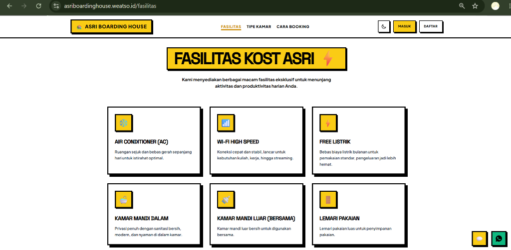
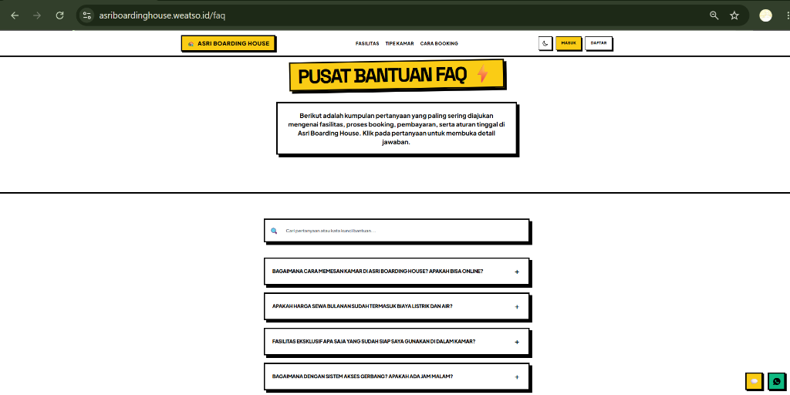
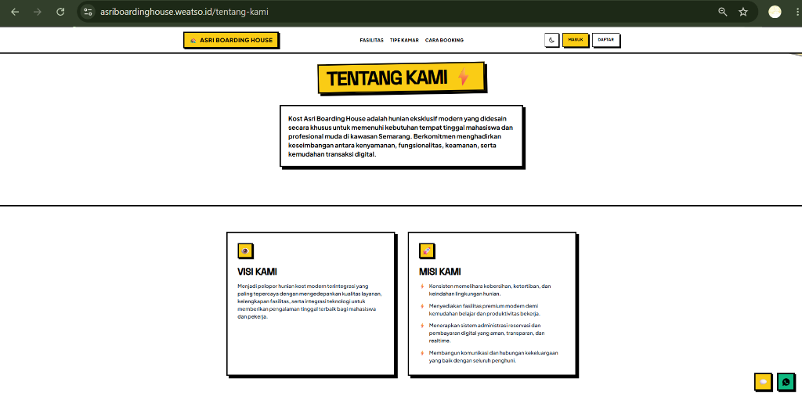
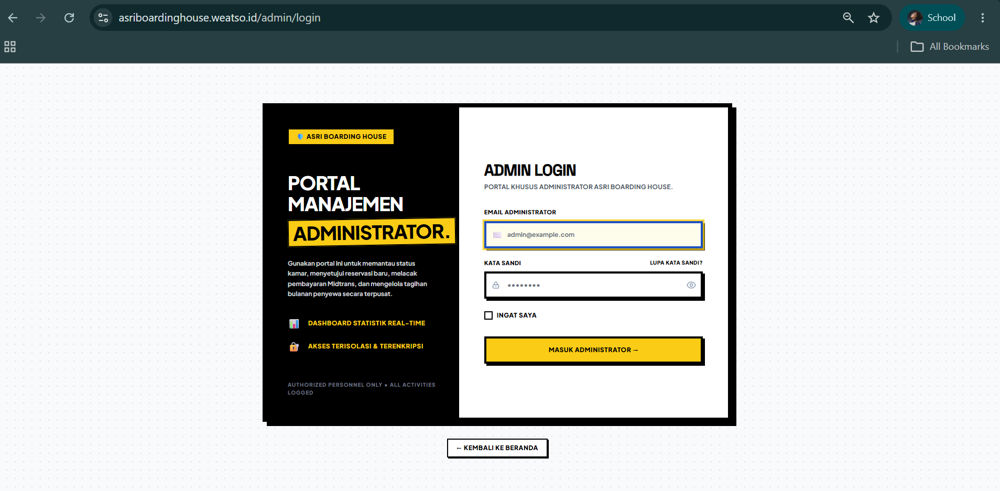
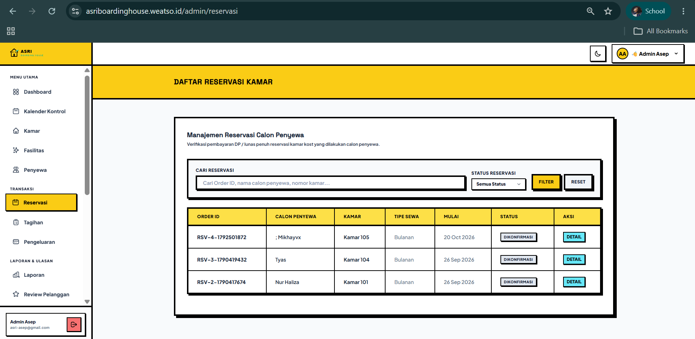
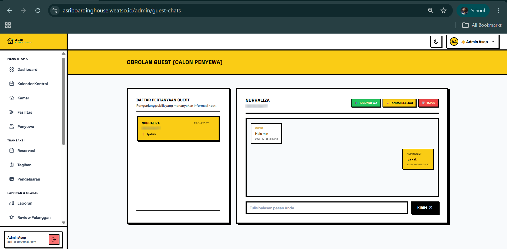
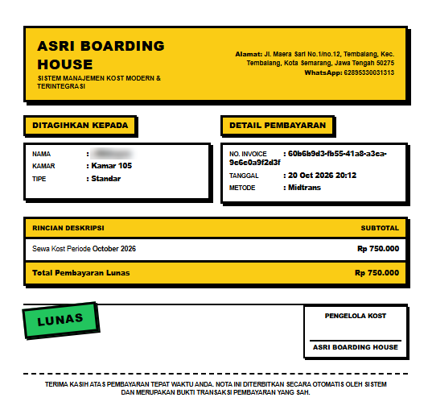
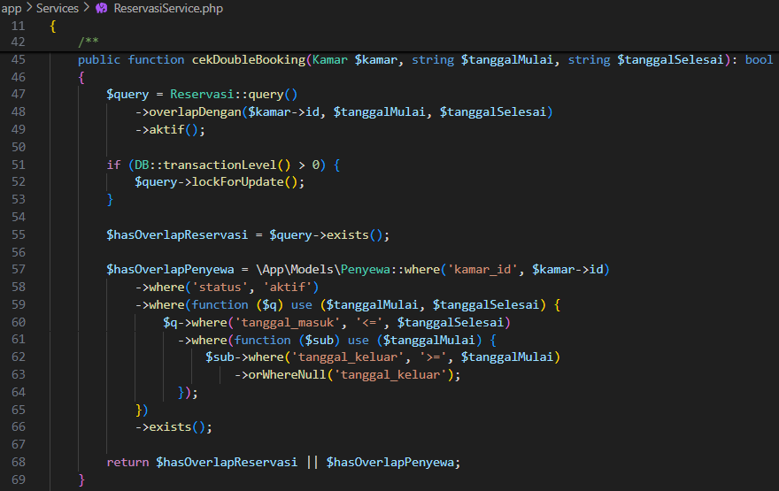
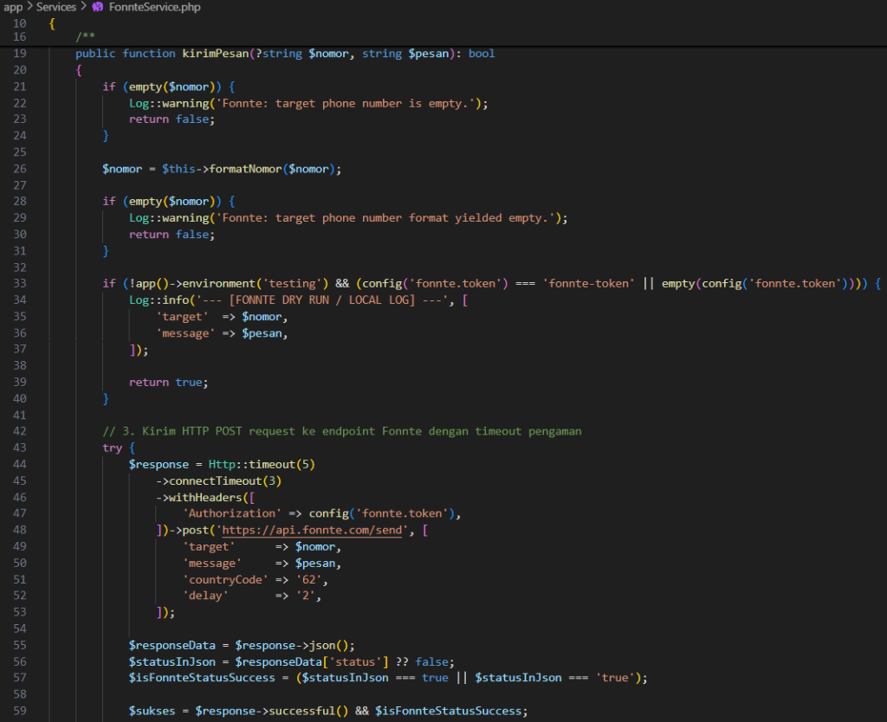
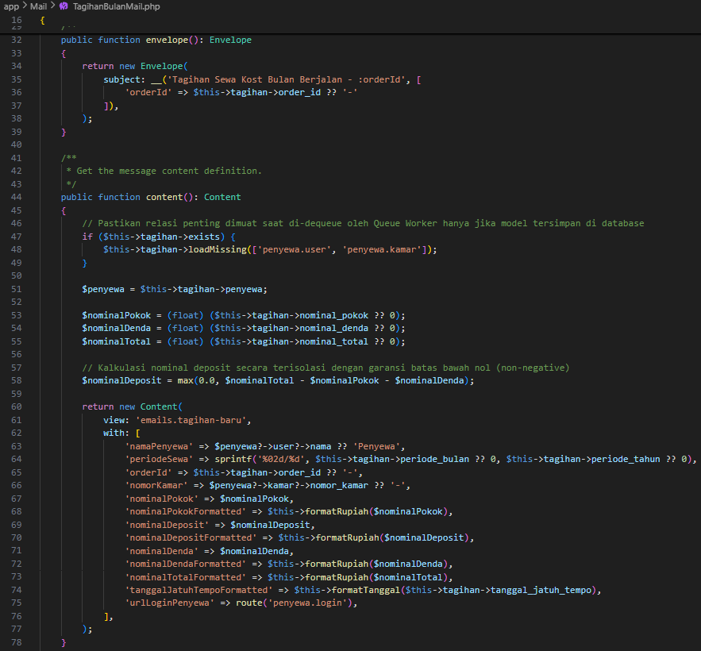

### LAPORAN SKRIPSI

 

## SISTEM INFORMASI MANAJEMEN KOST TERINTEGRASI PAYMENT GATEWAY PADA ASRI BOARDING HOUSE

  

   

**RAFIF ARSYA PRADIVA**

 

**22.N4.0014**

   

**PROGRAM STUDI SISTEM INFORMASI**  
**FAKULTAS ILMU KOMPUTER**  
**UNIVERSITAS KATOLIK SOEGIJAPRANATA**  
**SEMARANG**  
**2026**

### LAPORAN SKRIPSI

 

## SISTEM INFORMASI MANAJEMEN KOST TERINTEGRASI PAYMENT GATEWAY PADA ASRI BOARDING HOUSE

  

**Diajukan dalam Rangka Memenuhi**  
**Salah Satu Syarat Memperoleh Gelar**  
**Sarjana Komputer**

  

   

**RAFIF ARSYA PRADIVA**

 

**22.N4.0014**

   

**PROGRAM STUDI SISTEM INFORMASI**  
**FAKULTAS ILMU KOMPUTER**  
**UNIVERSITAS KATOLIK SOEGIJAPRANATA**  
**SEMARANG**  
**2026**

### HALAMAN PENGESAHAN

 

## SISTEM INFORMASI MANAJEMEN KOST TERINTEGRASI PAYMENT GATEWAY PADA ASRI BOARDING HOUSE

  

Diajukan oleh : 
**RAFIF ARSYA PRADIVA** 
**22.N4.0014**

  

Telah disetujui tanggal 10 April 2026 
Oleh

  

| Dosen Pembimbing 1, | Dosen Pembimbing 2, |
| :---: | :---: |
|      |      |
| **Ir. Andre Kurniawan Pamudji, S.Kom., M.Ling.** | **Erdhi Widyarto Nugroho, S.T., M.T.** |
| NPP. 058.1.1994.161 | NPP. .................... |

  

Mengetahui / menyetujui 
Kaprodi Sistem Informasi,

    

**Dr. Albertus Dwiyoga Widiantoro, S.Kom., M.Kom.** 
NPP. ....................

### HALAMAN PERNYATAAN KEASLIAN

 

Yang bertanda tangan di bawah ini :

 

Nama &nbsp;&nbsp;&nbsp;&nbsp;&nbsp;&nbsp;&nbsp;&nbsp;&nbsp;&nbsp;&nbsp;&nbsp;&nbsp;&nbsp;&nbsp;&nbsp;&nbsp;&nbsp;&nbsp;&nbsp;&nbsp;: Rafif Arsya Pradiva  
NIM &nbsp;&nbsp;&nbsp;&nbsp;&nbsp;&nbsp;&nbsp;&nbsp;&nbsp;&nbsp;&nbsp;&nbsp;&nbsp;&nbsp;&nbsp;&nbsp;&nbsp;&nbsp;&nbsp;&nbsp;&nbsp;&nbsp;&nbsp;: 22.N4.0014  
Progdi / Konsentrasi &nbsp;: Sistem Informasi / E-Commerce  
Fakultas &nbsp;&nbsp;&nbsp;&nbsp;&nbsp;&nbsp;&nbsp;&nbsp;&nbsp;&nbsp;&nbsp;&nbsp;&nbsp;&nbsp;&nbsp;&nbsp;&nbsp;: Ilmu Komputer

  

Dengan ini menyatakan bahwa laporan skripsi dengan judul **SISTEM INFORMASI MANAJEMEN KOST TERINTEGRASI PAYMENT GATEWAY PADA ASRI BOARDING HOUSE** benar-benar bebas dari plagiasi, dan apabila terbukti tidak benar bersedia menerima sanksi dengan ketentuan yang berlaku.

   

Semarang, 10 April 2026 
Yang menyatakan,

  

*Meterai Rp10.000* 
*(tanda tangan)*

  

**Rafif Arsya Pradiva**

### HALAMAN PERNYATAAN PERSETUJUAN PUBLIKASI

 

Sebagai sivitas akademik Universitas Katolik Soegijapranata, saya yang bertanda tangan di bawah ini:

 

Nama &nbsp;&nbsp;&nbsp;&nbsp;&nbsp;&nbsp;&nbsp;&nbsp;&nbsp;&nbsp;&nbsp;&nbsp;&nbsp;&nbsp;&nbsp;&nbsp;&nbsp;&nbsp;&nbsp;&nbsp;&nbsp;: Rafif Arsya Pradiva  
Program Studi &nbsp;&nbsp;&nbsp;&nbsp;&nbsp;&nbsp;&nbsp;&nbsp;: Sistem Informasi  
Fakultas &nbsp;&nbsp;&nbsp;&nbsp;&nbsp;&nbsp;&nbsp;&nbsp;&nbsp;&nbsp;&nbsp;&nbsp;&nbsp;&nbsp;&nbsp;&nbsp;&nbsp;: Ilmu Komputer  
Jenis Karya &nbsp;&nbsp;&nbsp;&nbsp;&nbsp;&nbsp;&nbsp;&nbsp;&nbsp;&nbsp;&nbsp;&nbsp;&nbsp;: Skripsi

  

Demi pengembangan ilmu pengetahuan, menyetujui untuk memberikan kepada Universitas Katolik Soegijapranata Hak Bebas Royalti Non-eksklusif atas karya ilmiah saya yang berjudul **SISTEM INFORMASI MANAJEMEN KOST TERINTEGRASI PAYMENT GATEWAY PADA ASRI BOARDING HOUSE**. Dengan Hak Bebas Royalti Non-eksklusif ini Universitas Katolik Soegijapranata berhak menyimpan, mengalih media/formatkan, mengelola dalam bentuk pangkalan data (database), merawat, dan memublikasikan skripsi saya selama tetap mencantumkan nama saya sebagai penulis/pencipta dan sebagai pemilik Hak Cipta.

 

Demikian pernyataan ini saya buat dengan sebenarnya.

   

Dibuat di &nbsp;&nbsp;&nbsp;&nbsp;&nbsp;&nbsp;&nbsp;&nbsp;: Semarang 
Pada tanggal &nbsp;&nbsp;: 10 April 2026  
Yang menyatakan,

   

*(tanda tangan)*

  

**Rafif Arsya Pradiva**

### KATA PENGANTAR

 

Laporan skripsi berjudul "Sistem Informasi Manajemen Kost Terintegrasi *Payment Gateway* pada Asri Boarding House" ini akhirnya rampung. Penulis mengucap syukur kepada Tuhan Yang Maha Esa atas kesehatan dan ketekunan selama merancang sistem hingga menyusun naskah akhir. Tugas akhir ini diajukan sebagai syarat memperoleh gelar Sarjana Komputer pada Program Studi Sistem Informasi, Fakultas Ilmu Komputer, Universitas Katolik Soegijapranata Semarang.

Merampungkan riset sekaligus membangun aplikasi web yang siap diuji di lapangan bukan kerja satu orang. Banyak pihak ikut menopang proses ini lewat bimbingan, data operasional, maupun dukungan moral. Atas peran tersebut, penulis menyampaikan terima kasih kepada:

1. Bapak Prof. Dr. Ridwan Sanjaya, S.E., S.Kom., MS.IEC selaku Dekan Fakultas Ilmu Komputer yang menyediakan lingkungan belajar dan fasilitas akademik selama penulis menempuh studi.
2. Bapak Dr. Albertus Dwiyoga Widiantoro, S.Kom., M.Kom., Ketua Program Studi Sistem Informasi, atas dukungan administrasi dan kelancaran penyelenggaraan tugas akhir.
3. Bapak Ir. Andre Kurniawan Pamudji, S.Kom., M.Ling. selaku Dosen Pembimbing 1 yang meluangkan waktu untuk mengarahkan alur riset, mengoreksi rancangan sistem, dan mempertajam penyusunan naskah.
4. Bapak Erdhi Widyarto Nugroho, S.T., M.T., Dosen Pembimbing 2, atas ketelitian evaluasi, masukan teknis, serta pendampingan hingga sistem siap diujikan.
5. Bapak dan Ibu dosen serta tenaga kependidikan Fakultas Ilmu Komputer, khususnya Program Studi Sistem Informasi, atas bekal keilmuan dan layanan akademik sepanjang masa kuliah penulis.
6. Pengelola, penjaga kost, dan para penghuni Asri Boarding House Tembalang yang bersedia membuka data operasional, meluangkan waktu wawancara, serta menguji coba aplikasi secara langsung.
7. Orang tua beserta keluarga di rumah atas doa, kepercayaan, dan kesabaran yang mengiringi setiap tahap perjuangan kuliah.
8. Rekan-rekan mahasiswa Universitas Katolik Soegijapranata serta berbagai pihak lain yang membantu penulis secara teknis maupun moral sampai skripsi ini selesai.

Penulis menyadari bahwa naskah dan sistem ini masih memiliki ruang penyempurnaan. Masukan dari pembaca maupun pengembang berikutnya tetap terbuka demi peningkatan kualitas aplikasi pada masa mendatang. Semoga karya ini bermanfaat langsung bagi operasional Asri Boarding House sekaligus menjadi rujukan bagi pengembangan sistem informasi sejenis.

   

Semarang, 10 April 2026

    

*(tanda tangan)*

  

**Rafif Arsya Pradiva**

### ABSTRAK

 

Pengelolaan 32 unit kamar pada Asri Boarding House di Tembalang, Semarang masih mengandalkan buku tulis dan pesan WhatsApp pribadi. Keterlambatan pembaruan stok kamar kerap memicu pemesanan ganda (*double booking*). Selain itu, pengawasan jatuh tempo setiap tanggal 10 sering terlewat, sedangkan pencocokan bukti transfer dan nota pengeluaran di akhir bulan menyita waktu tiga sampai empat hari. Penelitian ini bertujuan merancang dan membangun sistem informasi manajemen kost berbasis web yang terintegrasi *payment gateway* guna menata reservasi kamar, penagihan sewa bulanan, serta pembukuan kas.

Penelitian ini menerapkan metode *Research and Development* (R&D). Pengumpulan data dilakukan melalui wawancara, observasi, serta studi dokumentasi, sementara pengembangan perangkat lunak mengikuti tahapan model *Waterfall*. Sistem dibangun di atas kerangka kerja Laravel dan basis data MySQL dengan penguncian baris pesimis (*pessimistic row locking*) untuk mencegah benturan reservasi. Pelunasan nontunai ditangani oleh Midtrans Snap melalui verifikasi *webhook* SHA-512 yang langsung menerbitkan kuitansi PDF berformat A5. Di latar belakang, penjadwal tugas (*cron job*) otomatis menerbitkan tagihan setiap tanggal 1, menghitung denda keterlambatan *flat* 5% lintas bulan, lalu mengirimkan notifikasi melalui WhatsApp dan *email*.

Pengujian *black box* pada 60 skenario fungsional mencapai tingkat keberhasilan 100% tanpa galat validasi maupun transaksi. Dalam evaluasi lapangan, penjaga kost memberikan skor kepuasan 9,5 dari 10 karena proses tutup buku bulanan terpangkas dari tiga hingga empat hari menjadi hitungan detik tanpa selisih kas. Lima mahasiswa penghuni aktif memberikan skor rata-rata 8,0 dari 10 berkat kemudahan memesan kamar dari luar kota dan membayar lewat *Virtual Account* tanpa mengunggah bukti transfer. Hasil tersebut menunjukkan bahwa sistem mampu merapikan alur reservasi, penagihan sewa, dan pencatatan keuangan harian Asri Boarding House.

 

**Kata Kunci:** Asri Boarding House, gerbang pembayaran Midtrans, Laravel, penguncian baris pesimis, sistem informasi manajemen kost.

### ABSTRACT

 

Daily operations for the 32 rental rooms at Asri Boarding House in Tembalang, Semarang still rely on handwritten ledgers and personal WhatsApp messages. Slow availability updates frequently lead to double bookings. Monitoring rent due on the 10th of each month often slips through the cracks, while reconciling transfer receipts and expense notes at month end takes three to four days. This study aims to design and build a web-based boarding house management information system integrated with a payment gateway to streamline room reservations, monthly billing, and cash bookkeeping.

This research employs a Research and Development (R&D) approach. Data collection involves interviews, direct observation, and document analysis, whereas software construction follows the Waterfall model. Built with Laravel and MySQL, the application applies pessimistic row locking to block conflicting room bookings. Midtrans Snap processes cashless payments through SHA-512 webhook verification and automatically issues A5 PDF receipts. In the background, a cron scheduler generates monthly invoices on the 1st, calculates a 5% flat cross-month late fee, and sends payment reminders via WhatsApp and email.

Black-box testing across all 60 functional scenarios achieved a 100% pass rate without validation or transaction errors. During field evaluation, the resident caretaker gave a satisfaction score of 9.5 out of 10 as monthly closing dropped from three to four days to mere seconds with zero cash discrepancies. Five active student tenants awarded an average score of 8.0 out of 10, highlighting convenient out-of-town booking and Virtual Account settlement without manual receipt uploads. These results confirm that the system effectively organizes room reservations, rent collection, and daily financial records at Asri Boarding House.

 

**Keywords:** Asri Boarding House, boarding house management information system, Laravel, Midtrans payment gateway, pessimistic row locking.

## DAFTAR ISI

 

HALAMAN PENGESAHAN &emsp; iii  
HALAMAN PERNYATAAN KEASLIAN &emsp; iv  
HALAMAN PERNYATAAN PERSETUJUAN PUBLIKASI &emsp; v  
KATA PENGANTAR &emsp; vi  
ABSTRAK &emsp; viii  
ABSTRACT &emsp; ix  
DAFTAR ISI &emsp; x  
DAFTAR GAMBAR &emsp; xii  
DAFTAR TABEL &emsp; xiv  

 

**BAB 1 PENDAHULUAN** &emsp; **1**  
1.1 Latar Belakang &emsp; 1  
1.2 Rumusan Masalah &emsp; 2  
1.3 Tujuan Penelitian &emsp; 2  

 

**BAB 2 TINJAUAN PUSTAKA** &emsp; **4**  
2.1 Sistem Informasi Manajemen &emsp; 4  
2.2 E-Commerce B2C &emsp; 4  
2.3 Web Application &emsp; 5  
2.4 UI & UX &emsp; 5  
2.5 Laravel &emsp; 6  
2.6 RDBMS &emsp; 6  
2.7 MySQL Database &emsp; 7  
2.8 Payment Gateway &emsp; 7  
2.9 WhatsApp Gateway API &emsp; 8  
2.10 Email Gateway API &emsp; 9  
2.11 Cronjob &emsp; 9  
2.12 Metode Waterfall &emsp; 10  

 

**BAB 3 METODE PENELITIAN** &emsp; **11**  
3.1 Objek Penelitian &emsp; 11  
3.2 Jenis Penelitian &emsp; 11  
3.3 Sumber Data &emsp; 11  
3.4 Teknik Pengumpulan Data &emsp; 12  
3.5 Metode Pengembangan Sistem &emsp; 13  
3.6 Kerangka Pemikiran &emsp; 14  

 

**BAB 4 HASIL DAN PEMBAHASAN** &emsp; **17**  
4.1 Perancangan Aplikasi &emsp; 17  
&emsp; 4.1.1 Use Case Diagram &emsp; 17  
&emsp; 4.1.2 Entity Relationship Diagram (ERD) &emsp; 19  
&emsp; 4.1.3 Activity Diagram &emsp; 21  
&emsp; 4.1.4 Flowchart Sistem &emsp; 24  
4.2 Implementasi Antarmuka Sistem &emsp; 25  
&emsp; 4.2.1 Implementasi Umum &emsp; 25  
&emsp; 4.2.2 Implementasi Calon Penyewa &emsp; 36  
&emsp; 4.2.3 Implementasi Admin &emsp; 43  
&emsp; 4.2.4 Implementasi Penyewa Aktif &emsp; 54  
4.3 Implementasi Kode Program &emsp; 60  
&emsp; 4.3.1 Implementasi Autentikasi dan Hak Akses &emsp; 60  
&emsp; 4.3.2 Implementasi Pemesanan Kamar &emsp; 63  
&emsp; 4.3.3 Implementasi *Payment Gateway* &emsp; 65  
&emsp; 4.3.4 Implementasi Penjadwalan dan Notifikasi &emsp; 67  
4.4 Pengujian Sistem &emsp; 69  
4.5 Hasil Wawancara &emsp; 80  

 

**BAB 5 KESIMPULAN DAN SARAN** &emsp; **96**  
5.1 Kesimpulan &emsp; 96  
5.2 Saran &emsp; 96  

 

**DAFTAR PUSTAKA** &emsp; **98**  

## DAFTAR GAMBAR

 

Gambar 3.1 Tahapan Metode Waterfall &emsp; 13  
Gambar 3.2 Kerangka Pemikiran &emsp; 14  
Gambar 4.1 Use Case Diagram &emsp; 17  
Gambar 4.2(a) Entity Relationship Diagram (Modul Inti) &emsp; 19  
Gambar 4.2(b) Entity Relationship Diagram (Modul Pendukung) &emsp; 20  
Gambar 4.3 Activity Diagram Calon Penyewa &emsp; 21  
Gambar 4.4 Activity Diagram Admin (Penjaga Kost) &emsp; 22  
Gambar 4.5 Activity Diagram Penyewa Aktif &emsp; 23  
Gambar 4.6 Flowchart Sistem &emsp; 24  
Gambar 4.7 Halaman Beranda Utama &emsp; 26  
Gambar 4.8 Daftar Fasilitas Kost &emsp; 27  
Gambar 4.9 Katalog Tipe Kamar &emsp; 28  
Gambar 4.10 Galeri Foto Kost &emsp; 29  
Gambar 4.11 Panduan Alur Reservasi &emsp; 30  
Gambar 4.12 Halaman Testimoni Penghuni &emsp; 31  
Gambar 4.13 Halaman Pertanyaan Umum &emsp; 32  
Gambar 4.14 Halaman Tentang Kami &emsp; 32  
Gambar 4.15 Halaman Login Pengguna &emsp; 33  
Gambar 4.16 Halaman Pendaftaran Akun &emsp; 34  
Gambar 4.17 Chat Real Time Guest &emsp; 35  
Gambar 4.18 Kelengkapan Profil Pemesan &emsp; 36  
Gambar 4.19 Dasbor Reservasi Pemesan &emsp; 37  
Gambar 4.20 Simulasi Biaya Kamar &emsp; 38  
Gambar 4.21 Tahapan Pembayaran Reservasi &emsp; 39  
Gambar 4.22 Jendela Pembayaran Midtrans &emsp; 40  
Gambar 4.23 Pesan Aktivasi WhatsApp &emsp; 41  
Gambar 4.24 Email Konfirmasi Reservasi &emsp; 42  
Gambar 4.25 Halaman Login Administrator &emsp; 43  
Gambar 4.26 Dasbor Operasional Administrator &emsp; 44  
Gambar 4.27 Pengelolaan Data Kamar &emsp; 45  
Gambar 4.28 Pengelolaan Fasilitas Kost &emsp; 46  
Gambar 4.29 Pengelolaan Data Penghuni &emsp; 47  
Gambar 4.30 Pengelolaan Reservasi Masuk &emsp; 48  
Gambar 4.31 Pengelolaan Tagihan Bulanan &emsp; 49  
Gambar 4.32 Pencatatan Pengeluaran Operasional &emsp; 50  
Gambar 4.33 Laporan Rekapitulasi Kas &emsp; 51  
Gambar 4.34 Pengelolaan Keluhan Fasilitas &emsp; 52  
Gambar 4.35 Pengelolaan Obrolan Tamu &emsp; 53  
Gambar 4.36 Login Penyewa Aktif &emsp; 54  
Gambar 4.37 Dasbor Penyewa Aktif &emsp; 55  
Gambar 4.38 Tagihan Sewa Penyewa &emsp; 56  
Gambar 4.39 Pengaturan Profil Penghuni &emsp; 57  
Gambar 4.40 Riwayat Transaksi Pembayaran &emsp; 58  
Gambar 4.41 Pengajuan Keluhan Kamar &emsp; 59  
Gambar 4.42 Dokumen Kuitansi Digital &emsp; 60  
Gambar 4.43 Kode Pembatasan Akses &emsp; 61  
Gambar 4.44 Kode Pengalihan Portal &emsp; 62  
Gambar 4.45 Kode Penguncian Kamar &emsp; 63  
Gambar 4.46 Kode Pemeriksaan Jadwal &emsp; 64  
Gambar 4.47 Kode Token Midtrans &emsp; 65  
Gambar 4.48 Kode Validasi Webhook &emsp; 66  
Gambar 4.49 Kode Penjadwal Tugas &emsp; 67  
Gambar 4.50 Kode Integrasi WhatsApp &emsp; 68  
Gambar 4.51 Kode Pengiriman Email &emsp; 69  
Gambar 4.52 Dokumentasi Wawancara Bapak Asep &emsp; 81  

## DAFTAR TABEL

 

Tabel 4.1 Hasil Pengujian Fungsionalitas Sistem (Black Box Testing) &emsp; 70  
Tabel 4.2 Hasil Wawancara Penjaga Kost (Bapak Asep) &emsp; 81  
Tabel 4.3 Wawancara dengan Arjun &emsp; 85  
Tabel 4.4 Wawancara dengan Farrel &emsp; 87  
Tabel 4.5 Wawancara dengan Iman &emsp; 89  
Tabel 4.6 Wawancara dengan Ammar &emsp; 91  
Tabel 4.7 Wawancara dengan Sindhu &emsp; 93  

## BAB 1 PENDAHULUAN

 

## 1.1 Latar Belakang
Kawasan pendidikan Tembalang di Kota Semarang selalu dipadati mahasiswa perantau setiap tahun ajaran baru. Calon penghuni dari luar kota tentu memerlukan kepastian kamar kosong secara cepat, tetapi pemasaran dari mulut ke mulut maupun papan pengumuman masih mengharuskan mereka survei langsung ke lokasi. Pemanfaatan sistem reservasi berbasis web dapat memangkas hambatan jarak tersebut sekaligus merapikan pendataan penyewa sejak awal [1].

Persoalan serupa dialami Asri Boarding House dalam mengelola 32 unit kamar bertipe VIP, Deluxe, dan Standar. Selama ini, penjaga kost mencatat ketersediaan kamar pada buku tulis sembari melayani pertanyaan calon penyewa satu per satu melalui WhatsApp pribadi. Perubahan status hunian akibatnya sering terlambat tercatat. Ketika dua calon penghuni memesan unit yang sama pada waktu berdekatan, risiko pemesanan ganda (*double booking*) sulit dihindari [2]. Kondisi ini menuntut adanya penguncian transaksi pada basis data agar satu kamar tidak dapat diklaim oleh dua pemesan sekaligus.

Kendala pencatatan tersebut turut menghambat penagihan sewa bulanan. Pengelola masih harus memeriksa daftar jatuh tempo setiap tanggal 10, menghitung denda keterlambatan sebesar 5% saat tagihan melewati pergantian bulan, lalu mengirimkan pesan pengingat secara terpisah kepada penyewa. Tanpa penjadwal otomatis yang mengawasi siklus tagihan di latar belakang, pengiriman pengingat kerap terlewat hingga memicu penumpukan tunggakan [3].

Alur kerja yang belum terintegrasi juga memperberat proses pembukuan kas. Setiap akhir bulan, penjaga kost menghabiskan waktu tiga sampai empat hari hanya untuk mencocokkan setoran tunai, tangkapan layar bukti transfer penghuni, serta tumpukan nota pengeluaran operasional. Celah salah hitung dan selisih uang kas menjadi sangat rawan terjadi. Padahal, integrasi gerbang pembayaran digital (*payment gateway*) mampu mengonfirmasi pelunasan nontunai secara otomatis [4], sementara dukungan notifikasi via *WhatsApp gateway* dan surat elektronik (*email*) menjaga penyampaian tagihan maupun bukti bayar tetap tepat waktu [5].

Berangkat dari ketiga permasalahan tersebut, Asri Boarding House memerlukan aplikasi manajemen berbasis web yang menyatukan pengelolaan kamar, otomatisasi tagihan, dan rekonsiliasi keuangan dalam satu sistem terpusat. Aplikasi ini dibangun menggunakan kerangka kerja Laravel dan basis data MySQL dengan dukungan penguncian baris pesimis (*pessimistic row locking*), gerbang pembayaran Midtrans Snap, serta penjadwal tugas (*cron job*) yang terhubung ke layanan WhatsApp dan *email*. Melalui pengembangan sistem tersebut, operasional harian indekos diharapkan berjalan lebih efisien, transparan, dan bebas dari selisih pembukuan.

 

## 1.2 Rumusan Masalah
Berdasarkan permasalahan operasional yang telah diuraikan, penelitian ini merumuskan tiga pertanyaan utama:
1. Bagaimana merancang arsitektur Sistem Informasi Manajemen Kost Terintegrasi *Payment Gateway* pada Asri Boarding House guna mengatasi kendala reservasi 32 unit kamar, penagihan sewa bulanan, dan pembukuan kas?
2. Bagaimana membangun aplikasi web tersebut menggunakan kerangka kerja Laravel dan basis data MySQL yang memadukan penguncian transaksi reservasi, pembayaran otomatis Midtrans Snap, penjadwalan tagihan berkala (*cron job*), serta notifikasi WhatsApp dan *email*?
3. Bagaimana kelayakan fungsional dan efektivitas penerapan sistem dalam mendukung operasional harian Asri Boarding House berdasarkan pengujian *black box* serta evaluasi wawancara bersama penjaga dan penghuni kost?

 

## 1.3 Tujuan Penelitian
Sejalan dengan rumusan masalah tersebut, penelitian ini bertujuan untuk:
1. Menghasilkan rancangan arsitektur sistem informasi manajemen kost yang memetakan pembagian hak akses pengguna, struktur basis data relasional, serta alur kerja terpadu dari pemesanan kamar hingga pelaporan kas pada Asri Boarding House.
2. Mengimplementasikan aplikasi web berbasis Laravel dan MySQL yang mengintegrasikan penguncian baris pesimis untuk mencegah pesanan ganda, verifikasi pembayaran nontunai melalui Midtrans Snap, penerbitan tagihan dan denda otomatis via *cron job*, serta pengiriman pengingat melalui WhatsApp dan *email*.
3. Menguji keandalan seluruh modul aplikasi melalui *black box testing* sekaligus mengevaluasi dampaknya terhadap ketepatan siklus penagihan, efisiensi tutup buku bulanan, dan kenyamanan transaksi bagi penjaga maupun penghuni kost.

 

## BAB 2 TINJAUAN PUSTAKA

 

## 2.1 Sistem Informasi Manajemen
Sistem Informasi Manajemen (SIM) mengintegrasikan perangkat keras, perangkat lunak, prosedur kerja, dan pengguna untuk mengolah data transaksi harian menjadi informasi operasional yang terukur. Penyatuan arus data ke dalam satu basis penyimpanan menghilangkan kebiasaan mencatat di banyak dokumen terpisah. Melalui pusat data tersebut, pengelola dapat memantau kegiatan rutin, menilai kinerja layanan, dan mengambil keputusan manajerial secara tepat waktu [6].

Dalam operasional rumah kost, SIM menyatukan pengelolaan ketersediaan kamar, identitas penghuni, riwayat tagihan sewa, serta arus kas ke dalam satu pangkalan data terpusat. Setiap perubahan status hunian langsung tercatat di sistem sehingga risiko salah tulis pada buku besar maupun benturan pemesanan ganda (*double booking*) dapat dihindari. Selain memudahkan pengawasan masa sewa aktif tiap kamar, pencatatan terpadu ini memastikan seluruh penerimaan sewa dan belanja operasional terekap menjadi laporan keuangan yang rapi serta mudah diaudit [7].

 

## 2.2 E-Commerce B2C
Perdagangan elektronik berpola *Business-to-Consumer* (B2C) mempertemukan pelaku usaha langsung dengan konsumen akhir melalui jaringan internet. Tanpa perlu melewati perantara konvensional, calon pelanggan dapat menelusuri katalog layanan, membandingkan rincian harga, dan menyelesaikan transaksi secara mandiri kapan saja tanpa terbatas jam operasional pengelola [8].

Pada layanan hunian sewa, penerapan kanal B2C yang terhubung langsung dengan sistem manajemen properti internal membantu pemilik kost memasarkan kamar secara mandiri tanpa potongan komisi pihak ketiga. Pengelola bebas mengatur penyesuaian tarif maupun potongan harga untuk durasi sewa tertentu sesuai kondisi pasar. Di sisi pelanggan, calon penyewa dari luar kota dapat memeriksa sisa unit yang benar-benar kosong dan mengamankan kamar pilihan dari jarak jauh [9].

 

## 2.3 Web Application
Aplikasi web berjalan di atas arsitektur *client-server* yang mempertukarkan data melalui protokol HTTP atau HTTPS. Pengguna cukup mengakses layanan menggunakan peramban (*browser*) pada komputer maupun ponsel pintar untuk berinteraksi dengan antarmuka halaman, sementara *web server* di pusat data memproses logika bisnis dan kueri basis data. Mekanisme ini membebaskan pengguna dari keharusan mengunduh serta memasang perangkat lunak tambahan di perangkat masing-masing [10].

Dari sisi pengelolaan teknis, pemeliharaan aplikasi web jauh lebih praktis karena pembaruan kode maupun perbaikan celah sistem cukup diterapkan satu kali di *server* pusat. Begitu halaman dimuat ulang, baik pengelola maupun penghuni langsung menggunakan versi sistem paling mutakhir. Pemisahan antara lapisan penampil halaman, pengolah logika bisnis, dan penyimpanan data juga menjaga kinerja aplikasi tetap stabil saat modul fungsional baru ditambahkan [11].

 

## 2.4 UI & UX
Antarmuka pengguna (*User Interface* atau UI) merupakan ruang interaksi visual yang menjembatani pengguna dengan fungsi perangkat lunak. Penyusunan UI yang bertumpu pada *design system* menyeragamkan bentuk tombol, hierarki tipografi, serta palet warna agar pengguna langsung mengenali fungsi setiap komponen di layar [12]. Prinsip keterbacaan tersebut diterapkan melalui gaya visual *Neo-Brutalism* yang memadukan garis tepi hitam tegas, bayangan padat tanpa gradasi, dan bidang warna berkontras tinggi guna memperjelas batas antarelemen transaksi.

Keberhasilan tampilan visual tersebut diukur melalui pengalaman pengguna (*User Experience* atau UX) selama menyelesaikan tugas di dalam sistem. Struktur navigasi yang runtut menuntun calon penyewa menyelesaikan pengajuan kamar langkah demi langkah tanpa kebingungan [13]. Pada halaman kerja pengelola maupun portal penghuni aktif, pengelompokan kartu ringkasan metrik dan status pembayaran secara bertingkat ikut memangkas waktu pencarian informasi harian.

 

## 2.5 Laravel
Laravel adalah kerangka kerja pengembangan web berbasis PHP yang mengusung pola arsitektur *Model-View-Controller* (MVC) untuk memisahkan pengelolaan struktur data, penyajian antarmuka, dan pengendalian alur permintaan pengguna. Kerangka kerja ini menyediakan *Eloquent Object-Relational Mapping* (ORM) yang mempermudah pemodelan relasi tabel basis data serta mesin templat *Blade* untuk menyusun komponen halaman secara modular [14]. Dari sisi keamanan dasar, Laravel telah dilengkapi perlindungan bawaan terhadap celah *Cross-Site Request Forgery* (CSRF) serta pengikatan parameter kueri (*parameter binding*) guna menangkal injeksi SQL.

Seiring bertambahnya aturan operasional pada aplikasi berskala menengah, penempatan seluruh logika transaksi di dalam *controller* dapat membuat kode program sulit dipelihara [15]. Untuk menjaga kerapian arsitektur, pengolahan logika bisnis yang rumit seperti validasi ketersediaan kamar, kalkulasi denda keterlambatan, dan komunikasi API eksternal dipisahkan ke dalam lapisan layanan khusus (*Service Layer*). Sementara itu, penyaringan hak akses antarpengguna ditangani oleh komponen *middleware* di tingkat rute, sehingga setiap modul tetap terisolasi dan mudah diuji.

 

## 2.6 RDBMS
Sistem Manajemen Basis Data Relasional (*Relational Database Management System* atau RDBMS) mengorganisasikan data ke dalam tabel-tabel dua dimensi yang saling berelasi melalui kunci utama (*primary key*) dan kunci asing (*foreign key*). Keterhubungan antartabel ini menjaga integritas referensial data sekaligus menerapkan prinsip transaksi ACID (*Atomicity, Consistency, Isolation, Durability*), sehingga serangkaian operasi basis data dijamin selesai secara utuh atau dibatalkan seluruhnya apabila terjadi kegagalan di tengah proses [16].

Untuk mencegah duplikasi data serta menghindari anomali saat proses penambahan, pengubahan, maupun penghapusan baris, struktur tabel relasional dirancang memenuhi kaidah normalisasi hingga Bentuk Normal Ketiga (3NF) dengan menghilangkan ketergantungan transitif [17]. Dalam kasus pengelolaan sewa kamar berkala, struktur 3NF tersebut tetap dikombinasikan dengan penyimpanan nilai tarif kontrak (*snapshot* harga) pada tabel transaksi. Langkah ini memastikan perubahan harga dasar kamar di masa mendatang tidak ikut mengubah catatan tagihan historis milik penghuni yang sedang aktif menyewa.

 

## 2.7 MySQL Database
MySQL merupakan perangkat lunak RDBMS sumber terbuka berbasis *Structured Query Language* (SQL) yang bekerja dengan arsitektur *client-server multithread* untuk melayani pembacaan dan penulisan data secara bersamaan. Kebutuhan sumber daya komputasinya yang ringan serta dukungannya yang matang di dalam ekosistem PHP dan Laravel menjadikan MySQL andal dalam menangani operasi CRUD (*Create, Read, Update, Delete*) pada aplikasi transaksi berbasis web [18].

Pada tingkat penyimpanan tabel, mesin *storage engine* InnoDB di dalam MySQL mendukung penuh transaksi berbasis ACID serta mekanisme penguncian baris pesimis (*pessimistic row-level locking*). Ketika dua calon penyewa mengajukan pemesanan untuk unit kamar yang sama pada waktu berdekatan, perintah penguncian baris akan menahan transaksi kedua hingga transaksi pertama selesai memvalidasi dan menyimpan status kamar. Selain penguncian konkurensi, penempatan indeks pencarian (*indexing*) pada kolom kunci dan tanggal sewa turut menjaga kecepatan eksekusi kueri seiring bertambahnya riwayat transaksi [19].

 

## 2.8 Payment Gateway
Gerbang pembayaran (*payment gateway*) merupakan layanan perantara finansial yang menghubungkan aplikasi web dengan infrastruktur perbankan dan penerbit uang elektronik secara aman. Melalui penyedia layanan seperti Midtrans, satu integrasi sistem dapat langsung menerima pembayaran melalui *Virtual Account* lintas bank, kode QRIS, dompet digital, maupun kartu kredit. Kemudahan ini membebaskan pengelola kost dari keharusan menyediakan rekening di banyak bank sekaligus menghilangkan proses unggah dan periksa bukti transfer secara manual [20].

Dalam siklus pengembangannya, Midtrans memisahkan lingkungan pengujian (*Sandbox*) dari lingkungan transaksi nyata (*Production*). Pengembang dapat menyimulasikan berbagai skenario pembayaran berhasil, tertunda, maupun kedaluwarsa di lingkungan *Sandbox* tanpa melibatkan perpindahan dana asli, lalu beralih ke *Production* cukup dengan mengganti kredensial kunci akses pada konfigurasi *server*.

Secara teknis, alur transaksi dimulai saat *server* aplikasi mengirimkan rincian tagihan melalui API terautentikasi untuk mendapatkan *Snap token* yang menampilkan jendela pembayaran di layar pengguna [21]. Begitu pengguna melunasi tagihan, *server* Midtrans mengirimkan notifikasi balik secara asinkron melalui *webhook callback*. Aplikasi terlebih dahulu memvalidasi keaslian *signature key* berenkripsi SHA-512 secara *constant-time* dan memeriksa sifat idempoten transaksi berdasarkan identitas pembayaran, barulah memperbarui status tagihan menjadi lunas di basis data agar terhindar dari pencatatan ganda.

 

## 2.9 WhatsApp Gateway API
Antarmuka pemrograman aplikasi (API) pada layanan *WhatsApp gateway* memungkinkan *server* aplikasi web mengirimkan pesan teks otomatis ke nomor ponsel pengguna tanpa memerlukan intervensi manual dari perangkat pengelola. Saluran komunikasi pesan instan ini menjadi pilihan utama untuk pengiriman pengingat operasional karena tingkat keterbacaan pesannya (*open rate*) jauh lebih tinggi dibandingkan surat elektronik maupun SMS biasa [22].

Penyedia layanan *gateway* seperti Fonnte menjembatani pengiriman pesan terprogram melalui permintaan *HTTP POST* yang diamankan menggunakan token otorisasi pada *header* permintaan [23]. Sebelum paket data dikirimkan ke *endpoint* API, nomor telepon tujuan dinormalisasi terlebih dahulu ke format kode negara internasional (`62`) dan dibatasi waktu tunggu koneksinya (*timeout*), sehingga pesan pengingat jatuh tempo maupun konfirmasi aktivasi kamar dapat terkirim secara akurat tanpa menghambat proses utama di *server*.

 

## 2.10 Email Gateway API
Pengiriman surat elektronik terprogram dari aplikasi web bekerja di atas protokol *Simple Mail Transfer Protocol* (SMTP) yang diamankan dengan lapisan enkripsi TLS (*Transport Layer Security*). Dalam sistem informasi berbasis transaksi, saluran *email* berperan sebagai media pengiriman dokumen administrasi resmi yang membutuhkan format tata letak terstruktur dan mudah diarsipkan kembali oleh pengguna [24].

Agar pesan berisi rincian tagihan, kuitansi digital, maupun tautan pemulihan kata sandi tidak tertahan oleh penyaring *spam*, aplikasi web memanfaatkan layanan *mail relay* terautentikasi dengan reputasi domain pengirim yang terjaga [25]. Proses pengiriman surat elektronik tersebut ditempatkan ke dalam antrean pekerjaan asinkron (*asynchronous job queue*) di latar belakang, sehingga pengguna tidak perlu menunggu proses jabat tangan jaringan SMTP selesai saat menekan tombol transaksi di peramban.

 

## 2.11 Cronjob
*Cron job* adalah utilitas penjadwal tugas berbasis waktu pada sistem operasi keluarga Unix yang mengeksekusi perintah atau skrip program secara otomatis di latar belakang sesuai parameter menit, jam, tanggal, atau bulan yang ditentukan. Keberadaan penjadwal sistem ini memungkinkan pekerjaan administratif yang berulang dijalankan secara konsisten tanpa bergantung pada ketelitian operator manusia [26].

Pada aplikasi pengelolaan kost berbasis Laravel, satu entri *daemon cron* di tingkat *server* cukup digunakan untuk memicu *task scheduler* internal yang mengatur berbagai jadwal operasional, mulai dari pembatalan reservasi kedaluwarsa setiap jam, penerbitan tagihan sewa tiap tanggal 1, hingga pemeriksaan keterlambatan pembayaran setelah tanggal 10 yang terhubung ke layanan notifikasi WhatsApp dan *email* [27]. Agar eksekusi otomatis tersebut berjalan aman, setiap perintah terjadwal dilengkapi mekanisme pencegah tumpang-tindih (*overlap prevention*) serta pemeriksaan idempoten di basis data, sehingga satu periode sewa dipastikan hanya menerbitkan satu tagihan dan satu kalkulasi denda meskipun skrip dijalankan ulang.

 

## 2.12 Metode Waterfall
Metode *Waterfall* adalah model pengembangan perangkat lunak klasik yang menyusun tahapan rekayasa sistem secara sekuensial dan linier, dimulai dari analisis kebutuhan, perancangan sistem dan perangkat lunak, implementasi pengkodean, integrasi dan pengujian, verifikasi kelayakan, hingga pengoperasian serta pemeliharaan [28]. Setiap fase kerja wajib diselesaikan dan didokumentasikan secara tuntas sebelum tim pengembang beralih ke tahapan berikutnya, disertai jalur umpan balik (*feedback loop*) apabila ditemukan koreksi spesifikasi pada saat pengujian.

Pendekatan berurutan ini sangat tepat diterapkan pada pembangunan sistem informasi yang memiliki prosedur operasional dan aturan bisnis yang sudah pasti sejak awal penelitian. Karena skema tarif kamar, ketentuan jatuh tempo bulanan, persentase denda keterlambatan, serta alur pembukuan kas telah terdefinisi dengan jelas dari hasil observasi lapangan, tahapan perancangan basis data hingga pengkodean modul dapat dikerjakan secara terukur tanpa risiko perubahan fitur mendadak di tengah proses pengembangan.

 

## BAB 3 METODE PENELITIAN

 

## 3.1 Objek Penelitian
Penelitian ini dilaksanakan pada Asri Boarding House yang berlokasi di Jalan Maera Sari Nomor 1, kawasan pendidikan Tembalang, Kota Semarang. Hunian sewa dua lantai ini mengelola 32 unit kamar yang terbagi rata di lantai satu dan lantai dua, terdiri atas 6 unit bertipe VIP, 3 unit Deluxe, serta 23 unit Standar bagi kalangan mahasiswa maupun pekerja.

Fokus kajian diarahkan pada tiga aktivitas operasional harian, yaitu penerimaan reservasi kamar, penagihan sewa bulanan, dan pembukuan arus kas. Sebelum adanya sistem terkomputasi, ketersediaan kamar dicatat pada buku tulis manual sembari melayani pertanyaan calon penghuni satu per satu melalui WhatsApp pribadi, sehingga jeda pembaruan status kerap memicu pemesanan ganda (*double booking*). Pada siklus penagihan bulanan, pengawasan jatuh tempo setiap tanggal 10 beserta perhitungan denda keterlambatan *flat* 5% lintas bulan masih diperiksa secara manual dan rawan terlewat. Selain itu, proses tutup buku di akhir bulan menyita waktu tiga hingga empat hari kerja karena pengelola harus mencocokkan uang tunai, tangkapan layar bukti transfer, serta tumpukan nota pengeluaran fisik.

 

## 3.2 Jenis Penelitian
Penelitian ini menerapkan metode Penelitian dan Pengembangan atau *Research and Development* (R&D) dalam ranah rekayasa perangkat lunak [29]. Pendekatan R&D dipilih karena tujuan utama penelitian bukan menguji hipotesis teoretis semata, melainkan merancang, membangun, dan menguji produk perangkat lunak fungsional guna menyelesaikan permasalahan nyata di lapangan. Produk yang dihasilkan berupa aplikasi manajemen kost berbasis web yang terintegrasi dengan gerbang pembayaran digital dan penjadwal tugas otomatis.

Pelaksanaan R&D tersebut dipadukan dengan pendekatan studi kasus kualitatif-deskriptif pada objek tunggal di Asri Boarding House. Pada tahap awal, analisis deskriptif digunakan untuk memetakan alur kerja konvensional, mulai dari pencatatan kamar di buku besar, ketentuan jatuh tempo tanggal 10, hingga prosedur rekapitulasi kas bulanan. Setelah aplikasi selesai dibangun, kelayakan produk diverifikasi melalui pengujian fungsional *black box* serta uji coba pemakaian langsung bersama pengelola dan penghuni kost untuk memastikan kesiapan sistem menggantikan pencatatan manual.

 

## 3.3 Sumber Data
Penyusunan spesifikasi kebutuhan, perancangan skema basis data, hingga evaluasi kelayakan sistem dalam penelitian ini bertumpu pada dua kategori sumber data, yakni data primer dan data sekunder.

1. Data Primer  
Data primer diperoleh secara langsung dari lokasi penelitian di Asri Boarding House melalui wawancara tatap muka, pengamatan operasional harian, serta uji coba pemakaian aplikasi bersama dua kelompok narasumber:
* **Penjaga kost**, yaitu satu orang pengelola harian berpengalaman sekitar 20 tahun yang menangani langsung penerimaan penghuni baru, pengaturan tarif 32 unit kamar, penerapan aturan denda keterlambatan, pemeriksaan kondisi kamar pasca-*checkout*, hingga pembukuan kas bulanan.
* **Penghuni kost aktif**, yang diwakili oleh lima mahasiswa penyewa dari berbagai perguruan tinggi untuk menggali pengalaman nyata terkait pencarian kamar dari luar kota, pembayaran sewa bulanan, pengarsipan bukti bayar, serta pelaporan kerusakan fasilitas.

2. Data Sekunder  
Data sekunder dihimpun dari arsip administrasi internal dan literatur teknis pendukung guna melengkapi landasan perancangan sistem, yang meliputi:
* **Arsip operasional indekos**, mencakup buku besar catatan sewa, kumpulan bukti transfer penghuni, bundel nota pengeluaran rutin, lembaran tata tertib kost, serta daftar tarif dasar beserta skema potongan harga untuk durasi sewa tiga bulanan dan tahunan pada 32 unit kamar.
* **Dokumentasi teknis resmi**, meliputi panduan pengembang kerangka kerja Laravel 12, mesin penyimpanan MySQL InnoDB, spesifikasi API Midtrans Snap, dokumentasi *endpoint* *WhatsApp gateway* Fonnte, serta konfigurasi protokol surat elektronik SMTP.
* **Kepustakaan ilmiah**, berupa artikel jurnal terindeks dan buku metodologi penelitian yang membahas rancang bangun sistem informasi manajemen kost, pengendalian konkurensi basis data, serta integrasi gerbang pembayaran nontunai.

 

## 3.4 Teknik Pengumpulan Data
Pengumpulan data dalam penelitian ini menggunakan pendekatan kualitatif yang menempatkan wawancara mendalam sebagai instrumen utama [30], didampingi oleh observasi langsung di lapangan dan studi dokumentasi. Triangulasi dari ketiga teknik tersebut memastikan setiap spesifikasi kebutuhan maupun hasil evaluasi akhir terverifikasi secara akurat.

1. Wawancara Mendalam dan Uji Coba Pengguna  
Sesi wawancara dilaksanakan secara tatap muka dan semiterstruktur menggunakan perekam suara digital, kemudian disalin ke dalam transkrip tertulis agar seluruh keterangan narasumber terdokumentasi secara utuh. Penggalian informasi ini berlangsung dalam dua gelombang, yakni pada tahap analisis kebutuhan sebelum sistem dibangun dan pada tahap evaluasi penerimaan pengguna (*side-by-side usability testing*) setelah aplikasi rampung:
* **Bersama penjaga kost**: Wawancara tahap awal menggali aturan bisnis di lapangan, meliputi struktur tarif kamar, batas jatuh tempo tanggal 10, kebijakan bebas denda pada bulan berjalan, pengenaan denda *flat* 5% satu kali saat tagihan menyeberang bulan, alur pendaftaran penyewa datang langsung (*walk-in*), serta kewajiban karantina fisik kamar pasca-*checkout*. Pada tahap evaluasi akhir, penjaga kost menguji langsung panel administrator untuk menilai keterbacaan antarmuka *OLED Dark Mode*, kemudahan memantau 32 kamar, kepraktisan konfirmasi tunai maupun otomatis, serta kecepatan pembuatan laporan kas bulanan sebelum memberikan skor kepuasan pada skala 1 sampai 10.
* **Bersama lima mahasiswa penghuni kost aktif**: Wawancara awal memetakan kendala survei kamar dari luar kota, jeda verifikasi bukti transfer via WhatsApp, serta kerawanan hilangnya kuitansi kertas. Pada sesi evaluasi akhir, kelima penghuni mencoba langsung penelusuran katalog bergaya *Neo-Brutalism*, pengisian reservasi lima tahap, pelunasan tagihan via *Virtual Account* Bank BCA pada Midtrans Snap tanpa unggah resi, pengunduhan kuitansi PDF berformat A5, pengajuan tiket keluhan berfoto, hingga penerimaan pengingat WhatsApp, lalu menutup sesi dengan pemberian skor kepuasan pada skala 1 sampai 10 beserta saran pengembangan.

2. Observasi Langsung  
Pengamatan dilakukan secara langsung di lingkungan operasional dan ruang pengelola Asri Boarding House guna mengamati alur kerja harian apa adanya. Fokus pengamatan mencakup cara penjaga kost melayani pertanyaan ketersediaan kamar melalui ponsel sambil memeriksa buku besar, proses pengecekan fisik KTP saat penghuni baru tiba, prosedur pembersihan dan pemeriksaan fasilitas kamar selepas penyewa lama *checkout*, hingga kebiasaan pengumpulan nota belanja operasional seperti token listrik, air PDAM, dan perbaikan sarana.

3. Studi Dokumentasi  
Teknik ini dilakukan dengan menelaah struktur pencatatan pada buku besar sewa, format kuitansi kertas, serta rekapitulasi nota pengeluaran bulanan untuk dirumuskan menjadi atribut tabel pada basis data relasional dan tata letak dokumen kuitansi digital A5. Di samping dokumen fisik indekos, penelaahan juga mencakup pembacaan spesifikasi teknis atas *payload* permintaan dan balasan (*webhook callback*) pada dokumentasi API Midtrans Snap, Fonnte, serta penjadwal tugas Laravel 12 agar integrasi antarmuka pemrograman berjalan sesuai standar keamanan.

 

## 3.5 Metode Pengembangan Sistem
Pembangunan perangkat lunak dalam penelitian ini mengadopsi model siklus hidup pengembangan sistem *Waterfall* yang berjalan secara sekuensial [28]. Setiap fase rekayasa harus diselesaikan dan diverifikasi keluarannya terlebih dahulu sebelum beralih ke tahapan berikutnya. Pendekatan terstruktur ini dipilih karena seluruh prosedur operasional pada Asri Boarding House telah terdefinisi secara pasti sejak awal penelitian. Ketetapan mengenai kapasitas 32 unit kamar, skema uang muka 30% atau pelunasan penuh 100%, batas jatuh tempo setiap tanggal 10, perhitungan denda *flat* 5% lintas bulan, hingga prosedur karantina kamar pasca-*checkout* merupakan aturan baku yang tidak berubah-ubah, sehingga perancangan basis data dan pengkodean modul dapat dikerjakan secara terukur tanpa risiko perombakan fitur di tengah jalan.

*Gambar 3.1 Tahapan Metode Waterfall*

 

Sebagaimana ditunjukkan pada Gambar 3.1, alur rekayasa perangkat lunak dilaksanakan melalui enam tahapan berurutan yang dilengkapi jalur umpan balik (*feedback loop*):
1. ***Requirement gathering and analysis***: Tahap awal ini menghimpun dan memetakan spesifikasi kebutuhan fungsional maupun nonfungsional berdasarkan hasil wawancara penjaga serta penghuni kost, observasi alur kerja harian, dan penelaahan buku besar manual. Keluarannya berupa rumusan aturan bisnis dan pembagian hak akses untuk tiga aktor pengguna, yaitu calon penyewa, admin (penjaga kost), dan penyewa aktif.
2. ***Design***: Spesifikasi kebutuhan yang telah terkunci diterjemahkan menjadi cetak biru arsitektur sistem. Perancangan mencakup pemodelan *use case diagram*, penyusunan *Entity Relationship Diagram* (ERD) yang memisahkan modul inti dan modul pendukung, pembuatan *activity diagram* untuk ketiga peran pengguna, perancangan *flowchart* sistem, serta desain antarmuka web responsif bergaya *Neo-Brutalism*.
3. ***Implementation***: Cetak biru perancangan diwujudkan ke dalam baris kode program menggunakan kerangka kerja Laravel 12 dengan pemisahan logika bisnis pada *Service Layer* dan penyaringan akses melalui `RoleMiddleware`. Penyimpanan data dikelola oleh MySQL InnoDB yang menerapkan transaksi ACID dan penguncian baris pesimis (`lockForUpdate()`) guna mencegah benturan reservasi. Pada tahap ini pula dibangun integrasi *payment gateway* Midtrans Snap bervalidasi *signature key* SHA-512, pengiriman notifikasi via *WhatsApp gateway* Fonnte dan antrean *email* SMTP (`ShouldQueue`), pencetakan kuitansi PDF berukuran A5, serta penjadwal tugas otomatis (*cron job*).
4. ***Integration & testing***: Seluruh modul internal dan sambungan API pihak ketiga disatukan, kemudian diuji secara menyeluruh melalui 60 skenario *black box testing* yang dikelompokkan ke dalam enam domain fungsional. Pengujian ini memastikan validasi masukan formulir, pencegahan *double booking*, perhitungan denda lintas bulan, hingga pembaruan status pembayaran berjalan akurat tanpa celah kegagalan.
5. ***Verification***: Sistem yang telah lulus uji fungsional divalidasi langsung bersama pengguna sebenarnya di lokasi penelitian. Proses verifikasi ini dijalankan melalui uji coba berdampingan (*side-by-side usability testing*) dan wawancara evaluasi semiterstruktur bersama satu orang penjaga kost serta lima mahasiswa penghuni aktif untuk mengukur kemudahan pakai dan kesesuaian aplikasi dengan kebutuhan operasional.
6. ***Operation & maintenance***: Setelah dinyatakan layak, aplikasi disiapkan untuk penggunaan operasional harian disertai pengaktifan penjadwal otomatis di latar belakang. Pemeliharaan berkala mencakup pengawasan keutuhan basis data, pemantauan log pengiriman notifikasi, serta penyempurnaan kinerja sistem berdasarkan umpan balik pengguna.

Keberadaan garis umpan balik pada bagian bawah Gambar 3.1 memberikan ruang koreksi terukur apabila ditemukan ketidaksesuaian logika pada saat pengujian maupun verifikasi, sehingga pengembang dapat meninjau kembali tahapan sebelumnya sebelum sistem dioperasikan secara penuh.

 

## 3.6 Kerangka Pemikiran
Kerangka pemikiran disusun mengikuti logika *Research and Development* (R&D) guna memetakan keterkaitan utuh antara permasalahan operasional di Asri Boarding House, langkah rekayasa perangkat lunak yang ditempuh, hingga manfaat akhir yang dihasilkan. Alur konseptual penelitian ini disajikan secara visual pada Gambar 3.2.

*Gambar 3.2 Kerangka Pemikiran*

 

Berdasarkan bagan pada Gambar 3.2, alur penelitian ini bergerak melalui empat tahapan berkesinambungan:
1. **Masukan (*Input*)**: Tahap awal berangkat dari pemetaan **kondisi operasional** pengelolaan 32 unit kamar di Asri Boarding House yang masih bergantung pada buku tulis dan percakapan WhatsApp pribadi. Dari kondisi tersebut dilakukan **identifikasi masalah** utama, yakni kerawanan *double booking*, pengawasan jatuh tempo tanggal 10 dan denda keterlambatan yang kerap terlewat, serta lambatnya proses tutup buku kas di akhir bulan, yang selanjutnya dirumuskan menjadi **spesifikasi kebutuhan sistem**.
2. **Proses (*Process*)**: Berbekal spesifikasi kebutuhan tersebut, tahapan rekayasa dijalankan melalui tiga aktivitas berurutan. Proses dimulai dari **analisis & perancangan** pemodelan sistem (*use case*, ERD, *activity diagram*, *flowchart*, dan antarmuka *Neo-Brutalism*), dilanjutkan dengan **implementasi sistem** berbasis Laravel 12 dan MySQL yang memadukan penguncian transaksi baris, Midtrans Snap, *cron job*, serta notifikasi Fonnte dan SMTP, lalu ditutup dengan **pengujian & validasi** melalui 60 skenario *black box* beserta evaluasi lapangan bersama pengguna.
3. **Keluaran (*Output*)**: Rangkaian proses rekayasa dan pengujian tersebut melahirkan **artefak perangkat lunak teruji** berupa Sistem Informasi Manajemen Kost Terintegrasi *Payment Gateway* pada Asri Boarding House. Aplikasi web ini menyatukan halaman katalog publik, portal reservasi lima tahap bagi calon penyewa, dasbor kendali operasional dan kas bagi penjaga kost, serta portal mandiri bagi penyewa aktif.
4. **Dampak (*Outcome*)**: Penerapan artefak perangkat lunak tersebut memberikan **manfaat & dampak bagi operasional** harian indekos secara nyata. Benturan pemesanan kamar ganda dapat dicegah sejak tingkat basis data, penerbitan tagihan setiap tanggal 1 beserta perhitungan denda *flat* 5% lintas bulan berjalan tertib lewat pengingat otomatis WhatsApp dan *email*, sementara rekapitulasi laporan keuangan bulanan dapat diselesaikan secara instan tanpa selisih kas.

 

## BAB 4 HASIL DAN PEMBAHASAN

 

## 4.1 Perancangan Aplikasi

Tahap perancangan menerjemahkan aturan operasional Asri Boarding House ke dalam cetak biru arsitektur sebelum penulisan kode dimulai. Empat pemodelan utama digunakan untuk memetakan struktur sistem secara menyeluruh, meliputi *use case diagram*, *Entity Relationship Diagram* (ERD), *activity diagram*, dan *flowchart* sistem.

 

### 4.1.1 Use Case Diagram
Pembagian wewenang antarpengguna dipetakan melalui *use case diagram* pada Gambar 4.1. Pemisahan antara halaman katalog publik, portal pemesanan kamar, dan panel kendali operasional memastikan setiap pengguna hanya dapat mengakses fungsi yang sesuai dengan perannya.

 

*Gambar 4.1 Use Case Diagram*

 

Sebagaimana tergambar pada Gambar 4.1, interaksi sistem melibatkan tiga aktor: calon penyewa, admin (penjaga kost), dan penyewa aktif (penghuni kost). Hanya penelusuran katalog kamar yang dapat diakses bebas tanpa sesi akun, sedangkan seluruh aktivitas transaksi maupun pengelolaan internal terikat relasi `<<include>>` terhadap proses *Login Sistem* serta pengakhiran sesi melalui *Logout Sistem*.

1. Calon Penyewa  
Pengunjung luar dapat langsung membuka katalog publik untuk mengecek ketersediaan, fasilitas, dan tarif 32 unit kamar. Ketika hendak memesan unit, calon penyewa wajib mendaftarkan akun dan melakukan *login* terlebih dahulu. Setelah masuk ke portal, pemohon mengajukan *booking* kamar dan melunasi tagihan awal via Midtrans, baik dengan skema uang muka (DP) 30% maupun bayar penuh 100%, sehingga kamar pilihan langsung terkunci dari pemesan lain.

2. Admin (Penjaga Kost)  
Seluruh kendali operasional harian terpusat pada akun penjaga kost. Enam fungsi utama dipegang oleh peran ini: mengelola data kamar beserta tarifnya, mendata penghuni, memverifikasi reservasi dan kesiapan fisik kamar, memantau rekap arus kas, menindaklanjuti laporan keluhan, serta menyiarkan pengumuman kost (*broadcast* informasi dan pengingat tagihan). Karena status pembayaran nontunai diperbarui otomatis oleh sistem, penjaga kost tidak perlu lagi memeriksa mutasi bank satu per satu.

3. Penyewa Aktif (Penghuni Kost)  
Penghuni yang sudah resmi menempati kamar memiliki portal layanan mandiri tersendiri. Lewat ruang khusus ini, penyewa dapat memantau tagihan bulanan beserta potensi denda keterlambatan, melunasi sewa via Midtrans, serta mengunduh kuitansi digital berformat PDF. Portal yang sama juga menyediakan fitur pengajuan laporan keluhan apabila terdapat fasilitas kamar yang rusak.

 

### 4.1.2 Entity Relationship Diagram (ERD)
Penyimpanan data aplikasi ditopang oleh basis data relasional MySQL. Mengingat banyaknya tabel yang saling berelasi, rancangan ERD pada Gambar 4.2 dibagi menjadi dua bagian, yaitu modul inti dan modul pendukung.

 

*Gambar 4.2(a) Entity Relationship Diagram (Modul Inti)*

 

*Gambar 4.2(b) Entity Relationship Diagram (Modul Pendukung)*

 

Kedua diagram di atas mengelompokkan struktur penyimpanan ke dalam empat kluster fungsional yang memisahkan transaksi hunian utama dari layanan pendukung harian:

1. Modul Inti: Pengelolaan Kamar, Pengguna, Reservasi, dan Pembayaran (Gambar 4.2(a))  
Bagian kiri diagram (**a. Modul Pengelolaan Kamar & Pengguna**) menghubungkan tabel *users*, *kamar*, dan *penyewa*. Kredensial akun disimpan di tabel *users*, sedangkan spesifikasi 32 unit kamar ditampung pada tabel *kamar* yang juga berelasi dengan master fasilitas di basis data. Tabel *penyewa* menjembatani keduanya melalui relasi satu-ke-banyak (1:N) sekaligus menyimpan *snapshot* kontrak berupa *harga_sewa*, *tanggal_masuk*, *tgl_keluar_seharusnya*, dan kontak darurat (*no_wali*). Penyimpanan tarif kontrak ini menjaga agar perubahan harga kamar di masa depan tidak merombak tagihan penghuni lama.

Bagian kanan diagram (**b. Modul Transaksi Reservasi & Pembayaran**) mengatur siklus keuangan melalui tabel *reservasi*, *tagihan*, dan *pembayaran*. Pesanan kamar baru dicatat di tabel *reservasi*, sementara kewajiban sewa bulanan masuk ke tabel *tagihan* yang berelasi satu-ke-banyak (1:N) dengan catatan transaksi Midtrans di tabel *pembayaran*. Sebagai catatan teknis, penamaan atribut berbahasa Inggris pada bagan konseptual (seperti `room_number` atau `total_price`) serta garis 1:1 antara *tagihan* dan *reservasi* disederhanakan demi keterbacaan visual. Pada skema migrasi MySQL aktual, seluruh kolom menggunakan penamaan bahasa Indonesia seperti `nomor_kamar`, `order_id`, dan `nominal_total`, dengan tabel *tagihan* merujuk langsung ke `penyewa_id` sedangkan *reservasi* mengacu ke `user_id` dan `kamar_id`.

 

2. Modul Pendukung: Layanan Keluhan, Operasional, Komunikasi, dan Informasi (Gambar 4.2(b))  
Sisi kiri diagram (**c. Modul Layanan Keluhan & Operasional Kost**) menghimpun tabel *keluhan*, *pengeluaran*, dan *log_notifikasi*. Laporan kerusakan fasilitas dari penghuni terekam pada tabel *keluhan*, sedangkan belanja utilitas dan perawatan gedung dibukukan di tabel *pengeluaran*. Setiap pengiriman pesan WhatsApp maupun surat elektronik juga dicatat otomatis ke tabel *log_notifikasi* untuk keperluan audit pengiriman.

Sisi kanan diagram (**d. Modul Komunikasi Tamu & Pusat Informasi**) mencakup tabel *guest_chat_threads*, *chat_messages*, *customer_reviews*, serta entitas gabungan *peraturan & faqs*. Pengunjung publik dapat mengirim pertanyaan tanpa *login* melalui sesi *guest_chat_threads* yang berelasi satu-ke-banyak (1:N) dengan pesan obrolan. Adapun testimoni penghuni disimpan pada tabel *customer_reviews*. Dalam implementasi fisik MySQL, pesan obrolan tamu ditempatkan pada tabel `guest_chat_messages`, sementara data tata tertib dan tanya jawab umum dipisah ke dalam tabel `peraturan` serta `faqs`.

 

### 4.1.3 Activity Diagram
Urutan kerja antara aktor pengguna, sistem aplikasi web, dan layanan API eksternal dimodelkan menggunakan tiga *activity diagram* terpisah sesuai peran masing-masing.

 

1. Calon Penyewa  
Alur pemesanan kamar bagi pengunjung baru dipetakan pada Gambar 4.3 ke dalam tiga lajur (*swimlane*): Calon Penyewa, Sistem Web Kost, serta Midtrans & WhatsApp Gateway.

 

*Gambar 4.3 Activity Diagram Calon Penyewa*

 

Rangkaian aktivitas dimulai saat calon penyewa menelusuri katalog 32 kamar dan memilih unit yang masih kosong. Sistem mengecek status ketersediaan unit, lalu membuka formulir pemesanan bagi pengguna yang telah melengkapi identitas dan durasi sewa. Berdasarkan pilihan tersebut, aplikasi menghitung nominal uang muka atau bayar penuh dan meminta *Snap token* ke *server* Midtrans untuk memunculkan jendela pembayaran. Apabila pelunasan gagal, pemesan dikembalikan ke langkah pembayaran. Sebaliknya, transaksi yang terverifikasi sukses langsung mengunci status kamar, memicu *webhook* notifikasi, dan mengirimkan bukti reservasi ke WhatsApp pemesan via Fonnte.

 

2. Admin (Penjaga Kost)  
Rutinitas pengelolaan operasional dan pembukuan oleh penjaga kost dirangkum pada Gambar 4.4 yang terbagi atas lajur Admin (Penjaga Kost), Sistem Manajemen Kost, serta Basis Data & Notifikasi WA.

 

*Gambar 4.4 Activity Diagram Admin (Penjaga Kost)*

 

Proses diawali dengan verifikasi kredensial masuk pada portal pengelola. Setelah autentikasi dinyatakan sah, dasbor kontrol terbuka untuk menampilkan keterisian 32 unit kamar, daftar verifikasi penghuni baru, serta pengaturan tarif sewa. Setiap perubahan data langsung disinkronkan ke basis data dan menjadi acuan penerbitan tagihan rutin. Dalam kegiatan harian, penjaga kost memantau pembayaran yang masuk secara *real-time*, menindaklanjuti tiket keluhan fasilitas, serta menginput nota pengeluaran kas operasional. Sistem kemudian menghitung laba-rugi bersih secara otomatis sembari mengirimkan pengingat jatuh tempo via *WhatsApp gateway* hingga rekapitulasi pembukuan tuntas.

 

3. Penyewa Aktif  
Siklus pembayaran sewa bulanan dan layanan mandiri bagi penghuni tetap disajikan pada Gambar 4.5 melalui lajur Penyewa Aktif, Portal Layanan Penghuni, dan Midtrans Payment Gateway.

 

*Gambar 4.5 Activity Diagram Penyewa Aktif*

 

Sesaat setelah masuk ke portal layanan, penghuni langsung disuguhi rincian tagihan berjalan, tanggal jatuh tempo, dan sisa masa sewa. Ketika penyewa memilih tagihan lalu menekan tombol bayar instan, sistem memvalidasi data *invoice* dan memuat antarmuka Midtrans Snap. Penghuni kemudian menyelesaikan transfer melalui kanal pembayaran yang dipilih. Begitu pihak bank dan Midtrans mengonfirmasi pelunasan, sistem otomatis mengubah status tagihan menjadi lunas, memperpanjang periode sewa aktif, serta membuka akses unduh kuitansi digital maupun pelaporan keluhan sarana.

 

### 4.1.4 Flowchart Sistem
Logika prosedural dari pencarian kamar hingga serah terima kunci fisik dirangkum melalui *flowchart* sistem pada Gambar 4.6. Bagan alir ini membagi proses bisnis ke dalam dua tahapan berurutan.

 

*Gambar 4.6 Flowchart Sistem*

 

Pada Gambar 4.6, **Tahap 1 (Pengajuan Reservasi Kamar)** bermula ketika pengunjung membuka situs web publik dan mengecek ketersediaan unit di katalog. Jika unit yang diincar sedang terisi, alur kembali ke pencarian katalog; jika tersedia, calon penyewa mengisi formulir pemesanan beserta durasi sewa. Terkait kotak pengisian identitas pada bagan konseptual tersebut, implementasi aplikasi menerapkan validasi input NIK 16 digit dan nomor telepon wali pada halaman kelengkapan profil tanpa mengharuskan unggah foto KTP secara daring.

Alur kemudian berlanjut ke **Tahap 2 (Transaksi & Penempatan Unit)** melalui pemilihan saluran pembayaran Midtrans dan pemuatan *Snap token*. Transaksi yang belum valid akan diarahkan kembali ke pemilihan kanal bayar. Apabila pembayaran sah, sistem segera mengunci unit kamar dan mengirimkan bukti reservasi via WhatsApp. Seluruh rangkaian ini ditutup dengan pencocokan KTP fisik oleh penjaga kost saat penyewa tiba di lokasi (*check-in*) sebelum status hunian diaktifkan sepenuhnya.

 

## 4.2 Implementasi Antarmuka Sistem
Rancangan visual yang telah disusun diterjemahkan menjadi halaman web interaktif bergaya *Neo-Brutalism*. Ciri utamanya terletak pada bingkai hitam tegas, bayangan padat, palet warna kuning-hitam berkontras tinggi, serta tata letak responsif di layar komputer maupun ponsel. Pembahasan antarmuka berikut dikelompokkan berdasarkan empat peran pengguna: halaman publik umum, calon penyewa, admin (penjaga kost), dan penyewa aktif.

 

### 4.2.1 Implementasi Umum
Kelompok pertama mencakup sebelas antarmuka publik yang terbuka bagi siapa saja tanpa perlu melakukan *login*. Melalui deretan halaman ini, calon penghuni dapat mengenal profil Asri Boarding House, memeriksa kamar kosong, membaca aturan kost, hingga menghubungi pengelola secara langsung.

1. Halaman Beranda (*Home Page*)  
Beranda utama dirancang sebagai etalase digital pertama bagi mahasiswa maupun pekerja perantau yang mencari kost di kawasan Tembalang. Begitu membuka alamat situs utama seperti pada Gambar 4.7, pengunjung langsung melihat ringkasan keunggulan hunian beserta pintasan cepat untuk memeriksa ketersediaan kamar.

*Gambar 4.7 Halaman Beranda Utama*

Bilah navigasi atas memuat identitas Asri Boarding House, tautan menu Fasilitas, Tipe Kamar, dan Cara Booking, tombol pengalih mode gelap (*dark mode*), serta tombol **Masuk** dan **Daftar**. Di bagian tengah, panel sambutan bertajuk **"Hunian Kost Exclusive & Modern"** menjelaskan kapasitas 32 unit kamar berfasilitas internet cepat dan listrik gratis, berdampingan dengan ilustrasi fasad bangunan kost di sisi kanan. Pengunjung dapat langsung mengeksekusi tombol kuning **Cari & Pesan Kamar Sekarang**, menekan tombol **Tanya Lengkap via WA**, atau membuka ikon obrolan mengambang di sudut kanan bawah layar.

 

2. Halaman Fasilitas Kost  
Kenyamanan fasilitas sering menjadi pertimbangan utama sebelum perantau memilih tempat tinggal. Untuk menjawab kebutuhan tersebut, halaman `/fasilitas` pada Gambar 4.8 menjabarkan seluruh sarana penunjang yang didapat penghuni selama menyewa kamar.

*Gambar 4.8 Daftar Fasilitas Kost*

Enam kartu fasilitas disusun rapi dalam kisi tiga kolom berbingkai tebal, meliputi *Air Conditioner* (AC), *Wi-Fi High Speed*, *Free Listrik*, Kamar Mandi Dalam, Kamar Mandi Luar (Bersama), dan Lemari Pakaian. Tiap kartu dilengkapi kotak ikon berlatar kuning serta deskripsi singkat manfaatnya, sehingga calon penyewa dapat langsung memperkirakan kecocokan fasilitas dengan kebutuhan harian mereka.

 

3. Katalog Tipe Kamar Kost  
Transparansi harga dan sisa unit kosong disajikan secara *real-time* melalui halaman katalog kamar (`/kamar`). Tanpa harus menghubungi penjaga kost terlebih dahulu, pengunjung dapat memfilter kategori unit maupun mengetik nomor kamar yang dicari sebagaimana tampak pada Gambar 4.9.

*Gambar 4.9 Katalog Tipe Kamar*

Panel penyaring di bawah tajuk halaman menyediakan tombol **Semua Tipe**, **VIP**, **Deluxe**, dan **Standar** yang bersanding dengan kolom pencarian nomor unit. Pada daftar kartu di bawahnya, terlihat perbedaan tindakan berdasarkan status hunian: Kamar 105 yang sedang dihuni menampilkan lencana hitam **Terisi** dan mengganti tombol pemesanan menjadi tombol hijau **Tanya WA / Ketersediaan**. Sebaliknya, Kamar 106 dan Kamar 107 yang berlabel kuning **Tersedia** langsung mencantumkan tarif Rp750.000/bulan beserta tombol hitam **Pesan Unit** untuk memulai reservasi.

 

4. Halaman Galeri Kost  
Calon penghuni dari luar kota kerap membutuhkan gambaran visual ruangan agar tidak ragu saat memesan kamar dari jarak jauh. Halaman `/galeri` pada Gambar 4.10 menghimpun dokumentasi foto interior dari setiap kategori kamar yang tersedia di Asri Boarding House.

*Gambar 4.10 Galeri Foto Kost*

Di bawah tombol kembali ke beranda dan bilah pencarian kata kunci, berjajar tiga kartu dokumentasi utama: **Kamar VIP Eksklusif**, **Kamar Deluxe Nyaman**, dan **Kamar Standar Fungsional**. Masing-masing kartu merinci kelengkapan perabot di dalamnya serta menyediakan tautan **Perbesar** untuk melihat foto beresolusi penuh dan tautan **Tanya WA** jika pengunjung ingin menanyakan detail unit tertentu.

 

5. Halaman Alur Cara Reservasi  
Pengunjung yang baru pertama kali memesan kost secara daring dapat mempelajari langkah-langkah transaksi melalui halaman `/cara-booking` pada Gambar 4.11. Penyajian panduan visual ini membantu calon penyewa menyiapkan kelengkapan data diri dan metode pembayaran sebelum mengisi formulir reservasi.

*Gambar 4.11 Panduan Alur Reservasi*

Empat kartu berurutan memetakan alur sewa secara ringkas, mulai dari **1. Pilih & Cek Kamar**, **2. Isi Data Diri**, **3. Bayar Instan**, hingga **4. Terima Nota**. Apabila halaman pembayaran di portal calon penyewa memecah pelacakan transaksi menjadi lima tahap interaktif (Subbab 4.2.2 butir 4), halaman publik ini dirancang sebagai ringkasan prosedural yang mudah dipahami dalam sekali baca.

 

6. Halaman Testimoni Penyewa Kost  
Tingkat kepercayaan calon penghuni baru turut dibangun melalui ulasan nyata dari para penyewa terdahulu maupun penghuni aktif. Halaman `/testimoni` yang ditunjukkan pada Gambar 4.12 menampilkan pengalaman mereka selama tinggal di lingkungan Asri Boarding House.

*Gambar 4.12 Halaman Testimoni Penghuni*

Tiga kartu ulasan berjajar menampilkan deretan lima bintang kuning, kutipan kesan penghuni terkait kebersihan kamar maupun kelancaran internet, serta kotak inisial nama di bagian bawah. Identitas pengulas dicantumkan bersama asal kota dan latar belakang kampus atau pekerjaannya, sehingga memberi referensi yang relevan bagi sesama mahasiswa maupun pekerja rantau.

 

7. Halaman *Frequently Asked Questions* (FAQ)  
Banyak pertanyaan seputar aturan jam malam, skema uang muka, dan biaya utilitas yang berulang kali ditanyakan calon penyewa lewat WhatsApp. Untuk memangkas beban tanya jawab manual tersebut, sistem menyediakan halaman Pusat Bantuan FAQ (`/faq`) seperti pada Gambar 4.13.

*Gambar 4.13 Halaman Pertanyaan Umum*

Tepat di bawah kotak pengantar, tersedia bilah pencarian instan untuk menyaring topik bantuan berdasarkan kata kunci. Daftar pertanyaan di bawahnya dikemas menggunakan komponen lipat (*accordion*) bertanda tambah (`+`), yang akan membentangkan penjelasan lengkap ketika baris pertanyaan diklik tanpa perlu memuat ulang halaman.

 

8. Halaman Tentang Kami  
Kejelasan identitas pengelola merupakan faktor penting bagi orang tua maupun mahasiswa yang hendak bertransaksi secara daring. Halaman `/tentang-kami` pada Gambar 4.14 memaparkan latar belakang pengelolaan serta komitmen layanan yang diterapkan di Asri Boarding House.

*Gambar 4.14 Halaman Tentang Kami*

Bagian atas memuat kotak deskripsi mengenai konsep hunian modern yang mengutamakan keamanan dan kemudahan administrasi digital di kawasan Semarang. Di bawahnya berdiri dua panel berdampingan, yakni kartu **Visi Kami** di sisi kiri serta kartu **Misi Kami** di sisi kanan yang menjabarkan empat poin standar pelayanan kost.

 

9. Halaman *Login User*  
Sebelum mengajukan pemesanan kamar, calon penyewa diarahkan melewati gerbang autentikasi pada rute `/reservasi/login` (Gambar 4.15). Halaman ini memvalidasi kredensial akun terhadap basis data MySQL sekaligus menawarkan opsi masuk cepat satu klik melalui layanan Google OAuth.

*Gambar 4.15 Halaman Login Pengguna*

Tata letak kartu *split screen* memadukan panel informasi berlatar hitam di sebelah kiri dengan formulir **Selamat Datang** di sebelah kanan. Selain tombol **Masuk dengan Google**, pengguna dapat mengisikan alamat *email* dan kata sandi secara manual, mencentang kotak **Ingat Saya**, atau mengakses tautan **Lupa Sandi?** dan **Daftar Akun Baru** sebelum menekan tombol kuning **Masuk ke Akun**.

 

10. Halaman *Register User*  
Pengunjung yang belum memiliki akun dapat mendaftarkan diri melalui halaman `/reservasi/register` pada Gambar 4.16. Sistem menerapkan validasi langsung untuk memastikan alamat *email* belum pernah dipakai serta kata sandi memenuhi batas minimal delapan karakter.

*Gambar 4.16 Halaman Pendaftaran Akun*

Serupa dengan halaman masuk, antarmuka registrasi menggunakan kartu dua sisi yang menempatkan formulir **Registrasi Akun** di bagian kanan. Pendaftar bebas memilih tombol **Daftar dengan Google** atau mengisi kolom nama lengkap, alamat *email*, nomor WhatsApp, kata sandi, dan konfirmasi sandi, lalu menekan tombol kuning **Daftar Akun Baru** untuk beralih ke tahap pengisian profil.

 

11. Layanan *Chat Real-Time Guest*  
Tidak semua pengunjung situs web ingin langsung membuat akun hanya untuk menanyakan satu hal singkat. Oleh sebab itu, tersedia *widget* obrolan tamu (*guest chat*) di sudut kanan bawah halaman publik yang tampilan jendelanya ditunjukkan pada Gambar 4.17.

*Gambar 4.17 Chat Real Time Guest*

Saat tombol obrolan kuning ditekan, jendela **Tanya Admin Kost** muncul dengan sapaan singkat **Ada Pertanyaan?**. Tamu cukup mengetikkan nama lengkap dan nomor WhatsApp aktif, kemudian menekan tombol hitam **Mulai Chat** agar terhubung langsung dengan panel obrolan penjaga kost secara *real-time*.

 

### 4.2.2 Implementasi Calon Penyewa
Begitu selesai mendaftarkan akun, calon penyewa masuk ke rangkaian antarmuka pemesanan kamar. Tujuh tampilan dan integrasi layanan pada subbab ini mengawal proses sewa sejak pengisian biodata darurat, simulasi tarif, pembayaran uang muka atau penuh via Midtrans, hingga pengiriman kabar aktivasi melalui WhatsApp dan surat elektronik.

1. Halaman Lengkapi Profil  
Pengguna baru yang belum memiliki data kontak darurat akan dialihkan otomatis menuju halaman `/profil/complete` (Gambar 4.18) sebelum diizinkan memesan kamar. Empat informasi wajib harus dilengkapi pada tahap ini, yakni nomor WhatsApp aktif, Nomor Induk Kependudukan (NIK) 16 digit, nama lengkap wali atau orang tua, serta nomor telepon wali.

*Gambar 4.18 Kelengkapan Profil Pemesan*

Kotak peringatan kuning muda di bagian atas kartu menegaskan bahwa nomor WhatsApp diperlukan agar sistem dapat mengirimkan notifikasi tagihan secara tepat sasaran. Alih-alih membebani pengguna dengan unggah foto KTP di peramban, sistem menerapkan validasi panjang teks tepat 16 digit angka pada kolom NIK, sedangkan pencocokan fisik KTP dilakukan langsung oleh penjaga kost ketika penghuni tiba di lokasi (*check-in*). Penekanan tombol kuning **Simpan & Lanjutkan** di bawah formulir akan menyimpan biodata tersebut dan membuka akses ke halaman reservasi.

 

2. *Dashboard* Reservasi Calon Penyewa  
Akun calon penyewa yang belum berstatus penghuni aktif memiliki ruang pantau tersendiri pada rute `/penyewa/reservasi-dashboard`. Melalui halaman yang tampak pada Gambar 4.19 ini, pemohon dapat melihat posisi tahapan pemesanannya sekaligus mengakses riwayat transaksi maupun ruang obrolan dari bilah navigasi kiri.

*Gambar 4.19 Dasbor Reservasi Pemesan*

Di bawah spanduk sapaan berwarna biru muda, area tengah menampilkan kartu kosong **Pemesanan Kamar Belum Ditemukan** apabila pengguna belum memilih unit, lengkap dengan tombol **Cari & Booking Kamar** serta **Kembali ke Beranda**. Di sebelah kanannya berdiri panel **Tahapan Reservasi** yang memetakan lima langkah menuju penempatan kamar: (1) *Registrasi Akun*, (2) *Pilih & Booking Kamar*, (3) *Selesaikan Pembayaran*, (4) *Aktivasi Pengelola*, dan (5) *Siap Ditempati*.

 

3. Simulasi Biaya dan Pengajuan Kamar  
Saat calon penghuni memilih salah satu unit yang tersedia dari katalog, halaman detail kamar terbuka bersama kalkulator simulasi sewa secara *real-time* seperti pada Gambar 4.20. Fitur ini memungkinkan pemohon menghitung sendiri perbandingan biaya untuk durasi bulanan, tiga bulanan, maupun tahunan beserta pilihan uang muka 30% atau pelunasan penuh 100%.

*Gambar 4.20 Simulasi Biaya Kamar*

Kolom kiri memuat foto interior **Kamar 105** beserta spesifikasi tipe Standar, posisi Lantai 1, dan luas ruang 12 $\text{m}^2$. Di kolom kanan, panel **Simulasi & Reservasi** menyediakan pilihan tipe sewa, durasi, tanggal rencana masuk, serta opsi pembayaran. Kotak kuning di bawahnya langsung mengalkulasi harga pokok Rp750.000/bulan, estimasi total Rp750.000, serta batas minimal uang muka 30% senilai Rp225.000 sebelum pengguna menekan tombol **Pesan Kamar Sekarang**.

 

4. Portal Pembayaran Lima Tahap Reservasi  
Begitu pengajuan kamar berhasil dibuat, pengguna diarahkan menuju halaman pelacakan dan pembayaran reservasi (`/penyewa/reservasi/{id}/pembayaran`) yang disajikan pada Gambar 4.21. Halaman ini memadukan penunjuk progres lima langkah dengan rincian tagihan agar pemohon dapat memastikan kesiapan kamar sebelum mentransfer dana.

*Gambar 4.21 Tahapan Pembayaran Reservasi*

Deretan lima kotak indikator di bagian atas layar menyorot progres *Booking*, *Diskusi*, *Bayar DP/Full*, *Aktivasi*, hingga *Selesai*, disertai kotak imbauan agar pemesan menghubungi admin lewat fitur obrolan terlebih dahulu guna memastikan kesiapan fisik kamar. Kartu **Detail Booking Kamar** di sisi kiri menampilkan pilihan Kamar 105 (Lantai 1), periode sewa satu bulan, total biaya Rp750.000, dan lencana status **Pending**. Adapun kartu **Metode Pembayaran** di sisi kanan menyediakan tombol kuning **Bayar Sekarang (Midtrans)** untuk memunculkan jendela transaksi serta tombol merah **Batalkan Reservasi** bila pengguna ingin membatalkan pesanan.

 

5. Integrasi *Payment Gateway* Midtrans  
Pelunasan tagihan reservasi ditangani langsung oleh layanan Midtrans Snap yang mendukung beragam saluran pembayaran nontunai sebagaimana dijelaskan pada Bab 2. Begitu pengguna menyelesaikan transfer, *server* Midtrans mengirimkan *webhook callback* ke aplikasi untuk memperbarui status pesanan di basis data secara otomatis tanpa unggah foto bukti bayar.

Dalam pengujian sistem yang ditunjukkan pada Gambar 4.22, transaksi dijalankan menggunakan kanal *Virtual Account* Bank BCA.

*Gambar 4.22 Jendela Pembayaran Midtrans*

Jendela *pop-up* Midtrans tersebut memuat tajuk Asri Boarding House, nominal tagihan Rp750.000, kode referensi `#RSV-4-1792501872`, serta hitung mundur batas waktu bayar selama 24 jam. Di bawah logo Bank BCA, tertera deretan nomor *Virtual Account* lengkap dengan tombol *Copy* untuk menyalin nomor ke aplikasi perbankan, petunjuk pembayaran (*How to pay*), serta tombol **Check status** di bagian bawah layar.

 

6. Integrasi *WhatsApp Gateway* Fonnte  
Setelah pembayaran terverifikasi dan penjaga kost mengonfirmasi kesiapan kamar, sistem memicu pengiriman pesan sambutan otomatis ke nomor ponsel penghuni melalui API *WhatsApp gateway* Fonnte. Pemberitahuan instan seperti pada Gambar 4.23 ini memberi kepastian bahwa kamar yang dipesan sudah sah berstatus aktif.

*Gambar 4.23 Pesan Aktivasi WhatsApp*

Pesan berlabel **Selamat Datang Penyewa Baru** tersebut menyapa nama penghuni secara personal, menyebutkan bahwa unit pesanannya (Kamar 101) telah resmi **AKTIF**, dan mengarahkan penyewa membuka portal mandiri untuk keperluan administrasi bulanan. Tanda pengiriman *Sent via fonnte.com* di bagian bawah pesan menandakan bahwa notifikasi dikirim langsung oleh *server* aplikasi.

 

7. Integrasi *Email Gateway* SMTP  
Pendampingan komunikasi juga diperkuat melalui pengiriman surat elektronik resmi berbasis protokol SMTP. Bukti tertulis di dalam kotak masuk *email* seperti pada Gambar 4.24 memudahkan penghuni menyimpan arsip penempatan kamar maupun mengecek ulang rincian tarif sewa dari perangkat mana pun.

*Gambar 4.24 Email Konfirmasi Reservasi*

Templat surat elektronik tersebut mempertahankan identitas visual *Neo-Brutalism* lewat kepala pesan berwarna kuning dan kotak sambutan **Selamat Datang Penyewa Baru!**. Tabel rincian di tengah surat merangkum Nomor Kamar (`No. 104`), Harga Sewa (`Rp 950.000/bulan`), serta lencana hijau **AKTIF**, ditutup dengan tombol kuning **Buka Portal Penyewa** yang mengarah langsung ke halaman *login* penghuni.

 

### 4.2.3 Implementasi Admin
Pengelolaan harian untuk 32 unit kamar Asri Boarding House dipusatkan pada sebelas antarmuka administrator. Melalui panel khusus ini, penjaga kost memantau keterisian kamar, memproses pendaftaran penghuni, mengawasi tagihan sewa, mencatat belanja operasional, mencetak rekap keuangan, hingga merespons keluhan dan obrolan tamu.

1. Halaman *Admin Login*  
Jalur autentikasi pengelola pada rute `/admin/login` dipisahkan sepenuhnya dari halaman masuk penyewa. Pemisahan gerbang masuk yang tampak pada Gambar 4.25 ini melindungi data sensitif kamar, biodata penghuni, dan pembukuan kas dari percobaan akses tanpa izin.

*Gambar 4.25 Halaman Login Administrator*

Sisi kiri kartu *split screen* berlatar hitam menegaskan fungsi **Portal Manajemen Administrator** dengan penanda statistik *real-time* dan akses terisolasi. Di sisi kanan, formulir **Admin Login** hanya menerima kredensial *email* administrator dan kata sandi yang sah, dilengkapi tautan pemulihan sandi, kotak centang **Ingat Saya**, serta tombol kuning **Masuk Administrator**.

 

2. Halaman *Dashboard Admin*  
Begitu autentikasi berhasil, penjaga kost langsung dihadapkan pada halaman utama `/admin/dashboard` (Gambar 4.26). Seluruh indikator vital operasional dirangkum ke dalam satu layar agar pengelola tidak perlu lagi membuka lembaran buku besar manual untuk memeriksa kondisi kost.

*Gambar 4.26 Dasbor Operasional Administrator*

Delapan kartu metrik warna-warni di baris atas menampilkan Total Kamar (`32 Unit`, dengan 3 terisi atau okupansi 9,4%), Kamar Tersedia (`29 Unit`), Total Pemasukan bulan berjalan (`Rp 1.700.000`), Total Pengeluaran (`Rp 200.000`), Keuntungan Bersih (`Rp 1.500.000`), tagihan Belum Lunas (`0 Tagihan`), Reservasi Masuk (`0 Pending`, 1 dikonfirmasi), serta penghitung Klik WhatsApp. Di bawahnya berjajar grafik batang **Tren Pemasukan (12 Bulan Terakhir)** dan diagram donat **Status Kamar**, disusul tabel **Tagihan Terbaru**. Bilah samping kiri menyediakan akses ke seluruh modul (termasuk Kalender Kontrol, Review Pelanggan, dan Pengaturan Konten), sedangkan pojok kanan atas memuat tombol mode gelap (*OLED Dark Mode*) yang nyaman di mata.

 

3. Modul Manajemen Kamar  
Pengaturan 32 unit kamar sewa dikelola secara terpusat melalui halaman `/admin/kamar` pada Gambar 4.27. Lewat modul ini, penjaga kost dapat menambah data unit, mengubah tarif bulanan, hingga mengunci status kamar yang sedang dibersihkan pasca-*checkout* agar terhindar dari *double booking*.

*Gambar 4.27 Pengelolaan Data Kamar*

Bagian kepala kartu memuat tombol **Kelola Fasilitas** dan **Tambah Kamar**, diikuti empat kartu indikator status unit (Total 32, Tersedia 29, Terisi 3, dan *Maintenance* 0). Pengelola dapat menyaring daftar kamar menggunakan tombol pil status cepat, pengalih tampilan **Tabel** atau **Denah/Visual Grid**, serta menu *dropdown* tipe kamar, status, dan lantai. Pada baris tabel di bawahnya, setiap unit seperti Kamar 101 (tipe VIP, Lantai 1, tarif Rp1.400.000, status **Terisi**) ditampilkan lengkap bersama label fasilitasnya, nama penyewa aktif, serta tautan aksi **Detail** dan **Edit**.

 

4. Modul Manajemen Fasilitas  
Daftar sarana kamar yang tampil pada halaman publik maupun katalog kamar dikendalikan dari tabel master pada rute `/admin/fasilitas` (Gambar 4.28). Pendekatan data master ini menjaga keseragaman nama dan ikon fasilitas ketika disematkan ke banyak unit kamar sekaligus.

*Gambar 4.28 Pengelolaan Fasilitas Kost*

Panel **Daftar Master Fasilitas** dilengkapi tombol navigasi **Kembali ke Kamar** dan tombol kuning **Tambah Fasilitas** di sudut kanan atas. Tabel di dalamnya memuat delapan sarana aktif, mulai dari AC, *Wi-Fi High Speed*, *Free Listrik*, Kamar Mandi Dalam, Kamar Mandi Luar, Lemari Pakaian, Meja Belajar, hingga Kasur *Springbed Queen*. Setiap baris menampilkan ikon visual, nama sarana, deskripsi singkat, lencana hijau **Aktif**, serta tombol **Edit** dan **Hapus**.

 

5. Modul Manajemen Penyewa  
Data seluruh penghuni aktif maupun penyewa yang mendaftar langsung di tempat (*walk-in*) dihimpun pada halaman `/admin/penyewa` (Gambar 4.29). Selain berfungsi sebagai buku induk penghuni digital, modul ini juga menangani prosedur *checkout* ketika masa sewa berakhir.

*Gambar 4.29 Pengelolaan Data Penghuni*

Sudut kanan atas menyediakan tombol **Export PDF**, **Export Excel/CSV**, serta tombol kuning **Tambah Penyewa** untuk menginput penghuni *walk-in* tanpa harus melalui alur reservasi publik. Di bawah bilah pencarian dan penyaring **Status Keaktifan**, tabel utama menyajikan informasi nama dan kontak penyewa, nomor serta tipe kamar, NIK 16 digit, durasi beserta tarif kontrak (misalnya 12 bulan dengan harga Rp1.283.380/bulan setelah diskon paket), tanggal masuk, nama dan nomor telepon wali darurat, hingga lencana status **Aktif**.

 

6. Modul Manajemen Reservasi  
Setiap pesanan kamar yang diajukan calon penyewa dari situs web akan masuk ke halaman `/admin/reservasi` seperti terlihat pada Gambar 4.30. Dari halaman ini, penjaga kost memeriksa status pembayaran Midtrans sebelum mengaktifkan akun penghuni baru.

*Gambar 4.30 Pengelolaan Reservasi Masuk*

Kotak pencarian di bagian atas memungkinkan penyaringan pesanan berdasarkan *Order ID*, nama pemohon, nomor kamar, maupun **Status Reservasi**. Tabel di bawahnya mencantumkan kode pesanan (seperti `RSV-4-1792501872`), nama calon penyewa, unit kamar, tipe sewa bulanan, tanggal mulai huni, serta lencana **Dikonfirmasi**. Penjaga kost cukup menekan tombol biru **Detail** di kolom paling kanan untuk melihat rincian pembayaran sekaligus mengesahkan penempatan kamar setelah memeriksa KTP fisik pemohon.

 

7. Modul Manajemen Tagihan  
Pemantauan kewajiban sewa bulanan seluruh kamar dilakukan melalui halaman `/admin/tagihan` pada Gambar 4.31. Berkat dukungan penjadwal otomatis (*cron job*) yang menerbitkan faktur setiap tanggal 1, penjaga kost tidak perlu lagi membuat tagihan satu per satu secara manual.

*Gambar 4.31 Pengelolaan Tagihan Bulanan*

Melalui panel pencarian dan filter **Status Pembayaran**, pengelola dapat melacak tagihan yang masih tertunda maupun yang sudah lunas. Tabel **Semua Tagihan Bulanan** memuat *Order ID* (contohnya `TGH-4-202610`), nama penyewa, nomor kamar, periode bulan/tahun, batas jatuh tempo setiap tanggal 10, nominal total, lencana hijau **Lunas**, serta metode bayar Midtrans. Apabila terdapat penghuni yang membayar uang sewa secara tunai di meja pengelola, penjaga kost dapat membuka tombol biru **Detail** untuk mengonfirmasi pelunasan tunai dan menerbitkan kuitansi secara instan.

 

8. Modul Manajemen Pengeluaran  
Agar perhitungan laba bersih di akhir bulan tidak meleset, seluruh belanja rutin operasional dicatat melalui halaman `/admin/pengeluaran` (Gambar 4.32). Pengelola dapat membukukan biaya token listrik, air PDAM, gaji petugas kebersihan, perbaikan fasilitas, hingga pajak kost beserta lampiran foto notanya.

*Gambar 4.32 Pencatatan Pengeluaran Operasional*

Tiga tombol utama di kanan atas memfasilitasi **Export PDF**, **Export Excel**, dan **Tambah Pengeluaran**. Di bagian tengah, tersedia kolom pencarian nama pengeluaran yang dipadukan dengan filter kategori serta rentang tanggal mulai dan selesai. Tabel pencatatan di bawahnya menampilkan tanggal transaksi, uraian pengeluaran, label kategori, nominal biaya (misalnya `Rp 200.000`), status lampiran nota, keterangan tambahan, serta tombol aksi **Detail**, **Edit**, dan **Hapus**.

 

9. Modul Laporan Keuangan  
Rekonsiliasi antara penerimaan sewa dan kas keluar yang dulunya memakan waktu tiga sampai empat hari kini diotomatisasi melalui halaman `/admin/laporan` pada Gambar 4.33. Halaman bertajuk **Laporan Penagihan Bulanan** ini menghitung posisi kas secara seketika dan siap diunduh kapan saja oleh pemilik maupun penjaga kost.

*Gambar 4.33 Laporan Rekapitulasi Kas*

Panel **Filter & Ekspor Laporan** di bagian atas menyediakan penyaring periode bulan, tahun, dan status tagihan yang berdampingan langsung dengan tombol unduh **PDF** dan **Excel**. Tepat di bawahnya, tiga kartu metrik berukuran besar merangkum **Total Arus Kas Masuk** (`Rp 36.917.740`), **Total Arus Kas Keluar** (`Rp 200.000`), dan **Saldo Bersih Akhir** (`Rp 36.717.740`), diikuti tabel **Riwayat Keuangan Kost** yang merinci setiap transaksi penyewa.

 

10. Modul Manajemen Keluhan Penyewa  
Aduan kerusakan fasilitas yang dikirimkan penghuni dari portal mandiri akan terkumpul pada halaman `/admin/keluhan` (Gambar 4.34). Pencatatan terpusat ini menggantikan kebiasaan lapor lisan di lorong kost atau pesan WhatsApp pribadi yang rawan terlupakan oleh pengelola.

*Gambar 4.34 Pengelolaan Keluhan Fasilitas*

Empat tombol filter cepat (**Semua Keluhan**, **Pending**, **Diproses**, dan **Selesai**) beserta bilah pencarian memudahkan penjaga kost memilah antrean perbaikan. Pada tabel daftar pengaduan, terlihat contoh laporan dari penghuni Kamar 101 terkait keluhan *lampu mati* berkategori Kamar yang telah berstatus **Selesai**. Melalui tombol biru **Detail**, admin dapat melihat foto bukti kerusakan, meneruskannya ke teknisi, dan menuliskan tanggapan tindak lanjut bagi pelapor.

 

11. Modul Pengelolaan *Chat Guest*  
Pertanyaan yang dikirim pengunjung publik melalui *widget* obrolan di halaman depan diterima langsung oleh penjaga kost pada rute `/admin/guest-chats` (Gambar 4.35). Antarmuka ini memungkinkan pengelola merespons calon penyewa secara cepat tanpa harus berpindah perangkat.

*Gambar 4.35 Pengelolaan Obrolan Tamu*

Tampilan layar dibagi menjadi dua panel berdampingan: kolom kiri memuat **Daftar Pertanyaan Guest** yang menyorot pesan masuk terbaru, sedangkan kolom kanan menampilkan ruang percakapan aktif. Di kepala jendela obrolan terdapat tombol hijau **Hubungi WA** untuk melanjutkan diskusi ke WhatsApp, tombol kuning **Tandai Selesai**, dan tombol merah **Hapus**, sementara bagian bawah menyediakan bilah ketik balasan beserta tombol hitam **Kirim**.

 

### 4.2.4 Implementasi Penyewa Aktif
Setelah reservasi awal dikonfirmasi oleh penjaga kost, status akun pengguna beralih menjadi penghuni tetap. Tujuh antarmuka pada portal penyewa aktif ini dirancang agar penghuni dapat mengurus pembayaran sewa bulanan, mengunduh kuitansi resmi, memperbarui profil, hingga melaporkan kerusakan kamar secara mandiri dari ponsel maupun laptop.

1. Halaman *Login* Penyewa Aktif  
Penghuni tetap memiliki pintu masuk khusus melalui halaman `/penyewa/login` yang terpisah dari portal calon pemesan (Gambar 4.36). Pemisahan rute masuk ini memastikan penyewa aktif langsung diarahkan menuju dasbor pengelolaan kamar tanpa melewati halaman penawaran reservasi lagi.

*Gambar 4.36 Login Penyewa Aktif*

Kartu masuk tersebut menampilkan panel hitam **Portal Utama Penyewa Kost** di sisi kiri dan formulir **Portal Penyewa** di sisi kanan. Berbeda dari halaman masuk publik yang hanya menerima alamat *email*, formulir penyewa aktif mengizinkan pengguna masuk menggunakan kombinasi *email* ataupun nomor WhatsApp beserta kata sandi, di samping opsi instan **Masuk dengan Google** dan tombol kuning **Masuk ke Dashboard Penyewa**.

 

2. Halaman *Dashboard* Penyewa  
Begitu berhasil masuk, penghuni disambut oleh halaman `/penyewa/dashboard` seperti pada Gambar 4.37. Seluruh informasi terkait unit kamar yang ditempati, riwayat tagihan tahunan, hingga pintasan pelaporan fasilitas dirangkum secara visual dalam satu layar.

*Gambar 4.37 Dasbor Penyewa Aktif*

Lima kartu indikator di baris teratas memperlihatkan unit hunian (**Kamar 105** lantai 1 berstatus aktif), kategori **Tipe Kamar** (Standar, Rp750.000/bulan), **Uang Jaminan** (`Rp 0`), tagihan **Belum Lunas** (`0 Tagihan`), dan **Total Terbayar** (`1 Invoice` senilai Rp750.000). Tepat di bawahnya membentang spanduk biru muda **Ada Fasilitas Rusak atau Bermasalah?** yang dilengkapi tombol kuning **Buat Laporan Keluhan**, diikuti grafik batang **Tren Pengeluaran Sewa (12 Bulan Terakhir)** serta diagram donat **Status Tagihan**.

 

3. Halaman Tagihan Penyewa  
Rincian kewajiban sewa setiap bulan disajikan secara transparan pada halaman `/penyewa/tagihan` (Gambar 4.38). Melalui menu **Tagihan Saya** ini, penghuni dapat memeriksa jatuh tempo pembayaran tanggal 10, melunasi tagihan via Midtrans Snap, atau mengakses nota pembayaran sebelumnya.

*Gambar 4.38 Tagihan Sewa Penyewa*

Tiga kartu ringkasan di bagian atas mengelompokkan jumlah tagihan Belum Lunas, Tagihan Lunas, serta akumulasi Total Pengeluaran sewa. Pada tabel **Riwayat Tagihan Sewa** di bawahnya, tercatat faktur `#TGH-4-202610` untuk periode `10/2026` dengan batas jatuh tempo `10 Oct 2026` senilai `Rp 750.000` yang telah berstatus **Lunas** melalui metode Midtrans. Tautan **Detail / Bayar** di kolom aksi dapat ditekan untuk menyelesaikan pembayaran yang masih tertunda maupun membuka halaman cetak kuitansi.

 

4. Halaman Kelola Akun dan Profil  
Apabila penghuni berganti nomor WhatsApp atau ingin memperbarui kata sandi akunnya, perubahan tersebut dapat dilakukan secara mandiri melalui halaman `/profile?tab=profile` pada Gambar 4.39. Adapun data NIK 16 digit dan informasi kontrak kamar tetap dikunci sesuai catatan verifikasi awal di basis data pengelola.

*Gambar 4.39 Pengaturan Profil Penghuni*

Antarmuka pengelolaan akun memisahkan pengaturan ke dalam dua *tab* navigasi di bagian atas, yaitu **Profil Saya** dan **Ubah Password**. Di dalam panel **Informasi Profil**, penghuni dapat menyunting kolom Nama Lengkap, Alamat Email, serta Nomor WhatsApp, lalu menyimpannya lewat tombol kuning **Simpan**, sementara panel berbingkai merah di bagian bawah disediakan khusus untuk prosedur penghapusan akun.

 

5. Halaman Riwayat Pembayaran  
Catatan finansial penghuni selama menyewa di Asri Boarding House dikelompokkan secara rapi pada halaman **Riwayat Pembayaran** (Gambar 4.40). Pemisahan antara transaksi pemesanan awal dan pembayaran sewa bulanan memudahkan penyewa melacak mutasi pengeluarannya dari waktu ke waktu.

*Gambar 4.40 Riwayat Transaksi Pembayaran*

Baris atas memuat tiga kartu ringkasan: **Total Bayar Booking** (`Rp 750.000`), **Total Bayar Bulanan** (`Rp 0`), dan **Transaksi Berhasil** (`1 Transaksi`). Di bawahnya berdiri dua tabel terpisah, yakni tabel **Pembayaran Booking Kamar (Reservasi)** yang menampilkan catatan setoran awal `RSV-4-1792501872` untuk Kamar 105 berstatus **Dikonfirmasi** lengkap dengan tombol kuning **Rincian**, serta tabel **Pembayaran Tagihan Bulanan** di bagian bawah untuk log pembayaran sewa rutin.

 

6. Halaman Pengaduan dan Keluhan  
Ketika menemukan kendala fasilitas seperti keran bocor, lampu mati, atau gangguan internet, penghuni dapat mengirimkan tiket pengaduan berfoto melalui halaman `/penyewa/keluhan` pada Gambar 4.41. Kehadiran halaman ini membuat setiap laporan tercatat resmi dan dapat dipantau progres perbaikannya dari kamar.

*Gambar 4.41 Pengajuan Keluhan Kamar*

Panel **Riwayat Keluhan Anda** menempatkan tombol kuning **Buat Keluhan Baru** di sudut kanan atas untuk membuka formulir pelaporan beserta unggah foto bukti fisik. Di bawahnya terdapat deretan tombol filter status (**Semua Keluhan**, **Pending**, **Diproses**, dan **Selesai**) serta kolom pencarian judul laporan. Tabel pemantauan di bagian bawah merinci kolom Judul, Kategori, Tanggal Lapor, Status, Tanggapan Admin, dan Aksi (yang menampilkan keterangan kosong apabila penghuni belum pernah mengajukan aduan).

 

7. Dokumen Kuitansi Nota PDF  
Setiap transaksi sewa yang telah berstatus lunas secara otomatis membuka akses pencetakan bukti bayar resmi berukuran A5 yang dikonversi di sisi peramban menggunakan pustaka `html2pdf.js`. Wujud kuitansi digital yang diunduh oleh penghuni ditunjukkan pada Gambar 4.42.

*Gambar 4.42 Dokumen Kuitansi Digital*

Dokumen nota tersebut diawali kop kuning **Asri Boarding House** lengkap dengan alamat Jalan Maera Sari di Tembalang dan nomor WhatsApp pengelola. Di bawahnya berjajar kotak **Ditagihkan Kepada** (memuat nama penyewa, Kamar 105, dan tipe Standar) serta kotak **Detail Pembayaran** yang mencantumkan nomor *invoice* unik, waktu pelunasan, dan metode Midtrans. Tabel rincian di bagian tengah menampilkan tagihan *Sewa Kost Periode October 2026* sebesar `Rp 750.000`, diperkuat stempel hijau miring **LUNAS** dan kolom pengesahan Pengelola Kost di bagian kaki nota.

 

## 4.3 Implementasi Kode Program
Seluruh cetak biru arsitektur dan aturan bisnis Asri Boarding House diwujudkan ke dalam baris kode PHP menggunakan kerangka kerja Laravel 12. Agar pengendali rute (*controller*) tidak dibebani logika transaksi yang rumit, pemrosesan aturan bisnis diisolasi ke dalam lapisan layanan khusus (*Service Layer*). Pembahasan implementasi kode pada subbab ini dikelompokkan ke dalam empat ranah utama: pengamanan autentikasi dan hak akses, pengendalian konkurensi pemesanan kamar, integrasi *payment gateway*, serta otomasi penjadwalan dan pengiriman notifikasi.

 

### 4.3.1 Implementasi Autentikasi dan Hak Akses
Keamanan akses aplikasi dikawal sejak permintaan HTTP masuk ke *server*. Pemisahan wewenang ini memastikan pengunjung publik, calon penyewa, penghuni aktif, dan penjaga kost hanya dapat berinteraksi dengan rute halaman yang sesuai dengan perannya masing-masing.

1. Pembatasan Hak Akses Peran (*Role Middleware*)  
Setiap rute privat di dalam aplikasi dilindungi oleh kelas penengah `RoleMiddleware`. Sebelum permintaan pengguna diteruskan ke *controller*, metode `handle()` memeriksa keabsahan sesi masuk beserta kecocokan atribut peran akun sebagaimana terlihat pada Gambar 4.43.

*Gambar 4.43 Kode Pembatasan Akses*

Dua tahapan penyaringan (*guard clause*) dijalankan secara berurutan pada Gambar 4.43. Saringan pertama memeriksa apakah pengguna sudah terautentikasi (`!$user`); jika belum, permintaan API langsung ditolak dengan status JSON `401 Unauthenticated`, sedangkan akses dari peramban dialihkan menuju rute `login`. Saringan kedua mencocokkan peran pengguna terhadap daftar parameter `$roles` secara ketat (`in_array($user->role, $roles, true)`). Pengguna yang mencoba menerobos halaman di luar wewenangnya langsung dihentikan dengan kode status HTTP `403` (*Akses ditolak*).

 

2. Pengalihan Portal Pasca-autentikasi (*Auth Redirect*)  
Mengingat satu tabel pengguna melayani akun calon pemesan sekaligus penghuni tetap, arah navigasi setelah berhasil *login* ditentukan secara dinamis oleh kelas `AuthRedirectService`. Urutan logika penentuan rute tujuan di dalam metode `resolvePostAuthDestination()` ditampilkan pada Gambar 4.44.

*Gambar 4.44 Kode Pengalihan Portal*

Lima cabang keputusan berurutan mengatur alur pengalihan pada Gambar 4.44. Pertama, akun yang kolom `no_hp`-nya masih kosong atau diawali prefiks sementara `temp_` (hasil pendaftaran instan melalui Google OAuth) wajib diarahkan ke rute `profil.complete` agar pengiriman pesan WhatsApp Fonnte nantinya tidak gagal. Kedua, apabila terdapat alamat tujuan sebelumnya (*intended URL*) di dalam sesi yang bukan rute `/admin`, sistem memulihkan parameter simulasi `reservasi_tipe_sewa` dan `reservasi_durasi` ke alamat tersebut. Apabila tidak ada *intended URL*, sistem menjalankan tiga aturan cadangan (*fallback*): penghuni berstatus aktif diarahkan ke `penyewa.dashboard`, pemohon yang masih memiliki reservasi berstatus `pending`, `dp`, atau `lunas` dibawa ke `penyewa.reservasi.dashboard`, sedangkan pengguna lainnya dikembalikan ke beranda publik (`landing.index`).

 

### 4.3.2 Implementasi Pemesanan Kamar
Pembuatan pesanan kamar baru dan penjagaan ketersediaan 32 unit hunian ditangani terpusat oleh kelas `ReservasiService`. Fokus utama layanan ini adalah menutup celah pemesanan ganda (*double booking*) ketika dua calon penyewa memilih unit yang sama pada waktu berdekatan.

1. Transaksi ACID dan Penguncian Baris Unit Kamar  
Untuk mencegah kondisi balapan (*race condition*) di tingkat basis data, metode `buatReservasi()` membungkus seluruh rangkaian validasi dan penulisan data ke dalam satu blok transaksi berprinsip ACID, seperti ditunjukkan pada Gambar 4.45.

*Gambar 4.45 Kode Penguncian Kamar*

Begitu memasuki blok `DB::transaction()` pada Gambar 4.45, kode langsung mengeksekusi `Kamar::lockForUpdate()->findOrFail($data['kamar_id'])` untuk menerapkan penguncian baris pesimis (*pessimistic row locking*) pada unit kamar yang dipilih. Selama kunci ini aktif, transaksi lain yang mengincar kamar serupa akan ditahan di antrean MySQL InnoDB. Sistem selanjutnya menghitung `tanggal_selesai` otomatis menggunakan pustaka `Carbon` sesuai satuan `tipe_sewa`, lalu memanggil `cekDoubleBooking()`. Jika ditemukan jadwal yang beririsan, pelemparan `ValidationException` seketika membatalkan transaksi (*rollback*). Sebaliknya, bila jadwal kosong, sistem mengalkulasi rincian tarif melalui `hitungHarga()`, menyimpan rekaman reservasi berstatus `pending` dengan kode unik `RSV-{$userId}-{$timestamp}`, dan memancarkan *event* `ReservasiDibuat`.

 

2. Algoritma Pengecekan Benturan (*Double Booking*) Kamar  
Validasi ketersediaan jadwal unit kamar dijalankan oleh metode `cekDoubleBooking()` yang tertera pada Gambar 4.46. Pemeriksaan ini membandingkan rentang tanggal pengajuan baru terhadap antrean reservasi daring maupun kontrak penghuni yang sedang aktif menempati kamar.

*Gambar 4.46 Kode Pemeriksaan Jadwal*

Dua kueri berurutan dieksekusi di dalam Gambar 4.46. Kueri pertama memeriksa tabel `reservasi` menggunakan *scope* `overlapDengan()` dan `aktif()`, disertai penguncian `lockForUpdate()` apabila kueri dipanggil dari dalam transaksi (`DB::transactionLevel() > 0`). Kueri kedua memeriksa tabel `penyewa` berstatus `aktif` pada kamar terkait yang rentang `tanggal_masuk` dan `tanggal_keluar`-nya bersinggungan dengan tanggal pemesanan baru. Metode ini mengembalikan nilai *boolean* `true` apabila salah satu kondisi terpenuhi, sehingga sistem langsung menolak pengajuan yang tumpang-tindih.

 

### 4.3.3 Implementasi *Payment Gateway*
Komunikasi pembayaran nontunai dengan *server* Midtrans dikelola oleh kelas `MidtransService` serta pengendali `MidtransCallbackController`. Rancangan arsitektur ini mendukung berbagai metode pembayaran digital sesuai tinjauan pada Bab 2, dengan *Virtual Account* Bank BCA sebagai kanal uji utama selama evaluasi sistem.

1. Pembuatan Transaksi dan *Snap Token* Midtrans  
Sebelum antarmuka pembayaran Midtrans Snap dapat dimuat pada peramban, *server* aplikasi harus mendaftarkan rincian transaksi untuk memperoleh *Snap token*. Konstruksi parameter tagihan sewa bulanan di dalam metode `createSnapToken()` diperlihatkan pada Gambar 4.47, sementara transaksi reservasi awal ditangani oleh metode pendamping `createSnapTokenReservasi()` dengan prinsip serupa.

*Gambar 4.47 Kode Token Midtrans*

Pada Gambar 4.47, kode terlebih dahulu mengambil nilai `nominal_pokok`, `nominal_denda`, dan `nominal_total` dari model `Tagihan`. Apabila jumlah pokok dan denda tidak persis sama dengan `gross_amount`, nilai `$pricePokok` disesuaikan agar Midtrans tidak menolak *payload* akibat selisih penjumlahan item. Komponen biaya kemudian disusun ke dalam larik `$itemDetails` (`POKOK-{id}` dan `DENDA-{id}` jika terdapat denda), diikuti pembentukan `order_id` berimbuhan *timestamp* Unix. Khusus penentuan masa kedaluwarsa (`$duration`), batas waktu 24 jam akan dipangkas mengikuti sisa jam menuju akhir bulan (`$hoursUntilEndOfMonth < 24`) agar tagihan yang menyeberang bulan tetap terikat aturan denda kalender. Paket parameter tersebut akhirnya dikirim melalui *HTTP Basic Auth* berbekal `server_key` dan *header* `X-Override-Notification` untuk mengambil token transaksi.

 

2. Validasi *Signature Key* dan *Webhook Callback* Midtrans  
Pemberitahuan pelunasan dari *server* Midtrans diterima secara asinkron oleh metode `handle()` pada `MidtransCallbackController` (Gambar 4.48). Guna menangkal pemalsuan status lunas dari luar sistem, setiap paket *webhook* wajib melewati verifikasi kriptografi SHA-512 dan pemeriksaan idempoten.

*Gambar 4.48 Kode Validasi Webhook*

Sebagaimana tampak pada Gambar 4.48, kode merangkai empat komponen (`order_id`, `status_code`, `gross_amount`, dan `server_key`) menjadi dua kandidat *hash* SHA-512, yakni `$validSignature1` (dengan format dua angka desimal `.00`) dan `$validSignature2` (nominal mentah). Keduanya dicocokkan terhadap `signature_key` menggunakan fungsi `` `hash_equals()` `` yang bekerja secara *constant-time* sehingga kebal terhadap serangan pengukuran waktu (*timing attack*). Setelah menyaring *ping* pengujian dari dasbor Midtrans (`notif_test`), sistem melakukan pemeriksaan idempoten awal (*fast-path*) berdasarkan `transaction_id` pada tabel `pembayaran`. Jika transaksi belum pernah tercatat `settlement` atau `capture`, alur dilanjutkan ke penguncian baris tagihan untuk memperbarui status pembayaran menjadi lunas secara aman.

 

### 4.3.4 Implementasi Penjadwalan dan Notifikasi
Pekerjaan administratif yang berulang setiap jam, hari, maupun awal bulan didelegasikan kepada penjadwal tugas Laravel (*task scheduler*) yang terhubung langsung dengan layanan *WhatsApp gateway* Fonnte dan surat elektronik SMTP.

1. Penjadwalan Tugas Otomatis (*Task Scheduler Cron Job*)  
Konfigurasi jadwal eksekusi otomatis didefinisikan di dalam berkas `routes/console.php` dengan acuan zona waktu `Asia/Jakarta` seperti ditunjukkan pada Gambar 4.49.

*Gambar 4.49 Kode Penjadwal Tugas*

Empat perintah operasional utama dijadwalkan berjalan mandiri di latar belakang (`runInBackground()`) disertai pengaman `withoutOverlapping()` agar proses tidak saling menumpuk. Pertama, perintah `tagihan:generate-bulanan` dieksekusi setiap tanggal 1 pukul `00:05` WIB untuk menerbitkan faktur sewa seluruh penghuni aktif. Kedua, perintah `tagihan:proses-keterlambatan` berjalan setiap hari pukul `01:00` WIB guna menandai tagihan yang melewati tanggal 10 sekaligus menerapkan denda *flat* 5% satu kali ketika tunggakan menyeberang bulan. Adapun dua jadwal lainnya mengeksekusi pengingat kontrak yang hampir berakhir (`kontrak:reminder-habis`) setiap pukul `08:00` WIB serta membatalkan reservasi belum terbayar yang melewati batas waktu (`reservasi:cancel-expired`) setiap satu jam sekali.

 

2. Integrasi Layanan Pesan *WhatsApp Gateway* Fonnte  
Pengiriman pesan pengingat tagihan maupun konfirmasi aktivasi hunian ke nomor WhatsApp penghuni ditangani oleh metode `kirimPesan()` di dalam kelas `FonnteService` (Gambar 4.50).

*Gambar 4.50 Kode Integrasi WhatsApp*

Alur pada Gambar 4.50 diawali dengan pengecekan nomor kosong, dilanjutkan normalisasi nomor telepon ke format internasional `62` melalui metode `formatNomor()`. Apabila aplikasi sedang dijalankan pada lingkungan lokal tanpa token API aktif, pesan dialihkan ke catatan log internal (*dry run*) agar pengujian fitur tidak terhambat. Pada mode produksi, sistem mengirimkan permintaan *HTTP POST* ke `https://api.fonnte.com/send` menggunakan *header* otorisasi token, batas waktu sambungan 3 detik (`connectTimeout(3)`), batas respons total 5 detik (`timeout(5)`), serta jeda pengiriman 2 detik (`delay`). Keberhasilan pengiriman dipastikan dengan memeriksa status respons HTTP sekaligus nilai atribut `status` pada balasan JSON Fonnte.

 

3. Integrasi Pengiriman Dokumen Tagihan via *Email Gateway* SMTP  
Salinan resmi rincian tagihan bulanan dikirimkan ke kotak masuk *email* penghuni melalui kelas `TagihanBulanMail` yang mengimplementasikan antarmuka `ShouldQueue`. Mekanisme antrean asinkron yang tampak pada Gambar 4.51 ini memastikan proses pembuatan puluhan tagihan di awal bulan tidak tertahan oleh waktu tunggu koneksi jaringan SMTP.

*Gambar 4.51 Kode Pengiriman Email*

Di dalam Gambar 4.51, metode `envelope()` membentuk subjek surat elektronik yang mencantumkan kode `order_id` tagihan. Ketika pekerjaan diambil oleh *queue worker*, metode `content()` memastikan relasi `penyewa.user` dan `penyewa.kamar` telah termuat melalui `loadMissing()`. Kode kemudian mengisolasi komponen uang jaminan (apabila ada pada tagihan pertama) lewat perhitungan `max(0.0, $nominalTotal - $nominalPokok - $nominalDenda)`, memformat seluruh angka ke mata uang Rupiah, lalu meneruskannya bersama tautan `penyewa.login` ke templat Blade `emails.tagihan-baru`.

 

## 4.4 Pengujian Sistem
Keandalan fungsional dari seluruh modul yang telah diimplementasikan diverifikasi melalui pengujian kotak hitam (*black box testing*). Metode ini menguji kesesuaian antara masukan data, aturan validasi, dan keluaran antarmuka pada setiap fitur dari sudut pandang pengguna akhir. Sebanyak 60 skenario uji disusun mencakup enam domain fungsional, mulai dari autentikasi multipengguna, katalog publik dan obrolan tamu, simulasi serta reservasi kamar, portal mandiri penyewa aktif, panel operasional administrator, hingga penjadwal tugas otomatis dan integrasi API eksternal. Hasil pengujian untuk seluruh skenario tersebut dirangkum pada Tabel 4.1.

 

**Tabel 4.1** Hasil Pengujian Fungsionalitas Sistem (Black Box Testing)

| No | Modul / Skenario Uji | Prosedur Pengujian / Masukan Data | Hasil yang Diharapkan | Hasil Pengujian | Status |
| :---: | :--- | :--- | :--- | :--- | :---: |
| **Domain I: Autentikasi, Hak Akses & Profil Pengguna** | | | | | |
| 1 | *Login* Administrator dengan kredensial sah | Masukkan alamat *email* dan kata sandi admin yang terdaftar pada halaman `/admin/login` | Sistem menerima autentikasi dan mengalihkan halaman menuju `/admin/dashboard` | Sesuai ekspektasi | Berhasil |
| 2 | *Login* Administrator dengan kata sandi salah | Masukkan *email* admin yang benar disertai kata sandi yang keliru | Sistem menolak akses masuk dan menampilkan pesan kesalahan kredensial | Sesuai ekspektasi | Berhasil |
| 3 | *Login* Administrator memakai *email* tidak terdaftar | Masukkan alamat *email* acak yang belum tercatat di basis data | Akses ditolak disertai peringatan bahwa akun pengguna tidak ditemukan | Sesuai ekspektasi | Berhasil |
| 4 | Pengalihan wajib ganti kata sandi saat *login* perdana | Masuk menggunakan akun admin yang berstatus wajib perbarui kata sandi | Navigasi dialihkan otomatis menuju halaman `/admin/force-change-password` | Sesuai ekspektasi | Berhasil |
| 5 | *Login* Penyewa Aktif dengan kredensial sah | Masukkan *email* atau nomor WhatsApp beserta kata sandi yang benar di `/penyewa/login` | Akses diterima dan penghuni langsung diarahkan ke `/penyewa/dashboard` | Sesuai ekspektasi | Berhasil |
| 6 | *Login* Penyewa dengan kata sandi keliru | Masukkan *email* penyewa yang valid tetapi dengan kata sandi yang salah | Sistem menolak proses masuk dan memunculkan pesan gagal autentikasi | Sesuai ekspektasi | Berhasil |
| 7 | Permintaan pemulihan sandi untuk *email* terdaftar | Ketikkan alamat *email* penyewa yang sah pada formulir `/penyewa/forgot-password` | Tautan penyetelan ulang kata sandi berhasil dikirim ke kotak masuk *email* | Sesuai ekspektasi | Berhasil |
| 8 | Permintaan pemulihan sandi untuk *email* asing | Masukkan alamat *email* yang belum pernah terdaftar pada sistem | Formulir menolak permintaan dan menampilkan pemberitahuan *email* tidak ditemukan | Sesuai ekspektasi | Berhasil |
| 9 | Penyetelan kata sandi baru menggunakan token sah | Buka tautan pemulihan dari *email*, lalu simpan kata sandi baru minimal 8 karakter | Kata sandi akun diperbarui di basis data dan dapat dipakai masuk kembali | Sesuai ekspektasi | Berhasil |
| 10 | Pendaftaran akun baru Calon Penyewa | Lengkapi nama, nomor WhatsApp, *email*, dan kata sandi pada `/reservasi/register` | Akun baru berhasil dibuat dan pengguna diarahkan ke halaman kelengkapan profil | Sesuai ekspektasi | Berhasil |
| 11 | Pengisian kelengkapan profil dengan NIK dan kontak sah | Isi nomor WhatsApp aktif, NIK 16 digit, nama wali, dan nomor HP wali di `/profil/complete` | Biodata tersimpan di sistem dan akses pengajuan reservasi kamar terbuka | Sesuai ekspektasi | Berhasil |
| 12 | Penolakan format nomor telepon tidak valid | Ketikkan karakter huruf atau simbol pada kolom nomor WhatsApp di halaman profil | Validasi formulir menahan penyimpanan dan menampilkan peringatan salah format | Sesuai ekspektasi | Berhasil |
| **Domain II: Portal Publik, Katalog & Guest Chat** | | | | | |
| 13 | Pemuatan halaman beranda (*home page*) publik | Akses alamat utama situs web Asri Boarding House melalui peramban | Seluruh informasi beranda, navigasi menu, dan pintasan katalog tampil utuh | Sesuai ekspektasi | Berhasil |
| 14 | Pencarian unit berdasarkan nomor kamar | Ketikkan angka nomor kamar tertentu pada bilah pencarian halaman `/kamar` | Katalog menyaring daftar dan hanya menampilkan kartu nomor kamar yang dicari | Sesuai ekspektasi | Berhasil |
| 15 | Penyaringan katalog berdasarkan kategori tipe | Tekan tombol penyaring kategori "VIP" pada halaman katalog `/kamar` | Layar hanya menyajikan deretan kartu kamar yang bertipe VIP | Sesuai ekspektasi | Berhasil |
| 16 | Pembukaan detail unit kamar berstatus tersedia | Klik tombol **Pesan Unit** pada kartu kamar yang berlabel kuning "Tersedia" | Halaman `/kamar/{id}` terbuka menampilkan spesifikasi dan kalkulator simulasi sewa | Sesuai ekspektasi | Berhasil |
| 17 | Pembatasan tombol pesan pada kamar berstatus terisi | Amati kartu unit kamar yang sedang berlabel hitam "Terisi" di halaman `/kamar` | Tombol pesan disembunyikan dan diganti tombol hijau **Tanya WA / Ketersediaan** | Sesuai ekspektasi | Berhasil |
| 18 | Pintasan obrolan WhatsApp pengelola | Klik tombol hijau berikon WhatsApp di sudut kanan bawah halaman publik | Peramban membuka jendela percakapan WhatsApp menuju nomor resmi pengelola | Sesuai ekspektasi | Berhasil |
| 19 | Pembukaan jendela *widget Guest Chat* tanpa *login* | Klik tombol obrolan kuning di sudut kanan bawah layar | Jendela **Tanya Admin Kost** terbuka menampilkan kolom nama dan nomor WhatsApp | Sesuai ekspektasi | Berhasil |
| 20 | Pengiriman pesan pertanyaan melalui *Guest Chat* | Mulai sesi obrolan tamu lalu kirimkan teks pertanyaan ketersediaan kamar | Pesan tersimpan ke basis data dan langsung muncul di modul obrolan admin | Sesuai ekspektasi | Berhasil |
| 21 | Ketahanan sesi *Guest Chat* saat halaman dimuat ulang | Lakukan *refresh* peramban ketika sesi percakapan tamu sedang berlangsung | Riwayat pesan sebelumnya tetap terjaga utuh berdasarkan token sesi tamu | Sesuai ekspektasi | Berhasil |
| 22 | Interaksi perbesar foto galeri dan panel lipat FAQ | Klik tautan **Perbesar** di `/galeri` serta baris pertanyaan bertanda `+` di `/faq` | Foto kamar tampil dalam ukuran penuh dan jawaban FAQ membentang rapi | Sesuai ekspektasi | Berhasil |
| **Domain III: Calon Penyewa, Simulasi & Reservasi** | | | | | |
| 23 | Simulasi perhitungan biaya sewa di halaman detail kamar | Ubah pilihan tipe sewa, durasi, tanggal masuk, dan skema bayar pada `/kamar/{id}` | Kotak estimasi memperbarui rincian harga pokok dan total tagihan secara seketika | Sesuai ekspektasi | Berhasil |
| 24 | Validasi masukan NIK tepat 16 digit dan kontak wali | Masukkan 16 digit angka NIK beserta nama dan nomor HP wali pada `/profil/complete` | Sistem menerima masukan data dan mengizinkan pengguna melanjutkan reservasi | Sesuai ekspektasi | Berhasil |
| 25 | Penolakan masukan NIK kurang dari 16 digit | Masukkan 14 digit angka pada kolom NIK di formulir kelengkapan profil | Sistem menolak pengiriman formulir dan meminta panjang NIK tepat 16 digit | Sesuai ekspektasi | Berhasil |
| 26 | Kalkulasi otomatis tanggal berakhirnya masa sewa | Pilih sewa bulanan dengan durasi 12 bulan saat mengajukan reservasi kamar | Sistem menetapkan tanggal selesai kontrak tepat 12 bulan sejak tanggal masuk | Sesuai ekspektasi | Berhasil |
| 27 | Penerapan diskon otomatis untuk sewa jangka panjang | Pilih durasi sewa 3 bulan atau 12 bulan pada panel simulasi kamar | Potongan harga paket langsung mengurangi estimasi total tagihan sewa | Sesuai ekspektasi | Berhasil |
| 28 | Perhitungan tagihan awal dengan skema uang muka 30% | Pilih opsi pembayaran DP (30%) pada panel simulasi sebelum memesan unit | Kewajiban bayar awal ditetapkan sebesar 30% dari total biaya kontrak sewa | Sesuai ekspektasi | Berhasil |
| 29 | Perhitungan tagihan awal dengan skema bayar penuh 100% | Pilih opsi **Bayar Penuh (100%)** pada pilihan skema pembayaran reservasi | Nominal tagihan yang harus dilunasi ditetapkan 100% sesuai total harga sewa | Sesuai ekspektasi | Berhasil |
| 30 | Pemuatan jendela pembayaran Midtrans Snap | Tekan tombol kuning **Bayar Sekarang (Midtrans)** di halaman pembayaran reservasi | *Pop-up* Midtrans Snap terbuka menampilkan nominal tagihan dan pilihan kanal bayar | Sesuai ekspektasi | Berhasil |
| 31 | Penahanan status kamar saat *pop-up* Snap ditutup | Tutup jendela Midtrans Snap sebelum melakukan transfer pembayaran | Reservasi bertahan di status *pending* dan unit terkunci dari pemesanan ganda | Sesuai ekspektasi | Berhasil |
| 32 | Pelunasan reservasi melalui *Virtual Account* BCA | Selesaikan transfer sesuai nomor *Virtual Account* Bank BCA pada simulator Midtrans | *Webhook* memperbarui status pembayaran secara otomatis tanpa unggah foto resi | Sesuai ekspektasi | Berhasil |
| **Domain IV: Portal Penyewa Aktif, Tagihan & Keluhan** | | | | | |
| 33 | Pemuatan dasbor ringkasan hunian penyewa aktif | Akses halaman `/penyewa/dashboard` menggunakan akun penghuni yang telah aktif | Layar menyajikan 5 kartu indikator hunian, pintasan keluhan, dan grafik pengeluaran | Sesuai ekspektasi | Berhasil |
| 34 | Penampilan daftar riwayat tagihan sewa bulanan | Buka menu **Tagihan Saya** (`/penyewa/tagihan`) dari bilah navigasi samping | Kartu ringkasan tagihan beserta tabel riwayat faktur per periode tampil lengkap | Sesuai ekspektasi | Berhasil |
| 35 | Pemeriksaan rincian komponen faktur sewa | Klik tautan **Detail / Bayar** pada salah satu baris tagihan bulanan | Halaman rincian menampilkan nilai sewa pokok, denda bila ada, dan batas jatuh tempo | Sesuai ekspektasi | Berhasil |
| 36 | Pelunasan tagihan sewa bulanan via Midtrans Snap | Tekan tombol bayar pada detail tagihan lalu lunasi lewat *Virtual Account* BCA | Status faktur berubah menjadi **Lunas** secara otomatis begitu *webhook* diterima | Sesuai ekspektasi | Berhasil |
| 37 | Pencetakan dan pengunduhan kuitansi PDF format A5 | Buka halaman nota pada tagihan yang sudah lunas lalu tekan tombol unduh PDF | Dokumen kuitansi A5 berstempel **LUNAS** berhasil terunduh ke perangkat pengguna | Sesuai ekspektasi | Berhasil |
| 38 | Pengiriman tiket laporan keluhan fasilitas kamar | Klik **Buat Keluhan Baru**, pilih kategori kerusakan, dan kirimkan deskripsi masalah | Tiket pengaduan tercatat di basis data dan masuk ke antrean keluhan admin | Sesuai ekspektasi | Berhasil |
| 39 | Pengajuan keluhan dengan lampiran foto bukti fisik | Sertakan unggahan berkas foto gambar saat mengirim formulir keluhan kamar | Foto bukti kerusakan berhasil disimpan dan tertaut pada detail tiket aduan | Sesuai ekspektasi | Berhasil |
| 40 | Penolakan berkas lampiran keluhan selain gambar | Unggah dokumen berformat `.pdf` atau `.docx` pada kolom foto bukti keluhan | Validasi menolak unggahan dan meminta pengguna memilih berkas berformat gambar | Sesuai ekspektasi | Berhasil |
| 41 | Pelacakan perubahan status tindak lanjut keluhan | Tinjau tabel `/penyewa/keluhan` setelah penjaga kost menyelesaikan perbaikan | Lencana status aduan berubah menjadi **Selesai** disertai catatan tanggapan admin | Sesuai ekspektasi | Berhasil |
| **Domain V: Administrator & Manajemen Operasional** | | | | | |
| 42 | Pemuatan metrik operasional pada dasbor administrator | Buka halaman `/admin/dashboard` setelah masuk sebagai administrator | Delapan kartu statistik, grafik tren kas 12 bulan, dan diagram status kamar tampil tepat | Sesuai ekspektasi | Berhasil |
| 43 | Penambahan unit kamar baru ke dalam sistem | Isi nomor unit, lantai, tipe, fasilitas, dan harga melalui formulir `/admin/kamar` | Data kamar baru tersimpan di MySQL dan langsung muncul pada katalog publik | Sesuai ekspektasi | Berhasil |
| 44 | Pembaruan harga sewa dan spesifikasi kamar | Ubah nominal tarif bulanan dan daftar fasilitas pada salah satu unit kamar | Perubahan tersimpan serta memperbarui informasi harga di katalog publik | Sesuai ekspektasi | Berhasil |
| 45 | Perlindungan penghapusan kamar yang sedang dihuni | Coba hapus unit kamar yang masih memiliki kontrak penyewa atau reservasi aktif | Sistem memblokir penghapusan demi menjaga integritas riwayat transaksi | Sesuai ekspektasi | Berhasil |
| 46 | Penambahan item pada master fasilitas kost | Input nama sarana, ikon visual, dan deskripsi fungsi pada halaman `/admin/fasilitas` | Sarana baru tercatat di tabel master dan siap disematkan ke unit kamar | Sesuai ekspektasi | Berhasil |
| 47 | Pengesahan reservasi masuk dan aktivasi penghuni | Periksa kecocokan KTP fisik saat pemohon tiba, lalu klik konfirmasi di `/admin/reservasi` | Akun beralih menjadi penyewa aktif dan sistem mengirim kabar via Fonnte serta *email* | Sesuai ekspektasi | Berhasil |
| 48 | Konfirmasi pelunasan sewa secara tunai oleh admin | Buka rincian tagihan penghuni yang membayar uang tunai, lalu klik konfirmasi tunai | Status faktur berubah menjadi **Lunas**, kas masuk bertambah, dan nota A5 terbit | Sesuai ekspektasi | Berhasil |
| 49 | Pemrosesan *checkout* penghuni di akhir masa sewa | Jalankan prosedur *checkout* pada penghuni bebas tunggakan melalui `/admin/penyewa` | Kontrak penyewa dinonaktifkan, deposit diselesaikan, dan kamar dikunci untuk inspeksi | Sesuai ekspektasi | Berhasil |
| 50 | Pembukaan kembali status kamar pasca-inspeksi fisik | Ubah status unit menjadi "Tersedia" setelah pemeriksaan kebersihan kamar selesai | Unit kamar tampil kembali sebagai kamar kosong yang siap dipesan di katalog | Sesuai ekspektasi | Berhasil |
| 51 | Pembaruan progres perbaikan pada modul keluhan | Buka rincian aduan di `/admin/keluhan`, isi tanggapan, dan ubah status ke "Diproses" | Perubahan status perbaikan tersimpan dan langsung terlihat di portal penghuni | Sesuai ekspektasi | Berhasil |
| 52 | Pengiriman balasan pesan tamu pada *Guest Chat* | Pilih utas percakapan di `/admin/guest-chats`, ketik jawaban, dan klik **Kirim** | Balasan admin langsung tampil secara *real-time* pada jendela obrolan pengunjung | Sesuai ekspektasi | Berhasil |
| 53 | Pencatatan transaksi pengeluaran operasional kost | Input tanggal, nama pengeluaran, kategori, dan nominal biaya di `/admin/pengeluaran` | Data kas keluar tersimpan dan otomatis mengurangi saldo laba bersih bulanan | Sesuai ekspektasi | Berhasil |
| 54 | Pengunduhan rekap laporan keuangan PDF dan Excel | Pilih filter periode pada `/admin/laporan`, lalu klik tombol **PDF** dan **Excel** | Dokumen rekapitulasi arus kas masuk, keluar, dan saldo bersih berhasil terunduh | Sesuai ekspektasi | Berhasil |
| **Domain VI: Otomasi Task Scheduler, Denda & API Eksternal** | | | | | |
| 55 | Penerbitan otomatis tagihan bulanan setiap tanggal 1 | Eksekusi perintah terjadwal `tagihan:generate-bulanan` pada *task scheduler* | Faktur sewa bulan berjalan berhasil dibuat serentak bagi seluruh penghuni aktif | Sesuai ekspektasi | Berhasil |
| 56 | Pencegahan duplikasi faktur pada periode yang sama | Jalankan kembali perintah `tagihan:generate-bulanan` di bulan dan tahun yang sama | Pemeriksaan idempoten mendeteksi tagihan yang sudah ada dan menolak pembuatan ganda | Sesuai ekspektasi | Berhasil |
| 57 | Evaluasi jatuh tempo tanggal 10 dan denda *flat* 5% lintas bulan | Jalankan `tagihan:proses-keterlambatan` untuk faktur belum lunas yang melewati pergantian bulan | Tagihan ditandai terlambat selepas tanggal 10 dan dikenai denda *flat* 5% saat lintas bulan | Sesuai ekspektasi | Berhasil |
| 58 | Ketahanan sifat idempoten pada kalkulasi denda | Eksekusi berulang perintah `tagihan:proses-keterlambatan` pada periode tunggakan yang sama | Nominal denda *flat* 5% tetap dihitung satu kali tanpa mengalami penggandaan | Sesuai ekspektasi | Berhasil |
| 59 | Pengiriman notifikasi tagihan otomatis via WhatsApp Fonnte | Picu alur penerbitan tagihan yang memanggil metode `FonnteService::kirimPesan()` | Pesan WhatsApp berisi nomor *invoice*, nominal, dan jatuh tempo diterima di ponsel penyewa | Sesuai ekspektasi | Berhasil |
| 60 | Pengiriman surat elektronik tagihan melalui antrean SMTP | Jalankan *queue worker* untuk memproses objek antrean `TagihanBulanMail` | *Email* resmi bertema *Neo-Brutalism* berisi rincian tagihan masuk ke kotak surat penyewa | Sesuai ekspektasi | Berhasil |

 

Berdasarkan hasil pengujian pada Tabel 4.1, seluruh 60 skenario fungsional di keenam domain berhasil mencapai tingkat kelulusan 100% tanpa galat logika maupun kegagalan transaksi. Capaian ini membuktikan bahwa kombinasi validasi formulir di sisi *server*, pembatasan rute oleh `RoleMiddleware`, penguncian baris `lockForUpdate()` pada MySQL InnoDB, verifikasi *signature key* SHA-512 Midtrans, serta sifat idempoten pada perintah *cron job* mampu menjaga keutuhan data operasional dari hulu ke hilir. Setelah keandalan teknis terverifikasi, tahapan evaluasi dilanjutkan ke pengujian penerimaan pengguna secara langsung di lokasi penelitian.

 

## 4.5 Hasil Wawancara
Tahap verifikasi kelayakan lapangan (*User Acceptance Testing*) melibatkan satu orang penjaga kost senior serta lima mahasiswa penghuni aktif Asri Boarding House dari berbagai perguruan tinggi. Pengujian dikemas melalui metode uji coba berdampingan (*side-by-side usability testing*), di mana setiap narasumber mengoperasikan langsung modul aplikasi pada perangkat masing-masing, dilanjutkan wawancara semiterstruktur yang direkam secara audio untuk mendokumentasikan tanggapan mereka secara akurat. Evaluasi ini meninjau keterbacaan katalog, kepraktisan reservasi dan pembayaran *Virtual Account* Midtrans, manfaat kuitansi PDF A5, hingga efisiensi pembukuan kas bulanan.

 

1. Wawancara dengan Penjaga Kost  
Narasumber pertama adalah Bapak Asep selaku pengelola harian yang telah mengurus operasional kost secara manual menggunakan buku besar selama kurang lebih dua puluh tahun. Sesi pengujian difokuskan pada keterbacaan antarmuka *OLED Dark Mode*, pengelolaan 32 unit kamar, pendaftaran penyewa *walk-in*, mekanisme karantina kamar pasca-*checkout*, serta pembuatan laporan laba-rugi bulanan pada panel administrator.

 

*Gambar 4.52 Dokumentasi Wawancara Bapak Asep*

 

**Tabel 4.2** Hasil Wawancara Penjaga Kost (Bapak Asep)

| No | Aspek Pengujian | Pertanyaan | Tanggapan |
| :---: | :--- | :--- | :--- |
| 1 | Halaman Depan Publik: Tipografi, foto kamar, dan transparansi harga | Pak Asep, ini tampilan website depan kost kita yang bisa dibuka siapa saja lewat HP atau laptop. Di sini ada foto-foto 32 kamar, fasilitas, dan harga sewanya. Menurut pandangan Bapak, apakah tulisannya sudah cukup jelas dan fotonya pas menggambarkan kost kita? | Tampilannya jelas sekali Mas Rafif, tulisannya besar-besar dan kontrasnya tegas jadi mata saya yang sudah berumur tidak cepat capek bacanya. Fotonya terang, terus harga sewanya langsung kelihatan di depan. Ini bagus sekali supaya calon anak kost atau orang tuanya dari luar kota tidak perlu bolak-balik telepon tanya harga lagi. |
| 2 | Tombol WhatsApp Melayang: Sudut kanan bawah | Tombol hijau lambang WhatsApp di pojok kanan bawah ini selalu menempel saat layar digulirkan, dan kalau diklik langsung membuka obrolan ke nomor admin. Menurut Bapak tombol ini gampang dilihat atau mengganggu? | Sangat pas di situ Mas. Posisinya gampang dijangkau jempol kalau buka lewat HP, dan langsung nyambung ke nomor WhatsApp saya jadi kalau ada calon penyewa yang mau tanya-tanya ketersediaan kamar bisa langsung saya respon cepat. |
| 3 | Dasbor Admin & Kas Otomatis: Tata letak OLED Dark Mode | Sekarang kita masuk ke akun admin. Di dasbor ini langsung kelihatan kotak ringkasan: berapa kamar yang terisi, berapa yang kosong, dan berapa total uang kas yang masuk bulan ini. Menurut Bapak, melihat angka-angka ini langsung paham atau membingungkan? | Wah, ini sangat enak Mas. Warnanya gelap jadi adem di mata kalau berlama-lama di depan laptop. Angka kamar isi dan kamar kosong langsung kelihatan, tidak perlu lagi saya hitung manual pakai coret-coretan di buku besar seperti dulu. Total saldo kas masuk dan keluar juga langsung dihitung otomatis oleh sistem, jadi saya bisa langsung tahu laba bersih bulan ini tanpa takut salah jumlah. |
| 4 | Pendaftaran Penyewa Datang Langsung: Form Walk-In admin | Kalau ada calon anak kost atau orang tuanya yang datang langsung ke kantor pengelola tanpa reservasi lewat web, Bapak tinggal input di form ini: nama, nomor HP anak, nomor HP orang tuanya, dan pilih kamarnya. Formulir pendaftaran ini dirasa mudah diisi tidak Pak? | Gampang sekali, kolom isiannya ringkas dan jelas. Yang paling penting itu nomor HP orang tua atau wali anak kost langsung tersimpan di sistem, jadi kalau ada keadaan darurat atau anak kost menunggak, kita tidak kesulitan menghubungi keluarganya. |
| 5 | Konfirmasi Bayar Tunai & Kuitansi Instan: Menu Tagihan | Di menu Tagihan ini terlihat seluruh data kamar. Kalau ada anak kost yang membayar sewa secara tunai langsung ke meja Bapak, tinggal cari namanya lalu klik Konfirmasi Tunai, kuitansinya langsung terbit. Menurut Bapak cara ini praktis? | Sangat praktis. Tinggal satu klik langsung lunas dan kuitansinya keluar. Saya tidak perlu lagi cari buku blok kuitansi kertas, nulis tangan satu per satu, terus robek kertasnya. Semuanya langsung terekam rapi dan tidak takut nota hilang. |
| 6 | Aturan Denda Flat 5% Kalender | Di sistem ini ada aturan denda: jika anak kost terlambat membayar sewa melewati tanggal 10 di bulan berjalan belum dikenakan denda (bebas denda), baru jika menyeberang ke bulan berikutnya dikenakan denda flat 5% satu kali (tidak berbunga harian). Menurut pengalaman 20 tahun Bapak, aturan ini adil dan tepat? | Aturan denda ini sangat tepat dan bijaksana Mas Rafif! Mahasiswa di sini kiriman uang dari orang tuanya kadang suka mundur beberapa hari, jadi kalau belum lewat bulan jangan langsung didenda. Tapi kalau sudah menyeberang bulan baru didenda flat 5% supaya tertib dan ada ketegasan. Denda flat sekali ini tidak memberatkan mahasiswa tapi mendidik mereka disiplin. |
| 7 | Penguncian Kamar Pasca-Checkout: Karantina Fisik | Ketika ada anak kost yang selesai sewa atau checkout, status kamarnya di sistem tidak langsung berubah menjadi tersedia, melainkan tetap terkunci merah terisi sampai Bapak selesai memeriksa fisik kebersihan kamar baru diubah manual. Bagaimana pandangan Bapak tentang aturan ini? | Nah, ini hukumnya wajib Mas! Pengalaman saya 20 tahun, kalau kamar baru ditinggal keluar penghuni lama itu kasur, sprei, dan kamar mandinya harus dibersihkan dulu oleh petugas, lampu dan keran air dicek. Kalau kamar langsung otomatis jadi kosong di web padahal fisiknya masih kotor atau berantakan, nanti ada calon penyewa lain yang keburu pesan dan pas datang kamarnya belum siap, pengelola yang malu. Jadi kunci merah ini luar biasa penting mencegah komplain. |
| 8 | Pencatatan Biaya & Rekap Laporan Keuangan: Menu Laporan | Jika ada pengeluaran rutin seperti pembelian token listrik, air PAM, atau biaya teknisi, bisa dicatat di menu Pengeluaran. Saat pemilik kost meminta laporan bulanan, cukup klik satu tombol ekspor PDF atau Excel, seluruh laba bersih sudah terhitung otomatis. Fitur ini membantu pekerjaan Bapak? | Sangat membantu sekali Mas. Dulu setiap akhir bulan saya butuh waktu 3 sampai 4 hari untuk mengumpulkan nota-nota bon di laci meja, rekap pengeluaran satu per satu pakai kalkulator, baru diserahkan ke pemilik. Sekarang dalam hitungan detik laporannya sudah jadi rapi, bisa langsung dicetak atau dikirim lewat WhatsApp ke pemilik kost. |
| 9 | Portal Mandiri Anak Kost: Pembayaran BCA VA & Keluhan Berfoto | Anak kost memiliki portal mandiri di HP untuk membayar sewa via BCA Virtual Account (Midtrans) dan mengunduh kuitansi PDF sendiri. Selain itu, ada menu Keluhan di mana mereka bisa lapor kran bocor atau lampu mati disertai foto bukti fisik. Bagaimana respon Bapak? | Anak-anak mahasiswa zaman sekarang pasti senang sekali karena serba online dari HP tanpa perlu tarik tunai ke ATM. Terus fitur aduan keluhan berfoto ini sangat menolong kerjaan saya. Selama ini aduan anak kost sering disampaikan lisan pas papasan di lorong lalu saya lupa karena banyak kerjaan, atau lewat chat WA pribadi yang tertimbun. Dengan adanya foto kerusakan di sistem, saya bisa langsung teruskan fotonya ke tukang ledeng atau teknisi listrik agar cepat ditangani. |
| 10 | Refleksi 20 Tahun Manual vs Web & Penilaian Akhir | Pertanyaan terakhir Pak Asep, setelah mencoba langsung seluruh fitur: jika dibandingkan dengan pengalaman 20 tahun Bapak mengelola kos secara manual dengan buku besar, apakah sistem website ini membuat pekerjaan administrasi jauh lebih ringan dan bebas selisih uang kas? Berapa nilai kepuasan yang Bapak berikan dari skala 1 sampai 10? | Wah, kalau dibandingkan 20 tahun kemarin, perbedaannya seperti bumi dan langit Mas Rafif! Pakai website ini pekerjaan mengurus kost terasa jauh lebih enteng, hati jadi tenang karena tidak ada lagi selisih uang kas atau catatan nota yang tercecer. Semuanya transparan dan otomatis. Dari nilai 1 sampai 10, saya mantap memberikan nilai 9,5 atau bahkan 10! Sistem ini sangat siap dan sangat membantu operasional Asri Boarding House. |

 

Sebagaimana tercermin pada Tabel 4.2, Bapak Asep memberikan skor kepuasan **9,5 dari 10**. Pengelola merasakan dampak paling signifikan pada proses tutup buku akhir bulan yang terpangkas dari tiga hingga empat hari menjadi hitungan detik tanpa risiko selisih kas. Selain antarmuka *OLED Dark Mode* yang tidak melelahkan mata, aturan denda *flat* 5% lintas bulan dinilai sesuai dengan ritme kiriman uang mahasiswa, sementara fitur penguncian kamar pasca-*checkout* memastikan petugas memiliki waktu untuk memeriksa kebersihan kamar sebelum unit kembali dibuka di katalog publik.

 

2. Hasil Wawancara dengan Arjun  
Pengujian dari sisi penghuni dimulai bersama Arjun, mahasiswa Universitas Diponegoro (UNDIP) yang telah menetap selama tiga tahun di kawasan Tembalang. Sesi uji coba ini menggali perbandingan antara kebiasaan bayar sewa konvensional di pos penjaga dengan pelunasan nontunai melalui aplikasi *m-Banking* dan Midtrans Snap.

 

**Tabel 4.3** Wawancara dengan Arjun

| No | Aspek Pengujian | Pertanyaan | Tanggapan |
| :---: | :--- | :--- | :--- |
| 1 | Katalog Kamar & Ketersediaan | Sebagai mahasiswa yang sudah 3 tahun mengekos di Tembalang, bagaimana penilaian Mas Arjun terhadap katalog kamar di website ini? Apakah sajian foto fasilitas dan informasi ketersediaan unitnya sudah cukup jelas? | Tampilannya tegas dan modern ala Neo-Brutalism. Foto fasilitas kayak kasur, AC, kamar mandi dalam, sampai sudut-sudut ruangannya kelihatan jelas. Paling berguna itu penanda status Tersedia yang kontras, jadi aku langsung tahu kamar mana yang masih kosong tanpa perlu panas-panasan keliling Tembalang atau bolak-balik tanya ke penjaga kos. |
| 2 | Formulir Pemesanan Bertahap | Saat mencoba mengisi formulir pemesanan 5 tahap di sistem, bagaimana alurnya menurut Mas? Apakah ada bagian yang membingungkan? | Alurnya runtut karena dibagi bertahap pakai stepper, jadinya nggak berasa numpuk di satu halaman panjang yang bikin malas. Validasi otomatis di kolom NIK sama nomor kontak orang tua juga responsif, langsung ngasih tanda kalau semisal ada salah ketik. |
| 3 | Transparansi Rincian Biaya | Bagaimana dengan ringkasan biaya sewa yang tampil di layar sebelum pembayaran? Apakah rincian angkanya sudah cukup jelas? | Rinciannya terbuka sejak awal. Tarif dasar sampai total yang wajib dibayar terpampang pasti di layar, nggak ada biaya tambahan siluman atau iuran mendadak yang biasanya bikin kaget kalau di kos konvensional. |
| 4 | Prosedur Pembayaran Midtrans VA | Bagaimana pengalaman Mas saat mencoba transaksi pembayaran lewat BCA Virtual Account di pop-up Midtrans? | Prosesnya ringkas sekali. Jendela pop-up-nya langsung muncul di layar tanpa harus berpindah ke tab lain. Nomor BCA Virtual Account-nya langsung keluar dan tinggal disalin ke aplikasi m-Banking, jadi nggak perlu pusing mikirin kode unik transfer. |
| 5 | Konfirmasi Otomatis Tanpa Resi | Setelah transfer di m-Banking selesai, status pembayaran seketika berubah lunas otomatis di sistem tanpa perlu mengirim foto bukti transfer ke pengelola. Bagaimana tanggapan Mas mengenai fitur ini? | Fitur ini yang paling bikin tenang sih. Hitungan detik setelah transfer berhasil, status di web langsung berubah hijau jadi Lunas. Nggak perlu repot kirim screenshot resi, nggak usah nungguin chat WA dibalas bapak kos, dan nggak waswas uangnya salah masuk. |
| 6 | Penerbitan Kuitansi Digital A5 | Terkait kuitansi digital format A5 resmi berstempel lunas yang terbit otomatis, bagaimana kegunaannya buat Mas? | Format PDF A5-nya rapi dan kelihatan resmi, lengkap sama rincian transaksi dan cap stempelnya. Kuitansinya bisa langsung aku teruskan ke WhatsApp orang tua buat bukti laporan uang kos bulanan. Jauh lebih aman dibanding nota kertas yang gampang keselip atau rusak di dompet. |
| 7 | Navigasi Dasbor Portal Mandiri Penghuni | Saat masuk ke portal mandiri penghuni, bagaimana kesan Mas terhadap tata letak menu dasbor dan tampilan informasi masa sewanya? | Tata letaknya simpel dan langsung memperlihatkan kartu status masa sewa aktif sama jadwal tagihannya. Navigasinya jelas, tombol buat bayar tagihannya juga mudah ditemuin. |
| 8 | Notifikasi Tagihan via WhatsApp | Sistem mengirimkan notifikasi rincian tagihan sewa ke nomor WhatsApp Anda setiap tanggal 1 awal bulan. Bagaimana respon Mas terhadap pesan otomatis tersebut? | Sangat berguna buat jadi pengingat di awal bulan biar uang kiriman orang tua nggak kepakai buat kebutuhan lain duluan. Bahasanya juga sopan dan tertata, nggak terkesan nodong atau mendesak. |
| 9 | Pelunasan Rutin Tagihan Bulanan | Ketika menyimulasikan pembayaran rutin tagihan bulanan langsung dari tombol bayar di portal, bagaimana alurnya dibanding kebiasaan bayar tunai ke pos penjaga? | Jauh lebih hemat tenaga. Nggak perlu repot nyari keberadaan penjaga kos buat ngasih uang tunai atau nunggu beliau di pos. Cukup buka portal dari kamar, klik bayar, dan kelar cuma dalam hitungan menit. |
| 10 | Penilaian Keseluruhan & Masukan | Setelah mencoba keseluruhan alurnya, berapa skor kepuasan Mas Arjun (skala 1-10) dan apa saran pengembangan untuk sistem Asri Boarding House ini? | Sistem ini benar-benar memudahkan rutinitas anak kos. Nilai dari aku 8,5 dari skala 10 karena alurnya dari cari kamar sampai bayar tagihan bulanan ringkas dan transparan. Masukan dariku, sebaiknya ditambahin pesan pengingat otomatis di WhatsApp pas H-3 sebelum jatuh tempo tanggal 10, biar anak kos yang jadwal kuliahnya lagi padat nggak sampai kelewatan bayar. |

 

Dari hasil uji coba pada Tabel 4.3, Arjun memberikan skor **8,5 dari 10**. Keberadaan indikator ketersediaan kamar pada katalog *Neo-Brutalism* dinilai memangkas waktu pencarian kost di awal semester, sedangkan verifikasi otomatis *Virtual Account* BCA menghilangkan keharusan mengirim tangkapan layar bukti transfer ke penjaga kost. Dokumen kuitansi PDF berukuran A5 juga memudahkannya mengirimkan bukti pembayaran resmi kepada orang tua. Sebagai saran peningkatan, ia mengusulkan penambahan notifikasi WhatsApp otomatis pada H-3 sebelum batas jatuh tempo tanggal 10.

 

3. Hasil Wawancara dengan Farrel  
Responden ketiga adalah Farrel, mahasiswa perantau asal luar kota yang menempuh studi di Universitas Semarang (USM). Pengujian dilakukan menggunakan peramban pada ponsel pintar Android guna mengevaluasi kemudahan memesan kamar dari jarak jauh serta kenyamanan tampilan responsif di layar seluler.

 

**Tabel 4.4** Wawancara dengan Farrel

| No | Aspek Pengujian | Pertanyaan | Tanggapan |
| :---: | :--- | :--- | :--- |
| 1 | Katalog Kamar & Ketersediaan | Sebagai mahasiswa perantau luar kota yang mengakses web lewat ponsel Android, bagaimana kesan Mas Farrel melihat katalog kamar online ini? | Sangat menolong buat anak rantau kayak aku. Jadi bisa langsung ngeliat sudut kamar, fasilitas kamar mandi, sampai tarifnya secara jelas dari rumah tanpa harus jauh-jauh datang ke Semarang cuma buat survei kamar. |
| 2 | Formulir Pemesanan Bertahap | Saat mengisi formulir reservasi bertahap di layar ponsel, bagaimana alur pengisian datanya menurut Mas? | Formulirnya cukup simpel dan mudah diikutin. Tombol buat lanjut ke langkah berikutnya responsif di layar HP dan kolom isiannya juga nggak bikin pusing karena nggak terlalu padat. |
| 3 | Transparansi Rincian Biaya | Bagaimana dengan ringkasan nominal sewa yang tertera sebelum lanjut ke pembayaran? | Nominalnya pasti dan jelas. Di layar langsung kelihatan total yang wajib dibayar, jadi nggak ada rasa waswas bakal muncul biaya tambahan mendadak yang nggak disebut di awal. |
| 4 | Prosedur Pembayaran Midtrans VA | Bagaimana pengalaman Mas saat masuk ke menu pembayaran Virtual Account di Midtrans? | Proses pembuatan kode VA-nya cepat. Jendela pop-up pembayarannya juga pas di layar HP, tinggal salin nomornya ke aplikasi bank di ponsel dan langsung beres tanpa kendala. |
| 5 | Konfirmasi Otomatis Tanpa Resi | Setelah transfer selesai, sistem langsung mencatat status lunas otomatis tanpa perlu kirim resi manual ke WhatsApp pengelola. Bagaimana respon Mas? | Ini menghemat waktu sekali sih. Kalau cara manual dulu kan sering nunggu lama balasan penjaga kos yang kadang lagi sibuk. Verifikasi otomatis begini bikin transaksi langsung tuntas seketika. |
| 6 | Penerbitan Kuitansi Digital A5 | Terkait bukti bayar kuitansi digital format A5 yang langsung terunduh di ponsel, bagaimana kegunaannya bagi mahasiswa perantau? | Enak karena berkas PDF-nya langsung tersimpan di memori HP. Jauh lebih aman dibanding kuitansi kertas biasa yang rawan keselip atau rusak pas ditaruh di meja kamar. |
| 7 | Navigasi Dasbor Portal Penghuni | Saat menjelajahi portal penghuni melalui browser ponsel, bagaimana kenyamanan tata letak menunya menurut Mas? | Tampilannya lumayan bersih. Cuma pas awal-awal login lewat browser HP, aku sempat butuh waktu sebentar buat nyari tombol riwayat pembayaran sama unduh kuitansi, soalnya tabelnya harus digeser sedikit ke samping. |
| 8 | Notifikasi Tagihan via WhatsApp | Bagaimana respon Mas saat menerima pesan WhatsApp pengingat tagihan sewa di awal bulan? | Pengingatnya berguna, berasa jadi alarm pengeluaran bulanan anak rantau. Rinciannya jelas dan udah langsung nyediain informasi portal pembayarannya. |
| 9 | Pelunasan Rutin Tagihan Bulanan | Ketika menyimulasikan pelunasan sewa bulanan langsung via portal tanpa perlu tarik tunai malam-malam, bagaimana tanggapan Mas? | Memudahkan sekali, nggak perlu lagi repot ngantre tarik uang tunai di mesin ATM malam-malam. Bayar sewa bulanan bisa langsung diberesin sambil istirahat di kamar. |
| 10 | Penilaian Keseluruhan & Masukan | Bagaimana penilaian akhir Mas Farrel terhadap sistem website ini, berapa skor kepuasannya (skala 1-10), dan apa masukan ke depannya? | Buat anak rantau sistem ini sudah sangat fungsional. Nilai dari aku 7,0 dari skala 10. Alurnya sebenarnya udah enak, tapi aku kasih 7 karena aksesnya sekarang masih harus buka browser dulu di HP dan belum ada dokumen kontrak sewa digital. Masukan dariku, coba ke depannya dibikin aplikasi mobile khusus Android sama ditambah fitur kontrak sewa digital di portal. |

 

Berdasarkan evaluasi pada Tabel 4.4, Farrel memberikan nilai **7,0 dari 10**. Ia menilai katalog daring dan pembayaran *Virtual Account* sangat membantu mahasiswa luar kota mengamankan kamar tanpa harus datang survei terlebih dahulu maupun mengantre di ATM pada malam hari. Kendati demikian, ia mencatat bahwa tabel riwayat pembayaran pada layar ponsel masih memerlukan sedikit guliran horizontal (*horizontal scroll*), serta menyarankan pengembangan aplikasi *mobile* Android dan penambahan fitur kontrak sewa digital (*e-contract*).

 

4. Hasil Wawancara dengan Iman  
Sesi evaluasi keempat dilaksanakan bersama Iman, mahasiswa tingkat akhir Universitas Dian Nuswantoro (UDINUS) yang menguji aplikasi melalui perangkat laptop. Fokus pengujian diarahkan pada akuntabilitas pencatatan transaksi serta keandalan pengarsipan kuitansi digital dibandingkan pembukuan kost konvensional.

 

**Tabel 4.5** Wawancara dengan Iman

| No | Aspek Pengujian | Pertanyaan | Tanggapan |
| :---: | :--- | :--- | :--- |
| 1 | Katalog Kamar & Ketersediaan | Berdasarkan pengalaman Mas Iman selama kuliah, bagaimana penilaian Mas terhadap katalog kamar online dan status ketersediaannya di web ini? | Infonya benar-benar real-time. Jadi nggak perlu buang-buang pulsa buat telepon atau repot datang jauh-jauh cuma buat ngecek ada kamar kosong atau nggak. Indikator warnanya langsung bikin status kamar jelas dan pasti. |
| 2 | Formulir Pemesanan Bertahap | Saat mencoba formulir pemesanan 5 langkah di layar laptop, bagaimana alurnya menurut Mas? | Tampilan form di laptop rapi dan petunjuknya jelas. Cuma menurut saya alur 5 tahapannya agak kerasa panjang pas harus klik tombol Lanjut beberapa kali, walau validasi datanya memang tertata rapi. |
| 3 | Transparansi Rincian Biaya | Bagaimana evaluasi Mas terhadap rincian nominal sewa yang ditampilkan sistem sebelum pembayaran? | Sangat transparan. Rincian tarif dasar sampai total biayanya kelihatan jelas dan nggak ada biaya tersembunyi. Buat anak kos, kejelasan kayak gini penting biar anggaran bulanannya pasti. |
| 4 | Prosedur Pembayaran Midtrans VA | Bagaimana kemudahan transaksi melalui nomor BCA Virtual Account di Midtrans menurut Mas? | Eksekusinya cepat. Begitu klik tombol bayar, nomor Virtual Account-nya langsung keluar di layar dan tinggal disalin ke m-Banking tanpa nunggu lama. |
| 5 | Konfirmasi Otomatis Tanpa Resi | Mengingat Mas Iman pernah mengalami masalah kuitansi hilang di kos lama, bagaimana respon Mas saat sistem mendeteksi pembayaran lunas otomatis tanpa perlu kirim resi ke pengelola? | Fitur ini yang paling saya suka. Dulu di kos lama saya sempat dituduh belum bayar sewa gara-gara bapak kos lupa nyatet di buku, padahal saya udah transfer. Karena sistemnya otomatis begini, semuanya langsung tercatat rapi di database dan nggak bakal ada celah buat salah paham. |
| 6 | Penerbitan Kuitansi Digital A5 | Bagaimana penilaian Mas mengenai kuitansi digital format A5 resmi yang bisa diunduh dan disimpan secara digital? | Sangat fungsional. File PDF format A5-nya kelihatan resmi lengkap ada cap lunasnya, jadi bisa langsung saya simpan di Google Drive buat arsip pribadi. |
| 7 | Navigasi Dasbor Portal Penghuni | Saat membuka portal penghuni di laptop, bagaimana kenyamanan tata letak menu dan riwayat pembayarannya? | Tampilannya enteng dan responsif pas dibuka di laptop. Tabel riwayat pembayaran sebelumnya juga tersusun urut per bulan, jadi mudah kalau mau melacak mutasi sewa yang lama. |
| 8 | Notifikasi Tagihan via WhatsApp | Bagaimana tanggapan Mas terhadap pengingat tagihan bulanan otomatis yang masuk via WhatsApp di awal bulan? | Pengingatnya tepat waktu dan rasanya nggak canggung dibanding kalau ditagih langsung secara tatap muka atau lisan sama pemilik kos. Pesan otomatis ini menjaga pembayaran tetap tertib. |
| 9 | Pelunasan Rutin Tagihan Bulanan | Ketika menyimulasikan pembayaran rutin tagihan bulanan langsung dari portal, bagaimana efisiensinya bagi mahasiswa tingkat akhir? | Efisien sekali buat yang lagi sibuk skripsi. Tinggal buka web dari kamar, klik bayar, beresin lewat m-Banking, terus kuitansinya langsung keluar. Benar-benar hemat waktu. |
| 10 | Penilaian Keseluruhan & Masukan | Melihat keseluruhan fitur yang sudah dicoba, berapa skor kepuasan Mas Iman (skala 1-10) dan apa saran teknis untuk pengelolaannya? | Sistem ini sangat bisa diandalkan dan menjawab masalah pencatatan kos konvensional. Nilai dari saya 9,0 dari skala 10 karena pencatatannya memang akuntabel. Saran teknis dari saya, pastikan performa server hosting-nya stabil, terutama di tanggal 1 awal bulan pas semua anak kos buka web barengan biar halamannya nggak lemot. |

 

Sebagaimana dirangkum pada Tabel 4.5, Iman memberikan skor **9,0 dari 10**. Pengalaman pribadinya yang pernah mengalami sengketa pencatatan manual di tempat kost terdahulu membuat fitur verifikasi otomatis Midtrans dan arsip kuitansi PDF berstempel lunas dinilai sangat krusial. Meski menilai tahapan reservasi masih dapat dipadatkan, ia mengapresiasi kerapian tabel riwayat mutasi di layar laptop serta mengingatkan pentingnya menjaga kestabilan *server hosting* saat trafik penagihan memuncak setiap tanggal 1.

 

5. Hasil Wawancara dengan Ammar  
Pengujian kelima melibatkan Ammar, mahasiswa baru Politeknik Keuangan Negara (PKN) STAN yang mengakses sistem menggunakan peramban Safari pada perangkat iPhone (iOS). Evaluasi ini mengamati kompatibilitas antarmuka pada ekosistem iOS serta kemudahan melunasi sewa ketika penghuni sedang berada di luar kota saat libur kuliah.

 

**Tabel 4.6** Wawancara dengan Ammar

| No | Aspek Pengujian | Pertanyaan | Tanggapan |
| :---: | :--- | :--- | :--- |
| 1 | Katalog Kamar & Ketersediaan | Sebagai mahasiswa baru, bagaimana kesan Mas Ammar saat pertama kali membuka katalog kamar kos di Safari iPhone? | Tampilannya bersih dan mudah dipahami. Foto-foto fasilitasnya juga jelas, jadi mahasiswa baru kayak aku bisa langsung ngebandingin tipe kamar mana yang paling cocok. |
| 2 | Formulir Pemesanan Bertahap | Saat mengisi formulir reservasi bertahap di ponsel, bagaimana alurnya menurut Mas? | Urutan pengisiannya sudah cukup jelas. Terus adanya kolom kontak darurat wali itu penting, bikin orang tua di kampung juga jadi lebih tenang. |
| 3 | Transparansi Rincian Biaya | Bagaimana dengan rincian total biaya yang muncul di layar ringkasan sebelum bayar? | Nominalnya pas sama yang tertera di katalog depan, nggak ada biaya tambahan mendadak yang bikin bingung. |
| 4 | Prosedur Pembayaran Midtrans VA | Bagaimana kelancaran saat muncul pop-up pembayaran BCA Virtual Account di browser Safari iPhone Mas? | Berjalan mulus tanpa kendala di Safari. Buat salin nomor virtual account-nya juga gampang tinggal sekali sentuh aja. |
| 5 | Konfirmasi Otomatis Tanpa Resi | Begitu transfer selesai dan status pesanan langsung berubah lunas tanpa konfirmasi manual ke penjaga kos, bagaimana tanggapan Mas? | Cepat sekali, status lunasnya langsung keluar seketika. Jadi nggak perlu repot-repot screenshot bukti transfer terus dikirim ke WhatsApp penjaga kos. |
| 6 | Penerbitan Kuitansi Digital A5 | Terkait kuitansi digital format A5 yang terbit otomatis dan bisa diunduh di iPhone, bagaimana manfaatnya? | Tersimpan rapi di aplikasi Files HP dan bisa diunduh kapan aja, jadi nggak perlu khawatir berkas kertasnya hilang atau keselip. |
| 7 | Navigasi Dasbor Portal Penghuni | Bagaimana kenyamanan navigasi dasbor portal penghuni pada layar ponsel pintar Mas? | Layout-nya pas di layar iPhone. Ukuran teks sama tombol-tombol menunya juga enak dijangkau walau cuma pakai satu tangan. |
| 8 | Notifikasi Tagihan via WhatsApp | Mengenai pesan pengingat tagihan bulanan otomatis via WhatsApp di awal bulan, bagaimana respon Mas? | Bahasanya sopan dan infonya jelas, membantu mengingatkan jadwal bayar sebelum tanggal 10 biar uang saku bulanan nggak kepakai duluan. |
| 9 | Pelunasan Rutin Tagihan Bulanan | Jika sewaktu-waktu Mas sedang libur semester dan berada di rumah orang tua di luar kota, bagaimana kepraktisan bayar sewa lewat portal ini? | Sangat meringankan, soalnya pas lagi liburan di luar kota pun tetap bisa bayar sewa kos sendiri tanpa harus repot nitip uang tunai ke teman. |
| 10 | Penilaian Keseluruhan & Masukan | Dari hasil uji coba di iPhone tadi, berapa skor kepuasan Mas Ammar (skala 1-10) dan fitur apa yang sebaiknya ditambahkan? | Sistem ini berguna sekali buat anak kos, nilai dari aku 7,5 dari skala 10 karena secara fungsi udah jalan dengan baik. Saran dari aku, di pesan WhatsApp pengingat tagihan sebaiknya ditempel direct link, biar pas diklik bisa langsung mengarah ke halaman pembayaran di portal dan alurnya makin cepat. |

 

Mengacu pada Tabel 4.6, Ammar memberikan skor **7,5 dari 10**. Seluruh komponen antarmuka termasuk jendela *pop-up* Midtrans Snap terbukti berjalan mulus pada peramban Safari iOS dan nyaman dioperasikan dengan satu tangan. Selain mencatat manfaat pencatatan kontak wali darurat dan kemudahan bayar sewa saat mudik libur semester, ia menyarankan penyisipan tautan langsung (*direct link*) menuju halaman tagihan di dalam teks pengingat WhatsApp agar penghuni tidak perlu mengetik alamat portal secara manual.

 

6. Hasil Wawancara dengan Sindhu  
Responden terakhir adalah Sindhu, mahasiswa Universitas Indonesia (UI) yang menguji kejelasan foto katalog, validasi formulir, serta kemudahan adaptasi pengguna ketika pertama kali masuk ke dasbor portal penghuni aktif.

 

**Tabel 4.7** Wawancara dengan Sindhu

| No | Aspek Pengujian | Pertanyaan | Tanggapan |
| :---: | :--- | :--- | :--- |
| 1 | Katalog Kamar & Ketersediaan | Bagaimana penilaian Mas Sindhu mengenai tampilan foto katalog kamar di website? Apakah representasinya sudah sesuai untuk melihat kondisi kamar? | Foto fasilitas kamarnya sesuai sama kondisi aslinya di lapangan, jadi calon anak kos bisa langsung tahu gambaran ruangannya dan nggak ragu buat milih. |
| 2 | Formulir Pemesanan Bertahap | Saat mencoba mengisi formulir pemesanan kamar, bagaimana alur pengisian identitas dan validasinya menurut Mas? | Formulirnya ringkas dan nggak ribet diisi. Adanya deteksi otomatis buat nomor HP sama NIK 16 digit menjaga banget biar nggak ada data yang salah ketik. |
| 3 | Transparansi Rincian Biaya | Apakah rincian nominal tarif yang disajikan pada konfirmasi pemesanan sudah cukup jelas untuk merencanakan bujet sewa? | Rincian harganya jelas dan terbuka, jadi mudah buat mengatur anggaran bulanan karena nggak ada biaya tersembunyi. |
| 4 | Prosedur Pembayaran Midtrans VA | Bagaimana pengalaman Mas saat mencoba transaksi pembayaran lewat Virtual Account BCA di Midtrans? | Sangat praktis, nggak perlu pusing cari uang tunai pas. Nomor kode bayarnya langsung muncul di layar dan tinggal disalin buat diselesaikan lewat m-Banking dalam hitungan detik. |
| 5 | Konfirmasi Otomatis Tanpa Resi | Ketika pembayaran selesai dan status langsung berubah lunas secara real-time di sistem tanpa perlu kirim resi manual, bagaimana tanggapan Mas? | Puas sih. Pembayarannya langsung terverifikasi seketika tanpa jeda, jadi nggak bikin waswas atau ragu apakah transaksinya sudah tercatat atau belum. |
| 6 | Penerbitan Kuitansi Digital A5 | Mengenai dokumen kuitansi digital format A5 resmi berstempel lunas yang terbit otomatis, bagaimana manfaatnya dibanding nota kertas? | Kuitansi digital berstempel ini jauh lebih rapi dan gampang disimpan di perangkat, beda sama kuitansi kertas biasa yang gampang keselip atau hilang. |
| 7 | Navigasi Dasbor Portal Penghuni | Sebagai pengguna yang baru pertama kali masuk ke portal penghuni, bagaimana kemudahan navigasi dasbornya menurut Mas? | Tampilannya bersih dan cukup mudah dipahami. Cuma pas awal pakai, saya sempat butuh waktu beberapa menit buat membiasakan diri nyari letak menu kuitansi sama menu pelaporan keluhan fasilitas. |
| 8 | Notifikasi Tagihan via WhatsApp | Bagaimana respon Mas terhadap pengingat tagihan sewa otomatis via WhatsApp yang masuk setiap awal bulan? | Pengingat lewat WhatsApp tiap awal bulan sangat berguna, jadi nggak bakal kelewat bayar sewa sebelum jatuh tempo. |
| 9 | Pelunasan Rutin Tagihan Bulanan | Ketika menyimulasikan pelunasan tagihan bulanan langsung dari tombol bayar di portal web, bagaimana kepraktisannya? | Nggak ribet lagi karena nggak perlu repot ketemu langsung sama bapak atau ibu kos cuma buat bayar bulanan. Semuanya bisa diberesin sendiri lewat web. |
| 10 | Penilaian Keseluruhan & Masukan | Sebagai penutup, berapa skor kepuasan Mas Sindhu (skala 1-10) terhadap sistem Asri Boarding House ini dan apa saran penyempurnaannya? | Sistem ini bikin pengelolaan kos terasa jauh lebih modern dan tertata. Nilai dari saya 8,0 dari skala 10. Masukan saya, mungkin bisa ditambah panduan visual singkat atau tur panduan pas pertama kali login, supaya pengguna baru langsung paham letak menu-menunya. |

 

Dari catatan evaluasi pada Tabel 4.7, Sindhu memberikan skor **8,0 dari 10**. Kesesuaian foto katalog dengan kondisi fisik kamar, validasi format NIK dan nomor telepon, serta pelunasan mandiri via Midtrans dinilai membuat urusan administrasi kost jauh lebih rapi. Untuk mempercepat adaptasi penghuni baru yang pertama kali mengakses portal, ia menyarankan penambahan fitur tur panduan singkat (*onboarding tour*) yang menyorot letak menu unduh kuitansi dan pelaporan keluhan.

 

Secara keseluruhan, evaluasi penerimaan pengguna di lapangan menghasilkan skor kepuasan **9,5 dari 10** dari penjaga kost senior serta rata-rata **8,0 dari 10** dari kelima mahasiswa penghuni aktif ($\frac{8,5 + 7,0 + 9,0 + 7,5 + 8,0}{5} = 8,0$). Di sisi pengelola, digitalisasi pembukuan dan otomatisasi tagihan berhasil memangkas waktu rekapitulasi kas akhir bulan dari tiga hingga empat hari menjadi hitungan detik tanpa selisih uang fisik. Di sisi penghuni, transparansi katalog, pembayaran *Virtual Account* tanpa unggah resi, dan kuitansi PDF berukuran A5 terbukti menyederhanakan transaksi bulanan. Adapun masukan konstruktif dari para narasumber, meliputi pengingat WhatsApp H-3 bertautan langsung, panduan visual awal beserta perapian tabel seluler, optimasi beban *server* setiap tanggal 1, hingga pengembangan kontrak sewa digital dan aplikasi *mobile*, dihimpun sebagai dasar perumusan saran pengembangan pada Bab 5.

 

## BAB 5 KESIMPULAN DAN SARAN

 

## 5.1 Kesimpulan
Berdasarkan hasil perancangan, implementasi, dan pengujian Sistem Informasi Manajemen Kost Terintegrasi *Payment Gateway* pada Asri Boarding House, penelitian ini menghasilkan tiga kesimpulan utama:

1. Arsitektur sistem dirancang menggunakan pemodelan *use case diagram*, *Entity Relationship Diagram* (ERD), *activity diagram*, dan *flowchart* untuk menyatukan pengelolaan 32 unit kamar, penagihan sewa bulanan, serta pembukuan kas ke dalam satu alur terpusat. Pembagian hak akses memisahkan wewenang calon penyewa, admin (penjaga kost), dan penyewa aktif agar setiap peran hanya berinteraksi dengan modul yang relevan. Pada tingkat penyimpanan MySQL, struktur tabel dibagi menjadi modul inti dan modul pendukung dengan mekanisme *snapshot* tarif kontrak pada tabel penyewa, sehingga penyesuaian harga kamar di kemudian hari tidak mengubah tagihan penghuni lama. Alur prosedural ini kemudian diterjemahkan ke dalam empat kelompok antarmuka web bergaya *Neo-Brutalism* yang mengawal proses bisnis sejak pencarian katalog publik, reservasi dengan skema uang muka 30% atau pelunasan penuh 100%, hingga verifikasi KTP fisik saat *check-in* dan karantina kebersihan kamar pasca-*checkout*.
2. Aplikasi dibangun di atas kerangka kerja Laravel 12 dengan pemisahan logika bisnis pada *Service Layer*, penyaringan akses rute melalui `RoleMiddleware`, serta pengalihan portal dinamis oleh `AuthRedirectService`. Celah pemesanan ganda (*double booking*) pada basis data MySQL InnoDB ditutup menggunakan transaksi ACID berpengunci baris pesimis (`lockForUpdate()`) yang dipadukan dengan algoritma pemeriksa irisan jadwal sewa. Untuk transaksi nontunai, integrasi Midtrans Snap memvalidasi *webhook callback* berenkripsi SHA-512 secara *constant-time* dan idempoten sebelum memperbarui status lunas serta membuka akses unduh kuitansi PDF berukuran A5. Sementara itu, *task scheduler* (*cron job*) berpengaman `withoutOverlapping()` bekerja di latar belakang untuk membatalkan reservasi kedaluwarsa setiap jam, menerbitkan faktur bulanan setiap tanggal 1, mengevaluasi jatuh tempo tanggal 10 beserta denda *flat* 5% satu kali saat tagihan menyeberang bulan, lalu mengirimkan notifikasi otomatis melalui *WhatsApp gateway* Fonnte dan antrean *email* SMTP.
3. Pengujian *black box* terhadap 60 skenario di enam domain fungsional mencapai tingkat keberhasilan 100% tanpa galat validasi maupun kegagalan transaksi. Hasil uji coba lapangan menunjukkan bahwa sistem diterima dengan sangat baik oleh pengguna, tercermin dari skor kepuasan 9,5 dari 10 oleh penjaga kost dan rata-rata 8,0 dari 10 oleh lima mahasiswa penghuni aktif. Bagi penjaga kost, kehadiran dasbor *OLED Dark Mode*, konfirmasi bayar tunai satu klik, pelaporan keluhan berfoto, serta ekspor laporan keuangan PDF dan Excel berhasil memangkas waktu tutup buku akhir bulan dari tiga hingga empat hari menjadi hitungan detik tanpa selisih kas. Di sisi penghuni, transparansi ketersediaan kamar, pelunasan mandiri via *Virtual Account* tanpa unggah bukti transfer, serta pengarsipan nota digital A5 terbukti mempermudah urusan sewa bulanan maupun pemesanan kamar dari luar kota.

 

## 5.2 Saran
Berpijak pada evaluasi teknis selama pengembangan serta masukan pengguna pada Bab 4, terdapat lima saran yang dapat diterapkan untuk menyempurnakan sistem pada pengembangan berikutnya:

1. **Penambahan Pengingat WhatsApp H-3 Bertautan Langsung**: Jadwal notifikasi pada *task scheduler* dapat diperluas dengan menambahkan pengiriman pesan WhatsApp otomatis pada H-3 sebelum batas jatuh tempo tanggal 10. Pesan pengingat tersebut sebaiknya dilengkapi tautan langsung (*direct link*) menuju halaman detail tagihan agar penghuni yang memiliki jadwal kuliah padat dapat langsung melunasi sewa dalam satu ketukan tanpa harus mengetik alamat portal secara manual.
2. **Penyederhanaan Alur Reservasi dan Perapian Tabel Seluler**: Alur pemesanan kamar yang saat ini melewati lima tahapan dapat dipadatkan dengan menggabungkan langkah konfirmasi diskusi dan pemilihan pembayaran ke dalam satu tampilan ringkas. Selain itu, tabel riwayat transaksi pada portal penghuni perlu disesuaikan menjadi tata letak kartu tumpuk (*stacked cards*) saat dibuka di layar ponsel agar pengguna dapat mengunduh kuitansi tanpa harus menggulir layar ke samping (*horizontal scroll*).
3. **Penyediaan Panduan Visual Awal (*Onboarding Tour*)**: Portal mandiri penyewa aktif dapat dilengkapi fitur panduan interaktif singkat ketika akun penghuni masuk untuk pertama kalinya. Sorotan visual langkah demi langkah ini akan mempercepat adaptasi penghuni baru dalam mengenali letak menu unduh kuitansi A5, riwayat pembayaran, serta formulir pelaporan keluhan fasilitas.
4. **Optimasi Kinerja *Server* dan *Caching* pada Awal Bulan**: Mengingat trafik akses portal dan pemrosesan *webhook* pembayaran cenderung memuncak setiap tanggal 1 hingga tanggal 10, infrastruktur *server hosting* perlu didukung mekanisme *in-memory caching* pada kueri dasbor serta pengujian beban (*load testing*) berkala. Langkah ini menjaga waktu muat halaman tetap gegas saat seluruh penghuni mengakses tagihan secara bersamaan.
5. **Pengembangan Kontrak Sewa Digital dan Aplikasi *Mobile***: Modul administrasi penghuni dapat dilengkapi fitur surat perjanjian sewa digital (*e-contract*) berformat PDF untuk mengarsipkan kesepakatan durasi huni serta tata tertib kost secara sah sejak awal *check-in*. Ke depannya, antarmuka portal juga dapat dikemas menjadi *Progressive Web App* (PWA) atau aplikasi *mobile* Android guna memberikan akses yang lebih praktis dari ponsel pintar.

 

## DAFTAR PUSTAKA

 

[1] A. Cornellya and H. Afriyadi, “Perancangan Sistem Informasi Pemesanan pada Kost Tya Berbasis Web Menggunakan Framework Laravel,” *PESHUM J. Pendidikan, Sos. dan Hum.*, vol. 4, no. 6, pp. 10360-10369, 2025, doi: [10.56799/peshum.v4i6.11777](https://doi.org/10.56799/peshum.v4i6.11777).

[2] C. Nizar, “Rancang Bangun Sistem Informasi Sewa Rumah Kost (E-Kost) Berbasis Website,” *J. Sist. Inf. dan Sains Teknol.*, vol. 3, no. 1, pp. 1-10, 2021, doi: [10.31326/sistek.v3i1.852](https://doi.org/10.31326/sistek.v3i1.852).

[3] E. J. Malaikosa and P. Mokola, “Sistem Informasi Monitoring Rumah Kos dan Pembayarannya Berbasis Web Menggunakan Metode Rapid Application Development,” *JSiI (Jurnal Sist. Informasi)*, vol. 11, no. 1, pp. 21-26, 2024, doi: [10.30656/jsii.v11i1.8222](https://doi.org/10.30656/jsii.v11i1.8222).

[4] R. Sutisna and F. Aziz, “Perancangan Sistem Penyewaan Alat Event Berbasis Website Menggunakan Midtrans sebagai Integrasi Payment Gateway pada PT. Bangbewe Production,” *REMIK Ris. dan E-Jurnal Manaj. Inform. Komput.*, vol. 9, no. 1, pp. 317-325, 2025, doi: [10.33395/remik.v9i1.14498](https://doi.org/10.33395/remik.v9i1.14498).

[5] L. Hakim, S. P. Kristanto, M. N. Shodiq, and E. Amaliyah, “Aplikasi Penerimaan dan Pengeluaran Kas Berbasis Web dan WhatsApp Gateway,” *J. Tekno Kompak*, vol. 15, no. 1, pp. 13-24, 2021, doi: [10.33365/jtk.v15i1.900](https://doi.org/10.33365/jtk.v15i1.900).

[6] A. Syahputra, R. Wiranti, and W. Astita, “Peran Sistem Informasi Manajemen Organisasi Dalam Pengambilan Keputusan,” *J. Manaj. Sist. Inf.*, vol. 1, no. 1, pp. 26-31, 2022, doi: [10.35870/jmasif.v1i1.67](https://doi.org/10.35870/jmasif.v1i1.67).

[7] J. K. Aditya and A. T. Hidayat, “Sistem Informasi Manajemen Kos Berbasis Web Menggunakan Metode Blackbox: (Studi Kasus: Kos Putri Humba),” *JUSIM (Jurnal Sist. Inf. Musirawas)*, vol. 10, no. 2, pp. 229-241, 2025, doi: [10.32767/jusim.v10i2.2782](https://doi.org/10.32767/jusim.v10i2.2782).

[8] I. A. Nurhasanah, M. Brilliant, K. Reni, and A. Mulyanto, “Analisis Perancangan E-Business B2C (Business to Consumer) Upaya Digitalisasi Pengembangan UMKM (Studi Kasus : Kabupaten Pesawaran, Indonesia),” *J. Nas. Pendidik. Tek. Inform. JANAPATI*, vol. 11, no. 3, pp. 236–248, 2022, doi: [10.23887/janapati.v11i3.49787](https://doi.org/10.23887/janapati.v11i3.49787).

[9] E. Y. Sutrisno, A. C. Hidayat, and A. Sutanto, “Pemanfaatan E-Commerce dan Property Management System Dalam Kegiatan Bisnis Perhotelan di Era Revolusi Industri 4.0,” *J. Kepariwisataan Indones.*, vol. 17, no. 1, pp. 85–98, 2023, doi: [10.47608/jki.v17i12023.85-98](https://doi.org/10.47608/jki.v17i12023.85-98).

[10] W. Wahyudin and S. Bela, “Rancang Bangun Sistem Informasi Inventory Stock Barang Berbasis Web,” *J. Tek. Komput.*, vol. 7, no. 2, pp. 208–214, 2021, doi: [10.31294/jtk.v7i2.10683](https://doi.org/10.31294/jtk.v7i2.10683).

[11] Y. Anggraini, D. Pasha, D. Damayanti, and A. Setiawan, “Sistem Informasi Penjualan Sepeda Berbasis Web Menggunakan Framework CodeIgniter,” *J. Teknol. dan Sist. Inf.*, vol. 1, no. 2, pp. 64–70, 2020, doi: [10.33365/jtsi.v1i2.236](https://doi.org/10.33365/jtsi.v1i2.236).

[12] A. R. Setiawan, M. Asfi, A. Sevtiana, S. Pranata, and W. E. Septian, “Design System pada Perancangan Antarmuka Perangkat Lunak Sistem Akses Digital,” *J. Teknol. Terpadu*, vol. 9, no. 1, pp. 56–64, 2023, doi: [10.54914/jtt.v9i1.619](https://doi.org/10.54914/jtt.v9i1.619).

[13] O. N. Faizah, N. R. Oktadini, B. W. Putra, P. E. Sevtiyuni, P. Putra, and A. Meiriza, “UI/UX Design of Web-based Software License Management System using User-Centered Design and System Usability Scale,” *J. Nas. Teknol. dan Sist. Inf.*, vol. 9, no. 3, pp. 255–263, 2023, doi: [10.25077/TEKNOSI.v9i3.2023.255-263](https://doi.org/10.25077/TEKNOSI.v9i3.2023.255-263).

[14] L. Rahmawati and Sumarsono, “Desain Pengembangan Website dengan Arsitektur Model View Controller pada Framework Laravel,” *J. Teknol. dan Sist. Inf. Bisnis*, vol. 6, no. 4, pp. 785–790, 2024, doi: [10.47233/jteksis.v6i4.1497](https://doi.org/10.47233/jteksis.v6i4.1497).

[15] A. Prakarsya, L. Rahmadi, and M. S. Nurfatih, “Implementasi Konsep Model View Controller Pada Pengembangan Aplikasi Web Menggunakan Framework Laravel,” *SISKOMTI J. Sist. Inf. Komput. dan Teknol. Inf.*, vol. 5, no. 1, pp. 8–15, 2023, doi: [10.54342/agyr3903](https://doi.org/10.54342/agyr3903).

[16] Y. Adisa and M. I. P. Nasution, “Konsep Dan Peran Sistem Manajemen Basis Data Relasional Pada Sistem Informasi Manajemen,” *MASIP J. Manaj. Adm. Bisnis dan Publik Terapan*, vol. 1, no. 3, pp. 76–83, 2023, doi: [10.59061/masip.v1i3.314](https://doi.org/10.59061/masip.v1i3.314).

[17] D. F. M. Dina, “Normalisasi Database Rancangan Sistem Penyewaan Buku Berbayar,” *Computing Insight J. Comput. Sci.*, vol. 4, no. 1, pp. 56–61, 2024, doi: [10.30651/comp_insight.v4i1.15814](https://doi.org/10.30651/comp_insight.v4i1.15814).

[18] J. V. Dachi and J. Suhada, “Implementasi Basis Data Sederhana Menggunakan MySQL/PostgreSQL,” *Router J. Tek. Inform. dan Terap.*, vol. 3, no. 1, pp. 49–59, 2025, doi: [10.62951/router.v3i1.621](https://doi.org/10.62951/router.v3i1.621).

[19] I. Thoib, B. P. Candra, N. Sururi, and D. S. Nugraha, “Perbandingan Performa Pencarian Data Berbasis Teks dengan Dan Tanpa Full-text Index pada Basis Data MySQL,” *INSOLOGI J. Sains dan Teknol.*, vol. 3, no. 6, pp. 663–673, 2024, doi: [10.55123/insologi.v3i6.4596](https://doi.org/10.55123/insologi.v3i6.4596).

[20] M. Nurhayati and R. Setiawan, “Implementasi Payment Gateway Midtrans Pada Aplikasi Toko Mas Berbasis Web,” *J. Algoritma*, vol. 21, no. 2, pp. 366–377, 2024, doi: [10.33364/algoritma/v.21-2.1686](https://doi.org/10.33364/algoritma/v.21-2.1686).

[21] R. C. Buwono, R. Kartadie, and M. K. Ramadhan, “Perancangan dan Implementasi Sistem Payment Gateway MIDTRANS untuk UMKM Batik Lurik,” *INFOTECH J. Inform. dan Teknol.*, vol. 5, no. 2, pp. 228–238, 2024, doi: [10.37373/infotech.v5i2.1334](https://doi.org/10.37373/infotech.v5i2.1334).

[22] I. M. B. Waton, A. N. Weking, and B. Deta, “Penerapan Api Whatsapp Fonnte Untuk Sistem Pengingat Jadwal Bimbingan Tugas Akhir Mahasiswa Berbasis Web,” *J. Tek. Mesin, Elektro dan Ilmu Komput.*, vol. 5, no. 2, pp. 229–241, 2025, doi: [10.55606/teknik.v5i2.7614](https://doi.org/10.55606/teknik.v5i2.7614).

[23] A. R. Manik, D. Kiswanto, M. B. Akbar, and J. Purba, “Academic Portal with MFA (WhatsApp OTP via Fonnte), Role-Based Access Control, and Logging System for Network Monitoring,” *J. Ilm. Sist. Inf.*, vol. 4, no. 3, pp. 674–687, 2025, doi: [10.51903/qwz6pt87](https://doi.org/10.51903/qwz6pt87).

[24] A. Harbani and A. Sidiyantoro, “Implementasi Simple Mail Transfer Protocol Relay Pada Mail Gateway Untuk Menentukan Konten Email Spam,” *TeknoIS J. Ilm. Teknol. Inf. dan Sains*, vol. 12, no. 1, pp. 57–66, 2022, doi: [10.36350/jbs.v12i1.130](https://doi.org/10.36350/jbs.v12i1.130).

[25] M. A. Syahputra and R. A. Putri, “Sistem Informasi Monitoring Pembelajaran dengan Fitur Notifikasi Email Berbasis Web,” *Decode J. Pendidik. Teknol. Inf.*, vol. 5, no. 2, pp. 505–515, 2025, doi: [10.51454/decode.v5i2.1206](https://doi.org/10.51454/decode.v5i2.1206).

[26] A. Wibowo, A. Fathimah, D. Waskito, and R. A. Aprilianto, “Cron Job Implementation for Automated Data Processing and Transfer in Cloud Infrastructure,” *Sainteknol J. Sains dan Teknol.*, vol. 23, no. 1, pp. 11–20, 2025, doi: [10.15294/sainteknol.v23i1.22649](https://doi.org/10.15294/sainteknol.v23i1.22649).

[27] Iqbal, W. Nugraha, and R. Sa'adah, “Optimasi Notifikasi Agenda Kegiatan Pemerintahan Berbasis Web Menggunakan Firebase Cloud Messaging dan WhatsApp Gateway,” *JSITIK J. Sist. Inf. dan Teknol. Inf. Komput.*, vol. 5, no. 1, pp. 29–38, 2026, doi: [10.53624/jsitik.v5i1.951](https://doi.org/10.53624/jsitik.v5i1.951).

[28] E. Rahmi, E. Yumami, and N. Hidayasari, “Analisis Metode Pengembangan Sistem Informasi Berbasis Website: Systematic Literature Review,” *REMIK Ris. dan E-Jurnal Manaj. Inform. Komput.*, vol. 7, no. 1, pp. 821–834, 2023, doi: [10.33395/remik.v7i1.12177](https://doi.org/10.33395/remik.v7i1.12177).

[29] M. W. Mauludy and Fathahillah, “Pengembangan Sistem Informasi Pengarsipan File Menggunakan Metode R&D,” *J. Informatics Manag. Inf. Technol.*, vol. 5, no. 2, pp. 118–125, 2025, doi: [10.47065/jimat.v5i2.484](https://doi.org/10.47065/jimat.v5i2.484).

[30] Sugiyono, *Metode Penelitian Kuantitatif, Kualitatif, dan R&D*. Bandung: Alfabeta, 2022.
